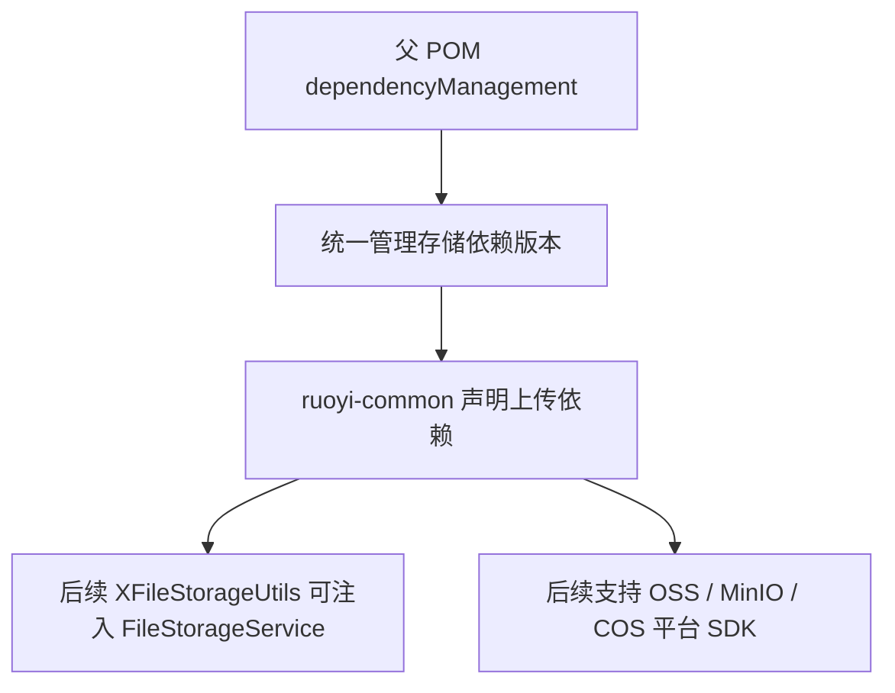

# 集成 x-file-storage 及存储 SDK 依赖

## 1. 改造目标

本次提交把 X File Storage 和当前需要接入的对象存储 SDK 纳入 Maven 依赖体系，并把版本统一放到父 POM 管理。

核心目标：

- 父 POM 统一管理 X File Storage、阿里云 OSS、MinIO、腾讯云 COS 版本
- `ruoyi-common` 只声明依赖，不重复写版本号
- 为后续统一上传门面和多平台上传能力打基础

## 改造前存在的问题

- 项目原有文件上传主要依赖若依本地上传工具，缺少统一的第三方存储依赖基础
- 如果各模块自行引入 OSS、MinIO、COS SDK，后续容易出现版本不一致和依赖冲突
- 后续要做多平台上传、文件记录、分片上传时，公共模块缺少 X File Storage 的基础能力

## 改造后的解决方案

- 在父 POM 统一管理 X File Storage 和对象存储 SDK 版本
- `ruoyi-common` 只声明依赖坐标，不写版本号
- 为后续 `XFileStorageUtils`、平台配置、文件记录和分片上传提供依赖基础

提交：

```text
b8d87bc7 集成 x-file-storage 及存储 SDK 依赖
```

## 2. 总体链路



## 3. 涉及文件

- `pom.xml`
- `ruoyi-common/pom.xml`

## 4. 父 POM 版本管理

文件：

```text
pom.xml
```

### 改动说明

父 POM 的 `properties` 中新增存储相关版本属性。这样后续无论 `ruoyi-common`、`ruoyi-system` 还是其它模块使用这些依赖，都不需要在子模块里重复写版本号。

### 涉及改动部分

```xml
<!-- 省略 -->
        <!-- 生成代码使用OpenAPI3注解，版本与springdoc 2.9.0依赖的swagger-core保持一致 -->
        <swagger-annotations.version>2.2.52</swagger-annotations.version>
        <!-- X File Storage及当前启用的OSS平台SDK版本统一放在父pom管理。 -->
        <x-file-storage.version>2.3.0</x-file-storage.version>
        <aliyun-sdk-oss.version>3.16.1</aliyun-sdk-oss.version>
        <minio.version>8.5.2</minio.version>
        <qcloud-cos.version>5.6.137</qcloud-cos.version>
    </properties>
<!-- 省略 -->
```

新增的版本含义：

- `x-file-storage.version`：X File Storage Spring 集成包版本
- `aliyun-sdk-oss.version`：阿里云 OSS SDK 版本
- `minio.version`：MinIO Java SDK 版本
- `qcloud-cos.version`：腾讯云 COS SDK 版本

## 5. 父 POM 依赖管理

文件：

```text
pom.xml
```

### 改动说明

父 POM 的 `dependencyManagement` 中新增存储依赖管理。这里写版本，子模块只需要写 `groupId` 和 `artifactId`。

### 涉及改动部分

```xml
<!-- 省略 -->
            <!-- 阿里JSON解析器 -->
            <dependency>
                <groupId>com.alibaba.fastjson2</groupId>
                <artifactId>fastjson2</artifactId>
                <version>${fastjson.version}</version>
            </dependency>

            <!-- X File Storage -->
            <dependency>
                <groupId>org.dromara.x-file-storage</groupId>
                <artifactId>x-file-storage-spring</artifactId>
                <version>${x-file-storage.version}</version>
            </dependency>

            <!-- Aliyun OSS -->
            <dependency>
                <groupId>com.aliyun.oss</groupId>
                <artifactId>aliyun-sdk-oss</artifactId>
                <version>${aliyun-sdk-oss.version}</version>
            </dependency>

            <!-- MinIO -->
            <dependency>
                <groupId>io.minio</groupId>
                <artifactId>minio</artifactId>
                <version>${minio.version}</version>
            </dependency>

            <!-- 腾讯云Qcloud COS -->
            <dependency>
                <groupId>com.qcloud</groupId>
                <artifactId>cos_api</artifactId>
                <version>${qcloud-cos.version}</version>
            </dependency>

            <!-- Token生成与解析-->
<!-- 省略 -->
```

这里选择放在父 POM 的原因：

- 防止各模块引入不同版本的对象存储 SDK
- 后续升级存储 SDK 时只改一个地方
- 子模块 POM 更干净，依赖意图更清晰

## 6. common 模块依赖

文件：

```text
ruoyi-common/pom.xml
```

### 改动说明

`ruoyi-common` 增加上传基础依赖。由于后续 `XFileStorageUtils` 位于 common 模块，所以 common 需要能注入 `FileStorageService`，也需要具备当前启用平台的 SDK 类。

### 涉及改动部分

```xml
<!-- 省略 -->
        <!-- easyexcel -->
        <dependency>
            <groupId>com.alibaba</groupId>
            <artifactId>easyexcel</artifactId>
            <version>${easyexcel.version}</version>
        </dependency>

        <!-- 文件上传-->
        <dependency>
            <groupId>org.dromara.x-file-storage</groupId>
            <artifactId>x-file-storage-spring</artifactId>
        </dependency>

        <!-- 阿里云oss-->
        <dependency>
            <groupId>com.aliyun.oss</groupId>
            <artifactId>aliyun-sdk-oss</artifactId>
        </dependency>

        <!-- minio oss依赖 -->
        <dependency>
            <groupId>io.minio</groupId>
            <artifactId>minio</artifactId>
        </dependency>

        <!-- 腾讯云qcloud cos依赖 -->
        <dependency>
            <groupId>com.qcloud</groupId>
            <artifactId>cos_api</artifactId>
        </dependency>

    </dependencies>
<!-- 省略 -->
```

`ruoyi-common` 不写版本号，实际版本由父 POM 管理。

## 7. 变更小结

本次提交只完成依赖接入，不涉及上传接口、配置文件和数据库表。

依赖关系调整后，后续提交才能继续完成：

- 启用 X File Storage 自动配置
- 配置本地、阿里云 OSS、MinIO、腾讯云 COS 平台
- 编写统一上传门面 `XFileStorageUtils`
- 实现文件记录和分片记录能力


