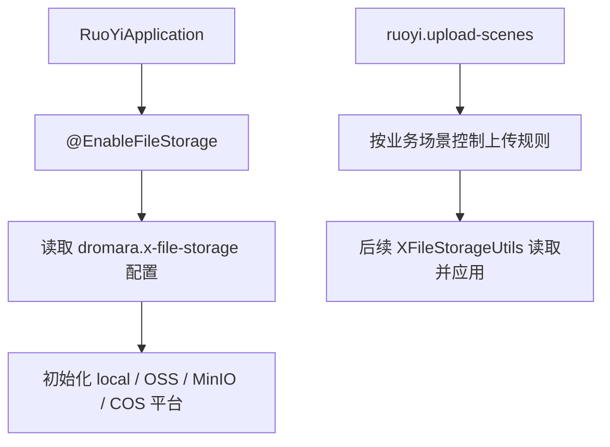

# 启用x-file-storage并增加存储基础配置

## 1. 改造目标

本篇文档对应一次独立 git 提交，用原代码和现代码对比说明本次改造。

核心目标：

- 在启动类启用 X File Storage 自动配置
- 在 application.yml 中配置默认平台和多存储平台
- 通过上传场景配置管理路径、大小、格式、缩略图和访问策略

## 改造前存在的问题

- 项目虽然引入了依赖，但启动类还没有启用 X File Storage 自动配置
- 上传平台、默认平台、上传路径、缩略图、访问策略都没有统一配置入口
- 本地、阿里云 OSS、MinIO、腾讯云 COS 如果靠代码硬编码，后续切换平台和新增平台成本高

## 改造后的解决方案

- 启动类增加 `@EnableFileStorage`，让 X File Storage 按配置初始化平台
- 在 `application.yml` 中集中配置默认平台和多个存储平台
- 新增上传场景配置，把大小、格式、路径、缩略图、访问级别交给配置管理

## 总体链路



提交：

```
33a688ca 启用 x-file-storage 并增加存储基础配置
```

## 2. 涉及文件

- `ruoyi-admin/src/main/java/com/ruoyi/RuoYiApplication.java`
- `ruoyi-admin/src/main/resources/application.yml`

## 3. 改动点清单

- RuoYiApplication 增加启用 X File Storage 的注解
- application.yml 增加 dromara.x-file-storage 配置块
- 新增默认平台、平台列表、上传场景、缩略图后缀和访问策略配置

## 4. ruoyi-admin/src/main/java/com/ruoyi/RuoYiApplication.java

### 原代码

```java
package com.ruoyi;

import org.springframework.boot.SpringApplication;
import org.springframework.boot.autoconfigure.SpringBootApplication;
import org.springframework.boot.autoconfigure.jdbc.DataSourceAutoConfiguration;

/**
 * 启动程序
 * 
 * @author ruoyi
 */
@SpringBootApplication(exclude = { DataSourceAutoConfiguration.class })
public class RuoYiApplication
{
    public static void main(String[] args)
    {
        // System.setProperty("spring.devtools.restart.enabled", "false");
        SpringApplication.run(RuoYiApplication.class, args);
        System.out.println("(♥◠‿◠)ﾉﾞ  若依启动成功   ლ(´ڡ`ლ)ﾞ  \n" +
                " .-------.       ____     __        \n" +
                " |  _ _   \\      \\   \\   /  /    \n" +
                " | ( ' )  |       \\  _. /  '       \n" +
                " |(_ o _) /        _( )_ .'         \n" +
                " | (_,_).' __  ___(_ o _)'          \n" +
                " |  |\\ \\  |  ||   |(_,_)'         \n" +
                " |  | \\ `'   /|   `-'  /           \n" +
                " |  |  \\    /  \\      /           \n" +
                " ''-'   `'-'    `-..-'              ");
    }
}
```

### 现代码

```java
package com.ruoyi;

import org.dromara.x.file.storage.spring.EnableFileStorage;
import org.springframework.boot.SpringApplication;
import org.springframework.boot.autoconfigure.SpringBootApplication;
import org.springframework.boot.autoconfigure.jdbc.DataSourceAutoConfiguration;

/**
 * 启动程序
 * 
 * @author ruoyi
 */
@EnableFileStorage
@SpringBootApplication(exclude = { DataSourceAutoConfiguration.class })
public class RuoYiApplication
{
    public static void main(String[] args)
    {
        // System.setProperty("spring.devtools.restart.enabled", "false");
        SpringApplication.run(RuoYiApplication.class, args);
        System.out.println("(♥◠‿◠)ﾉﾞ  若依启动成功   ლ(´ڡ`ლ)ﾞ  \n" +
                " .-------.       ____     __        \n" +
                " |  _ _   \\      \\   \\   /  /    \n" +
                " | ( ' )  |       \\  _. /  '       \n" +
                " |(_ o _) /        _( )_ .'         \n" +
                " | (_,_).' __  ___(_ o _)'          \n" +
                " |  |\\ \\  |  ||   |(_,_)'         \n" +
                " |  | \\ `'   /|   `-'  /           \n" +
                " |  |  \\    /  \\      /           \n" +
                " ''-'   `'-'    `-..-'              ");
    }
}
```

### 涉及改动部分

#### 改动后代码 1

```java
// 省略
@EnableFileStorage
@SpringBootApplication(exclude = { DataSourceAutoConfiguration.class })
public class RuoYiApplication
{
// 省略
```

### 改动说明

- 启动类增加 `@EnableFileStorage`，让 X File Storage 的 Spring 自动配置生效
- 没有这个注解时，`FileStorageService` 不会按配置初始化，本地、OSS、MinIO、COS 平台都无法被统一上传工具使用

## 5. ruoyi-admin/src/main/resources/application.yml

### 原代码

```yaml
# 项目相关配置
ruoyi:
  # 名称
  name: RuoYi
  # 版本
  version: 3.9.2
  # 版权年份
  copyrightYear: 2026
  # 文件路径 示例（ Windows配置D:/ruoyi/uploadPath，Linux配置 /home/ruoyi/uploadPath）
  profile: D:/ruoyi/uploadPath
  # 获取ip地址开关
  addressEnabled: false
  # 验证码类型 math 数字计算 char 字符验证
  captchaType: math

# 开发环境配置
server:
  # 服务器的HTTP端口，默认为8080
  port: 8080
  servlet:
    # 应用的访问路径
    context-path: /
  tomcat:
    # tomcat的URI编码
    uri-encoding: UTF-8
    # 连接数满后的排队数，默认为100
    accept-count: 1000
    threads:
      # tomcat最大线程数，默认为200
      max: 800
      # Tomcat启动初始化的线程数，默认值10
      min-spare: 100

# 日志配置
logging:
  level:
    com.ruoyi: debug
    org.springframework: warn

# 用户配置
user:
  password:
    # 密码最大错误次数
    maxRetryCount: 5
    # 密码锁定时间（默认10分钟）
    lockTime: 10

# Spring配置
spring:
  # 资源信息
  messages:
    # 国际化资源文件路径
    basename: i18n/messages
  profiles:
    active: druid
  # 文件上传
  servlet:
    multipart:
      # 单个文件大小
      max-file-size: 10MB
      # 设置总上传的文件大小
      max-request-size: 20MB
  # 服务模块
  devtools:
    restart:
      # 热部署开关
      enabled: true
  data:
    # redis 配置
    redis:
      # 地址
      #      host: localhost
      host: 192.168.159.167
      # 端口，默认为6379
      port: 6379
      # 数据库索引
      database: 0
      # 密码
      password:
      # 连接超时时间
      timeout: 10s
      lettuce:
        pool:
          # 连接池中的最小空闲连接
          min-idle: 0
          # 连接池中的最大空闲连接
          max-idle: 8
          # 连接池的最大数据库连接数
          max-active: 8
          # #连接池最大阻塞等待时间（使用负值表示没有限制）
          max-wait: -1ms

# token配置
token:

# MyBatis Plus配置
mybatis-plus:
  # 搜索指定包别名
  typeAliasesPackage: com.ruoyi.**.domain
  # 配置mapper的扫描，找到所有的mapper.xml映射文件
  mapperLocations: classpath*:mapper/**/*Mapper.xml
  # 加载全局的配置文件
  configLocation: classpath:mybatis/mybatis-config.xml
  global-config:
    db-config:
      # 逻辑删除字段统一约定为del_flag / delFlag，MP方法按该配置自动追加未删除条件。
      logic-delete-field: delFlag
      logic-not-delete-value: 0
      logic-delete-value: 2

# PageHelper分页插件
pagehelper:
  helperDialect: mysql
  supportMethodsArguments: true
  params: count=countSql

# Springdoc配置
springdoc:
  api-docs:
    path: /v3/api-docs
  swagger-ui:
    enabled: true
    path: /swagger-ui.html
    # 使用相对地址兼容后端直连和前端/dev-api代理入口
    config-url: ./v3/api-docs/swagger-config
    tags-sorter: alpha
    urls:
      - name: '若依接口'
        # 分组地址保持相对避免前端iframe请求到localhost/v3/api-docs
        url: ./v3/api-docs/default
      - name: '系统管理'
        url: ./v3/api-docs/system
  group-configs:
    - group: 'default'
      display-name: '若依接口'
      paths-to-match: '/**'
      # 扫描后台Controller根包让Knife4j展示全部业务接口
      packages-to-scan: com.ruoyi.web.controller
    - group: 'system'
      display-name: '系统管理'
      paths-to-match: '/**'
      # 扫描后台Controller根包让Knife4j展示全部业务接口
      packages-to-scan: com.ruoyi.system.controller

# Knife4j配置
knife4j:
  # 开启Knife4j增强页面
  enable: true
  # 生产环境可通过环境变量关闭文档增强接口
  production: false
  # 基础认证默认关闭
  basic:
    # 需要文档密码时再开启
    enable: false
    username: ruoyi
    password: 123456
  setting:
    # 自定义左侧菜单中Schema的显示名称
    swagger-model-name: 实体类列表

# 防盗链配置
referer:
  # 防盗链开关
  enabled: false
  # 允许的域名列表
  allowed-domains: localhost,127.0.0.1,ruoyi.vip,www.ruoyi.vip

# 防止XSS攻击
xss:
  # 过滤开关
  enabled: true
  # 排除链接（多个用逗号分隔）
  excludes: /system/notice
  # 匹配链接
  urlPatterns: /system/*,/monitor/*,/tool/*
```

### 现代码

```yaml
# 项目相关配置
ruoyi:
  # 名称
  name: RuoYi
  # 版本
  version: 3.9.2
  # 版权年份
  copyrightYear: 2026
  # 文件路径 示例（ Windows配置D:/ruoyi/uploadPath，Linux配置 /home/ruoyi/uploadPath）
  profile: D:/ruoyi/uploadPath
  # 获取ip地址开关
  addressEnabled: false
  # 验证码类型 math 数字计算 char 字符验证
  captchaType: math
  # 通用上传场景配置
  upload-scenes:
    # 头像上传场景，前端传 uploadScene=avatar 时生效
    avatar:
      # 访问级别，public 表示可匿名访问，private 表示需要登录认证
      access: public
      # 场景路径前缀，最终路径形如 upload/public/avatar/yyyy/MM/dd/文件名
      path-prefix: avatar
      # 最大上传大小
      max-size: 5MB
      # 允许上传的扩展名，不带点号
      allowed-extension: png,jpg,jpeg
      # 是否生成缩略图
      thumbnail: true
      # 缩略图宽度
      thumbnail-width: 100
      # 缩略图高度
      thumbnail-height: 100
    # 图片上传场景，前端传 uploadScene=commonImg 时生效
    commonImg:
      # 公开图片允许匿名访问，适合富文本图片、封面图等业务
      access: public
      # 场景路径前缀，最终路径形如 upload/public/image/yyyy/MM/dd/文件名
      path-prefix: image
      # 最大上传大小
      max-size: 5MB
      # 允许上传的扩展名，不带点号
      allowed-extension: png,jpg,jpeg
      # 是否生成缩略图
      thumbnail: true
      # 缩略图宽度
      thumbnail-width: 100
      # 缩略图高度
      thumbnail-height: 100
    commonFile:
      # 普通附件默认私有访问，避免业务资料被匿名访问
      access: private
      # 场景路径前缀，最终路径形如 upload/private/file/yyyy/MM/dd/文件名
      path-prefix: file
      # 最大上传大小
      max-size: 5MB
      # 允许上传的扩展名，不带点号
      allowed-extension: doc,xls,ppt,txt,pdf
      # 是否生成缩略图
      thumbnail: false
    video:
      # 视频默认私有访问，需要公开时再改成 public 或单独走签名 URL
      access: private
      # 场景路径前缀，最终路径形如 upload/private/video/yyyy/MM/dd/文件名
      path-prefix: video
      max-size: 200MB
      allowed-extension: mp4,avi,rmvb
    audio:
      # 音频默认私有访问，需要公开时再改成 public 或单独走签名 URL
      access: private
      # 场景路径前缀，最终路径形如 upload/private/audio/yyyy/MM/dd/文件名
      path-prefix: audio
      max-size: 50MB
      allowed-extension: mp3,wav,wma,ogg
  # 存储文件管理配置
  storage-file:
    # 公开文件访问路径，匹配到的 GET 请求允许匿名访问
    public-path-patterns:
      # local-plus 的 domain 为 /file/，base-path 为 upload/，公开场景 path 第一层为 public
      - /file/upload/public/**
    # 临时文件超过该小时数仍未绑定业务时允许定时任务清理
    temp-expire-hours: 24
    # 未配置业务类型时使用的默认待删除延迟小时数
    default-delete-delay-hours: 24
    # 不同业务类型的待删除延迟小时数
    delete-delay-hours:
      # 头像旧文件延迟清理时间
      avatar: 24

# 开发环境配置
server:
  # 服务器的HTTP端口，默认为8080
  port: 8080
  servlet:
    # 应用的访问路径
    context-path: /
  tomcat:
    # tomcat的URI编码
    uri-encoding: UTF-8
    # 连接数满后的排队数，默认为100
    accept-count: 1000
    threads:
      # tomcat最大线程数，默认为200
      max: 800
      # Tomcat启动初始化的线程数，默认值10
      min-spare: 100

# 日志配置
logging:
  level:
    com.ruoyi: debug
    org.springframework: warn

# 用户配置
user:
  password:
    # 密码最大错误次数
    maxRetryCount: 5
    # 密码锁定时间（默认10分钟）
    lockTime: 10

# Spring配置
spring:
  # 资源信息
  messages:
    # 国际化资源文件路径
    basename: i18n/messages
  profiles:
    active: druid
  # 文件上传
  servlet:
    multipart:
      # 单个文件大小
      max-file-size: 10MB
      # 设置总上传的文件大小
      max-request-size: 20MB
  # 服务模块
  devtools:
    restart:
      # 热部署开关
      enabled: true
  data:
    # redis 配置
    redis:
      # 地址
      #      host: localhost
      host: 192.168.159.167
      # 端口，默认为6379
      port: 6379
      # 数据库索引
      database: 0
      # 密码
      password:
      # 连接超时时间
      timeout: 10s
      lettuce:
        pool:
          # 连接池中的最小空闲连接
          min-idle: 0
          # 连接池中的最大空闲连接
          max-idle: 8
          # 连接池的最大数据库连接数
          max-active: 8
          # #连接池最大阻塞等待时间（使用负值表示没有限制）
          max-wait: -1ms

# token配置
token:

# MyBatis Plus配置
mybatis-plus:
  # 搜索指定包别名
  typeAliasesPackage: com.ruoyi.**.domain
  # 配置mapper的扫描，找到所有的mapper.xml映射文件
  mapperLocations: classpath*:mapper/**/*Mapper.xml
  # 加载全局的配置文件
  configLocation: classpath:mybatis/mybatis-config.xml
  global-config:
    db-config:
      # 逻辑删除字段统一约定为del_flag / delFlag，MP方法按该配置自动追加未删除条件。
      logic-delete-field: delFlag
      logic-not-delete-value: 0
      logic-delete-value: 2

# PageHelper分页插件
pagehelper:
  helperDialect: mysql
  supportMethodsArguments: true
  params: count=countSql

# Springdoc配置
springdoc:
  api-docs:
    path: /v3/api-docs
  swagger-ui:
    enabled: true
    path: /swagger-ui.html
    # 使用相对地址兼容后端直连和前端/dev-api代理入口
    config-url: ./v3/api-docs/swagger-config
    tags-sorter: alpha
    urls:
      - name: '若依接口'
        # 分组地址保持相对避免前端iframe请求到localhost/v3/api-docs
        url: ./v3/api-docs/default
      - name: '系统管理'
        url: ./v3/api-docs/system
  group-configs:
    - group: 'default'
      display-name: '若依接口'
      paths-to-match: '/**'
      # 扫描后台Controller根包让Knife4j展示全部业务接口
      packages-to-scan: com.ruoyi.web.controller
    - group: 'system'
      display-name: '系统管理'
      paths-to-match: '/**'
      # 扫描后台Controller根包让Knife4j展示全部业务接口
      packages-to-scan: com.ruoyi.system.controller

# Knife4j配置
knife4j:
  # 开启Knife4j增强页面
  enable: true
  # 生产环境可通过环境变量关闭文档增强接口
  production: false
  # 基础认证默认关闭
  basic:
    # 需要文档密码时再开启
    enable: false
    username: ruoyi
    password: 123456
  setting:
    # 自定义左侧菜单中Schema的显示名称
    swagger-model-name: 实体类列表

# 防盗链配置
referer:
  # 防盗链开关
  enabled: false
  # 允许的域名列表
  allowed-domains: localhost,127.0.0.1,ruoyi.vip,www.ruoyi.vip

# 防止XSS攻击
xss:
  # 过滤开关
  enabled: true
  # 排除链接（多个用逗号分隔）
  excludes: /system/notice
  # 匹配链接
  urlPatterns: /system/*,/monitor/*,/tool/*

# 文件上传
dromara:
  # X File Storage 统一文件存储配置
  x-file-storage:
    # 默认使用的存储平台，不在接口参数中传 platform 时使用这个平台
    default-platform: local-1
    # 缩略图文件名后缀，生成缩略图时会追加到原文件名后面
    thumbnail-suffix: ".min.jpg"
    # 本地增强存储平台，适合开发环境或单机部署使用
    local-plus:
      # 平台标识，上传接口的 platform 参数可以传这个值指定上传到本地
      - platform: local-1
        # 是否允许把文件上传并保存到该平台
        enable-storage: true
        # 是否开启本地文件访问映射，开启后可通过 domain 加文件路径直接访问
        enable-access: true
        # 访问域名，生产环境建议改成实际域名，并保持以 /file/ 结尾
        domain: http://localhost:${server.port}/file/
        # 存储基础路径，会作为文件对象路径的统一前缀
        base-path: upload/
        # 本地访问映射路径，enable-access 为 true 时用于匹配文件访问请求
        path-patterns:
          - /file/**
        # 本地文件实际存储目录，文件会落到这个磁盘目录下
        storage-path: ${ruoyi.profile}/x-file-storage/
    # 阿里云 OSS 存储平台，适合生产环境对象存储
    aliyun-oss:
      # 平台标识，上传接口的 platform 参数可以传这个值指定上传到阿里云 OSS
      - platform: aliyun-oss-1
        # 是否允许把文件上传并保存到该平台
        enable-storage: true
        # 阿里云 OSS AccessKey ID，建议生产环境使用环境变量或配置中心托管
        access-key: ??
        # 阿里云 OSS AccessKey Secret，建议不要提交真实密钥到代码仓库
        secret-key: ??
        # OSS 访问端点，例如 oss-cn-hangzhou.aliyuncs.com
        end-point: ??
        # OSS Bucket 名称
        bucket-name: ??
        # 文件访问域名，注意以 / 结尾，可以使用 Bucket 域名或自定义 CDN 域名
        domain: ??
        # OSS 对象基础路径，用于把当前系统文件放到固定目录前缀下
        base-path: ruoyi-images/
    # MinIO 存储平台，适合私有化部署或自建对象存储
    minio:
      # 平台标识，上传接口的 platform 参数可以传这个值指定上传到 MinIO
      - platform: minio-1
        # 是否允许把文件上传并保存到该平台
        enable-storage: true
        # MinIO AccessKey
        access-key: ??
        # MinIO SecretKey
        secret-key: ??
        # MinIO 服务端点，例如 http://127.0.0.1:9000
        end-point: ??
        # MinIO Bucket 名称
        bucket-name: ??
        # 文件访问域名，注意以 / 结尾，通常是 MinIO 公网地址或反向代理地址
        domain: ??
        # MinIO 对象基础路径，用于区分当前系统上传文件
        base-path: test/
    tencent-cos:
#      - platform: tencent-cos-1 # 存储平台标识
#        enable-storage: true  # 启用存储
#        secret-id: ??
#        secret-key: ??
#        region: ?? #存仓库所在地域
#        bucket-name: ??
#        domain: ?? # 访问域名，注意“/”结尾，例如：https://abc.cos.ap-nanjing.myqcloud.com/
#        base-path: test/ # 基础路径
      - platform: tencent-cos-1 # 存储平台标识
        enable-storage: true  # 启用存储
        secret-id: ${TENCENT_COS_SECRET_ID:??}
        secret-key: ${TENCENT_COS_SECRET_KEY:??}
        region: ${TENCENT_COS_REGION:ap-shanghai} #存仓库所在地域
        bucket-name: ${TENCENT_COS_BUCKET_NAME:??}
        domain: ${TENCENT_COS_DOMAIN:??} # COS 默认访问域名，自定义域名需先在腾讯云完成绑定、证书和回源配置
        base-path: ${TENCENT_COS_BASE_PATH:test/} # 基础路径
```

### 涉及改动部分

#### 改动后代码 1

```yaml
# 省略
  addressEnabled: false
  captchaType: math
  upload-scenes:
    avatar:
      access: public
      path-prefix: avatar
      max-size: 5MB
      allowed-extension: png,jpg,jpeg
      thumbnail: true
      thumbnail-width: 100
      thumbnail-height: 100
    commonImg:
      access: public
      path-prefix: image
      max-size: 5MB
      allowed-extension: png,jpg,jpeg
      thumbnail: true
      thumbnail-width: 100
      thumbnail-height: 100
    commonFile:
      access: private
      path-prefix: file
      max-size: 5MB
      allowed-extension: doc,xls,ppt,txt,pdf
      thumbnail: false
    video:
      access: private
      path-prefix: video
      max-size: 200MB
      allowed-extension: mp4,avi,rmvb
    audio:
      access: private
      path-prefix: audio
      max-size: 50MB
      allowed-extension: mp3,wav,wma,ogg
  storage-file:
    public-path-patterns:
      - /file/upload/public/**
    temp-expire-hours: 24
    default-delete-delay-hours: 24
    delete-delay-hours:
      avatar: 24
server:
# 省略
```

#### 改动后代码 2

```yaml
# 省略
  excludes: /system/notice
  urlPatterns: /system/*,/monitor/*,/tool/*
dromara:
  x-file-storage:
    default-platform: local-1
    thumbnail-suffix: ".min.jpg"
    local-plus:
      - platform: local-1
        enable-storage: true
        enable-access: true
        domain: http://localhost:${server.port}/file/
        base-path: upload/
        path-patterns:
          - /file/**
        storage-path: ${ruoyi.profile}/x-file-storage/
    aliyun-oss:
      - platform: aliyun-oss-1
        enable-storage: true
        access-key: ??
        secret-key: ??
        end-point: ??
        bucket-name: ??
        domain: ??
        base-path: ruoyi-images/
    minio:
      - platform: minio-1
        enable-storage: true
        access-key: ??
        secret-key: ??
        end-point: ??
        bucket-name: ??
        domain: ??
        base-path: test/
    tencent-cos:
      - platform: tencent-cos-1 # 存储平台标识
        enable-storage: true  # 启用存储
        secret-id: ${TENCENT_COS_SECRET_ID:??}
        secret-key: ${TENCENT_COS_SECRET_KEY:??}
        region: ${TENCENT_COS_REGION:ap-shanghai} #存仓库所在地域
        bucket-name: ${TENCENT_COS_BUCKET_NAME:??}
        domain: ${TENCENT_COS_DOMAIN:??} # COS 默认访问域名，自定义域名需先在腾讯云完成绑定、证书和回源配置
        base-path: ${TENCENT_COS_BASE_PATH:test/} # 基础路径
# 省略
```

### 改动说明

- 新增 `dromara.x-file-storage` 配置块，集中声明默认平台、本地存储、阿里云 OSS、MinIO、腾讯云 COS
- 新增 `ruoyi.upload-scenes`，通过场景控制路径、大小、格式、缩略图和访问策略
- 新增 `ruoyi.storage-file`，给文件访问和清理任务提供基础配置

## 变更小结

本篇只记录该提交自身涉及的代码和配置变化，不混入其它提交。


