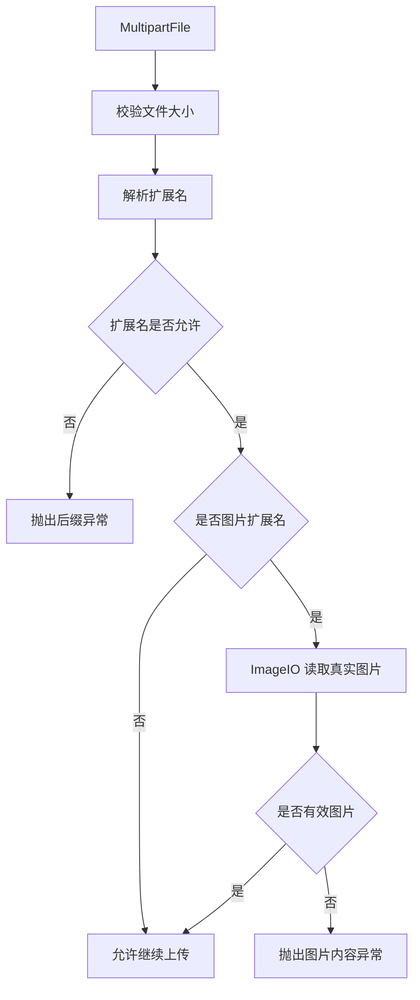

# 增强上传文件校验

## 1. 改造目标

本篇文档对应一次独立 git 提交，用原代码和现代码对比说明本次改造。

核心目标：

- 补充文件后缀和真实文件类型校验
- 增强图片真实性校验，避免伪装扩展名绕过上传限制
- 补充通用文件类型白名单，给上传场景复用

## 改造前存在的问题

- 若依原上传校验主要依赖文件大小和扩展名，无法识别 txt 改 jpg 这类伪装图片
- 文件大小限制不方便按业务场景动态调整
- 图片内容不合法和后缀不合法共用相近提示，前端和用户不容易判断真实原因

## 改造后的解决方案

- 增加真实图片内容校验，图片扩展名通过后继续用 `ImageIO` 判断内容是否有效
- 增加可传入最大大小的校验方法，后续上传场景可以覆盖默认大小
- 增加图片内容异常，让后缀错误和真实内容错误分开提示

## 总体链路



提交：

```
203dd6da 增强上传文件校验
```

## 2. 涉及文件

- `ruoyi-common/src/main/java/com/ruoyi/common/exception/file/InvalidExtensionException.java`
- `ruoyi-common/src/main/java/com/ruoyi/common/utils/file/FileTypeUtils.java`
- `ruoyi-common/src/main/java/com/ruoyi/common/utils/file/FileUploadUtils.java`
- `ruoyi-common/src/main/java/com/ruoyi/common/utils/file/FileUtils.java`
- `ruoyi-common/src/main/java/com/ruoyi/common/utils/file/ImageUtils.java`
- `ruoyi-common/src/main/java/com/ruoyi/common/utils/file/MimeTypeUtils.java`

## 3. 改动点清单

- InvalidExtensionException 增加真实文件类型不匹配异常
- FileTypeUtils 增加文件真实类型识别
- FileUploadUtils 上传流程增加真实图片校验
- FileUtils、ImageUtils、MimeTypeUtils 补充安全校验支撑方法和白名单

## 4. ruoyi-common/src/main/java/com/ruoyi/common/exception/file/InvalidExtensionException.java

### 原代码

```java
package com.ruoyi.common.exception.file;

import java.util.Arrays;

/**
 * 文件上传无效扩展名异常类
 * 
 * @author ruoyi
 */
public class InvalidExtensionException extends FileUploadException
{
    private static final long serialVersionUID = 1L;

    private String[] allowedExtension;
    private String extension;
    private String filename;

    public InvalidExtensionException(String[] allowedExtension, String extension, String filename)
    {
        super("文件[" + filename + "]后缀[" + extension + "]不正确，请上传" + Arrays.toString(allowedExtension) + "格式");
        this.allowedExtension = allowedExtension;
        this.extension = extension;
        this.filename = filename;
    }

    public String[] getAllowedExtension()
    {
        return allowedExtension;
    }

    public String getExtension()
    {
        return extension;
    }

    public String getFilename()
    {
        return filename;
    }

    public static class InvalidImageExtensionException extends InvalidExtensionException
    {
        private static final long serialVersionUID = 1L;

        public InvalidImageExtensionException(String[] allowedExtension, String extension, String filename)
        {
            super(allowedExtension, extension, filename);
        }
    }

    public static class InvalidFlashExtensionException extends InvalidExtensionException
    {
        private static final long serialVersionUID = 1L;

        public InvalidFlashExtensionException(String[] allowedExtension, String extension, String filename)
        {
            super(allowedExtension, extension, filename);
        }
    }

    public static class InvalidMediaExtensionException extends InvalidExtensionException
    {
        private static final long serialVersionUID = 1L;

        public InvalidMediaExtensionException(String[] allowedExtension, String extension, String filename)
        {
            super(allowedExtension, extension, filename);
        }
    }

    public static class InvalidVideoExtensionException extends InvalidExtensionException
    {
        private static final long serialVersionUID = 1L;

        public InvalidVideoExtensionException(String[] allowedExtension, String extension, String filename)
        {
            super(allowedExtension, extension, filename);
        }
    }
}
```

### 现代码

```java
package com.ruoyi.common.exception.file;

import java.util.Arrays;

/**
 * 文件上传无效扩展名异常类
 * 
 * @author ruoyi
 */
public class InvalidExtensionException extends FileUploadException
{
    private static final long serialVersionUID = 1L;

    private String[] allowedExtension;
    private String extension;
    private String filename;

    public InvalidExtensionException(String[] allowedExtension, String extension, String filename)
    {
        super("文件[" + filename + "]后缀[" + extension + "]不正确，请上传" + Arrays.toString(allowedExtension) + "格式");
        this.allowedExtension = allowedExtension;
        this.extension = extension;
        this.filename = filename;
    }

    public InvalidExtensionException(String message, String[] allowedExtension, String extension, String filename)
    {
        super(message);
        this.allowedExtension = allowedExtension;
        this.extension = extension;
        this.filename = filename;
    }

    public String[] getAllowedExtension()
    {
        return allowedExtension;
    }

    public String getExtension()
    {
        return extension;
    }

    public String getFilename()
    {
        return filename;
    }

    public static class InvalidImageExtensionException extends InvalidExtensionException
    {
        private static final long serialVersionUID = 1L;

        public InvalidImageExtensionException(String[] allowedExtension, String extension, String filename)
        {
            super("图片文件[" + filename + "]后缀[" + extension + "]不正确，请上传" + Arrays.toString(allowedExtension) + "格式图片",
                    allowedExtension, extension, filename);
        }
    }

    public static class InvalidImageContentException extends InvalidExtensionException
    {
        private static final long serialVersionUID = 1L;

        public InvalidImageContentException(String[] allowedExtension, String extension, String filename)
        {
            super("文件[" + filename + "]内容不是有效图片，请上传真实的" + Arrays.toString(allowedExtension) + "格式图片",
                    allowedExtension, extension, filename);
        }
    }

    public static class InvalidFlashExtensionException extends InvalidExtensionException
    {
        private static final long serialVersionUID = 1L;

        public InvalidFlashExtensionException(String[] allowedExtension, String extension, String filename)
        {
            super(allowedExtension, extension, filename);
        }
    }

    public static class InvalidMediaExtensionException extends InvalidExtensionException
    {
        private static final long serialVersionUID = 1L;

        public InvalidMediaExtensionException(String[] allowedExtension, String extension, String filename)
        {
            super(allowedExtension, extension, filename);
        }
    }

    public static class InvalidVideoExtensionException extends InvalidExtensionException
    {
        private static final long serialVersionUID = 1L;

        public InvalidVideoExtensionException(String[] allowedExtension, String extension, String filename)
        {
            super(allowedExtension, extension, filename);
        }
    }
}
```

### 涉及改动部分

#### 改动后代码 1

```java
// 省略
        this.filename = filename;
    }
    public InvalidExtensionException(String message, String[] allowedExtension, String extension, String filename)
    {
        super(message);
        this.allowedExtension = allowedExtension;
        this.extension = extension;
        this.filename = filename;
    }
    public String[] getAllowedExtension()
    {
        return allowedExtension;
// 省略
```

#### 改动后代码 2

```java
// 省略
        public InvalidImageExtensionException(String[] allowedExtension, String extension, String filename)
        {
            super("图片文件[" + filename + "]后缀[" + extension + "]不正确，请上传" + Arrays.toString(allowedExtension) + "格式图片",
                    allowedExtension, extension, filename);
        }
    }
    public static class InvalidImageContentException extends InvalidExtensionException
    {
        private static final long serialVersionUID = 1L;
        public InvalidImageContentException(String[] allowedExtension, String extension, String filename)
        {
            super("文件[" + filename + "]内容不是有效图片，请上传真实的" + Arrays.toString(allowedExtension) + "格式图片",
                    allowedExtension, extension, filename);
        }
    }
// 省略
```

### 改动说明

- 增加可传入自定义错误消息的构造方法，方便区分“后缀不合法”和“真实内容不合法”
- 图片后缀错误使用图片专用提示
- 新增 `InvalidImageContentException`，专门表示扩展名是图片但内容不是有效图片

## 5. ruoyi-common/src/main/java/com/ruoyi/common/utils/file/FileTypeUtils.java

### 原代码

```java
package com.ruoyi.common.utils.file;

import java.io.File;
import org.apache.commons.lang3.StringUtils;

/**
 * 文件类型工具类
 *
 * @author ruoyi
 */
public class FileTypeUtils
{
    /**
     * 获取文件类型
     * <p>
     * 例如: ruoyi.txt, 返回: txt
     * 
     * @param file 文件名
     * @return 后缀（不含".")
     */
    public static String getFileType(File file)
    {
        if (null == file)
        {
            return StringUtils.EMPTY;
        }
        return getFileType(file.getName());
    }

    /**
     * 获取文件类型
     * <p>
     * 例如: ruoyi.txt, 返回: txt
     *
     * @param fileName 文件名
     * @return 后缀（不含".")
     */
    public static String getFileType(String fileName)
    {
        int separatorIndex = fileName.lastIndexOf(".");
        if (separatorIndex < 0)
        {
            return "";
        }
        return fileName.substring(separatorIndex + 1).toLowerCase();
    }

    /**
     * 获取文件类型
     * 
     * @param photoByte 文件字节码
     * @return 后缀（不含".")
     */
    public static String getFileExtendName(byte[] photoByte)
    {
        String strFileExtendName = "JPG";
        if ((photoByte[0] == 71) && (photoByte[1] == 73) && (photoByte[2] == 70) && (photoByte[3] == 56)
                && ((photoByte[4] == 55) || (photoByte[4] == 57)) && (photoByte[5] == 97))
        {
            strFileExtendName = "GIF";
        }
        else if ((photoByte[6] == 74) && (photoByte[7] == 70) && (photoByte[8] == 73) && (photoByte[9] == 70))
        {
            strFileExtendName = "JPG";
        }
        else if ((photoByte[0] == 66) && (photoByte[1] == 77))
        {
            strFileExtendName = "BMP";
        }
        else if ((photoByte[1] == 80) && (photoByte[2] == 78) && (photoByte[3] == 71))
        {
            strFileExtendName = "PNG";
        }
        return strFileExtendName;
    }
}
```

### 现代码

```java
package com.ruoyi.common.utils.file;

import java.io.File;
import org.apache.commons.lang3.StringUtils;

/**
 * 文件类型工具类
 * <p>
 * 该工具只根据文件扩展名或少量常见图片文件头判断类型，不做完整 MIME 检测
 * 接收用户上传文件时，仍需要结合上传白名单进行校验
 *
 * @author ruoyi
 */
public class FileTypeUtils
{
    /**
     * 从 File 对象中获取小写扩展名
     *
     * @param file 目标文件，为 null 时返回空字符串
     * @return 不带点号的扩展名，例如 txt
     */
    public static String getFileType(File file)
    {
        // 空文件对象直接返回空扩展名，避免调用 getName 触发空指针
        if (null == file)
        {
            return StringUtils.EMPTY;
        }
        // File 场景最终仍复用文件名解析逻辑
        return getFileType(file.getName());
    }

    /**
     * 从文件名或路径中获取小写扩展名
     * <p>
     * 例如 ruoyi.txt 返回 txt；没有点号的文件名返回空字符串，便于白名单校验拒绝
     *
     * @param fileName 文件名或资源路径
     * @return 不带点号的扩展名
     */
    public static String getFileType(String fileName)
    {
        // 取最后一个点号，兼容 a.b.txt 这类文件名
        int separatorIndex = fileName.lastIndexOf(".");
        if (separatorIndex < 0)
        {
            // 没有扩展名时返回空字符串，让白名单校验自然失败
            return "";
        }
        // 白名单比较不区分大小写，这里先统一转成小写
        return fileName.substring(separatorIndex + 1).toLowerCase();
    }

    /**
     * 根据图片文件头猜测扩展名
     * <p>
     * 当前覆盖 GIF、JPG/JFIF、BMP、PNG
     * 默认返回 JPG，主要用于图片字节写入类场景
     *
     * @param photoByte 图片字节，调用方需要保证至少包含文件头所需长度
     * @return 大写扩展名，例如 JPG、PNG
     */
    public static String getFileExtendName(byte[] photoByte)
    {
        // 默认按 JPG 处理，保持若依原有兜底行为
        String strFileExtendName = "JPG";
        // GIF 文件头通常以 GIF87a 或 GIF89a 开头
        if ((photoByte[0] == 71) && (photoByte[1] == 73) && (photoByte[2] == 70) && (photoByte[3] == 56)
                && ((photoByte[4] == 55) || (photoByte[4] == 57)) && (photoByte[5] == 97))
        {
            strFileExtendName = "GIF";
        }
        // JFIF 是常见 JPEG 文件头片段
        else if ((photoByte[6] == 74) && (photoByte[7] == 70) && (photoByte[8] == 73) && (photoByte[9] == 70))
        {
            strFileExtendName = "JPG";
        }
        // BMP 文件头以 BM 开头
        else if ((photoByte[0] == 66) && (photoByte[1] == 77))
        {
            strFileExtendName = "BMP";
        }
        // PNG 文件头中包含 PNG 标识
        else if ((photoByte[1] == 80) && (photoByte[2] == 78) && (photoByte[3] == 71))
        {
            strFileExtendName = "PNG";
        }
        return strFileExtendName;
    }
}
```

### 涉及改动部分

#### 改动后代码 1

```java
// 省略
public class FileTypeUtils
{
    public static String getFileType(File file)
    {
        if (null == file)
        {
            return StringUtils.EMPTY;
        }
        return getFileType(file.getName());
    }
    public static String getFileType(String fileName)
    {
        int separatorIndex = fileName.lastIndexOf(".");
        if (separatorIndex < 0)
        {
            return "";
        }
        return fileName.substring(separatorIndex + 1).toLowerCase();
    }
    public static String getFileExtendName(byte[] photoByte)
    {
        String strFileExtendName = "JPG";
        if ((photoByte[0] == 71) && (photoByte[1] == 73) && (photoByte[2] == 70) && (photoByte[3] == 56)
                && ((photoByte[4] == 55) || (photoByte[4] == 57)) && (photoByte[5] == 97))
        {
            strFileExtendName = "GIF";
        }
        else if ((photoByte[6] == 74) && (photoByte[7] == 70) && (photoByte[8] == 73) && (photoByte[9] == 70))
        {
            strFileExtendName = "JPG";
        }
        else if ((photoByte[0] == 66) && (photoByte[1] == 77))
        {
            strFileExtendName = "BMP";
        }
        else if ((photoByte[1] == 80) && (photoByte[2] == 78) && (photoByte[3] == 71))
        {
            strFileExtendName = "PNG";
        }
        return strFileExtendName;
    }
}
// 省略
```

### 改动说明

- 增加文件真实类型识别能力，后续可根据文件头或内容类型辅助判断文件合法性
- 工具类只负责识别，不直接决定业务是否允许上传

## 6. ruoyi-common/src/main/java/com/ruoyi/common/utils/file/FileUploadUtils.java

### 原代码

```java
package com.ruoyi.common.utils.file;

import java.io.File;
import java.io.IOException;
import java.nio.file.Paths;
import java.util.Objects;
import org.apache.commons.io.FilenameUtils;
import org.springframework.web.multipart.MultipartFile;
import com.ruoyi.common.config.RuoYiConfig;
import com.ruoyi.common.constant.Constants;
import com.ruoyi.common.exception.file.FileNameLengthLimitExceededException;
import com.ruoyi.common.exception.file.FileSizeLimitExceededException;
import com.ruoyi.common.exception.file.InvalidExtensionException;
import com.ruoyi.common.utils.DateUtils;
import com.ruoyi.common.utils.StringUtils;
import com.ruoyi.common.utils.uuid.IdUtils;
import com.ruoyi.common.utils.uuid.Seq;

/**
 * 文件上传工具类
 * 
 * @author ruoyi
 */
public class FileUploadUtils
{
    /**
     * 默认大小 50M
     */
    public static final long DEFAULT_MAX_SIZE = 50 * 1024 * 1024L;

    /**
     * 默认的文件名最大长度 100
     */
    public static final int DEFAULT_FILE_NAME_LENGTH = 100;

    /**
     * 默认上传的地址
     */
    private static String defaultBaseDir = RuoYiConfig.getProfile();

    public static void setDefaultBaseDir(String defaultBaseDir)
    {
        FileUploadUtils.defaultBaseDir = defaultBaseDir;
    }

    public static String getDefaultBaseDir()
    {
        return defaultBaseDir;
    }

    /**
     * 以默认配置进行文件上传
     *
     * @param file 上传的文件
     * @return 文件名称
     * @throws Exception
     */
    public static final String upload(MultipartFile file) throws IOException
    {
        try
        {
            return upload(getDefaultBaseDir(), file, MimeTypeUtils.DEFAULT_ALLOWED_EXTENSION);
        }
        catch (Exception e)
        {
            throw new IOException(e.getMessage(), e);
        }
    }

    /**
     * 根据文件路径上传
     *
     * @param baseDir 相对应用的基目录
     * @param file 上传的文件
     * @return 文件名称
     * @throws IOException
     */
    public static final String upload(String baseDir, MultipartFile file) throws IOException
    {
        try
        {
            return upload(baseDir, file, MimeTypeUtils.DEFAULT_ALLOWED_EXTENSION);
        }
        catch (Exception e)
        {
            throw new IOException(e.getMessage(), e);
        }
    }

    /**
     * 文件上传
     *
     * @param baseDir 相对应用的基目录
     * @param file 上传的文件
     * @param allowedExtension 上传文件类型
     * @return 返回上传成功的文件名
     * @throws FileSizeLimitExceededException 如果超出最大大小
     * @throws FileNameLengthLimitExceededException 文件名太长
     * @throws IOException 比如读写文件出错时
     * @throws InvalidExtensionException 文件校验异常
     */
    public static final String upload(String baseDir, MultipartFile file, String[] allowedExtension)
            throws FileSizeLimitExceededException, IOException, FileNameLengthLimitExceededException,
            InvalidExtensionException
    {
        return upload(baseDir, file, allowedExtension, false);
    }
    
    /**
     * 文件上传
     *
     * @param baseDir 相对应用的基目录
     * @param file 上传的文件
     * @param useCustomNaming 系统自定义文件名
     * @param allowedExtension 上传文件类型
     * @return 返回上传成功的文件名
     * @throws FileSizeLimitExceededException 如果超出最大大小
     * @throws FileNameLengthLimitExceededException 文件名太长
     * @throws IOException 比如读写文件出错时
     * @throws InvalidExtensionException 文件校验异常
     */
    public static final String upload(String baseDir, MultipartFile file, String[] allowedExtension, boolean useCustomNaming)
            throws FileSizeLimitExceededException, IOException, FileNameLengthLimitExceededException,
            InvalidExtensionException
    {
        int fileNameLength = Objects.requireNonNull(file.getOriginalFilename()).length();
        if (fileNameLength > FileUploadUtils.DEFAULT_FILE_NAME_LENGTH)
        {
            throw new FileNameLengthLimitExceededException(FileUploadUtils.DEFAULT_FILE_NAME_LENGTH);
        }

        assertAllowed(file, allowedExtension);

        String fileName = useCustomNaming ? uuidFilename(file) : extractFilename(file);

        String absPath = getAbsoluteFile(baseDir, fileName).getAbsolutePath();
        file.transferTo(Paths.get(absPath));
        return getPathFileName(baseDir, fileName);
    }

    /**
     * 编码文件名(日期格式目录 + 原文件名 + 序列值 + 后缀)
     */
    public static final String extractFilename(MultipartFile file)
    {
        return StringUtils.format("{}/{}_{}.{}", DateUtils.datePath(), FilenameUtils.getBaseName(file.getOriginalFilename()), Seq.getId(Seq.uploadSeqType), getExtension(file));
    }

    /**
     * 编编码文件名(日期格式目录 + UUID + 后缀)
     */
    public static final String uuidFilename(MultipartFile file)
    {
        return StringUtils.format("{}/{}.{}", DateUtils.datePath(), IdUtils.fastSimpleUUID(), getExtension(file));
    }

    public static final File getAbsoluteFile(String uploadDir, String fileName) throws IOException
    {
        File desc = new File(uploadDir + File.separator + fileName);

        if (!desc.exists())
        {
            if (!desc.getParentFile().exists())
            {
                desc.getParentFile().mkdirs();
            }
        }
        return desc;
    }

    public static final String getPathFileName(String uploadDir, String fileName) throws IOException
    {
        int dirLastIndex = RuoYiConfig.getProfile().length() + 1;
        String currentDir = StringUtils.substring(uploadDir, dirLastIndex);
        return Constants.RESOURCE_PREFIX + "/" + currentDir + "/" + fileName;
    }

    /**
     * 文件大小校验
     *
     * @param file 上传的文件
     * @return
     * @throws FileSizeLimitExceededException 如果超出最大大小
     * @throws InvalidExtensionException
     */
    public static final void assertAllowed(MultipartFile file, String[] allowedExtension)
            throws FileSizeLimitExceededException, InvalidExtensionException
    {
        long size = file.getSize();
        if (size > DEFAULT_MAX_SIZE)
        {
            throw new FileSizeLimitExceededException(DEFAULT_MAX_SIZE / 1024 / 1024);
        }

        String fileName = file.getOriginalFilename();
        String extension = getExtension(file);
        if (allowedExtension != null && !isAllowedExtension(extension, allowedExtension))
        {
            if (allowedExtension == MimeTypeUtils.IMAGE_EXTENSION)
            {
                throw new InvalidExtensionException.InvalidImageExtensionException(allowedExtension, extension,
                        fileName);
            }
            else if (allowedExtension == MimeTypeUtils.FLASH_EXTENSION)
            {
                throw new InvalidExtensionException.InvalidFlashExtensionException(allowedExtension, extension,
                        fileName);
            }
            else if (allowedExtension == MimeTypeUtils.MEDIA_EXTENSION)
            {
                throw new InvalidExtensionException.InvalidMediaExtensionException(allowedExtension, extension,
                        fileName);
            }
            else if (allowedExtension == MimeTypeUtils.VIDEO_EXTENSION)
            {
                throw new InvalidExtensionException.InvalidVideoExtensionException(allowedExtension, extension,
                        fileName);
            }
            else
            {
                throw new InvalidExtensionException(allowedExtension, extension, fileName);
            }
        }
    }

    /**
     * 判断MIME类型是否是允许的MIME类型
     *
     * @param extension
     * @param allowedExtension
     * @return
     */
    public static final boolean isAllowedExtension(String extension, String[] allowedExtension)
    {
        for (String str : allowedExtension)
        {
            if (str.equalsIgnoreCase(extension))
            {
                return true;
            }
        }
        return false;
    }

    /**
     * 获取文件名的后缀
     * 
     * @param file 表单文件
     * @return 后缀名
     */
    public static final String getExtension(MultipartFile file)
    {
        String extension = FilenameUtils.getExtension(file.getOriginalFilename());
        if (StringUtils.isEmpty(extension))
        {
            extension = MimeTypeUtils.getExtension(Objects.requireNonNull(file.getContentType()));
        }
        return extension;
    }
}
```

### 现代码

```java
package com.ruoyi.common.utils.file;

import java.io.File;
import java.io.IOException;
import java.nio.file.Paths;
import java.util.Objects;
import javax.imageio.ImageIO;
import org.apache.commons.io.FilenameUtils;
import org.springframework.web.multipart.MultipartFile;
import com.ruoyi.common.config.RuoYiConfig;
import com.ruoyi.common.constant.Constants;
import com.ruoyi.common.exception.file.FileNameLengthLimitExceededException;
import com.ruoyi.common.exception.file.FileSizeLimitExceededException;
import com.ruoyi.common.exception.file.InvalidExtensionException;
import com.ruoyi.common.utils.DateUtils;
import com.ruoyi.common.utils.StringUtils;
import com.ruoyi.common.utils.uuid.IdUtils;
import com.ruoyi.common.utils.uuid.Seq;

/**
 * 本地文件上传工具类
 * <p>
 * 这是若依原有的本地磁盘上传实现。当前通用上传已经改由 {@link XFileStorageUtils}
 * 接入 X File Storage，但本类仍用于上传校验、文件命名、本地导入导出文件
 * 历史 /profile 路径处理等场景
 *
 * @author ruoyi
 */
public class FileUploadUtils
{
    /**
     * 默认最大上传大小：50MB
     */
    public static final long DEFAULT_MAX_SIZE = 50 * 1024 * 1024L;

    /**
     * 原始文件名允许的最大长度
     */
    public static final int DEFAULT_FILE_NAME_LENGTH = 100;

    /**
     * 默认本地上传根目录
     * <p>
     * 默认指向 ruoyi.profile；测试或自定义模块可以通过 {@link #setDefaultBaseDir(String)} 覆盖
     */
    private static String defaultBaseDir = RuoYiConfig.getProfile();

    /**
     * 设置默认本地上传根目录
     *
     * @param defaultBaseDir 绝对路径形式的上传根目录
     */
    public static void setDefaultBaseDir(String defaultBaseDir)
    {
        // 覆盖静态根目录，主要服务测试或特殊本地上传场景
        FileUploadUtils.defaultBaseDir = defaultBaseDir;
    }

    /**
     * 获取当前默认本地上传根目录
     *
     * @return 绝对路径形式的上传根目录
     */
    public static String getDefaultBaseDir()
    {
        // 返回当前生效的本地上传根目录
        return defaultBaseDir;
    }

    /**
     * 按默认本地根目录上传文件
     *
     * @param file 前端提交的 Multipart 文件
     * @return 若依资源路径，例如 /profile/upload/yyyy/MM/dd/xxx.png
     * @throws IOException 校验失败或本地写入失败时抛出
     */
    public static final String upload(MultipartFile file) throws IOException
    {
        try
        {
            // 未指定目录时使用 ruoyi.profile 作为本地上传根目录
            return upload(getDefaultBaseDir(), file, MimeTypeUtils.DEFAULT_ALLOWED_EXTENSION);
        }
        catch (Exception e)
        {
            // 保持若依原方法签名，把校验异常包装为 IOException 向上抛出
            throw new IOException(e.getMessage(), e);
        }
    }

    /**
     * 按指定本地根目录上传文件，并使用默认扩展名白名单
     *
     * @param baseDir 绝对路径形式的本地上传根目录
     * @param file 前端提交的 Multipart 文件
     * @return 若依资源路径
     * @throws IOException 校验失败或本地写入失败时抛出
     */
    public static final String upload(String baseDir, MultipartFile file) throws IOException
    {
        try
        {
            // 指定目录但未指定白名单时使用通用上传白名单
            return upload(baseDir, file, MimeTypeUtils.DEFAULT_ALLOWED_EXTENSION);
        }
        catch (Exception e)
        {
            // 保持若依原方法签名，把校验异常包装为 IOException 向上抛出
            throw new IOException(e.getMessage(), e);
        }
    }

    /**
     * 按指定扩展名白名单上传文件到本地磁盘
     *
     * @param baseDir 绝对路径形式的本地上传根目录
     * @param file 前端提交的 Multipart 文件
     * @param allowedExtension 允许的扩展名数组，不带点号
     * @return 若依资源路径
     * @throws FileSizeLimitExceededException 文件超过默认大小限制时抛出
     * @throws FileNameLengthLimitExceededException 原始文件名过长时抛出
     * @throws IOException 本地写入失败时抛出
     * @throws InvalidExtensionException 扩展名不在白名单内时抛出
     */
    public static final String upload(String baseDir, MultipartFile file, String[] allowedExtension)
            throws FileSizeLimitExceededException, IOException, FileNameLengthLimitExceededException,
            InvalidExtensionException
    {
        // 默认使用若依原命名策略，保留原文件名主体并追加序列号
        return upload(baseDir, file, allowedExtension, false);
    }

    /**
     * 上传文件到本地磁盘，并指定命名策略
     *
     * @param baseDir 绝对路径形式的本地上传根目录
     * @param file 前端提交的 Multipart 文件
     * @param allowedExtension 允许的扩展名数组，不带点号
     * @param useCustomNaming true 表示使用 UUID 文件名，false 表示保留原文件名主体并追加序列号
     * @return 若依资源路径
     * @throws FileSizeLimitExceededException 文件超过默认大小限制时抛出
     * @throws FileNameLengthLimitExceededException 原始文件名过长时抛出
     * @throws IOException 本地写入失败时抛出
     * @throws InvalidExtensionException 扩展名不在白名单内时抛出
     */
    public static final String upload(String baseDir, MultipartFile file, String[] allowedExtension, boolean useCustomNaming)
            throws FileSizeLimitExceededException, IOException, FileNameLengthLimitExceededException,
            InvalidExtensionException
    {
        // 原始文件名必须存在，并且长度不能超过系统限制
        int fileNameLength = Objects.requireNonNull(file.getOriginalFilename()).length();
        if (fileNameLength > FileUploadUtils.DEFAULT_FILE_NAME_LENGTH)
        {
            throw new FileNameLengthLimitExceededException(FileUploadUtils.DEFAULT_FILE_NAME_LENGTH);
        }

        // 先校验大小和扩展名，避免非法文件落盘
        assertAllowed(file, allowedExtension);

        // 根据调用方选择决定使用 UUID 命名还是若依原命名
        String fileName = useCustomNaming ? uuidFilename(file) : extractFilename(file);

        // 解析真实落盘路径，并确保父目录已经创建
        String absPath = getAbsoluteFile(baseDir, fileName).getAbsolutePath();
        // MultipartFile 写入本地文件系统
        file.transferTo(Paths.get(absPath));
        // 返回前端可保存的 /profile 资源路径
        return getPathFileName(baseDir, fileName);
    }

    /**
     * 生成默认本地上传文件名
     * <p>
     * 格式为 yyyy/MM/dd/原文件名主体_序列号.扩展名
     * 序列号用于降低重名概率，同时保留原文件名可读性
     *
     * @param file 前端提交的 Multipart 文件
     * @return 上传目录下的相对路径和文件名
     */
    public static final String extractFilename(MultipartFile file)
    {
        // 日期目录便于按天归档，序列号降低同名文件覆盖风险
        return StringUtils.format("{}/{}_{}.{}", DateUtils.datePath(), FilenameUtils.getBaseName(file.getOriginalFilename()), Seq.getId(Seq.uploadSeqType), getExtension(file));
    }

    /**
     * 生成 UUID 文件名
     * <p>
     * 格式为 yyyy/MM/dd/uuid.扩展名
     * XFileStorageUtils 也复用该方法，让远程对象名称和本地头像命名规则保持一致
     *
     * @param file 前端提交的 Multipart 文件
     * @return 上传目录下的相对路径和 UUID 文件名
     */
    public static final String uuidFilename(MultipartFile file)
    {
        // UUID 文件名避免暴露原始文件名，也降低对象存储中的重名风险
        return StringUtils.format("{}/{}.{}", DateUtils.datePath(), IdUtils.fastSimpleUUID(), getExtension(file));
    }

    /**
     * 将上传目录和相对文件名解析成本地绝对文件，并创建父目录
     *
     * @param uploadDir 绝对路径形式的上传根目录
     * @param fileName 上传根目录下的相对路径和文件名
     * @return 目标文件对象
     * @throws IOException 路径解析失败时抛出
     */
    public static final File getAbsoluteFile(String uploadDir, String fileName) throws IOException
    {
        // uploadDir 是绝对根目录，fileName 是日期目录加文件名
        File desc = new File(uploadDir + File.separator + fileName);

        if (!desc.exists())
        {
            // 目标文件不存在时先确保父目录存在
            if (!desc.getParentFile().exists())
            {
                // mkdirs 可一次性创建 yyyy/MM/dd 多级目录
                desc.getParentFile().mkdirs();
            }
        }
        return desc;
    }

    /**
     * 将本地上传文件路径转换成若依公开的 /profile 资源路径
     *
     * @param uploadDir 绝对路径形式的上传目录，通常是 ruoyi.profile 的子目录
     * @param fileName uploadDir 下的相对文件名
     * @return 前端可保存和访问的资源路径
     * @throws IOException 保留若依原方法签名
     */
    public static final String getPathFileName(String uploadDir, String fileName) throws IOException
    {
        // ruoyi.profile 后面的目录部分会作为 /profile 的二级路径
        int dirLastIndex = RuoYiConfig.getProfile().length() + 1;
        String currentDir = StringUtils.substring(uploadDir, dirLastIndex);
        // 拼成前端可访问和可保存的若依资源地址
        return Constants.RESOURCE_PREFIX + "/" + currentDir + "/" + fileName;
    }

    /**
     * 校验上传文件大小和扩展名
     *
     * @param file 前端提交的 Multipart 文件
     * @param allowedExtension 允许的扩展名数组，不带点号；为 null 时不校验扩展名
     * @throws FileSizeLimitExceededException 文件超过默认大小限制时抛出
     * @throws InvalidExtensionException 扩展名不在白名单内时抛出
     */
    public static final void assertAllowed(MultipartFile file, String[] allowedExtension)
            throws FileSizeLimitExceededException, InvalidExtensionException
    {
        // 未指定场景大小时使用若依默认 50MB 限制
        assertAllowed(file, allowedExtension, DEFAULT_MAX_SIZE);
    }

    /**
     * 校验上传文件大小和扩展名
     *
     * @param file 前端提交的 Multipart 文件
     * @param allowedExtension 允许的扩展名数组，不带点号；为 null 时不校验扩展名
     * @param maxSize 最大上传大小，单位字节
     * @throws FileSizeLimitExceededException 文件超过最大大小限制时抛出
     * @throws InvalidExtensionException 扩展名不在白名单内时抛出
     */
    public static final void assertAllowed(MultipartFile file, String[] allowedExtension, long maxSize)
            throws FileSizeLimitExceededException, InvalidExtensionException
    {
        // 超过当前场景允许大小时直接拒绝上传
        long size = file.getSize();
        if (size > maxSize)
        {
            throw new FileSizeLimitExceededException(toMb(maxSize));
        }

        // 扩展名优先来自原始文件名，没有扩展名时按 Content-Type 兜底
        String fileName = file.getOriginalFilename();
        String extension = getExtension(file);
        // allowedExtension 为 null 时仅校验大小，不校验扩展名
        if (allowedExtension != null && !isAllowedExtension(extension, allowedExtension))
        {
            // 图片白名单失败时抛出图片专用异常，前端提示更准确
            if (allowedExtension == MimeTypeUtils.IMAGE_EXTENSION)
            {
                throw new InvalidExtensionException.InvalidImageExtensionException(allowedExtension, extension,
                        fileName);
            }
            // Flash 白名单失败时保留若依原异常类型
            else if (allowedExtension == MimeTypeUtils.FLASH_EXTENSION)
            {
                throw new InvalidExtensionException.InvalidFlashExtensionException(allowedExtension, extension,
                        fileName);
            }
            // 媒体白名单失败时保留若依原异常类型
            else if (allowedExtension == MimeTypeUtils.MEDIA_EXTENSION)
            {
                throw new InvalidExtensionException.InvalidMediaExtensionException(allowedExtension, extension,
                        fileName);
            }
            // 视频白名单失败时保留若依原异常类型
            else if (allowedExtension == MimeTypeUtils.VIDEO_EXTENSION)
            {
                throw new InvalidExtensionException.InvalidVideoExtensionException(allowedExtension, extension,
                        fileName);
            }
            else
            {
                // 其它白名单使用通用非法扩展名异常
                throw new InvalidExtensionException(allowedExtension, extension, fileName);
            }
        }

        // 扩展名通过后只对图片做真实内容校验，PDF、音频、视频等普通文件不走 ImageIO
        assertRealImage(file, extension, allowedExtension);
    }

    /**
     * 将字节数转换为向上取整的 MB
     *
     * @param size 文件大小，单位字节
     * @return 文件大小，单位 MB
     */
    private static long toMb(long size)
    {
        // 异常消息按 MB 展示，非整 MB 时向上取整避免提示偏小
        return (size + 1024 * 1024 - 1) / 1024 / 1024;
    }

    /**
     * 判断扩展名是否在允许列表中
     *
     * @param extension 不带点号的扩展名
     * @param allowedExtension 允许的扩展名数组，不带点号
     * @return true 表示允许，不区分大小写
     */
    public static final boolean isAllowedExtension(String extension, String[] allowedExtension)
    {
        // 遍历白名单并忽略大小写，兼容 JPG、Png 等用户上传文件名
        for (String str : allowedExtension)
        {
            if (str.equalsIgnoreCase(extension))
            {
                // 命中任意一个白名单扩展名即可通过
                return true;
            }
        }
        // 遍历结束仍未命中则拒绝
        return false;
    }

    /**
     * 获取上传文件扩展名
     * <p>
     * 优先使用原始文件名中的扩展名；原始文件名没有扩展名时，再根据 Content-Type 兜底推断
     *
     * @param file 前端提交的 Multipart 文件
     * @return 不带点号的扩展名
     */
    public static final String getExtension(MultipartFile file)
    {
        // 先从原始文件名提取扩展名
        String extension = FilenameUtils.getExtension(file.getOriginalFilename());
        if (StringUtils.isEmpty(extension))
        {
            // 原始文件名没有扩展名时，根据 Content-Type 做图片类型兜底
            extension = MimeTypeUtils.getExtension(Objects.requireNonNull(file.getContentType()));
        }
        return extension;
    }

    /**
     * 校验图片文件真实内容
     *
     * @param file 前端提交的 Multipart 文件
     * @param extension 不带点号的扩展名
     * @param allowedExtension 允许的扩展名数组，不带点号
     * @throws InvalidExtensionException 图片扩展名与真实内容不匹配时抛出
     */
    private static void assertRealImage(MultipartFile file, String extension, String[] allowedExtension)
            throws InvalidExtensionException
    {
        // 非图片文件直接跳过真实图片校验，避免 PDF、音频、视频等文件被 ImageIO 误处理
        if (!shouldAssertRealImage(extension, allowedExtension))
        {
            return;
        }
        try
        {
            // ImageIO 能成功解析图片头时才认为是真实图片
            if (ImageIO.read(file.getInputStream()) == null)
            {
                // 扩展名已经通过白名单，但内容无法按图片解码时提示真实图片错误
                throw new InvalidExtensionException.InvalidImageContentException(allowedExtension, extension,
                        file.getOriginalFilename());
            }
        }
        catch (IOException e)
        {
            // 图片流读取异常按非法图片处理，避免损坏文件或伪造文件继续上传
            throw new InvalidExtensionException.InvalidImageContentException(allowedExtension, extension,
                    file.getOriginalFilename());
        }
    }

    /**
     * 判断当前文件是否需要做真实图片校验
     *
     * @param extension 不带点号的扩展名
     * @param allowedExtension 允许的扩展名数组，不带点号
     * @return true 表示需要按图片内容读取校验
     */
    private static boolean shouldAssertRealImage(String extension, String[] allowedExtension)
    {
        // 没有扩展名白名单时不做真实图片校验，保持原有宽松调用方式
        if (allowedExtension == null)
        {
            return false;
        }
        // 只有当前上传文件本身是图片扩展名时才需要读取图片头
        return isAllowedExtension(extension, MimeTypeUtils.IMAGE_EXTENSION);
    }

}
```

### 涉及改动部分

#### 改动后代码 1

```java
// 省略
import com.ruoyi.common.utils.uuid.Seq;
public class FileUploadUtils
{
    public static final long DEFAULT_MAX_SIZE = 50 * 1024 * 1024L;
    public static final int DEFAULT_FILE_NAME_LENGTH = 100;
    private static String defaultBaseDir = RuoYiConfig.getProfile();
    public static void setDefaultBaseDir(String defaultBaseDir)
    {
        FileUploadUtils.defaultBaseDir = defaultBaseDir;
    }
    public static String getDefaultBaseDir()
    {
        return defaultBaseDir;
    }
    public static final String upload(MultipartFile file) throws IOException
    {
        try
        {
            return upload(getDefaultBaseDir(), file, MimeTypeUtils.DEFAULT_ALLOWED_EXTENSION);
        }
        catch (Exception e)
        {
            throw new IOException(e.getMessage(), e);
        }
    }
    public static final String upload(String baseDir, MultipartFile file) throws IOException
    {
        try
        {
            return upload(baseDir, file, MimeTypeUtils.DEFAULT_ALLOWED_EXTENSION);
        }
        catch (Exception e)
        {
            throw new IOException(e.getMessage(), e);
        }
    }
    public static final String upload(String baseDir, MultipartFile file, String[] allowedExtension)
            throws FileSizeLimitExceededException, IOException, FileNameLengthLimitExceededException,
            InvalidExtensionException
    {
        return upload(baseDir, file, allowedExtension, false);
    }
    public static final String upload(String baseDir, MultipartFile file, String[] allowedExtension, boolean useCustomNaming)
            throws FileSizeLimitExceededException, IOException, FileNameLengthLimitExceededException,
            InvalidExtensionException
    {
        int fileNameLength = Objects.requireNonNull(file.getOriginalFilename()).length();
        if (fileNameLength > FileUploadUtils.DEFAULT_FILE_NAME_LENGTH)
        {
            throw new FileNameLengthLimitExceededException(FileUploadUtils.DEFAULT_FILE_NAME_LENGTH);
        }
        assertAllowed(file, allowedExtension);
        String fileName = useCustomNaming ? uuidFilename(file) : extractFilename(file);
        String absPath = getAbsoluteFile(baseDir, fileName).getAbsolutePath();
        file.transferTo(Paths.get(absPath));
        return getPathFileName(baseDir, fileName);
    }
    public static final String extractFilename(MultipartFile file)
    {
        return StringUtils.format("{}/{}_{}.{}", DateUtils.datePath(), FilenameUtils.getBaseName(file.getOriginalFilename()), Seq.getId(Seq.uploadSeqType), getExtension(file));
    }
    public static final String uuidFilename(MultipartFile file)
    {
        return StringUtils.format("{}/{}.{}", DateUtils.datePath(), IdUtils.fastSimpleUUID(), getExtension(file));
    }
    public static final File getAbsoluteFile(String uploadDir, String fileName) throws IOException
    {
        File desc = new File(uploadDir + File.separator + fileName);
        if (!desc.exists())
        {
            if (!desc.getParentFile().exists())
            {
                desc.getParentFile().mkdirs();
            }
        }
        return desc;
    }
    public static final String getPathFileName(String uploadDir, String fileName) throws IOException
    {
        int dirLastIndex = RuoYiConfig.getProfile().length() + 1;
        String currentDir = StringUtils.substring(uploadDir, dirLastIndex);
        return Constants.RESOURCE_PREFIX + "/" + currentDir + "/" + fileName;
    }
    public static final void assertAllowed(MultipartFile file, String[] allowedExtension)
            throws FileSizeLimitExceededException, InvalidExtensionException
    {
        assertAllowed(file, allowedExtension, DEFAULT_MAX_SIZE);
    }
    public static final void assertAllowed(MultipartFile file, String[] allowedExtension, long maxSize)
            throws FileSizeLimitExceededException, InvalidExtensionException
    {
        long size = file.getSize();
        if (size > maxSize)
        {
            throw new FileSizeLimitExceededException(toMb(maxSize));
        }
        String fileName = file.getOriginalFilename();
        String extension = getExtension(file);
        if (allowedExtension != null && !isAllowedExtension(extension, allowedExtension))
        {
            if (allowedExtension == MimeTypeUtils.IMAGE_EXTENSION)
            {
                throw new InvalidExtensionException.InvalidImageExtensionException(allowedExtension, extension,
                        fileName);
            }
            else if (allowedExtension == MimeTypeUtils.FLASH_EXTENSION)
            {
                throw new InvalidExtensionException.InvalidFlashExtensionException(allowedExtension, extension,
                        fileName);
            }
            else if (allowedExtension == MimeTypeUtils.MEDIA_EXTENSION)
            {
                throw new InvalidExtensionException.InvalidMediaExtensionException(allowedExtension, extension,
                        fileName);
            }
            else if (allowedExtension == MimeTypeUtils.VIDEO_EXTENSION)
            {
                throw new InvalidExtensionException.InvalidVideoExtensionException(allowedExtension, extension,
// 省略
```

#### 改动后代码 2

```java
// 省略
            }
            else
            {
                throw new InvalidExtensionException(allowedExtension, extension, fileName);
            }
        }
        assertRealImage(file, extension, allowedExtension);
    }
    private static long toMb(long size)
    {
        return (size + 1024 * 1024 - 1) / 1024 / 1024;
    }
    public static final boolean isAllowedExtension(String extension, String[] allowedExtension)
    {
        for (String str : allowedExtension)
        {
            if (str.equalsIgnoreCase(extension))
            {
                return true;
            }
        }
        return false;
    }
    public static final String getExtension(MultipartFile file)
    {
        String extension = FilenameUtils.getExtension(file.getOriginalFilename());
        if (StringUtils.isEmpty(extension))
        {
            extension = MimeTypeUtils.getExtension(Objects.requireNonNull(file.getContentType()));
        }
        return extension;
    }
    private static void assertRealImage(MultipartFile file, String extension, String[] allowedExtension)
            throws InvalidExtensionException
    {
        if (!shouldAssertRealImage(extension, allowedExtension))
        {
            return;
        }
        try
        {
            if (ImageIO.read(file.getInputStream()) == null)
            {
                throw new InvalidExtensionException.InvalidImageContentException(allowedExtension, extension,
                        file.getOriginalFilename());
            }
        }
        catch (IOException e)
        {
            throw new InvalidExtensionException.InvalidImageContentException(allowedExtension, extension,
                    file.getOriginalFilename());
        }
    }
    private static boolean shouldAssertRealImage(String extension, String[] allowedExtension)
    {
        if (allowedExtension == null)
        {
            return false;
        }
        return isAllowedExtension(extension, MimeTypeUtils.IMAGE_EXTENSION);
    }
}
// 省略
```

### 改动说明

- 上传校验增加 `maxSize` 参数，支持按上传场景覆盖大小限制
- 扩展名校验通过后，如果当前文件属于图片白名单，再进入真实图片校验
- 非图片文件不会走 `ImageIO` 解码，避免 PDF、音频、视频被误判

## 7. ruoyi-common/src/main/java/com/ruoyi/common/utils/file/FileUtils.java

### 原代码

```java
package com.ruoyi.common.utils.file;

import java.io.File;
import java.io.FileInputStream;
import java.io.FileNotFoundException;
import java.io.FileOutputStream;
import java.io.IOException;
import java.io.OutputStream;
import java.io.UnsupportedEncodingException;
import java.net.URLEncoder;
import java.nio.charset.StandardCharsets;
import jakarta.servlet.http.HttpServletRequest;
import jakarta.servlet.http.HttpServletResponse;
import org.apache.commons.io.FilenameUtils;
import org.apache.commons.io.IOUtils;
import org.apache.commons.lang3.ArrayUtils;
import com.ruoyi.common.config.RuoYiConfig;
import com.ruoyi.common.constant.Constants;
import com.ruoyi.common.utils.DateUtils;
import com.ruoyi.common.utils.StringUtils;
import com.ruoyi.common.utils.uuid.IdUtils;

/**
 * 文件处理工具类
 * 
 * @author ruoyi
 */
public class FileUtils
{
    public static String FILENAME_PATTERN = "[a-zA-Z0-9_\\-\\|\\.\\u4e00-\\u9fa5]+";

    /**
     * 输出指定文件的byte数组
     * 
     * @param filePath 文件路径
     * @param os 输出流
     * @return
     */
    public static void writeBytes(String filePath, OutputStream os) throws IOException
    {
        FileInputStream fis = null;
        try
        {
            File file = new File(filePath);
            if (!file.exists())
            {
                throw new FileNotFoundException(filePath);
            }
            fis = new FileInputStream(file);
            byte[] b = new byte[1024];
            int length;
            while ((length = fis.read(b)) > 0)
            {
                os.write(b, 0, length);
            }
        }
        catch (IOException e)
        {
            throw e;
        }
        finally
        {
            IOUtils.close(os);
            IOUtils.close(fis);
        }
    }

    /**
     * 写数据到文件中
     *
     * @param data 数据
     * @return 目标文件
     * @throws IOException IO异常
     */
    public static String writeImportBytes(byte[] data) throws IOException
    {
        return writeBytes(data, RuoYiConfig.getImportPath());
    }

    /**
     * 写数据到文件中
     *
     * @param data 数据
     * @param uploadDir 目标文件
     * @return 目标文件
     * @throws IOException IO异常
     */
    public static String writeBytes(byte[] data, String uploadDir) throws IOException
    {
        FileOutputStream fos = null;
        String pathName = "";
        try
        {
            String extension = getFileExtendName(data);
            pathName = DateUtils.datePath() + "/" + IdUtils.fastUUID() + "." + extension;
            File file = FileUploadUtils.getAbsoluteFile(uploadDir, pathName);
            fos = new FileOutputStream(file);
            fos.write(data);
        }
        finally
        {
            IOUtils.close(fos);
        }
        return FileUploadUtils.getPathFileName(uploadDir, pathName);
    }

    /**
     * 移除路径中的请求前缀片段
     * 
     * @param filePath 文件路径
     * @return 移除后的文件路径
     */
    public static String stripPrefix(String filePath)
    {
        return StringUtils.substringAfter(filePath, Constants.RESOURCE_PREFIX);
    }

    /**
     * 删除文件
     * 
     * @param filePath 文件
     * @return
     */
    public static boolean deleteFile(String filePath)
    {
        boolean flag = false;
        File file = new File(filePath);
        // 路径为文件且不为空则进行删除
        if (file.isFile() && file.exists())
        {
            flag = file.delete();
        }
        return flag;
    }

    /**
     * 文件名称验证
     * 
     * @param filename 文件名称
     * @return true 正常 false 非法
     */
    public static boolean isValidFilename(String filename)
    {
        return filename.matches(FILENAME_PATTERN);
    }

    /**
     * 检查文件是否可下载
     * 
     * @param resource 需要下载的文件
     * @return true 正常 false 非法
     */
    public static boolean checkAllowDownload(String resource)
    {
        // 禁止目录上跳级别
        if (StringUtils.contains(resource, ".."))
        {
            return false;
        }

        // 检查允许下载的文件规则
        if (ArrayUtils.contains(MimeTypeUtils.DEFAULT_ALLOWED_EXTENSION, FileTypeUtils.getFileType(resource)))
        {
            return true;
        }

        // 不在允许下载的文件规则
        return false;
    }

    /**
     * 下载文件名重新编码
     * 
     * @param request 请求对象
     * @param fileName 文件名
     * @return 编码后的文件名
     */
    public static String setFileDownloadHeader(HttpServletRequest request, String fileName) throws UnsupportedEncodingException
    {
        final String agent = request.getHeader("USER-AGENT");
        String filename = fileName;
        if (agent.contains("MSIE"))
        {
            // IE浏览器
            filename = URLEncoder.encode(filename, "utf-8");
            filename = filename.replace("+", " ");
        }
        else if (agent.contains("Firefox"))
        {
            // 火狐浏览器
            filename = new String(fileName.getBytes(), "ISO8859-1");
        }
        else if (agent.contains("Chrome"))
        {
            // google浏览器
            filename = URLEncoder.encode(filename, "utf-8");
        }
        else
        {
            // 其它浏览器
            filename = URLEncoder.encode(filename, "utf-8");
        }
        return filename;
    }

    /**
     * 下载文件名重新编码
     *
     * @param response 响应对象
     * @param realFileName 真实文件名
     */
    public static void setAttachmentResponseHeader(HttpServletResponse response, String realFileName) throws UnsupportedEncodingException
    {
        String percentEncodedFileName = percentEncode(realFileName);

        StringBuilder contentDispositionValue = new StringBuilder();
        contentDispositionValue.append("attachment; filename=")
                .append(percentEncodedFileName)
                .append(";")
                .append("filename*=")
                .append("utf-8''")
                .append(percentEncodedFileName);

        response.addHeader("Access-Control-Expose-Headers", "Content-Disposition,download-filename");
        response.setHeader("Content-disposition", contentDispositionValue.toString());
        response.setHeader("download-filename", percentEncodedFileName);
    }

    /**
     * 百分号编码工具方法
     *
     * @param s 需要百分号编码的字符串
     * @return 百分号编码后的字符串
     */
    public static String percentEncode(String s) throws UnsupportedEncodingException
    {
        String encode = URLEncoder.encode(s, StandardCharsets.UTF_8.toString());
        return encode.replaceAll("\\+", "%20");
    }

    /**
     * 获取图像后缀
     * 
     * @param photoByte 图像数据
     * @return 后缀名
     */
    public static String getFileExtendName(byte[] photoByte)
    {
        String strFileExtendName = "jpg";
        if ((photoByte[0] == 71) && (photoByte[1] == 73) && (photoByte[2] == 70) && (photoByte[3] == 56)
                && ((photoByte[4] == 55) || (photoByte[4] == 57)) && (photoByte[5] == 97))
        {
            strFileExtendName = "gif";
        }
        else if ((photoByte[6] == 74) && (photoByte[7] == 70) && (photoByte[8] == 73) && (photoByte[9] == 70))
        {
            strFileExtendName = "jpg";
        }
        else if ((photoByte[0] == 66) && (photoByte[1] == 77))
        {
            strFileExtendName = "bmp";
        }
        else if ((photoByte[1] == 80) && (photoByte[2] == 78) && (photoByte[3] == 71))
        {
            strFileExtendName = "png";
        }
        return strFileExtendName;
    }

    /**
     * 获取文件名称 /profile/upload/2022/04/16/ruoyi.png -- ruoyi.png
     * 
     * @param fileName 路径名称
     * @return 没有文件路径的名称
     */
    public static String getName(String fileName)
    {
        if (fileName == null)
        {
            return null;
        }
        int lastUnixPos = fileName.lastIndexOf('/');
        int lastWindowsPos = fileName.lastIndexOf('\\');
        int index = Math.max(lastUnixPos, lastWindowsPos);
        return fileName.substring(index + 1);
    }

    /**
     * 获取不带后缀文件名称 /profile/upload/2022/04/16/ruoyi.png -- ruoyi
     * 
     * @param fileName 路径名称
     * @return 没有文件路径和后缀的名称
     */
    public static String getNameNotSuffix(String fileName)
    {
        if (fileName == null)
        {
            return null;
        }
        String baseName = FilenameUtils.getBaseName(fileName);
        return baseName;
    }
}
```

### 现代码

```java
package com.ruoyi.common.utils.file;

import java.io.File;
import java.io.FileInputStream;
import java.io.FileNotFoundException;
import java.io.FileOutputStream;
import java.io.IOException;
import java.io.OutputStream;
import java.io.UnsupportedEncodingException;
import java.net.URLEncoder;
import java.nio.charset.StandardCharsets;
import jakarta.servlet.http.HttpServletRequest;
import jakarta.servlet.http.HttpServletResponse;
import org.apache.commons.io.FilenameUtils;
import org.apache.commons.io.IOUtils;
import org.apache.commons.lang3.ArrayUtils;
import com.ruoyi.common.config.RuoYiConfig;
import com.ruoyi.common.constant.Constants;
import com.ruoyi.common.utils.DateUtils;
import com.ruoyi.common.utils.StringUtils;
import com.ruoyi.common.utils.uuid.IdUtils;

/**
 * 文件处理工具类
 * <p>
 * 本类主要面向本地文件和若依 /profile 资源路径。对象存储上传会通过
 * X File Storage 返回远程 URL；历史本地资源、导入导出临时文件仍继续使用本工具
 *
 * @author ruoyi
 */
public class FileUtils
{
    /**
     * 简单文件名允许的字符范围
     * <p>
     * 该规则故意保持较窄范围，不包含路径分隔符，用于降低路径注入风险
     */
    public static String FILENAME_PATTERN = "[a-zA-Z0-9_\\-\\|\\.\\u4e00-\\u9fa5]+";

    /**
     * 将本地文件写入输出流
     * <p>
     * 该方法会在 finally 中关闭输出流，保持若依原有下载接口行为
     *
     * @param filePath 本地绝对文件路径
     * @param os 目标输出流
     * @throws IOException 文件不存在或写出失败时抛出
     */
    public static void writeBytes(String filePath, OutputStream os) throws IOException
    {
        FileInputStream fis = null;
        try
        {
            // 根据绝对路径定位本地文件
            File file = new File(filePath);
            if (!file.exists())
            {
                // 文件不存在时直接抛出异常，由调用方统一记录下载失败
                throw new FileNotFoundException(filePath);
            }
            // 使用文件输入流分块读取，避免一次性加载大文件
            fis = new FileInputStream(file);
            byte[] b = new byte[1024];
            int length;
            while ((length = fis.read(b)) > 0)
            {
                // 每次只写入本轮实际读取的字节数
                os.write(b, 0, length);
            }
        }
        catch (IOException e)
        {
            throw e;
        }
        finally
        {
            // 若依原逻辑会关闭响应输出流和文件输入流
            IOUtils.close(os);
            IOUtils.close(fis);
        }
    }

    /**
     * 将字节内容写入配置的导入目录
     *
     * @param data 文件字节
     * @return 写入后的 /profile 资源路径
     * @throws IOException 写入失败时抛出
     */
    public static String writeImportBytes(byte[] data) throws IOException
    {
        // 导入场景统一写入 ruoyi.profile/import 目录
        return writeBytes(data, RuoYiConfig.getImportPath());
    }

    /**
     * 将字节内容写入指定本地上传目录
     * <p>
     * 文件名使用日期目录 + UUID + 根据文件头推断的扩展名
     *
     * @param data 文件字节
     * @param uploadDir 本地绝对上传目录
     * @return 写入后的 /profile 资源路径
     * @throws IOException 写入失败时抛出
     */
    public static String writeBytes(byte[] data, String uploadDir) throws IOException
    {
        FileOutputStream fos = null;
        String pathName = "";
        try
        {
            // 根据文件头推断扩展名，常用于图片字节写入
            String extension = getFileExtendName(data);
            // 日期目录加 UUID 文件名，降低目录过大和文件重名风险
            pathName = DateUtils.datePath() + "/" + IdUtils.fastUUID() + "." + extension;
            // 获取真实文件对象并创建父目录
            File file = FileUploadUtils.getAbsoluteFile(uploadDir, pathName);
            fos = new FileOutputStream(file);
            // 将字节数组完整写入本地文件
            fos.write(data);
        }
        finally
        {
            // 写入完成后关闭文件输出流
            IOUtils.close(fos);
        }
        // 返回若依 /profile 资源路径
        return FileUploadUtils.getPathFileName(uploadDir, pathName);
    }

    /**
     * 移除资源路径中的 /profile 前缀
     *
     * @param filePath 资源路径，例如 /profile/avatar/a.png
     * @return 去掉 /profile 后的路径
     */
    public static String stripPrefix(String filePath)
    {
        // substringAfter 会返回 /profile 之后的相对路径
        return StringUtils.substringAfter(filePath, Constants.RESOURCE_PREFIX);
    }

    /**
     * 删除本地文件
     *
     * @param filePath 本地绝对文件路径
     * @return true 表示删除成功
     */
    public static boolean deleteFile(String filePath)
    {
        boolean flag = false;
        File file = new File(filePath);
        // 只删除普通文件，目录或不存在的路径直接忽略
        if (file.isFile() && file.exists())
        {
            // 删除结果由 File.delete 返回，调用方可据此判断是否成功
            flag = file.delete();
        }
        return flag;
    }

    /**
     * 校验简单文件名是否合法
     *
     * @param filename 不包含路径分隔符的文件名
     * @return true 表示文件名合法
     */
    public static boolean isValidFilename(String filename)
    {
        // 仅允许预设字符范围，不允许路径分隔符
        return filename.matches(FILENAME_PATTERN);
    }

    /**
     * 检查请求的资源是否允许下载
     * <p>
     * 这里会阻止路径穿越，并且只允许 {@link MimeTypeUtils#DEFAULT_ALLOWED_EXTENSION}
     * 白名单中的扩展名
     *
     * @param resource 客户端请求的资源路径或文件名
     * @return true 表示通过基础安全检查
     */
    public static boolean checkAllowDownload(String resource)
    {
        // 阻止 ../secret.txt 这类目录穿越路径
        if (StringUtils.contains(resource, ".."))
        {
            return false;
        }

        // 下载扩展名复用通用上传白名单
        if (ArrayUtils.contains(MimeTypeUtils.DEFAULT_ALLOWED_EXTENSION, FileTypeUtils.getFileType(resource)))
        {
            return true;
        }

        // 未命中白名单的文件不允许下载
        return false;
    }

    /**
     * 按浏览器类型编码下载文件名
     *
     * @param request 当前请求对象
     * @param fileName 原始文件名
     * @return 编码后的文件名
     * @throws UnsupportedEncodingException 编码不支持时抛出
     */
    public static String setFileDownloadHeader(HttpServletRequest request, String fileName) throws UnsupportedEncodingException
    {
        // 读取 User-Agent，用于兼容不同浏览器的文件名编码差异
        final String agent = request.getHeader("USER-AGENT");
        String filename = fileName;
        if (agent.contains("MSIE"))
        {
            // IE 使用 URL 编码并把加号还原为空格
            filename = URLEncoder.encode(filename, "utf-8");
            filename = filename.replace("+", " ");
        }
        else if (agent.contains("Firefox"))
        {
            // Firefox 走 ISO8859-1 字节转换逻辑
            filename = new String(fileName.getBytes(), "ISO8859-1");
        }
        else if (agent.contains("Chrome"))
        {
            // Chrome 使用 UTF-8 URL 编码
            filename = URLEncoder.encode(filename, "utf-8");
        }
        else
        {
            // 其它浏览器按通用 UTF-8 URL 编码处理
            filename = URLEncoder.encode(filename, "utf-8");
        }
        return filename;
    }

    /**
     * 设置附件下载响应头
     * <p>
     * 同时暴露 Content-Disposition 和 download-filename，方便前端跨域请求后读取文件名
     *
     * @param response 响应对象
     * @param realFileName 展示给客户端的下载文件名
     * @throws UnsupportedEncodingException 编码不支持时抛出
     */
    public static void setAttachmentResponseHeader(HttpServletResponse response, String realFileName) throws UnsupportedEncodingException
    {
        // 先对中文文件名做百分号编码
        String percentEncodedFileName = percentEncode(realFileName);

        // Content-Disposition 同时设置 filename 和 RFC 5987 filename*
        StringBuilder contentDispositionValue = new StringBuilder();
        contentDispositionValue.append("attachment; filename=")
                .append(percentEncodedFileName)
                .append(";")
                .append("filename*=")
                .append("utf-8''")
                .append(percentEncodedFileName);

        // 暴露响应头，便于前端在跨域下载时读取文件名
        response.addHeader("Access-Control-Expose-Headers", "Content-Disposition,download-filename");
        response.setHeader("Content-disposition", contentDispositionValue.toString());
        response.setHeader("download-filename", percentEncodedFileName);
    }

    /**
     * 对字符串做 HTTP 头可用的百分号编码
     *
     * @param s 原始字符串
     * @return 编码后的字符串，空格会编码为 %20
     * @throws UnsupportedEncodingException 编码不支持时抛出
     */
    public static String percentEncode(String s) throws UnsupportedEncodingException
    {
        // URLEncoder 会把空格编码成加号
        String encode = URLEncoder.encode(s, StandardCharsets.UTF_8.toString());
        // 下载响应头中使用 %20 表示空格更稳妥
        return encode.replaceAll("\\+", "%20");
    }

    /**
     * 根据图片文件头猜测扩展名
     *
     * @param photoByte 图片字节，调用方需要保证至少包含文件头所需长度
     * @return 小写扩展名，默认 jpg
     */
    public static String getFileExtendName(byte[] photoByte)
    {
        // 默认按 jpg 处理，保持若依原有兜底行为
        String strFileExtendName = "jpg";
        // GIF 文件头通常以 GIF87a 或 GIF89a 开头
        if ((photoByte[0] == 71) && (photoByte[1] == 73) && (photoByte[2] == 70) && (photoByte[3] == 56)
                && ((photoByte[4] == 55) || (photoByte[4] == 57)) && (photoByte[5] == 97))
        {
            strFileExtendName = "gif";
        }
        // JFIF 是常见 JPEG 文件头片段
        else if ((photoByte[6] == 74) && (photoByte[7] == 70) && (photoByte[8] == 73) && (photoByte[9] == 70))
        {
            strFileExtendName = "jpg";
        }
        // BMP 文件头以 BM 开头
        else if ((photoByte[0] == 66) && (photoByte[1] == 77))
        {
            strFileExtendName = "bmp";
        }
        // PNG 文件头中包含 PNG 标识
        else if ((photoByte[1] == 80) && (photoByte[2] == 78) && (photoByte[3] == 71))
        {
            strFileExtendName = "png";
        }
        return strFileExtendName;
    }

    /**
     * 从路径中提取文件名
     * <p>
     * 例如 /profile/upload/2022/04/16/ruoyi.png 返回 ruoyi.png
     *
     * @param fileName 路径或文件名
     * @return 不包含父路径的文件名；入参为 null 时返回 null
     */
    public static String getName(String fileName)
    {
        if (fileName == null)
        {
            // 入参为空时保持空返回，避免调用方额外判空
            return null;
        }
        // 同时兼容 URL 路径和 Windows 本地路径
        int lastUnixPos = fileName.lastIndexOf('/');
        int lastWindowsPos = fileName.lastIndexOf('\\');
        int index = Math.max(lastUnixPos, lastWindowsPos);
        // 取最后一个路径分隔符后面的文件名
        return fileName.substring(index + 1);
    }

    /**
     * 从路径中提取不带扩展名的文件名
     * <p>
     * 例如 /profile/upload/2022/04/16/ruoyi.png 返回 ruoyi
     *
     * @param fileName 路径或文件名
     * @return 不包含父路径和扩展名的文件名；入参为 null 时返回 null
     */
    public static String getNameNotSuffix(String fileName)
    {
        if (fileName == null)
        {
            // 入参为空时保持空返回，避免调用方额外判空
            return null;
        }
        // FilenameUtils 会处理路径分隔符和扩展名截断
        String baseName = FilenameUtils.getBaseName(fileName);
        return baseName;
    }
}
```

### 涉及改动部分

```java
// 省略
public class FileUtils
{
    public static String FILENAME_PATTERN = "[a-zA-Z0-9_\\-|.\\u4e00-\\u9fa5]+";

    public static String getName(String fileName)
    {
        if (fileName == null)
        {
            return null;
        }
        int lastUnixPos = fileName.lastIndexOf('/');
        int lastWindowsPos = fileName.lastIndexOf('\\');
        int index = Math.max(lastUnixPos, lastWindowsPos);
        return fileName.substring(index + 1);
    }
// 省略
```
### 改动说明

- 补充文件名、路径和下载安全相关工具能力
- 给上传和下载流程提供统一的路径处理支撑

## 8. ruoyi-common/src/main/java/com/ruoyi/common/utils/file/ImageUtils.java

### 原代码

```java
package com.ruoyi.common.utils.file;

import java.io.ByteArrayInputStream;
import java.io.FileInputStream;
import java.io.InputStream;
import java.net.URL;
import java.net.URLConnection;
import java.util.Arrays;
import org.apache.poi.util.IOUtils;
import org.slf4j.Logger;
import org.slf4j.LoggerFactory;
import com.ruoyi.common.config.RuoYiConfig;
import com.ruoyi.common.constant.Constants;
import com.ruoyi.common.utils.StringUtils;

/**
 * 图片处理工具类
 *
 * @author ruoyi
 */
public class ImageUtils
{
    private static final Logger log = LoggerFactory.getLogger(ImageUtils.class);

    public static byte[] getImage(String imagePath)
    {
        InputStream is = getFile(imagePath);
        try
        {
            return IOUtils.toByteArray(is);
        }
        catch (Exception e)
        {
            log.error("图片加载异常 {}", e);
            return null;
        }
        finally
        {
            IOUtils.closeQuietly(is);
        }
    }

    public static InputStream getFile(String imagePath)
    {
        try
        {
            byte[] result = readFile(imagePath);
            result = Arrays.copyOf(result, result.length);
            return new ByteArrayInputStream(result);
        }
        catch (Exception e)
        {
            log.error("获取图片异常 {}", e);
        }
        return null;
    }

    /**
     * 读取文件为字节数据
     * 
     * @param url 地址
     * @return 字节数据
     */
    public static byte[] readFile(String url)
    {
        InputStream in = null;
        try
        {
            if (url.startsWith("http"))
            {
                // 网络地址
                URL urlObj = new URL(url);
                URLConnection urlConnection = urlObj.openConnection();
                urlConnection.setConnectTimeout(30 * 1000);
                urlConnection.setReadTimeout(60 * 1000);
                urlConnection.setDoInput(true);
                in = urlConnection.getInputStream();
            }
            else
            {
                // 本机地址
                String localPath = RuoYiConfig.getProfile();
                String downloadPath = localPath + StringUtils.substringAfter(url, Constants.RESOURCE_PREFIX);
                in = new FileInputStream(downloadPath);
            }
            return IOUtils.toByteArray(in);
        }
        catch (Exception e)
        {
            log.error("获取文件路径异常 {}", e);
            return null;
        }
        finally
        {
            IOUtils.closeQuietly(in);
        }
    }
}
```

### 现代码

```java
package com.ruoyi.common.utils.file;

import java.io.ByteArrayInputStream;
import java.io.FileInputStream;
import java.io.InputStream;
import java.net.URL;
import java.net.URLConnection;
import java.util.Arrays;
import org.apache.poi.util.IOUtils;
import org.slf4j.Logger;
import org.slf4j.LoggerFactory;
import com.ruoyi.common.config.RuoYiConfig;
import com.ruoyi.common.constant.Constants;
import com.ruoyi.common.utils.StringUtils;

/**
 * 图片读取工具类
 * <p>
 * 同时支持远程 HTTP 图片地址和若依历史本地 /profile 资源路径
 * 导出、导入等需要读取图片字节的功能，可以不关心图片当前存储在本地还是对象存储
 *
 * @author ruoyi
 */
public class ImageUtils
{
    private static final Logger log = LoggerFactory.getLogger(ImageUtils.class);

    /**
     * 将图片读取为字节数组
     *
     * @param imagePath HTTP 图片 URL 或 /profile 资源路径
     * @return 图片字节；读取失败时返回 null
     */
    public static byte[] getImage(String imagePath)
    {
        // 先把图片路径统一转换成输入流
        InputStream is = getFile(imagePath);
        try
        {
            // 调用方通常需要字节数组，例如导出 Excel 图片
            return IOUtils.toByteArray(is);
        }
        catch (Exception e)
        {
            log.error("图片加载异常 {}", e);
            return null;
        }
        finally
        {
            // 读取完成后安静关闭输入流
            IOUtils.closeQuietly(is);
        }
    }

    /**
     * 将图片路径读取为输入流
     * <p>
     * 这里先读成字节数组再包装成 ByteArrayInputStream，便于调用方重复按流式 API 使用
     *
     * @param imagePath HTTP 图片 URL 或 /profile 资源路径
     * @return 图片输入流；读取失败时返回 null
     */
    public static InputStream getFile(String imagePath)
    {
        try
        {
            // 统一读取远程或本地图片字节
            byte[] result = readFile(imagePath);
            // 复制一份字节，避免外部引用影响后续输入流内容
            result = Arrays.copyOf(result, result.length);
            // 包装成内存输入流交给调用方
            return new ByteArrayInputStream(result);
        }
        catch (Exception e)
        {
            log.error("获取图片异常 {}", e);
        }
        return null;
    }

    /**
     * 读取远程或本地图片文件为字节数组
     * <p>
     * http 开头的路径会直接发起网络读取，并设置连接和读取超时
     * 非 http 路径会按若依 /profile 资源处理，从 ruoyi.profile 下读取本地文件
     *
     * @param url HTTP 图片 URL 或 /profile 资源路径
     * @return 文件字节；读取失败时返回 null
     */
    public static byte[] readFile(String url)
    {
        InputStream in = null;
        try
        {
            // 远程 URL 直接按 HTTP 资源读取
            if (url.startsWith("http"))
            {
                // 对象存储公开 URL 或其它公网图片地址，通过 HTTP 读取
                URL urlObj = new URL(url);
                URLConnection urlConnection = urlObj.openConnection();
                // 连接超时控制，避免导出时长时间卡住
                urlConnection.setConnectTimeout(30 * 1000);
                // 读取超时控制，避免大图或网络异常阻塞线程
                urlConnection.setReadTimeout(60 * 1000);
                urlConnection.setDoInput(true);
                in = urlConnection.getInputStream();
            }
            else
            {
                // 历史本地资源去掉 /profile 前缀后，从 ruoyi.profile 下解析真实文件
                String localPath = RuoYiConfig.getProfile();
                String downloadPath = localPath + StringUtils.substringAfter(url, Constants.RESOURCE_PREFIX);
                in = new FileInputStream(downloadPath);
            }
            // 将输入流完整转换成字节数组
            return IOUtils.toByteArray(in);
        }
        catch (Exception e)
        {
            log.error("获取文件路径异常 {}", e);
            return null;
        }
        finally
        {
            // 无论远程还是本地读取，都需要关闭输入流
            IOUtils.closeQuietly(in);
        }
    }
}
```

### 涉及改动部分

```java
// 省略
public class ImageUtils
{
    public static BufferedImage readImage(MultipartFile file) throws IOException
    {
        if (file == null || file.isEmpty())
        {
            return null;
        }
        return ImageIO.read(file.getInputStream());
    }

    public static boolean isImage(MultipartFile file)
    {
        try
        {
            return readImage(file) != null;
        }
        catch (IOException e)
        {
            return false;
        }
    }
}
// 省略
```
### 改动说明

- 增加图片读取和真实性判断支撑
- 上传图片时可以识别 txt 改 jpg 这类伪装文件

## 9. ruoyi-common/src/main/java/com/ruoyi/common/utils/file/MimeTypeUtils.java

### 原代码

```java
package com.ruoyi.common.utils.file;

/**
 * 媒体类型工具类
 * 
 * @author ruoyi
 */
public class MimeTypeUtils
{
    public static final String IMAGE_PNG = "image/png";

    public static final String IMAGE_JPG = "image/jpg";

    public static final String IMAGE_JPEG = "image/jpeg";

    public static final String IMAGE_BMP = "image/bmp";

    public static final String IMAGE_GIF = "image/gif";
    
    public static final String[] IMAGE_EXTENSION = { "bmp", "gif", "jpg", "jpeg", "png" };

    public static final String[] FLASH_EXTENSION = { "swf", "flv" };

    public static final String[] MEDIA_EXTENSION = { "swf", "flv", "mp3", "wav", "wma", "wmv", "mid", "avi", "mpg",
            "asf", "rm", "rmvb" };

    public static final String[] VIDEO_EXTENSION = { "mp4", "avi", "rmvb" };

    public static final String[] DEFAULT_ALLOWED_EXTENSION = {
            // 图片
            "bmp", "gif", "jpg", "jpeg", "png",
            // word excel powerpoint
            "doc", "docx", "xls", "xlsx", "ppt", "pptx", "txt",
            // 压缩文件
            "rar", "zip", "gz", "bz2",
            // 视频格式
            "mp4", "avi", "rmvb",
            // pdf
            "pdf" };

    public static String getExtension(String prefix)
    {
        switch (prefix)
        {
            case IMAGE_PNG:
                return "png";
            case IMAGE_JPG:
                return "jpg";
            case IMAGE_JPEG:
                return "jpeg";
            case IMAGE_BMP:
                return "bmp";
            case IMAGE_GIF:
                return "gif";
            default:
                return "";
        }
    }
}
```

### 现代码

```java
package com.ruoyi.common.utils.file;

/**
 * MIME 类型和文件扩展名白名单常量
 * <p>
 * {@link FileUploadUtils} 和 {@link XFileStorageUtils} 会使用这些扩展名数组做上传校验
 * 如果要新增允许上传的文件类型，应先在这里扩展白名单，再决定哪些接口使用新的白名单
 *
 * @author ruoyi
 */
public class MimeTypeUtils
{
    /**
     * PNG 图片 MIME 类型
     */
    public static final String IMAGE_PNG = "image/png";

    /**
     * JPG 图片常见 MIME 类型
     */
    public static final String IMAGE_JPG = "image/jpg";

    /**
     * JPEG 图片标准 MIME 类型
     */
    public static final String IMAGE_JPEG = "image/jpeg";

    /**
     * BMP 图片 MIME 类型
     */
    public static final String IMAGE_BMP = "image/bmp";

    /**
     * GIF 图片 MIME 类型
     */
    public static final String IMAGE_GIF = "image/gif";

    /**
     * 图片上传允许的扩展名，头像上传等图片专用接口使用该白名单
     */
    public static final String[] IMAGE_EXTENSION = { "bmp", "gif", "jpg", "jpeg", "png" };

    /**
     * Flash 相关扩展名，保留若依原有兼容逻辑
     */
    public static final String[] FLASH_EXTENSION = { "swf", "flv" };

    /**
     * 音视频媒体扩展名，供媒体类上传校验使用
     */
    public static final String[] MEDIA_EXTENSION = { "swf", "flv", "mp3", "wav", "wma", "wmv", "mid", "avi", "mpg",
            "asf", "rm", "rmvb" };

    /**
     * 视频扩展名，供视频类上传校验使用
     */
    public static final String[] VIDEO_EXTENSION = { "mp4", "avi", "rmvb" };

    /**
     * 通用上传接口默认允许的扩展名
     * <p>
     * 该列表会同时用于通用上传和下载校验，应保持谨慎，不建议加入可执行脚本类文件
     */
    public static final String[] DEFAULT_ALLOWED_EXTENSION = {
            // 图片
            "bmp", "gif", "jpg", "jpeg", "png",
            // Office 文档和文本
            "doc", "docx", "xls", "xlsx", "ppt", "pptx", "txt",
            // 压缩文件
            "rar", "zip", "gz", "bz2",
            // 视频格式
            "mp4", "avi", "rmvb",
            // PDF 文档
            "pdf" };

    /**
     * 将图片 Content-Type 映射为默认扩展名
     * <p>
     * 当 MultipartFile 的原始文件名没有扩展名时，上传工具会尝试根据 Content-Type 兜底
     *
     * @param prefix 请求中的 Content-Type
     * @return 不带点号的扩展名，不支持时返回空字符串
     */
    public static String getExtension(String prefix)
    {
        // 只处理图片 Content-Type，未知类型返回空字符串
        switch (prefix)
        {
            case IMAGE_PNG:
                // image/png 对应 png 扩展名
                return "png";
            case IMAGE_JPG:
                // image/jpg 对应 jpg 扩展名
                return "jpg";
            case IMAGE_JPEG:
                // image/jpeg 对应 jpeg 扩展名
                return "jpeg";
            case IMAGE_BMP:
                // image/bmp 对应 bmp 扩展名
                return "bmp";
            case IMAGE_GIF:
                // image/gif 对应 gif 扩展名
                return "gif";
            default:
                // 非图片或未知 Content-Type 不做扩展名推断
                return "";
        }
    }
}
```

### 涉及改动部分

```java
// 省略
public class MimeTypeUtils
{
    public static final String[] IMAGE_EXTENSION = { "bmp", "gif", "jpg", "jpeg", "png" };

    public static final String[] MEDIA_EXTENSION = { "swf", "flv", "mp3", "wav", "wma", "wmv", "mid", "avi", "mpg",
            "asf", "rm", "rmvb", "mp4" };

    public static final String[] DEFAULT_ALLOWED_EXTENSION = {
            "bmp", "gif", "jpg", "jpeg", "png", "doc", "docx", "xls", "xlsx", "ppt", "pptx", "html", "htm", "txt",
            "rar", "zip", "gz", "bz2", "pdf", "swf", "flv", "mp3", "wav", "wma", "wmv", "mid", "avi", "mpg", "asf",
            "rm", "rmvb", "mp4" };
}
// 省略
```
### 改动说明

- 补充常用文件类型白名单
- 将图片、文档、音频、视频等扩展名集中维护，方便上传场景复用

## 变更小结

本篇只记录该提交自身涉及的代码和配置变化，不混入其它提交。


