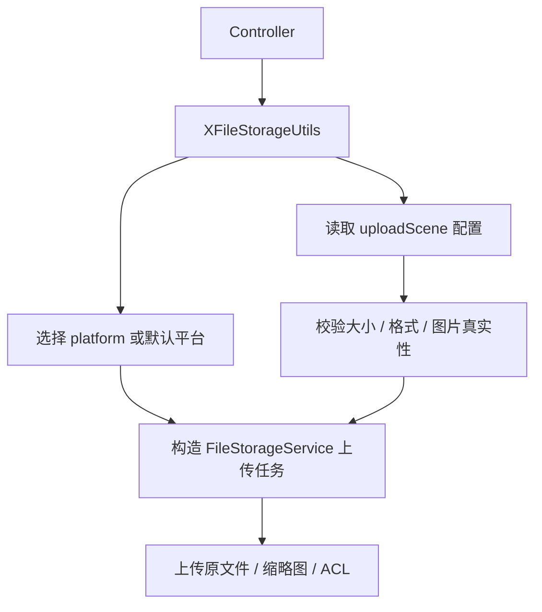

# 增加统一文件上传门面

## 1. 改造目标

本篇文档对应一次独立 git 提交，用原代码和现代码对比说明本次改造。

核心目标：

- 新增上传场景配置对象
- 新增 XFileStorageUtils 统一封装上传、删除、下载、缩略图、ACL 和分片能力
- 控制器后续只依赖统一门面，不直接散落平台 SDK 调用

## 改造前存在的问题

- Controller 如果直接调用本地上传或具体平台 SDK，平台选择、路径生成、校验、缩略图、ACL 会散落在多个接口中
- 不同业务上传规则不一致时，只能继续增加接口或在 Controller 写分支
- 后续删除、下载、分片上传如果没有统一门面，调用方需要了解 X File Storage 的细节

## 改造后的解决方案

- 新增 `UploadSceneProperties`，用配置描述不同业务上传规则
- 新增 `XFileStorageUtils`，统一封装上传、删除、下载、缩略图、ACL 和分片上传
- Controller 只传文件、平台和场景，具体规则由统一门面处理

## 总体链路



提交：

```
d5c951da 增加统一文件上传门面
```

## 2. 涉及文件

- `ruoyi-common/src/main/java/com/ruoyi/common/config/UploadSceneProperties.java`
- `ruoyi-common/src/main/java/com/ruoyi/common/utils/file/XFileStorageUtils.java`

## 3. 改动点清单

- 新增 UploadSceneProperties 读取上传场景配置
- 新增 XFileStorageUtils 统一处理上传参数、场景规则、平台选择、缩略图、ACL 和分片能力

## 4. ruoyi-common/src/main/java/com/ruoyi/common/config/UploadSceneProperties.java

### 原代码

```text
本次新增，提交前不存在该文件
```

### 现代码

```java
package com.ruoyi.common.config;

import java.util.HashMap;
import java.util.List;
import java.util.Map;
import org.springframework.boot.context.properties.ConfigurationProperties;
import org.springframework.stereotype.Component;
import org.springframework.util.unit.DataSize;
import com.ruoyi.common.utils.StringUtils;

/**
 * 上传场景配置
 * <p>
 * 用于让同一个通用上传接口根据不同业务场景使用不同大小、格式和缩略图规则
 *
 * @author ruoyi
 */
@Component
@ConfigurationProperties(prefix = "ruoyi")
public class UploadSceneProperties
{
    /** 场景配置集合 */
    private Map<String, Scene> uploadScenes = new HashMap<String, Scene>();

    public Map<String, Scene> getUploadScenes()
    {
        return uploadScenes;
    }

    public void setUploadScenes(Map<String, Scene> uploadScenes)
    {
        this.uploadScenes = uploadScenes;
    }

    /**
     * 根据场景编码获取上传场景
     *
     * @param scene 上传场景编码
     * @return 上传场景配置
     */
    public Scene getScene(String scene)
    {
        // 场景为空时不启用场景规则，保持通用上传原有默认行为
        if (StringUtils.isBlank(scene) || uploadScenes == null)
        {
            return null;
        }
        // 按配置键直接查找场景，调用方传 avatar、contract 等稳定编码
        return uploadScenes.get(scene);
    }

    /**
     * 上传场景规则
     */
    public static class Scene
    {
        /** 最大上传大小 */
        private DataSize maxSize;

        /** 允许上传的扩展名 */
        private List<String> allowedExtension;

        /** 是否生成缩略图 */
        private Boolean thumbnail;

        /** 缩略图宽度 */
        private Integer thumbnailWidth;

        /** 缩略图高度 */
        private Integer thumbnailHeight;

        /** 访问级别，public 表示公开访问，private 表示私有访问 */
        private String access;

        /** 场景路径前缀，例如 avatar、image、contract */
        private String pathPrefix;

        public DataSize getMaxSize()
        {
            return maxSize;
        }

        public void setMaxSize(DataSize maxSize)
        {
            this.maxSize = maxSize;
        }

        public List<String> getAllowedExtension()
        {
            return allowedExtension;
        }

        public void setAllowedExtension(List<String> allowedExtension)
        {
            this.allowedExtension = allowedExtension;
        }

        public Boolean getThumbnail()
        {
            return thumbnail;
        }

        public void setThumbnail(Boolean thumbnail)
        {
            this.thumbnail = thumbnail;
        }

        public Integer getThumbnailWidth()
        {
            return thumbnailWidth;
        }

        public void setThumbnailWidth(Integer thumbnailWidth)
        {
            this.thumbnailWidth = thumbnailWidth;
        }

        public Integer getThumbnailHeight()
        {
            return thumbnailHeight;
        }

        public void setThumbnailHeight(Integer thumbnailHeight)
        {
            this.thumbnailHeight = thumbnailHeight;
        }

        public String getAccess()
        {
            return access;
        }

        public void setAccess(String access)
        {
            this.access = access;
        }

        public String getPathPrefix()
        {
            return pathPrefix;
        }

        public void setPathPrefix(String pathPrefix)
        {
            this.pathPrefix = pathPrefix;
        }
    }
}
```

### 涉及改动部分

```java
// 省略
package com.ruoyi.common.config;

import java.util.HashMap;
import java.util.List;
import java.util.Map;
import org.springframework.boot.context.properties.ConfigurationProperties;
import org.springframework.stereotype.Component;
import org.springframework.util.unit.DataSize;
import com.ruoyi.common.utils.StringUtils;

/**
 * 上传场景配置
 * <p>
 * 用于让同一个通用上传接口根据不同业务场景使用不同大小、格式和缩略图规则
 *
 * @author ruoyi
 */
@Component
@ConfigurationProperties(prefix = "ruoyi")
public class UploadSceneProperties
{
    /** 场景配置集合 */
    private Map<String, Scene> uploadScenes = new HashMap<String, Scene>();

    public Map<String, Scene> getUploadScenes()
    {
        return uploadScenes;
    }

    public void setUploadScenes(Map<String, Scene> uploadScenes)
    {
        this.uploadScenes = uploadScenes;
    }

    /**
     * 根据场景编码获取上传场景
     *
     * @param scene 上传场景编码
     * @return 上传场景配置
     */
    public Scene getScene(String scene)
    {
        // 场景为空时不启用场景规则，保持通用上传原有默认行为
        if (StringUtils.isBlank(scene) || uploadScenes == null)
        {
            return null;
        }
        // 按配置键直接查找场景，调用方传 avatar、contract 等稳定编码
        return uploadScenes.get(scene);
    }

    /**
     * 上传场景规则
     */
    public static class Scene
    {
        /** 最大上传大小 */
        private DataSize maxSize;

        /** 允许上传的扩展名 */
        private List<String> allowedExtension;

        /** 是否生成缩略图 */
        private Boolean thumbnail;

        /** 缩略图宽度 */
        private Integer thumbnailWidth;

        /** 缩略图高度 */
        private Integer thumbnailHeight;

        /** 访问级别，public 表示公开访问，private 表示私有访问 */
        private String access;

        /** 场景路径前缀，例如 avatar、image、contract */
        private String pathPrefix;

        public DataSize getMaxSize()
        {
            return maxSize;
        }

        public void setMaxSize(DataSize maxSize)
        {
            this.maxSize = maxSize;
        }

        public List<String> getAllowedExtension()
        {
            return allowedExtension;
        }

        public void setAllowedExtension(List<String> allowedExtension)
        {
            this.allowedExtension = allowedExtension;
        }

        public Boolean getThumbnail()
        {
            return thumbnail;
        }

        public void setThumbnail(Boolean thumbnail)
        {
            this.thumbnail = thumbnail;
        }

        public Integer getThumbnailWidth()
        {
            return thumbnailWidth;
        }

        public void setThumbnailWidth(Integer thumbnailWidth)
        {
            this.thumbnailWidth = thumbnailWidth;
        }

        public Integer getThumbnailHeight()
        {
            return thumbnailHeight;
// 省略
```
### 改动说明

- 新增上传场景配置类，用配置描述不同业务的大小、格式、路径、缩略图和访问策略
- Controller 只传 `uploadScene`，具体规则由配置读取

## 5. ruoyi-common/src/main/java/com/ruoyi/common/utils/file/XFileStorageUtils.java

### 原代码

```text
本次新增，提交前不存在该文件
```

### 现代码

```java
package com.ruoyi.common.utils.file;

import org.dromara.x.file.storage.core.FileInfo;
import org.dromara.x.file.storage.core.FileStorageService;
import org.dromara.x.file.storage.core.constant.Constant;
import org.dromara.x.file.storage.core.upload.FilePartInfo;
import org.dromara.x.file.storage.core.upload.FilePartInfoList;
import org.dromara.x.file.storage.core.upload.MultipartUploadSupportInfo;
import org.dromara.x.file.storage.core.upload.UploadPretreatment;
import org.apache.commons.io.FilenameUtils;
import org.springframework.stereotype.Component;
import org.springframework.web.multipart.MultipartFile;
import com.ruoyi.common.exception.file.FileNameLengthLimitExceededException;
import com.ruoyi.common.exception.file.FileSizeLimitExceededException;
import com.ruoyi.common.exception.file.InvalidExtensionException;
import com.ruoyi.common.config.UploadSceneProperties;
import com.ruoyi.common.config.UploadSceneProperties.Scene;
import com.ruoyi.common.utils.DateUtils;
import com.ruoyi.common.utils.StringUtils;
import com.ruoyi.common.utils.uuid.IdUtils;

/**
 * X File Storage 上传适配工具
 * <p>
 * 控制器应优先调用该工具类，而不是直接使用 {@link FileStorageService}
 * 这样可以把平台选择、上传校验、文件命名、远程删除等行为集中维护
 * 保证通用上传和头像上传的行为一致
 */
@Component
public class XFileStorageUtils
{
    /**
     * 公开文件访问级别
     */
    private static final String ACCESS_PUBLIC = "public";

    /**
     * 私有文件访问级别
     */
    private static final String ACCESS_PRIVATE = "private";

    /**
     * 由 @EnableFileStorage 和 application.yml 平台配置自动创建的统一文件存储服务
     */
    private final FileStorageService fileStorageService;

    /**
     * 上传场景配置
     */
    private final UploadSceneProperties uploadSceneProperties;

    /**
     * 构造上传适配工具
     *
     * @param fileStorageService X File Storage 自动配置提供的统一存储服务
     * @param uploadSceneProperties 上传场景配置
     */
    public XFileStorageUtils(FileStorageService fileStorageService, UploadSceneProperties uploadSceneProperties)
    {
        this.fileStorageService = fileStorageService;
        this.uploadSceneProperties = uploadSceneProperties;
    }

    /**
     * 使用默认平台和默认扩展名白名单上传文件
     *
     * @param file 前端提交的 Multipart 文件
     * @return 存储平台返回的文件元数据
     * @throws Exception 校验失败或上传失败时抛出
     */
    public FileInfo upload(MultipartFile file) throws Exception
    {
        // 默认上传入口统一委托到完整参数方法
        return upload(file, null, MimeTypeUtils.DEFAULT_ALLOWED_EXTENSION);
    }

    /**
     * 使用默认平台和指定扩展名白名单上传文件
     *
     * @param file 前端提交的 Multipart 文件
     * @param allowedExtension 允许的扩展名数组，不带点号
     * @return 存储平台返回的文件元数据
     * @throws Exception 校验失败或上传失败时抛出
     */
    public FileInfo upload(MultipartFile file, String[] allowedExtension) throws Exception
    {
        // 图片上传等场景会传入更严格的扩展名白名单
        return upload(file, null, allowedExtension);
    }

    /**
     * 使用可选平台和默认扩展名白名单上传文件
     *
     * @param file 前端提交的 Multipart 文件
     * @param platform 可选平台标识；为空时使用配置中的默认平台
     * @return 存储平台返回的文件元数据
     * @throws Exception 校验失败或上传失败时抛出
     */
    public FileInfo upload(MultipartFile file, String platform) throws Exception
    {
        // 指定平台但不指定白名单时使用通用白名单
        return upload(file, platform, MimeTypeUtils.DEFAULT_ALLOWED_EXTENSION);
    }

    /**
     * 使用可选平台和指定扩展名白名单上传文件
     * <p>
     * 平台标识来自 application.yml，例如 local-1、aliyun-oss-1、minio-1
     * 后续新增腾讯云 COS、华为 OBS、S3 等平台时，只要补充对应配置和依赖
     * 再把新的 platform 标识传入这里即可
     *
     * @param file 前端提交的 Multipart 文件
     * @param platform 可选平台标识；为空时使用配置中的默认平台
     * @param allowedExtension 允许的扩展名数组，不带点号
     * @return 存储平台返回的文件元数据
     * @throws Exception 校验失败或上传失败时抛出
     */
    public FileInfo upload(MultipartFile file, String platform, String[] allowedExtension) throws Exception
    {
        // 默认不生成缩略图，保持普通上传原有行为
        return upload(file, platform, allowedExtension, false, null, null);
    }

    /**
     * 使用可选平台和指定扩展名白名单上传文件，并可按需生成缩略图
     * <p>
     * 生成缩略图时，原图和缩略图都会上传
     * 原图地址通过 FileInfo#getUrl 获取，缩略图地址通过 FileInfo#getThUrl 获取
     *
     * @param file 前端提交的 Multipart 文件
     * @param platform 可选平台标识；为空时使用配置中的默认平台
     * @param allowedExtension 允许的扩展名数组，不带点号
     * @param thumbnail true 表示生成缩略图
     * @param thumbnailWidth 缩略图宽度，和 thumbnailHeight 同时为空时使用框架默认尺寸
     * @param thumbnailHeight 缩略图高度，和 thumbnailWidth 同时为空时使用框架默认尺寸
     * @return 存储平台返回的文件元数据
     * @throws Exception 校验失败、缩略图生成失败或上传失败时抛出
     */
    public FileInfo upload(MultipartFile file, String platform, String[] allowedExtension, boolean thumbnail,
            Integer thumbnailWidth, Integer thumbnailHeight) throws Exception
    {
        // 未指定上传场景时使用调用方传入的白名单、大小和缩略图规则
        return upload(file, platform, null, allowedExtension, thumbnail, thumbnailWidth, thumbnailHeight);
    }

    /**
     * 使用可选平台和上传场景上传文件，并可按需生成缩略图
     * <p>
     * uploadScene 为空时使用调用方传入的规则
     * uploadScene 不为空时优先使用 ruoyi.upload-scenes 中配置的大小、格式和缩略图规则
     *
     * @param file 前端提交的 Multipart 文件
     * @param platform 可选平台标识；为空时使用配置中的默认平台
     * @param uploadScene 可选上传场景编码
     * @param allowedExtension 默认允许的扩展名数组，不带点号
     * @param thumbnail true 表示生成缩略图
     * @param thumbnailWidth 缩略图宽度，和 thumbnailHeight 同时为空时使用框架默认尺寸
     * @param thumbnailHeight 缩略图高度，和 thumbnailWidth 同时为空时使用框架默认尺寸
     * @return 存储平台返回的文件元数据
     * @throws Exception 校验失败、缩略图生成失败或上传失败时抛出
     */
    public FileInfo upload(MultipartFile file, String platform, String uploadScene, String[] allowedExtension,
            boolean thumbnail, Integer thumbnailWidth, Integer thumbnailHeight) throws Exception
    {
        // 根据场景编码读取场景规则，没有配置时回退到通用上传默认规则
        Scene scene = getScene(uploadScene);
        // 场景配置了扩展名时优先使用场景白名单
        String[] actualAllowedExtension = getAllowedExtension(scene, allowedExtension);
        // 场景配置了最大大小时优先使用场景大小限制
        long maxSize = getMaxSize(scene);
        // 场景配置了缩略图开关时优先使用场景缩略图策略
        boolean actualThumbnail = scene != null && scene.getThumbnail() != null ? scene.getThumbnail() : thumbnail;
        // 场景配置了缩略图宽度时优先使用场景宽度
        Integer actualThumbnailWidth = scene != null && scene.getThumbnailWidth() != null ? scene.getThumbnailWidth() : thumbnailWidth;
        // 场景配置了缩略图高度时优先使用场景高度
        Integer actualThumbnailHeight = scene != null && scene.getThumbnailHeight() != null ? scene.getThumbnailHeight() : thumbnailHeight;
        // 先执行若依原有文件安全校验
        assertAllowed(file, actualAllowedExtension, maxSize);
        // 日期目录保持 yyyy/MM/dd，便于按天归档
        String datePath = DateUtils.datePath();
        // 按上传场景生成 public/private 分层路径，便于 Spring Security 按 URL 粗粒度放行
        String storagePath = buildStoragePath(scene, uploadScene, datePath);
        // 保留若依原来的日期目录和 UUID 文件名规则，只把真实存储交给 X File Storage
        UploadPretreatment upload = fileStorageService.of(file)
                .setPath(storagePath)
                // 只取 UUID 文件名部分，避免 setPath 后重复日期目录
                .setSaveFilename(FileUploadUtils.uuidFilename(file).substring(datePath.length() + 1));
        if (platform != null && !platform.isBlank())
        {
            // 指定平台时覆盖配置中的默认平台
            upload.setPlatform(platform);
        }
        if (scene != null)
        {
            // 只有声明了上传场景时才按场景访问级别同步对象 ACL，未声明场景时保留平台默认权限
            applyAcl(upload, scene);
        }
        if (actualThumbnail)
        {
            // 调用方明确要求缩略图时再开启，避免普通文件上传被误处理
            setThumbnail(upload, file, actualThumbnailWidth, actualThumbnailHeight);
        }
        // platform 为空时，X File Storage 会自动使用 dromara.x-file-storage.default-platform
        // 真正执行上传并返回平台生成的元数据
        return upload.upload();
    }

    /**
     * 按 X File Storage 返回的 URL 删除远程对象
     * <p>
     * 该方法适用于本工具上传后返回的 URL
     * 若依历史本地 /profile 资源仍应使用 {@link FileUtils#deleteFile(String)} 删除
     * 文件存在缩略图时优先按 FileInfo 删除，让框架有机会同时处理缩略图
     *
     * @param url X File Storage 上传后返回的文件 URL
     * @return true 表示存储平台确认删除成功
     */
    public boolean delete(String url)
    {
        // 空 URL 不交给存储服务处理
        if (url == null || url.isBlank())
        {
            return false;
        }
        // 先根据 URL 还原 FileInfo，里面可能包含缩略图文件名等完整元数据
        FileInfo fileInfo = fileStorageService.getFileInfoByUrl(url);
        if (fileInfo != null)
        {
            // 使用 FileInfo 删除时，框架能拿到比单纯 URL 更完整的信息
            return fileStorageService.delete(fileInfo);
        }
        // 没有 FileInfo 时说明当前运行期没有记录，直接返回 true 避免历史 URL 影响主业务
        return true;
    }

    /**
     * 根据 URL 获取文件信息
     *
     * @param url X File Storage 上传后返回的文件 URL
     * @return 文件信息
     */
    public FileInfo getFileInfoByUrl(String url)
    {
        // URL 为空时无法定位文件记录
        if (StringUtils.isBlank(url))
        {
            throw new IllegalArgumentException("文件URL不能为空");
        }
        // 通过 FileRecorder 从数据库还原 FileInfo
        FileInfo fileInfo = fileStorageService.getFileInfoByUrl(url);
        if (fileInfo == null)
        {
            throw new IllegalArgumentException("文件记录不存在");
        }
        return fileInfo;
    }

    /**
     * 下载文件内容
     *
     * @param fileInfo 文件信息
     * @return 文件字节内容
     */
    public byte[] downloadBytes(FileInfo fileInfo)
    {
        // 下载必须依赖完整 FileInfo，里面包含平台、路径和文件名
        if (fileInfo == null)
        {
            throw new IllegalArgumentException("文件信息不能为空");
        }
        // 由 X File Storage 根据 FileInfo 中的平台信息选择实际存储平台下载
        return fileStorageService.download(fileInfo).bytes();
    }

    /**
     * 查询指定平台是否支持手动分片上传
     *
     * @param platform 可选平台标识；为空时使用配置中的默认平台
     * @return 分片上传支持信息
     */
    public MultipartUploadSupportInfo isSupportMultipartUpload(String platform)
    {
        // platform 为空时查询默认平台的分片上传能力
        if (StringUtils.isBlank(platform))
        {
            return fileStorageService.isSupportMultipartUpload();
        }
        // platform 不为空时查询指定平台的分片上传能力
        return fileStorageService.isSupportMultipartUpload(platform);
    }

    /**
     * 初始化手动分片上传
     *
     * @param originalFilename 原始文件名
     * @param size 文件总大小
     * @param contentType 文件内容类型
     * @param platform 可选平台标识；为空时使用配置中的默认平台
     * @param allowedExtension 允许的扩展名数组，不带点号
     * @return 初始化后的文件信息
     * @throws FileNameLengthLimitExceededException 原始文件名过长时抛出
     * @throws InvalidExtensionException 扩展名不在白名单内时抛出
     */
    public FileInfo initiateMultipartUpload(String originalFilename, Long size, String contentType, String platform,
            String[] allowedExtension) throws FileNameLengthLimitExceededException, FileSizeLimitExceededException,
            InvalidExtensionException
    {
        // 未指定上传场景时使用调用方传入的白名单和默认大小规则
        return initiateMultipartUpload(originalFilename, size, contentType, platform, null, allowedExtension);
    }

    /**
     * 初始化手动分片上传
     *
     * @param originalFilename 原始文件名
     * @param size 文件总大小
     * @param contentType 文件内容类型
     * @param platform 可选平台标识；为空时使用配置中的默认平台
     * @param uploadScene 可选上传场景编码
     * @param allowedExtension 默认允许的扩展名数组，不带点号
     * @return 初始化后的文件信息
     * @throws FileNameLengthLimitExceededException 原始文件名过长时抛出
     * @throws InvalidExtensionException 扩展名不在白名单内时抛出
     */
    public FileInfo initiateMultipartUpload(String originalFilename, Long size, String contentType, String platform,
            String uploadScene, String[] allowedExtension) throws FileNameLengthLimitExceededException,
            FileSizeLimitExceededException, InvalidExtensionException
    {
        // 根据场景编码读取场景规则，没有配置时回退到通用上传默认规则
        Scene scene = getScene(uploadScene);
        // 初始化阶段同样按场景限制文件格式和声明大小
        String[] actualAllowedExtension = getAllowedExtension(scene, allowedExtension);
        long maxSize = getMaxSize(scene);
        // 初始化阶段还没有完整文件内容，只能先校验文件名、扩展名和声明大小
        assertInitiateAllowed(originalFilename, size, actualAllowedExtension, maxSize);
        // 日期目录保持 yyyy/MM/dd，便于和普通上传使用相同归档规则
        String datePath = DateUtils.datePath();
        // 分片上传也使用同一套 public/private 分层路径，避免普通上传和大文件上传访问策略不一致
        String storagePath = buildStoragePath(scene, uploadScene, datePath);
        // 分片上传也使用 UUID 文件名，避免暴露用户原始文件名和降低重名风险
        String saveFilename = IdUtils.fastSimpleUUID() + "." + FilenameUtils.getExtension(originalFilename);
        // 构造初始化请求，返回的 FileInfo 会携带 uploadId 供后续分片上传使用
        org.dromara.x.file.storage.core.upload.InitiateMultipartUploadPretreatment upload = fileStorageService
                .initiateMultipartUpload()
                .setPath(storagePath)
                .setSaveFilename(saveFilename)
                .setOriginalFilename(originalFilename)
                .setSize(size)
                .setContentType(contentType);
        if (StringUtils.isNotBlank(platform))
        {
            // 指定平台时覆盖配置中的默认平台
            upload.setPlatform(platform);
        }
        if (scene != null)
        {
            // 分片上传初始化也按场景访问级别设置对象 ACL，避免合并后的文件权限和普通上传不一致
            applyMultipartAcl(upload, scene);
        }
        // 执行初始化，框架会通过 FileRecorder.save 保存分片上传会话
        return upload.init();
    }

    /**
     * 上传一个文件分片
     *
     * @param url 初始化分片上传后返回的文件地址
     * @param partNumber 分片编号
     * @param file 当前分片文件
     * @return 已上传的分片信息
     */
    public FilePartInfo uploadPart(String url, Integer partNumber, MultipartFile file)
    {
        // 分片编号从 1 开始，非法编号直接拒绝
        if (partNumber == null || partNumber <= 0)
        {
            throw new IllegalArgumentException("分片编号必须大于0");
        }
        // 分片内容不能为空，避免上传空分片污染分片记录
        if (file == null || file.isEmpty())
        {
            throw new IllegalArgumentException("分片文件不能为空");
        }
        // 从数据库记录按 URL 还原 FileInfo，里面包含平台、路径和 uploadId
        FileInfo fileInfo = getRequiredFileInfo(url);
        // 上传当前分片，框架成功后会通过 FileRecorder.saveFilePart 保存分片记录
        return fileStorageService.uploadPart(fileInfo, partNumber, file, file.getSize()).upload();
    }

    /**
     * 查询已经上传的分片列表
     *
     * @param url 初始化分片上传后返回的文件地址
     * @param maxParts 本次最多返回的分片数量
     * @param partNumberMarker 分页起始分片编号
     * @return 分片列表
     */
    public FilePartInfoList listParts(String url, Integer maxParts, Integer partNumberMarker)
    {
        // 从数据库记录按 URL 还原 FileInfo，里面包含平台、路径和 uploadId
        FileInfo fileInfo = getRequiredFileInfo(url);
        // 构造列举请求，部分平台可能不支持列举，由框架根据平台能力决定
        org.dromara.x.file.storage.core.upload.ListPartsPretreatment listParts = fileStorageService.listParts(fileInfo);
        if (maxParts != null && maxParts > 0)
        {
            // 设置本次最多返回的分片数量
            listParts.setMaxParts(maxParts);
        }
        if (partNumberMarker != null && partNumberMarker > 0)
        {
            // 设置分页起始分片编号
            listParts.setPartNumberMarker(partNumberMarker);
        }
        return listParts.listParts();
    }

    /**
     * 完成手动分片上传
     *
     * @param url 初始化分片上传后返回的文件地址
     * @return 合并后的文件信息
     */
    public FileInfo completeMultipartUpload(String url)
    {
        // 从数据库记录按 URL 还原 FileInfo，里面包含平台、路径和 uploadId
        FileInfo fileInfo = getRequiredFileInfo(url);
        // 通知存储平台合并分片，成功后框架会更新主文件记录并清理分片记录
        return fileStorageService.completeMultipartUpload(fileInfo).complete();
    }

    /**
     * 取消手动分片上传
     *
     * @param url 初始化分片上传后返回的文件地址
     * @return 取消后的文件信息
     */
    public FileInfo abortMultipartUpload(String url)
    {
        // 从数据库记录按 URL 还原 FileInfo，里面包含平台、路径和 uploadId
        FileInfo fileInfo = getRequiredFileInfo(url);
        // 通知存储平台取消分片上传，成功后框架会清理分片记录
        return fileStorageService.abortMultipartUpload(fileInfo).abort();
    }

    /**
     * 复用若依本地上传的校验规则
     *
     * @param file 前端提交的 Multipart 文件
     * @param allowedExtension 允许的扩展名数组，不带点号
     * @throws FileSizeLimitExceededException 文件超过默认大小限制时抛出
     * @throws InvalidExtensionException 扩展名不在白名单内时抛出
     * @throws FileNameLengthLimitExceededException 原始文件名过长时抛出
     */
    private void assertAllowed(MultipartFile file, String[] allowedExtension, long maxSize)
            throws FileSizeLimitExceededException, InvalidExtensionException, FileNameLengthLimitExceededException
    {
        // 切换存储平台不应放宽上传限制，因此仍沿用若依原来的文件名长度、大小和扩展名校验
        int fileNameLength = file.getOriginalFilename() == null ? 0 : file.getOriginalFilename().length();
        if (fileNameLength > FileUploadUtils.DEFAULT_FILE_NAME_LENGTH)
        {
            // 原始文件名过长时抛出若依原有异常
            throw new FileNameLengthLimitExceededException(FileUploadUtils.DEFAULT_FILE_NAME_LENGTH);
        }
        // 文件大小和扩展名校验统一委托给若依原工具
        FileUploadUtils.assertAllowed(file, allowedExtension, maxSize);
    }

    /**
     * 校验分片上传初始化参数
     *
     * @param originalFilename 原始文件名
     * @param size 文件总大小
     * @param allowedExtension 允许的扩展名数组，不带点号
     * @throws FileNameLengthLimitExceededException 原始文件名过长时抛出
     * @throws InvalidExtensionException 扩展名不在白名单内时抛出
     */
    private void assertInitiateAllowed(String originalFilename, Long size, String[] allowedExtension, long maxSize)
            throws FileNameLengthLimitExceededException, InvalidExtensionException
    {
        // 原始文件名不能为空，否则无法判断扩展名和生成最终保存名
        if (StringUtils.isBlank(originalFilename))
        {
            throw new IllegalArgumentException("文件名不能为空");
        }
        // 分片上传声明大小必须大于 0，避免创建无意义的上传会话
        if (size == null || size <= 0)
        {
            throw new IllegalArgumentException("文件大小必须大于0");
        }
        // 声明大小超过当前场景允许大小时直接拒绝初始化分片上传
        if (size > maxSize)
        {
            throw new FileSizeLimitExceededException((maxSize + 1024 * 1024 - 1) / 1024 / 1024);
        }
        // 复用若依原有文件名长度限制
        if (originalFilename.length() > FileUploadUtils.DEFAULT_FILE_NAME_LENGTH)
        {
            throw new FileNameLengthLimitExceededException(FileUploadUtils.DEFAULT_FILE_NAME_LENGTH);
        }
        // 初始化阶段按原始文件名后缀做白名单校验，真实内容校验放在普通图片上传链路
        String extension = FilenameUtils.getExtension(originalFilename);
        if (allowedExtension != null && !FileUploadUtils.isAllowedExtension(extension, allowedExtension))
        {
            throw new InvalidExtensionException(allowedExtension, extension, originalFilename);
        }
    }

    /**
     * 根据上传场景编码获取场景配置
     *
     * @param uploadScene 上传场景编码
     * @return 上传场景配置
     */
    private Scene getScene(String uploadScene)
    {
        // 没有传场景时不启用场景规则
        if (StringUtils.isBlank(uploadScene))
        {
            return null;
        }
        // 场景不存在时直接拒绝，避免前端传错后退回到更宽松的默认规则
        Scene scene = uploadSceneProperties.getScene(uploadScene);
        if (scene == null)
        {
            throw new IllegalArgumentException("上传场景不存在：" + uploadScene);
        }
        return scene;
    }

    /**
     * 获取当前上传允许的扩展名
     *
     * @param scene 上传场景配置
     * @param defaultAllowedExtension 默认扩展名白名单
     * @return 实际扩展名白名单
     */
    private String[] getAllowedExtension(Scene scene, String[] defaultAllowedExtension)
    {
        // 场景没有配置扩展名时使用调用方默认白名单
        if (scene == null || scene.getAllowedExtension() == null || scene.getAllowedExtension().isEmpty())
        {
            return defaultAllowedExtension;
        }
        // 将配置列表转换为若依校验工具使用的字符串数组
        return scene.getAllowedExtension().toArray(new String[0]);
    }

    /**
     * 获取当前上传最大大小
     *
     * @param scene 上传场景配置
     * @return 最大上传大小，单位字节
     */
    private long getMaxSize(Scene scene)
    {
        // 场景没有配置大小时使用若依默认 50MB
        if (scene == null || scene.getMaxSize() == null)
        {
            return FileUploadUtils.DEFAULT_MAX_SIZE;
        }
        // DataSize 会把 5MB、10MB 等配置换算成字节
        return scene.getMaxSize().toBytes();
    }

    /**
     * 构建场景化存储路径
     *
     * @param scene 上传场景配置
     * @param uploadScene 上传场景编码
     * @param datePath 日期路径
     * @return X File Storage setPath 使用的相对路径
     */
    private String buildStoragePath(Scene scene, String uploadScene, String datePath)
    {
        // 访问级别作为路径第一层，便于 /file/upload/public/** 直接匿名放行
        String access = getAccess(scene);
        // 场景路径作为第二层，方便按业务分类管理文件
        String pathPrefix = getPathPrefix(scene, uploadScene);
        return access + "/" + pathPrefix + "/" + datePath + "/";
    }

    /**
     * 按上传场景设置对象访问权限
     *
     * @param upload 当前上传预处理对象
     * @param scene 上传场景配置
     */
    private void applyAcl(UploadPretreatment upload, Scene scene)
    {
        // 部分平台不支持对象 ACL，例如本地存储，关闭抛错可以保持多平台上传入口通用
        upload.setNotSupportAclThrowException(false);
        // public 场景需要匿名可读，否则腾讯 COS、阿里云 OSS 等私有 Bucket 会返回 AccessDenied
        if (ACCESS_PUBLIC.equals(getAccess(scene)))
        {
            upload.setAcl(Constant.ACL.PUBLIC_READ);
            return;
        }
        // 未配置或非 public 场景统一按私有处理，避免业务附件被误公开
        upload.setAcl(Constant.ACL.PRIVATE);
    }

    /**
     * 按上传场景设置分片上传对象访问权限
     *
     * @param upload 当前分片上传初始化预处理对象
     * @param scene 上传场景配置
     */
    private void applyMultipartAcl(org.dromara.x.file.storage.core.upload.InitiateMultipartUploadPretreatment upload,
            Scene scene)
    {
        // 部分平台不支持对象 ACL，关闭抛错可以避免影响分片上传初始化
        upload.setNotSupportAclThrowException(false);
        // public 场景的分片文件合并后需要匿名可读，否则 COS 等平台会返回 AccessDenied
        if (ACCESS_PUBLIC.equals(getAccess(scene)))
        {
            upload.setFileAcl(Constant.ACL.PUBLIC_READ);
            return;
        }
        // private 场景显式设置私有，避免平台默认公开导致业务附件泄露
        upload.setFileAcl(Constant.ACL.PRIVATE);
    }

    /**
     * 获取上传场景访问级别
     *
     * @param scene 上传场景配置
     * @return public 或 private
     */
    private String getAccess(Scene scene)
    {
        // 未配置场景或未配置访问级别时默认私有，避免新业务文件误公开
        if (scene == null || StringUtils.isBlank(scene.getAccess()))
        {
            return ACCESS_PRIVATE;
        }
        // 只接受 public，其他值一律按 private 处理
        return ACCESS_PUBLIC.equalsIgnoreCase(scene.getAccess()) ? ACCESS_PUBLIC : ACCESS_PRIVATE;
    }

    /**
     * 获取上传场景路径前缀
     *
     * @param scene 上传场景配置
     * @param uploadScene 上传场景编码
     * @return 已清洗的相对路径前缀
     */
    private String getPathPrefix(Scene scene, String uploadScene)
    {
        // 场景 path-prefix 优先，未配置时使用 uploadScene，再没有时落到 common
        String pathPrefix = scene != null && StringUtils.isNotBlank(scene.getPathPrefix()) ? scene.getPathPrefix() : uploadScene;
        if (StringUtils.isBlank(pathPrefix))
        {
            pathPrefix = "common";
        }
        return normalizePathPrefix(pathPrefix);
    }

    /**
     * 清洗场景路径前缀
     *
     * @param pathPrefix 配置中的路径前缀
     * @return 安全的相对路径前缀
     */
    private String normalizePathPrefix(String pathPrefix)
    {
        // 统一路径分隔符并去掉首尾空白
        String normalized = pathPrefix.trim().replace("\\", "/");
        // 去掉开头结尾斜杠，避免拼接出绝对路径或重复斜杠
        while (normalized.startsWith("/"))
        {
            normalized = normalized.substring(1);
        }
        while (normalized.endsWith("/"))
        {
            normalized = normalized.substring(0, normalized.length() - 1);
        }
        // 禁止路径穿越，场景路径只允许作为存储相对目录
        if (normalized.contains(".."))
        {
            throw new IllegalArgumentException("上传场景路径前缀不能包含..");
        }
        return StringUtils.isBlank(normalized) ? "common" : normalized;
    }

    /**
     * 根据 URL 获取必须存在的文件信息
     *
     * @param url 文件访问地址
     * @return 文件信息
     */
    private FileInfo getRequiredFileInfo(String url)
    {
        // URL 为空时无法定位分片上传会话
        if (StringUtils.isBlank(url))
        {
            throw new IllegalArgumentException("文件URL不能为空");
        }
        // 通过 FileRecorder 从数据库还原 FileInfo
        FileInfo fileInfo = fileStorageService.getFileInfoByUrl(url);
        if (fileInfo == null)
        {
            throw new IllegalArgumentException("文件记录不存在");
        }
        // 分片上传后续操作必须依赖 uploadId
        if (StringUtils.isBlank(fileInfo.getUploadId()))
        {
            throw new IllegalArgumentException("文件不是有效的分片上传会话");
        }
        return fileInfo;
    }

    /**
     * 为上传任务设置缩略图参数
     *
     * @param upload 当前上传预处理对象
     * @param file 前端提交的 Multipart 文件
     * @param thumbnailWidth 缩略图宽度
     * @param thumbnailHeight 缩略图高度
     */
    private void setThumbnail(UploadPretreatment upload, MultipartFile file, Integer thumbnailWidth,
            Integer thumbnailHeight)
    {
        // 缩略图只支持图片文件，避免 PDF、压缩包等普通文件进入图片处理流程
        if (!FileUploadUtils.isAllowedExtension(FileUploadUtils.getExtension(file), MimeTypeUtils.IMAGE_EXTENSION))
        {
            throw new IllegalArgumentException("缩略图只支持图片文件");
        }
        // 宽高同时不传时使用 X File Storage 和 Thumbnailator 的默认缩略图策略
        if (thumbnailWidth == null && thumbnailHeight == null)
        {
            upload.thumbnail();
            return;
        }
        // 只传一个值或传入非正数时直接拒绝，避免生成尺寸不可预期
        if (thumbnailWidth == null || thumbnailHeight == null || thumbnailWidth <= 0 || thumbnailHeight <= 0)
        {
            throw new IllegalArgumentException("缩略图宽高必须同时大于0");
        }
        // 指定宽高时按调用方要求生成缩略图
        upload.thumbnail(thumbnailWidth, thumbnailHeight);
    }

}
```

### 涉及改动部分

```java
// 省略
package com.ruoyi.common.utils.file;

import org.dromara.x.file.storage.core.FileInfo;
import org.dromara.x.file.storage.core.FileStorageService;
import org.dromara.x.file.storage.core.constant.Constant;
import org.dromara.x.file.storage.core.upload.FilePartInfo;
import org.dromara.x.file.storage.core.upload.FilePartInfoList;
import org.dromara.x.file.storage.core.upload.MultipartUploadSupportInfo;
import org.dromara.x.file.storage.core.upload.UploadPretreatment;
import org.apache.commons.io.FilenameUtils;
import org.springframework.stereotype.Component;
import org.springframework.web.multipart.MultipartFile;
import com.ruoyi.common.exception.file.FileNameLengthLimitExceededException;
import com.ruoyi.common.exception.file.FileSizeLimitExceededException;
import com.ruoyi.common.exception.file.InvalidExtensionException;
import com.ruoyi.common.config.UploadSceneProperties;
import com.ruoyi.common.config.UploadSceneProperties.Scene;
import com.ruoyi.common.utils.DateUtils;
import com.ruoyi.common.utils.StringUtils;
import com.ruoyi.common.utils.uuid.IdUtils;

/**
 * X File Storage 上传适配工具
 * <p>
 * 控制器应优先调用该工具类，而不是直接使用 {@link FileStorageService}
 * 这样可以把平台选择、上传校验、文件命名、远程删除等行为集中维护
 * 保证通用上传和头像上传的行为一致
 */
@Component
public class XFileStorageUtils
{
    /**
     * 公开文件访问级别
     */
    private static final String ACCESS_PUBLIC = "public";

    /**
     * 私有文件访问级别
     */
    private static final String ACCESS_PRIVATE = "private";

    /**
     * 由 @EnableFileStorage 和 application.yml 平台配置自动创建的统一文件存储服务
     */
    private final FileStorageService fileStorageService;

    /**
     * 上传场景配置
     */
    private final UploadSceneProperties uploadSceneProperties;

    /**
     * 构造上传适配工具
     *
     * @param fileStorageService X File Storage 自动配置提供的统一存储服务
     * @param uploadSceneProperties 上传场景配置
     */
    public XFileStorageUtils(FileStorageService fileStorageService, UploadSceneProperties uploadSceneProperties)
    {
        this.fileStorageService = fileStorageService;
        this.uploadSceneProperties = uploadSceneProperties;
    }

    /**
     * 使用默认平台和默认扩展名白名单上传文件
     *
     * @param file 前端提交的 Multipart 文件
     * @return 存储平台返回的文件元数据
     * @throws Exception 校验失败或上传失败时抛出
     */
    public FileInfo upload(MultipartFile file) throws Exception
    {
        // 默认上传入口统一委托到完整参数方法
        return upload(file, null, MimeTypeUtils.DEFAULT_ALLOWED_EXTENSION);
    }

    /**
     * 使用默认平台和指定扩展名白名单上传文件
     *
     * @param file 前端提交的 Multipart 文件
     * @param allowedExtension 允许的扩展名数组，不带点号
     * @return 存储平台返回的文件元数据
     * @throws Exception 校验失败或上传失败时抛出
     */
    public FileInfo upload(MultipartFile file, String[] allowedExtension) throws Exception
    {
        // 图片上传等场景会传入更严格的扩展名白名单
        return upload(file, null, allowedExtension);
    }

    /**
     * 使用可选平台和默认扩展名白名单上传文件
     *
     * @param file 前端提交的 Multipart 文件
     * @param platform 可选平台标识；为空时使用配置中的默认平台
     * @return 存储平台返回的文件元数据
     * @throws Exception 校验失败或上传失败时抛出
     */
    public FileInfo upload(MultipartFile file, String platform) throws Exception
    {
        // 指定平台但不指定白名单时使用通用白名单
        return upload(file, platform, MimeTypeUtils.DEFAULT_ALLOWED_EXTENSION);
    }

    /**
     * 使用可选平台和指定扩展名白名单上传文件
     * <p>
     * 平台标识来自 application.yml，例如 local-1、aliyun-oss-1、minio-1
     * 后续新增腾讯云 COS、华为 OBS、S3 等平台时，只要补充对应配置和依赖
     * 再把新的 platform 标识传入这里即可
     *
     * @param file 前端提交的 Multipart 文件
     * @param platform 可选平台标识；为空时使用配置中的默认平台
     * @param allowedExtension 允许的扩展名数组，不带点号
     * @return 存储平台返回的文件元数据
     * @throws Exception 校验失败或上传失败时抛出
     */
    public FileInfo upload(MultipartFile file, String platform, String[] allowedExtension) throws Exception
    {
        // 默认不生成缩略图，保持普通上传原有行为
// 省略
```
### 改动说明

- 新增统一上传门面，集中处理平台选择、文件校验、路径生成、缩略图、ACL、删除、下载和分片上传
- Controller 不再直接调用本地上传工具或具体对象存储 SDK
- `platform` 不传时走默认平台，传入时上传到指定平台

## 变更小结

本篇只记录该提交自身涉及的代码和配置变化，不混入其它提交。


