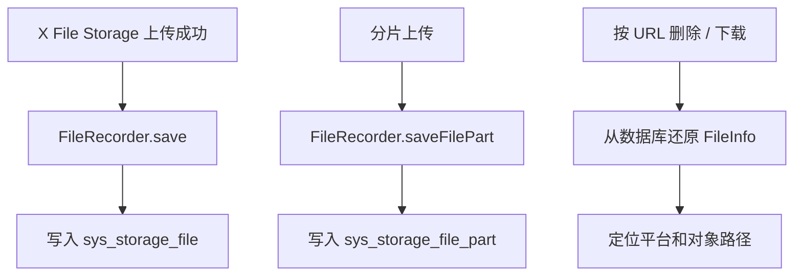

# 增加存储文件记录能力

## 1. 改造目标

本篇文档对应一次独立 git 提交，用原代码和现代码对比说明本次改造。

核心目标：

- 新增 sys_storage_file 和 sys_storage_file_part 表
- 实现 X File Storage 的 FileRecorder 接口
- 支持文件记录保存、业务绑定、待删除标记和分片记录管理

## 改造前存在的问题

- 只拿到 URL 时，后端无法可靠知道文件属于哪个平台、哪个路径、是否有缩略图
- X File Storage 的按 URL 删除、下载、存在判断等高级能力需要 `FileRecorder` 支持
- 没有文件表时，临时文件、业务文件、待删除文件、分片文件无法做生命周期管理

## 改造后的解决方案

- 新增 `sys_storage_file` 保存主文件、平台、路径、缩略图、业务绑定和清理状态
- 新增 `sys_storage_file_part` 保存分片上传过程中的分片记录
- 在 system 模块实现 `FileRecorder`，让上传记录入库，并支持按 URL 还原 `FileInfo`

## 总体链路



提交：

```
b4e523b9 增加存储文件记录能力
```

## 2. 涉及文件

- `ruoyi-system/pom.xml`
- `ruoyi-system/src/main/java/com/ruoyi/system/config/StorageFileProperties.java`
- `ruoyi-system/src/main/java/com/ruoyi/system/domain/SysStorageFile.java`
- `ruoyi-system/src/main/java/com/ruoyi/system/domain/SysStorageFilePart.java`
- `ruoyi-system/src/main/java/com/ruoyi/system/mapper/SysStorageFileMapper.java`
- `ruoyi-system/src/main/java/com/ruoyi/system/mapper/SysStorageFilePartMapper.java`
- `ruoyi-system/src/main/java/com/ruoyi/system/service/ISysStorageFileService.java`
- `ruoyi-system/src/main/java/com/ruoyi/system/service/impl/SysStorageFileServiceImpl.java`
- `ruoyi-system/src/main/resources/mapper/system/SysStorageFileMapper.xml`
- `ruoyi-system/src/main/resources/mapper/system/SysStorageFilePartMapper.xml`
- `sql/ry_20260417.sql`
- `sql/sys_storage_file_20260901.sql`

## 3. 改动点清单

- ruoyi-system 增加 x-file-storage-spring 依赖
- 新增文件记录表和分片记录表 SQL
- 新增文件记录领域对象、Mapper、Service 和 XML
- 实现 FileRecorder 保存文件主记录和分片记录

## 4. ruoyi-system/pom.xml

### 涉及改动部分

POM 文件只展示依赖或版本的插入位置，不展开完整原代码和现代码。

### 改动说明

- `ruoyi-system` 增加 X File Storage 依赖，用于实现数据库版 `FileRecorder`
- 文件记录属于系统业务能力，所以实现类放在 system 模块

## 5. ruoyi-system/src/main/java/com/ruoyi/system/config/StorageFileProperties.java

### 原代码

```text
本次新增，提交前不存在该文件
```

### 现代码

```java
package com.ruoyi.system.config;

import java.util.HashMap;
import java.util.Map;
import org.springframework.boot.context.properties.ConfigurationProperties;
import org.springframework.stereotype.Component;
import com.ruoyi.common.utils.StringUtils;

/**
 * 存储文件管理配置
 * <p>
 * 用于控制临时文件过期时间，以及不同业务类型旧文件进入待删除后的保留时间
 *
 * @author ruoyi
 */
@Component
@ConfigurationProperties(prefix = "ruoyi.storage-file")
public class StorageFileProperties
{
    /** 临时文件过期小时数 */
    private int tempExpireHours = 24;

    /** 默认待删除延迟小时数 */
    private int defaultDeleteDelayHours = 24;

    /** 业务类型对应的待删除延迟小时数 */
    private Map<String, Integer> deleteDelayHours = new HashMap<>();

    public int getTempExpireHours()
    {
        return tempExpireHours;
    }

    public void setTempExpireHours(int tempExpireHours)
    {
        this.tempExpireHours = tempExpireHours;
    }

    public int getDefaultDeleteDelayHours()
    {
        return defaultDeleteDelayHours;
    }

    public void setDefaultDeleteDelayHours(int defaultDeleteDelayHours)
    {
        this.defaultDeleteDelayHours = defaultDeleteDelayHours;
    }

    public Map<String, Integer> getDeleteDelayHours()
    {
        return deleteDelayHours;
    }

    public void setDeleteDelayHours(Map<String, Integer> deleteDelayHours)
    {
        this.deleteDelayHours = deleteDelayHours;
    }

    /**
     * 根据业务类型获取待删除延迟小时数
     *
     * @param bizType 业务类型
     * @return 待删除延迟小时数
     */
    public int getDeleteDelayHours(String bizType)
    {
        // 业务类型为空时直接使用默认值，适配通用文件删除场景
        if (StringUtils.isBlank(bizType) || deleteDelayHours == null)
        {
            return getPositiveOrDefault(defaultDeleteDelayHours);
        }
        // 业务单独配置了延迟时间时优先使用业务值
        Integer delayHours = deleteDelayHours.get(bizType);
        if (delayHours != null && delayHours > 0)
        {
            return delayHours;
        }
        // 未配置或配置非法时回退到默认延迟时间
        return getPositiveOrDefault(defaultDeleteDelayHours);
    }

    /**
     * 获取有效的临时文件过期小时数
     *
     * @return 临时文件过期小时数
     */
    public int getEffectiveTempExpireHours()
    {
        // 配置小于等于 0 时使用 24 小时兜底，避免误配置导致立即清理
        return getPositiveOrDefault(tempExpireHours);
    }

    /**
     * 获取正数配置或默认值
     *
     * @param value 配置值
     * @return 有效小时数
     */
    private int getPositiveOrDefault(int value)
    {
        // 所有小时数配置都要求是正数，非法值统一回退到 24 小时
        return value > 0 ? value : 24;
    }
}
```

### 涉及改动部分

```java
// 省略
package com.ruoyi.system.config;

import java.util.HashMap;
import java.util.Map;
import org.springframework.boot.context.properties.ConfigurationProperties;
import org.springframework.stereotype.Component;
import com.ruoyi.common.utils.StringUtils;

/**
 * 存储文件管理配置
 * <p>
 * 用于控制临时文件过期时间，以及不同业务类型旧文件进入待删除后的保留时间
 *
 * @author ruoyi
 */
@Component
@ConfigurationProperties(prefix = "ruoyi.storage-file")
public class StorageFileProperties
{
    /** 临时文件过期小时数 */
    private int tempExpireHours = 24;

    /** 默认待删除延迟小时数 */
    private int defaultDeleteDelayHours = 24;

    /** 业务类型对应的待删除延迟小时数 */
    private Map<String, Integer> deleteDelayHours = new HashMap<>();

    public int getTempExpireHours()
    {
        return tempExpireHours;
    }

    public void setTempExpireHours(int tempExpireHours)
    {
        this.tempExpireHours = tempExpireHours;
    }

    public int getDefaultDeleteDelayHours()
    {
        return defaultDeleteDelayHours;
    }

    public void setDefaultDeleteDelayHours(int defaultDeleteDelayHours)
    {
        this.defaultDeleteDelayHours = defaultDeleteDelayHours;
    }

    public Map<String, Integer> getDeleteDelayHours()
    {
        return deleteDelayHours;
    }

    public void setDeleteDelayHours(Map<String, Integer> deleteDelayHours)
    {
        this.deleteDelayHours = deleteDelayHours;
    }

    /**
     * 根据业务类型获取待删除延迟小时数
     *
     * @param bizType 业务类型
     * @return 待删除延迟小时数
     */
    public int getDeleteDelayHours(String bizType)
    {
        // 业务类型为空时直接使用默认值，适配通用文件删除场景
        if (StringUtils.isBlank(bizType) || deleteDelayHours == null)
        {
            return getPositiveOrDefault(defaultDeleteDelayHours);
        }
        // 业务单独配置了延迟时间时优先使用业务值
        Integer delayHours = deleteDelayHours.get(bizType);
        if (delayHours != null && delayHours > 0)
        {
            return delayHours;
        }
        // 未配置或配置非法时回退到默认延迟时间
        return getPositiveOrDefault(defaultDeleteDelayHours);
    }

    /**
     * 获取有效的临时文件过期小时数
     *
     * @return 临时文件过期小时数
     */
    public int getEffectiveTempExpireHours()
    {
        // 配置小于等于 0 时使用 24 小时兜底，避免误配置导致立即清理
        return getPositiveOrDefault(tempExpireHours);
    }

    /**
     * 获取正数配置或默认值
     *
     * @param value 配置值
     * @return 有效小时数
     */
    private int getPositiveOrDefault(int value)
    {
        // 所有小时数配置都要求是正数，非法值统一回退到 24 小时
        return value > 0 ? value : 24;
    }
}
```
### 改动说明

- 新增文件记录配置属性，读取临时文件保留时间、待删除保留时间和分片保留时间
- 清理任务和文件服务通过该配置决定什么时候可以物理删除文件

## 6. ruoyi-system/src/main/java/com/ruoyi/system/domain/SysStorageFile.java

### 原代码

```text
本次新增，提交前不存在该文件
```

### 现代码

```java
package com.ruoyi.system.domain;

import java.time.LocalDateTime;
import org.apache.commons.lang3.builder.ToStringBuilder;
import org.apache.commons.lang3.builder.ToStringStyle;
import com.ruoyi.common.core.domain.BaseEntity;

/**
 * 存储文件记录 sys_storage_file
 * <p>
 * 类名避免使用 SysFile，防止和若依服务监控模块的磁盘信息类产生 MyBatis 别名冲突
 *
 * @author ruoyi
 */
public class SysStorageFile extends BaseEntity
{
    private static final long serialVersionUID = 1L;

    /** 文件ID */
    private Long fileId;

    /** X File Storage 内部文件ID，由框架生成或由存储平台返回 */
    private String storageId;

    /** 原图访问地址 */
    private String url;

    /** 原图大小，单位字节 */
    private Long size;

    /** 原图文件名 */
    private String filename;

    /** 原始文件名 */
    private String originalFilename;

    /** 存储基础路径 */
    private String basePath;

    /** 文件路径 */
    private String path;

    /** 文件扩展名 */
    private String ext;

    /** 文件内容类型 */
    private String contentType;

    /** 存储平台 */
    private String platform;

    /** 缩略图访问地址 */
    private String thUrl;

    /** 缩略图文件名 */
    private String thFilename;

    /** 缩略图大小，单位字节 */
    private Long thSize;

    /** 缩略图内容类型 */
    private String thContentType;

    /** X File Storage 关联对象ID，框架扩展字段，不等同于本系统 bizId */
    private String objectId;

    /** X File Storage 关联对象类型，框架扩展字段，不等同于本系统 bizType */
    private String objectType;

    /** 原图存储平台元数据JSON，例如对象存储 Header 或自定义元信息 */
    private String metadata;

    /** 原图用户自定义元数据JSON，例如上传方传入的业务扩展元信息 */
    private String userMetadata;

    /** 缩略图存储平台元数据JSON */
    private String thMetadata;

    /** 缩略图用户自定义元数据JSON */
    private String thUserMetadata;

    /** X File Storage 附加属性JSON，只用于程序内部扩展，不会写入对象存储元数据 */
    private String attr;

    /** 原图访问控制ACL JSON，例如私有、公共读或平台专有权限配置 */
    private String fileAcl;

    /** 缩略图访问控制ACL JSON */
    private String thFileAcl;

    /** 原图哈希信息JSON，例如 MD5、SHA1、SHA256 等摘要结果 */
    private String hashInfo;

    /** 分片上传ID */
    private String uploadId;

    /** 分片上传状态 */
    private Integer uploadStatus;

    /** 文件状态（0临时 1已使用 2待删除 3已删除） */
    private String fileStatus;

    /** 业务类型 */
    private String bizType;

    /** 业务ID */
    private String bizId;

    /** 删除时间 */
    private LocalDateTime deleteTime;

    public Long getFileId()
    {
        return fileId;
    }

    public void setFileId(Long fileId)
    {
        this.fileId = fileId;
    }

    public String getStorageId()
    {
        return storageId;
    }

    public void setStorageId(String storageId)
    {
        this.storageId = storageId;
    }

    public String getUrl()
    {
        return url;
    }

    public void setUrl(String url)
    {
        this.url = url;
    }

    public Long getSize()
    {
        return size;
    }

    public void setSize(Long size)
    {
        this.size = size;
    }

    public String getFilename()
    {
        return filename;
    }

    public void setFilename(String filename)
    {
        this.filename = filename;
    }

    public String getOriginalFilename()
    {
        return originalFilename;
    }

    public void setOriginalFilename(String originalFilename)
    {
        this.originalFilename = originalFilename;
    }

    public String getBasePath()
    {
        return basePath;
    }

    public void setBasePath(String basePath)
    {
        this.basePath = basePath;
    }

    public String getPath()
    {
        return path;
    }

    public void setPath(String path)
    {
        this.path = path;
    }

    public String getExt()
    {
        return ext;
    }

    public void setExt(String ext)
    {
        this.ext = ext;
    }

    public String getContentType()
    {
        return contentType;
    }

    public void setContentType(String contentType)
    {
        this.contentType = contentType;
    }

    public String getPlatform()
    {
        return platform;
    }

    public void setPlatform(String platform)
    {
        this.platform = platform;
    }

    public String getThUrl()
    {
        return thUrl;
    }

    public void setThUrl(String thUrl)
    {
        this.thUrl = thUrl;
    }

    public String getThFilename()
    {
        return thFilename;
    }

    public void setThFilename(String thFilename)
    {
        this.thFilename = thFilename;
    }

    public Long getThSize()
    {
        return thSize;
    }

    public void setThSize(Long thSize)
    {
        this.thSize = thSize;
    }

    public String getThContentType()
    {
        return thContentType;
    }

    public void setThContentType(String thContentType)
    {
        this.thContentType = thContentType;
    }

    public String getObjectId()
    {
        return objectId;
    }

    public void setObjectId(String objectId)
    {
        this.objectId = objectId;
    }

    public String getObjectType()
    {
        return objectType;
    }

    public void setObjectType(String objectType)
    {
        this.objectType = objectType;
    }

    public String getMetadata()
    {
        return metadata;
    }

    public void setMetadata(String metadata)
    {
        this.metadata = metadata;
    }

    public String getUserMetadata()
    {
        return userMetadata;
    }

    public void setUserMetadata(String userMetadata)
    {
        this.userMetadata = userMetadata;
    }

    public String getThMetadata()
    {
        return thMetadata;
    }

    public void setThMetadata(String thMetadata)
    {
        this.thMetadata = thMetadata;
    }

    public String getThUserMetadata()
    {
        return thUserMetadata;
    }

    public void setThUserMetadata(String thUserMetadata)
    {
        this.thUserMetadata = thUserMetadata;
    }

    public String getAttr()
    {
        return attr;
    }

    public void setAttr(String attr)
    {
        this.attr = attr;
    }

    public String getFileAcl()
    {
        return fileAcl;
    }

    public void setFileAcl(String fileAcl)
    {
        this.fileAcl = fileAcl;
    }

    public String getThFileAcl()
    {
        return thFileAcl;
    }

    public void setThFileAcl(String thFileAcl)
    {
        this.thFileAcl = thFileAcl;
    }

    public String getHashInfo()
    {
        return hashInfo;
    }

    public void setHashInfo(String hashInfo)
    {
        this.hashInfo = hashInfo;
    }

    public String getUploadId()
    {
        return uploadId;
    }

    public void setUploadId(String uploadId)
    {
        this.uploadId = uploadId;
    }

    public Integer getUploadStatus()
    {
        return uploadStatus;
    }

    public void setUploadStatus(Integer uploadStatus)
    {
        this.uploadStatus = uploadStatus;
    }

    public String getFileStatus()
    {
        return fileStatus;
    }

    public void setFileStatus(String fileStatus)
    {
        this.fileStatus = fileStatus;
    }

    public String getBizType()
    {
        return bizType;
    }

    public void setBizType(String bizType)
    {
        this.bizType = bizType;
    }

    public String getBizId()
    {
        return bizId;
    }

    public void setBizId(String bizId)
    {
        this.bizId = bizId;
    }

    public LocalDateTime getDeleteTime()
    {
        return deleteTime;
    }

    public void setDeleteTime(LocalDateTime deleteTime)
    {
        this.deleteTime = deleteTime;
    }

    @Override
    public String toString()
    {
        return new ToStringBuilder(this, ToStringStyle.MULTI_LINE_STYLE)
                .append("fileId", getFileId())
                .append("storageId", getStorageId())
                .append("url", getUrl())
                .append("platform", getPlatform())
                .append("filename", getFilename())
                .append("fileStatus", getFileStatus())
                .append("bizType", getBizType())
                .append("bizId", getBizId())
                .append("createTime", getCreateTime())
                .append("updateTime", getUpdateTime())
                .append("remark", getRemark())
                .toString();
    }
}
```

### 涉及改动部分

```java
// 省略
package com.ruoyi.system.domain;

import java.time.LocalDateTime;
import org.apache.commons.lang3.builder.ToStringBuilder;
import org.apache.commons.lang3.builder.ToStringStyle;
import com.ruoyi.common.core.domain.BaseEntity;

/**
 * 存储文件记录 sys_storage_file
 * <p>
 * 类名避免使用 SysFile，防止和若依服务监控模块的磁盘信息类产生 MyBatis 别名冲突
 *
 * @author ruoyi
 */
public class SysStorageFile extends BaseEntity
{
    private static final long serialVersionUID = 1L;

    /** 文件ID */
    private Long fileId;

    /** X File Storage 内部文件ID，由框架生成或由存储平台返回 */
    private String storageId;

    /** 原图访问地址 */
    private String url;

    /** 原图大小，单位字节 */
    private Long size;

    /** 原图文件名 */
    private String filename;

    /** 原始文件名 */
    private String originalFilename;

    /** 存储基础路径 */
    private String basePath;

    /** 文件路径 */
    private String path;

    /** 文件扩展名 */
    private String ext;

    /** 文件内容类型 */
    private String contentType;

    /** 存储平台 */
    private String platform;

    /** 缩略图访问地址 */
    private String thUrl;

    /** 缩略图文件名 */
    private String thFilename;

    /** 缩略图大小，单位字节 */
    private Long thSize;

    /** 缩略图内容类型 */
    private String thContentType;

    /** X File Storage 关联对象ID，框架扩展字段，不等同于本系统 bizId */
    private String objectId;

    /** X File Storage 关联对象类型，框架扩展字段，不等同于本系统 bizType */
    private String objectType;

    /** 原图存储平台元数据JSON，例如对象存储 Header 或自定义元信息 */
    private String metadata;

    /** 原图用户自定义元数据JSON，例如上传方传入的业务扩展元信息 */
    private String userMetadata;

    /** 缩略图存储平台元数据JSON */
    private String thMetadata;

    /** 缩略图用户自定义元数据JSON */
    private String thUserMetadata;

    /** X File Storage 附加属性JSON，只用于程序内部扩展，不会写入对象存储元数据 */
    private String attr;

    /** 原图访问控制ACL JSON，例如私有、公共读或平台专有权限配置 */
    private String fileAcl;

    /** 缩略图访问控制ACL JSON */
    private String thFileAcl;

    /** 原图哈希信息JSON，例如 MD5、SHA1、SHA256 等摘要结果 */
    private String hashInfo;

    /** 分片上传ID */
    private String uploadId;

    /** 分片上传状态 */
    private Integer uploadStatus;

    /** 文件状态（0临时 1已使用 2待删除 3已删除） */
    private String fileStatus;

    /** 业务类型 */
    private String bizType;

    /** 业务ID */
    private String bizId;

    /** 删除时间 */
    private LocalDateTime deleteTime;

    public Long getFileId()
    {
        return fileId;
    }

    public void setFileId(Long fileId)
    {
        this.fileId = fileId;
    }
// 省略
```
### 改动说明

- 新增主文件记录实体，对应 `sys_storage_file` 表
- 保存原文件 URL、大小、平台、缩略图、业务绑定状态、清理状态等信息

## 7. ruoyi-system/src/main/java/com/ruoyi/system/domain/SysStorageFilePart.java

### 原代码

```text
本次新增，提交前不存在该文件
```

### 现代码

```java
package com.ruoyi.system.domain;

import java.time.LocalDateTime;
import org.apache.commons.lang3.builder.ToStringBuilder;
import org.apache.commons.lang3.builder.ToStringStyle;
import com.ruoyi.common.core.domain.BaseEntity;

/**
 * 存储文件分片记录 sys_storage_file_part
 * <p>
 * 用于承接 X File Storage 手动分片上传回调，和 sys_storage_file 主文件记录分开保存
 *
 * @author ruoyi
 */
public class SysStorageFilePart extends BaseEntity
{
    private static final long serialVersionUID = 1L;

    /** 分片ID */
    private Long partId;

    /** X File Storage 内部分片ID，由框架生成或由存储平台返回 */
    private String storageId;

    /** 存储平台 */
    private String platform;

    /** 分片上传ID */
    private String uploadId;

    /** 分片编号 */
    private Integer partNumber;

    /** 分片大小，单位字节 */
    private Long partSize;

    /** 分片ETag，存储平台返回的分片唯一校验标识 */
    private String etag;

    /** 分片哈希信息JSON，例如 MD5、SHA1、SHA256 等摘要结果 */
    private String hashInfo;

    /** 分片最后修改时间 */
    private LocalDateTime lastModified;

    public Long getPartId()
    {
        return partId;
    }

    public void setPartId(Long partId)
    {
        this.partId = partId;
    }

    public String getStorageId()
    {
        return storageId;
    }

    public void setStorageId(String storageId)
    {
        this.storageId = storageId;
    }

    public String getPlatform()
    {
        return platform;
    }

    public void setPlatform(String platform)
    {
        this.platform = platform;
    }

    public String getUploadId()
    {
        return uploadId;
    }

    public void setUploadId(String uploadId)
    {
        this.uploadId = uploadId;
    }

    public Integer getPartNumber()
    {
        return partNumber;
    }

    public void setPartNumber(Integer partNumber)
    {
        this.partNumber = partNumber;
    }

    public Long getPartSize()
    {
        return partSize;
    }

    public void setPartSize(Long partSize)
    {
        this.partSize = partSize;
    }

    public String getEtag()
    {
        return etag;
    }

    public void setEtag(String etag)
    {
        this.etag = etag;
    }

    public String getHashInfo()
    {
        return hashInfo;
    }

    public void setHashInfo(String hashInfo)
    {
        this.hashInfo = hashInfo;
    }

    public LocalDateTime getLastModified()
    {
        return lastModified;
    }

    public void setLastModified(LocalDateTime lastModified)
    {
        this.lastModified = lastModified;
    }

    @Override
    public String toString()
    {
        return new ToStringBuilder(this, ToStringStyle.MULTI_LINE_STYLE)
                .append("partId", getPartId())
                .append("storageId", getStorageId())
                .append("platform", getPlatform())
                .append("uploadId", getUploadId())
                .append("partNumber", getPartNumber())
                .append("partSize", getPartSize())
                .append("etag", getEtag())
                .append("createTime", getCreateTime())
                .append("lastModified", getLastModified())
                .toString();
    }
}
```

### 涉及改动部分

```java
// 省略
package com.ruoyi.system.domain;

import java.time.LocalDateTime;
import org.apache.commons.lang3.builder.ToStringBuilder;
import org.apache.commons.lang3.builder.ToStringStyle;
import com.ruoyi.common.core.domain.BaseEntity;

/**
 * 存储文件分片记录 sys_storage_file_part
 * <p>
 * 用于承接 X File Storage 手动分片上传回调，和 sys_storage_file 主文件记录分开保存
 *
 * @author ruoyi
 */
public class SysStorageFilePart extends BaseEntity
{
    private static final long serialVersionUID = 1L;

    /** 分片ID */
    private Long partId;

    /** X File Storage 内部分片ID，由框架生成或由存储平台返回 */
    private String storageId;

    /** 存储平台 */
    private String platform;

    /** 分片上传ID */
    private String uploadId;

    /** 分片编号 */
    private Integer partNumber;

    /** 分片大小，单位字节 */
    private Long partSize;

    /** 分片ETag，存储平台返回的分片唯一校验标识 */
    private String etag;

    /** 分片哈希信息JSON，例如 MD5、SHA1、SHA256 等摘要结果 */
    private String hashInfo;

    /** 分片最后修改时间 */
    private LocalDateTime lastModified;

    public Long getPartId()
    {
        return partId;
    }

    public void setPartId(Long partId)
    {
        this.partId = partId;
    }

    public String getStorageId()
    {
        return storageId;
    }

    public void setStorageId(String storageId)
    {
        this.storageId = storageId;
    }

    public String getPlatform()
    {
        return platform;
    }

    public void setPlatform(String platform)
    {
        this.platform = platform;
    }

    public String getUploadId()
    {
        return uploadId;
    }

    public void setUploadId(String uploadId)
    {
        this.uploadId = uploadId;
    }

    public Integer getPartNumber()
    {
        return partNumber;
    }

    public void setPartNumber(Integer partNumber)
    {
        this.partNumber = partNumber;
    }

    public Long getPartSize()
    {
        return partSize;
    }

    public void setPartSize(Long partSize)
    {
        this.partSize = partSize;
    }

    public String getEtag()
    {
        return etag;
    }

    public void setEtag(String etag)
    {
        this.etag = etag;
    }

    public String getHashInfo()
    {
        return hashInfo;
    }

// 省略
```
### 改动说明

- 新增分片文件记录实体，对应 `sys_storage_file_part` 表
- 保存 uploadId、partNumber、partSize、etag 等分片上传信息

## 8. ruoyi-system/src/main/java/com/ruoyi/system/mapper/SysStorageFileMapper.java

### 原代码

```text
本次新增，提交前不存在该文件
```

### 现代码

```java
package com.ruoyi.system.mapper;

import java.time.LocalDateTime;
import java.util.List;
import org.apache.ibatis.annotations.Param;
import com.ruoyi.system.domain.SysStorageFile;

/**
 * 存储文件记录 数据层
 *
 * @author ruoyi
 */
public interface SysStorageFileMapper
{
    /**
     * 根据 URL 查询文件记录
     *
     * @param url 文件访问地址
     * @return 文件记录
     */
    public SysStorageFile selectStorageFileByUrl(String url);

    /**
     * 查询可清理的文件记录
     *
     * @param tempBefore 临时文件过期时间
     * @param waitDeleteBefore 待删除文件到期时间
     * @return 文件记录集合
     */
    public List<SysStorageFile> selectCleanableStorageFiles(@Param("tempBefore") LocalDateTime tempBefore,
            @Param("waitDeleteBefore") LocalDateTime waitDeleteBefore);

    /**
     * 新增文件记录
     *
     * @param storageFile 文件记录
     * @return 结果
     */
    public int insertStorageFile(SysStorageFile storageFile);

    /**
     * 更新文件记录
     *
     * @param storageFile 文件记录
     * @return 结果
     */
    public int updateStorageFile(SysStorageFile storageFile);

    /**
     * 根据 URL 删除文件记录
     *
     * @param url 文件访问地址
     * @return 结果
     */
    public int deleteStorageFileByUrl(String url);

    /**
     * 绑定文件到业务
     *
     * @param url 文件访问地址
     * @param bizType 业务类型
     * @param bizId 业务ID
     * @param updateBy 更新者
     * @return 结果
     */
    public int bindStorageFile(@Param("url") String url, @Param("bizType") String bizType,
            @Param("bizId") String bizId, @Param("updateBy") String updateBy);

    /**
     * 标记文件为待删除
     *
     * @param url 文件访问地址
     * @param deleteTime 删除时间
     * @param updateBy 更新者
     * @return 结果
     */
    public int markStorageFileWaitDelete(@Param("url") String url, @Param("deleteTime") LocalDateTime deleteTime,
            @Param("updateBy") String updateBy);

    /**
     * 标记文件为已删除
     *
     * @param url 文件访问地址
     * @param updateBy 更新者
     * @return 结果
     */
    public int markStorageFileDeleted(@Param("url") String url, @Param("updateBy") String updateBy);
}
```

### 涉及改动部分

```java
// 省略
package com.ruoyi.system.mapper;

import java.time.LocalDateTime;
import java.util.List;
import org.apache.ibatis.annotations.Param;
import com.ruoyi.system.domain.SysStorageFile;

/**
 * 存储文件记录 数据层
 *
 * @author ruoyi
 */
public interface SysStorageFileMapper
{
    /**
     * 根据 URL 查询文件记录
     *
     * @param url 文件访问地址
     * @return 文件记录
     */
    public SysStorageFile selectStorageFileByUrl(String url);

    /**
     * 查询可清理的文件记录
     *
     * @param tempBefore 临时文件过期时间
     * @param waitDeleteBefore 待删除文件到期时间
     * @return 文件记录集合
     */
    public List<SysStorageFile> selectCleanableStorageFiles(@Param("tempBefore") LocalDateTime tempBefore,
            @Param("waitDeleteBefore") LocalDateTime waitDeleteBefore);

    /**
     * 新增文件记录
     *
     * @param storageFile 文件记录
     * @return 结果
     */
    public int insertStorageFile(SysStorageFile storageFile);

    /**
     * 更新文件记录
     *
     * @param storageFile 文件记录
     * @return 结果
     */
    public int updateStorageFile(SysStorageFile storageFile);

    /**
     * 根据 URL 删除文件记录
     *
     * @param url 文件访问地址
     * @return 结果
     */
    public int deleteStorageFileByUrl(String url);

    /**
     * 绑定文件到业务
     *
     * @param url 文件访问地址
     * @param bizType 业务类型
     * @param bizId 业务ID
     * @param updateBy 更新者
     * @return 结果
     */
    public int bindStorageFile(@Param("url") String url, @Param("bizType") String bizType,
            @Param("bizId") String bizId, @Param("updateBy") String updateBy);

    /**
     * 标记文件为待删除
     *
     * @param url 文件访问地址
     * @param deleteTime 删除时间
     * @param updateBy 更新者
     * @return 结果
     */
    public int markStorageFileWaitDelete(@Param("url") String url, @Param("deleteTime") LocalDateTime deleteTime,
            @Param("updateBy") String updateBy);

    /**
     * 标记文件为已删除
     *
     * @param url 文件访问地址
     * @param updateBy 更新者
     * @return 结果
     */
    public int markStorageFileDeleted(@Param("url") String url, @Param("updateBy") String updateBy);
}
```
### 改动说明

- 新增主文件记录 Mapper，提供按 URL 查询、可清理文件查询、状态更新等数据库操作

## 9. ruoyi-system/src/main/java/com/ruoyi/system/mapper/SysStorageFilePartMapper.java

### 原代码

```text
本次新增，提交前不存在该文件
```

### 现代码

```java
package com.ruoyi.system.mapper;

import org.apache.ibatis.annotations.Param;
import com.ruoyi.system.domain.SysStorageFilePart;

/**
 * 存储文件分片记录 数据层
 *
 * @author ruoyi
 */
public interface SysStorageFilePartMapper
{
    /**
     * 新增或更新分片记录
     *
     * @param storageFilePart 分片记录
     * @return 结果
     */
    public int saveStorageFilePart(SysStorageFilePart storageFilePart);

    /**
     * 根据分片上传ID删除分片记录
     *
     * @param uploadId 分片上传ID
     * @return 结果
     */
    public int deleteStorageFilePartByUploadId(@Param("uploadId") String uploadId);
}
```

### 涉及改动部分

```java
// 省略
package com.ruoyi.system.mapper;

import org.apache.ibatis.annotations.Param;
import com.ruoyi.system.domain.SysStorageFilePart;

/**
 * 存储文件分片记录 数据层
 *
 * @author ruoyi
 */
public interface SysStorageFilePartMapper
{
    /**
     * 新增或更新分片记录
     *
     * @param storageFilePart 分片记录
     * @return 结果
     */
    public int saveStorageFilePart(SysStorageFilePart storageFilePart);

    /**
     * 根据分片上传ID删除分片记录
     *
     * @param uploadId 分片上传ID
     * @return 结果
     */
    public int deleteStorageFilePartByUploadId(@Param("uploadId") String uploadId);
}
```
### 改动说明

- 新增分片记录 Mapper，提供保存、查询和删除分片记录能力

## 10. ruoyi-system/src/main/java/com/ruoyi/system/service/ISysStorageFileService.java

### 原代码

```text
本次新增，提交前不存在该文件
```

### 现代码

```java
package com.ruoyi.system.service;

import java.util.List;
import org.dromara.x.file.storage.core.FileInfo;
import org.dromara.x.file.storage.core.recorder.FileRecorder;
import com.ruoyi.system.domain.SysStorageFile;

/**
 * 存储文件记录 服务层
 *
 * @author ruoyi
 */
public interface ISysStorageFileService extends FileRecorder
{
    /**
     * 绑定文件到业务
     *
     * @param url 文件访问地址
     * @param bizType 业务类型
     * @param bizId 业务ID
     * @param updateBy 更新者
     * @return 结果
     */
    public int bindStorageFile(String url, String bizType, String bizId, String updateBy);

    /**
     * 标记文件为待删除
     *
     * @param url 文件访问地址
     * @param delayHours 延迟删除小时数
     * @param updateBy 更新者
     * @return 结果
     */
    public int markStorageFileWaitDelete(String url, int delayHours, String updateBy);

    /**
     * 按业务类型标记文件为待删除
     *
     * @param url 文件访问地址
     * @param bizType 业务类型
     * @param updateBy 更新者
     * @return 结果
     */
    public int markStorageFileWaitDelete(String url, String bizType, String updateBy);

    /**
     * 标记文件为已删除
     *
     * @param url 文件访问地址
     * @param updateBy 更新者
     * @return 结果
     */
    public int markStorageFileDeleted(String url, String updateBy);

    /**
     * 查询可清理的文件记录
     *
     * @param tempExpireHours 临时文件过期小时数
     * @return 文件记录集合
     */
    public List<SysStorageFile> selectCleanableStorageFiles(int tempExpireHours);

    /**
     * 将数据库记录还原为 X File Storage 文件信息
     *
     * @param storageFile 数据库文件记录
     * @return X File Storage 文件信息
     */
    public FileInfo toFileInfo(SysStorageFile storageFile);
}
```

### 涉及改动部分

```java
// 省略
package com.ruoyi.system.service;

import java.util.List;
import org.dromara.x.file.storage.core.FileInfo;
import org.dromara.x.file.storage.core.recorder.FileRecorder;
import com.ruoyi.system.domain.SysStorageFile;

/**
 * 存储文件记录 服务层
 *
 * @author ruoyi
 */
public interface ISysStorageFileService extends FileRecorder
{
    /**
     * 绑定文件到业务
     *
     * @param url 文件访问地址
     * @param bizType 业务类型
     * @param bizId 业务ID
     * @param updateBy 更新者
     * @return 结果
     */
    public int bindStorageFile(String url, String bizType, String bizId, String updateBy);

    /**
     * 标记文件为待删除
     *
     * @param url 文件访问地址
     * @param delayHours 延迟删除小时数
     * @param updateBy 更新者
     * @return 结果
     */
    public int markStorageFileWaitDelete(String url, int delayHours, String updateBy);

    /**
     * 按业务类型标记文件为待删除
     *
     * @param url 文件访问地址
     * @param bizType 业务类型
     * @param updateBy 更新者
     * @return 结果
     */
    public int markStorageFileWaitDelete(String url, String bizType, String updateBy);

    /**
     * 标记文件为已删除
     *
     * @param url 文件访问地址
     * @param updateBy 更新者
     * @return 结果
     */
    public int markStorageFileDeleted(String url, String updateBy);

    /**
     * 查询可清理的文件记录
     *
     * @param tempExpireHours 临时文件过期小时数
     * @return 文件记录集合
     */
    public List<SysStorageFile> selectCleanableStorageFiles(int tempExpireHours);

    /**
     * 将数据库记录还原为 X File Storage 文件信息
     *
     * @param storageFile 数据库文件记录
     * @return X File Storage 文件信息
     */
    public FileInfo toFileInfo(SysStorageFile storageFile);
}
```
### 改动说明

- 新增文件记录服务接口，同时承接 X File Storage `FileRecorder` 能力
- 对外提供业务绑定、待删除标记、清理查询和 URL 还原 FileInfo 能力

## 11. ruoyi-system/src/main/java/com/ruoyi/system/service/impl/SysStorageFileServiceImpl.java

### 原代码

```text
本次新增，提交前不存在该文件
```

### 现代码

```java
package com.ruoyi.system.service.impl;

import java.time.LocalDateTime;
import java.time.ZoneId;
import java.util.Date;
import java.util.List;
import java.util.Map;
import org.dromara.x.file.storage.core.FileInfo;
import org.dromara.x.file.storage.core.hash.HashInfo;
import org.dromara.x.file.storage.core.upload.FilePartInfo;
import org.springframework.beans.factory.annotation.Autowired;
import org.springframework.stereotype.Service;
import com.alibaba.fastjson2.JSON;
import com.alibaba.fastjson2.TypeReference;
import com.ruoyi.common.utils.DateUtils;
import com.ruoyi.common.utils.StringUtils;
import com.ruoyi.system.config.StorageFileProperties;
import com.ruoyi.system.domain.SysStorageFile;
import com.ruoyi.system.domain.SysStorageFilePart;
import com.ruoyi.system.mapper.SysStorageFileMapper;
import com.ruoyi.system.mapper.SysStorageFilePartMapper;
import com.ruoyi.system.service.ISysStorageFileService;

/**
 * 存储文件记录 服务层实现
 * <p>
 * 该类同时实现 X File Storage 的 FileRecorder 接口，让上传记录真正落到 sys_storage_file
 *
 * @author ruoyi
 */
@Service
public class SysStorageFileServiceImpl implements ISysStorageFileService
{
    /** 临时文件 */
    private static final String STATUS_TEMP = "0";

    /** 已使用文件 */
    private static final String STATUS_USED = "1";

    /** 待删除文件 */
    private static final String STATUS_WAIT_DELETE = "2";

    /** 已删除文件 */
    private static final String STATUS_DELETED = "3";

    @Autowired
    private SysStorageFileMapper storageFileMapper;

    @Autowired
    private SysStorageFilePartMapper storageFilePartMapper;

    @Autowired
    private StorageFileProperties storageFileProperties;

    /**
     * 保存上传文件记录
     *
     * @param fileInfo X File Storage 上传后生成的文件元数据
     * @return true 表示保存成功
     */
    @Override
    public boolean save(FileInfo fileInfo)
    {
        // 上传成功后框架会调用该方法，没有 URL 的记录无法用于后续按 URL 查询
        if (fileInfo == null || StringUtils.isBlank(fileInfo.getUrl()))
        {
            return false;
        }
        // 同一个 URL 重复保存时按更新处理，避免重试上传造成唯一索引冲突
        SysStorageFile exists = storageFileMapper.selectStorageFileByUrl(fileInfo.getUrl());
        SysStorageFile storageFile = toStorageFile(fileInfo);
        if (exists != null)
        {
            // 保留原主键并刷新最新元数据
            storageFile.setFileId(exists.getFileId());
            storageFile.setUpdateTime(DateUtils.getNowDate());
            return storageFileMapper.updateStorageFile(storageFile) > 0;
        }
        // 新上传文件先记录为临时状态，等业务保存成功后再绑定为已使用
        storageFile.setFileStatus(STATUS_TEMP);
        storageFile.setCreateTime(fileInfo.getCreateTime() == null ? DateUtils.getNowDate() : fileInfo.getCreateTime());
        return storageFileMapper.insertStorageFile(storageFile) > 0;
    }

    /**
     * 更新上传文件记录
     *
     * @param fileInfo X File Storage 文件元数据
     */
    @Override
    public void update(FileInfo fileInfo)
    {
        // 框架更新记录时复用保存逻辑，保证 URL 对应的元数据保持最新
        save(fileInfo);
    }

    /**
     * 根据 URL 查询文件信息
     *
     * @param url 文件访问地址
     * @return X File Storage 文件信息
     */
    @Override
    public FileInfo getByUrl(String url)
    {
        // 按 URL 从 sys_storage_file 还原 FileInfo，支持官网文档中的 delete(url)、exists(url) 等操作
        return toFileInfo(storageFileMapper.selectStorageFileByUrl(url));
    }

    /**
     * 删除文件记录
     *
     * @param url 文件访问地址
     * @return true 表示删除记录成功
     */
    @Override
    public boolean delete(String url)
    {
        // 物理删除成功后框架会调用该方法，这里保留记录并标记已删除，便于审计和排查
        return markStorageFileDeleted(url, "") >= 0;
    }

    /**
     * 保存分片上传记录
     *
     * @param filePartInfo 分片上传元数据
     */
    @Override
    public void saveFilePart(FilePartInfo filePartInfo)
    {
        // 分片上传没有 uploadId 时无法在后续合并或取消时定位同一批分片
        if (filePartInfo == null || StringUtils.isBlank(filePartInfo.getUploadId()))
        {
            return;
        }
        // 将框架回调的分片信息转换为数据库记录，和主文件记录拆开保存
        SysStorageFilePart storageFilePart = toStorageFilePart(filePartInfo);
        storageFilePartMapper.saveStorageFilePart(storageFilePart);
    }

    /**
     * 根据 uploadId 删除分片上传记录
     *
     * @param uploadId 分片上传 ID
     */
    @Override
    public void deleteFilePartByUploadId(String uploadId)
    {
        // 框架完成、取消或清理分片上传时会按 uploadId 删除这批分片记录
        if (StringUtils.isBlank(uploadId))
        {
            return;
        }
        storageFilePartMapper.deleteStorageFilePartByUploadId(uploadId);
    }

    /**
     * 绑定文件到业务
     *
     * @param url 文件访问地址
     * @param bizType 业务类型
     * @param bizId 业务ID
     * @param updateBy 更新者
     * @return 结果
     */
    @Override
    public int bindStorageFile(String url, String bizType, String bizId, String updateBy)
    {
        // 业务保存成功后把临时文件转为已使用，避免被临时文件清理任务误删
        if (StringUtils.isBlank(url))
        {
            return 0;
        }
        return storageFileMapper.bindStorageFile(url, bizType, bizId, updateBy);
    }

    /**
     * 标记文件为待删除
     *
     * @param url 文件访问地址
     * @param delayHours 延迟删除小时数
     * @param updateBy 更新者
     * @return 结果
     */
    @Override
    public int markStorageFileWaitDelete(String url, int delayHours, String updateBy)
    {
        // 历史本地 /profile 文件没有 X File Storage 记录，直接跳过状态标记
        if (StringUtils.isBlank(url))
        {
            return 0;
        }
        // 延迟删除给浏览器缓存、CDN 缓存和短时间回滚留出缓冲
        LocalDateTime deleteTime = LocalDateTime.now().plusHours(delayHours);
        return storageFileMapper.markStorageFileWaitDelete(url, deleteTime, updateBy);
    }

    /**
     * 按业务类型标记文件为待删除
     *
     * @param url 文件访问地址
     * @param bizType 业务类型
     * @param updateBy 更新者
     * @return 结果
     */
    @Override
    public int markStorageFileWaitDelete(String url, String bizType, String updateBy)
    {
        // 不同业务可以配置不同保留时间，例如头像短保留、合同附件长保留
        int delayHours = storageFileProperties.getDeleteDelayHours(bizType);
        return markStorageFileWaitDelete(url, delayHours, updateBy);
    }

    /**
     * 标记文件为已删除
     *
     * @param url 文件访问地址
     * @param updateBy 更新者
     * @return 结果
     */
    @Override
    public int markStorageFileDeleted(String url, String updateBy)
    {
        // 物理文件删除成功后保留记录并标记删除，便于后续审计和排查
        if (StringUtils.isBlank(url))
        {
            return 0;
        }
        return storageFileMapper.markStorageFileDeleted(url, updateBy);
    }

    /**
     * 查询可清理的文件记录
     *
     * @param tempExpireHours 临时文件过期小时数
     * @return 文件记录集合
     */
    @Override
    public List<SysStorageFile> selectCleanableStorageFiles(int tempExpireHours)
    {
        // 定时任务未传参数或参数非法时使用配置文件中的临时文件过期时间
        int expireHours = tempExpireHours <= 0 ? storageFileProperties.getEffectiveTempExpireHours() : tempExpireHours;
        // 临时文件按创建时间过期，待删除文件按 delete_time 到期
        LocalDateTime now = LocalDateTime.now();
        LocalDateTime tempBefore = now.minusHours(expireHours);
        return storageFileMapper.selectCleanableStorageFiles(tempBefore, now);
    }

    /**
     * 将数据库记录还原为 X File Storage 文件信息
     *
     * @param storageFile 数据库文件记录
     * @return X File Storage 文件信息
     */
    @Override
    public FileInfo toFileInfo(SysStorageFile storageFile)
    {
        // 没有数据库记录时返回 null，让框架或调用方自行决定是否跳过
        if (storageFile == null)
        {
            return null;
        }
        // FileInfo 需要 platform、basePath、path、filename 才能让具体平台定位对象
        FileInfo fileInfo = new FileInfo()
                .setId(storageFile.getStorageId())
                .setUrl(storageFile.getUrl())
                .setSize(storageFile.getSize())
                .setFilename(storageFile.getFilename())
                .setOriginalFilename(storageFile.getOriginalFilename())
                .setBasePath(storageFile.getBasePath())
                .setPath(storageFile.getPath())
                .setExt(storageFile.getExt())
                .setContentType(storageFile.getContentType())
                .setPlatform(storageFile.getPlatform())
                .setThUrl(storageFile.getThUrl())
                .setThFilename(storageFile.getThFilename())
                .setThSize(storageFile.getThSize())
                .setThContentType(storageFile.getThContentType())
                .setObjectId(storageFile.getObjectId())
                .setObjectType(storageFile.getObjectType())
                .setMetadata(parseMap(storageFile.getMetadata()))
                .setUserMetadata(parseMap(storageFile.getUserMetadata()))
                .setThMetadata(parseMap(storageFile.getThMetadata()))
                .setThUserMetadata(parseMap(storageFile.getThUserMetadata()))
                .setFileAcl(parseObject(storageFile.getFileAcl()))
                .setThFileAcl(parseObject(storageFile.getThFileAcl()))
                .setHashInfo(parseHashInfo(storageFile.getHashInfo()))
                .setUploadId(storageFile.getUploadId())
                .setUploadStatus(storageFile.getUploadStatus())
                .setCreateTime(storageFile.getCreateTime());
        return fileInfo;
    }

    /**
     * 将 X File Storage 文件信息转换为数据库记录
     *
     * @param fileInfo X File Storage 文件信息
     * @return 数据库文件记录
     */
    private SysStorageFile toStorageFile(FileInfo fileInfo)
    {
        SysStorageFile storageFile = new SysStorageFile();
        // 原样保存框架生成的元数据，保证后续可按 URL 还原 FileInfo 做删除、下载、判断存在
        storageFile.setStorageId(fileInfo.getId());
        storageFile.setUrl(fileInfo.getUrl());
        storageFile.setSize(fileInfo.getSize());
        storageFile.setFilename(fileInfo.getFilename());
        storageFile.setOriginalFilename(fileInfo.getOriginalFilename());
        storageFile.setBasePath(fileInfo.getBasePath());
        storageFile.setPath(fileInfo.getPath());
        storageFile.setExt(fileInfo.getExt());
        storageFile.setContentType(fileInfo.getContentType());
        storageFile.setPlatform(fileInfo.getPlatform());
        storageFile.setThUrl(fileInfo.getThUrl());
        storageFile.setThFilename(fileInfo.getThFilename());
        storageFile.setThSize(fileInfo.getThSize());
        storageFile.setThContentType(fileInfo.getThContentType());
        storageFile.setObjectId(fileInfo.getObjectId());
        storageFile.setObjectType(fileInfo.getObjectType());
        storageFile.setMetadata(toJson(fileInfo.getMetadata()));
        storageFile.setUserMetadata(toJson(fileInfo.getUserMetadata()));
        storageFile.setThMetadata(toJson(fileInfo.getThMetadata()));
        storageFile.setThUserMetadata(toJson(fileInfo.getThUserMetadata()));
        storageFile.setAttr(toJson(fileInfo.getAttr()));
        storageFile.setFileAcl(toJson(fileInfo.getFileAcl()));
        storageFile.setThFileAcl(toJson(fileInfo.getThFileAcl()));
        storageFile.setHashInfo(toJson(fileInfo.getHashInfo()));
        storageFile.setUploadId(fileInfo.getUploadId());
        storageFile.setUploadStatus(fileInfo.getUploadStatus());
        return storageFile;
    }

    /**
     * 将 X File Storage 分片信息转换为数据库记录
     *
     * @param filePartInfo X File Storage 分片信息
     * @return 数据库分片记录
     */
    private SysStorageFilePart toStorageFilePart(FilePartInfo filePartInfo)
    {
        SysStorageFilePart storageFilePart = new SysStorageFilePart();
        // 分片记录只保存断点续传需要的分片维度信息，不混入主文件业务绑定状态
        storageFilePart.setStorageId(filePartInfo.getId());
        storageFilePart.setPlatform(filePartInfo.getPlatform());
        storageFilePart.setUploadId(filePartInfo.getUploadId());
        storageFilePart.setPartNumber(filePartInfo.getPartNumber());
        storageFilePart.setPartSize(filePartInfo.getPartSize());
        storageFilePart.setEtag(filePartInfo.getETag());
        storageFilePart.setHashInfo(toJson(filePartInfo.getHashInfo()));
        storageFilePart.setCreateTime(filePartInfo.getCreateTime() == null ? DateUtils.getNowDate() : filePartInfo.getCreateTime());
        storageFilePart.setLastModified(toLocalDateTime(filePartInfo.getLastModified()));
        return storageFilePart;
    }

    /**
     * 将原始依赖中的 Date 转换为业务记录使用的 LocalDateTime
     *
     * @param date 原始时间
     * @return 本地日期时间
     */
    private LocalDateTime toLocalDateTime(Date date)
    {
        // X File Storage 的 FilePartInfo 使用 Date，这里只在落库前转换一次
        return date == null ? null : LocalDateTime.ofInstant(date.toInstant(), ZoneId.systemDefault());
    }

    /**
     * 转换为 JSON 字符串
     *
     * @param value 待转换对象
     * @return JSON 字符串
     */
    private String toJson(Object value)
    {
        // 空值不写 JSON，减少数据库里的无意义空对象
        return value == null ? null : JSON.toJSONString(value);
    }

    /**
     * 解析字符串键值元数据
     *
     * @param json JSON 字符串
     * @return 字符串键值 Map
     */
    private Map<String, String> parseMap(String json)
    {
        // 元数据为空时直接返回 null，保持和 FileInfo 原始语义一致
        if (StringUtils.isBlank(json))
        {
            return null;
        }
        return JSON.parseObject(json, new TypeReference<Map<String, String>>()
        {
        });
    }

    /**
     * 解析普通对象
     *
     * @param json JSON 字符串
     * @return 普通对象
     */
    private Object parseObject(String json)
    {
        // ACL 等字段类型由不同平台决定，这里还原为通用 JSON 对象即可
        return StringUtils.isBlank(json) ? null : JSON.parse(json);
    }

    /**
     * 解析哈希信息
     *
     * @param json JSON 字符串
     * @return 哈希信息
     */
    private HashInfo parseHashInfo(String json)
    {
        // 哈希信息本质是字符串键值 Map，重新包装成 HashInfo 交回框架
        Map<String, String> map = parseMap(json);
        return map == null ? null : new HashInfo(map);
    }
}
```

### 涉及改动部分

```java
// 省略
package com.ruoyi.system.service.impl;

import java.time.LocalDateTime;
import java.time.ZoneId;
import java.util.Date;
import java.util.List;
import java.util.Map;
import org.dromara.x.file.storage.core.FileInfo;
import org.dromara.x.file.storage.core.hash.HashInfo;
import org.dromara.x.file.storage.core.upload.FilePartInfo;
import org.springframework.beans.factory.annotation.Autowired;
import org.springframework.stereotype.Service;
import com.alibaba.fastjson2.JSON;
import com.alibaba.fastjson2.TypeReference;
import com.ruoyi.common.utils.DateUtils;
import com.ruoyi.common.utils.StringUtils;
import com.ruoyi.system.config.StorageFileProperties;
import com.ruoyi.system.domain.SysStorageFile;
import com.ruoyi.system.domain.SysStorageFilePart;
import com.ruoyi.system.mapper.SysStorageFileMapper;
import com.ruoyi.system.mapper.SysStorageFilePartMapper;
import com.ruoyi.system.service.ISysStorageFileService;

/**
 * 存储文件记录 服务层实现
 * <p>
 * 该类同时实现 X File Storage 的 FileRecorder 接口，让上传记录真正落到 sys_storage_file
 *
 * @author ruoyi
 */
@Service
public class SysStorageFileServiceImpl implements ISysStorageFileService
{
    /** 临时文件 */
    private static final String STATUS_TEMP = "0";

    /** 已使用文件 */
    private static final String STATUS_USED = "1";

    /** 待删除文件 */
    private static final String STATUS_WAIT_DELETE = "2";

    /** 已删除文件 */
    private static final String STATUS_DELETED = "3";

    @Autowired
    private SysStorageFileMapper storageFileMapper;

    @Autowired
    private SysStorageFilePartMapper storageFilePartMapper;

    @Autowired
    private StorageFileProperties storageFileProperties;

    /**
     * 保存上传文件记录
     *
     * @param fileInfo X File Storage 上传后生成的文件元数据
     * @return true 表示保存成功
     */
    @Override
    public boolean save(FileInfo fileInfo)
    {
        // 上传成功后框架会调用该方法，没有 URL 的记录无法用于后续按 URL 查询
        if (fileInfo == null || StringUtils.isBlank(fileInfo.getUrl()))
        {
            return false;
        }
        // 同一个 URL 重复保存时按更新处理，避免重试上传造成唯一索引冲突
        SysStorageFile exists = storageFileMapper.selectStorageFileByUrl(fileInfo.getUrl());
        SysStorageFile storageFile = toStorageFile(fileInfo);
        if (exists != null)
        {
            // 保留原主键并刷新最新元数据
            storageFile.setFileId(exists.getFileId());
            storageFile.setUpdateTime(DateUtils.getNowDate());
            return storageFileMapper.updateStorageFile(storageFile) > 0;
        }
        // 新上传文件先记录为临时状态，等业务保存成功后再绑定为已使用
        storageFile.setFileStatus(STATUS_TEMP);
        storageFile.setCreateTime(fileInfo.getCreateTime() == null ? DateUtils.getNowDate() : fileInfo.getCreateTime());
        return storageFileMapper.insertStorageFile(storageFile) > 0;
    }

    /**
     * 更新上传文件记录
     *
     * @param fileInfo X File Storage 文件元数据
     */
    @Override
    public void update(FileInfo fileInfo)
    {
        // 框架更新记录时复用保存逻辑，保证 URL 对应的元数据保持最新
        save(fileInfo);
    }

    /**
     * 根据 URL 查询文件信息
     *
     * @param url 文件访问地址
     * @return X File Storage 文件信息
     */
    @Override
    public FileInfo getByUrl(String url)
    {
        // 按 URL 从 sys_storage_file 还原 FileInfo，支持官网文档中的 delete(url)、exists(url) 等操作
        return toFileInfo(storageFileMapper.selectStorageFileByUrl(url));
    }

    /**
     * 删除文件记录
     *
     * @param url 文件访问地址
     * @return true 表示删除记录成功
     */
    @Override
    public boolean delete(String url)
    {
        // 物理删除成功后框架会调用该方法，这里保留记录并标记已删除，便于审计和排查
        return markStorageFileDeleted(url, "") >= 0;
// 省略
```
### 改动说明

- 实现 `FileRecorder`，上传成功后把 FileInfo 保存到数据库
- 支持根据 URL 还原 FileInfo，让删除、下载、存在判断可以直接按 URL 操作
- 支持业务绑定和待删除标记，形成文件资产生命周期管理

## 12. ruoyi-system/src/main/resources/mapper/system/SysStorageFileMapper.xml

### 原代码

```text
本次新增，提交前不存在该文件
```

### 现代码

```xml
<?xml version="1.0" encoding="UTF-8" ?>
<!DOCTYPE mapper
PUBLIC "-//mybatis.org//DTD Mapper 3.0//EN"
"http://mybatis.org/dtd/mybatis-3-mapper.dtd">
<mapper namespace="com.ruoyi.system.mapper.SysStorageFileMapper">

    <resultMap type="SysStorageFile" id="SysStorageFileResult">
        <id     property="fileId"           column="file_id"           />
        <result property="storageId"        column="storage_id"        />
        <result property="url"              column="url"               />
        <result property="size"             column="size"              />
        <result property="filename"         column="filename"          />
        <result property="originalFilename" column="original_filename" />
        <result property="basePath"         column="base_path"         />
        <result property="path"             column="path"              />
        <result property="ext"              column="ext"               />
        <result property="contentType"      column="content_type"      />
        <result property="platform"         column="platform"          />
        <result property="thUrl"            column="th_url"            />
        <result property="thFilename"       column="th_filename"       />
        <result property="thSize"           column="th_size"           />
        <result property="thContentType"    column="th_content_type"   />
        <result property="objectId"         column="object_id"         />
        <result property="objectType"       column="object_type"       />
        <result property="metadata"         column="metadata"          />
        <result property="userMetadata"     column="user_metadata"     />
        <result property="thMetadata"       column="th_metadata"       />
        <result property="thUserMetadata"   column="th_user_metadata"  />
        <result property="attr"             column="attr"              />
        <result property="fileAcl"          column="file_acl"          />
        <result property="thFileAcl"        column="th_file_acl"       />
        <result property="hashInfo"         column="hash_info"         />
        <result property="uploadId"         column="upload_id"         />
        <result property="uploadStatus"     column="upload_status"     />
        <result property="fileStatus"       column="file_status"       />
        <result property="bizType"          column="biz_type"          />
        <result property="bizId"            column="biz_id"            />
        <result property="deleteTime"       column="delete_time"       />
        <result property="createBy"         column="create_by"         />
        <result property="createTime"       column="create_time"       />
        <result property="updateBy"         column="update_by"         />
        <result property="updateTime"       column="update_time"       />
        <result property="remark"           column="remark"            />
    </resultMap>

    <sql id="selectStorageFileVo">
        select file_id, storage_id, url, size, filename, original_filename, base_path, path, ext, content_type,
               platform, th_url, th_filename, th_size, th_content_type, object_id, object_type, metadata,
               user_metadata, th_metadata, th_user_metadata, attr, file_acl, th_file_acl, hash_info,
               upload_id, upload_status, file_status, biz_type, biz_id, delete_time,
               create_by, create_time, update_by, update_time, remark
        from sys_storage_file
    </sql>

    <select id="selectStorageFileByUrl" parameterType="String" resultMap="SysStorageFileResult">
        <include refid="selectStorageFileVo"/>
        where url = #{url}
        limit 1
    </select>

    <select id="selectCleanableStorageFiles" resultMap="SysStorageFileResult">
        <include refid="selectStorageFileVo"/>
        where (file_status = '0' and create_time &lt; #{tempBefore})
           or (file_status = '2' and delete_time is not null and delete_time &lt;= #{waitDeleteBefore})
        order by create_time asc
    </select>

    <insert id="insertStorageFile" parameterType="SysStorageFile" useGeneratedKeys="true" keyProperty="fileId">
        insert into sys_storage_file (
            storage_id, url, size, filename, original_filename, base_path, path, ext, content_type,
            platform, th_url, th_filename, th_size, th_content_type, object_id, object_type, metadata,
            user_metadata, th_metadata, th_user_metadata, attr, file_acl, th_file_acl, hash_info,
            upload_id, upload_status, file_status, biz_type, biz_id, delete_time,
            create_by, create_time, update_by, update_time, remark
        ) values (
            #{storageId}, #{url}, #{size}, #{filename}, #{originalFilename}, #{basePath}, #{path}, #{ext}, #{contentType},
            #{platform}, #{thUrl}, #{thFilename}, #{thSize}, #{thContentType}, #{objectId}, #{objectType}, #{metadata},
            #{userMetadata}, #{thMetadata}, #{thUserMetadata}, #{attr}, #{fileAcl}, #{thFileAcl}, #{hashInfo},
            #{uploadId}, #{uploadStatus}, #{fileStatus}, #{bizType}, #{bizId}, #{deleteTime},
            #{createBy}, #{createTime}, #{updateBy}, #{updateTime}, #{remark}
        )
    </insert>

    <update id="updateStorageFile" parameterType="SysStorageFile">
        update sys_storage_file
        <set>
            storage_id = #{storageId},
            size = #{size},
            filename = #{filename},
            original_filename = #{originalFilename},
            base_path = #{basePath},
            path = #{path},
            ext = #{ext},
            content_type = #{contentType},
            platform = #{platform},
            th_url = #{thUrl},
            th_filename = #{thFilename},
            th_size = #{thSize},
            th_content_type = #{thContentType},
            object_id = #{objectId},
            object_type = #{objectType},
            metadata = #{metadata},
            user_metadata = #{userMetadata},
            th_metadata = #{thMetadata},
            th_user_metadata = #{thUserMetadata},
            attr = #{attr},
            file_acl = #{fileAcl},
            th_file_acl = #{thFileAcl},
            hash_info = #{hashInfo},
            upload_id = #{uploadId},
            upload_status = #{uploadStatus},
            update_time = #{updateTime}
        </set>
        where file_id = #{fileId}
    </update>

    <delete id="deleteStorageFileByUrl" parameterType="String">
        delete from sys_storage_file where url = #{url}
    </delete>

    <update id="bindStorageFile">
        update sys_storage_file
        set file_status = '1',
            biz_type = #{bizType},
            biz_id = #{bizId},
            update_by = #{updateBy},
            update_time = sysdate()
        where url = #{url}
          and file_status != '3'
    </update>

    <update id="markStorageFileWaitDelete">
        update sys_storage_file
        set file_status = '2',
            delete_time = #{deleteTime},
            update_by = #{updateBy},
            update_time = sysdate()
        where url = #{url}
          and file_status != '3'
    </update>

    <update id="markStorageFileDeleted">
        update sys_storage_file
        set file_status = '3',
            delete_time = sysdate(),
            update_by = #{updateBy},
            update_time = sysdate()
        where url = #{url}
    </update>
</mapper>
```

### 涉及改动部分

```xml
<!-- 省略 -->
<?xml version="1.0" encoding="UTF-8" ?>
<!DOCTYPE mapper
PUBLIC "-//mybatis.org//DTD Mapper 3.0//EN"
"http://mybatis.org/dtd/mybatis-3-mapper.dtd">
<mapper namespace="com.ruoyi.system.mapper.SysStorageFileMapper">

    <resultMap type="SysStorageFile" id="SysStorageFileResult">
        <id     property="fileId"           column="file_id"           />
        <result property="storageId"        column="storage_id"        />
        <result property="url"              column="url"               />
        <result property="size"             column="size"              />
        <result property="filename"         column="filename"          />
        <result property="originalFilename" column="original_filename" />
        <result property="basePath"         column="base_path"         />
        <result property="path"             column="path"              />
        <result property="ext"              column="ext"               />
        <result property="contentType"      column="content_type"      />
        <result property="platform"         column="platform"          />
        <result property="thUrl"            column="th_url"            />
        <result property="thFilename"       column="th_filename"       />
        <result property="thSize"           column="th_size"           />
        <result property="thContentType"    column="th_content_type"   />
        <result property="objectId"         column="object_id"         />
        <result property="objectType"       column="object_type"       />
        <result property="metadata"         column="metadata"          />
        <result property="userMetadata"     column="user_metadata"     />
        <result property="thMetadata"       column="th_metadata"       />
        <result property="thUserMetadata"   column="th_user_metadata"  />
        <result property="attr"             column="attr"              />
        <result property="fileAcl"          column="file_acl"          />
        <result property="thFileAcl"        column="th_file_acl"       />
        <result property="hashInfo"         column="hash_info"         />
        <result property="uploadId"         column="upload_id"         />
        <result property="uploadStatus"     column="upload_status"     />
        <result property="fileStatus"       column="file_status"       />
        <result property="bizType"          column="biz_type"          />
        <result property="bizId"            column="biz_id"            />
        <result property="deleteTime"       column="delete_time"       />
        <result property="createBy"         column="create_by"         />
        <result property="createTime"       column="create_time"       />
        <result property="updateBy"         column="update_by"         />
        <result property="updateTime"       column="update_time"       />
        <result property="remark"           column="remark"            />
    </resultMap>

    <sql id="selectStorageFileVo">
        select file_id, storage_id, url, size, filename, original_filename, base_path, path, ext, content_type,
               platform, th_url, th_filename, th_size, th_content_type, object_id, object_type, metadata,
               user_metadata, th_metadata, th_user_metadata, attr, file_acl, th_file_acl, hash_info,
               upload_id, upload_status, file_status, biz_type, biz_id, delete_time,
               create_by, create_time, update_by, update_time, remark
        from sys_storage_file
    </sql>

    <select id="selectStorageFileByUrl" parameterType="String" resultMap="SysStorageFileResult">
        <include refid="selectStorageFileVo"/>
        where url = #{url}
        limit 1
    </select>

    <select id="selectCleanableStorageFiles" resultMap="SysStorageFileResult">
        <include refid="selectStorageFileVo"/>
        where (file_status = '0' and create_time &lt; #{tempBefore})
           or (file_status = '2' and delete_time is not null and delete_time &lt;= #{waitDeleteBefore})
        order by create_time asc
    </select>

    <insert id="insertStorageFile" parameterType="SysStorageFile" useGeneratedKeys="true" keyProperty="fileId">
        insert into sys_storage_file (
            storage_id, url, size, filename, original_filename, base_path, path, ext, content_type,
            platform, th_url, th_filename, th_size, th_content_type, object_id, object_type, metadata,
            user_metadata, th_metadata, th_user_metadata, attr, file_acl, th_file_acl, hash_info,
            upload_id, upload_status, file_status, biz_type, biz_id, delete_time,
            create_by, create_time, update_by, update_time, remark
        ) values (
            #{storageId}, #{url}, #{size}, #{filename}, #{originalFilename}, #{basePath}, #{path}, #{ext}, #{contentType},
            #{platform}, #{thUrl}, #{thFilename}, #{thSize}, #{thContentType}, #{objectId}, #{objectType}, #{metadata},
            #{userMetadata}, #{thMetadata}, #{thUserMetadata}, #{attr}, #{fileAcl}, #{thFileAcl}, #{hashInfo},
            #{uploadId}, #{uploadStatus}, #{fileStatus}, #{bizType}, #{bizId}, #{deleteTime},
            #{createBy}, #{createTime}, #{updateBy}, #{updateTime}, #{remark}
        )
    </insert>

    <update id="updateStorageFile" parameterType="SysStorageFile">
        update sys_storage_file
        <set>
            storage_id = #{storageId},
            size = #{size},
            filename = #{filename},
            original_filename = #{originalFilename},
            base_path = #{basePath},
            path = #{path},
            ext = #{ext},
            content_type = #{contentType},
            platform = #{platform},
            th_url = #{thUrl},
            th_filename = #{thFilename},
            th_size = #{thSize},
            th_content_type = #{thContentType},
            object_id = #{objectId},
            object_type = #{objectType},
            metadata = #{metadata},
            user_metadata = #{userMetadata},
            th_metadata = #{thMetadata},
            th_user_metadata = #{thUserMetadata},
            attr = #{attr},
            file_acl = #{fileAcl},
            th_file_acl = #{thFileAcl},
            hash_info = #{hashInfo},
            upload_id = #{uploadId},
            upload_status = #{uploadStatus},
            update_time = #{updateTime}
        </set>
        where file_id = #{fileId}
    </update>

    <delete id="deleteStorageFileByUrl" parameterType="String">
        delete from sys_storage_file where url = #{url}
    </delete>

<!-- 省略 -->
```
### 改动说明

- 新增主文件记录 MyBatis XML，映射 `sys_storage_file` 字段和查询语句

## 13. ruoyi-system/src/main/resources/mapper/system/SysStorageFilePartMapper.xml

### 原代码

```text
本次新增，提交前不存在该文件
```

### 现代码

```xml
<?xml version="1.0" encoding="UTF-8" ?>
<!DOCTYPE mapper
PUBLIC "-//mybatis.org//DTD Mapper 3.0//EN"
"http://mybatis.org/dtd/mybatis-3-mapper.dtd">
<mapper namespace="com.ruoyi.system.mapper.SysStorageFilePartMapper">

    <resultMap type="SysStorageFilePart" id="SysStorageFilePartResult">
        <id     property="partId"       column="part_id"       />
        <result property="storageId"    column="storage_id"    />
        <result property="platform"     column="platform"      />
        <result property="uploadId"     column="upload_id"     />
        <result property="partNumber"   column="part_number"   />
        <result property="partSize"     column="part_size"     />
        <result property="etag"         column="etag"          />
        <result property="hashInfo"     column="hash_info"     />
        <result property="createTime"   column="create_time"   />
        <result property="lastModified" column="last_modified" />
    </resultMap>

    <insert id="saveStorageFilePart" parameterType="SysStorageFilePart">
        insert into sys_storage_file_part (
            storage_id, platform, upload_id, part_number, part_size, etag, hash_info, create_time, last_modified
        ) values (
            #{storageId}, #{platform}, #{uploadId}, #{partNumber}, #{partSize}, #{etag}, #{hashInfo}, #{createTime}, #{lastModified}
        )
        on duplicate key update
            storage_id = values(storage_id),
            platform = values(platform),
            part_size = values(part_size),
            etag = values(etag),
            hash_info = values(hash_info),
            last_modified = values(last_modified)
    </insert>

    <delete id="deleteStorageFilePartByUploadId" parameterType="String">
        delete from sys_storage_file_part where upload_id = #{uploadId}
    </delete>
</mapper>
```

### 涉及改动部分

```xml
<!-- 省略 -->
<?xml version="1.0" encoding="UTF-8" ?>
<!DOCTYPE mapper
PUBLIC "-//mybatis.org//DTD Mapper 3.0//EN"
"http://mybatis.org/dtd/mybatis-3-mapper.dtd">
<mapper namespace="com.ruoyi.system.mapper.SysStorageFilePartMapper">

    <resultMap type="SysStorageFilePart" id="SysStorageFilePartResult">
        <id     property="partId"       column="part_id"       />
        <result property="storageId"    column="storage_id"    />
        <result property="platform"     column="platform"      />
        <result property="uploadId"     column="upload_id"     />
        <result property="partNumber"   column="part_number"   />
        <result property="partSize"     column="part_size"     />
        <result property="etag"         column="etag"          />
        <result property="hashInfo"     column="hash_info"     />
        <result property="createTime"   column="create_time"   />
        <result property="lastModified" column="last_modified" />
    </resultMap>

    <insert id="saveStorageFilePart" parameterType="SysStorageFilePart">
        insert into sys_storage_file_part (
            storage_id, platform, upload_id, part_number, part_size, etag, hash_info, create_time, last_modified
        ) values (
            #{storageId}, #{platform}, #{uploadId}, #{partNumber}, #{partSize}, #{etag}, #{hashInfo}, #{createTime}, #{lastModified}
        )
        on duplicate key update
            storage_id = values(storage_id),
            platform = values(platform),
            part_size = values(part_size),
            etag = values(etag),
            hash_info = values(hash_info),
            last_modified = values(last_modified)
    </insert>

    <delete id="deleteStorageFilePartByUploadId" parameterType="String">
        delete from sys_storage_file_part where upload_id = #{uploadId}
    </delete>
</mapper>
```
### 改动说明

- 新增分片记录 MyBatis XML，映射 `sys_storage_file_part` 字段和查询语句

## 14. sql/ry_20260417.sql

### 原代码

```sql
insert into sys_dict_data values(25, 7,  '强退',     '7',       'sys_oper_type',       '',   'danger',  'N', '0', 'admin', sysdate(), '', null, '强退操作');
insert into sys_dict_data values(26, 8,  '生成代码', '8',       'sys_oper_type',       '',   'warning', 'N', '0', 'admin', sysdate(), '', null, '生成操作');
insert into sys_dict_data values(27, 9,  '清空数据', '9',       'sys_oper_type',       '',   'danger',  'N', '0', 'admin', sysdate(), '', null, '清空操作');
insert into sys_dict_data values(28, 1,  '成功',     '0',       'sys_common_status',   '',   'primary', 'N', '0', 'admin', sysdate(), '', null, '正常状态');
insert into sys_dict_data values(29, 2,  '失败',     '1',       'sys_common_status',   '',   'danger',  'N', '0', 'admin', sysdate(), '', null, '停用状态');


-- ----------------------------
-- 13、参数配置表
-- ----------------------------
drop table if exists sys_config;
create table sys_config (
  config_id         int(5)          not null auto_increment    comment '参数主键',
  config_name       varchar(100)    default ''                 comment '参数名称',
  config_key        varchar(100)    default ''                 comment '参数键名',
  config_value      varchar(500)    default ''                 comment '参数键值',
  config_type       char(1)         default 'N'                comment '系统内置（Y是 N否）',
  create_by         varchar(64)     default ''                 comment '创建者',
  create_time       datetime                                   comment '创建时间',
  update_by         varchar(64)     default ''                 comment '更新者',
  update_time       datetime                                   comment '更新时间',
  remark            varchar(500)    default null               comment '备注',
  primary key (config_id)
) engine=innodb auto_increment=100 comment = '参数配置表';

insert into sys_config values(1, '主框架页-默认皮肤样式名称',     'sys.index.skinName',               'skin-blue',     'Y', 'admin', sysdate(), '', null, '蓝色 skin-blue、绿色 skin-green、紫色 skin-purple、红色 skin-red、黄色 skin-yellow' );
insert into sys_config values(2, '用户管理-账号初始密码',         'sys.user.initPassword',            '123456',        'Y', 'admin', sysdate(), '', null, '初始化密码 123456' );
insert into sys_config values(3, '主框架页-侧边栏主题',           'sys.index.sideTheme',              'theme-dark',    'Y', 'admin', sysdate(), '', null, '深色主题theme-dark，浅色主题theme-light' );
insert into sys_config values(4, '账号自助-验证码开关',           'sys.account.captchaEnabled',       'true',          'Y', 'admin', sysdate(), '', null, '是否开启验证码功能（true开启，false关闭）');
insert into sys_config values(5, '账号自助-是否开启用户注册功能', 'sys.account.registerUser',         'false',         'Y', 'admin', sysdate(), '', null, '是否开启注册用户功能（true开启，false关闭）');
insert into sys_config values(6, '用户登录-黑名单列表',           'sys.login.blackIPList',            '',              'Y', 'admin', sysdate(), '', null, '设置登录IP黑名单限制，多个匹配项以;分隔，支持匹配（*通配、网段）');
insert into sys_config values(7, '用户管理-初始密码修改策略',     'sys.account.initPasswordModify',   '1',             'Y', 'admin', sysdate(), '', null, '0：初始密码修改策略关闭，没有任何提示，1：提醒用户，如果未修改初始密码，则在登录时就会提醒修改密码对话框');
insert into sys_config values(8, '用户管理-账号密码更新周期',     'sys.account.passwordValidateDays', '0',             'Y', 'admin', sysdate(), '', null, '密码更新周期（填写数字，数据初始化值为0不限制，若修改必须为大于0小于365的正整数），如果超过这个周期登录系统时，则在登录时就会提醒修改密码对话框');
insert into sys_config values(9, '用户管理-密码字符范围',         'sys.account.chrtype',              '0',             'Y', 'admin', sysdate(), '', null, '默认任意字符范围，0任意（密码可以输入任意字符），1数字（密码只能为0-9数字），2英文字母（密码只能为a-z和A-Z字母），3字母和数字（密码必须包含字母，数字）,4字母数字和特殊字符（目前支持的特殊字符包括：~!@#$%^&*()-=_+）');


-- ----------------------------
-- 14、系统访问记录
-- ----------------------------
drop table if exists sys_logininfor;
create table sys_logininfor (
  info_id        bigint(20)     not null auto_increment   comment '访问ID',
  user_name      varchar(50)    default ''                comment '用户账号',
  ipaddr         varchar(128)   default ''                comment '登录IP地址',
  login_location varchar(255)   default ''                comment '登录地点',
  browser        varchar(50)    default ''                comment '浏览器类型',
  os             varchar(50)    default ''                comment '操作系统',
  status         char(1)        default '0'               comment '登录状态（0成功 1失败）',
  msg            varchar(255)   default ''                comment '提示消息',
  login_time     datetime                                 comment '访问时间',
  primary key (info_id),
  key idx_sys_logininfor_s  (status),
  key idx_sys_logininfor_lt (login_time)
) engine=innodb auto_increment=100 comment = '系统访问记录';


-- ----------------------------
-- 15、定时任务调度表
-- ----------------------------
drop table if exists sys_job;
create table sys_job (
  job_id              bigint(20)    not null auto_increment    comment '任务ID',
  job_name            varchar(64)   default ''                 comment '任务名称',
  job_group           varchar(64)   default 'DEFAULT'          comment '任务组名',
  invoke_target       varchar(500)  not null                   comment '调用目标字符串',
  cron_expression     varchar(255)  default ''                 comment 'cron执行表达式',
  misfire_policy      varchar(20)   default '3'                comment '计划执行错误策略（1立即执行 2执行一次 3放弃执行）',
  concurrent          char(1)       default '1'                comment '是否并发执行（0允许 1禁止）',
  status              char(1)       default '0'                comment '状态（0正常 1暂停）',
  create_by           varchar(64)   default ''                 comment '创建者',
  create_time         datetime                                 comment '创建时间',
  update_by           varchar(64)   default ''                 comment '更新者',
  update_time         datetime                                 comment '更新时间',
  remark              varchar(500)  default ''                 comment '备注信息',
  primary key (job_id, job_name, job_group)
) engine=innodb auto_increment=100 comment = '定时任务调度表';

insert into sys_job values(1, '系统默认（无参）', 'DEFAULT', 'ryTask.ryNoParams',        '0/10 * * * * ?', '3', '1', '1', 'admin', sysdate(), '', null, '');
insert into sys_job values(2, '系统默认（有参）', 'DEFAULT', 'ryTask.ryParams(\'ry\')',  '0/15 * * * * ?', '3', '1', '1', 'admin', sysdate(), '', null, '');
insert into sys_job values(3, '系统默认（多参）', 'DEFAULT', 'ryTask.ryMultipleParams(\'ry\', true, 2000L, 316.50D, 100)',  '0/20 * * * * ?', '3', '1', '1', 'admin', sysdate(), '', null, '');


-- ----------------------------
-- 16、定时任务调度日志表
-- ----------------------------
drop table if exists sys_job_log;
create table sys_job_log (
  job_log_id          bigint(20)     not null auto_increment    comment '任务日志ID',
  job_name            varchar(64)    not null                   comment '任务名称',
  job_group           varchar(64)    not null                   comment '任务组名',
  invoke_target       varchar(500)   not null                   comment '调用目标字符串',
  job_message         varchar(500)                              comment '日志信息',
  status              char(1)        default '0'                comment '执行状态（0正常 1失败）',
  exception_info      varchar(2000)  default ''                 comment '异常信息',
  start_time          datetime                                  comment '执行开始时间',
  end_time            datetime                                  comment '执行结束时间',
  create_time         datetime                                  comment '创建时间',
  primary key (job_log_id)
) engine=innodb comment = '定时任务调度日志表';


-- ----------------------------
-- 17、通知公告表
-- ----------------------------
drop table if exists sys_notice;
create table sys_notice (
  notice_id         int(4)          not null auto_increment    comment '公告ID',
  notice_title      varchar(50)     not null                   comment '公告标题',
  notice_type       char(1)         not null                   comment '公告类型（1通知 2公告）',
  notice_content    longblob        default null               comment '公告内容',
  status            char(1)         default '0'                comment '公告状态（0正常 1关闭）',
  create_by         varchar(64)     default ''                 comment '创建者',
  create_time       datetime                                   comment '创建时间',
  update_by         varchar(64)     default ''                 comment '更新者',
  update_time       datetime                                   comment '更新时间',
  remark            varchar(255)    default null               comment '备注',
  primary key (notice_id)
) engine=innodb auto_increment=10 comment = '通知公告表';

-- ----------------------------
-- 初始化-公告信息表数据
-- ----------------------------
insert into sys_notice values('1', '温馨提醒：2018-07-01 若依新版本发布啦', '2', '新版本内容', '0', 'admin', sysdate(), '', null, '管理员');
insert into sys_notice values('2', '维护通知：2018-07-01 若依系统凌晨维护', '1', '维护内容',   '0', 'admin', sysdate(), '', null, '管理员');
insert into sys_notice values('3', '若依开源框架介绍', '1', '<p><span style=\"color: rgb(230, 0, 0);\">项目介绍</span></p><p><font color=\"#333333\">RuoYi开源项目是为企业用户定制的后台脚手架框架，为企业打造的一站式解决方案，降低企业开发成本，提升开发效率。主要包括用户管理、角色管理、部门管理、菜单管理、参数管理、字典管理、</font><span style=\"color: rgb(51, 51, 51);\">岗位管理</span><span style=\"color: rgb(51, 51, 51);\">、定时任务</span><span style=\"color: rgb(51, 51, 51);\">、</span><span style=\"color: rgb(51, 51, 51);\">服务监控、登录日志、操作日志、代码生成等功能。其中，还支持多数据源、数据权限、国际化、Redis缓存、Docker部署、滑动验证码、第三方认证登录、分布式事务、</span><font color=\"#333333\">分布式文件存储</font><span style=\"color: rgb(51, 51, 51);\">、分库分表处理等技术特点。</span></p><p><br></p><p><span style=\"color: rgb(230, 0, 0);\">官网及演示</span></p><p><span style=\"color: rgb(51, 51, 51);\">若依官网地址：&nbsp;</span><a href=\"http://ruoyi.vip\" target=\"_blank\">http://ruoyi.vip</a><a href=\"http://ruoyi.vip\" target=\"_blank\"></a></p><p><span style=\"color: rgb(51, 51, 51);\">若依文档地址：&nbsp;</span><a href=\"http://doc.ruoyi.vip\" target=\"_blank\">http://doc.ruoyi.vip</a><br></p><p><span style=\"color: rgb(51, 51, 51);\">演示地址【不分离版】：&nbsp;</span><a href=\"http://demo.ruoyi.vip\" target=\"_blank\">http://demo.ruoyi.vip</a></p><p><span style=\"color: rgb(51, 51, 51);\">演示地址【分离版本】：&nbsp;</span><a href=\"http://vue.ruoyi.vip\" target=\"_blank\">http://vue.ruoyi.vip</a></p><p><span style=\"color: rgb(51, 51, 51);\">演示地址【微服务版】：&nbsp;</span><a href=\"http://cloud.ruoyi.vip\" target=\"_blank\">http://cloud.ruoyi.vip</a></p><p><span style=\"color: rgb(51, 51, 51);\">演示地址【移动端版】：&nbsp;</span><a href=\"http://h5.ruoyi.vip\" target=\"_blank\">http://h5.ruoyi.vip</a></p><p><br style=\"color: rgb(48, 49, 51); font-family: &quot;Helvetica Neue&quot;, Helvetica, Arial, sans-serif; font-size: 12px;\"></p>', '0', 'admin', sysdate(), '', null, '管理员');


-- ----------------------------
-- 18、公告已读记录表
-- ----------------------------
drop table if exists sys_notice_read;
create table sys_notice_read (
  read_id          bigint(20)       not null auto_increment    comment '已读主键',
  notice_id        int(4)           not null                   comment '公告id',
  user_id          bigint(20)       not null                   comment '用户id',
  read_time        datetime         not null                   comment '阅读时间',
  primary key (read_id),
  unique key uk_user_notice (user_id, notice_id)   comment '同一用户同一公告只记录一次'
) engine=innodb auto_increment=1 comment='公告已读记录表';


-- ----------------------------
-- ----------------------------
drop table if exists gen_table;
create table gen_table (
  table_id          bigint(20)      not null auto_increment    comment '编号',
  table_name        varchar(200)    default ''                 comment '表名称',
  table_comment     varchar(500)    default ''                 comment '表描述',
  sub_table_name    varchar(64)     default null               comment '关联子表的表名',
  sub_table_fk_name varchar(64)     default null               comment '子表关联的外键名',
  class_name        varchar(100)    default ''                 comment '实体类名称',
  tpl_category      varchar(200)    default 'crud'             comment '使用的模板（crud单表操作 tree树表操作）',
  tpl_web_type      varchar(30)     default ''                 comment '前端模板类型（element-ui模版 element-plus模版）',
  package_name      varchar(100)                               comment '生成包路径',
  module_name       varchar(30)                                comment '生成模块名',
  business_name     varchar(30)                                comment '生成业务名',
  function_name     varchar(50)                                comment '生成功能名',
  function_author   varchar(50)                                comment '生成功能作者',
  form_col_num      int(1)          default 1                  comment '表单布局（单列 双列 三列）',
  gen_type          char(1)         default '0'                comment '生成代码方式（0zip压缩包 1自定义路径）',
  gen_path          varchar(200)    default '/'                comment '生成路径（不填默认项目路径）',
  options           varchar(1000)                              comment '其它生成选项',
  create_by         varchar(64)     default ''                 comment '创建者',
  create_time 	    datetime                                   comment '创建时间',
  update_by         varchar(64)     default ''                 comment '更新者',
  update_time       datetime                                   comment '更新时间',
  remark            varchar(500)    default null               comment '备注',
  primary key (table_id)
) engine=innodb auto_increment=1 comment = '代码生成业务表';


-- ----------------------------
-- ----------------------------
drop table if exists gen_table_column;
create table gen_table_column (
  column_id         bigint(20)      not null auto_increment    comment '编号',
  table_id          bigint(20)                                 comment '归属表编号',
  column_name       varchar(200)                               comment '列名称',
  column_comment    varchar(500)                               comment '列描述',
  column_type       varchar(100)                               comment '列类型',
  java_type         varchar(500)                               comment 'JAVA类型',
  java_field        varchar(200)                               comment 'JAVA字段名',
  is_pk             char(1)                                    comment '是否主键（1是）',
  is_increment      char(1)                                    comment '是否自增（1是）',
  is_required       char(1)                                    comment '是否必填（1是）',
  is_insert         char(1)                                    comment '是否为插入字段（1是）',
  is_edit           char(1)                                    comment '是否编辑字段（1是）',
  is_list           char(1)                                    comment '是否列表字段（1是）',
  is_query          char(1)                                    comment '是否查询字段（1是）',
  query_type        varchar(200)    default 'EQ'               comment '查询方式（等于、不等于、大于、小于、范围）',
  html_type         varchar(200)                               comment '显示类型（文本框、文本域、下拉框、复选框、单选框、日期控件）',
  dict_type         varchar(200)    default ''                 comment '字典类型',
  sort              int                                        comment '排序',
  create_by         varchar(64)     default ''                 comment '创建者',
  create_time 	    datetime                                   comment '创建时间',
  update_by         varchar(64)     default ''                 comment '更新者',
  update_time       datetime                                   comment '更新时间',
  primary key (column_id)
) engine=innodb auto_increment=1 comment = '代码生成业务表字段';
```

### 现代码

```sql
insert into sys_dict_data values(25, 7,  '强退',     '7',       'sys_oper_type',       '',   'danger',  'N', '0', 'admin', sysdate(), '', null, '强退操作');
insert into sys_dict_data values(26, 8,  '生成代码', '8',       'sys_oper_type',       '',   'warning', 'N', '0', 'admin', sysdate(), '', null, '生成操作');
insert into sys_dict_data values(27, 9,  '清空数据', '9',       'sys_oper_type',       '',   'danger',  'N', '0', 'admin', sysdate(), '', null, '清空操作');
insert into sys_dict_data values(28, 1,  '成功',     '0',       'sys_common_status',   '',   'primary', 'N', '0', 'admin', sysdate(), '', null, '正常状态');
insert into sys_dict_data values(29, 2,  '失败',     '1',       'sys_common_status',   '',   'danger',  'N', '0', 'admin', sysdate(), '', null, '停用状态');


-- ----------------------------
-- 13、参数配置表
-- ----------------------------
drop table if exists sys_config;
create table sys_config (
  config_id         int(5)          not null auto_increment    comment '参数主键',
  config_name       varchar(100)    default ''                 comment '参数名称',
  config_key        varchar(100)    default ''                 comment '参数键名',
  config_value      varchar(500)    default ''                 comment '参数键值',
  config_type       char(1)         default 'N'                comment '系统内置（Y是 N否）',
  create_by         varchar(64)     default ''                 comment '创建者',
  create_time       datetime                                   comment '创建时间',
  update_by         varchar(64)     default ''                 comment '更新者',
  update_time       datetime                                   comment '更新时间',
  remark            varchar(500)    default null               comment '备注',
  primary key (config_id)
) engine=innodb auto_increment=100 comment = '参数配置表';

insert into sys_config values(1, '主框架页-默认皮肤样式名称',     'sys.index.skinName',               'skin-blue',     'Y', 'admin', sysdate(), '', null, '蓝色 skin-blue、绿色 skin-green、紫色 skin-purple、红色 skin-red、黄色 skin-yellow' );
insert into sys_config values(2, '用户管理-账号初始密码',         'sys.user.initPassword',            '123456',        'Y', 'admin', sysdate(), '', null, '初始化密码 123456' );
insert into sys_config values(3, '主框架页-侧边栏主题',           'sys.index.sideTheme',              'theme-dark',    'Y', 'admin', sysdate(), '', null, '深色主题theme-dark，浅色主题theme-light' );
insert into sys_config values(4, '账号自助-验证码开关',           'sys.account.captchaEnabled',       'true',          'Y', 'admin', sysdate(), '', null, '是否开启验证码功能（true开启，false关闭）');
insert into sys_config values(5, '账号自助-是否开启用户注册功能', 'sys.account.registerUser',         'false',         'Y', 'admin', sysdate(), '', null, '是否开启注册用户功能（true开启，false关闭）');
insert into sys_config values(6, '用户登录-黑名单列表',           'sys.login.blackIPList',            '',              'Y', 'admin', sysdate(), '', null, '设置登录IP黑名单限制，多个匹配项以;分隔，支持匹配（*通配、网段）');
insert into sys_config values(7, '用户管理-初始密码修改策略',     'sys.account.initPasswordModify',   '1',             'Y', 'admin', sysdate(), '', null, '0：初始密码修改策略关闭，没有任何提示，1：提醒用户，如果未修改初始密码，则在登录时就会提醒修改密码对话框');
insert into sys_config values(8, '用户管理-账号密码更新周期',     'sys.account.passwordValidateDays', '0',             'Y', 'admin', sysdate(), '', null, '密码更新周期（填写数字，数据初始化值为0不限制，若修改必须为大于0小于365的正整数），如果超过这个周期登录系统时，则在登录时就会提醒修改密码对话框');
insert into sys_config values(9, '用户管理-密码字符范围',         'sys.account.chrtype',              '0',             'Y', 'admin', sysdate(), '', null, '默认任意字符范围，0任意（密码可以输入任意字符），1数字（密码只能为0-9数字），2英文字母（密码只能为a-z和A-Z字母），3字母和数字（密码必须包含字母，数字）,4字母数字和特殊字符（目前支持的特殊字符包括：~!@#$%^&*()-=_+）');


-- ----------------------------
-- 14、系统访问记录
-- ----------------------------
drop table if exists sys_logininfor;
create table sys_logininfor (
  info_id        bigint(20)     not null auto_increment   comment '访问ID',
  user_name      varchar(50)    default ''                comment '用户账号',
  ipaddr         varchar(128)   default ''                comment '登录IP地址',
  login_location varchar(255)   default ''                comment '登录地点',
  browser        varchar(50)    default ''                comment '浏览器类型',
  os             varchar(50)    default ''                comment '操作系统',
  status         char(1)        default '0'               comment '登录状态（0成功 1失败）',
  msg            varchar(255)   default ''                comment '提示消息',
  login_time     datetime                                 comment '访问时间',
  primary key (info_id),
  key idx_sys_logininfor_s  (status),
  key idx_sys_logininfor_lt (login_time)
) engine=innodb auto_increment=100 comment = '系统访问记录';


-- ----------------------------
-- 15、定时任务调度表
-- ----------------------------
drop table if exists sys_job;
create table sys_job (
  job_id              bigint(20)    not null auto_increment    comment '任务ID',
  job_name            varchar(64)   default ''                 comment '任务名称',
  job_group           varchar(64)   default 'DEFAULT'          comment '任务组名',
  invoke_target       varchar(500)  not null                   comment '调用目标字符串',
  cron_expression     varchar(255)  default ''                 comment 'cron执行表达式',
  misfire_policy      varchar(20)   default '3'                comment '计划执行错误策略（1立即执行 2执行一次 3放弃执行）',
  concurrent          char(1)       default '1'                comment '是否并发执行（0允许 1禁止）',
  status              char(1)       default '0'                comment '状态（0正常 1暂停）',
  create_by           varchar(64)   default ''                 comment '创建者',
  create_time         datetime                                 comment '创建时间',
  update_by           varchar(64)   default ''                 comment '更新者',
  update_time         datetime                                 comment '更新时间',
  remark              varchar(500)  default ''                 comment '备注信息',
  primary key (job_id, job_name, job_group)
) engine=innodb auto_increment=100 comment = '定时任务调度表';

insert into sys_job values(1, '系统默认（无参）', 'DEFAULT', 'ryTask.ryNoParams',        '0/10 * * * * ?', '3', '1', '1', 'admin', sysdate(), '', null, '');
insert into sys_job values(2, '系统默认（有参）', 'DEFAULT', 'ryTask.ryParams(\'ry\')',  '0/15 * * * * ?', '3', '1', '1', 'admin', sysdate(), '', null, '');
insert into sys_job values(3, '系统默认（多参）', 'DEFAULT', 'ryTask.ryMultipleParams(\'ry\', true, 2000L, 316.50D, 100)',  '0/20 * * * * ?', '3', '1', '1', 'admin', sysdate(), '', null, '');
insert into sys_job values(4, '清理存储文件', 'SYSTEM', 'storageFileTask.clearStorageFile()', '0 0 * * * ?', '3', '1', '1', 'admin', sysdate(), '', null, '清理超过配置时间未绑定业务或已经到期的待删除文件');


-- ----------------------------
-- 16、定时任务调度日志表
-- ----------------------------
drop table if exists sys_job_log;
create table sys_job_log (
  job_log_id          bigint(20)     not null auto_increment    comment '任务日志ID',
  job_name            varchar(64)    not null                   comment '任务名称',
  job_group           varchar(64)    not null                   comment '任务组名',
  invoke_target       varchar(500)   not null                   comment '调用目标字符串',
  job_message         varchar(500)                              comment '日志信息',
  status              char(1)        default '0'                comment '执行状态（0正常 1失败）',
  exception_info      varchar(2000)  default ''                 comment '异常信息',
  start_time          datetime                                  comment '执行开始时间',
  end_time            datetime                                  comment '执行结束时间',
  create_time         datetime                                  comment '创建时间',
  primary key (job_log_id)
) engine=innodb comment = '定时任务调度日志表';


-- ----------------------------
-- 17、通知公告表
-- ----------------------------
drop table if exists sys_notice;
create table sys_notice (
  notice_id         int(4)          not null auto_increment    comment '公告ID',
  notice_title      varchar(50)     not null                   comment '公告标题',
  notice_type       char(1)         not null                   comment '公告类型（1通知 2公告）',
  notice_content    longblob        default null               comment '公告内容',
  status            char(1)         default '0'                comment '公告状态（0正常 1关闭）',
  create_by         varchar(64)     default ''                 comment '创建者',
  create_time       datetime                                   comment '创建时间',
  update_by         varchar(64)     default ''                 comment '更新者',
  update_time       datetime                                   comment '更新时间',
  remark            varchar(255)    default null               comment '备注',
  primary key (notice_id)
) engine=innodb auto_increment=10 comment = '通知公告表';

-- ----------------------------
-- 初始化-公告信息表数据
-- ----------------------------
insert into sys_notice values('1', '温馨提醒：2018-07-01 若依新版本发布啦', '2', '新版本内容', '0', 'admin', sysdate(), '', null, '管理员');
insert into sys_notice values('2', '维护通知：2018-07-01 若依系统凌晨维护', '1', '维护内容',   '0', 'admin', sysdate(), '', null, '管理员');
insert into sys_notice values('3', '若依开源框架介绍', '1', '<p><span style=\"color: rgb(230, 0, 0);\">项目介绍</span></p><p><font color=\"#333333\">RuoYi开源项目是为企业用户定制的后台脚手架框架，为企业打造的一站式解决方案，降低企业开发成本，提升开发效率。主要包括用户管理、角色管理、部门管理、菜单管理、参数管理、字典管理、</font><span style=\"color: rgb(51, 51, 51);\">岗位管理</span><span style=\"color: rgb(51, 51, 51);\">、定时任务</span><span style=\"color: rgb(51, 51, 51);\">、</span><span style=\"color: rgb(51, 51, 51);\">服务监控、登录日志、操作日志、代码生成等功能。其中，还支持多数据源、数据权限、国际化、Redis缓存、Docker部署、滑动验证码、第三方认证登录、分布式事务、</span><font color=\"#333333\">分布式文件存储</font><span style=\"color: rgb(51, 51, 51);\">、分库分表处理等技术特点。</span></p><p><br></p><p><span style=\"color: rgb(230, 0, 0);\">官网及演示</span></p><p><span style=\"color: rgb(51, 51, 51);\">若依官网地址：&nbsp;</span><a href=\"http://ruoyi.vip\" target=\"_blank\">http://ruoyi.vip</a><a href=\"http://ruoyi.vip\" target=\"_blank\"></a></p><p><span style=\"color: rgb(51, 51, 51);\">若依文档地址：&nbsp;</span><a href=\"http://doc.ruoyi.vip\" target=\"_blank\">http://doc.ruoyi.vip</a><br></p><p><span style=\"color: rgb(51, 51, 51);\">演示地址【不分离版】：&nbsp;</span><a href=\"http://demo.ruoyi.vip\" target=\"_blank\">http://demo.ruoyi.vip</a></p><p><span style=\"color: rgb(51, 51, 51);\">演示地址【分离版本】：&nbsp;</span><a href=\"http://vue.ruoyi.vip\" target=\"_blank\">http://vue.ruoyi.vip</a></p><p><span style=\"color: rgb(51, 51, 51);\">演示地址【微服务版】：&nbsp;</span><a href=\"http://cloud.ruoyi.vip\" target=\"_blank\">http://cloud.ruoyi.vip</a></p><p><span style=\"color: rgb(51, 51, 51);\">演示地址【移动端版】：&nbsp;</span><a href=\"http://h5.ruoyi.vip\" target=\"_blank\">http://h5.ruoyi.vip</a></p><p><br style=\"color: rgb(48, 49, 51); font-family: &quot;Helvetica Neue&quot;, Helvetica, Arial, sans-serif; font-size: 12px;\"></p>', '0', 'admin', sysdate(), '', null, '管理员');


-- ----------------------------
-- 18、公告已读记录表
-- ----------------------------
drop table if exists sys_notice_read;
create table sys_notice_read (
  read_id          bigint(20)       not null auto_increment    comment '已读主键',
  notice_id        int(4)           not null                   comment '公告id',
  user_id          bigint(20)       not null                   comment '用户id',
  read_time        datetime         not null                   comment '阅读时间',
  primary key (read_id),
  unique key uk_user_notice (user_id, notice_id)   comment '同一用户同一公告只记录一次'
) engine=innodb auto_increment=1 comment='公告已读记录表';


-- ----------------------------
-- 19、存储文件记录表
-- ----------------------------
drop table if exists sys_storage_file;
create table sys_storage_file (
  file_id           bigint(20)       not null auto_increment    comment '文件ID',
  storage_id        varchar(64)      default null               comment 'X File Storage内部文件ID',
  url               varchar(1000)    not null                   comment '原图访问地址',
  size              bigint(20)       default 0                  comment '原图大小，单位字节',
  filename          varchar(255)     default ''                 comment '原图文件名',
  original_filename varchar(255)     default ''                 comment '原始文件名',
  base_path         varchar(255)     default ''                 comment '存储基础路径',
  path              varchar(255)     default ''                 comment '文件路径',
  ext               varchar(32)      default ''                 comment '扩展名',
  content_type      varchar(128)     default ''                 comment 'Content-Type',
  platform          varchar(64)      default ''                 comment '存储平台',
  th_url            varchar(1000)    default null               comment '缩略图访问地址',
  th_filename       varchar(255)     default ''                 comment '缩略图文件名',
  th_size           bigint(20)       default 0                  comment '缩略图大小，单位字节',
  th_content_type   varchar(128)     default ''                 comment '缩略图Content-Type',
  object_id         varchar(64)      default ''                 comment 'X File Storage关联对象ID',
  object_type       varchar(64)      default ''                 comment 'X File Storage关联对象类型',
  metadata          text                                        comment '原图存储平台元数据JSON',
  user_metadata     text                                        comment '原图用户自定义元数据JSON',
  th_metadata       text                                        comment '缩略图存储平台元数据JSON',
  th_user_metadata  text                                        comment '缩略图用户自定义元数据JSON',
  attr              text                                        comment 'X File Storage附加属性JSON',
  file_acl          text                                        comment '原图访问控制ACL JSON',
  th_file_acl       text                                        comment '缩略图访问控制ACL JSON',
  hash_info         text                                        comment '原图哈希信息JSON',
  upload_id         varchar(255)     default ''                 comment '分片上传ID',
  upload_status     int(1)           default null               comment '分片上传状态',
  file_status       char(1)          default '0'                comment '文件状态（0临时 1已使用 2待删除 3已删除）',
  biz_type          varchar(64)      default ''                 comment '业务类型',
  biz_id            varchar(64)      default ''                 comment '业务ID',
  delete_time       datetime                                   comment '删除时间',
  create_by         varchar(64)      default ''                 comment '创建者',
  create_time       datetime                                   comment '创建时间',
  update_by         varchar(64)      default ''                 comment '更新者',
  update_time       datetime                                   comment '更新时间',
  remark            varchar(500)     default null               comment '备注',
  primary key (file_id),
  unique key uk_sys_storage_file_url (url(191)),
  key idx_sys_storage_file_status_time (file_status, create_time),
  key idx_sys_storage_file_biz (biz_type, biz_id)
) engine=innodb auto_increment=1 comment = '存储文件记录表';

-- ----------------------------
-- 20、存储文件分片记录表
-- ----------------------------
drop table if exists sys_storage_file_part;
create table sys_storage_file_part (
  part_id           bigint(20)       not null auto_increment    comment '分片ID',
  storage_id        varchar(64)      default null               comment 'X File Storage内部分片ID',
  platform          varchar(64)      default ''                 comment '存储平台',
  upload_id         varchar(255)     not null                   comment '分片上传ID',
  part_number       int(11)          not null                   comment '分片编号',
  part_size         bigint(20)       default 0                  comment '分片大小，单位字节',
  etag              varchar(255)     default ''                 comment '分片ETag，存储平台返回的分片唯一校验标识',
  hash_info         text                                        comment '分片哈希信息JSON',
  create_time       datetime                                   comment '创建时间',
  last_modified     datetime                                   comment '分片最后修改时间',
  primary key (part_id),
  unique key uk_sys_storage_file_part_upload_part (upload_id, part_number),
  key idx_sys_storage_file_part_upload_id (upload_id)
) engine=innodb auto_increment=1 comment = '存储文件分片记录表';


-- ----------------------------
-- 21、代码生成业务表
-- ----------------------------
drop table if exists gen_table;
create table gen_table (
  table_id          bigint(20)      not null auto_increment    comment '编号',
  table_name        varchar(200)    default ''                 comment '表名称',
  table_comment     varchar(500)    default ''                 comment '表描述',
  sub_table_name    varchar(64)     default null               comment '关联子表的表名',
  sub_table_fk_name varchar(64)     default null               comment '子表关联的外键名',
  class_name        varchar(100)    default ''                 comment '实体类名称',
  tpl_category      varchar(200)    default 'crud'             comment '使用的模板（crud单表操作 tree树表操作）',
  tpl_web_type      varchar(30)     default ''                 comment '前端模板类型（element-ui模版 element-plus模版）',
  package_name      varchar(100)                               comment '生成包路径',
  module_name       varchar(30)                                comment '生成模块名',
  business_name     varchar(30)                                comment '生成业务名',
  function_name     varchar(50)                                comment '生成功能名',
  function_author   varchar(50)                                comment '生成功能作者',
  form_col_num      int(1)          default 1                  comment '表单布局（单列 双列 三列）',
  gen_type          char(1)         default '0'                comment '生成代码方式（0zip压缩包 1自定义路径）',
  gen_path          varchar(200)    default '/'                comment '生成路径（不填默认项目路径）',
  options           varchar(1000)                              comment '其它生成选项',
  create_by         varchar(64)     default ''                 comment '创建者',
  create_time 	    datetime                                   comment '创建时间',
  update_by         varchar(64)     default ''                 comment '更新者',
  update_time       datetime                                   comment '更新时间',
  remark            varchar(500)    default null               comment '备注',
  primary key (table_id)
) engine=innodb auto_increment=1 comment = '代码生成业务表';


-- ----------------------------
-- 22、代码生成业务表字段
-- ----------------------------
drop table if exists gen_table_column;
create table gen_table_column (
  column_id         bigint(20)      not null auto_increment    comment '编号',
  table_id          bigint(20)                                 comment '归属表编号',
  column_name       varchar(200)                               comment '列名称',
  column_comment    varchar(500)                               comment '列描述',
  column_type       varchar(100)                               comment '列类型',
  java_type         varchar(500)                               comment 'JAVA类型',
  java_field        varchar(200)                               comment 'JAVA字段名',
  is_pk             char(1)                                    comment '是否主键（1是）',
  is_increment      char(1)                                    comment '是否自增（1是）',
  is_required       char(1)                                    comment '是否必填（1是）',
  is_insert         char(1)                                    comment '是否为插入字段（1是）',
  is_edit           char(1)                                    comment '是否编辑字段（1是）',
  is_list           char(1)                                    comment '是否列表字段（1是）',
  is_query          char(1)                                    comment '是否查询字段（1是）',
  query_type        varchar(200)    default 'EQ'               comment '查询方式（等于、不等于、大于、小于、范围）',
  html_type         varchar(200)                               comment '显示类型（文本框、文本域、下拉框、复选框、单选框、日期控件）',
  dict_type         varchar(200)    default ''                 comment '字典类型',
  sort              int                                        comment '排序',
  create_by         varchar(64)     default ''                 comment '创建者',
  create_time 	    datetime                                   comment '创建时间',
  update_by         varchar(64)     default ''                 comment '更新者',
  update_time       datetime                                   comment '更新时间',
  primary key (column_id)
) engine=innodb auto_increment=1 comment = '代码生成业务表字段';
```

### 涉及改动部分

#### 改动后代码 1

```sql
-- 省略
insert into sys_job values(1, '系统默认（无参）', 'DEFAULT', 'ryTask.ryNoParams',        '0/10 * * * * ?', '3', '1', '1', 'admin', sysdate(), '', null, '');
insert into sys_job values(2, '系统默认（有参）', 'DEFAULT', 'ryTask.ryParams(\'ry\')',  '0/15 * * * * ?', '3', '1', '1', 'admin', sysdate(), '', null, '');
insert into sys_job values(3, '系统默认（多参）', 'DEFAULT', 'ryTask.ryMultipleParams(\'ry\', true, 2000L, 316.50D, 100)',  '0/20 * * * * ?', '3', '1', '1', 'admin', sysdate(), '', null, '');
insert into sys_job values(4, '清理存储文件', 'SYSTEM', 'storageFileTask.clearStorageFile()', '0 0 * * * ?', '3', '1', '1', 'admin', sysdate(), '', null, '清理超过配置时间未绑定业务或已经到期的待删除文件');
-- 省略
```

#### 改动后代码 2

```sql
-- 省略
drop table if exists sys_storage_file;
create table sys_storage_file (
  file_id           bigint(20)       not null auto_increment    comment '文件ID',
  storage_id        varchar(64)      default null               comment 'X File Storage内部文件ID',
  url               varchar(1000)    not null                   comment '原图访问地址',
  size              bigint(20)       default 0                  comment '原图大小，单位字节',
  filename          varchar(255)     default ''                 comment '原图文件名',
  original_filename varchar(255)     default ''                 comment '原始文件名',
  base_path         varchar(255)     default ''                 comment '存储基础路径',
  path              varchar(255)     default ''                 comment '文件路径',
  ext               varchar(32)      default ''                 comment '扩展名',
  content_type      varchar(128)     default ''                 comment 'Content-Type',
  platform          varchar(64)      default ''                 comment '存储平台',
  th_url            varchar(1000)    default null               comment '缩略图访问地址',
  th_filename       varchar(255)     default ''                 comment '缩略图文件名',
  th_size           bigint(20)       default 0                  comment '缩略图大小，单位字节',
  th_content_type   varchar(128)     default ''                 comment '缩略图Content-Type',
  object_id         varchar(64)      default ''                 comment 'X File Storage关联对象ID',
  object_type       varchar(64)      default ''                 comment 'X File Storage关联对象类型',
  metadata          text                                        comment '原图存储平台元数据JSON',
  user_metadata     text                                        comment '原图用户自定义元数据JSON',
  th_metadata       text                                        comment '缩略图存储平台元数据JSON',
  th_user_metadata  text                                        comment '缩略图用户自定义元数据JSON',
  attr              text                                        comment 'X File Storage附加属性JSON',
  file_acl          text                                        comment '原图访问控制ACL JSON',
  th_file_acl       text                                        comment '缩略图访问控制ACL JSON',
  hash_info         text                                        comment '原图哈希信息JSON',
  upload_id         varchar(255)     default ''                 comment '分片上传ID',
  upload_status     int(1)           default null               comment '分片上传状态',
  file_status       char(1)          default '0'                comment '文件状态（0临时 1已使用 2待删除 3已删除）',
  biz_type          varchar(64)      default ''                 comment '业务类型',
  biz_id            varchar(64)      default ''                 comment '业务ID',
  delete_time       datetime                                   comment '删除时间',
  create_by         varchar(64)      default ''                 comment '创建者',
  create_time       datetime                                   comment '创建时间',
  update_by         varchar(64)      default ''                 comment '更新者',
  update_time       datetime                                   comment '更新时间',
  remark            varchar(500)     default null               comment '备注',
  primary key (file_id),
  unique key uk_sys_storage_file_url (url(191)),
  key idx_sys_storage_file_status_time (file_status, create_time),
  key idx_sys_storage_file_biz (biz_type, biz_id)
) engine=innodb auto_increment=1 comment = '存储文件记录表';
drop table if exists sys_storage_file_part;
create table sys_storage_file_part (
  part_id           bigint(20)       not null auto_increment    comment '分片ID',
  storage_id        varchar(64)      default null               comment 'X File Storage内部分片ID',
  platform          varchar(64)      default ''                 comment '存储平台',
  upload_id         varchar(255)     not null                   comment '分片上传ID',
  part_number       int(11)          not null                   comment '分片编号',
  part_size         bigint(20)       default 0                  comment '分片大小，单位字节',
  etag              varchar(255)     default ''                 comment '分片ETag，存储平台返回的分片唯一校验标识',
  hash_info         text                                        comment '分片哈希信息JSON',
  create_time       datetime                                   comment '创建时间',
  last_modified     datetime                                   comment '分片最后修改时间',
  primary key (part_id),
  unique key uk_sys_storage_file_part_upload_part (upload_id, part_number),
  key idx_sys_storage_file_part_upload_id (upload_id)
) engine=innodb auto_increment=1 comment = '存储文件分片记录表';
drop table if exists gen_table;
create table gen_table (
-- 省略
```

#### 改动后代码 3

```sql
-- 省略
  update_by         varchar(64)     default ''                 comment '更新者',
  update_time       datetime                                   comment '更新时间',
  primary key (column_id)
) engine=innodb auto_increment=1 comment = '代码生成业务表字段';
-- 省略
```

### 改动说明

- 在总初始化脚本中追加文件记录相关表结构，方便新环境一次性初始化

## 15. sql/sys_storage_file_20260901.sql

### 原代码

```text
本次新增，提交前不存在该文件
```

### 现代码

```sql
-- ----------------------------
-- 存储文件记录表
-- ----------------------------
drop table if exists sys_storage_file;
create table sys_storage_file (
  file_id           bigint(20)       not null auto_increment    comment '文件ID',
  storage_id        varchar(64)      default null               comment 'X File Storage内部文件ID',
  url               varchar(1000)    not null                   comment '原图访问地址',
  size              bigint(20)       default 0                  comment '原图大小，单位字节',
  filename          varchar(255)     default ''                 comment '原图文件名',
  original_filename varchar(255)     default ''                 comment '原始文件名',
  base_path         varchar(255)     default ''                 comment '存储基础路径',
  path              varchar(255)     default ''                 comment '文件路径',
  ext               varchar(32)      default ''                 comment '扩展名',
  content_type      varchar(128)     default ''                 comment 'Content-Type',
  platform          varchar(64)      default ''                 comment '存储平台',
  th_url            varchar(1000)    default null               comment '缩略图访问地址',
  th_filename       varchar(255)     default ''                 comment '缩略图文件名',
  th_size           bigint(20)       default 0                  comment '缩略图大小，单位字节',
  th_content_type   varchar(128)     default ''                 comment '缩略图Content-Type',
  object_id         varchar(64)      default ''                 comment 'X File Storage关联对象ID',
  object_type       varchar(64)      default ''                 comment 'X File Storage关联对象类型',
  metadata          text                                        comment '原图存储平台元数据JSON',
  user_metadata     text                                        comment '原图用户自定义元数据JSON',
  th_metadata       text                                        comment '缩略图存储平台元数据JSON',
  th_user_metadata  text                                        comment '缩略图用户自定义元数据JSON',
  attr              text                                        comment 'X File Storage附加属性JSON',
  file_acl          text                                        comment '原图访问控制ACL JSON',
  th_file_acl       text                                        comment '缩略图访问控制ACL JSON',
  hash_info         text                                        comment '原图哈希信息JSON',
  upload_id         varchar(255)     default ''                 comment '分片上传ID',
  upload_status     int(1)           default null               comment '分片上传状态',
  file_status       char(1)          default '0'                comment '文件状态（0临时 1已使用 2待删除 3已删除）',
  biz_type          varchar(64)      default ''                 comment '业务类型',
  biz_id            varchar(64)      default ''                 comment '业务ID',
  delete_time       datetime                                   comment '删除时间',
  create_by         varchar(64)      default ''                 comment '创建者',
  create_time       datetime                                   comment '创建时间',
  update_by         varchar(64)      default ''                 comment '更新者',
  update_time       datetime                                   comment '更新时间',
  remark            varchar(500)     default null               comment '备注',
  primary key (file_id),
  unique key uk_sys_storage_file_url (url(191)),
  key idx_sys_storage_file_status_time (file_status, create_time),
  key idx_sys_storage_file_biz (biz_type, biz_id)
) engine=innodb auto_increment=1 comment = '存储文件记录表';

-- ----------------------------
-- 存储文件分片记录表
-- ----------------------------
drop table if exists sys_storage_file_part;
create table sys_storage_file_part (
  part_id           bigint(20)       not null auto_increment    comment '分片ID',
  storage_id        varchar(64)      default null               comment 'X File Storage内部分片ID',
  platform          varchar(64)      default ''                 comment '存储平台',
  upload_id         varchar(255)     not null                   comment '分片上传ID',
  part_number       int(11)          not null                   comment '分片编号',
  part_size         bigint(20)       default 0                  comment '分片大小，单位字节',
  etag              varchar(255)     default ''                 comment '分片ETag，存储平台返回的分片唯一校验标识',
  hash_info         text                                        comment '分片哈希信息JSON',
  create_time       datetime                                   comment '创建时间',
  last_modified     datetime                                   comment '分片最后修改时间',
  primary key (part_id),
  unique key uk_sys_storage_file_part_upload_part (upload_id, part_number),
  key idx_sys_storage_file_part_upload_id (upload_id)
) engine=innodb auto_increment=1 comment = '存储文件分片记录表';

-- ----------------------------
-- 存储文件清理任务
-- ----------------------------
delete from sys_job where job_name = '清理存储文件' and job_group = 'SYSTEM';
insert into sys_job values(4, '清理存储文件', 'SYSTEM', 'storageFileTask.clearStorageFile()', '0 0 * * * ?', '3', '1', '1', 'admin', sysdate(), '', null, '清理超过配置时间未绑定业务或已经到期的待删除文件');
```

### 涉及改动部分

```sql
-- 省略
-- ----------------------------
-- 存储文件记录表
-- ----------------------------
drop table if exists sys_storage_file;
create table sys_storage_file (
  file_id           bigint(20)       not null auto_increment    comment '文件ID',
  storage_id        varchar(64)      default null               comment 'X File Storage内部文件ID',
  url               varchar(1000)    not null                   comment '原图访问地址',
  size              bigint(20)       default 0                  comment '原图大小，单位字节',
  filename          varchar(255)     default ''                 comment '原图文件名',
  original_filename varchar(255)     default ''                 comment '原始文件名',
  base_path         varchar(255)     default ''                 comment '存储基础路径',
  path              varchar(255)     default ''                 comment '文件路径',
  ext               varchar(32)      default ''                 comment '扩展名',
  content_type      varchar(128)     default ''                 comment 'Content-Type',
  platform          varchar(64)      default ''                 comment '存储平台',
  th_url            varchar(1000)    default null               comment '缩略图访问地址',
  th_filename       varchar(255)     default ''                 comment '缩略图文件名',
  th_size           bigint(20)       default 0                  comment '缩略图大小，单位字节',
  th_content_type   varchar(128)     default ''                 comment '缩略图Content-Type',
  object_id         varchar(64)      default ''                 comment 'X File Storage关联对象ID',
  object_type       varchar(64)      default ''                 comment 'X File Storage关联对象类型',
  metadata          text                                        comment '原图存储平台元数据JSON',
  user_metadata     text                                        comment '原图用户自定义元数据JSON',
  th_metadata       text                                        comment '缩略图存储平台元数据JSON',
  th_user_metadata  text                                        comment '缩略图用户自定义元数据JSON',
  attr              text                                        comment 'X File Storage附加属性JSON',
  file_acl          text                                        comment '原图访问控制ACL JSON',
  th_file_acl       text                                        comment '缩略图访问控制ACL JSON',
  hash_info         text                                        comment '原图哈希信息JSON',
  upload_id         varchar(255)     default ''                 comment '分片上传ID',
  upload_status     int(1)           default null               comment '分片上传状态',
  file_status       char(1)          default '0'                comment '文件状态（0临时 1已使用 2待删除 3已删除）',
  biz_type          varchar(64)      default ''                 comment '业务类型',
  biz_id            varchar(64)      default ''                 comment '业务ID',
  delete_time       datetime                                   comment '删除时间',
  create_by         varchar(64)      default ''                 comment '创建者',
  create_time       datetime                                   comment '创建时间',
  update_by         varchar(64)      default ''                 comment '更新者',
  update_time       datetime                                   comment '更新时间',
  remark            varchar(500)     default null               comment '备注',
  primary key (file_id),
  unique key uk_sys_storage_file_url (url(191)),
  key idx_sys_storage_file_status_time (file_status, create_time),
  key idx_sys_storage_file_biz (biz_type, biz_id)
) engine=innodb auto_increment=1 comment = '存储文件记录表';

-- ----------------------------
-- 存储文件分片记录表
-- ----------------------------
drop table if exists sys_storage_file_part;
create table sys_storage_file_part (
  part_id           bigint(20)       not null auto_increment    comment '分片ID',
  storage_id        varchar(64)      default null               comment 'X File Storage内部分片ID',
  platform          varchar(64)      default ''                 comment '存储平台',
  upload_id         varchar(255)     not null                   comment '分片上传ID',
  part_number       int(11)          not null                   comment '分片编号',
  part_size         bigint(20)       default 0                  comment '分片大小，单位字节',
  etag              varchar(255)     default ''                 comment '分片ETag，存储平台返回的分片唯一校验标识',
  hash_info         text                                        comment '分片哈希信息JSON',
  create_time       datetime                                   comment '创建时间',
  last_modified     datetime                                   comment '分片最后修改时间',
  primary key (part_id),
  unique key uk_sys_storage_file_part_upload_part (upload_id, part_number),
  key idx_sys_storage_file_part_upload_id (upload_id)
) engine=innodb auto_increment=1 comment = '存储文件分片记录表';

-- ----------------------------
-- 存储文件清理任务
-- ----------------------------
delete from sys_job where job_name = '清理存储文件' and job_group = 'SYSTEM';
insert into sys_job values(4, '清理存储文件', 'SYSTEM', 'storageFileTask.clearStorageFile()', '0 0 * * * ?', '3', '1', '1', 'admin', sysdate(), '', null, '清理超过配置时间未绑定业务或已经到期的待删除文件');
```
### 改动说明

- 独立提供文件记录表和分片表脚本，方便已有环境单独升级

## 变更小结

本篇只记录该提交自身涉及的代码和配置变化，不混入其它提交。


