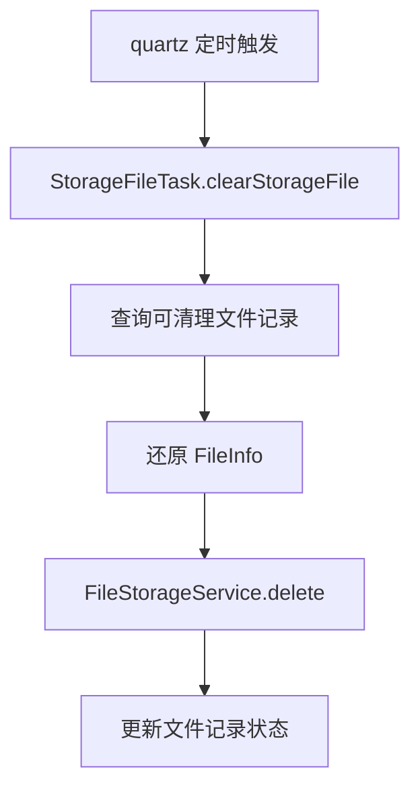

# 增加存储文件清理任务

## 1. 改造目标

本篇文档对应一次独立 git 提交，用原代码和现代码对比说明本次改造。

核心目标：

- 新增文件清理定时任务
- 按临时文件、待删除文件和分片文件分别清理
- 通过 SQL 初始化定时任务配置

## 改造前存在的问题

- 文件上传后如果业务保存失败或用户替换旧文件，容易留下孤儿文件
- 临时文件和分片文件如果长期不清理，会持续占用本地磁盘或对象存储容量
- 删除逻辑如果写在业务接口里，容易影响主流程稳定性

## 改造后的解决方案

- 在 quartz 模块新增 `StorageFileTask` 定时任务
- 定时查询可清理的临时文件、待删除文件和过期分片文件
- 真实删除交给 X File Storage，文件状态更新交给文件记录服务

## 总体链路



提交：

```
4ffd4e28 增加存储文件清理任务
```

## 2. 涉及文件

- `ruoyi-quartz/pom.xml`
- `ruoyi-quartz/src/main/java/com/ruoyi/quartz/task/StorageFileTask.java`

## 3. 改动点清单

- ruoyi-quartz 增加对 ruoyi-system 的依赖
- 新增 StorageFileTask 调用文件服务清理过期文件
- SQL 新增并启用文件清理定时任务

## 4. ruoyi-quartz/pom.xml

### 涉及改动部分

POM 文件只展示依赖或版本的插入位置，不展开完整原代码和现代码。

### 改动说明

- `ruoyi-quartz` 增加 `ruoyi-system` 依赖，因为清理任务需要调用文件记录服务
- 定时任务仍保留在 quartz 模块，业务删除逻辑收敛到 system 服务

## 5. ruoyi-quartz/src/main/java/com/ruoyi/quartz/task/StorageFileTask.java

### 原代码

```text
本次新增，提交前不存在该文件
```

### 现代码

```java
package com.ruoyi.quartz.task;

import java.util.List;
import org.dromara.x.file.storage.core.FileInfo;
import org.dromara.x.file.storage.core.FileStorageService;
import org.slf4j.Logger;
import org.slf4j.LoggerFactory;
import org.springframework.stereotype.Component;
import com.ruoyi.system.domain.SysStorageFile;
import com.ruoyi.system.service.ISysStorageFileService;

/**
 * 存储文件清理任务
 * <p>
 * 定时清理超时临时文件和已经到期的待删除文件，避免对象存储长期堆积孤儿文件
 *
 * @author ruoyi
 */
@Component("storageFileTask")
public class StorageFileTask
{
    private static final Logger log = LoggerFactory.getLogger(StorageFileTask.class);

    private final ISysStorageFileService storageFileService;

    private final FileStorageService fileStorageService;

    /**
     * 构造存储文件清理任务
     *
     * @param storageFileService 存储文件记录服务
     * @param fileStorageService X File Storage 统一存储服务
     */
    public StorageFileTask(ISysStorageFileService storageFileService, FileStorageService fileStorageService)
    {
        this.storageFileService = storageFileService;
        this.fileStorageService = fileStorageService;
    }

    /**
     * 清理过期存储文件
     */
    public void clearStorageFile()
    {
        // 无参任务使用配置文件中的临时文件过期时间
        clearStorageFile(null);
    }

    /**
     * 清理过期存储文件
     *
     * @param tempExpireHours 临时文件过期小时数
     */
    public void clearStorageFile(Integer tempExpireHours)
    {
        // 未传入过期时间或参数非法时交给服务层读取 ruoyi.storage-file.temp-expire-hours
        int expireHours = tempExpireHours == null ? 0 : tempExpireHours;
        // 查询临时过期和待删除到期的文件记录
        List<SysStorageFile> storageFiles = storageFileService.selectCleanableStorageFiles(expireHours);
        for (SysStorageFile storageFile : storageFiles)
        {
            try
            {
                // 数据库记录还原为 FileInfo 后，框架才能定位具体平台和对象路径
                FileInfo fileInfo = storageFileService.toFileInfo(storageFile);
                if (fileInfo == null)
                {
                    continue;
                }
                // 删除原图和缩略图，成功后 FileRecorder.delete 会把记录标记为已删除
                fileStorageService.delete(fileInfo);
            }
            catch (Exception e)
            {
                // 单个文件删除失败不影响后续文件，避免一次异常中断整批清理
                log.warn("清理存储文件失败，url={}", storageFile.getUrl(), e);
            }
        }
    }
}
```

### 涉及改动部分

```java
// 省略
package com.ruoyi.quartz.task;

import java.util.List;
import org.dromara.x.file.storage.core.FileInfo;
import org.dromara.x.file.storage.core.FileStorageService;
import org.slf4j.Logger;
import org.slf4j.LoggerFactory;
import org.springframework.stereotype.Component;
import com.ruoyi.system.domain.SysStorageFile;
import com.ruoyi.system.service.ISysStorageFileService;

/**
 * 存储文件清理任务
 * <p>
 * 定时清理超时临时文件和已经到期的待删除文件，避免对象存储长期堆积孤儿文件
 *
 * @author ruoyi
 */
@Component("storageFileTask")
public class StorageFileTask
{
    private static final Logger log = LoggerFactory.getLogger(StorageFileTask.class);

    private final ISysStorageFileService storageFileService;

    private final FileStorageService fileStorageService;

    /**
     * 构造存储文件清理任务
     *
     * @param storageFileService 存储文件记录服务
     * @param fileStorageService X File Storage 统一存储服务
     */
    public StorageFileTask(ISysStorageFileService storageFileService, FileStorageService fileStorageService)
    {
        this.storageFileService = storageFileService;
        this.fileStorageService = fileStorageService;
    }

    /**
     * 清理过期存储文件
     */
    public void clearStorageFile()
    {
        // 无参任务使用配置文件中的临时文件过期时间
        clearStorageFile(null);
    }

    /**
     * 清理过期存储文件
     *
     * @param tempExpireHours 临时文件过期小时数
     */
    public void clearStorageFile(Integer tempExpireHours)
    {
        // 未传入过期时间或参数非法时交给服务层读取 ruoyi.storage-file.temp-expire-hours
        int expireHours = tempExpireHours == null ? 0 : tempExpireHours;
        // 查询临时过期和待删除到期的文件记录
        List<SysStorageFile> storageFiles = storageFileService.selectCleanableStorageFiles(expireHours);
        for (SysStorageFile storageFile : storageFiles)
        {
            try
            {
                // 数据库记录还原为 FileInfo 后，框架才能定位具体平台和对象路径
                FileInfo fileInfo = storageFileService.toFileInfo(storageFile);
                if (fileInfo == null)
                {
                    continue;
                }
                // 删除原图和缩略图，成功后 FileRecorder.delete 会把记录标记为已删除
                fileStorageService.delete(fileInfo);
            }
            catch (Exception e)
            {
                // 单个文件删除失败不影响后续文件，避免一次异常中断整批清理
                log.warn("清理存储文件失败，url={}", storageFile.getUrl(), e);
            }
        }
    }
}
```
### 改动说明

- 新增 `storageFileTask` 定时任务 Bean
- 定时查询过期临时文件、待删除文件和过期分片文件
- 清理真实文件后同步更新文件记录状态

## 变更小结

本篇只记录该提交自身涉及的代码和配置变化，不混入其它提交。


