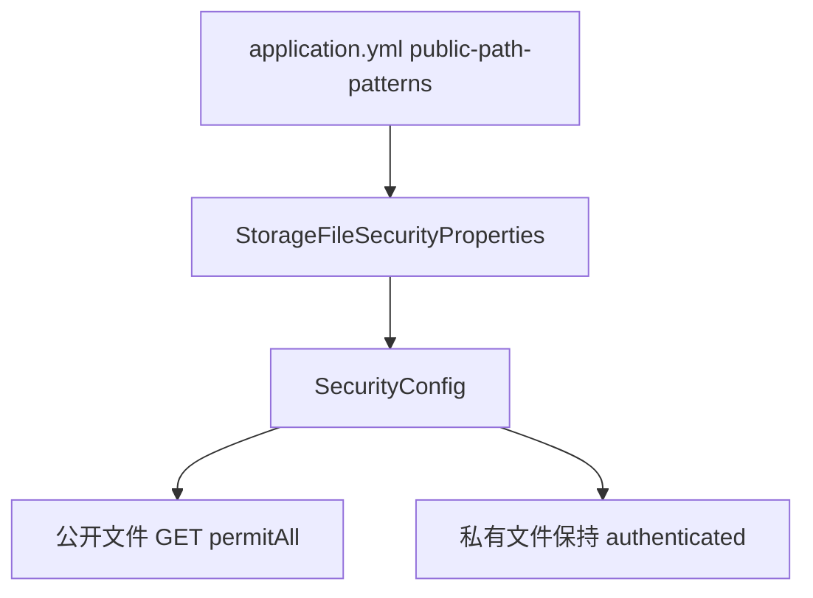

# 增加存储文件访问策略配置

## 1. 改造目标

本篇文档对应一次独立 git 提交，用原代码和现代码对比说明本次改造。

核心目标：

- 新增文件访问安全配置
- 公开路径由配置文件控制
- 私有文件不直接放行静态访问，后续走后端下载入口

## 改造前存在的问题

- 如果在 Spring Security 中直接放行 `/file/**`，私有文件也会被匿名访问入口覆盖
- 如果完全不放行文件路径，公开图片、公开附件又无法直接回显
- 公开或私有访问策略写死在代码里，不方便按环境调整

## 改造后的解决方案

- 新增 `StorageFileSecurityProperties` 读取公开文件访问路径
- Spring Security 只放行配置中的公开 GET 路径
- 私有路径继续走认证流程或后端下载接口

## 总体链路



提交：

```
487a2598 增加存储文件访问策略配置
```

## 2. 涉及文件

- `ruoyi-framework/src/main/java/com/ruoyi/framework/config/SecurityConfig.java`
- `ruoyi-framework/src/main/java/com/ruoyi/framework/config/properties/StorageFileSecurityProperties.java`

## 3. 改动点清单

- 新增 StorageFileSecurityProperties 读取公开访问路径
- SecurityConfig 注入访问策略配置
- 静态放行路径从固定 /file/** 改为配置驱动

## 4. ruoyi-framework/src/main/java/com/ruoyi/framework/config/SecurityConfig.java

### 原代码

```java
package com.ruoyi.framework.config;

import org.springframework.beans.factory.annotation.Autowired;
import org.springframework.context.annotation.Bean;
import org.springframework.context.annotation.Configuration;
import org.springframework.http.HttpMethod;
import org.springframework.security.authentication.AuthenticationManager;
import org.springframework.security.config.annotation.authentication.configuration.AuthenticationConfiguration;
import org.springframework.security.config.annotation.method.configuration.EnableMethodSecurity;
import org.springframework.security.config.annotation.web.builders.HttpSecurity;
import org.springframework.security.config.http.SessionCreationPolicy;
import org.springframework.security.crypto.bcrypt.BCryptPasswordEncoder;
import org.springframework.security.web.SecurityFilterChain;
import org.springframework.security.web.authentication.UsernamePasswordAuthenticationFilter;
import org.springframework.security.web.authentication.logout.LogoutFilter;
import org.springframework.web.filter.CorsFilter;
import com.ruoyi.framework.config.properties.PermitAllUrlProperties;
import com.ruoyi.framework.security.filter.JwtAuthenticationTokenFilter;
import com.ruoyi.framework.security.handle.AuthenticationEntryPointImpl;
import com.ruoyi.framework.security.handle.LogoutSuccessHandlerImpl;

/**
 * spring security配置
 * 
 * @author ruoyi
 */
@EnableMethodSecurity(prePostEnabled = true, securedEnabled = true)
@Configuration
public class SecurityConfig
{
    /**
     * 认证失败处理类
     */
    @Autowired
    private AuthenticationEntryPointImpl unauthorizedHandler;

    /**
     * 退出处理类
     */
    @Autowired
    private LogoutSuccessHandlerImpl logoutSuccessHandler;

    /**
     * token认证过滤器
     */
    @Autowired
    private JwtAuthenticationTokenFilter authenticationTokenFilter;
    
    /**
     * 跨域过滤器
     */
    @Autowired
    private CorsFilter corsFilter;

    /**
     * 允许匿名访问的地址
     */
    @Autowired
    private PermitAllUrlProperties permitAllUrl;

	/**
	 * 身份验证实现
	 */
	@Bean
	public AuthenticationManager authenticationManager(AuthenticationConfiguration authenticationConfiguration) throws Exception 
	{
		return authenticationConfiguration.getAuthenticationManager();
	}

    /**
     * anyRequest          |   匹配所有请求路径
     * access              |   SpringEl表达式结果为true时可以访问
     * anonymous           |   匿名可以访问
     * denyAll             |   用户不能访问
     * fullyAuthenticated  |   用户完全认证可以访问（非remember-me下自动登录）
     * hasAnyAuthority     |   如果有参数，参数表示权限，则其中任何一个权限可以访问
     * hasAnyRole          |   如果有参数，参数表示角色，则其中任何一个角色可以访问
     * hasAuthority        |   如果有参数，参数表示权限，则其权限可以访问
     * hasIpAddress        |   如果有参数，参数表示IP地址，如果用户IP和参数匹配，则可以访问
     * hasRole             |   如果有参数，参数表示角色，则其角色可以访问
     * permitAll           |   用户可以任意访问
     * rememberMe          |   允许通过remember-me登录的用户访问
     * authenticated       |   用户登录后可访问
     */
    @Bean
    protected SecurityFilterChain filterChain(HttpSecurity httpSecurity) throws Exception
    {
        return httpSecurity
            // CSRF禁用，因为不使用session
            .csrf(csrf -> csrf.disable())
            // 禁用HTTP响应标头
            .headers((headersCustomizer) -> {
                headersCustomizer.cacheControl(cache -> cache.disable()).frameOptions(options -> options.sameOrigin());
            })
            // 认证失败处理类
            .exceptionHandling(exception -> exception.authenticationEntryPoint(unauthorizedHandler))
            // 基于token，所以不需要session
            .sessionManagement(session -> session.sessionCreationPolicy(SessionCreationPolicy.STATELESS))
            // 注解标记允许匿名访问的url
            .authorizeHttpRequests((requests) -> {
                permitAllUrl.getUrls().forEach(url -> requests.requestMatchers(url).permitAll());
                // 对于登录login 注册register 验证码captchaImage 允许匿名访问
                requests.requestMatchers("/login", "/register", "/captchaImage").permitAll()
                    // 静态资源，可匿名访问
                    .requestMatchers(HttpMethod.GET, "/", "/*.html", "/**.html", "/**.css", "/**.js", "/profile/**").permitAll()
                    // Knife4j依赖 /doc.html、/webjars/** 和 springdoc 的 /v3/api-docs/**，放行后才能匿名打开接口文档
                    .requestMatchers("/doc.html", "/webjars/**", "/swagger-ui.html", "/v3/api-docs/**", "/swagger-ui/**", "/druid/**").permitAll()
                    // 除上面外的所有请求全部需要鉴权认证
                    .anyRequest().authenticated();
            })
            // 添加Logout filter
            .logout(logout -> logout.logoutUrl("/logout").logoutSuccessHandler(logoutSuccessHandler))
            // 添加JWT filter
            .addFilterBefore(authenticationTokenFilter, UsernamePasswordAuthenticationFilter.class)
            // 添加CORS filter
            .addFilterBefore(corsFilter, JwtAuthenticationTokenFilter.class)
            .addFilterBefore(corsFilter, LogoutFilter.class)
            .build();
    }

    /**
     * 强散列哈希加密实现
     */
    @Bean
    public BCryptPasswordEncoder bCryptPasswordEncoder()
    {
        return new BCryptPasswordEncoder();
    }
}
```

### 现代码

```java
package com.ruoyi.framework.config;

import org.springframework.beans.factory.annotation.Autowired;
import org.springframework.context.annotation.Bean;
import org.springframework.context.annotation.Configuration;
import org.springframework.http.HttpMethod;
import org.springframework.security.authentication.AuthenticationManager;
import org.springframework.security.config.annotation.authentication.configuration.AuthenticationConfiguration;
import org.springframework.security.config.annotation.method.configuration.EnableMethodSecurity;
import org.springframework.security.config.annotation.web.builders.HttpSecurity;
import org.springframework.security.config.http.SessionCreationPolicy;
import org.springframework.security.crypto.bcrypt.BCryptPasswordEncoder;
import org.springframework.security.web.SecurityFilterChain;
import org.springframework.security.web.authentication.UsernamePasswordAuthenticationFilter;
import org.springframework.security.web.authentication.logout.LogoutFilter;
import org.springframework.web.filter.CorsFilter;
import com.ruoyi.framework.config.properties.PermitAllUrlProperties;
import com.ruoyi.framework.config.properties.StorageFileSecurityProperties;
import com.ruoyi.framework.security.filter.JwtAuthenticationTokenFilter;
import com.ruoyi.framework.security.handle.AuthenticationEntryPointImpl;
import com.ruoyi.framework.security.handle.LogoutSuccessHandlerImpl;

/**
 * spring security配置
 * 
 * @author ruoyi
 */
@EnableMethodSecurity(prePostEnabled = true, securedEnabled = true)
@Configuration
public class SecurityConfig
{
    /**
     * 认证失败处理类
     */
    @Autowired
    private AuthenticationEntryPointImpl unauthorizedHandler;

    /**
     * 退出处理类
     */
    @Autowired
    private LogoutSuccessHandlerImpl logoutSuccessHandler;

    /**
     * token认证过滤器
     */
    @Autowired
    private JwtAuthenticationTokenFilter authenticationTokenFilter;
    
    /**
     * 跨域过滤器
     */
    @Autowired
    private CorsFilter corsFilter;

    /**
     * 允许匿名访问的地址
     */
    @Autowired
    private PermitAllUrlProperties permitAllUrl;

    /**
     * 公开文件访问路径
     * <p>
     * 只放行配置中的公开路径，私有路径继续进入登录认证
     */
    @Autowired
    private StorageFileSecurityProperties storageFileSecurityProperties;

	/**
	 * 身份验证实现
	 */
	@Bean
	public AuthenticationManager authenticationManager(AuthenticationConfiguration authenticationConfiguration) throws Exception 
	{
		return authenticationConfiguration.getAuthenticationManager();
	}

    /**
     * anyRequest          |   匹配所有请求路径
     * access              |   SpringEl表达式结果为true时可以访问
     * anonymous           |   匿名可以访问
     * denyAll             |   用户不能访问
     * fullyAuthenticated  |   用户完全认证可以访问（非remember-me下自动登录）
     * hasAnyAuthority     |   如果有参数，参数表示权限，则其中任何一个权限可以访问
     * hasAnyRole          |   如果有参数，参数表示角色，则其中任何一个角色可以访问
     * hasAuthority        |   如果有参数，参数表示权限，则其权限可以访问
     * hasIpAddress        |   如果有参数，参数表示IP地址，如果用户IP和参数匹配，则可以访问
     * hasRole             |   如果有参数，参数表示角色，则其角色可以访问
     * permitAll           |   用户可以任意访问
     * rememberMe          |   允许通过remember-me登录的用户访问
     * authenticated       |   用户登录后可访问
     */
    @Bean
    protected SecurityFilterChain filterChain(HttpSecurity httpSecurity) throws Exception
    {
        return httpSecurity
            // CSRF禁用，因为不使用session
            .csrf(csrf -> csrf.disable())
            // 禁用HTTP响应标头
            .headers((headersCustomizer) -> {
                headersCustomizer.cacheControl(cache -> cache.disable()).frameOptions(options -> options.sameOrigin());
            })
            // 认证失败处理类
            .exceptionHandling(exception -> exception.authenticationEntryPoint(unauthorizedHandler))
            // 基于token，所以不需要session
            .sessionManagement(session -> session.sessionCreationPolicy(SessionCreationPolicy.STATELESS))
            // 注解标记允许匿名访问的url
            .authorizeHttpRequests((requests) -> {
                permitAllUrl.getUrls().forEach(url -> requests.requestMatchers(url).permitAll());
                // 对于登录login 注册register 验证码captchaImage 允许匿名访问
                requests.requestMatchers("/login", "/register", "/captchaImage").permitAll();
                // 静态资源和若依历史 /profile 本地资源继续允许匿名访问
                requests.requestMatchers(HttpMethod.GET, "/", "/*.html", "/**.html", "/**.css", "/**.js", "/profile/**").permitAll();
                String[] publicPathPatterns = getStorageFilePublicPathPatterns();
                if (publicPathPatterns.length > 0)
                {
                    // 只放行公开文件路径，例如 /file/upload/public/**
                    requests.requestMatchers(HttpMethod.GET, publicPathPatterns).permitAll();
                }
                // Knife4j依赖 /doc.html、/webjars/** 和 springdoc 的 /v3/api-docs/**，放行后才能匿名打开接口文档
                requests.requestMatchers("/doc.html", "/webjars/**", "/swagger-ui.html", "/v3/api-docs/**", "/swagger-ui/**", "/druid/**").permitAll();
                // 除上面外的所有请求全部需要鉴权认证
                requests.anyRequest().authenticated();
            })
            // 添加Logout filter
            .logout(logout -> logout.logoutUrl("/logout").logoutSuccessHandler(logoutSuccessHandler))
            // 添加JWT filter
            .addFilterBefore(authenticationTokenFilter, UsernamePasswordAuthenticationFilter.class)
            // 添加CORS filter
            .addFilterBefore(corsFilter, JwtAuthenticationTokenFilter.class)
            .addFilterBefore(corsFilter, LogoutFilter.class)
            .build();
    }

    /**
     * 强散列哈希加密实现
     */
    @Bean
    public BCryptPasswordEncoder bCryptPasswordEncoder()
    {
        return new BCryptPasswordEncoder();
    }

    /**
     * 获取公开文件访问路径
     *
     * @return 已清洗的公开文件访问路径
     */
    private String[] getStorageFilePublicPathPatterns()
    {
        // 过滤空配置，允许通过空列表关闭所有 X File Storage 匿名访问
        if (storageFileSecurityProperties.getPublicPathPatterns() == null)
        {
            return new String[0];
        }
        return storageFileSecurityProperties.getPublicPathPatterns().stream()
                .map(String::trim)
                .filter(pattern -> !pattern.isEmpty())
                .toArray(String[]::new);
    }
}
```

### 涉及改动部分

#### 改动后代码 1

```java
// 省略
    @Autowired
    private PermitAllUrlProperties permitAllUrl;
    @Autowired
    private StorageFileSecurityProperties storageFileSecurityProperties;
// 省略
```

#### 改动后代码 2

```java
// 省略
            .authorizeHttpRequests((requests) -> {
                permitAllUrl.getUrls().forEach(url -> requests.requestMatchers(url).permitAll());
                requests.requestMatchers("/login", "/register", "/captchaImage").permitAll();
                requests.requestMatchers(HttpMethod.GET, "/", "/*.html", "/**.html", "/**.css", "/**.js", "/profile/**").permitAll();
                String[] publicPathPatterns = getStorageFilePublicPathPatterns();
                if (publicPathPatterns.length > 0)
                {
                    requests.requestMatchers(HttpMethod.GET, publicPathPatterns).permitAll();
                }
                requests.requestMatchers("/doc.html", "/webjars/**", "/swagger-ui.html", "/v3/api-docs/**", "/swagger-ui/**", "/druid/**").permitAll();
                requests.anyRequest().authenticated();
            })
            .logout(logout -> logout.logoutUrl("/logout").logoutSuccessHandler(logoutSuccessHandler))
// 省略
```

#### 改动后代码 3

```java
// 省略
    {
        return new BCryptPasswordEncoder();
    }
    private String[] getStorageFilePublicPathPatterns()
    {
        if (storageFileSecurityProperties.getPublicPathPatterns() == null)
        {
            return new String[0];
        }
        return storageFileSecurityProperties.getPublicPathPatterns().stream()
                .map(String::trim)
                .filter(pattern -> !pattern.isEmpty())
                .toArray(String[]::new);
    }
}
// 省略
```

### 改动说明

- 注入 `StorageFileSecurityProperties`，从配置读取公开文件路径
- 静态资源放行保留 `/profile/**`，但不再硬编码放行全部 `/file/**`
- 配置为空时不额外放行 X File Storage 文件路径

## 5. ruoyi-framework/src/main/java/com/ruoyi/framework/config/properties/StorageFileSecurityProperties.java

### 原代码

```text
本次新增，提交前不存在该文件
```

### 现代码

```java
package com.ruoyi.framework.config.properties;

import java.util.ArrayList;
import java.util.List;
import org.springframework.boot.context.properties.ConfigurationProperties;
import org.springframework.stereotype.Component;

/**
 * 存储文件安全配置
 * <p>
 * 用于控制哪些 X File Storage 访问路径允许匿名访问
 *
 * @author ruoyi
 */
@Component
@ConfigurationProperties(prefix = "ruoyi.storage-file")
public class StorageFileSecurityProperties
{
    /** 公开文件访问路径 */
    private List<String> publicPathPatterns = new ArrayList<String>();

    public List<String> getPublicPathPatterns()
    {
        return publicPathPatterns;
    }

    public void setPublicPathPatterns(List<String> publicPathPatterns)
    {
        this.publicPathPatterns = publicPathPatterns;
    }
}
```

### 涉及改动部分

```java
// 省略
package com.ruoyi.framework.config.properties;

import java.util.ArrayList;
import java.util.List;
import org.springframework.boot.context.properties.ConfigurationProperties;
import org.springframework.stereotype.Component;

/**
 * 存储文件安全配置
 * <p>
 * 用于控制哪些 X File Storage 访问路径允许匿名访问
 *
 * @author ruoyi
 */
@Component
@ConfigurationProperties(prefix = "ruoyi.storage-file")
public class StorageFileSecurityProperties
{
    /** 公开文件访问路径 */
    private List<String> publicPathPatterns = new ArrayList<String>();

    public List<String> getPublicPathPatterns()
    {
        return publicPathPatterns;
    }

    public void setPublicPathPatterns(List<String> publicPathPatterns)
    {
        this.publicPathPatterns = publicPathPatterns;
    }
}
```
### 改动说明

- 新增文件访问安全配置类
- `publicPathPatterns` 用于声明哪些文件路径允许匿名 GET 访问

## 变更小结

本篇只记录该提交自身涉及的代码和配置变化，不混入其它提交。


