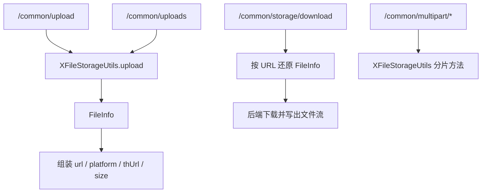

# 改造通用文件上传接口

## 1. 改造目标

本篇文档对应一次独立 git 提交，用原代码和现代码对比说明本次改造。

核心目标：

- 通用上传接口接入 XFileStorageUtils
- 支持平台、上传场景、缩略图参数
- 多文件上传返回 fileList 数组
- 新增大文件分片上传和私有文件下载接口

## 改造前存在的问题

- `/common/upload` 和 `/common/uploads` 只能走若依本地上传，不能指定 OSS、MinIO、COS 等平台
- 多文件上传返回逗号拼接字符串，前端解析不直观，也不方便携带平台、大小、缩略图等元数据
- 私有文件不能直接通过对象存储 URL 访问，需要后端下载入口承接鉴权
- 没有通用分片上传接口，大文件上传缺少统一入口

## 改造后的解决方案

- 通用上传接口统一调用 `XFileStorageUtils`
- 上传参数支持 `platform`、`uploadScene`、`thumbnail`、`thumbnailWidth`、`thumbnailHeight`
- 多文件上传返回 `fileList` 数组，每个文件带 URL、平台、大小、Content-Type、缩略图等信息
- 新增私有文件下载接口和分片上传接口

## 总体链路



提交：

```
cdabb7b3 改造通用文件上传接口
```

## 2. 涉及文件

- `ruoyi-admin/src/main/java/com/ruoyi/web/controller/common/CommonController.java`

## 3. 改动点清单

- CommonController 上传接口改为调用 XFileStorageUtils
- 新增 platform、uploadScene、thumbnail 等上传参数
- 多文件上传返回 fileList 数组
- 新增分片上传接口和存储文件下载接口

## 4. ruoyi-admin/src/main/java/com/ruoyi/web/controller/common/CommonController.java

### 原代码

```java
package com.ruoyi.web.controller.common;

import java.util.ArrayList;
import java.util.List;
import jakarta.servlet.http.HttpServletRequest;
import jakarta.servlet.http.HttpServletResponse;
import org.slf4j.Logger;
import org.slf4j.LoggerFactory;
import org.springframework.beans.factory.annotation.Autowired;
import org.springframework.http.MediaType;
import org.springframework.web.bind.annotation.GetMapping;
import org.springframework.web.bind.annotation.PostMapping;
import org.springframework.web.bind.annotation.RequestMapping;
import org.springframework.web.bind.annotation.RestController;
import org.springframework.web.multipart.MultipartFile;
import com.ruoyi.common.config.RuoYiConfig;
import com.ruoyi.common.core.domain.AjaxResult;
import com.ruoyi.common.utils.StringUtils;
import com.ruoyi.common.utils.file.FileUploadUtils;
import com.ruoyi.common.utils.file.FileUtils;
import com.ruoyi.framework.config.ServerConfig;

/**
 * 通用请求处理
 * 
 * @author ruoyi
 */
@RestController
@RequestMapping("/common")
public class CommonController
{
    private static final Logger log = LoggerFactory.getLogger(CommonController.class);

    @Autowired
    private ServerConfig serverConfig;

    private static final String FILE_DELIMITER = ",";

    /**
     * 通用下载请求
     * 
     * @param fileName 文件名称
     * @param delete 是否删除
     */
    @GetMapping("/download")
    public void fileDownload(String fileName, Boolean delete, HttpServletResponse response, HttpServletRequest request)
    {
        try
        {
            if (!FileUtils.checkAllowDownload(fileName))
            {
                throw new Exception(StringUtils.format("文件名称({})非法，不允许下载。 ", fileName));
            }
            String realFileName = System.currentTimeMillis() + fileName.substring(fileName.indexOf("_") + 1);
            String filePath = RuoYiConfig.getDownloadPath() + fileName;

            response.setContentType(MediaType.APPLICATION_OCTET_STREAM_VALUE);
            FileUtils.setAttachmentResponseHeader(response, realFileName);
            FileUtils.writeBytes(filePath, response.getOutputStream());
            if (delete)
            {
                FileUtils.deleteFile(filePath);
            }
        }
        catch (Exception e)
        {
            log.error("下载文件失败", e);
        }
    }

    /**
     * 通用上传请求（单个）
     */
    @PostMapping("/upload")
    public AjaxResult uploadFile(MultipartFile file) throws Exception
    {
        try
        {
            // 上传文件路径
            String filePath = RuoYiConfig.getUploadPath();
            // 上传并返回新文件名称
            String fileName = FileUploadUtils.upload(filePath, file);
            String url = serverConfig.getUrl() + fileName;
            AjaxResult ajax = AjaxResult.success();
            ajax.put("url", url);
            ajax.put("fileName", fileName);
            ajax.put("newFileName", FileUtils.getName(fileName));
            ajax.put("originalFilename", file.getOriginalFilename());
            return ajax;
        }
        catch (Exception e)
        {
            return AjaxResult.error(e.getMessage());
        }
    }

    /**
     * 通用上传请求（多个）
     */
    @PostMapping("/uploads")
    public AjaxResult uploadFiles(List<MultipartFile> files) throws Exception
    {
        try
        {
            // 上传文件路径
            String filePath = RuoYiConfig.getUploadPath();
            List<String> urls = new ArrayList<String>();
            List<String> fileNames = new ArrayList<String>();
            List<String> newFileNames = new ArrayList<String>();
            List<String> originalFilenames = new ArrayList<String>();
            for (MultipartFile file : files)
            {
                // 上传并返回新文件名称
                String fileName = FileUploadUtils.upload(filePath, file);
                String url = serverConfig.getUrl() + fileName;
                urls.add(url);
                fileNames.add(fileName);
                newFileNames.add(FileUtils.getName(fileName));
                originalFilenames.add(file.getOriginalFilename());
            }
            AjaxResult ajax = AjaxResult.success();
            ajax.put("urls", StringUtils.join(urls, FILE_DELIMITER));
            ajax.put("fileNames", StringUtils.join(fileNames, FILE_DELIMITER));
            ajax.put("newFileNames", StringUtils.join(newFileNames, FILE_DELIMITER));
            ajax.put("originalFilenames", StringUtils.join(originalFilenames, FILE_DELIMITER));
            return ajax;
        }
        catch (Exception e)
        {
            return AjaxResult.error(e.getMessage());
        }
    }

    /**
     * 本地资源通用下载
     */
    @GetMapping("/download/resource")
    public void resourceDownload(String resource, HttpServletRequest request, HttpServletResponse response)
            throws Exception
    {
        try
        {
            if (!FileUtils.checkAllowDownload(resource))
            {
                throw new Exception(StringUtils.format("资源文件({})非法，不允许下载。 ", resource));
            }
            // 本地资源路径
            String localPath = RuoYiConfig.getProfile();
            // 数据库资源地址
            String downloadPath = localPath + FileUtils.stripPrefix(resource);
            // 下载名称
            String downloadName = StringUtils.substringAfterLast(downloadPath, "/");
            response.setContentType(MediaType.APPLICATION_OCTET_STREAM_VALUE);
            FileUtils.setAttachmentResponseHeader(response, downloadName);
            FileUtils.writeBytes(downloadPath, response.getOutputStream());
        }
        catch (Exception e)
        {
            log.error("下载文件失败", e);
        }
    }
}
```

### 现代码

```java
package com.ruoyi.web.controller.common;

import java.util.ArrayList;
import java.util.LinkedHashMap;
import java.util.List;
import java.util.Map;
import jakarta.servlet.http.HttpServletRequest;
import jakarta.servlet.http.HttpServletResponse;
import org.slf4j.Logger;
import org.slf4j.LoggerFactory;
import org.dromara.x.file.storage.core.FileInfo;
import org.dromara.x.file.storage.core.upload.FilePartInfo;
import org.dromara.x.file.storage.core.upload.FilePartInfoList;
import org.dromara.x.file.storage.core.upload.MultipartUploadSupportInfo;
import org.springframework.http.MediaType;
import org.springframework.web.bind.annotation.GetMapping;
import org.springframework.web.bind.annotation.PostMapping;
import org.springframework.web.bind.annotation.RequestMapping;
import org.springframework.web.bind.annotation.RequestParam;
import org.springframework.web.bind.annotation.RestController;
import org.springframework.web.multipart.MultipartFile;
import com.ruoyi.common.config.RuoYiConfig;
import com.ruoyi.common.core.domain.AjaxResult;
import com.ruoyi.common.utils.StringUtils;
import com.ruoyi.common.utils.file.FileUtils;
import com.ruoyi.common.utils.file.MimeTypeUtils;
import com.ruoyi.common.utils.file.XFileStorageUtils;

/**
 * 通用文件接口
 * <p>
 * 下载接口仍沿用若依原来的本地文件流程；上传接口统一交给
 * {@link XFileStorageUtils} 处理，因此调用方既可以使用配置中的默认平台
 * 也可以通过 platform 参数指定 local-1、aliyun-oss-1、minio-1 等存储平台
 *
 * @author ruoyi
 */
@RestController
@RequestMapping("/common")
public class CommonController
{
    private static final Logger log = LoggerFactory.getLogger(CommonController.class);

    /**
     * X File Storage 适配工具
     * <p>
     * 控制器不直接调用第三方上传 API，而是通过该工具统一复用若依的校验
     * 命名规则和平台选择逻辑
     */
    private final XFileStorageUtils xFileStorageUtils;

    /**
     * 构造器注入上传工具，明确当前控制器依赖的文件存储能力
     *
     * @param xFileStorageUtils 统一上传工具
     */
    public CommonController(XFileStorageUtils xFileStorageUtils)
    {
        this.xFileStorageUtils = xFileStorageUtils;
    }

    /**
     * 从若依本地下载目录下载导出文件
     * <p>
     * 该接口主要服务导出、临时文件下载等本地流程，所以继续保留若依原来的
     * 本地文件读取方式，不走对象存储
     *
     * @param fileName 下载目录下的相对文件名
     * @param delete 下载完成后是否删除本地临时文件
     * @param response 用于输出文件流的响应对象
     * @param request 当前请求对象，保留原始签名兼容性
     */
    @GetMapping("/download")
    public void fileDownload(String fileName, Boolean delete, HttpServletResponse response, HttpServletRequest request)
    {
        try
        {
            // 下载前先校验文件名，避免路径穿越和非法扩展名
            if (!FileUtils.checkAllowDownload(fileName))
            {
                throw new Exception(StringUtils.format("文件名称({})非法，不允许下载。 ", fileName));
            }
            // 导出文件名通常带时间戳前缀，这里生成浏览器看到的真实下载名
            String realFileName = System.currentTimeMillis() + fileName.substring(fileName.indexOf("_") + 1);
            // 拼接若依本地下载目录中的真实文件路径
            String filePath = RuoYiConfig.getDownloadPath() + fileName;

            // 设置附件响应头并把本地文件写入响应流
            response.setContentType(MediaType.APPLICATION_OCTET_STREAM_VALUE);
            FileUtils.setAttachmentResponseHeader(response, realFileName);
            FileUtils.writeBytes(filePath, response.getOutputStream());
            if (delete)
            {
                // 临时导出文件按调用方要求在下载后删除
                FileUtils.deleteFile(filePath);
            }
        }
        catch (Exception e)
        {
            log.error("下载文件失败", e);
        }
    }

    /**
     * 通用单文件上传
     * <p>
     * platform 为空时使用 {@code dromara.x-file-storage.default-platform}
     * 配置的默认平台；platform 不为空时必须匹配 application.yml 中已启用的
     * 存储平台标识
     *
     * @param file 前端上传的文件
     * @param platform 可选存储平台标识，例如 local-1、aliyun-oss-1、minio-1
     * @param uploadScene 可选上传场景编码，例如 avatar、contract、importExcel
     * @param thumbnail 是否生成缩略图，仅图片文件支持
     * @param thumbnailWidth 缩略图宽度，为空时使用框架默认尺寸
     * @param thumbnailHeight 缩略图高度，为空时使用框架默认尺寸
     * @return 兼容若依前端的上传结果，并额外返回实际使用的平台和缩略图地址
     */
    @PostMapping("/upload")
    public AjaxResult uploadFile(MultipartFile file, @RequestParam(value = "platform", required = false) String platform,
            @RequestParam(value = "uploadScene", required = false) String uploadScene,
            @RequestParam(value = "thumbnail", defaultValue = "false") Boolean thumbnail,
            @RequestParam(value = "thumbnailWidth", required = false) Integer thumbnailWidth,
            @RequestParam(value = "thumbnailHeight", required = false) Integer thumbnailHeight) throws Exception
    {
        try
        {
            // platform 为空时走默认平台，不为空时上传到指定平台
            // uploadScene 不为空时按场景配置覆盖大小、格式和缩略图规则
            FileInfo fileInfo = xFileStorageUtils.upload(file, platform, uploadScene, MimeTypeUtils.DEFAULT_ALLOWED_EXTENSION,
                    Boolean.TRUE.equals(thumbnail), thumbnailWidth, thumbnailHeight);
            // 远程 URL 是前端直接访问和保存的主地址
            String url = fileInfo.getUrl();
            AjaxResult ajax = AjaxResult.success();
            // 单文件上传继续返回平铺字段，方便前端直接读取
            ajax.put("url", url);
            ajax.put("fileName", url);
            ajax.put("newFileName", FileUtils.getName(url));
            ajax.put("originalFilename", file.getOriginalFilename());
            // 返回实际平台，便于确认默认平台解析结果和排查上传去向
            ajax.put("platform", fileInfo.getPlatform());
            // 返回当前上传场景，便于前端排查使用了哪套规则
            ajax.put("uploadScene", uploadScene);
            // 缩略图未生成时 thUrl 为空，前端可继续使用原图 URL
            ajax.put("thUrl", fileInfo.getThUrl());
            ajax.put("thFileName", fileInfo.getThUrl());
            ajax.put("thNewFileName", FileUtils.getName(fileInfo.getThUrl()));
            ajax.put("thSize", fileInfo.getThSize());
            ajax.put("size", fileInfo.getSize());
            ajax.put("contentType", fileInfo.getContentType());
            return ajax;
        }
        catch (Exception e)
        {
            return AjaxResult.error(e.getMessage());
        }
    }

    /**
     * 通用多文件上传
     * <p>
     * 本次请求内的多个文件会上传到同一个平台
     * 返回值使用 fileList 数组承载每个文件的完整元数据，前端无需再拆逗号字符串
     *
     * @param files 前端上传的文件集合
     * @param platform 可选存储平台标识，为空时使用默认平台
     * @param uploadScene 可选上传场景编码，例如 avatar、contract、importExcel
     * @param thumbnail 是否生成缩略图，仅图片文件支持
     * @param thumbnailWidth 缩略图宽度，为空时使用框架默认尺寸
     * @param thumbnailHeight 缩略图高度，为空时使用框架默认尺寸
     * @return 结构化文件列表
     */
    @PostMapping("/uploads")
    public AjaxResult uploadFiles(List<MultipartFile> files, @RequestParam(value = "platform", required = false) String platform,
            @RequestParam(value = "uploadScene", required = false) String uploadScene,
            @RequestParam(value = "thumbnail", defaultValue = "false") Boolean thumbnail,
            @RequestParam(value = "thumbnailWidth", required = false) Integer thumbnailWidth,
            @RequestParam(value = "thumbnailHeight", required = false) Integer thumbnailHeight) throws Exception
    {
        try
        {
            // 结构化文件列表给新前端使用，每个元素对应一个上传文件
            List<Map<String, Object>> fileList = new ArrayList<Map<String, Object>>();
            for (MultipartFile file : files)
            {
                // 每个文件使用同一个 platform 策略上传
                // uploadScene 不为空时按场景配置覆盖大小、格式和缩略图规则
                FileInfo fileInfo = xFileStorageUtils.upload(file, platform, uploadScene, MimeTypeUtils.DEFAULT_ALLOWED_EXTENSION,
                        Boolean.TRUE.equals(thumbnail), thumbnailWidth, thumbnailHeight);
                // 远程 URL 是前端保存和展示当前文件的主地址
                String url = fileInfo.getUrl();
                // 使用有序 Map 保持返回字段顺序稳定，便于前端联调和接口排查
                Map<String, Object> fileItem = new LinkedHashMap<String, Object>();
                fileItem.put("url", url);
                fileItem.put("fileName", url);
                fileItem.put("newFileName", FileUtils.getName(url));
                fileItem.put("originalFilename", file.getOriginalFilename());
                fileItem.put("platform", fileInfo.getPlatform());
                fileItem.put("uploadScene", uploadScene);
                fileItem.put("thUrl", fileInfo.getThUrl());
                fileItem.put("thFileName", fileInfo.getThUrl());
                fileItem.put("thNewFileName", FileUtils.getName(fileInfo.getThUrl()));
                fileItem.put("size", fileInfo.getSize());
                fileItem.put("thSize", fileInfo.getThSize());
                fileItem.put("contentType", fileInfo.getContentType());
                // 当前文件元数据组装完成后加入统一 fileList 返回
                fileList.add(fileItem);
            }
            // 只返回新的结构化 fileList，前端按数组逐项处理
            AjaxResult ajax = AjaxResult.success();
            ajax.put("fileList", fileList);
            return ajax;
        }
        catch (Exception e)
        {
            return AjaxResult.error(e.getMessage());
        }
    }

    /**
     * 查询平台是否支持大文件分片上传
     * <p>
     * platform 为空时查询默认平台；platform 不为空时查询指定平台
     *
     * @param platform 可选存储平台标识
     * @return 平台分片上传支持信息
     */
    @GetMapping("/multipart/support")
    public AjaxResult multipartSupport(@RequestParam(value = "platform", required = false) String platform)
    {
        // 支持能力由 X File Storage 根据当前平台适配器返回
        MultipartUploadSupportInfo supportInfo = xFileStorageUtils.isSupportMultipartUpload(platform);
        AjaxResult ajax = AjaxResult.success();
        ajax.put("platform", platform);
        ajax.put("support", supportInfo.getIsSupport());
        ajax.put("supportListParts", supportInfo.getIsSupportListParts());
        ajax.put("supportAbort", supportInfo.getIsSupportAbort());
        ajax.put("listPartsSupportMaxParts", supportInfo.getListPartsSupportMaxParts());
        return ajax;
    }

    /**
     * 初始化大文件分片上传
     * <p>
     * 前端在上传第一个分片前调用，返回的 url 和 uploadId 后续分片上传、合并、取消都要继续传回
     *
     * @param originalFilename 原始文件名
     * @param size 文件总大小
     * @param contentType 文件内容类型
     * @param platform 可选存储平台标识
     * @param uploadScene 可选上传场景编码
     * @return 分片上传会话信息
     */
    @PostMapping("/multipart/init")
    public AjaxResult initiateMultipartUpload(@RequestParam("originalFilename") String originalFilename,
            @RequestParam("size") Long size, @RequestParam(value = "contentType", required = false) String contentType,
            @RequestParam(value = "platform", required = false) String platform,
            @RequestParam(value = "uploadScene", required = false) String uploadScene)
    {
        try
        {
            // 初始化阶段只创建上传会话和文件记录，不上传实际文件内容
            FileInfo fileInfo = xFileStorageUtils.initiateMultipartUpload(originalFilename, size, contentType, platform, uploadScene,
                    MimeTypeUtils.DEFAULT_ALLOWED_EXTENSION);
            AjaxResult ajax = AjaxResult.success(toFileItem(fileInfo, originalFilename));
            ajax.put("uploadScene", uploadScene);
            return ajax;
        }
        catch (Exception e)
        {
            return AjaxResult.error(e.getMessage());
        }
    }

    /**
     * 上传大文件分片
     * <p>
     * partNumber 从 1 开始，前端需要保证同一个 url 下的分片编号稳定
     *
     * @param url 初始化接口返回的文件地址
     * @param partNumber 分片编号
     * @param file 当前分片文件
     * @return 当前分片上传结果
     */
    @PostMapping("/multipart/uploadPart")
    public AjaxResult uploadPart(@RequestParam("url") String url, @RequestParam("partNumber") Integer partNumber,
            @RequestParam("file") MultipartFile file)
    {
        try
        {
            // 分片上传成功后框架会回调 FileRecorder.saveFilePart 保存分片记录
            FilePartInfo filePartInfo = xFileStorageUtils.uploadPart(url, partNumber, file);
            return AjaxResult.success(toFilePartItem(filePartInfo));
        }
        catch (Exception e)
        {
            return AjaxResult.error(e.getMessage());
        }
    }

    /**
     * 查询已上传的大文件分片
     * <p>
     * 用于前端断点续传时判断哪些分片已经上传成功
     *
     * @param url 初始化接口返回的文件地址
     * @param maxParts 本次最多返回的分片数量
     * @param partNumberMarker 分页起始分片编号
     * @return 已上传分片列表
     */
    @GetMapping("/multipart/listParts")
    public AjaxResult listParts(@RequestParam("url") String url,
            @RequestParam(value = "maxParts", required = false) Integer maxParts,
            @RequestParam(value = "partNumberMarker", required = false) Integer partNumberMarker)
    {
        try
        {
            // 部分平台不支持列举分片，具体能力可先调用 support 接口确认
            FilePartInfoList filePartInfoList = xFileStorageUtils.listParts(url, maxParts, partNumberMarker);
            AjaxResult ajax = AjaxResult.success();
            ajax.put("file", toFileItem(filePartInfoList.getFileInfo(), null));
            ajax.put("partList", toFilePartList(filePartInfoList.getList()));
            ajax.put("maxParts", filePartInfoList.getMaxParts());
            ajax.put("truncated", filePartInfoList.getIsTruncated());
            ajax.put("partNumberMarker", filePartInfoList.getPartNumberMarker());
            ajax.put("nextPartNumberMarker", filePartInfoList.getNextPartNumberMarker());
            return ajax;
        }
        catch (Exception e)
        {
            return AjaxResult.error(e.getMessage());
        }
    }

    /**
     * 完成大文件分片上传
     * <p>
     * 前端确认所有分片上传成功后调用，存储平台会把分片合并为最终文件
     *
     * @param url 初始化接口返回的文件地址
     * @return 合并后的文件信息
     */
    @PostMapping("/multipart/complete")
    public AjaxResult completeMultipartUpload(@RequestParam("url") String url)
    {
        try
        {
            // 合并成功后框架会更新主文件记录并删除分片记录
            FileInfo fileInfo = xFileStorageUtils.completeMultipartUpload(url);
            return AjaxResult.success(toFileItem(fileInfo, null));
        }
        catch (Exception e)
        {
            return AjaxResult.error(e.getMessage());
        }
    }

    /**
     * 取消大文件分片上传
     * <p>
     * 用于前端主动放弃上传或业务侧回滚上传会话
     *
     * @param url 初始化接口返回的文件地址
     * @return 取消后的文件信息
     */
    @PostMapping("/multipart/abort")
    public AjaxResult abortMultipartUpload(@RequestParam("url") String url)
    {
        try
        {
            // 取消成功后框架会通知平台释放未合并分片
            FileInfo fileInfo = xFileStorageUtils.abortMultipartUpload(url);
            return AjaxResult.success(toFileItem(fileInfo, null));
        }
        catch (Exception e)
        {
            return AjaxResult.error(e.getMessage());
        }
    }

    /**
     * 下载 /profile 地址引用的本地资源
     * <p>
     * 对象存储返回的是远程 URL 或签名 URL，应直接访问对应 URL；该接口只负责
     * 解析若依历史本地资源
     *
     * @param resource /profile 资源路径
     * @param request 当前请求对象
     * @param response 用于输出本地资源的响应对象
     */
    @GetMapping("/download/resource")
    public void resourceDownload(String resource, HttpServletRequest request, HttpServletResponse response)
            throws Exception
    {
        try
        {
            // 本地资源下载同样先做路径穿越和扩展名白名单校验
            if (!FileUtils.checkAllowDownload(resource))
            {
                throw new Exception(StringUtils.format("资源文件({})非法，不允许下载。 ", resource));
            }
            // 获取若依本地资源根目录
            String localPath = RuoYiConfig.getProfile();
            // 去掉 /profile 前缀后拼接到 ruoyi.profile
            String downloadPath = localPath + FileUtils.stripPrefix(resource);
            // 使用路径最后一段作为浏览器下载文件名
            String downloadName = StringUtils.substringAfterLast(downloadPath, "/");
            // 设置附件响应头并写出本地资源内容
            response.setContentType(MediaType.APPLICATION_OCTET_STREAM_VALUE);
            FileUtils.setAttachmentResponseHeader(response, downloadName);
            FileUtils.writeBytes(downloadPath, response.getOutputStream());
        }
        catch (Exception e)
        {
            log.error("下载文件失败", e);
        }
    }

    /**
     * 下载 X File Storage 管理的文件
     * <p>
     * 私有文件不允许浏览器直接访问 /file/upload/private/**
     * 前端应通过该接口携带登录 token 下载，由后端完成权限入口和文件流输出
     *
     * @param url X File Storage 返回的文件 URL
     * @param response 用于输出文件内容的响应对象
     */
    @PostMapping("/storage/download")
    public void storageDownload(@RequestParam("url") String url, HttpServletResponse response)
    {
        try
        {
            // 先从文件记录表还原 FileInfo，避免只靠 URL 猜平台和对象路径
            FileInfo fileInfo = xFileStorageUtils.getFileInfoByUrl(url);
            // 原始文件名优先用于下载文件名，缺失时使用 URL 最后一段兜底
            String downloadName = StringUtils.isNotBlank(fileInfo.getOriginalFilename()) ? fileInfo.getOriginalFilename()
                    : FileUtils.getName(fileInfo.getUrl());
            // Content-Type 有值时按真实类型返回，便于浏览器识别预览或下载
            response.setContentType(StringUtils.isNotBlank(fileInfo.getContentType()) ? fileInfo.getContentType()
                    : MediaType.APPLICATION_OCTET_STREAM_VALUE);
            // 设置附件响应头，中文文件名由 FileUtils 统一编码
            FileUtils.setAttachmentResponseHeader(response, downloadName);
            // 从实际存储平台下载文件内容并写入响应流
            response.getOutputStream().write(xFileStorageUtils.downloadBytes(fileInfo));
        }
        catch (Exception e)
        {
            // 下载异常写日志并返回 500，前端下载工具会按失败处理
            log.error("下载存储文件失败，url={}", url, e);
            response.setStatus(HttpServletResponse.SC_INTERNAL_SERVER_ERROR);
        }
    }

    /**
     * 将文件信息转换为通用接口返回项
     *
     * @param fileInfo X File Storage 文件信息
     * @param fallbackOriginalFilename 原始文件名兜底值
     * @return 文件返回项
     */
    private Map<String, Object> toFileItem(FileInfo fileInfo, String fallbackOriginalFilename)
    {
        // 使用有序 Map 保持返回字段顺序稳定，便于前端联调和接口排查
        Map<String, Object> fileItem = new LinkedHashMap<String, Object>();
        if (fileInfo == null)
        {
            return fileItem;
        }
        // 远程 URL 是前端保存和展示当前文件的主地址
        String url = fileInfo.getUrl();
        fileItem.put("url", url);
        fileItem.put("fileName", url);
        fileItem.put("newFileName", FileUtils.getName(url));
        fileItem.put("originalFilename",
                StringUtils.isNotBlank(fileInfo.getOriginalFilename()) ? fileInfo.getOriginalFilename() : fallbackOriginalFilename);
        fileItem.put("platform", fileInfo.getPlatform());
        fileItem.put("uploadId", fileInfo.getUploadId());
        fileItem.put("uploadStatus", fileInfo.getUploadStatus());
        fileItem.put("thUrl", fileInfo.getThUrl());
        fileItem.put("thFileName", fileInfo.getThUrl());
        fileItem.put("thNewFileName", FileUtils.getName(fileInfo.getThUrl()));
        fileItem.put("size", fileInfo.getSize());
        fileItem.put("thSize", fileInfo.getThSize());
        fileItem.put("contentType", fileInfo.getContentType());
        return fileItem;
    }

    /**
     * 将分片列表转换为接口返回项
     *
     * @param filePartInfos X File Storage 分片列表
     * @return 分片返回项列表
     */
    private List<Map<String, Object>> toFilePartList(List<FilePartInfo> filePartInfos)
    {
        // 空分片列表返回空数组，前端无需做 null 判断
        List<Map<String, Object>> partList = new ArrayList<Map<String, Object>>();
        if (filePartInfos == null)
        {
            return partList;
        }
        for (FilePartInfo filePartInfo : filePartInfos)
        {
            // 每个分片转换为稳定结构后返回
            partList.add(toFilePartItem(filePartInfo));
        }
        return partList;
    }

    /**
     * 将分片信息转换为接口返回项
     *
     * @param filePartInfo X File Storage 分片信息
     * @return 分片返回项
     */
    private Map<String, Object> toFilePartItem(FilePartInfo filePartInfo)
    {
        // 使用有序 Map 保持返回字段顺序稳定
        Map<String, Object> partItem = new LinkedHashMap<String, Object>();
        if (filePartInfo == null)
        {
            return partItem;
        }
        partItem.put("id", filePartInfo.getId());
        partItem.put("platform", filePartInfo.getPlatform());
        partItem.put("uploadId", filePartInfo.getUploadId());
        partItem.put("partNumber", filePartInfo.getPartNumber());
        partItem.put("partSize", filePartInfo.getPartSize());
        partItem.put("etag", filePartInfo.getETag());
        partItem.put("hashInfo", filePartInfo.getHashInfo());
        partItem.put("createTime", filePartInfo.getCreateTime());
        partItem.put("lastModified", filePartInfo.getLastModified());
        return partItem;
    }

}
```

### 涉及改动部分

#### 改动后代码 1

```java
// 省略
{
    private static final Logger log = LoggerFactory.getLogger(CommonController.class);
    private final XFileStorageUtils xFileStorageUtils;
    public CommonController(XFileStorageUtils xFileStorageUtils)
    {
        this.xFileStorageUtils = xFileStorageUtils;
    }
    @GetMapping("/download")
    public void fileDownload(String fileName, Boolean delete, HttpServletResponse response, HttpServletRequest request)
    {
        try
        {
            if (!FileUtils.checkAllowDownload(fileName))
            {
                throw new Exception(StringUtils.format("文件名称({})非法，不允许下载。 ", fileName));
            }
            String realFileName = System.currentTimeMillis() + fileName.substring(fileName.indexOf("_") + 1);
            String filePath = RuoYiConfig.getDownloadPath() + fileName;
            response.setContentType(MediaType.APPLICATION_OCTET_STREAM_VALUE);
            FileUtils.setAttachmentResponseHeader(response, realFileName);
            FileUtils.writeBytes(filePath, response.getOutputStream());
            if (delete)
            {
                FileUtils.deleteFile(filePath);
            }
        }
// 省略
```

#### 改动后代码 2

```java
// 省略
    }
    @PostMapping("/upload")
    public AjaxResult uploadFile(MultipartFile file, @RequestParam(value = "platform", required = false) String platform,
            @RequestParam(value = "uploadScene", required = false) String uploadScene,
            @RequestParam(value = "thumbnail", defaultValue = "false") Boolean thumbnail,
            @RequestParam(value = "thumbnailWidth", required = false) Integer thumbnailWidth,
            @RequestParam(value = "thumbnailHeight", required = false) Integer thumbnailHeight) throws Exception
    {
        try
        {
            FileInfo fileInfo = xFileStorageUtils.upload(file, platform, uploadScene, MimeTypeUtils.DEFAULT_ALLOWED_EXTENSION,
                    Boolean.TRUE.equals(thumbnail), thumbnailWidth, thumbnailHeight);
            String url = fileInfo.getUrl();
            AjaxResult ajax = AjaxResult.success();
            ajax.put("url", url);
            ajax.put("fileName", url);
            ajax.put("newFileName", FileUtils.getName(url));
            ajax.put("originalFilename", file.getOriginalFilename());
            ajax.put("platform", fileInfo.getPlatform());
            ajax.put("uploadScene", uploadScene);
            ajax.put("thUrl", fileInfo.getThUrl());
            ajax.put("thFileName", fileInfo.getThUrl());
            ajax.put("thNewFileName", FileUtils.getName(fileInfo.getThUrl()));
            ajax.put("thSize", fileInfo.getThSize());
            ajax.put("size", fileInfo.getSize());
            ajax.put("contentType", fileInfo.getContentType());
            return ajax;
        }
        catch (Exception e)
// 省略
```

#### 改动后代码 3

```java
// 省略
    }
    @PostMapping("/uploads")
    public AjaxResult uploadFiles(List<MultipartFile> files, @RequestParam(value = "platform", required = false) String platform,
            @RequestParam(value = "uploadScene", required = false) String uploadScene,
            @RequestParam(value = "thumbnail", defaultValue = "false") Boolean thumbnail,
            @RequestParam(value = "thumbnailWidth", required = false) Integer thumbnailWidth,
            @RequestParam(value = "thumbnailHeight", required = false) Integer thumbnailHeight) throws Exception
    {
        try
        {
            List<Map<String, Object>> fileList = new ArrayList<Map<String, Object>>();
            for (MultipartFile file : files)
            {
                FileInfo fileInfo = xFileStorageUtils.upload(file, platform, uploadScene, MimeTypeUtils.DEFAULT_ALLOWED_EXTENSION,
                        Boolean.TRUE.equals(thumbnail), thumbnailWidth, thumbnailHeight);
                String url = fileInfo.getUrl();
                Map<String, Object> fileItem = new LinkedHashMap<String, Object>();
                fileItem.put("url", url);
                fileItem.put("fileName", url);
                fileItem.put("newFileName", FileUtils.getName(url));
                fileItem.put("originalFilename", file.getOriginalFilename());
                fileItem.put("platform", fileInfo.getPlatform());
                fileItem.put("uploadScene", uploadScene);
                fileItem.put("thUrl", fileInfo.getThUrl());
                fileItem.put("thFileName", fileInfo.getThUrl());
                fileItem.put("thNewFileName", FileUtils.getName(fileInfo.getThUrl()));
                fileItem.put("size", fileInfo.getSize());
                fileItem.put("thSize", fileInfo.getThSize());
                fileItem.put("contentType", fileInfo.getContentType());
                fileList.add(fileItem);
            }
            AjaxResult ajax = AjaxResult.success();
            ajax.put("fileList", fileList);
            return ajax;
        }
        catch (Exception e)
        {
            return AjaxResult.error(e.getMessage());
        }
    }
    @GetMapping("/multipart/support")
    public AjaxResult multipartSupport(@RequestParam(value = "platform", required = false) String platform)
    {
        MultipartUploadSupportInfo supportInfo = xFileStorageUtils.isSupportMultipartUpload(platform);
        AjaxResult ajax = AjaxResult.success();
        ajax.put("platform", platform);
        ajax.put("support", supportInfo.getIsSupport());
        ajax.put("supportListParts", supportInfo.getIsSupportListParts());
        ajax.put("supportAbort", supportInfo.getIsSupportAbort());
        ajax.put("listPartsSupportMaxParts", supportInfo.getListPartsSupportMaxParts());
        return ajax;
    }
    @PostMapping("/multipart/init")
    public AjaxResult initiateMultipartUpload(@RequestParam("originalFilename") String originalFilename,
            @RequestParam("size") Long size, @RequestParam(value = "contentType", required = false) String contentType,
            @RequestParam(value = "platform", required = false) String platform,
            @RequestParam(value = "uploadScene", required = false) String uploadScene)
    {
        try
        {
            FileInfo fileInfo = xFileStorageUtils.initiateMultipartUpload(originalFilename, size, contentType, platform, uploadScene,
                    MimeTypeUtils.DEFAULT_ALLOWED_EXTENSION);
            AjaxResult ajax = AjaxResult.success(toFileItem(fileInfo, originalFilename));
            ajax.put("uploadScene", uploadScene);
            return ajax;
        }
        catch (Exception e)
// 省略
```

#### 改动后代码 4

```java
// 省略
    }
    @PostMapping("/multipart/uploadPart")
    public AjaxResult uploadPart(@RequestParam("url") String url, @RequestParam("partNumber") Integer partNumber,
            @RequestParam("file") MultipartFile file)
    {
        try
        {
            FilePartInfo filePartInfo = xFileStorageUtils.uploadPart(url, partNumber, file);
            return AjaxResult.success(toFilePartItem(filePartInfo));
        }
        catch (Exception e)
        {
            return AjaxResult.error(e.getMessage());
        }
    }
    @GetMapping("/multipart/listParts")
    public AjaxResult listParts(@RequestParam("url") String url,
            @RequestParam(value = "maxParts", required = false) Integer maxParts,
            @RequestParam(value = "partNumberMarker", required = false) Integer partNumberMarker)
    {
        try
        {
            FilePartInfoList filePartInfoList = xFileStorageUtils.listParts(url, maxParts, partNumberMarker);
            AjaxResult ajax = AjaxResult.success();
            ajax.put("file", toFileItem(filePartInfoList.getFileInfo(), null));
            ajax.put("partList", toFilePartList(filePartInfoList.getList()));
            ajax.put("maxParts", filePartInfoList.getMaxParts());
            ajax.put("truncated", filePartInfoList.getIsTruncated());
            ajax.put("partNumberMarker", filePartInfoList.getPartNumberMarker());
            ajax.put("nextPartNumberMarker", filePartInfoList.getNextPartNumberMarker());
            return ajax;
        }
        catch (Exception e)
        {
            return AjaxResult.error(e.getMessage());
        }
    }
    @PostMapping("/multipart/complete")
    public AjaxResult completeMultipartUpload(@RequestParam("url") String url)
    {
        try
        {
            FileInfo fileInfo = xFileStorageUtils.completeMultipartUpload(url);
            return AjaxResult.success(toFileItem(fileInfo, null));
        }
        catch (Exception e)
        {
            return AjaxResult.error(e.getMessage());
        }
    }
    @PostMapping("/multipart/abort")
    public AjaxResult abortMultipartUpload(@RequestParam("url") String url)
    {
        try
        {
            FileInfo fileInfo = xFileStorageUtils.abortMultipartUpload(url);
            return AjaxResult.success(toFileItem(fileInfo, null));
        }
        catch (Exception e)
        {
            return AjaxResult.error(e.getMessage());
        }
    }
    @GetMapping("/download/resource")
    public void resourceDownload(String resource, HttpServletRequest request, HttpServletResponse response)
// 省略
```

#### 改动后代码 5

```java
// 省略
            log.error("下载文件失败", e);
        }
    }
    @PostMapping("/storage/download")
    public void storageDownload(@RequestParam("url") String url, HttpServletResponse response)
    {
        try
        {
            FileInfo fileInfo = xFileStorageUtils.getFileInfoByUrl(url);
            String downloadName = StringUtils.isNotBlank(fileInfo.getOriginalFilename()) ? fileInfo.getOriginalFilename()
                    : FileUtils.getName(fileInfo.getUrl());
            response.setContentType(StringUtils.isNotBlank(fileInfo.getContentType()) ? fileInfo.getContentType()
                    : MediaType.APPLICATION_OCTET_STREAM_VALUE);
            FileUtils.setAttachmentResponseHeader(response, downloadName);
            response.getOutputStream().write(xFileStorageUtils.downloadBytes(fileInfo));
        }
        catch (Exception e)
        {
            log.error("下载存储文件失败，url={}", url, e);
            response.setStatus(HttpServletResponse.SC_INTERNAL_SERVER_ERROR);
        }
    }
    private Map<String, Object> toFileItem(FileInfo fileInfo, String fallbackOriginalFilename)
    {
        Map<String, Object> fileItem = new LinkedHashMap<String, Object>();
        if (fileInfo == null)
        {
            return fileItem;
        }
        String url = fileInfo.getUrl();
        fileItem.put("url", url);
        fileItem.put("fileName", url);
        fileItem.put("newFileName", FileUtils.getName(url));
        fileItem.put("originalFilename",
                StringUtils.isNotBlank(fileInfo.getOriginalFilename()) ? fileInfo.getOriginalFilename() : fallbackOriginalFilename);
        fileItem.put("platform", fileInfo.getPlatform());
        fileItem.put("uploadId", fileInfo.getUploadId());
        fileItem.put("uploadStatus", fileInfo.getUploadStatus());
        fileItem.put("thUrl", fileInfo.getThUrl());
        fileItem.put("thFileName", fileInfo.getThUrl());
        fileItem.put("thNewFileName", FileUtils.getName(fileInfo.getThUrl()));
        fileItem.put("size", fileInfo.getSize());
        fileItem.put("thSize", fileInfo.getThSize());
        fileItem.put("contentType", fileInfo.getContentType());
        return fileItem;
    }
    private List<Map<String, Object>> toFilePartList(List<FilePartInfo> filePartInfos)
    {
        List<Map<String, Object>> partList = new ArrayList<Map<String, Object>>();
        if (filePartInfos == null)
        {
            return partList;
        }
        for (FilePartInfo filePartInfo : filePartInfos)
        {
            partList.add(toFilePartItem(filePartInfo));
        }
        return partList;
    }
    private Map<String, Object> toFilePartItem(FilePartInfo filePartInfo)
    {
        Map<String, Object> partItem = new LinkedHashMap<String, Object>();
        if (filePartInfo == null)
        {
            return partItem;
        }
        partItem.put("id", filePartInfo.getId());
        partItem.put("platform", filePartInfo.getPlatform());
        partItem.put("uploadId", filePartInfo.getUploadId());
        partItem.put("partNumber", filePartInfo.getPartNumber());
        partItem.put("partSize", filePartInfo.getPartSize());
        partItem.put("etag", filePartInfo.getETag());
        partItem.put("hashInfo", filePartInfo.getHashInfo());
        partItem.put("createTime", filePartInfo.getCreateTime());
        partItem.put("lastModified", filePartInfo.getLastModified());
        return partItem;
    }
}
// 省略
```

### 改动说明

- 通用上传接口改为注入并调用 `XFileStorageUtils`
- 单文件上传支持 `platform`、`uploadScene`、`thumbnail`、`thumbnailWidth`、`thumbnailHeight` 参数
- 多文件上传返回 `fileList` 数组，避免前端拆逗号字符串
- 新增私有文件下载接口，通过后端鉴权后读取真实存储文件
- 新增分片上传 support、init、uploadPart、listParts、complete、abort 接口

## 变更小结

本篇只记录该提交自身涉及的代码和配置变化，不混入其它提交。


