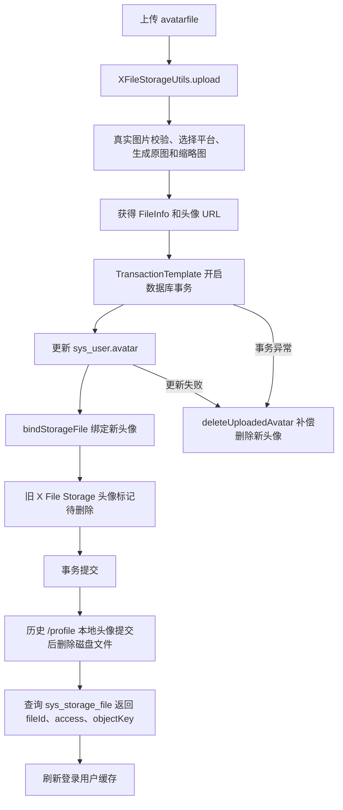

# 头像上传接入文件资产管理

## 1. 改造目标

本次改造将个人中心头像上传接入 X File Storage 和文件资产管理流程。

核心目标：

- 头像上传走统一上传门面 `XFileStorageUtils`
- 支持 `platform` 指定上传平台
- `platform` 为空时走配置中的默认上传平台
- 头像上传时生成缩略图
- 上传成功后绑定文件到当前用户业务
- 用户头像更新、文件绑定、旧头像标记待删除放入同一个数据库事务
- 用户表保存失败或事务异常时补偿删除本次新上传头像
- 替换头像时兼容若依历史 `/profile` 本地头像和新文件资产
- 返回 `fileId`、`access`、`objectKey`、`thObjectKey`，避免后续业务只依赖 URL

对应提交：

```text
53c0886b 头像上传接入文件资产管理
```

## 2. 改造前存在的问题

- 头像上传只走若依本地目录，不能指定本地、OSS、MinIO、腾讯云 COS 等不同平台
- 用户表保存失败时，已经上传的新头像可能变成孤儿文件
- 替换头像时直接删除旧文件，无法区分历史 `/profile` 本地头像和 X File Storage 文件资产
- 返回结果只有 `imgUrl`，没有实际上传平台、缩略图、文件资产主键和对象 Key
- 用户头像字段更新和文件记录绑定没有统一事务边界，存在用户头像已更新但文件资产未绑定的风险

## 3. 改造后的解决方案

- 头像接口接入 `XFileStorageUtils`，由统一上传门面处理平台选择、真实图片校验、缩略图和 ACL
- 头像接口增加可选 `platform` 入参，前端不传时使用默认平台，传入时上传到指定平台
- 用户表仍保存原图 URL，兼容现有若依头像字段语义
- 头像保存成功后调用 `bindStorageFile` 绑定到 `avatar + userId` 业务
- 历史 `/profile/**` 本地头像继续删除本地文件
- X File Storage 旧头像不立即物理删除，先标记待删除，由定时任务延迟清理
- 使用 `TransactionTemplate` 包住用户表更新、文件绑定和旧头像状态标记
- 事务异常时补偿删除本次新上传头像
- 响应返回 `fileId`、`access`、`objectKey`、`thObjectKey`，方便前端回显、下载、预览和后续业务绑定

## 4. 总体链路



## 5. 涉及文件

- `ruoyi-admin/src/main/java/com/ruoyi/web/controller/system/SysProfileController.java`

## 6. 改动点清单

- 引入 `FileInfo`、`Constants`、`XFileStorageUtils`、`SysStorageFile`、`ISysStorageFileService`、`TransactionTemplate`
- 新增头像上传工具、文件记录服务和事务模板
- 新增头像业务类型和缩略图宽高常量
- 头像上传接口增加 `platform` 参数
- 上传方法从若依 `FileUploadUtils.upload` 改为 `xFileStorageUtils.upload`
- 用户头像保存成功后绑定文件记录
- 旧头像按历史本地头像和新文件资产分流处理
- 数据库动作使用 `TransactionTemplate` 控制事务
- 保存失败或事务异常时补偿删除新头像
- 返回结果补充 `platform`、`fileId`、`access`、`objectKey`、`thObjectKey`、`previewUrl`、`downloadUrl`、`thPreviewUrl`
- 接口返回给前端的是对外预览地址，数据库仍保存真实存储 URL

## 7. 原代码

```java
package com.ruoyi.web.controller.system;

import java.util.Map;
import org.springframework.beans.factory.annotation.Autowired;
import org.springframework.web.bind.annotation.GetMapping;
import org.springframework.web.bind.annotation.PostMapping;
import org.springframework.web.bind.annotation.PutMapping;
import org.springframework.web.bind.annotation.RequestBody;
import org.springframework.web.bind.annotation.RequestMapping;
import org.springframework.web.bind.annotation.RequestParam;
import org.springframework.web.bind.annotation.RestController;
import org.springframework.web.multipart.MultipartFile;
import com.ruoyi.common.annotation.Log;
import com.ruoyi.common.config.RuoYiConfig;
import com.ruoyi.common.core.controller.BaseController;
import com.ruoyi.common.core.domain.AjaxResult;
import com.ruoyi.common.core.domain.entity.SysUser;
import com.ruoyi.common.core.domain.model.LoginUser;
import com.ruoyi.common.enums.BusinessType;
import com.ruoyi.common.utils.DateUtils;
import com.ruoyi.common.utils.SecurityUtils;
import com.ruoyi.common.utils.StringUtils;
import com.ruoyi.common.utils.file.FileUploadUtils;
import com.ruoyi.common.utils.file.FileUtils;
import com.ruoyi.common.utils.file.MimeTypeUtils;
import com.ruoyi.framework.web.service.TokenService;
import com.ruoyi.system.service.ISysUserService;

/**
 * 个人信息 业务处理
 *
 * @author ruoyi
 */
@RestController
@RequestMapping("/system/user/profile")
public class SysProfileController extends BaseController
{
    @Autowired
    private ISysUserService userService;

    @Autowired
    private TokenService tokenService;

    /**
     * 头像上传
     */
    @Log(title = "用户头像", businessType = BusinessType.UPDATE)
    @PostMapping("/avatar")
    public AjaxResult avatar(@RequestParam("avatarfile") MultipartFile file) throws Exception
    {
        if (!file.isEmpty())
        {
            LoginUser loginUser = getLoginUser();
            String avatar = FileUploadUtils.upload(RuoYiConfig.getAvatarPath(), file, MimeTypeUtils.IMAGE_EXTENSION, true);
            if (userService.updateUserAvatar(loginUser.getUserId(), avatar))
            {
                String oldAvatar = loginUser.getUser().getAvatar();
                if (StringUtils.isNotEmpty(oldAvatar))
                {
                    FileUtils.deleteFile(RuoYiConfig.getProfile() + FileUtils.stripPrefix(oldAvatar));
                }
                AjaxResult ajax = AjaxResult.success();
                ajax.put("imgUrl", avatar);
                // 更新缓存用户头像
                loginUser.getUser().setAvatar(avatar);
                tokenService.setLoginUser(loginUser);
                return ajax;
            }
        }
        return error("上传图片异常，请联系管理员");
    }
}
```

## 8. 现代码

```java
package com.ruoyi.web.controller.system;

import java.util.Map;
import org.dromara.x.file.storage.core.FileInfo;
import org.slf4j.Logger;
import org.slf4j.LoggerFactory;
import org.springframework.beans.factory.annotation.Autowired;
import org.springframework.transaction.support.TransactionTemplate;
import org.springframework.web.bind.annotation.GetMapping;
import org.springframework.web.bind.annotation.PostMapping;
import org.springframework.web.bind.annotation.PutMapping;
import org.springframework.web.bind.annotation.RequestBody;
import org.springframework.web.bind.annotation.RequestMapping;
import org.springframework.web.bind.annotation.RequestParam;
import org.springframework.web.bind.annotation.RestController;
import org.springframework.web.multipart.MultipartFile;
import com.ruoyi.common.annotation.Log;
import com.ruoyi.common.constant.Constants;
import com.ruoyi.common.config.RuoYiConfig;
import com.ruoyi.common.core.controller.BaseController;
import com.ruoyi.common.core.domain.AjaxResult;
import com.ruoyi.common.core.domain.entity.SysUser;
import com.ruoyi.common.core.domain.model.LoginUser;
import com.ruoyi.common.enums.BusinessType;
import com.ruoyi.common.utils.DateUtils;
import com.ruoyi.common.utils.SecurityUtils;
import com.ruoyi.common.utils.StringUtils;
import com.ruoyi.common.utils.file.FileUtils;
import com.ruoyi.common.utils.file.MimeTypeUtils;
import com.ruoyi.common.utils.file.XFileStorageUtils;
import com.ruoyi.framework.web.service.TokenService;
import com.ruoyi.system.domain.SysStorageFile;
import com.ruoyi.system.service.ISysStorageFileService;
import com.ruoyi.system.service.ISysUserService;

/**
 * 当前登录用户的个人中心接口
 * <p>
 * 个人资料、密码修改等流程保持若依原有逻辑；头像上传改为使用 X File Storage
 * 因此头像可以存储到本地、阿里云 OSS、MinIO，或后续新增的其它平台
 *
 * @author ruoyi
 */
@RestController
@RequestMapping("/system/user/profile")
public class SysProfileController extends BaseController
{
    private static final Logger log = LoggerFactory.getLogger(SysProfileController.class);

    @Autowired
    private ISysUserService userService;

    @Autowired
    private TokenService tokenService;

    /**
     * 头像上传使用的统一文件存储适配器
     * <p>
     * 控制器只依赖该工具类，不直接依赖具体平台 SDK，后续新增平台时控制器无需改造
     */
    @Autowired
    private XFileStorageUtils xFileStorageUtils;

    /**
     * 存储文件记录服务
     * <p>
     * 头像上传成功后绑定新文件，替换旧头像时只标记待删除，由定时任务延迟清理
     */
    @Autowired
    private ISysStorageFileService storageFileService;

    /**
     * 编程式事务模板
     * <p>
     * 头像上传真实文件不参与数据库事务，只把用户头像更新、文件绑定和旧头像状态标记放入同一个事务
     */
    @Autowired
    private TransactionTemplate transactionTemplate;

    /**
     * 头像业务类型
     */
    private static final String BIZ_TYPE_AVATAR = "avatar";

    /**
     * 头像缩略图宽度，单位像素
     */
    private static final int AVATAR_THUMBNAIL_WIDTH = 100;

    /**
     * 头像缩略图高度，单位像素
     */
    private static final int AVATAR_THUMBNAIL_HEIGHT = 100;

    /**
     * 上传当前用户的新头像
     * <p>
     * platform 为空时使用配置中的默认存储平台；platform 不为空时上传到对应的已启用平台
     * 头像接口只允许图片扩展名
     *
     * @param file avatarfile 表单字段提交的头像文件
     * @param platform 可选存储平台标识，例如 local-1、aliyun-oss-1、minio-1
     * @return 头像访问 URL、缩略图 URL 和实际使用的存储平台
     */
    @Log(title = "用户头像", businessType = BusinessType.UPDATE)
    @PostMapping("/avatar")
    public AjaxResult avatar(@RequestParam("avatarfile") MultipartFile file,
            @RequestParam(value = "platform", required = false) String platform) throws Exception
    {
        // 空文件直接走统一失败返回
        if (!file.isEmpty())
        {
            LoginUser loginUser = getLoginUser();
            // 工具类负责图片校验，并根据 platform 选择指定平台或默认平台
            // 头像默认生成缩略图，原图仍作为数据库头像地址保存
            FileInfo fileInfo = xFileStorageUtils.upload(file, platform, BIZ_TYPE_AVATAR, MimeTypeUtils.IMAGE_EXTENSION, true,
                    AVATAR_THUMBNAIL_WIDTH, AVATAR_THUMBNAIL_HEIGHT);
            // 数据库存储最终可访问的头像 URL
            String avatar = fileInfo.getUrl();
            // 先记录旧头像，事务提交成功后再处理历史本地文件删除
            String oldAvatar = loginUser.getUser().getAvatar();
            boolean avatarSaved;
            try
            {
                // 头像业务数据库动作放在同一事务里，避免用户表已更新但文件资产未绑定
                avatarSaved = Boolean.TRUE.equals(transactionTemplate.execute(status ->
                {
                    // 更新用户头像字段，用户表仍保存最终可访问的原图 URL
                    if (!userService.updateUserAvatar(loginUser.getUserId(), avatar))
                    {
                        return false;
                    }
                    // 头像保存成功后把本次上传的新文件绑定到用户业务，避免被临时文件清理任务误删
                    storageFileService.bindStorageFile(avatar, BIZ_TYPE_AVATAR, String.valueOf(loginUser.getUserId()),
                            loginUser.getUsername());
                    if (StringUtils.isNotEmpty(oldAvatar) && !oldAvatar.startsWith(Constants.RESOURCE_PREFIX))
                    {
                        // X File Storage 上传的旧头像先标记待删除，交给定时任务延迟物理清理
                        storageFileService.markStorageFileWaitDelete(oldAvatar, BIZ_TYPE_AVATAR, loginUser.getUsername());
                    }
                    return true;
                }));
            }
            catch (Exception e)
            {
                // 数据库事务异常时立即补偿删除本次新头像，避免用户头像未保存但对象存储残留
                deleteUploadedAvatar(avatar);
                throw e;
            }
            if (avatarSaved)
            {
                if (StringUtils.isNotEmpty(oldAvatar) && oldAvatar.startsWith(Constants.RESOURCE_PREFIX))
                {
                    // 历史若依本地头像不参与数据库事务，等数据库提交成功后再删除磁盘文件
                    FileUtils.deleteFile(RuoYiConfig.getProfile() + FileUtils.stripPrefix(oldAvatar));
                }
                // 绑定后按 URL 读取文件资产记录，头像接口也同步返回 fileId、access 和对象 Key
                SysStorageFile storageFile = storageFileService.selectStorageFileByUrl(avatar);
                // 返回头像 URL 和实际平台，前端可据此展示当前上传去向
                AjaxResult ajax = AjaxResult.success();
                ajax.put("imgUrl", avatar);
                ajax.put("platform", fileInfo.getPlatform());
                if (storageFile != null)
                {
                    // fileId 是后续前端预览、下载、业务绑定和后台排查的稳定文件资产主键
                    ajax.put("fileId", storageFile.getFileId());
                    // access 从文件记录表返回，前端可区分公开直连和私有授权下载
                    ajax.put("access", storageFile.getAccess());
                    // objectKey 是对象存储里的真实对象定位信息，避免业务只依赖 URL
                    ajax.put("objectKey", storageFile.getObjectKey());
                    // thObjectKey 对应缩略图对象定位信息
                    ajax.put("thObjectKey", storageFile.getThObjectKey());
                }
                // 返回缩略图地址，前端列表或头像小尺寸展示可优先使用
                ajax.put("thUrl", fileInfo.getThUrl());
                // 同步令牌缓存中的头像地址，前端无需重新登录即可看到新头像
                loginUser.getUser().setAvatar(avatar);
                tokenService.setLoginUser(loginUser);
                return ajax;
            }
            // 头像上传成功但用户表保存失败时删除新文件，避免产生无法关联的孤儿文件
            deleteUploadedAvatar(avatar);
        }
        return error("上传图片异常，请联系管理员");
    }

    /**
     * 删除已经上传但业务保存失败的新头像
     *
     * @param avatar 新头像 URL
     */
    private void deleteUploadedAvatar(String avatar)
    {
        try
        {
            // 这里删除的是本次刚上传的新文件，不影响当前登录用户原头像
            xFileStorageUtils.delete(avatar);
        }
        catch (Exception e)
        {
            // 补偿删除失败只记录日志，接口仍返回原业务失败信息
            log.warn("头像保存失败后删除新头像失败，avatar={}", avatar, e);
        }
    }
}
```

## 9. 涉及改动部分

### 改动 1：引入头像上传、文件资产和事务依赖

原代码定位：

```java
// 省略
import java.util.Map;
import org.springframework.beans.factory.annotation.Autowired;
import org.springframework.web.bind.annotation.GetMapping;
// 省略
import com.ruoyi.common.annotation.Log;
import com.ruoyi.common.config.RuoYiConfig;
// 省略
import com.ruoyi.common.utils.file.FileUploadUtils;
import com.ruoyi.common.utils.file.FileUtils;
import com.ruoyi.common.utils.file.MimeTypeUtils;
import com.ruoyi.framework.web.service.TokenService;
import com.ruoyi.system.service.ISysUserService;
// 省略
```

现代码定位：

```java
// 省略
import java.util.Map;
import org.dromara.x.file.storage.core.FileInfo;
import org.slf4j.Logger;
import org.slf4j.LoggerFactory;
import org.springframework.beans.factory.annotation.Autowired;
import org.springframework.transaction.support.TransactionTemplate;
import org.springframework.web.bind.annotation.GetMapping;
// 省略
import com.ruoyi.common.annotation.Log;
import com.ruoyi.common.constant.Constants;
import com.ruoyi.common.config.RuoYiConfig;
// 省略
import com.ruoyi.common.utils.file.FileUtils;
import com.ruoyi.common.utils.file.MimeTypeUtils;
import com.ruoyi.common.utils.file.XFileStorageUtils;
import com.ruoyi.framework.web.service.TokenService;
import com.ruoyi.system.domain.SysStorageFile;
import com.ruoyi.system.service.ISysStorageFileService;
import com.ruoyi.system.service.ISysUserService;
// 省略
```

改动说明：

- 删除 `FileUploadUtils`，头像不再直接走若依本地上传工具
- 新增 `XFileStorageUtils`，统一处理平台选择、校验、缩略图、ACL 和上传
- 新增 `FileInfo`，用于接收 X File Storage 上传结果
- 新增 `ISysStorageFileService` 和 `SysStorageFile`，用于绑定文件资产并返回文件主键、访问级别和对象 Key
- 新增 `TransactionTemplate`，只把数据库动作放进事务，不把真实文件上传动作包进事务
- 新增 `Constants`，用于判断旧头像是否是历史 `/profile/**` 本地文件

### 改动 2：新增上传工具、文件记录服务、事务模板和头像常量

原代码定位：

```java
// 省略
public class SysProfileController extends BaseController
{
    @Autowired
    private ISysUserService userService;

    @Autowired
    private TokenService tokenService;

    @GetMapping
// 省略
```

现代码定位：

```java
// 省略
public class SysProfileController extends BaseController
{
    private static final Logger log = LoggerFactory.getLogger(SysProfileController.class);

    @Autowired
    private ISysUserService userService;

    @Autowired
    private TokenService tokenService;

    /**
     * 头像上传使用的统一文件存储适配器
     * <p>
     * 控制器只依赖该工具类，不直接依赖具体平台 SDK，后续新增平台时控制器无需改造
     */
    @Autowired
    private XFileStorageUtils xFileStorageUtils;

    /**
     * 存储文件记录服务
     * <p>
     * 头像上传成功后绑定新文件，替换旧头像时只标记待删除，由定时任务延迟清理
     */
    @Autowired
    private ISysStorageFileService storageFileService;

    /**
     * 编程式事务模板
     * <p>
     * 头像上传真实文件不参与数据库事务，只把用户头像更新、文件绑定和旧头像状态标记放入同一个事务
     */
    @Autowired
    private TransactionTemplate transactionTemplate;

    /**
     * 头像业务类型
     */
    private static final String BIZ_TYPE_AVATAR = "avatar";

    /**
     * 头像缩略图宽度，单位像素
     */
    private static final int AVATAR_THUMBNAIL_WIDTH = 100;

    /**
     * 头像缩略图高度，单位像素
     */
    private static final int AVATAR_THUMBNAIL_HEIGHT = 100;

    @GetMapping
// 省略
```

改动说明：

- `xFileStorageUtils` 让控制器只依赖统一上传门面，不关心本地、阿里云 OSS、MinIO、腾讯云 COS 的 SDK 细节
- `storageFileService` 负责文件记录绑定、旧头像待删除标记和文件资产回查
- `transactionTemplate` 负责头像业务数据库动作的事务边界
- `BIZ_TYPE_AVATAR` 写入文件记录表 `biz_type`，表示该文件属于头像业务
- 缩略图宽高常量用于头像固定小图生成，避免魔法值散落在方法里

### 改动 3：头像接口支持 platform 参数

原代码定位：

```java
// 省略
    @Log(title = "用户头像", businessType = BusinessType.UPDATE)
    @PostMapping("/avatar")
    public AjaxResult avatar(@RequestParam("avatarfile") MultipartFile file) throws Exception
    {
        if (!file.isEmpty())
// 省略
```

现代码定位：

```java
// 省略
    @Log(title = "用户头像", businessType = BusinessType.UPDATE)
    @PostMapping("/avatar")
    public AjaxResult avatar(@RequestParam("avatarfile") MultipartFile file,
            @RequestParam(value = "platform", required = false) String platform) throws Exception
    {
        // 空文件直接走统一失败返回
        if (!file.isEmpty())
// 省略
```

改动说明：

- `platform` 不是必填字段
- 不传 `platform` 时使用配置中的默认上传平台
- 传入 `local-1`、`aliyun-oss-1`、`minio-1`、`tencent-cos-1` 等平台标识时，会上传到指定平台
- 头像接口因此可以同时支持本地、OSS、MinIO、COS 或后续新增平台

### 改动 4：头像上传从若依本地上传改为 X File Storage 上传

原代码定位：

```java
// 省略
        if (!file.isEmpty())
        {
            LoginUser loginUser = getLoginUser();
            String avatar = FileUploadUtils.upload(RuoYiConfig.getAvatarPath(), file, MimeTypeUtils.IMAGE_EXTENSION, true);
            if (userService.updateUserAvatar(loginUser.getUserId(), avatar))
            {
                String oldAvatar = loginUser.getUser().getAvatar();
// 省略
```

现代码定位：

```java
// 省略
        if (!file.isEmpty())
        {
            LoginUser loginUser = getLoginUser();
            // 工具类负责图片校验，并根据 platform 选择指定平台或默认平台
            // 头像默认生成缩略图，原图仍作为数据库头像地址保存
            FileInfo fileInfo = xFileStorageUtils.upload(file, platform, BIZ_TYPE_AVATAR, MimeTypeUtils.IMAGE_EXTENSION, true,
                    AVATAR_THUMBNAIL_WIDTH, AVATAR_THUMBNAIL_HEIGHT);
            // 数据库存储最终可访问的头像 URL
            String avatar = fileInfo.getUrl();
            // 先记录旧头像，事务提交成功后再处理历史本地文件删除
            String oldAvatar = loginUser.getUser().getAvatar();
// 省略
```

改动说明：

- 原来调用 `FileUploadUtils.upload`，只能按若依本地上传逻辑处理头像
- 现在调用 `xFileStorageUtils.upload`，统一走 X File Storage
- 头像仍限制图片扩展名 `png`、`jpg`、`jpeg`
- 上传工具内部会做真实图片校验，避免 `.txt` 改名成 `.jpg` 绕过校验
- `true` 表示头像场景生成缩略图
- 用户表保存 `fileInfo.getUrl()`，也就是原图 URL

### 改动 5：用户头像更新、文件绑定和旧头像标记放入同一个数据库事务

原代码定位：

```java
// 省略
            String avatar = FileUploadUtils.upload(RuoYiConfig.getAvatarPath(), file, MimeTypeUtils.IMAGE_EXTENSION, true);
            if (userService.updateUserAvatar(loginUser.getUserId(), avatar))
            {
                String oldAvatar = loginUser.getUser().getAvatar();
                if (StringUtils.isNotEmpty(oldAvatar))
                {
                    FileUtils.deleteFile(RuoYiConfig.getProfile() + FileUtils.stripPrefix(oldAvatar));
                }
                AjaxResult ajax = AjaxResult.success();
// 省略
```

现代码定位：

```java
// 省略
            String avatar = fileInfo.getUrl();
            // 先记录旧头像，事务提交成功后再处理历史本地文件删除
            String oldAvatar = loginUser.getUser().getAvatar();
            boolean avatarSaved;
            try
            {
                // 头像业务数据库动作放在同一事务里，避免用户表已更新但文件资产未绑定
                avatarSaved = Boolean.TRUE.equals(transactionTemplate.execute(status ->
                {
                    // 更新用户头像字段，用户表仍保存最终可访问的原图 URL
                    if (!userService.updateUserAvatar(loginUser.getUserId(), avatar))
                    {
                        return false;
                    }
                    // 头像保存成功后把本次上传的新文件绑定到用户业务，避免被临时文件清理任务误删
                    storageFileService.bindStorageFile(avatar, BIZ_TYPE_AVATAR, String.valueOf(loginUser.getUserId()),
                            loginUser.getUsername());
                    if (StringUtils.isNotEmpty(oldAvatar) && !oldAvatar.startsWith(Constants.RESOURCE_PREFIX))
                    {
                        // X File Storage 上传的旧头像先标记待删除，交给定时任务延迟物理清理
                        storageFileService.markStorageFileWaitDelete(oldAvatar, BIZ_TYPE_AVATAR, loginUser.getUsername());
                    }
                    return true;
                }));
            }
            catch (Exception e)
            {
                // 数据库事务异常时立即补偿删除本次新头像，避免用户头像未保存但对象存储残留
                deleteUploadedAvatar(avatar);
                throw e;
            }
// 省略
```

改动说明：

- 真实文件上传不能被数据库事务回滚，所以先上传文件，再处理数据库事务
- 事务里只放数据库动作：更新 `sys_user.avatar`、绑定 `sys_storage_file`、标记旧 X File Storage 头像待删除
- 如果数据库事务异常，立即删除本次刚上传的新头像
- 没有在整个 `avatar` 方法上直接加 `@Transactional`，因为上传真实文件不应该被包进数据库事务

### 改动 6：旧头像清理兼容历史本地头像和新文件资产

原代码定位：

```java
// 省略
                String oldAvatar = loginUser.getUser().getAvatar();
                if (StringUtils.isNotEmpty(oldAvatar))
                {
                    FileUtils.deleteFile(RuoYiConfig.getProfile() + FileUtils.stripPrefix(oldAvatar));
                }
                AjaxResult ajax = AjaxResult.success();
// 省略
```

现代码定位：

```java
// 省略
                    if (StringUtils.isNotEmpty(oldAvatar) && !oldAvatar.startsWith(Constants.RESOURCE_PREFIX))
                    {
                        // X File Storage 上传的旧头像先标记待删除，交给定时任务延迟物理清理
                        storageFileService.markStorageFileWaitDelete(oldAvatar, BIZ_TYPE_AVATAR, loginUser.getUsername());
                    }
                    return true;
                }));
            }
            catch (Exception e)
// 省略
            if (avatarSaved)
            {
                if (StringUtils.isNotEmpty(oldAvatar) && oldAvatar.startsWith(Constants.RESOURCE_PREFIX))
                {
                    // 历史若依本地头像不参与数据库事务，等数据库提交成功后再删除磁盘文件
                    FileUtils.deleteFile(RuoYiConfig.getProfile() + FileUtils.stripPrefix(oldAvatar));
                }
                // 绑定后按 URL 读取文件资产记录，头像接口也同步返回 fileId、access 和对象 Key
                SysStorageFile storageFile = storageFileService.selectStorageFileByUrl(avatar);
// 省略
```

改动说明：

- 历史头像如果是 `/profile/**`，说明它是若依原本的本地文件，数据库事务提交成功后再删除磁盘文件
- 新方案上传的头像是 X File Storage URL，不直接物理删除，而是标记为待删除
- 延迟删除可以避免头像刚替换时因为缓存、浏览器回显、CDN 回源等原因出现短暂访问失败
- 旧头像标记待删除属于数据库动作，所以放在事务里
- 历史本地磁盘删除不属于数据库动作，所以放在事务提交成功后执行

### 改动 7：返回文件资产字段

原代码定位：

```java
// 省略
                AjaxResult ajax = AjaxResult.success();
                ajax.put("imgUrl", avatar);
                // 更新缓存用户头像
                loginUser.getUser().setAvatar(avatar);
                tokenService.setLoginUser(loginUser);
                return ajax;
// 省略
```

现代码定位：

```java
// 省略
                // 绑定后按 URL 读取文件资产记录，头像接口也同步返回 fileId、access 和对象 Key
                SysStorageFile storageFile = storageFileService.selectStorageFileByUrl(avatar);
                // 返回头像 URL 和实际平台，前端可据此展示当前上传去向
                AjaxResult ajax = AjaxResult.success();
                ajax.put("imgUrl", avatar);
                ajax.put("platform", fileInfo.getPlatform());
                if (storageFile != null)
                {
                    // fileId 是后续前端预览、下载、业务绑定和后台排查的稳定文件资产主键
                    ajax.put("fileId", storageFile.getFileId());
                    // access 从文件记录表返回，前端可区分公开直连和私有授权下载
                    ajax.put("access", storageFile.getAccess());
                    // objectKey 是对象存储里的真实对象定位信息，避免业务只依赖 URL
                    ajax.put("objectKey", storageFile.getObjectKey());
                    // thObjectKey 对应缩略图对象定位信息
                    ajax.put("thObjectKey", storageFile.getThObjectKey());
                }
                // 返回缩略图地址，前端列表或头像小尺寸展示可优先使用
                ajax.put("thUrl", fileInfo.getThUrl());
                // 同步令牌缓存中的头像地址，前端无需重新登录即可看到新头像
                loginUser.getUser().setAvatar(avatar);
// 省略
```

改动说明：

- `imgUrl` 保持为头像原图 URL，兼容若依前端头像字段
- `platform` 返回实际使用的上传平台，方便排查默认平台或指定平台是否生效
- `thUrl` 返回缩略图 URL，后续小尺寸头像展示可以优先使用
- `fileId` 是文件资产表主键，比 URL 更适合做后续绑定、下载、预览和后台排查
- `access` 表示公开或私有，前端可以据此判断直连展示还是走授权下载
- `objectKey` 和 `thObjectKey` 是对象存储中的真实对象定位信息，降低系统对 URL 的依赖

### 改动 8：保存失败补偿删除

原代码定位：

```java
// 省略
            if (userService.updateUserAvatar(loginUser.getUserId(), avatar))
            {
                AjaxResult ajax = AjaxResult.success();
                ajax.put("imgUrl", avatar);
                return ajax;
            }
        }
        return error("上传图片异常，请联系管理员");
    }
}
// 省略
```

现代码定位：

```java
// 省略
            if (avatarSaved)
            {
                AjaxResult ajax = AjaxResult.success();
                ajax.put("imgUrl", avatar);
                ajax.put("platform", fileInfo.getPlatform());
                ajax.put("thUrl", fileInfo.getThUrl());
                loginUser.getUser().setAvatar(avatar);
                tokenService.setLoginUser(loginUser);
                return ajax;
            }
            // 头像上传成功但用户表保存失败时删除新文件，避免产生无法关联的孤儿文件
            deleteUploadedAvatar(avatar);
        }
        return error("上传图片异常，请联系管理员");
    }

    /**
     * 删除已经上传但业务保存失败的新头像
     *
     * @param avatar 新头像 URL
     */
    private void deleteUploadedAvatar(String avatar)
    {
        try
        {
            // 这里删除的是本次刚上传的新文件，不影响当前登录用户原头像
            xFileStorageUtils.delete(avatar);
        }
        catch (Exception e)
        {
            // 补偿删除失败只记录日志，接口仍返回原业务失败信息
            log.warn("头像保存失败后删除新头像失败，avatar={}", avatar, e);
        }
    }
}
// 省略
```

改动说明：

- 补偿删除只处理本次刚上传的新头像
- 不删除当前登录用户原头像，避免业务保存失败时把用户现有头像删掉
- 补偿删除失败只记录日志，不覆盖原始业务失败原因
- 事务异常和用户表保存失败都会触发补偿删除

## 10. 返回结果示例

改造前：

```json
{
  "msg": "操作成功",
  "code": 200,
  "imgUrl": "/profile/avatar/2026/09/08/abc.jpg"
}
```

改造后：

```json
{
  "msg": "操作成功",
  "code": 200,
  "imgUrl": "https://ruoyi-1451277880.cos.ap-shanghai.myqcloud.com/test/public/avatar/2026/09/08/d779e160218e4fd9b657312eb4438568.jpg",
  "previewUrl": "https://ruoyi-1451277880.cos.ap-shanghai.myqcloud.com/test/public/avatar/2026/09/08/d779e160218e4fd9b657312eb4438568.jpg",
  "downloadUrl": "https://ruoyi-1451277880.cos.ap-shanghai.myqcloud.com/test/public/avatar/2026/09/08/d779e160218e4fd9b657312eb4438568.jpg",
  "platform": "tencent-cos-1",
  "fileId": 1,
  "access": "public",
  "objectKey": "test/public/avatar/2026/09/08/d779e160218e4fd9b657312eb4438568.jpg",
  "thObjectKey": "test/public/avatar/2026/09/08/d779e160218e4fd9b657312eb4438568.jpg.min.jpg",
  "thUrl": "https://ruoyi-1451277880.cos.ap-shanghai.myqcloud.com/test/public/avatar/2026/09/08/d779e160218e4fd9b657312eb4438568.jpg.min.jpg",
  "thPreviewUrl": "https://ruoyi-1451277880.cos.ap-shanghai.myqcloud.com/test/public/avatar/2026/09/08/d779e160218e4fd9b657312eb4438568.jpg.min.jpg"
}
```

字段说明：

- `imgUrl`：头像对外预览地址，前端头像回显优先使用
- `previewUrl`：头像对外预览地址
- `downloadUrl`：头像下载地址
- `platform`：本次实际上传平台
- `fileId`：`sys_storage_file` 文件资产主键
- `access`：文件访问级别，公开文件可直连，私有文件应走授权下载或预览
- `objectKey`：原图在对象存储中的对象 Key
- `thObjectKey`：缩略图在对象存储中的对象 Key
- `thUrl`：缩略图对外预览地址
- `thPreviewUrl`：缩略图对外预览地址

注意：`sys_user.avatar` 和 `sys_storage_file.url` 仍保存真实存储 URL，用于后端内部和 X File Storage 操作；接口返回给前端的是按访问策略转换后的对外地址。

## 11. 事务边界说明

头像上传流程不能简单给整个方法加 `@Transactional`。

原因：

- 文件已经上传到对象存储或本地磁盘后，数据库事务回滚不会自动删除真实文件
- 如果把上传动作放在数据库事务里，会让数据库事务持有时间变长
- 对象存储上传失败和数据库写入失败属于两类资源失败，需要用补偿逻辑处理

当前做法：

- 先上传真实文件
- 再用 `TransactionTemplate` 执行用户表更新、文件绑定、旧头像标记待删除
- 数据库事务失败时，补偿删除本次新上传头像
- 数据库事务成功后，再删除历史 `/profile/**` 本地头像

## 12. 与文件资产表的关系

头像上传成功后，X File Storage 的 `FileRecorder` 会先保存文件记录到 `sys_storage_file`。

头像业务保存成功后，再通过：

```java
storageFileService.bindStorageFile(avatar, BIZ_TYPE_AVATAR, String.valueOf(loginUser.getUserId()),
        loginUser.getUsername());
```

把文件从临时状态绑定为业务文件。

绑定后的关键字段：

- `biz_type = avatar`
- `biz_id = 当前用户ID`
- `file_status = 已使用`
- `url = 头像原图 URL`
- `th_url = 头像缩略图 URL`
- `access = public/private`
- `object_key = 原图对象 Key`
- `th_object_key = 缩略图对象 Key`

## 13. 变更小结

本次头像上传改造不是单纯替换上传工具，而是把头像纳入文件资产管理流程。

改造后头像上传具备：

- 多平台上传能力
- 真实图片校验能力
- 缩略图生成能力
- 文件资产记录能力
- 业务绑定能力
- 旧文件延迟删除能力
- 保存失败补偿能力
- 数据库事务一致性控制
- 前端回显和后续下载预览所需的稳定文件信息
