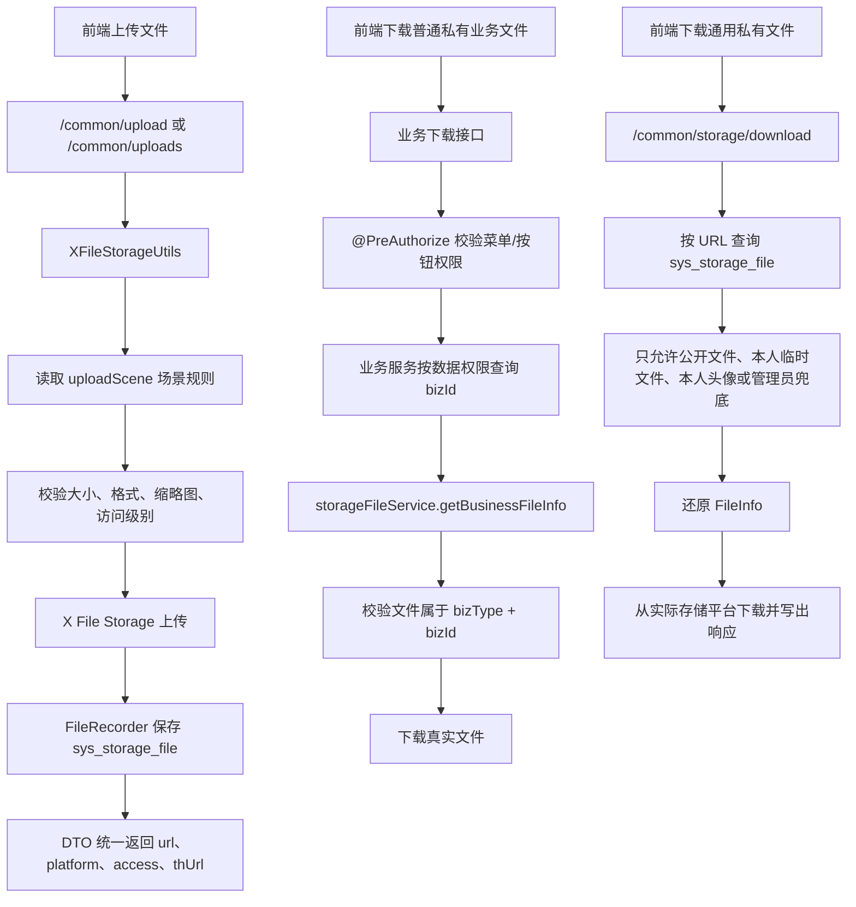

# P0P1 文件上传优化说明

## 1. 改造目标

本次优化聚焦文件上传模块的 P0、P1 问题，目标是让通用上传入口更适合后续业务复用：

- 通用上传返回结构统一，避免控制器里重复手写 `Map`
- 私有文件下载不再只凭 URL 放行，通用入口只处理公开文件、本人临时文件、本人头像和管理员兜底
- 业务私有文件下载交回业务接口处理，由业务接口先做菜单权限和数据权限，再调用文件服务校验文件归属
- 文件上传失败日志补齐上下文，便于排查平台、场景、文件大小和文件名问题
- 新业务可通过配置强制传入 `uploadScene`，避免绕过场景规则
- 文件资产服务增加批量绑定和业务文件同步能力，方便业务表不保存文件字段时仍能管理附件
- 缩略图后缀支持按上传场景配置，避免所有图片场景被全局 `.min.jpg` 绑定
- 文件资产表使用 `url_hash` 做唯一索引，避免长 URL 前缀索引存在误判风险
- 文件资产表增加 `object_key`、`th_object_key` 和 `access`，后续鉴权、预览和后台排查不再只依赖 URL，访问级别入库时优先根据对象 ACL 判断
- 通用上传和头像上传返回 `fileId`、`objectKey`、`thObjectKey`，前端和业务绑定可优先使用文件资产主键
- 文件资产服务只在业务文件集合同步这种多步数据库写操作上补充事务边界，避免文件绑定和旧文件待删除状态不一致
- 头像上传补充局部事务，用户头像更新、文件绑定、旧头像标记待删除保持一致，事务异常时补偿删除新头像
- 用户头像字段长度扩展到 `varchar(512)`，适配对象存储或 CDN 返回的完整 URL
- 生产环境 COS 配置放入 `application-prod.yml`，主配置通过激活 `prod` profile 读取
- 新增文件作者统一使用当前 Git 用户名 `955Kane`

## 2. 改造前存在的问题

### 2.1 上传返回结构分散

`CommonController` 里单文件上传、多文件上传、分片初始化、分片上传都各自组装返回字段。字段含义相近，但代码散落在多个接口里，后续增加 `access`、`uploadStatus`、缩略图字段时容易漏改。

### 2.2 私有文件下载入口权限偏弱

原来的 X File Storage 下载接口主要根据 URL 还原 `FileInfo` 后直接下载。对于 `private` 场景文件，如果 URL 泄露，同系统登录用户可能绕过业务权限直接下载。

第一版私有下载改造已经增加了 token、上传人、头像本人和 `bizType/bizId` 归属校验，但 `bizType/bizId` 只能证明“文件属于这个业务”，还不能证明“当前用户有权限查看这个业务”。因此最终方案不在文件模块单独维护业务权限映射，而是让业务接口先完成菜单权限和数据权限校验，再调用文件服务校验文件归属。

### 2.3 通用上传可以不传场景

当前为了兼容旧接口，`uploadScene` 可以为空。这个行为对历史接口友好，但新业务如果忘记传场景，就可能使用默认大小、默认格式和默认路径策略。

### 2.4 文件绑定只支持单文件

文件资产表绑定业务时只有单文件绑定方法。实际业务常见附件数组、图片数组、编辑时替换附件等场景，需要业务层自己循环和比较新旧文件集合。

### 2.5 上传异常日志信息不足

上传失败时只返回异常消息，日志缺少 `platform`、`uploadScene`、原始文件名、大小、分片号等关键上下文，排查 OSS/COS/MinIO 权限或场景配置时成本较高。

### 2.6 缩略图后缀只能使用全局配置

原来只使用 `dromara.x-file-storage.thumbnail-suffix` 控制缩略图后缀。头像、普通图片、素材图如果都生成缩略图，就只能统一生成同一种格式，例如全部都是 `.min.jpg`。头像场景这样做问题不大，但透明 PNG、商品图、素材图后续可能需要保留 PNG 或改成 WebP。

### 2.7 文件 URL 唯一索引使用前缀索引

文件表中 `url` 字段较长，原设计使用 `unique key uk_sys_storage_file_url (url(191))` 做兼容型唯一索引。这个方式能解决多数场景，但只比较 URL 前 191 个字符，理论上存在不同长 URL 前缀相同导致误判冲突的风险。

### 2.8 用户头像字段长度不足

若依原始 `sys_user.avatar` 字段为 `varchar(100)`。本地 `/profile/avatar/xxx.jpg` 可以放下，但 COS、OSS、MinIO 或 CDN 返回完整 URL 后很容易超过 100，保存头像时会触发 `Data too long for column 'avatar'`。

### 2.9 生产配置未激活导致占位默认值生效

腾讯 COS 的真实配置已经放入 `application-prod.yml`，但主配置中只激活了 `druid`，导致 `prod` 配置没有加载。运行时仍读取主配置中的 `${TENCENT_COS_BUCKET_NAME:??}`，桶名变成 `??` 后腾讯 COS SDK 会报 `Bucket name only should contain lowercase characters, num and -`。

## 3. 改造后的解决方案

- 新增 `StorageFileUploadRespDTO`，统一普通上传、批量上传、分片初始化、分片合并后的文件返回结构
- 新增 `StorageFilePartRespDTO`，统一分片上传和分片列表中的分片返回结构
- 新增 `StorageFileUploadProperties`，通过 `ruoyi.storage-file.require-upload-scene` 控制是否强制传入上传场景
- `CommonController` 引入 `ISysStorageFileService`，下载私有文件前先查库并校验访问边界
- `CommonController` 不再承接普通业务私有文件下载，避免绕过业务数据权限
- `ISysStorageFileService` 增加 `getBusinessFileInfo`，供业务接口在完成权限和数据权限校验后复用文件归属校验
- `XFileStorageUtils` 读取上传控制配置，在需要时拒绝无场景上传
- `ISysStorageFileService` 增加根据 URL 查询、批量绑定、业务文件集合同步方法
- `SysStorageFileServiceImpl` 保存上传记录时记录上传人，后续私有临时文件下载可判断归属
- `UploadSceneProperties.Scene` 增加 `thumbnailSuffix`，上传时场景配置优先覆盖全局缩略图后缀
- `sys_storage_file` 增加 `url_hash` 字段，使用完整 URL 的 SHA-256 哈希做唯一索引
- `sys_storage_file` 增加 `object_key`、`th_object_key`、`access` 字段，分别保存原图对象 Key、缩略图对象 Key 和访问级别
- `SysStorageFileServiceImpl` 保存文件记录时优先根据对象 ACL 写入 `access`，没有 ACL 时才回退历史路径规则
- `SysStorageFileMapper` 根据 `url_hash + url` 精确查询、绑定和更新文件记录
- `StorageFileUploadRespDTO` 从文件记录表补齐 `fileId`、`objectKey`、`thObjectKey`、`access`
- `SysProfileController` 头像上传成功后回查文件资产记录，头像接口也返回文件资产主键和对象 Key
- `SysStorageFileServiceImpl` 只对 `syncBizStorageFiles` 增加回滚事务，单条数据库操作和对象存储 IO 方法不额外挂事务
- `SysProfileController` 使用 `TransactionTemplate` 包裹头像业务数据库动作，不把对象存储上传动作放入数据库事务
- `SysStorageFileServiceImpl` 延迟获取 `FileStorageService`，避免 FileRecorder 与 X File Storage 自动配置形成循环依赖
- `sys_user.avatar` 扩展为 `varchar(512)`，保存完整对象存储访问 URL
- `application-prod.yml` 保存腾讯 COS 生产配置，`application.yml` 激活 `druid,prod`

## 4. 总体链路



## 5. 涉及文件

- `ruoyi-admin/src/main/java/com/ruoyi/web/controller/common/CommonController.java`
- `ruoyi-admin/src/main/resources/application.yml`
- `ruoyi-common/src/main/java/com/ruoyi/common/config/StorageFileUploadProperties.java`
- `ruoyi-common/src/main/java/com/ruoyi/common/core/domain/model/StorageFileUploadRespDTO.java`
- `ruoyi-common/src/main/java/com/ruoyi/common/core/domain/model/StorageFilePartRespDTO.java`
- `ruoyi-common/src/main/java/com/ruoyi/common/utils/file/XFileStorageUtils.java`
- `ruoyi-framework/src/main/java/com/ruoyi/framework/config/properties/StorageFileSecurityProperties.java`
- `ruoyi-system/src/main/java/com/ruoyi/system/service/ISysStorageFileService.java`
- `ruoyi-system/src/main/java/com/ruoyi/system/service/impl/SysStorageFileServiceImpl.java`
- `ruoyi-system/src/main/java/com/ruoyi/system/domain/SysStorageFile.java`
- `ruoyi-system/src/main/java/com/ruoyi/system/mapper/SysStorageFileMapper.java`
- `ruoyi-system/src/main/resources/mapper/system/SysStorageFileMapper.xml`
- `ruoyi-admin/src/main/java/com/ruoyi/web/controller/system/SysProfileController.java`
- `ruoyi-admin/src/main/resources/application-prod.yml`
- `sql/ry_20260417.sql`
- `sql/sys_user_avatar_20260908.sql`
- `sql/sys_storage_file_20260901.sql`
- `sql/sys_storage_file_url_hash_20260908.sql`

## 6. 具体改动

### 6.1 CommonController 注入文件记录服务

#### 原代码

```java
// 省略
public class CommonController
{
    private static final Logger log = LoggerFactory.getLogger(CommonController.class);

    /**
     * X File Storage 适配工具
     * <p>
     * 控制器不直接调用第三方上传 API，而是通过该工具统一复用若依的校验
     * 命名规则和平台选择逻辑
     */
    private final XFileStorageUtils xFileStorageUtils;

    /**
     * 构造器注入上传工具，明确当前控制器依赖的文件存储能力
     *
     * @param xFileStorageUtils 统一上传工具
     */
    public CommonController(XFileStorageUtils xFileStorageUtils)
    {
        this.xFileStorageUtils = xFileStorageUtils;
    }
// 省略
```

#### 现代码

```java
// 省略
public class CommonController
{
    private static final Logger log = LoggerFactory.getLogger(CommonController.class);

    /** X File Storage 上传适配工具 */
    private final XFileStorageUtils xFileStorageUtils;

    /** 存储文件记录服务，用于私有文件下载鉴权和文件资产记录查询 */
    private final ISysStorageFileService storageFileService;

    /**
     * 构造通用文件控制器
     *
     * @param xFileStorageUtils 统一上传工具
     * @param storageFileService 存储文件记录服务
     */
    public CommonController(XFileStorageUtils xFileStorageUtils, ISysStorageFileService storageFileService)
    {
        this.xFileStorageUtils = xFileStorageUtils;
        this.storageFileService = storageFileService;
    }
// 省略
```

#### 涉及改动部分

```java
// 省略
    /** X File Storage 上传适配工具 */
    private final XFileStorageUtils xFileStorageUtils;

    /** 存储文件记录服务，用于私有文件下载鉴权和文件资产记录查询 */
    private final ISysStorageFileService storageFileService;

    /**
     * 构造通用文件控制器
     *
     * @param xFileStorageUtils 统一上传工具
     * @param storageFileService 存储文件记录服务
     */
    public CommonController(XFileStorageUtils xFileStorageUtils, ISysStorageFileService storageFileService)
    {
        this.xFileStorageUtils = xFileStorageUtils;
        this.storageFileService = storageFileService;
    }
// 省略
```

#### 改动说明

原来 `CommonController` 只依赖上传工具，下载 X File Storage 文件时缺少数据库记录上下文。现在增加 `ISysStorageFileService`，控制器可以先根据 URL 查询 `sys_storage_file`，再判断文件是否公开、是否属于当前用户、是否属于头像本人，或者是否由管理员兜底处理。

### 6.2 CommonController 单文件上传返回 DTO

#### 原代码

```java
// 省略
@PostMapping("/upload")
public AjaxResult uploadFile(MultipartFile file, @RequestParam(value = "platform", required = false) String platform,
        @RequestParam(value = "uploadScene", required = false) String uploadScene,
        @RequestParam(value = "thumbnail", defaultValue = "false") Boolean thumbnail,
        @RequestParam(value = "thumbnailWidth", required = false) Integer thumbnailWidth,
        @RequestParam(value = "thumbnailHeight", required = false) Integer thumbnailHeight) throws Exception
{
    try
    {
        FileInfo fileInfo = xFileStorageUtils.upload(file, platform, uploadScene, MimeTypeUtils.DEFAULT_ALLOWED_EXTENSION,
                Boolean.TRUE.equals(thumbnail), thumbnailWidth, thumbnailHeight);
        String url = fileInfo.getUrl();
        AjaxResult ajax = AjaxResult.success();
        ajax.put("url", url);
        ajax.put("fileName", url);
        ajax.put("newFileName", FileUtils.getName(url));
        ajax.put("originalFilename", file.getOriginalFilename());
        ajax.put("platform", fileInfo.getPlatform());
        ajax.put("uploadScene", uploadScene);
        ajax.put("thUrl", fileInfo.getThUrl());
        ajax.put("thFileName", fileInfo.getThUrl());
        ajax.put("thNewFileName", FileUtils.getName(fileInfo.getThUrl()));
        ajax.put("thSize", fileInfo.getThSize());
        ajax.put("size", fileInfo.getSize());
        ajax.put("contentType", fileInfo.getContentType());
        return ajax;
    }
    catch (Exception e)
    {
        return AjaxResult.error(e.getMessage());
    }
}
// 省略
```

#### 现代码

```java
// 省略
@PostMapping("/upload")
public AjaxResult uploadFile(MultipartFile file, @RequestParam(value = "platform", required = false) String platform,
        @RequestParam(value = "uploadScene", required = false) String uploadScene,
        @RequestParam(value = "thumbnail", defaultValue = "false") Boolean thumbnail,
        @RequestParam(value = "thumbnailWidth", required = false) Integer thumbnailWidth,
        @RequestParam(value = "thumbnailHeight", required = false) Integer thumbnailHeight) throws Exception
{
    try
    {
        // 统一使用工具类处理平台选择、场景规则、格式校验、缩略图和真实上传
        FileInfo fileInfo = xFileStorageUtils.upload(file, platform, uploadScene, MimeTypeUtils.DEFAULT_ALLOWED_EXTENSION,
                Boolean.TRUE.equals(thumbnail), thumbnailWidth, thumbnailHeight);
        // 单文件上传返回 data 对象，字段由 DTO 统一维护
        return AjaxResult.success(StorageFileUploadRespDTO.from(fileInfo, uploadScene, file.getOriginalFilename()));
    }
    catch (Exception e)
    {
        // 上传失败记录上下文，方便排查对象存储配置、场景配置或文件限制问题
        log.error("上传文件失败，platform={}，uploadScene={}，originalFilename={}，size={}", platform, uploadScene,
                file == null ? null : file.getOriginalFilename(), file == null ? null : file.getSize(), e);
        return AjaxResult.error(e.getMessage());
    }
}
// 省略
```

#### 涉及改动部分

```java
// 省略
        FileInfo fileInfo = xFileStorageUtils.upload(file, platform, uploadScene, MimeTypeUtils.DEFAULT_ALLOWED_EXTENSION,
                Boolean.TRUE.equals(thumbnail), thumbnailWidth, thumbnailHeight);
        // 单文件上传返回 data 对象，字段由 DTO 统一维护
        return AjaxResult.success(StorageFileUploadRespDTO.from(fileInfo, uploadScene, file.getOriginalFilename()));
    }
    catch (Exception e)
    {
        // 上传失败记录上下文，方便排查对象存储配置、场景配置或文件限制问题
        log.error("上传文件失败，platform={}，uploadScene={}，originalFilename={}，size={}", platform, uploadScene,
                file == null ? null : file.getOriginalFilename(), file == null ? null : file.getSize(), e);
        return AjaxResult.error(e.getMessage());
    }
// 省略
```

#### 改动说明

原来上传接口把 `url`、`fileName`、`newFileName`、`thUrl` 等字段直接平铺到 `AjaxResult`。现在改为 `AjaxResult.success(StorageFileUploadRespDTO)`，返回字段集中在 DTO 内维护。这样新增 `access`、`uploadId`、`uploadStatus` 等字段时，只需要改 DTO，不需要每个接口重复补字段。

这次也补充了失败日志。以前只返回错误消息，后台日志无法看出是哪一个平台、哪一个场景、哪一个文件失败；现在日志会记录 `platform`、`uploadScene`、`originalFilename` 和 `size`。

### 6.3 CommonController 多文件上传返回 fileList DTO 数组

#### 原代码

```java
// 省略
List<Map<String, Object>> fileList = new ArrayList<Map<String, Object>>();
for (MultipartFile file : files)
{
    FileInfo fileInfo = xFileStorageUtils.upload(file, platform, uploadScene, MimeTypeUtils.DEFAULT_ALLOWED_EXTENSION,
            Boolean.TRUE.equals(thumbnail), thumbnailWidth, thumbnailHeight);
    String url = fileInfo.getUrl();
    Map<String, Object> fileItem = new LinkedHashMap<String, Object>();
    fileItem.put("url", url);
    fileItem.put("fileName", url);
    fileItem.put("newFileName", FileUtils.getName(url));
    fileItem.put("originalFilename", file.getOriginalFilename());
    fileItem.put("platform", fileInfo.getPlatform());
    fileItem.put("uploadScene", uploadScene);
    fileItem.put("thUrl", fileInfo.getThUrl());
    fileItem.put("thFileName", fileInfo.getThUrl());
    fileItem.put("thNewFileName", FileUtils.getName(fileInfo.getThUrl()));
    fileItem.put("size", fileInfo.getSize());
    fileItem.put("thSize", fileInfo.getThSize());
    fileItem.put("contentType", fileInfo.getContentType());
    fileList.add(fileItem);
}
AjaxResult ajax = AjaxResult.success();
ajax.put("fileList", fileList);
return ajax;
// 省略
```

#### 现代码

```java
// 省略
List<StorageFileUploadRespDTO> fileList = new ArrayList<StorageFileUploadRespDTO>();
for (MultipartFile file : files)
{
    // 每个文件使用同一套 platform 和 uploadScene 策略上传
    FileInfo fileInfo = xFileStorageUtils.upload(file, platform, uploadScene, MimeTypeUtils.DEFAULT_ALLOWED_EXTENSION,
            Boolean.TRUE.equals(thumbnail), thumbnailWidth, thumbnailHeight);
    // DTO 内部统一处理 url、缩略图、大小、access 等返回字段
    fileList.add(StorageFileUploadRespDTO.from(fileInfo, uploadScene, file.getOriginalFilename()));
}
// 批量上传继续保留 fileList 字段，前端按数组逐项处理
AjaxResult ajax = AjaxResult.success();
ajax.put("fileList", fileList);
return ajax;
// 省略
```

#### 涉及改动部分

```java
// 省略
        // 结构化文件列表给新前端使用，每个元素对应一个上传文件
        List<StorageFileUploadRespDTO> fileList = new ArrayList<StorageFileUploadRespDTO>();
        for (MultipartFile file : files)
        {
            // 每个文件使用同一套 platform 和 uploadScene 策略上传
            FileInfo fileInfo = xFileStorageUtils.upload(file, platform, uploadScene, MimeTypeUtils.DEFAULT_ALLOWED_EXTENSION,
                    Boolean.TRUE.equals(thumbnail), thumbnailWidth, thumbnailHeight);
            // DTO 内部统一处理 url、缩略图、大小、access 等返回字段
            fileList.add(StorageFileUploadRespDTO.from(fileInfo, uploadScene, file.getOriginalFilename()));
        }
        // 批量上传继续保留 fileList 字段，前端按数组逐项处理
        AjaxResult ajax = AjaxResult.success();
// 省略
```

#### 改动说明

原来多文件接口在循环里手动创建 `LinkedHashMap`，字段逻辑和单文件接口重复。现在统一使用 `StorageFileUploadRespDTO`，批量接口仍保留 `fileList` 数组字段，适配前端按数组展示附件、图片和普通文件。

### 6.4 CommonController 分片上传返回 DTO

#### 原代码

```java
// 省略
FileInfo fileInfo = xFileStorageUtils.initiateMultipartUpload(originalFilename, size, contentType, platform, uploadScene,
        MimeTypeUtils.DEFAULT_ALLOWED_EXTENSION);
AjaxResult ajax = AjaxResult.success(toFileItem(fileInfo, originalFilename));
ajax.put("uploadScene", uploadScene);
return ajax;
// 省略
FilePartInfo filePartInfo = xFileStorageUtils.uploadPart(url, partNumber, file);
return AjaxResult.success(toFilePartItem(filePartInfo));
// 省略
ajax.put("file", toFileItem(filePartInfoList.getFileInfo(), null));
ajax.put("partList", toFilePartList(filePartInfoList.getList()));
// 省略
FileInfo fileInfo = xFileStorageUtils.completeMultipartUpload(url);
return AjaxResult.success(toFileItem(fileInfo, null));
// 省略
```

#### 现代码

```java
// 省略
FileInfo fileInfo = xFileStorageUtils.initiateMultipartUpload(originalFilename, size, contentType, platform, uploadScene,
        MimeTypeUtils.DEFAULT_ALLOWED_EXTENSION);
// 分片初始化返回统一 DTO，前端后续用 url 和 uploadId 继续传分片
return AjaxResult.success(StorageFileUploadRespDTO.from(fileInfo, uploadScene, originalFilename));
// 省略
FilePartInfo filePartInfo = xFileStorageUtils.uploadPart(url, partNumber, file);
return AjaxResult.success(StorageFilePartRespDTO.from(filePartInfo));
// 省略
ajax.put("file", StorageFileUploadRespDTO.from(filePartInfoList.getFileInfo(), null, null));
ajax.put("partList", toFilePartList(filePartInfoList.getList()));
// 省略
FileInfo fileInfo = xFileStorageUtils.completeMultipartUpload(url);
return AjaxResult.success(StorageFileUploadRespDTO.from(fileInfo, null, null));
// 省略
```

#### 涉及改动部分

```java
// 省略
    private List<StorageFilePartRespDTO> toFilePartList(List<FilePartInfo> filePartInfos)
    {
        // 空分片列表返回空数组，前端无需做 null 判断
        List<StorageFilePartRespDTO> partList = new ArrayList<StorageFilePartRespDTO>();
        if (filePartInfos == null)
        {
            return partList;
        }
        for (FilePartInfo filePartInfo : filePartInfos)
        {
            // 每个分片转换为稳定 DTO 后返回
            partList.add(StorageFilePartRespDTO.from(filePartInfo));
        }
        return partList;
    }
// 省略
```

#### 改动说明

原来分片相关接口依赖控制器内部的 `toFileItem`、`toFilePartItem` 组装 Map。现在分片初始化、上传分片、查询分片、完成分片都使用 DTO。分片返回字段里明确包含 `uploadId`、`uploadStatus`、`partNumber`、`partSize` 和 `etag`，前端做断点续传时字段更稳定。

### 6.5 CommonController 私有文件下载鉴权

#### 原代码

```java
// 省略
@PostMapping("/storage/download")
public void storageDownload(@RequestParam("url") String url, HttpServletResponse response)
{
    try
    {
        FileInfo fileInfo = xFileStorageUtils.getFileInfoByUrl(url);
        String downloadName = StringUtils.isNotBlank(fileInfo.getOriginalFilename()) ? fileInfo.getOriginalFilename()
                : FileUtils.getName(fileInfo.getUrl());
        response.setContentType(StringUtils.isNotBlank(fileInfo.getContentType()) ? fileInfo.getContentType()
                : MediaType.APPLICATION_OCTET_STREAM_VALUE);
        FileUtils.setAttachmentResponseHeader(response, downloadName);
        response.getOutputStream().write(xFileStorageUtils.downloadBytes(fileInfo));
    }
    catch (Exception e)
    {
        log.error("下载存储文件失败，url={}", url, e);
        response.setStatus(HttpServletResponse.SC_INTERNAL_SERVER_ERROR);
    }
}
// 省略
```

#### 现代码

```java
// 省略
@PostMapping("/storage/download")
public void storageDownload(@RequestParam("url") String url,
        @RequestParam(value = "bizType", required = false) String bizType,
        @RequestParam(value = "bizId", required = false) String bizId, HttpServletResponse response)
{
    try
    {
        // 先查数据库文件记录，私有下载必须基于记录里的业务归属做鉴权
        SysStorageFile storageFile = storageFileService.selectStorageFileByUrl(url);
        checkStorageDownloadAllowed(storageFile, bizType, bizId);
        // 数据库记录还原为 FileInfo，框架才能定位具体平台和对象路径
        FileInfo fileInfo = storageFileService.toFileInfo(storageFile);
        if (fileInfo == null)
        {
            throw new ServiceException("文件记录不存在");
        }
        // 原始文件名优先用于下载文件名，缺失时使用 URL 最后一段兜底
        String downloadName = StringUtils.isNotBlank(fileInfo.getOriginalFilename()) ? fileInfo.getOriginalFilename()
                : FileUtils.getName(fileInfo.getUrl());
        // Content-Type 有值时按真实类型返回，便于浏览器识别预览或下载
        response.setContentType(StringUtils.isNotBlank(fileInfo.getContentType()) ? fileInfo.getContentType()
                : MediaType.APPLICATION_OCTET_STREAM_VALUE);
        // 设置附件响应头，中文文件名由 FileUtils 统一编码
        FileUtils.setAttachmentResponseHeader(response, downloadName);
        // 从实际存储平台下载文件内容并写入响应流
        response.getOutputStream().write(xFileStorageUtils.downloadBytes(fileInfo));
    }
    catch (ServiceException e)
    {
        // 权限或业务归属校验失败返回 403，避免私有文件 URL 泄露后被同系统用户下载
        log.warn("下载存储文件被拒绝，url={}，bizType={}，bizId={}，reason={}", url, bizType, bizId, e.getMessage());
        response.setStatus(HttpStatus.FORBIDDEN);
    }
    catch (Exception e)
    {
        // 下载异常写日志并返回 500，前端下载工具会按失败处理
        log.error("下载存储文件失败，url={}，bizType={}，bizId={}", url, bizType, bizId, e);
        response.setStatus(HttpServletResponse.SC_INTERNAL_SERVER_ERROR);
    }
}
// 省略
```

#### 涉及改动部分

```java
// 省略
    private void checkStorageDownloadAllowed(SysStorageFile storageFile, String bizType, String bizId)
    {
        if (storageFile == null)
        {
            throw new ServiceException("文件记录不存在");
        }
        // 超级管理员和拥有统一下载权限的用户允许兜底处理跨业务文件
        if (SecurityUtils.isAdmin() || SecurityUtils.hasPermi("system:storage:download"))
        {
            return;
        }
        // 公开文件本身可以走静态资源访问，登录下载入口也允许读取
        if (isPublicStorageFile(storageFile))
        {
            return;
        }
        String username = SecurityUtils.getUsername();
        // 临时文件或未绑定业务文件只允许上传人自己下载，已绑定业务后要继续走业务身份校验
        if (StringUtils.isBlank(storageFile.getBizType()) && StringUtils.isNotBlank(storageFile.getCreateBy())
                && storageFile.getCreateBy().equals(username))
        {
            return;
        }
        // 头像属于用户自身资料，当前用户只能下载自己的头像文件
        if ("avatar".equals(storageFile.getBizType()) && String.valueOf(SecurityUtils.getUserId()).equals(storageFile.getBizId()))
        {
            return;
        }
        // 普通业务私有文件不在通用入口下载，必须回到业务接口做菜单权限和数据权限校验
        if (StringUtils.isBlank(bizType) || StringUtils.isBlank(bizId))
        {
            throw new ServiceException("业务私有文件请通过对应业务下载接口下载");
        }
        // 请求声明的业务身份必须和文件绑定记录一致
        if (!bizType.equals(storageFile.getBizType()) || !bizId.equals(storageFile.getBizId()))
        {
            throw new ServiceException("文件不属于当前业务");
        }
        // 通用入口不承接普通业务私有文件下载，业务接口应先做菜单权限和数据权限校验后再调用文件服务
        throw new ServiceException("业务私有文件请通过对应业务下载接口下载");
    }

    private boolean isPublicStorageFile(SysStorageFile storageFile)
    {
        // 当前上传路径第一层为 public/private，直接按 path 判断访问级别
        return StringUtils.isNotBlank(storageFile.getPath()) && storageFile.getPath().startsWith("public/");
    }
// 省略
```

#### 改动说明

原来下载接口只传 `url`，后端拿到 URL 后直接下载。现在私有下载入口增加 `bizType`、`bizId`，并按以下顺序判断：

- 超级管理员或拥有 `system:storage:download` 权限，允许下载
- `path` 以 `public/` 开头的公开文件，允许下载
- 未绑定业务的临时文件，只允许上传人自己下载
- `avatar` 文件只允许头像所属用户自己下载
- 普通业务私有文件不在通用入口直接下载，即使传入 `bizType`、`bizId` 且文件归属匹配，也会提示走对应业务下载接口

这个改动解决的是“私有对象存储 URL 不能直接访问，但后端通用下载接口也不能绕过业务数据权限”的问题。当前通用下载入口只处理公开文件、本人临时文件、本人头像和管理员兜底下载。普通业务私有文件应由业务 Controller 先做 `@PreAuthorize` 菜单权限和业务数据权限校验，再调用文件服务校验文件归属并下载。

### 6.6 StorageFileSecurityProperties 撤回业务下载权限映射

#### 原代码

```java
package com.ruoyi.framework.config.properties;

import java.util.ArrayList;
import java.util.HashMap;
import java.util.List;
import java.util.Map;
import org.springframework.boot.context.properties.ConfigurationProperties;
import org.springframework.stereotype.Component;

/**
 * 存储文件安全配置
 * <p>
 * 用于控制哪些 X File Storage 访问路径允许匿名访问
 *
 * @author ruoyi
 */
@Component
@ConfigurationProperties(prefix = "ruoyi.storage-file")
public class StorageFileSecurityProperties
{
    /** 公开文件访问路径 */
    private List<String> publicPathPatterns = new ArrayList<String>();

    /** 是否要求私有业务文件必须配置下载权限 */
    private boolean requireBusinessDownloadPermission = true;

    /** 私有业务文件下载权限映射，key 为 bizType，value 为若依权限标识 */
    private Map<String, String> downloadPermissions = new HashMap<String, String>();

    public List<String> getPublicPathPatterns()
    {
        return publicPathPatterns;
    }

    public void setPublicPathPatterns(List<String> publicPathPatterns)
    {
        this.publicPathPatterns = publicPathPatterns == null ? new ArrayList<String>() : publicPathPatterns;
    }

    public boolean isRequireBusinessDownloadPermission()
    {
        return requireBusinessDownloadPermission;
    }

    public void setRequireBusinessDownloadPermission(boolean requireBusinessDownloadPermission)
    {
        this.requireBusinessDownloadPermission = requireBusinessDownloadPermission;
    }

    public Map<String, String> getDownloadPermissions()
    {
        return downloadPermissions;
    }

    public void setDownloadPermissions(Map<String, String> downloadPermissions)
    {
        this.downloadPermissions = downloadPermissions == null ? new HashMap<String, String>() : downloadPermissions;
    }
}
```

这段是上一版临时方案：尝试在文件模块通过 `bizType -> 权限标识` 的配置来判断业务文件下载权限。讨论后确认它会复制业务权限体系，并且无法处理若依数据权限，所以撤回。

#### 现代码

```java
package com.ruoyi.framework.config.properties;

import java.util.ArrayList;
import java.util.List;
import org.springframework.boot.context.properties.ConfigurationProperties;
import org.springframework.stereotype.Component;

/**
 * 存储文件安全配置
 * <p>
 * 用于控制哪些 X File Storage 访问路径允许匿名访问
 *
 * @author ruoyi
 */
@Component
@ConfigurationProperties(prefix = "ruoyi.storage-file")
public class StorageFileSecurityProperties
{
    /** 公开文件访问路径 */
    private List<String> publicPathPatterns = new ArrayList<String>();

    public List<String> getPublicPathPatterns()
    {
        return publicPathPatterns;
    }

    public void setPublicPathPatterns(List<String> publicPathPatterns)
    {
        this.publicPathPatterns = publicPathPatterns == null ? new ArrayList<String>() : publicPathPatterns;
    }
}
```

#### 涉及改动部分

```java
// 省略
    /** 公开文件访问路径 */
    private List<String> publicPathPatterns = new ArrayList<String>();

    public void setPublicPathPatterns(List<String> publicPathPatterns)
    {
        this.publicPathPatterns = publicPathPatterns == null ? new ArrayList<String>() : publicPathPatterns;
    }
// 省略
```

#### 改动说明

最终保留 `StorageFileSecurityProperties` 的职责为“公开路径白名单配置”，不再维护私有业务文件下载权限映射。私有业务文件下载权限应由业务 Controller 的 `@PreAuthorize` 和业务服务的数据权限查询决定，文件模块只校验文件是否属于指定业务。`setPublicPathPatterns` 保留空值兜底，避免配置留空时 Spring Security 构造白名单出现空指针。

### 6.7 新增 StorageFileUploadRespDTO

#### 原代码

```java
// 原来没有统一上传返回 DTO
// CommonController 中直接使用 AjaxResult 和 Map 手动组装 url、fileName、thUrl 等字段
```

#### 现代码

```java
package com.ruoyi.common.core.domain.model;

import org.dromara.x.file.storage.core.FileInfo;
import com.ruoyi.common.utils.StringUtils;
import com.ruoyi.common.utils.file.FileUtils;

/**
 * 存储文件上传返回 DTO
 * <p>
 * 用于统一普通上传、批量上传和分片合并后的返回字段，避免控制器里反复手写 Map
 *
 * @author 955Kane
 */
public class StorageFileUploadRespDTO
{
    /** 原图访问地址 */
    private String url;

    /** 兼容若依上传组件的文件地址字段 */
    private String fileName;

    /** 保存后的文件名 */
    private String newFileName;

    /** 上传时的原始文件名 */
    private String originalFilename;

    /** 实际使用的存储平台 */
    private String platform;

    /** 上传场景编码 */
    private String uploadScene;

    /** 分片上传会话 ID */
    private String uploadId;

    /** 分片上传状态 */
    private Integer uploadStatus;

    /** 缩略图访问地址 */
    private String thUrl;

    /** 兼容若依上传组件的缩略图地址字段 */
    private String thFileName;

    /** 缩略图文件名 */
    private String thNewFileName;

    /** 原图大小，单位字节 */
    private Long size;

    /** 缩略图大小，单位字节 */
    private Long thSize;

    /** 文件内容类型 */
    private String contentType;

    /** 访问级别，public 表示公开访问，private 表示需要后端鉴权下载 */
    private String access;

    public static StorageFileUploadRespDTO from(FileInfo fileInfo, String uploadScene, String fallbackOriginalFilename)
    {
        StorageFileUploadRespDTO resp = new StorageFileUploadRespDTO();
        if (fileInfo == null)
        {
            return resp;
        }
        // URL 是前端保存和展示当前文件的主地址
        String url = fileInfo.getUrl();
        resp.setUrl(url);
        resp.setFileName(url);
        resp.setNewFileName(FileUtils.getName(url));
        // 原始文件名优先使用框架记录，缺失时使用调用方传入的文件名
        resp.setOriginalFilename(StringUtils.isNotBlank(fileInfo.getOriginalFilename()) ? fileInfo.getOriginalFilename()
                : fallbackOriginalFilename);
        resp.setPlatform(fileInfo.getPlatform());
        resp.setUploadScene(uploadScene);
        resp.setUploadId(fileInfo.getUploadId());
        resp.setUploadStatus(fileInfo.getUploadStatus());
        resp.setThUrl(fileInfo.getThUrl());
        resp.setThFileName(fileInfo.getThUrl());
        resp.setThNewFileName(FileUtils.getName(fileInfo.getThUrl()));
        resp.setSize(fileInfo.getSize());
        resp.setThSize(fileInfo.getThSize());
        resp.setContentType(fileInfo.getContentType());
        resp.setAccess(resolveAccess(fileInfo));
        return resp;
    }

    private static String resolveAccess(FileInfo fileInfo)
    {
        // 当前路径规则由 XFileStorageUtils 统一生成，第一层目录就是访问级别
        String path = fileInfo.getPath();
        if (StringUtils.isBlank(path))
        {
            return null;
        }
        if (path.startsWith("public/"))
        {
            return "public";
        }
        if (path.startsWith("private/"))
        {
            return "private";
        }
        return null;
    }

    // 省略标准 getter/setter
}
```

#### 涉及改动部分

```java
// 省略
    /** 分片上传会话 ID */
    private String uploadId;

    /** 分片上传状态 */
    private Integer uploadStatus;

    /** 缩略图访问地址 */
    private String thUrl;

    /** 原图大小，单位字节 */
    private Long size;

    /** 缩略图大小，单位字节 */
    private Long thSize;

    /** 访问级别，public 表示公开访问，private 表示需要后端鉴权下载 */
    private String access;
// 省略
```

#### 改动说明

这个 DTO 把上传接口常用返回字段集中到一个地方。`size`、`thSize` 注释明确单位是字节，`access` 用于告诉前端当前文件是公开资源还是私有资源。公开资源可直接展示，私有资源应走后端下载接口。

### 6.8 新增 StorageFilePartRespDTO

#### 原代码

```java
// 原来没有统一分片返回 DTO
// CommonController 内部通过 toFilePartItem 手动组装分片 Map
```

#### 现代码

```java
package com.ruoyi.common.core.domain.model;

import java.util.Date;
import org.dromara.x.file.storage.core.upload.FilePartInfo;

/**
 * 存储文件分片返回 DTO
 * <p>
 * 用于统一分片上传、分片列表接口的返回字段
 *
 * @author 955Kane
 */
public class StorageFilePartRespDTO
{
    /** 分片记录 ID */
    private String id;

    /** 存储平台 */
    private String platform;

    /** 分片上传会话 ID */
    private String uploadId;

    /** 分片编号，从 1 开始 */
    private Integer partNumber;

    /** 分片大小，单位字节 */
    private Long partSize;

    /** 存储平台返回的分片 ETag */
    private String etag;

    /** 分片哈希信息 */
    private Object hashInfo;

    /** 创建时间 */
    private Date createTime;

    /** 最后修改时间 */
    private Date lastModified;

    public static StorageFilePartRespDTO from(FilePartInfo filePartInfo)
    {
        StorageFilePartRespDTO resp = new StorageFilePartRespDTO();
        if (filePartInfo == null)
        {
            return resp;
        }
        // 分片字段直接来自框架，前端用 uploadId 和 partNumber 做断点续传匹配
        resp.setId(filePartInfo.getId());
        resp.setPlatform(filePartInfo.getPlatform());
        resp.setUploadId(filePartInfo.getUploadId());
        resp.setPartNumber(filePartInfo.getPartNumber());
        resp.setPartSize(filePartInfo.getPartSize());
        resp.setEtag(filePartInfo.getETag());
        resp.setHashInfo(filePartInfo.getHashInfo());
        resp.setCreateTime(filePartInfo.getCreateTime());
        resp.setLastModified(filePartInfo.getLastModified());
        return resp;
    }

    // 省略标准 getter/setter
}
```

#### 涉及改动部分

```java
// 省略
    /** 分片编号，从 1 开始 */
    private Integer partNumber;

    /** 分片大小，单位字节 */
    private Long partSize;

    /** 存储平台返回的分片 ETag */
    private String etag;

    /** 分片哈希信息 */
    private Object hashInfo;
// 省略
```

#### 改动说明

分片上传需要前端根据 `uploadId`、`partNumber` 和 `etag` 判断哪些分片已经上传、哪些需要重传。这里把这些字段固定成 DTO，避免后续接口返回字段不一致。`partSize` 注释明确单位是字节。

### 6.9 新增 StorageFileUploadProperties

#### 原代码

```java
// 原来没有 ruoyi.storage-file 上传控制配置类
// uploadScene 为空时 XFileStorageUtils 始终回退默认上传规则
```

#### 现代码

```java
package com.ruoyi.common.config;

import org.springframework.boot.context.properties.ConfigurationProperties;
import org.springframework.stereotype.Component;

/**
 * 存储文件上传控制配置
 * <p>
 * 用于控制通用上传入口是否必须声明上传场景，避免新业务绕过场景级大小、格式和访问策略
 *
 * @author 955Kane
 */
@Component
@ConfigurationProperties(prefix = "ruoyi.storage-file")
public class StorageFileUploadProperties
{
    /** 是否要求通用上传必须传 uploadScene */
    private boolean requireUploadScene = false;

    public boolean isRequireUploadScene()
    {
        return requireUploadScene;
    }

    public void setRequireUploadScene(boolean requireUploadScene)
    {
        this.requireUploadScene = requireUploadScene;
    }
}
```

#### 涉及改动部分

```java
// 省略
@Component
@ConfigurationProperties(prefix = "ruoyi.storage-file")
public class StorageFileUploadProperties
{
    /** 是否要求通用上传必须传 uploadScene */
    private boolean requireUploadScene = false;
// 省略
```

#### 改动说明

这里新增的是“开关型配置”。默认 `false` 是为了兼容旧接口：不传 `uploadScene` 仍可上传。生产环境如果希望所有新业务都必须声明场景，可以改成 `true`，这样遗漏场景的上传会直接返回“上传场景不能为空”。

### 6.10 application.yml 只保留上传场景强制开关和公开路径配置

#### 配置位置

```yaml
# 省略
ruoyi:
  storage-file:
    # 是否要求通用上传必须传 uploadScene，生产环境建议开启，新业务避免绕过场景规则
    require-upload-scene: false
    # 公开文件访问路径，匹配到的 GET 请求允许匿名访问
    public-path-patterns:
      # local-plus 的 domain 为 /file/，base-path 为 upload/，公开场景 path 第一层为 public
      - /file/upload/public/**
# 省略
```

#### 涉及改动部分

```yaml
# 省略
  storage-file:
    # 是否要求通用上传必须传 uploadScene，生产环境建议开启，新业务避免绕过场景规则
    require-upload-scene: false
    # 公开文件访问路径，匹配到的 GET 请求允许匿名访问
    public-path-patterns:
      # local-plus 的 domain 为 /file/，base-path 为 upload/，公开场景 path 第一层为 public
      - /file/upload/public/**
# 省略
```

#### 改动说明

配置文件只保留文件模块真正应该负责的内容：

- `require-upload-scene`：当前值为 `false`，表示“有场景按场景，没有场景走兼容默认规则”。如果改为 `true`，通用上传接口必须传 `uploadScene`，否则 `XFileStorageUtils.getScene` 会拒绝上传
- `public-path-patterns`：只控制哪些 X File Storage 静态资源路径允许匿名访问，例如 `/file/upload/public/**`

私有业务文件下载权限不放在 `application.yml` 做 `bizType -> permission` 映射，避免形成第二套业务权限配置。最终由业务 Controller 的 `@PreAuthorize` 和业务服务的数据权限查询来决定当前用户能否下载某个业务附件。

### 6.11 XFileStorageUtils 读取上传控制配置

#### 原代码

```java
// 省略
private final FileStorageService fileStorageService;

private final UploadSceneProperties uploadSceneProperties;

public XFileStorageUtils(FileStorageService fileStorageService, UploadSceneProperties uploadSceneProperties)
{
    this.fileStorageService = fileStorageService;
    this.uploadSceneProperties = uploadSceneProperties;
}
// 省略
private Scene getScene(String uploadScene)
{
    // 没有传场景时不启用场景规则
    if (StringUtils.isBlank(uploadScene))
    {
        return null;
    }
    Scene scene = uploadSceneProperties.getScene(uploadScene);
    if (scene == null)
    {
        throw new IllegalArgumentException("上传场景不存在：" + uploadScene);
    }
    return scene;
}
// 省略
```

#### 现代码

```java
// 省略
private final FileStorageService fileStorageService;

/** 上传场景配置 */
private final UploadSceneProperties uploadSceneProperties;

/** 存储文件上传控制配置 */
private final StorageFileUploadProperties storageFileUploadProperties;

public XFileStorageUtils(FileStorageService fileStorageService, UploadSceneProperties uploadSceneProperties,
        StorageFileUploadProperties storageFileUploadProperties)
{
    this.fileStorageService = fileStorageService;
    this.uploadSceneProperties = uploadSceneProperties;
    this.storageFileUploadProperties = storageFileUploadProperties;
}
// 省略
private Scene getScene(String uploadScene)
{
    // 生产环境可开启强制场景，避免新业务误走默认大小、格式和访问策略
    if (storageFileUploadProperties.isRequireUploadScene() && StringUtils.isBlank(uploadScene))
    {
        throw new IllegalArgumentException("上传场景不能为空");
    }
    // 没有传场景时不启用场景规则，保持兼容旧上传入口
    if (StringUtils.isBlank(uploadScene))
    {
        return null;
    }
    // 场景不存在时直接拒绝，避免前端传错后回退到更宽松的默认规则
    Scene scene = uploadSceneProperties.getScene(uploadScene);
    if (scene == null)
    {
        throw new IllegalArgumentException("上传场景不存在：" + uploadScene);
    }
    return scene;
}
// 省略
```

#### 涉及改动部分

```java
// 省略
    /** 存储文件上传控制配置 */
    private final StorageFileUploadProperties storageFileUploadProperties;

    public XFileStorageUtils(FileStorageService fileStorageService, UploadSceneProperties uploadSceneProperties,
            StorageFileUploadProperties storageFileUploadProperties)
    {
        this.fileStorageService = fileStorageService;
        this.uploadSceneProperties = uploadSceneProperties;
        this.storageFileUploadProperties = storageFileUploadProperties;
    }
// 省略
```

#### 改动说明

`XFileStorageUtils` 现在不只读取具体场景配置，还读取上传控制开关。这样场景必传策略放在工具层统一处理，`/common/upload`、`/common/uploads`、分片初始化等入口都会生效，不需要每个 Controller 单独判断。

### 6.12 XFileStorageUtils 上传和分片初始化按配置判断场景

#### 原代码

```java
// 省略
public FileInfo upload(MultipartFile file, String platform, String uploadScene, String[] allowedExtension,
        boolean thumbnail, Integer thumbnailWidth, Integer thumbnailHeight) throws Exception
{
    Scene scene = getScene(uploadScene);
    String[] actualAllowedExtension = getAllowedExtension(scene, allowedExtension);
    long maxSize = getMaxSize(scene);
    boolean actualThumbnail = scene != null && scene.getThumbnail() != null ? scene.getThumbnail() : thumbnail;
    Integer actualThumbnailWidth = scene != null && scene.getThumbnailWidth() != null ? scene.getThumbnailWidth() : thumbnailWidth;
    Integer actualThumbnailHeight = scene != null && scene.getThumbnailHeight() != null ? scene.getThumbnailHeight() : thumbnailHeight;
    assertAllowed(file, actualAllowedExtension, maxSize);
    String datePath = DateUtils.datePath();
    String storagePath = buildStoragePath(scene, uploadScene, datePath);
    UploadPretreatment upload = fileStorageService.of(file)
            .setPath(storagePath)
            .setSaveFilename(FileUploadUtils.uuidFilename(file).substring(datePath.length() + 1));
    if (StringUtils.isNotBlank(platform))
    {
        upload.setPlatform(platform);
    }
    if (scene != null)
    {
        applyAcl(upload, scene);
    }
    if (actualThumbnail)
    {
        setThumbnail(upload, file, actualThumbnailWidth, actualThumbnailHeight);
    }
    return upload.upload();
}
// 省略
```

#### 现代码

```java
// 省略
public FileInfo upload(MultipartFile file, String platform, String uploadScene, String[] allowedExtension,
        boolean thumbnail, Integer thumbnailWidth, Integer thumbnailHeight) throws Exception
{
    // 根据场景编码读取场景规则，未传场景时按配置决定是否允许回退默认规则
    Scene scene = getScene(uploadScene);
    // 场景配置了扩展名时优先使用场景白名单
    String[] actualAllowedExtension = getAllowedExtension(scene, allowedExtension);
    // 场景配置了最大大小时优先使用场景大小限制
    long maxSize = getMaxSize(scene);
    // 场景配置了缩略图开关时优先使用场景缩略图策略
    boolean actualThumbnail = scene != null && scene.getThumbnail() != null ? scene.getThumbnail() : thumbnail;
    // 场景配置了缩略图宽度时优先使用场景宽度
    Integer actualThumbnailWidth = scene != null && scene.getThumbnailWidth() != null ? scene.getThumbnailWidth() : thumbnailWidth;
    // 场景配置了缩略图高度时优先使用场景高度
    Integer actualThumbnailHeight = scene != null && scene.getThumbnailHeight() != null ? scene.getThumbnailHeight() : thumbnailHeight;
    // 先执行若依原有文件安全校验
    assertAllowed(file, actualAllowedExtension, maxSize);
    // 日期目录保持 yyyy/MM/dd，便于按天归档
    String datePath = DateUtils.datePath();
    // 按上传场景生成 public/private 分层路径，便于 Spring Security 放行公开资源
    String storagePath = buildStoragePath(scene, uploadScene, datePath);
    // 构造上传预处理对象，文件名继续使用若依 UUID 规则
    UploadPretreatment upload = fileStorageService.of(file)
            .setPath(storagePath)
            .setSaveFilename(FileUploadUtils.uuidFilename(file).substring(datePath.length() + 1));
    if (StringUtils.isNotBlank(platform))
    {
        // 指定平台时覆盖配置中的默认平台
        upload.setPlatform(platform);
    }
    if (scene != null)
    {
        // 只有声明场景时才同步对象 ACL，未声明场景时保留平台默认权限
        applyAcl(upload, scene);
    }
    if (actualThumbnail)
    {
        // 明确要求缩略图时再开启，避免普通文件被误处理为图片
        setThumbnail(upload, file, actualThumbnailWidth, actualThumbnailHeight);
    }
    // platform 为空时 X File Storage 会使用 dromara.x-file-storage.default-platform
    return upload.upload();
}
// 省略
```

#### 涉及改动部分

```java
// 省略
        // 根据场景编码读取场景规则，未传场景时按配置决定是否允许回退默认规则
        Scene scene = getScene(uploadScene);
// 省略
        if (scene != null)
        {
            // 只有声明场景时才同步对象 ACL，未声明场景时保留平台默认权限
            applyAcl(upload, scene);
        }
// 省略
        // platform 为空时 X File Storage 会使用 dromara.x-file-storage.default-platform
        return upload.upload();
// 省略
```

#### 改动说明

这里主要补清了上传链路注释，并把“未传场景时是否允许继续上传”交给 `getScene` 根据配置判断。普通上传和分片初始化都调用同一个 `getScene`，所以配置开关能覆盖两条上传链路。

### 6.13 ISysStorageFileService 增加文件查询和集合同步能力

#### 原代码

```java
// 省略
public interface ISysStorageFileService extends FileRecorder
{
    /**
     * 绑定文件到业务
     *
     * @param url 文件访问地址
     * @param bizType 业务类型
     * @param bizId 业务ID
     * @param updateBy 更新者
     * @return 结果
     */
    public int bindStorageFile(String url, String bizType, String bizId, String updateBy);
// 省略
}
```

#### 现代码

```java
// 省略
public interface ISysStorageFileService extends FileRecorder
{
    /**
     * 根据 URL 查询存储文件记录
     *
     * @param url 文件访问地址
     * @return 存储文件记录
     */
    public SysStorageFile selectStorageFileByUrl(String url);

    /**
     * 绑定文件到业务
     *
     * @param url 文件访问地址
     * @param bizType 业务类型
     * @param bizId 业务ID
     * @param updateBy 更新者
     * @return 影响行数
     */
    public int bindStorageFile(String url, String bizType, String bizId, String updateBy);

    /**
     * 批量绑定文件到业务
     *
     * @param urls 文件访问地址集合
     * @param bizType 业务类型
     * @param bizId 业务ID
     * @param updateBy 更新者
     * @return 影响行数
     */
    public int bindStorageFiles(Collection<String> urls, String bizType, String bizId, String updateBy);

    /**
     * 同步业务文件集合
     * <p>
     * 新文件会绑定到当前业务，旧文件中不再出现的文件会标记待删除
     *
     * @param newUrls 当前业务保存后的文件地址集合
     * @param oldUrls 修改前业务已关联的文件地址集合
     * @param bizType 业务类型
     * @param bizId 业务ID
     * @param updateBy 更新者
     * @return 影响行数
     */
    public int syncBizStorageFiles(Collection<String> newUrls, Collection<String> oldUrls, String bizType, String bizId,
            String updateBy);

    /**
     * 获取已通过业务权限校验的业务文件信息
     * <p>
     * 调用方需要先完成菜单权限和数据权限校验，本方法只校验文件是否属于指定业务
     *
     * @param url 文件访问地址
     * @param bizType 业务类型
     * @param bizId 业务ID
     * @return X File Storage 文件信息
     */
    public FileInfo getBusinessFileInfo(String url, String bizType, String bizId);
// 省略
}
```

#### 涉及改动部分

```java
// 省略
    public SysStorageFile selectStorageFileByUrl(String url);

    public int bindStorageFiles(Collection<String> urls, String bizType, String bizId, String updateBy);

    public int syncBizStorageFiles(Collection<String> newUrls, Collection<String> oldUrls, String bizType, String bizId,
            String updateBy);

    public FileInfo getBusinessFileInfo(String url, String bizType, String bizId);
// 省略
```

#### 改动说明

接口层增加四个能力：

- `selectStorageFileByUrl`：供私有下载入口按 URL 查文件记录
- `bindStorageFiles`：业务保存成功后批量绑定附件
- `syncBizStorageFiles`：业务编辑时绑定新文件，并把被移除的旧文件标记待删除
- `getBusinessFileInfo`：供业务接口在完成菜单权限和数据权限校验后，校验文件是否属于当前业务并还原 `FileInfo`

这使业务表可以只保存业务字段，文件关系放在 `sys_storage_file.biz_type`、`sys_storage_file.biz_id` 中管理。

### 6.14 SysStorageFileServiceImpl 记录上传人并支持业务文件同步

#### 原代码

```java
// 省略
// 新上传文件先记录为临时状态，等业务保存成功后再绑定为已使用
storageFile.setFileStatus(STATUS_TEMP);
storageFile.setCreateTime(fileInfo.getCreateTime() == null ? DateUtils.getNowDate() : fileInfo.getCreateTime());
return storageFileMapper.insertStorageFile(storageFile) > 0;
// 省略
public int bindStorageFile(String url, String bizType, String bizId, String updateBy)
{
    if (StringUtils.isBlank(url))
    {
        return 0;
    }
    return storageFileMapper.bindStorageFile(url, bizType, bizId, updateBy);
}
// 省略
```

#### 现代码

```java
// 省略
// 新上传文件先记录为临时状态，等业务保存成功后再绑定为已使用
storageFile.setFileStatus(STATUS_TEMP);
// 记录上传人，私有临时文件下载时可判断是否属于当前登录用户
storageFile.setCreateBy(getCurrentUsernameQuietly());
storageFile.setCreateTime(fileInfo.getCreateTime() == null ? DateUtils.getNowDate() : fileInfo.getCreateTime());
return storageFileMapper.insertStorageFile(storageFile) > 0;
// 省略
public int bindStorageFiles(Collection<String> urls, String bizType, String bizId, String updateBy)
{
    // 没有文件地址时无需处理，便于业务保存空附件
    if (urls == null || urls.isEmpty())
    {
        return 0;
    }
    int rows = 0;
    for (String url : urls)
    {
        // 单个空地址跳过，避免前端空字符串污染绑定逻辑
        if (StringUtils.isNotBlank(url))
        {
            rows += bindStorageFile(url, bizType, bizId, updateBy);
        }
    }
    return rows;
}

public int syncBizStorageFiles(Collection<String> newUrls, Collection<String> oldUrls, String bizType, String bizId,
        String updateBy)
{
    // 先绑定当前仍在使用的文件，避免临时文件清理任务误删
    int rows = bindStorageFiles(newUrls, bizType, bizId, updateBy);
    // 当前文件集合用于判断旧文件是否已经被业务替换或移除
    Set<String> currentUrls = normalizeUrlSet(newUrls);
    if (oldUrls == null || oldUrls.isEmpty())
    {
        return rows;
    }
    for (String oldUrl : oldUrls)
    {
        // 旧文件不在新集合中时才进入待删除，仍被使用的文件保持已绑定状态
        if (StringUtils.isNotBlank(oldUrl) && !currentUrls.contains(oldUrl))
        {
            rows += markStorageFileWaitDelete(oldUrl, bizType, updateBy);
        }
    }
    return rows;
}

public FileInfo getBusinessFileInfo(String url, String bizType, String bizId)
{
    // 业务下载必须由业务接口传入明确身份，文件服务只负责校验文件归属
    if (StringUtils.isBlank(url) || StringUtils.isBlank(bizType) || StringUtils.isBlank(bizId))
    {
        throw new ServiceException("文件业务参数不能为空");
    }
    SysStorageFile storageFile = storageFileMapper.selectStorageFileByUrl(url);
    if (storageFile == null)
    {
        throw new ServiceException("文件记录不存在");
    }
    // 已删除或等待删除的文件不再作为业务有效附件下载
    if (STATUS_DELETED.equals(storageFile.getFileStatus()) || STATUS_WAIT_DELETE.equals(storageFile.getFileStatus()))
    {
        throw new ServiceException("文件已失效");
    }
    // 文件记录必须绑定到当前业务，避免业务接口拿错其它业务的文件
    if (!bizType.equals(storageFile.getBizType()) || !bizId.equals(storageFile.getBizId()))
    {
        throw new ServiceException("文件不属于当前业务");
    }
    FileInfo fileInfo = toFileInfo(storageFile);
    if (fileInfo == null)
    {
        throw new ServiceException("文件记录不存在");
    }
    return fileInfo;
}
// 省略
```

#### 涉及改动部分

```java
// 省略
    private Set<String> normalizeUrlSet(Collection<String> urls)
    {
        Set<String> result = new HashSet<String>();
        if (urls == null || urls.isEmpty())
        {
            return result;
        }
        for (String url : urls)
        {
            // 只保留非空 URL，避免空字符串参与旧文件替换判断
            if (StringUtils.isNotBlank(url))
            {
                result.add(url);
            }
        }
        return result;
    }

    private String getCurrentUsernameQuietly()
    {
        try
        {
            // 普通上传请求有登录上下文，框架内部或定时任务回调可能没有登录上下文
            return SecurityUtils.getUsername();
        }
        catch (Exception e)
        {
            return "";
        }
    }

    public FileInfo getBusinessFileInfo(String url, String bizType, String bizId)
    {
        // 业务下载必须由业务接口传入明确身份，文件服务只负责校验文件归属
        if (StringUtils.isBlank(url) || StringUtils.isBlank(bizType) || StringUtils.isBlank(bizId))
        {
            throw new ServiceException("文件业务参数不能为空");
        }
        SysStorageFile storageFile = storageFileMapper.selectStorageFileByUrl(url);
        if (storageFile == null)
        {
            throw new ServiceException("文件记录不存在");
        }
        // 已删除或等待删除的文件不再作为业务有效附件下载
        if (STATUS_DELETED.equals(storageFile.getFileStatus()) || STATUS_WAIT_DELETE.equals(storageFile.getFileStatus()))
        {
            throw new ServiceException("文件已失效");
        }
        // 文件记录必须绑定到当前业务，避免业务接口拿错其它业务的文件
        if (!bizType.equals(storageFile.getBizType()) || !bizId.equals(storageFile.getBizId()))
        {
            throw new ServiceException("文件不属于当前业务");
        }
        FileInfo fileInfo = toFileInfo(storageFile);
        if (fileInfo == null)
        {
            throw new ServiceException("文件记录不存在");
        }
        return fileInfo;
    }
// 省略
```

#### 改动说明

保存文件记录时新增 `createBy`，主要服务私有临时文件下载：业务还没保存时文件没有 `bizType`、`bizId`，只能通过上传人判断是否允许下载。

`syncBizStorageFiles` 解决的是业务编辑场景。比如编辑点位、合同、商品时，前端传回新的附件 URL 集合，服务层可以把新集合绑定到业务，同时把旧集合里不再使用的文件标记为待删除。

`getBusinessFileInfo` 解决的是业务私有文件下载复用问题。业务 Controller 先通过 `@PreAuthorize` 和业务服务查询完成权限、数据权限校验，然后调用该方法确认文件确实属于当前业务。文件模块不判断“用户能不能看点位/合同/订单”，只判断“这个 URL 是否属于 point/contract/order 的这个 bizId”。

### 6.15 上传场景支持缩略图后缀

#### 原代码

```java
// 省略
private Boolean thumbnail;

/**
 * 缩略图宽度
 */
private Integer thumbnailWidth;

/**
 * 缩略图高度
 */
private Integer thumbnailHeight;

/**
 * 访问级别，public 表示公开访问，private 表示私有访问
 */
private String access;
// 省略
```

#### 现代码

```java
// 省略
private Boolean thumbnail;

/**
 * 缩略图宽度
 */
private Integer thumbnailWidth;

/**
 * 缩略图高度
 */
private Integer thumbnailHeight;

/**
 * 缩略图文件名后缀，配置后覆盖全局 thumbnail-suffix
 */
private String thumbnailSuffix;

/**
 * 访问级别，public 表示公开访问，private 表示私有访问
 */
private String access;
// 省略
```

#### 涉及改动部分

```java
// 省略
    /**
     * 缩略图高度
     */
    private Integer thumbnailHeight;

    /**
     * 缩略图文件名后缀，配置后覆盖全局 thumbnail-suffix
     */
    private String thumbnailSuffix;

    /**
     * 访问级别，public 表示公开访问，private 表示私有访问
     */
    private String access;
// 省略
```

#### 改动说明

`UploadSceneProperties.Scene` 增加 `thumbnailSuffix` 后，缩略图后缀不再只能依赖全局 `dromara.x-file-storage.thumbnail-suffix`。头像、普通图片、素材图等场景可以保持不同缩略图格式。

当前 `application.yml` 中 `avatar` 和 `commonImg` 仍配置为 `.min.jpg`，是为了不改变现有上传结果。后续如果普通图片要改 WebP，只需要把 `commonImg.thumbnail-suffix` 改成 `.min.webp`。

### 6.16 XFileStorageUtils 按场景覆盖缩略图后缀

#### 原代码

```java
// 省略
Integer actualThumbnailHeight = scene != null && scene.getThumbnailHeight() != null ? scene.getThumbnailHeight() : thumbnailHeight;
// 先执行若依原有文件安全校验
assertAllowed(file, actualAllowedExtension, maxSize);
// 省略
if (actualThumbnail)
{
    // 明确要求缩略图时再开启，避免普通文件被误处理为图片
    setThumbnail(upload, file, actualThumbnailWidth, actualThumbnailHeight);
}
// 省略
```

#### 现代码

```java
// 省略
Integer actualThumbnailHeight = scene != null && scene.getThumbnailHeight() != null ? scene.getThumbnailHeight() : thumbnailHeight;
// 场景配置了缩略图后缀时覆盖全局缩略图后缀
String actualThumbnailSuffix = getThumbnailSuffix(scene);
// 先执行若依原有文件安全校验
assertAllowed(file, actualAllowedExtension, maxSize);
// 省略
if (actualThumbnail)
{
    // 明确要求缩略图时再开启，避免普通文件被误处理为图片
    setThumbnail(upload, file, actualThumbnailWidth, actualThumbnailHeight, actualThumbnailSuffix);
}
// 省略
```

#### 涉及改动部分

```java
// 省略
        Integer actualThumbnailHeight = scene != null && scene.getThumbnailHeight() != null ? scene.getThumbnailHeight() : thumbnailHeight;
        // 场景配置了缩略图后缀时覆盖全局缩略图后缀
        String actualThumbnailSuffix = getThumbnailSuffix(scene);
        // 先执行若依原有文件安全校验
        assertAllowed(file, actualAllowedExtension, maxSize);
// 省略
        if (actualThumbnail)
        {
            // 明确要求缩略图时再开启，避免普通文件被误处理为图片
            setThumbnail(upload, file, actualThumbnailWidth, actualThumbnailHeight, actualThumbnailSuffix);
        }
// 省略
```

#### 改动说明

上传方法在读取场景大小、扩展名、缩略图宽高后，额外读取 `thumbnailSuffix`。如果场景配置了缩略图后缀，就在生成缩略图前调用 `upload.setThumbnailSuffix(thumbnailSuffix)` 覆盖全局配置。

后缀校验要求必须以 `.` 开头，避免配置成 `min.jpg` 这类没有扩展名边界的值，最终生成出语义不清晰的缩略图文件名。

### 6.17 文件资产表使用 url_hash 唯一索引

#### 原代码

```sql
-- 省略
  url               varchar(1000)    not null                   comment '原图访问地址',
  size              bigint(20)       default 0                  comment '原图大小，单位字节',
-- 省略
  primary key (file_id),
  unique key uk_sys_storage_file_url (url(191)),
  key idx_sys_storage_file_status_time (file_status, create_time),
-- 省略
```

#### 现代码

```sql
-- 省略
  url               varchar(1000)    not null                   comment '原图访问地址',
  url_hash          char(64)         not null                   comment '原图访问地址SHA-256哈希',
  size              bigint(20)       default 0                  comment '原图大小，单位字节',
-- 省略
  primary key (file_id),
  unique key uk_sys_storage_file_url_hash (url_hash),
  key idx_sys_storage_file_status_time (file_status, create_time),
-- 省略
```

#### 涉及改动部分

```sql
-- 省略
  url               varchar(1000)    not null                   comment '原图访问地址',
  url_hash          char(64)         not null                   comment '原图访问地址SHA-256哈希',
  size              bigint(20)       default 0                  comment '原图大小，单位字节',
-- 省略
  primary key (file_id),
  unique key uk_sys_storage_file_url_hash (url_hash),
  key idx_sys_storage_file_status_time (file_status, create_time),
-- 省略
```

#### 改动说明

`url(191)` 是兼容型前缀唯一索引，只比较 URL 前 191 个字符。对象存储 URL、CDN URL、签名 URL 变长后，理论上可能出现前缀相同但完整 URL 不同的误判。

改成 `url_hash char(64)` 后，唯一性由完整 URL 的 SHA-256 哈希保证。数据库索引长度固定，查询和唯一约束都更稳定。

老库增量 SQL 为 `sql/sys_storage_file_url_hash_20260908.sql`，执行顺序是：加字段、回填历史 URL 哈希、改非空、删除旧前缀唯一索引、增加新唯一索引。

### 6.18 文件记录按 url_hash + url 精确查询

#### 原代码

```xml
<!-- 省略 -->
<select id="selectStorageFileByUrl" parameterType="String" resultMap="SysStorageFileResult">
    <include refid="selectStorageFileVo"/>
    where url = #{url}
    limit 1
</select>
<!-- 省略 -->
```

#### 现代码

```xml
<!-- 省略 -->
<select id="selectStorageFileByUrl" resultMap="SysStorageFileResult">
    <include refid="selectStorageFileVo"/>
    where url_hash = #{urlHash}
      and url = #{url}
    limit 1
</select>
<!-- 省略 -->
```

#### 涉及改动部分

```java
// 省略
        // 同一个 URL 重复保存时按更新处理，避免重试上传造成唯一索引冲突
        SysStorageFile exists = storageFileMapper.selectStorageFileByUrl(sha256Hex(fileInfo.getUrl()), fileInfo.getUrl());
        SysStorageFile storageFile = toStorageFile(fileInfo);
// 省略
        storageFile.setStorageId(fileInfo.getId());
        storageFile.setUrl(fileInfo.getUrl());
        storageFile.setUrlHash(sha256Hex(fileInfo.getUrl()));
        storageFile.setSize(fileInfo.getSize());
// 省略
```

#### 改动说明

服务层仍然对外暴露 `selectStorageFileByUrl(String url)`，业务方不需要感知 `url_hash`。进入 mapper 前由 `SysStorageFileServiceImpl.sha256Hex(url)` 计算哈希，再传入 `urlHash + url`。

查询时同时判断 `url_hash` 和完整 `url`，是为了规避极小概率哈希碰撞。即使两个不同 URL 的 SHA-256 理论上发生碰撞，也必须完整 URL 一致才会命中。

绑定业务、标记待删除、标记已删除、删除记录也同步改为 `url_hash + url` 定位，避免只靠长 URL 字符串扫描。

### 6.19 用户头像字段扩展为 varchar(512)

#### 原代码

```sql
-- 省略
  sex               char(1)         default '0'                comment '用户性别（0男 1女 2未知）',
  avatar            varchar(100)    default ''                 comment '头像地址',
  password          varchar(100)    default ''                 comment '密码',
-- 省略
```

#### 现代码

```sql
-- 省略
  sex               char(1)         default '0'                comment '用户性别（0男 1女 2未知）',
  avatar            varchar(512)    default ''                 comment '头像地址',
  password          varchar(100)    default ''                 comment '密码',
-- 省略
```

#### 涉及改动部分

```sql
-- 省略
  sex               char(1)         default '0'                comment '用户性别（0男 1女 2未知）',
  avatar            varchar(512)    default ''                 comment '头像地址',
  password          varchar(100)    default ''                 comment '密码',
-- 省略
```

#### 改动说明

若依原始头像字段只需要保存 `/profile/avatar/xxx.jpg` 这类短路径，`varchar(100)` 足够。接入对象存储后，头像字段保存完整访问 URL，例如 COS 默认域名加 `base-path`、场景路径、日期路径和 UUID 文件名，长度容易超过 100。

本次改为 `varchar(512)`，既能容纳常见 COS、OSS、MinIO、CDN URL，也比 `text` 更适合普通用户表字段。老库增量 SQL 为 `sql/sys_user_avatar_20260908.sql`。

### 6.20 生产环境 COS 配置放入 application-prod.yml

#### 原代码

```yaml
# 省略
spring:
  profiles:
    active: druid
# 省略
dromara:
  x-file-storage:
    tencent-cos:
      - platform: tencent-cos-1
        enable-storage: true
        secret-id: ${TENCENT_COS_SECRET_ID:??}
        secret-key: ${TENCENT_COS_SECRET_KEY:??}
        region: ${TENCENT_COS_REGION:ap-shanghai}
        bucket-name: ${TENCENT_COS_BUCKET_NAME:??}
        domain: ${TENCENT_COS_DOMAIN:??}
        base-path: ${TENCENT_COS_BASE_PATH:test/}
```

#### 现代码

```yaml
# 省略
spring:
  profiles:
    # 激活 druid 和 prod 配置，prod 中保存生产环境 COS 等敏感配置占位默认值
    active: druid,prod
```

```yaml
# application-prod.yml
# 省略
dromara:
  x-file-storage:
    tencent-cos:
      # 腾讯云 COS 存储平台，platform 参数传该值时上传到此平台
      - platform: ${TENCENT_COS_PLATFORM:tencent-cos-1}
        # 是否启用该平台存储能力
        enable-storage: ${TENCENT_COS_ENABLE_STORAGE:true}
        # 腾讯云 SecretId，生产环境建议通过环境变量覆盖
        secret-id: ${TENCENT_COS_SECRET_ID:已省略}
        # 腾讯云 SecretKey，生产环境建议通过环境变量覆盖
        secret-key: ${TENCENT_COS_SECRET_KEY:已省略}
        # COS 存储桶所在地域
        region: ${TENCENT_COS_REGION:ap-shanghai}
        # COS 存储桶名称
        bucket-name: ${TENCENT_COS_BUCKET_NAME:ruoyi-1451277880}
        # 文件访问域名，必须以 / 结尾
        domain: ${TENCENT_COS_DOMAIN:https://aichongwei.com/}
        # COS 对象基础路径
        base-path: ${TENCENT_COS_BASE_PATH:test/}
```

#### 涉及改动部分

```yaml
# 省略
  profiles:
    # 激活 druid 和 prod 配置，prod 中保存生产环境 COS 等敏感配置占位默认值
    active: druid,prod
# 省略
```

```yaml
# application-prod.yml
# 省略
    tencent-cos:
      # 腾讯云 COS 存储平台，platform 参数传该值时上传到此平台
      - platform: ${TENCENT_COS_PLATFORM:tencent-cos-1}
        # 是否启用该平台存储能力
        enable-storage: ${TENCENT_COS_ENABLE_STORAGE:true}
        # 腾讯云 SecretId，生产环境建议通过环境变量覆盖
        secret-id: ${TENCENT_COS_SECRET_ID:已省略}
        # 腾讯云 SecretKey，生产环境建议通过环境变量覆盖
        secret-key: ${TENCENT_COS_SECRET_KEY:已省略}
        # COS 存储桶所在地域
        region: ${TENCENT_COS_REGION:ap-shanghai}
        # COS 存储桶名称
        bucket-name: ${TENCENT_COS_BUCKET_NAME:ruoyi-1451277880}
        # 文件访问域名，必须以 / 结尾
        domain: ${TENCENT_COS_DOMAIN:https://aichongwei.com/}
        # COS 对象基础路径
        base-path: ${TENCENT_COS_BASE_PATH:test/}
```

#### 改动说明

腾讯 COS 的具体生产配置放入 `application-prod.yml`，并使用 `${环境变量:默认值}` 形式读取。部署环境配置了环境变量时优先使用环境变量，未配置时使用 yml 中的默认值。

主配置原来只激活 `druid`，导致 `application-prod.yml` 不生效，运行时桶名可能落到 `${TENCENT_COS_BUCKET_NAME:??}` 的默认 `??`。腾讯 COS SDK 校验 bucket 名称时会因此报错。本次改为 `druid,prod`，确保 prod 配置参与加载。

### 6.12 头像上传接口返回文件资产字段

#### 原代码

```java
// 省略
                // 返回头像 URL 和实际平台，前端可据此展示当前上传去向
                AjaxResult ajax = AjaxResult.success();
                ajax.put("imgUrl", avatar);
                ajax.put("platform", fileInfo.getPlatform());
                // 返回缩略图地址，前端列表或头像小尺寸展示可优先使用
                ajax.put("thUrl", fileInfo.getThUrl());
                // 同步令牌缓存中的头像地址，前端无需重新登录即可看到新头像
                loginUser.getUser().setAvatar(avatar);
// 省略
```

#### 现代码

```java
// 省略
                // 绑定后按 URL 读取文件资产记录，头像接口也同步返回 fileId、access 和对象 Key
                SysStorageFile storageFile = storageFileService.selectStorageFileByUrl(avatar);
                // 返回头像 URL 和实际平台，前端可据此展示当前上传去向
                AjaxResult ajax = AjaxResult.success();
                ajax.put("imgUrl", avatar);
                ajax.put("platform", fileInfo.getPlatform());
                if (storageFile != null)
                {
                    // fileId 是后续前端预览、下载、业务绑定和后台排查的稳定文件资产主键
                    ajax.put("fileId", storageFile.getFileId());
                    // access 从文件记录表返回，前端可区分公开直连和私有授权下载
                    ajax.put("access", storageFile.getAccess());
                    // objectKey 是对象存储里的真实对象定位信息，避免业务只依赖 URL
                    ajax.put("objectKey", storageFile.getObjectKey());
                    // thObjectKey 对应缩略图对象定位信息
                    ajax.put("thObjectKey", storageFile.getThObjectKey());
                }
                // 返回缩略图地址，前端列表或头像小尺寸展示可优先使用
                ajax.put("thUrl", fileInfo.getThUrl());
                // 同步令牌缓存中的头像地址，前端无需重新登录即可看到新头像
                loginUser.getUser().setAvatar(avatar);
// 省略
```

#### 涉及改动部分

```java
// 省略
                storageFileService.bindStorageFile(avatar, BIZ_TYPE_AVATAR, String.valueOf(loginUser.getUserId()),
                        loginUser.getUsername());
                // 绑定后按 URL 读取文件资产记录，头像接口也同步返回 fileId、access 和对象 Key
                SysStorageFile storageFile = storageFileService.selectStorageFileByUrl(avatar);
                // 更新头像成功后再处理旧头像清理
                String oldAvatar = loginUser.getUser().getAvatar();
// 省略
```

```java
// 省略
                ajax.put("imgUrl", avatar);
                ajax.put("platform", fileInfo.getPlatform());
                if (storageFile != null)
                {
                    // fileId 是后续前端预览、下载、业务绑定和后台排查的稳定文件资产主键
                    ajax.put("fileId", storageFile.getFileId());
                    // access 从文件记录表返回，前端可区分公开直连和私有授权下载
                    ajax.put("access", storageFile.getAccess());
                    // objectKey 是对象存储里的真实对象定位信息，避免业务只依赖 URL
                    ajax.put("objectKey", storageFile.getObjectKey());
                    // thObjectKey 对应缩略图对象定位信息
                    ajax.put("thObjectKey", storageFile.getThObjectKey());
                }
                // 返回缩略图地址，前端列表或头像小尺寸展示可优先使用
                ajax.put("thUrl", fileInfo.getThUrl());
// 省略
```

#### 改动说明

头像上传接口属于独立业务接口，不走 `/common/upload`，所以通用上传 DTO 增强后头像接口也要同步增强。现在头像上传成功并绑定 `avatar + userId` 后，会回查 `sys_storage_file`，把 `fileId`、`access`、`objectKey`、`thObjectKey` 一起返回。

这能解决两个问题：一是前端或管理后台后续可以通过 `fileId` 精准定位头像文件，二是对象存储域名变更时，系统仍保留 `objectKey` 作为真实对象定位信息，不需要完全依赖 URL。

### 6.13 文件资产服务事务边界修正

#### 原代码

```java
// 省略
@Override
public int syncBizStorageFiles(Collection<String> newUrls, Collection<String> oldUrls, String bizType, String bizId,
        String updateBy)
{
    // 先绑定当前仍在使用的文件，避免临时文件清理任务误删
    int rows = bindStorageFiles(newUrls, bizType, bizId, updateBy);
    // 当前文件集合用于判断旧文件是否已经被业务替换或移除
    Set<String> currentUrls = normalizeUrlSet(newUrls);
    if (oldUrls == null || oldUrls.isEmpty())
    {
        return rows;
    }
    for (String oldUrl : oldUrls)
    {
        // 旧文件不在新集合中时才进入待删除，仍被使用的文件保持已绑定状态
        if (StringUtils.isNotBlank(oldUrl) && !currentUrls.contains(oldUrl))
        {
            rows += markStorageFileWaitDelete(oldUrl, bizType, updateBy);
        }
    }
    return rows;
}
// 省略
```

#### 现代码

```java
// 省略
import org.springframework.stereotype.Service;
import org.springframework.transaction.annotation.Transactional;
// 省略

@Override
@Transactional(rollbackFor = Exception.class)
public int syncBizStorageFiles(Collection<String> newUrls, Collection<String> oldUrls, String bizType, String bizId,
        String updateBy)
{
    // 先绑定当前仍在使用的文件，避免临时文件清理任务误删
    int rows = bindStorageFiles(newUrls, bizType, bizId, updateBy);
    // 当前文件集合用于判断旧文件是否已经被业务替换或移除
    Set<String> currentUrls = normalizeUrlSet(newUrls);
    if (oldUrls == null || oldUrls.isEmpty())
    {
        return rows;
    }
    for (String oldUrl : oldUrls)
    {
        // 旧文件不在新集合中时才进入待删除，仍被使用的文件保持已绑定状态
        if (StringUtils.isNotBlank(oldUrl) && !currentUrls.contains(oldUrl))
        {
            rows += markStorageFileWaitDelete(oldUrl, bizType, updateBy);
        }
    }
    return rows;
}
// 省略
```

#### 涉及改动部分

```java
// 省略
import org.springframework.stereotype.Service;
import org.springframework.transaction.annotation.Transactional;
import com.alibaba.fastjson2.JSON;
// 省略
```

```java
// 省略
@Override
@Transactional(rollbackFor = Exception.class)
public int syncBizStorageFiles(Collection<String> newUrls, Collection<String> oldUrls, String bizType, String bizId,
        String updateBy)
{
    // 先绑定当前仍在使用的文件，避免临时文件清理任务误删
    int rows = bindStorageFiles(newUrls, bizType, bizId, updateBy);
// 省略
```

#### 改动说明

事务注解不能因为方法访问了数据库就随意添加。适合加事务的情况是：同一个业务动作里存在多条数据库写操作，并且这些写操作必须同时成功或同时失败。

本次最终只在 `syncBizStorageFiles` 上保留 `@Transactional(rollbackFor = Exception.class)`。这个方法会先批量绑定当前文件，再遍历旧文件并标记待删除，属于多步数据库状态变更，需要保证新旧文件状态一致。

`selectStorageFileByUrl`、`selectStorageFileById`、`selectStorageFileList` 这类纯查询方法不额外加事务。`bindStorageFile`、`bindStorageFiles`、`markStorageFileWaitDelete`、`markStorageFileDeleted` 这类单条更新方法也不单独加事务，它们可以参与上层业务事务；如果单独调用，本身就是一个独立数据库动作。

`deleteStorageFileNow` 这类包含对象存储 IO 的方法不建议把远程删除包进数据库事务。对象存储、MinIO、COS、OSS 的物理删除不属于数据库事务，数据库回滚不能恢复已经删除的远程对象，所以这里只在远程删除成功后再更新本地记录状态。

### 6.14 头像上传补充局部事务和补偿删除

#### 原代码

```java
// 省略
            // 数据库存储最终可访问的头像 URL
            String avatar = fileInfo.getUrl();
            if (userService.updateUserAvatar(loginUser.getUserId(), avatar))
            {
                // 头像保存成功后把本次上传的新文件绑定到用户业务，避免被临时文件清理任务误删
                storageFileService.bindStorageFile(avatar, BIZ_TYPE_AVATAR, String.valueOf(loginUser.getUserId()),
                        loginUser.getUsername());
                // 更新头像成功后再处理旧头像清理
                String oldAvatar = loginUser.getUser().getAvatar();
                if (StringUtils.isNotEmpty(oldAvatar))
                {
                    // 历史头像可能仍是本地 /profile 路径，新头像则是 X File Storage 返回的远程 URL
                    if (oldAvatar.startsWith(Constants.RESOURCE_PREFIX))
                    {
                        // 若依历史本地头像继续按本地文件删除
                        FileUtils.deleteFile(RuoYiConfig.getProfile() + FileUtils.stripPrefix(oldAvatar));
                    }
                    else
                    {
                        // X File Storage 上传的旧头像先标记待删除，交给定时任务延迟物理清理
                        storageFileService.markStorageFileWaitDelete(oldAvatar, BIZ_TYPE_AVATAR, loginUser.getUsername());
                    }
                }
// 省略
```

#### 现代码

```java
// 省略
            // 数据库存储最终可访问的头像 URL
            String avatar = fileInfo.getUrl();
            // 先记录旧头像，事务提交成功后再处理历史本地文件删除
            String oldAvatar = loginUser.getUser().getAvatar();
            boolean avatarSaved;
            try
            {
                // 头像业务数据库动作放在同一事务里，避免用户表已更新但文件资产未绑定
                avatarSaved = Boolean.TRUE.equals(transactionTemplate.execute(status ->
                {
                    // 更新用户头像字段，用户表仍保存最终可访问的原图 URL
                    if (!userService.updateUserAvatar(loginUser.getUserId(), avatar))
                    {
                        return false;
                    }
                    // 头像保存成功后把本次上传的新文件绑定到用户业务，避免被临时文件清理任务误删
                    storageFileService.bindStorageFile(avatar, BIZ_TYPE_AVATAR, String.valueOf(loginUser.getUserId()),
                            loginUser.getUsername());
                    if (StringUtils.isNotEmpty(oldAvatar) && !oldAvatar.startsWith(Constants.RESOURCE_PREFIX))
                    {
                        // X File Storage 上传的旧头像先标记待删除，交给定时任务延迟物理清理
                        storageFileService.markStorageFileWaitDelete(oldAvatar, BIZ_TYPE_AVATAR, loginUser.getUsername());
                    }
                    return true;
                }));
            }
            catch (Exception e)
            {
                // 数据库事务异常时立即补偿删除本次新头像，避免用户头像未保存但对象存储残留
                deleteUploadedAvatar(avatar);
                throw e;
            }
            if (avatarSaved)
            {
                if (StringUtils.isNotEmpty(oldAvatar) && oldAvatar.startsWith(Constants.RESOURCE_PREFIX))
                {
                    // 历史若依本地头像不参与数据库事务，等数据库提交成功后再删除磁盘文件
                    FileUtils.deleteFile(RuoYiConfig.getProfile() + FileUtils.stripPrefix(oldAvatar));
                }
// 省略
```

#### 涉及改动部分

```java
// 省略
import org.springframework.beans.factory.annotation.Autowired;
import org.springframework.transaction.support.TransactionTemplate;
import org.springframework.web.bind.annotation.GetMapping;
// 省略
```

```java
// 省略
    @Autowired
    private ISysStorageFileService storageFileService;

    /**
     * 编程式事务模板
     * <p>
     * 头像上传真实文件不参与数据库事务，只把用户头像更新、文件绑定和旧头像状态标记放入同一个事务
     */
    @Autowired
    private TransactionTemplate transactionTemplate;

    /**
     * 头像业务类型
     */
// 省略
```

```java
// 省略
            // 先记录旧头像，事务提交成功后再处理历史本地文件删除
            String oldAvatar = loginUser.getUser().getAvatar();
            boolean avatarSaved;
            try
            {
                // 头像业务数据库动作放在同一事务里，避免用户表已更新但文件资产未绑定
                avatarSaved = Boolean.TRUE.equals(transactionTemplate.execute(status ->
                {
                    // 更新用户头像字段，用户表仍保存最终可访问的原图 URL
                    if (!userService.updateUserAvatar(loginUser.getUserId(), avatar))
                    {
                        return false;
                    }
                    // 头像保存成功后把本次上传的新文件绑定到用户业务，避免被临时文件清理任务误删
                    storageFileService.bindStorageFile(avatar, BIZ_TYPE_AVATAR, String.valueOf(loginUser.getUserId()),
                            loginUser.getUsername());
                    if (StringUtils.isNotEmpty(oldAvatar) && !oldAvatar.startsWith(Constants.RESOURCE_PREFIX))
                    {
                        // X File Storage 上传的旧头像先标记待删除，交给定时任务延迟物理清理
                        storageFileService.markStorageFileWaitDelete(oldAvatar, BIZ_TYPE_AVATAR, loginUser.getUsername());
                    }
                    return true;
                }));
            }
            catch (Exception e)
            {
                // 数据库事务异常时立即补偿删除本次新头像，避免用户头像未保存但对象存储残留
                deleteUploadedAvatar(avatar);
                throw e;
            }
// 省略
```

#### 改动说明

头像上传不能简单把整个接口方法标成 `@Transactional`。因为真实文件已经上传到本地、OSS、COS 或 MinIO，数据库事务回滚不了远程对象；如果把上传和数据库动作放进同一个大事务，后续数据库失败时反而可能出现“远程对象已存在、数据库记录回滚消失”的孤儿文件。

现在的处理方式是：先完成真实上传和文件记录保存；拿到新头像 URL 后，只把 `sys_user.avatar` 更新、新文件绑定、旧 X File Storage 头像标记待删除放进 `TransactionTemplate`。如果这段数据库事务异常，立即调用 `deleteUploadedAvatar(avatar)` 补偿删除本次刚上传的新头像。

历史若依本地头像文件删除属于磁盘物理操作，也不放进数据库事务。只有数据库事务成功后，才删除旧的 `/profile` 本地头像文件。

## 7. 验证方式

### 7.1 后端编译验证

执行命令：

```powershell
$env:JAVA_HOME='D:\software\jdk17'
$env:Path='D:\software\jdk17\bin;' + $env:Path
mvn -pl ruoyi-admin -am -DskipTests "-Dmaven.compiler.useIncrementalCompilation=false" compile
```

验证结果：

```text
BUILD SUCCESS
```

### 7.2 中文注释编码验证

对本次涉及的 Java 文件使用 UTF-8 显式读取，中文注释可正常显示。PowerShell 5 默认 `Get-Content` 读取无 BOM UTF-8 时可能显示乱码，这属于终端读取编码问题，不是文件内容乱码。

### 7.3 作者信息验证

新增文件作者已使用当前 Git 用户名：

```java
@author 955Kane
```

涉及新增文件：

- `StorageFileUploadProperties.java`
- `StorageFileUploadRespDTO.java`
- `StorageFilePartRespDTO.java`

### 7.4 数据库增量 SQL 验证

已有数据库需要按顺序执行以下增量 SQL：

```sql
-- 扩展用户头像字段，适配对象存储完整 URL
alter table sys_user modify column avatar varchar(512) default '' comment '头像地址';

-- 增加 URL 哈希字段
alter table sys_storage_file add column url_hash char(64) default null comment '原图访问地址SHA-256哈希' after url;

-- 回填历史文件记录 URL 哈希
update sys_storage_file set url_hash = sha2(url, 256) where url_hash is null or url_hash = '';

-- URL 哈希回填后改为必填
alter table sys_storage_file modify column url_hash char(64) not null comment '原图访问地址SHA-256哈希';

-- 删除原 URL 前缀唯一索引
alter table sys_storage_file drop index uk_sys_storage_file_url;

-- 增加 URL 哈希唯一索引
alter table sys_storage_file add unique key uk_sys_storage_file_url_hash (url_hash);
```

对应文件：

- `sql/sys_user_avatar_20260908.sql`
- `sql/sys_storage_file_url_hash_20260908.sql`

注意不要执行带 `...` 的摘要 SQL，`...` 只是文档或回复里的省略符，不是合法 SQL。

## 8. 注意事项

- `/common/upload` 当前返回 `data` 对象，前端需要从 `res.data.url`、`res.data.access` 等字段读取
- `/common/uploads` 当前返回 `fileList` 数组，前端按数组逐项处理
- 私有文件不再向前端暴露真实对象存储 URL，上传响应中的 `url`、`fileName` 会被转换为后端代理预览地址
- 上传响应新增 `previewUrl`、`downloadUrl`、`thPreviewUrl`，前端展示优先使用 `previewUrl`，下载优先使用 `downloadUrl`
- 前端文件上传组件列表显示优先使用 `originalFilename`，下载保存名也使用同一套展示名规则
- 新增 `/common/file/listByIds?fileIds=70,73,74,75` 批量文件回显接口，业务表保存多个 `fileId` 时前端可一次反查 `originalFilename`、`previewUrl` 和 `downloadUrl`
- 公开文件默认仍可直连存储地址，配置 `access-url-mode=domain` 后可返回统一文件域名地址，配置 `access-url-mode=backend` 后可返回后端代理地址
- `require-upload-scene` 当前为 `false`，后续新业务稳定后可以改为 `true` 强制所有通用上传声明场景
- 普通业务私有文件不建议让前端直接调用 `/common/storage/download`，新前端应优先使用 `/common/file/download/{fileId}`
- 业务下载接口先做 `@PreAuthorize` 和数据权限查询，再调用 `storageFileService.getBusinessFileInfo(url, bizType, bizId)` 校验文件归属
- `system:storage:download` 只适合作为文件管理后台或运维排查的兜底权限，不作为普通业务附件下载权限

## 9. 本次最终访问地址方案

本次将文件上传模块收口为脚手架友好的三层模型：

```text
数据库层：保存真实 url、url_hash、platform、objectKey、access
接口层：根据 access 和 access-url-mode 生成对外访问地址
前端层：展示用 previewUrl，下载用 downloadUrl
```

### 9.1 访问模式

配置文件新增：

```yaml
ruoyi:
  storage-file:
    # 对外访问地址模式，direct 直连存储地址，domain 使用公开文件域名，backend 使用后端代理地址
    access-url-mode: direct
    # 公开文件域名，access-url-mode 为 domain 时生效，例如 https://file.example.com/
    public-domain:
```

三种模式：

- `direct`：脚手架默认模式，公开文件直接返回 X File Storage 生成的存储地址
- `domain`：公开文件返回 `public-domain + objectKey`，适合 COS/OSS 自定义域名、CDN 或 Nginx 代理
- `backend`：公开文件也返回后端代理地址，适合不想让前端直接接触存储域名的项目

私有文件不受 `direct/domain` 影响，统一返回后端代理地址。

### 9.2 返回字段职责

```text
url：对外预览地址，私有文件不会返回真实存储 URL
previewUrl：前端预览地址
downloadUrl：前端下载地址
thUrl：缩略图对外预览地址
thPreviewUrl：缩略图预览地址
fileId：前端后续下载、删除、绑定具体文件时使用
objectKey：底层辅助定位字段，主要用于 domain 模式拼接公开文件域名
```

数据库中的 `sys_storage_file.url` 仍然保存真实 URL，用于 X File Storage 的 `delete(url)`、`download(FileInfo)`、`getFileInfoByUrl(url)` 等内部能力。

### 9.3 公开文件返回示例

`access-url-mode=direct`：

```json
{
  "fileId": 1,
  "url": "https://ruoyi-1451277880.cos.ap-shanghai.myqcloud.com/test/public/image/a.jpg",
  "previewUrl": "https://ruoyi-1451277880.cos.ap-shanghai.myqcloud.com/test/public/image/a.jpg",
  "downloadUrl": "https://ruoyi-1451277880.cos.ap-shanghai.myqcloud.com/test/public/image/a.jpg",
  "access": "public"
}
```

`access-url-mode=domain`：

```json
{
  "fileId": 1,
  "url": "https://file.example.com/test/public/image/a.jpg",
  "previewUrl": "https://file.example.com/test/public/image/a.jpg",
  "downloadUrl": "https://file.example.com/test/public/image/a.jpg",
  "access": "public"
}
```

### 9.4 私有文件返回示例

```json
{
  "fileId": 2,
  "url": "/common/file/preview/2",
  "previewUrl": "/common/file/preview/2",
  "downloadUrl": "/common/file/download/2",
  "access": "private"
}
```

私有文件真实 COS/OSS/MinIO 地址只保存在数据库和后端内部，接口不返回给前端。

### 9.5 新增代理访问入口

```java
@GetMapping("/file/preview/{fileId}")
public void previewStorageFile(@PathVariable Long fileId,
        @RequestParam(value = "thumbnail", defaultValue = "false") Boolean thumbnail, HttpServletResponse response)
{
    writeStorageFile(fileId, Boolean.TRUE.equals(thumbnail), false, response);
}

@RequestMapping(value = "/file/download/{fileId}", method = { RequestMethod.GET, RequestMethod.POST })
public void downloadStorageFile(@PathVariable Long fileId, HttpServletResponse response)
{
    writeStorageFile(fileId, false, true, response);
}
```

公开文件允许匿名访问代理入口；私有文件进入控制器后继续校验登录用户、上传人、头像归属或管理兜底权限。

## 10. 业务文件生命周期通用服务抽取

### 10.1 改造前问题

点位业务实现类中曾经直接包含大量文件处理辅助方法：

```text
fillNodeStorageFileList
bindNodeStorageFiles
syncNodeStorageFiles
markNodeStorageFilesWaitDelete
parseFileIds
parseFileId
getOperator
```

这些方法并不是点位管理独有逻辑，而是任何“业务表保存 fileId，文件表保存文件资产”的模块都会遇到的通用动作。如果每个业务 Service 都复制一份，会导致：

- 业务实现类越来越臃肿
- 文件绑定和待删除规则分散在多个业务里
- 后续修改文件生命周期策略时需要到处改
- 操作者获取逻辑重复，而且没有统一使用若依当前登录上下文

### 10.2 改造后方案

新增业务文件字段定义：

文件位置：

```text
ruoyi-common/src/main/java/com/ruoyi/common/annotation/StorageFileField.java
```

```java
@Target(ElementType.FIELD)
@Retention(RetentionPolicy.RUNTIME)
public @interface StorageFileField
{
    /**
     * 文件业务类型
     */
    String bizType();

    /**
     * 文件回显列表字段名，默认使用当前字段名 + List
     */
    String listField() default "";
}
```

新增通用业务文件生命周期服务：

```java
public interface IBusinessStorageFileService
{
    public <T> void fillStorageFileList(T business);

    public <T> void fillStorageFileList(Collection<T> businesses);

    public <T> int bindStorageFiles(T business, String bizId, String updateBy);

    public <T> int syncStorageFiles(T newBusiness, T oldBusiness, String bizId, String updateBy);

    public int markStorageFilesWaitDeleteByBiz(Object[] bizIds, Class<?> businessClass, String updateBy);

    public Collection<Long> parseFileIds(String fileIds);

    public String getOperator(BaseEntity entity);
}
```

### 10.3 点位业务现代码

点位实体字段声明文件类型：

```java
/** 图片 */
@StorageFileField(bizType = "pointImage")
private String file1;

/**
 * 图片文件回显列表
 */
private List<StorageFileUploadRespDTO> file1List;
```

查询时填充回显：

```java
public Node selectNodeById(Long id)
{
    Node node = nodeMapper.selectNodeById(id);
    // 详情接口已经由 Controller 完成权限校验，这里只填充点位文件回显信息
    businessStorageFileService.fillStorageFileList(node);
    return node;
}
```

新增时绑定文件：

```java
if (rows > 0)
{
    // 新增点位成功后，生成的点位ID作为 bizId 绑定本次上传的文件
    businessStorageFileService.bindStorageFiles(node, String.valueOf(node.getId()),
            businessStorageFileService.getOperator(node));
}
```

修改时同步文件：

```java
if (rows > 0 && oldNode != null)
{
    // 修改成功后同步新旧文件集合，移除的文件会进入待删除状态
    businessStorageFileService.syncStorageFiles(node, oldNode, String.valueOf(node.getId()),
            businessStorageFileService.getOperator(node));
}
```

删除时标记业务文件：

```java
if (rows > 0)
{
    // 批量删除点位后，将每个点位下各类文件统一标记为待删除
    businessStorageFileService.markStorageFilesWaitDeleteByBiz(ids, Node.class,
            businessStorageFileService.getOperator(null));
}
```

### 10.4 操作者获取

`getOperator` 不再放在具体业务实现类中，而是由 `BusinessStorageFileServiceImpl` 统一处理：

```java
public String getOperator(BaseEntity entity)
{
    if (entity != null && StringUtils.isNotBlank(entity.getUpdateBy()))
    {
        return entity.getUpdateBy();
    }
    if (entity != null && StringUtils.isNotBlank(entity.getCreateBy()))
    {
        return entity.getCreateBy();
    }
    try
    {
        // 若依登录信息保存在 Spring SecurityContextHolder 中，Controller 线程内可直接读取当前登录用户
        return SecurityUtils.getUsername();
    }
    catch (Exception e)
    {
        return "";
    }
}
```

若依当前登录用户不是业务代码自己维护的 ThreadLocal，而是 Spring Security 的 `SecurityContextHolder`。`SecurityUtils.getUsername()` 已经封装了这条链路，业务文件服务复用它即可。

### 10.5 列表回显批量优化

改造前，如果列表页有 10 条业务数据，每条业务有 5 个文件字段，通用服务逐条逐字段调用 `buildAuthorizedFileListByIds`，会产生接近 50 次文件记录查询。

现代码按列表批量处理：

```java
public <T> void fillStorageFileList(Collection<T> businesses)
{
    if (businesses == null || businesses.isEmpty())
    {
        return;
    }
    T firstBusiness = findFirstBusiness(businesses);
    if (firstBusiness == null)
    {
        return;
    }
    // 同一页列表通常是同一种业务实体，字段注解只解析一次
    fillStorageFileListBatchByFields(businesses, resolveStorageFileFields(firstBusiness.getClass()));
}
```

批量收集文件ID：

```java
private <T> Collection<Long> collectFileIds(Collection<T> businesses, Collection<BusinessStorageFileField<T>> fields)
{
    List<Long> fileIds = new ArrayList<Long>();
    Set<Long> exists = new HashSet<Long>();
    if (businesses == null || fields == null)
    {
        return fileIds;
    }
    for (T business : businesses)
    {
        if (business == null)
        {
            continue;
        }
        for (BusinessStorageFileField<T> field : fields)
        {
            if (field == null || field.getFileIdsGetter() == null)
            {
                continue;
            }
            for (Long fileId : parseFileIds(field.getFileIdsGetter().apply(business)))
            {
                if (exists.add(fileId))
                {
                    // 跨字段去重后批量查询，避免列表接口产生 N+1 文件查询
                    fileIds.add(fileId);
                }
            }
        }
    }
    return fileIds;
}
```

批量回填：

```java
Map<Long, StorageFileUploadRespDTO> fileInfoMap = buildAuthorizedFileInfoMap(businesses, fields);
for (T business : businesses)
{
    if (business == null)
    {
        continue;
    }
    for (BusinessStorageFileField<T> field : fields)
    {
        if (field == null || field.getFileIdsGetter() == null || field.getFileListSetter() == null)
        {
            continue;
        }
        // 批量查询结果按当前业务字段原始顺序回填，避免列表回显顺序和业务字段保存顺序不一致
        field.getFileListSetter().accept(business,
                buildFileListByIds(parseFileIds(field.getFileIdsGetter().apply(business)), fileInfoMap));
    }
}
```

改造后，列表页只需要一次批量文件记录查询，再按业务字段原始顺序回填 DTO，避免 N+1 查询。
