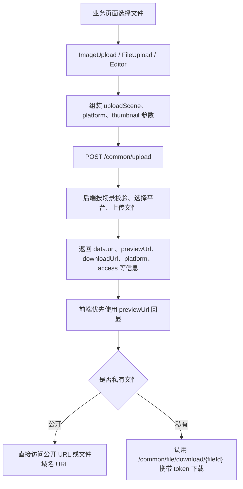

# 前端文件上传适配说明

## 一、改造背景

后端 `/common/upload` 已从若依原来的扁平返回格式，调整为统一 DTO 返回：

```json
{
  "code": 200,
  "msg": "操作成功",
  "data": {
    "url": "https://xxx/test/public/image/2026/09/08/xxx.jpg",
    "fileName": "https://xxx/test/public/image/2026/09/08/xxx.jpg",
    "newFileName": "xxx.jpg",
    "originalFilename": "原文件名.jpg",
    "platform": "tencent-cos-1",
    "uploadScene": "commonImg",
    "access": "public"
  }
}
```

前端原组件仍按 `res.fileName` 读取上传结果，并且默认会把 `VITE_APP_BASE_API` 拼到文件地址前面，导致对象存储返回完整 URL 时出现回显失败、链接错误或地址重复拼接

## 二、改造前问题

1. 图片上传、文件上传、富文本上传只支持若依历史返回格式，不兼容 `res.data.url`
2. 图片和头像回显默认拼接后端接口前缀，遇到 COS、OSS、MinIO 完整 URL 会拼错
3. 前端没有把 `uploadScene`、`platform`、`thumbnail` 等上传策略参数传给后端，业务页无法指定场景和存储平台
4. 文件链接直接打开真实 URL，私有文件会遇到对象存储 `AccessDenied`
5. 头像前端只判断 `image/*`，和后端 `avatar` 场景的 `png/jpg/jpeg` 不完全一致
6. 富文本图片原来允许 `svg`，后端通用图片白名单不支持时会出现前后端校验不一致
7. 业务接口已经返回 `file1List`、`file2List` 等授权文件列表时，上传组件仍会根据 fileId 再调用 `/common/file/listByIds`，导致页面进来多一次查询，也让私有文件 token 来源变得混乱

## 三、改造后方案

1. 通用上传组件新增 `uploadScene`、`platform`、`thumbnail`、`thumbnailWidth`、`thumbnailHeight` 属性
2. 上传时通过 `el-upload` 的 `data` 参数把非空扩展参数传给后端
3. 上传成功后优先读取 `res.data.url`，兼容旧接口的 `res.fileName`
4. 回显地址通过 `normalizeUrl` 统一处理，完整 URL 不再拼接 `VITE_APP_BASE_API`
5. 文件上传组件识别 `/private/` 路径，私有文件改走后端下载接口并携带 token
6. 头像和富文本图片增加前端格式、大小校验，后端仍做最终校验
7. 上传组件新增 `storageFileList` 属性，业务接口已经返回授权文件 DTO 时直接用于回显，不再 fallback 到 `/common/file/listByIds`

## 四、当前前端改动清单

已修改文件：

```text
D:\workspace\p_project\RuoYi\RuoYi-Vue3\src\components\ImageUpload\index.vue
D:\workspace\p_project\RuoYi\RuoYi-Vue3\src\components\FileUpload\index.vue
D:\workspace\p_project\RuoYi\RuoYi-Vue3\src\components\Editor\index.vue
D:\workspace\p_project\RuoYi\RuoYi-Vue3\src\store\modules\user.js
D:\workspace\p_project\RuoYi\RuoYi-Vue3\src\views\system\user\profile\userAvatar.vue
D:\workspace\p_project\RuoYi\RuoYi-Vue3\src\views\tool\gen\editTable.vue
D:\workspace\p_project\RuoYi\RuoYi-Vue3\src\views\tool\gen\importTable.vue
D:\workspace\p_project\RuoYi\RuoYi-Vue3\src\views\tool\swagger\index.vue
```

当前前端工作区新增文件：

```text
D:\workspace\p_project\RuoYi\RuoYi-Vue3\src\api\system\node.js
D:\workspace\p_project\RuoYi\RuoYi-Vue3\src\api\system\student.js
D:\workspace\p_project\RuoYi\RuoYi-Vue3\src\views\system\node\index.vue
D:\workspace\p_project\RuoYi\RuoYi-Vue3\src\views\system\student\index.vue
```

当前前端工作区还存在 Vite 临时文件：

```text
vite.config.js.timestamp-*.mjs
```

这类文件是 Vite 配置热加载产生的临时文件，不属于业务功能改造内容

## 五、通用图片上传组件

文件：

```text
D:\workspace\p_project\RuoYi\RuoYi-Vue3\src\components\ImageUpload\index.vue
```

### 5.1 上传时携带后端场景参数

原代码：

```vue
<el-upload
  multiple
  :action="uploadImgUrl"
  list-type="picture-card"
  :on-success="handleUploadSuccess"
  :before-upload="handleBeforeUpload"
  :headers="headers"
  :file-list="fileList"
>
```

现代码：

```vue
<el-upload
  multiple
  :action="uploadImgUrl"
  list-type="picture-card"
  :on-success="handleUploadSuccess"
  :before-upload="handleBeforeUpload"
  :headers="headers"
  :data="uploadData"
  :file-list="fileList"
>
```

改动说明：

`el-upload` 增加 `:data="uploadData"`，用于把上传场景、指定平台和缩略图参数一并提交到 `/common/upload`

### 5.2 新增上传扩展属性

原代码：

```js
const props = defineProps({
  modelValue: [String, Object, Array],
  limit: {
    type: Number,
    default: 5,
  },
  isShowTip: {
    type: Boolean,
    default: true
  },
});
```

现代码：

```js
const props = defineProps({
  modelValue: [String, Object, Array],
  limit: {
    type: Number,
    default: 5,
  },
  isShowTip: {
    type: Boolean,
    default: true
  },
  // 上传场景编码，对应后端 ruoyi.upload-scenes 配置
  uploadScene: {
    type: String,
    default: ""
  },
  // 存储平台标识，为空时使用后端默认平台
  platform: {
    type: String,
    default: ""
  },
  // 是否生成缩略图，具体规则可被后端上传场景覆盖
  thumbnail: {
    type: Boolean,
    default: false
  },
  // 缩略图宽度，为空时使用后端默认值
  thumbnailWidth: {
    type: Number,
    default: null
  },
  // 缩略图高度，为空时使用后端默认值
  thumbnailHeight: {
    type: Number,
    default: null
  },
  // 业务接口已经返回的授权文件列表，传入后优先用于回显，避免组件再调用通用 listByIds 查询私有文件
  storageFileList: {
    type: Array,
    default: () => []
  },
});
```

改动说明：

图片组件从“只能上传文件”变成“可声明上传场景和平台”的通用组件。业务页只需要写 `upload-scene="commonImg"` 或 `platform="tencent-cos-1"`，不需要为每个业务重新写上传接口

`storageFileList` 用来接收业务接口已经返回的授权文件 DTO。业务接口已经校验过菜单权限和业务数据权限，所以私有文件的短期 token 应该从业务接口返回，不应该让通用上传组件优先通过 `/common/file/listByIds` 再补一次

### 5.3 组装上传参数

新增代码：

```js
const uploadData = computed(() => {
  // 只传有值的扩展参数，后端会继续做真实性校验和场景规则校验
  const data = {};
  if (props.uploadScene) {
    data.uploadScene = props.uploadScene;
  }
  if (props.platform) {
    data.platform = props.platform;
  }
  if (props.thumbnail) {
    data.thumbnail = props.thumbnail;
  }
  if (props.thumbnailWidth) {
    data.thumbnailWidth = props.thumbnailWidth;
  }
  if (props.thumbnailHeight) {
    data.thumbnailHeight = props.thumbnailHeight;
  }
  return data;
});
```

改动说明：

只传有值参数，避免空字符串覆盖后端默认平台。后端仍是规则最终裁决方，前端只做体验和参数透传

### 5.4 兼容完整 URL 回显

原代码：

```js
fileList.value = list.map(item => {
  if (typeof item === "string") {
    if (item.indexOf(baseUrl) === -1) {
      item = { name: baseUrl + item, url: baseUrl + item };
    } else {
      item = { name: item, url: item };
    }
  }
  return item;
});
```

现代码：

```js
fileList.value = list.map(item => {
  if (typeof item === "string") {
    item = { name: normalizeUrl(item), url: normalizeUrl(item) };
  }
  return item;
});

// 兼容 X File Storage 完整 URL 和若依历史相对路径
function normalizeUrl(url) {
  if (!url || url.startsWith("http://") || url.startsWith("https://") || url.startsWith("blob:")) {
    return url;
  }
  return baseUrl + url;
}
```

改动说明：

COS、OSS、MinIO 返回 `https://...` 时直接使用；若依历史 `/profile/...` 或相对路径才拼接 `baseUrl`

### 5.5 优先使用业务返回的授权文件列表

原代码：

```js
watch(() => props.modelValue, async val => {
  if (val) {
    const list = Array.isArray(val) ? val : props.modelValue.split(",");
    const fileInfoMap = await getFileInfoMap(list);
    fileList.value = list.map(item => normalizeImageItem(item, fileInfoMap));
  } else {
    fileList.value = [];
    return [];
  }
},{ deep: true, immediate: true });
```

现代码：

```js
watch([() => props.modelValue, () => props.storageFileList], ([val]) => {
  if (val) {
    const list = Array.isArray(val) ? val : props.modelValue.split(",");
    const fileInfoMap = getFileInfoMap();
    fileList.value = list.map(item => normalizeImageItem(item, fileInfoMap));
  } else {
    fileList.value = [];
    return [];
  }
},{ deep: true, immediate: true });
```

新增代码：

```js
function getFileInfoMap() {
  // 普通业务私有文件必须由业务接口先完成权限校验，再把授权文件列表传给组件
  return { ...getExistingFileInfoMap(), ...getProvidedFileInfoMap() };
}

function getExistingFileInfoMap() {
  return (fileList.value || []).reduce((map, fileInfo) => {
    if (fileInfo && fileInfo.fileId) {
      map[String(fileInfo.fileId)] = fileInfo;
    }
    return map;
  }, {});
}

// 将业务接口返回的授权文件列表转成 Map，供 v-model 中的 fileId 回显使用
function getProvidedFileInfoMap() {
  return (props.storageFileList || []).reduce((map, fileInfo) => {
    if (fileInfo && fileInfo.fileId) {
      map[String(fileInfo.fileId)] = fileInfo;
    }
    return map;
  }, {});
}
```

改动说明：

组件现在同时监听 `modelValue` 和 `storageFileList`。业务接口已经返回文件 DTO 时，组件直接使用 DTO 中的 `originalFilename`、`previewUrl`、`downloadUrl` 回显；如果业务接口没有返回对应文件 DTO，组件不再兜底补查，需要业务接口补齐对应 `fileList`

### 5.6 兼容新上传返回结构

原代码：

```js
function handleUploadSuccess(res, file) {
  if (res.code === 200) {
    uploadList.value.push({ name: res.fileName, url: res.fileName });
    uploadedSuccessfully();
  } else {
    number.value--;
    proxy.$modal.closeLoading();
    proxy.$modal.msgError(res.msg);
  }
}
```

现代码：

```js
function handleUploadSuccess(res, file) {
  if (res.code === 200) {
    // 后端新上传接口返回 data 对象，旧接口返回顶层 fileName，这里同时兼容
    const fileInfo = res.data || res;
    const url = normalizeUrl(fileInfo.previewUrl || fileInfo.url || fileInfo.fileName);
    uploadList.value.push({
      name: fileInfo.originalFilename || fileInfo.newFileName || file.name,
      originalFilename: fileInfo.originalFilename || file.name,
      newFileName: fileInfo.newFileName,
      url,
      previewUrl: normalizeUrl(fileInfo.previewUrl || url),
      downloadUrl: normalizeUrl(fileInfo.downloadUrl || url),
      fileId: fileInfo.fileId,
      access: fileInfo.access
    });
    uploadedSuccessfully();
  } else {
    number.value--;
    proxy.$modal.closeLoading();
    proxy.$modal.msgError(res.msg);
  }
}
```

改动说明：

优先读取新 DTO 的 `previewUrl/url`，旧返回的 `fileName` 仍可兼容。点位管理图片上传后不回显，就是因为这里原来只读取顶层 `res.fileName`

## 六、通用文件上传组件

文件：

```text
D:\workspace\p_project\RuoYi\RuoYi-Vue3\src\components\FileUpload\index.vue
```

### 6.1 上传时携带场景参数

原代码：

```vue
<el-upload
  multiple
  :action="uploadFileUrl"
  :before-upload="handleBeforeUpload"
  :on-error="handleUploadError"
  :on-success="handleUploadSuccess"
  :headers="headers"
>
```

现代码：

```vue
<el-upload
  multiple
  :action="uploadFileUrl"
  :before-upload="handleBeforeUpload"
  :on-error="handleUploadError"
  :on-success="handleUploadSuccess"
  :headers="headers"
  :data="uploadData"
>
```

改动说明：

文件上传组件和图片上传组件保持一致，支持向后端透传 `uploadScene/platform/thumbnail`

### 6.2 文件链接支持私有下载

原代码：

```vue
<el-link :href="`${baseUrl}${file.url}`" :underline="false" target="_blank">
  <span class="el-icon-document"> {{ getFileName(file.name) }} </span>
</el-link>
```

现代码：

```vue
<el-link :href="getFileHref(file.url)" :underline="false" target="_blank" @click="handleFileClick(file, $event)">
  <span class="el-icon-document"> {{ getFileName(file.name) }} </span>
</el-link>
```

新增代码：

```js
// 点击文件时按公开或私有访问策略处理
async function handleFileClick(file, event) {
  if (!isPrivateStorageUrl(file.url)) {
    return;
  }
  event.preventDefault();
  if (file.downloadUrl || file.fileId) {
    await downloadPrivateStorageFile(file);
    return;
  }
  proxy.$modal.msgError("文件缺少下载地址");
}

async function downloadPrivateStorageFile(file) {
  const url = toRequestUrl(file.downloadUrl || `/common/file/download/${file.fileId}`);
  const data = await request({
    url,
    method: "get",
    responseType: "blob"
  });
  if (blobValidate(data)) {
    saveAs(new Blob([data]), getDisplayName(file));
  }
}
```

改动说明：

公开文件仍然直接打开 URL；私有文件不再直接访问对象存储地址，也不再调用已删除的 `common/storage/download`，而是调用业务接口返回的 `downloadUrl` 或 `/common/file/download/{fileId}` 后端代理下载接口

### 6.3 成功回调兼容新 DTO

原代码：

```js
function handleUploadSuccess(res, file) {
  if (res.code === 200) {
    uploadList.value.push({ name: res.fileName, url: res.fileName });
    uploadedSuccessfully();
  } else {
    number.value--;
    proxy.$modal.closeLoading();
    proxy.$modal.msgError(res.msg);
  }
}
```

现代码：

```js
function handleUploadSuccess(res, file) {
  if (res.code === 200) {
    // 后端新上传接口返回 data 对象，旧接口返回顶层 fileName，这里同时兼容
    const fileInfo = res.data || res;
    const url = normalizeUrl(fileInfo.previewUrl || fileInfo.url || fileInfo.fileName);
    uploadList.value.push({
      name: fileInfo.originalFilename || fileInfo.newFileName || file.name,
      originalFilename: fileInfo.originalFilename || file.name,
      newFileName: fileInfo.newFileName,
      url,
      previewUrl: normalizeUrl(fileInfo.previewUrl || url),
      downloadUrl: normalizeUrl(fileInfo.downloadUrl || url),
      fileId: fileInfo.fileId,
      access: fileInfo.access
    });
    uploadedSuccessfully();
  } else {
    number.value--;
    proxy.$modal.closeLoading();
    proxy.$modal.msgError(res.msg);
  }
}
```

改动说明：

修复文件上传成功后列表只显示文件名但无法正确打开对象存储完整 URL 的问题，同时保留 `originalFilename` 供列表展示和下载保存名使用

## 七、富文本编辑器上传

文件：

```text
D:\workspace\p_project\RuoYi\RuoYi-Vue3\src\components\Editor\index.vue
```

### 7.1 上传时携带扩展参数

原代码：

```vue
<el-upload
  :action="uploadUrl"
  :before-upload="handleBeforeUpload"
  :on-success="handleUploadSuccess"
  :on-error="handleUploadError"
  name="file"
  :headers="headers"
>
```

现代码：

```vue
<el-upload
  :action="uploadUrl"
  :before-upload="handleBeforeUpload"
  :on-success="handleUploadSuccess"
  :on-error="handleUploadError"
  name="file"
  :headers="headers"
  :data="uploadData"
>
```

改动说明：

富文本内上传图片也可按业务场景传入平台和缩略图参数，默认不传时继续走后端默认平台

### 7.2 图片格式校验与后端保持一致

原代码：

```js
function handleBeforeUpload(file) {
  const type = ["image/jpeg", "image/jpg", "image/png", "image/svg"];
  const isJPG = type.includes(file.type);
  //检验文件格式
  if (!isJPG) {
    proxy.$modal.msgError(`图片格式错误!`);
    return false;
  }
}
```

现代码：

```js
function handleBeforeUpload(file) {
  // 富文本图片格式要和后端通用上传白名单保持一致，避免前端放行后端不支持的 svg
  const type = ["image/jpeg", "image/jpg", "image/png", "image/gif", "image/bmp"];
  const isImage = type.includes(file.type);
  // 检验图片格式
  if (!isImage) {
    proxy.$modal.msgError(`图片格式错误，请上传 jpg/jpeg/png/gif/bmp 格式图片`);
    return false;
  }
}
```

改动说明：

移除前端 `svg` 放行，补齐 `gif/bmp`，避免“前端能选，后端拒绝”的体验不一致

### 7.3 插入图片兼容完整 URL

原代码：

```js
// 插入图片，res.url为服务器返回的图片链接地址
quill.insertEmbed(length, "image", import.meta.env.VITE_APP_BASE_API + res.fileName);
```

现代码：

```js
// 插入图片，兼容后端新 data 对象和若依历史顶层 fileName
const fileInfo = res.data || res;
const url = fileInfo.url || fileInfo.fileName;
quill.insertEmbed(length, "image", normalizeUrl(url));
```

新增代码：

```js
// 兼容 X File Storage 完整 URL 和若依历史相对路径
function normalizeUrl(url) {
  if (!url || url.startsWith("http://") || url.startsWith("https://") || url.startsWith("blob:")) {
    return url;
  }
  return import.meta.env.VITE_APP_BASE_API + url;
}
```

改动说明：

富文本上传后直接把真实可访问 URL 插入编辑器，避免对象存储地址被拼成 `/dev-api/https://...`

## 八、头像上传页面

文件：

```text
D:\workspace\p_project\RuoYi\RuoYi-Vue3\src\views\system\user\profile\userAvatar.vue
```

### 8.1 头像前端白名单

原代码：

```js
function beforeUpload(file) {
  if (file.type.indexOf("image/") == -1) {
    proxy.$modal.msgError("文件格式错误，请上传图片类型,如：JPG，PNG后缀的文件。");
  } else {
    const reader = new FileReader();
    reader.readAsDataURL(file);
    reader.onload = () => {
      options.img = reader.result;
      options.filename = file.name;
    };
  }
}
```

现代码：

```js
const avatarMaxSize = 5;
const avatarFileTypes = ["png", "jpg", "jpeg"];

function beforeUpload(file) {
  // 头像只允许上传 png、jpg、jpeg，和后端 avatar 场景保持一致
  if (!isAllowedAvatarType(file)) {
    proxy.$modal.msgError(`文件格式错误，请上传 ${avatarFileTypes.join("/")} 格式的图片`);
    return false;
  }
  // 前端先拦截超过 5MB 的头像，后端仍会再次校验
  if (file.size / 1024 / 1024 > avatarMaxSize) {
    proxy.$modal.msgError(`上传头像图片大小不能超过 ${avatarMaxSize} MB`);
    return false;
  }
  // 读取本地图片用于裁剪预览，不会直接上传原始文件
  const reader = new FileReader();
  reader.readAsDataURL(file);
  reader.onload = () => {
    options.img = reader.result;
    options.filename = file.name;
  };
  return true;
}
```

改动说明：

头像前端限制从泛化 `image/*` 改成 `png/jpg/jpeg + 5MB`，和后端 `avatar` 场景保持一致。前端校验只负责体验，后端仍做真实性校验

### 8.2 头像返回 URL 兼容

原代码：

```js
uploadAvatar(formData).then(response => {
  open.value = false;
  options.img = import.meta.env.VITE_APP_BASE_API + response.imgUrl;
  userStore.avatar = options.img;
  proxy.$modal.msgSuccess("修改成功");
  visible.value = false;
});
```

现代码：

```js
uploadAvatar(formData).then(response => {
  const avatarUrl = getAvatarUrl(response);
  options.img = avatarUrl;
  userStore.avatar = avatarUrl;
  proxy.$modal.msgSuccess("修改成功");
  visible.value = false;
  open.value = false;
});

/** 从上传响应中获取头像地址 */
function getAvatarUrl(response) {
  const data = response && response.data ? response.data : response;
  return normalizeAvatarUrl(data && (data.imgUrl || data.url || data.thUrl));
}

/** 关闭窗口 */
function closeDialog() {
  options.img = userStore.avatar;
  visible.value = false;
}

/** 兼容后端返回绝对地址和相对地址 */
function normalizeAvatarUrl(url) {
  // X File Storage 会返回完整 URL，若依历史本地上传可能返回 /profile 相对路径
  if (!url || url.startsWith("http://") || url.startsWith("https://") || url.startsWith("blob:")) {
    return url;
  }
  return import.meta.env.VITE_APP_BASE_API + url;
}
```

改动说明：

后端头像保存的是 X File Storage 返回的完整 URL，前端不再强行拼接 `/dev-api`

头像弹窗回显失败的直接原因是上传成功后先执行了 `open.value = false`，弹窗关闭时触发 `closeDialog()`，又把 `options.img` 重置成旧的 `userStore.avatar`。现在改为先从响应中解析新头像地址，更新 `options.img` 和 `userStore.avatar`，最后再关闭弹窗，避免新头像被旧缓存覆盖。

`getAvatarUrl` 同时兼容 `response.imgUrl` 和 `response.data.imgUrl` 两种结构，也兜底支持 `url`、`thUrl` 字段，避免后端返回格式调整后头像回显再次失效。

## 九、用户头像缓存

文件：

```text
D:\workspace\p_project\RuoYi\RuoYi-Vue3\src\store\modules\user.js
```

原代码：

```js
const avatar = (user.avatar == "" || user.avatar == null) ? defAva : import.meta.env.VITE_APP_BASE_API + user.avatar;
```

现代码：

```js
const avatar = (user.avatar == "" || user.avatar == null) ? defAva : normalizeAvatarUrl(user.avatar);

// 兼容 X File Storage 完整 URL 和若依历史相对路径
function normalizeAvatarUrl(url) {
  if (!url || url.startsWith("http://") || url.startsWith("https://") || url.startsWith("blob:")) {
    return url;
  }
  return import.meta.env.VITE_APP_BASE_API + url;
}
```

改动说明：

登录后用户信息里的头像如果是对象存储完整 URL，直接用于页面展示；如果是若依历史相对路径，继续拼接后端接口前缀

## 十、代码生成前端页面

### 10.1 编辑生成表字段

文件：

```text
D:\workspace\p_project\RuoYi\RuoYi-Vue3\src\views\tool\gen\editTable.vue
```

原代码：

```vue
<el-select v-model="scope.row.javaType">
  <el-option label="Long" value="Long" />
  <el-option label="String" value="String" />
  <el-option label="Integer" value="Integer" />
  <el-option label="Double" value="Double" />
  <el-option label="BigDecimal" value="BigDecimal" />
  <el-option label="Date" value="Date" />
  <el-option label="Boolean" value="Boolean" />
</el-select>
```

现代码：

```vue
<el-select v-model="scope.row.javaType" @change="value => handleJavaTypeChange(scope.row, value)">
  <el-option label="Long" value="Long" />
  <el-option label="String" value="String" />
  <el-option label="Integer" value="Integer" />
  <el-option label="Double" value="Double" />
  <el-option label="BigDecimal" value="BigDecimal" />
  <el-option label="Date" value="Date" />
  <el-option label="LocalDate" value="LocalDate" />
  <el-option label="LocalDateTime" value="LocalDateTime" />
  <el-option label="Boolean" value="Boolean" />
</el-select>
```

原代码：

```vue
<el-option label="日期控件" value="datetime" />
<el-option label="图片上传" value="imageUpload" />
<el-option label="文件上传" value="fileUpload" />
```

现代码：

```vue
<el-option label="日期控件" value="date" />
<el-option label="日期时间控件" value="datetime" />
<el-option label="图片上传" value="imageUpload" />
<el-option label="文件上传" value="fileUpload" />
```

新增代码：

```js
// Java日期类型与显示类型联动，避免LocalDate仍按datetime控件生成。
function handleJavaTypeChange(row, javaType) {
  syncDateHtmlType(row, javaType);
}

// 加载已保存字段时也归一化日期显示类型，修复历史配置中的LocalDate + datetime组合。
function syncDateHtmlType(row, javaType = row.javaType) {
  if (javaType === "LocalDate") {
    row.htmlType = "date";
  } else if (javaType === "LocalDateTime" || javaType === "Date") {
    row.htmlType = "datetime";
  }
}
```

改动说明：

这部分属于代码生成配套优化：前端生成页面支持 `LocalDate/LocalDateTime`，并把 `LocalDate` 自动联动为日期控件，避免生成代码时日期类型和控件类型错配

### 10.2 导入表时指定前端模板类型

文件：

```text
D:\workspace\p_project\RuoYi\RuoYi-Vue3\src\views\tool\gen\importTable.vue
```

原代码：

```js
importTable({ tables: tableNames }).then(res => {
  proxy.$modal.msgSuccess(res.msg);
});
```

现代码：

```js
importTable({ tables: tableNames, tplWebType: "element-plus" }).then(res => {
  proxy.$modal.msgSuccess(res.msg);
});
```

改动说明：

导入表时明确传 `element-plus`，让后端代码生成器按 Vue3/Element Plus 模板初始化前端字段配置

## 十一、Swagger 页面入口

文件：

```text
D:\workspace\p_project\RuoYi\RuoYi-Vue3\src\views\tool\swagger\index.vue
```

原代码：

```js
import iFrame from '@/components/iFrame'

const url = ref(import.meta.env.VITE_APP_BASE_API + "/swagger-ui/index.html")
```

现代码：

```js
import { ref } from 'vue'
import iFrame from '@/components/iFrame'

const url = ref(import.meta.env.VITE_APP_BASE_API + "/doc.html")
```

改动说明：

前端 Swagger 菜单从 Springdoc 默认页面切换为 Knife4j `doc.html` 页面，同时补齐 `ref` 导入

## 十二、新增生成页面说明

当前前端工作区存在新增的点位管理和学生信息生成文件：

```text
src/api/system/node.js
src/views/system/node/index.vue
src/api/system/student.js
src/views/system/student/index.vue
```

其中点位管理页面已经生成了文件上传相关控件，用于验证 `upload-scene` 和 `platform` 是否能从前端传到后端

关键现代码：

```vue
<image-upload v-model="form.file1"
  upload-scene="commonImg"
  platform="tencent-cos-1"
/>

<file-upload v-model="form.file2"
  upload-scene="commonFile"
  platform="tencent-cos-1"
/>

<file-upload
  v-model="form.file4"
  upload-scene="audio"
  platform="tencent-cos-1"
  :file-type="['mp3', 'wav', 'wma', 'ogg']"
  :file-size="50"
/>

<file-upload
  v-model="form.file5"
  upload-scene="video"
  platform="tencent-cos-1"
  :file-type="['mp4', 'avi', 'rmvb']"
  :file-size="100"
/>
```

说明：

1. `upload-scene` 决定后端使用哪个业务场景规则，例如图片、附件、音频、视频
2. `platform` 指定上传到哪个存储平台，不传时使用后端默认平台
3. 音频、视频仍复用 `file-upload` 组件，通过 `file-type` 和 `file-size` 做前端体验校验
4. 新增生成文件当前存在中文乱码，属于生成输出编码问题，后续需要从代码生成模板或生成流程修正

## 十三、前端上传链路



## 十四、对外访问地址适配

后端上传响应现在会根据公开或私有访问级别返回对外地址：

```json
{
  "fileId": 2,
  "url": "/common/file/preview/2",
  "previewUrl": "/common/file/preview/2",
  "downloadUrl": "/common/file/download/2",
  "access": "private"
}
```

前端组件适配规则：

- 图片回显优先使用 `previewUrl`，没有时回退 `url`
- 文件下载优先使用 `downloadUrl`
- 文件列表展示优先使用 `originalFilename`，避免页面展示 UUID 文件名或完整代理地址
- 业务字段保存多个 `fileId` 时，上传组件只使用业务接口返回的 `storageFileList` 做回显，不再调用 `/common/file/listByIds`
- 私有文件优先使用业务接口返回的 `downloadUrl` 下载，缺少 `downloadUrl` 时通过 `fileId` 调用 `/common/file/download/{fileId}`
- 后端返回相对地址时，前端继续通过 `VITE_APP_BASE_API` 补成接口代理地址

`ImageUpload` 上传成功后保存：

```js
const url = normalizeUrl(fileInfo.previewUrl || fileInfo.url || fileInfo.fileName);
uploadList.value.push({
  name: fileInfo.originalFilename || fileInfo.newFileName || file.name,
  originalFilename: fileInfo.originalFilename || file.name,
  newFileName: fileInfo.newFileName,
  url,
  previewUrl: normalizeUrl(fileInfo.previewUrl || url),
  downloadUrl: normalizeUrl(fileInfo.downloadUrl || url),
  fileId: fileInfo.fileId,
  access: fileInfo.access
});
```

`FileUpload` 私有文件下载：

```js
const url = toRequestUrl(file.downloadUrl || `/common/file/download/${file.fileId}`);
const data = await request({
  url,
  method: "get",
  responseType: "blob"
});
if (blobValidate(data)) {
  saveAs(new Blob([data]), getDisplayName(file));
}
```

`FileUpload` 文件名展示：

```vue
<span class="el-icon-document"> {{ getDisplayName(file) }} </span>
```

`FileUpload` 通过 `fileId` 批量回显：

```js
watch([() => props.modelValue, () => props.storageFileList], ([val]) => {
  if (val) {
    let temp = 1;
    const list = Array.isArray(val) ? val : props.modelValue.split(",");
    const fileInfoMap = getFileInfoMap();
    fileList.value = list.map(item => {
      item = normalizeFileItem(item, fileInfoMap);
      item.uid = item.uid || new Date().getTime() + temp++;
      return item;
    });
  } else {
    fileList.value = [];
    return [];
  }
},{ deep: true, immediate: true });
```

```js
function getFileInfoMap() {
  return { ...getExistingFileInfoMap(), ...getProvidedFileInfoMap() };
}
```

```js
function normalizeFileItem(item, fileInfoMap) {
  if (typeof item === "string") {
    const value = item.trim();
    if (isFileIdValue(value)) {
      const fileInfo = fileInfoMap[value];
      if (fileInfo) {
        return buildFileItem(fileInfo, value);
      }
    }
    return { name: getFileName(value), url: value };
  }
  item.name = item.originalFilename || item.name || item.newFileName || getFileName(item.url || "");
  item.url = normalizeUrl(item.previewUrl || item.url);
  item.downloadUrl = normalizeUrl(item.downloadUrl || item.url);
  return item;
}
```

```js
function getDisplayName(file) {
  if (!file) {
    return "";
  }
  if (file.originalFilename) {
    return file.originalFilename;
  }
  if (file.name && !isPathLike(file.name)) {
    return file.name;
  }
  if (file.newFileName) {
    return file.newFileName;
  }
  return getFileName(file.name || file.url || "");
}
```

回显已有文件对象时，也会把 `originalFilename` 映射到 `name`：

```js
function buildFileItem(fileInfo, fallbackFileId) {
  const url = normalizeUrl(fileInfo.previewUrl || fileInfo.url || fileInfo.fileName || "");
  return {
    name: fileInfo.originalFilename || fileInfo.newFileName || fileInfo.filename || fallbackFileId,
    originalFilename: fileInfo.originalFilename,
    newFileName: fileInfo.newFileName || fileInfo.filename,
    url,
    previewUrl: normalizeUrl(fileInfo.previewUrl || url),
    downloadUrl: normalizeUrl(fileInfo.downloadUrl || url),
    fileId: fileInfo.fileId || fallbackFileId,
    access: fileInfo.access
  };
}
```

`FileUpload` 回传业务字段时优先使用 `fileId`：

```js
const value = list[i].fileId || list[i].url;
if (value) {
  strs += value + separator;
}
```

这样新上传的文件保存到业务表时是文件资产 ID，当前页面会从组件已有文件对象中继续展示 `originalFilename`。重新打开表单时由业务详情接口返回授权文件 DTO，组件通过 `storageFileList` 展示 `originalFilename`。老数据如果仍是 URL，会继续按 URL 最后一段兜底显示。

`ImageUpload` 同步支持 `fileId` 回显，图片类字段保存 `70,73,74,75` 时也只消费业务接口返回的 `storageFileList`，不再发起 `/common/file/listByIds` 请求。

头像上传弹窗优先使用后端返回的代理或文件域名预览地址：

```js
return normalizeAvatarUrl(data && (data.previewUrl || data.imgUrl || data.url || data.thUrl));
```

## 十五、验证结果

已执行前端构建：

```bash
npm run build:prod
```

结果：

```text
构建成功
仅存在 Vite chunk size warning
```

该警告为构建产物体积提示，不影响本次上传组件适配功能

## 十六、上传 Loading 收尾修复

问题表现：

```text
图片上传接口已经成功返回，但页面一直停留在“正在上传图片，请稍候...”
```

原因：

```text
ImageUpload / FileUpload 使用 number 记录本轮上传数量，使用 uploadList 记录成功上传数量
原逻辑只有 uploadList.length === number 时才关闭 loading
如果之前发生过上传失败、移除、重复回调或计数残留，就会导致两者不相等，loading 无法关闭
```

现代码：

```js
function uploadedSuccessfully() {
  if (number.value > 0 && uploadList.value.length >= number.value) {
    fileList.value = fileList.value.filter(f => f.url !== undefined).concat(uploadList.value);
    uploadList.value = [];
    number.value = 0;
    emit("update:modelValue", listToString(fileList.value));
    proxy.$modal.closeLoading();
  }
}
```

上传失败时同步重置本轮计数：

```js
function handleUploadError() {
  number.value = Math.max(number.value - 1, 0);
  proxy.$modal.msgError("上传图片失败");
  if (number.value === 0) {
    uploadList.value = [];
    proxy.$modal.closeLoading();
  }
}
```

`ImageUpload` 的 `before-upload` 明确返回 `true`：

```js
proxy.$modal.loading("正在上传图片，请稍候...");
number.value++;
return true;
```

改动后，上传成功、上传失败、批量上传部分成功等场景都能正确收尾，不会因为计数偏差导致 loading 常驻

## 十七、业务授权文件列表优先回显

问题表现：

```text
进入点位管理页面时，除了 /system/node/list，还会额外请求：
GET /common/file/listByIds?fileIds=73,75,80...
```

原因：

```text
点位列表接口已经返回 file1List、file2List 等文件 DTO
但是前端页面和上传组件仍然根据业务字段里的 fileId 再调用 /common/file/listByIds 回查
这会导致同一批私有文件同时存在“业务接口授权”和“通用接口回查”两条来源
```

现代码：

```vue
<image-upload
  v-model="form.file1"
  upload-scene="commonImg"
  platform="tencent-cos-1"
  :storage-file-list="form.file1List"
/>

<file-upload
  v-model="form.file2"
  upload-scene="commonFile"
  platform="tencent-cos-1"
  :storage-file-list="form.file2List"
/>
```

组件处理：

```js
watch([() => props.modelValue, () => props.storageFileList], ([val]) => {
  if (val) {
    const list = Array.isArray(val) ? val : props.modelValue.split(",");
    // 文件回显信息由业务列表或详情接口返回，组件不再绕过业务权限单独补查
    const fileInfoMap = getFileInfoMap();
    fileList.value = list.map(item => normalizeFileItem(item, fileInfoMap));
  } else {
    fileList.value = [];
    return [];
  }
},{ deep: true, immediate: true });
```

```js
function getFileInfoMap() {
  // 普通业务私有文件必须由业务接口先完成权限校验，再把授权文件列表传给组件
  return { ...getExistingFileInfoMap(), ...getProvidedFileInfoMap() };
}

function getExistingFileInfoMap() {
  return (fileList.value || []).reduce((map, fileInfo) => {
    if (fileInfo && fileInfo.fileId) {
      map[String(fileInfo.fileId)] = fileInfo;
    }
    return map;
  }, {});
}

function getProvidedFileInfoMap() {
  return (props.storageFileList || []).reduce((map, fileInfo) => {
    if (fileInfo && fileInfo.fileId) {
      map[String(fileInfo.fileId)] = fileInfo;
    }
    return map;
  }, {});
}
```

点位列表处理：

```js
function loadNodeStorageFileDisplay(rows) {
  const fileInfoMap = collectProvidedStorageFileMap(rows)
  if (!Object.keys(fileInfoMap).length) {
    return
  }
  rows.forEach(row => {
    // 图片列使用缩略图预览地址，避免列表里继续把 fileId 当图片地址使用
    row.file1FileList = buildStorageFileList(row.file1, fileInfoMap)
    row.file1PreviewUrl = row.file1FileList[0]?.thPreviewUrl || row.file1FileList[0]?.previewUrl || ""
    // 附件、富文本、音频、视频列展示 originalFilename，而不是展示业务表保存的 fileId
    row.file2FileList = buildStorageFileList(row.file2, fileInfoMap)
    row.file3FileList = buildStorageFileList(row.file3, fileInfoMap)
    row.file4FileList = buildStorageFileList(row.file4, fileInfoMap)
    row.file5FileList = buildStorageFileList(row.file5, fileInfoMap)
  })
}
```

改动后链路：

```text
业务列表或详情接口有 fileXList：前端直接回显，不再额外查通用 fileId 补查接口
业务列表或详情接口缺少文件 DTO：前端不再兜底补查，需要业务接口补齐对应 fileList
业务私有文件 token 来源：业务接口签发
通用 listByIds 定位：已删除，避免组件绕过业务查询权限枚举文件
```

上传成功后的文件名显示：

```js
function handleUploadSuccess(res, file) {
  if (res.code === 200) {
    const fileInfo = res.data || res;
    uploadList.value.push({
      name: fileInfo.originalFilename || fileInfo.newFileName || file.name,
      originalFilename: fileInfo.originalFilename || file.name,
      newFileName: fileInfo.newFileName,
      fileId: fileInfo.fileId,
      access: fileInfo.access
    });
    uploadedSuccessfully();
  }
}
```

说明：上传成功后业务字段仍保存 `fileId`，但组件会先从已有 `fileList` 中读取刚上传的文件对象，因此页面展示继续使用 `originalFilename`，不会在父组件回写 v-model 后退化成显示数字。

私有文件下载：

```js
async function handleFileClick(file, event) {
  if (!isPrivateStorageFile(file)) {
    return;
  }
  event.preventDefault();
  if (file.downloadUrl || file.fileId) {
    await downloadPrivateStorageFile(file);
    return;
  }
  proxy.$modal.msgError("文件缺少下载地址");
}

async function downloadPrivateStorageFile(file) {
  const url = toRequestUrl(file.downloadUrl || `/common/file/download/${file.fileId}`);
  const data = await request({
    url,
    method: "get",
    responseType: "blob"
  });
  if (blobValidate(data)) {
    saveAs(new Blob([data]), getDisplayName(file));
  }
}
```

说明：私有文件点击时不再依赖已删除的 `/common/storage/download`，而是走业务接口返回的 `downloadUrl` 或后端代理下载接口 `/common/file/download/{fileId}`。`downloadUrl` 中如果带有文件 token，会由后端继续做私有文件授权校验。
