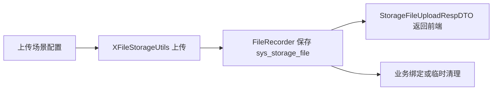

# 完善文件管理公共模型和配置

对应提交：`d78587c6 完善文件管理公共模型和配置`

## 1. 改造目标

建立文件资产管理的公共模型、枚举、配置和数据库字段基础，让后续上传、回显、私有访问、分片上传、业务绑定都能使用统一的数据结构。

## 2. 改造前存在的问题

原来文件上传更多停留在“返回 URL 给业务字段保存”的层面，缺少统一的文件资产状态、访问级别、对象 Key、批量上传限制、分片响应 DTO 和业务文件字段标记能力。

## 3. 改造后的解决方案

新增 `StorageFileConstants`、`StorageFileAccess`、`StorageFileStatus`、上传响应 DTO、分片响应 DTO 和 `StorageFileField` 注解，并扩展 `sys_storage_file` 表结构，使文件资产具备可管理的基础字段。

## 4. 总体链路



## 5. 涉及文件

- `ruoyi-common/src/main/java/com/ruoyi/common/annotation/StorageFileField.java`
- `ruoyi-common/src/main/java/com/ruoyi/common/config/StorageFileUploadProperties.java`
- `ruoyi-common/src/main/java/com/ruoyi/common/config/UploadSceneProperties.java`
- `ruoyi-common/src/main/java/com/ruoyi/common/constant/CacheConstants.java`
- `ruoyi-common/src/main/java/com/ruoyi/common/constant/StorageFileConstants.java`
- `ruoyi-common/src/main/java/com/ruoyi/common/core/domain/model/StorageFilePartRespDTO.java`
- `ruoyi-common/src/main/java/com/ruoyi/common/core/domain/model/StorageFileUploadRespDTO.java`
- `ruoyi-common/src/main/java/com/ruoyi/common/enums/StorageFileAccess.java`
- `ruoyi-common/src/main/java/com/ruoyi/common/enums/StorageFileStatus.java`
- `ruoyi-system/src/main/java/com/ruoyi/system/config/StorageFileProperties.java`
- `ruoyi-system/src/main/java/com/ruoyi/system/domain/SysStorageFile.java`
- `ruoyi-system/src/main/java/com/ruoyi/system/domain/SysStorageFilePart.java`
- `sql/ry_20260417.sql`
- `sql/sys_storage_file_20260901.sql`

## 6. 具体改动

### 6.1 增加上传控制配置

#### 原代码

改造前没有独立的 `StorageFileUploadProperties`，通用上传入口无法统一控制是否必须传 `uploadScene`，也没有全局批量上传数量兜底。

#### 现代码

```java
@Component
@ConfigurationProperties(prefix = "ruoyi.storage-file")
public class StorageFileUploadProperties
{
    /**
     * 是否要求通用上传必须传 uploadScene
     */
    private boolean requireUploadScene = false;

    /**
     * 单次批量上传最大文件数量
     */
    private int maxBatchUploadCount = 20;

    /**
     * 获取有效的单次批量上传最大文件数量
     *
     * @return 单次批量上传最大文件数量
     */
    public int getEffectiveMaxBatchUploadCount()
    {
        // 配置小于等于 0 时使用 20 个兜底，避免误配置导致批量上传不受限制
        return maxBatchUploadCount > 0 ? maxBatchUploadCount : 20;
    }
}
```

#### 涉及改动部分

```java
// 省略
/**
 * 单次批量上传最大文件数量
 */
private int maxBatchUploadCount = 20;

public int getEffectiveMaxBatchUploadCount()
{
    // 配置小于等于 0 时使用 20 个兜底，避免误配置导致批量上传不受限制
    return maxBatchUploadCount > 0 ? maxBatchUploadCount : 20;
}
// 省略
```

#### 改动说明

原来批量上传没有统一数量上限，容易被某个业务一次性提交过多文件。现在提供全局默认值 `20`，后续上传场景和后端代码还可以覆盖这个值。

### 6.2 扩展上传场景配置

#### 原代码

```java
public static class Scene
{
    private DataSize maxSize;
    private List<String> allowedExtension;
    private Boolean thumbnail;
    private Integer thumbnailWidth;
    private Integer thumbnailHeight;
}
```

#### 现代码

```java
public static class Scene
{
    private DataSize maxSize;
    private List<String> allowedExtension;
    private Boolean thumbnail;
    private Integer thumbnailWidth;
    private Integer thumbnailHeight;

    /**
     * 缩略图文件名后缀，配置后覆盖全局 thumbnail-suffix
     */
    private String thumbnailSuffix;

    /**
     * 单次批量上传最大文件数量，配置后覆盖全局 max-batch-upload-count
     */
    private Integer maxBatchUploadCount;

    /**
     * 访问级别，public 表示公开访问，private 表示私有访问
     */
    private String access;

    /**
     * 场景路径前缀，例如 avatar、image、contract
     */
    private String pathPrefix;
}
```

#### 涉及改动部分

```java
// 省略
private Integer thumbnailHeight;

/**
 * 缩略图文件名后缀，配置后覆盖全局 thumbnail-suffix
 */
private String thumbnailSuffix;

/**
 * 单次批量上传最大文件数量，配置后覆盖全局 max-batch-upload-count
 */
private Integer maxBatchUploadCount;

/**
 * 访问级别，public 表示公开访问，private 表示私有访问
 */
private String access;

/**
 * 场景路径前缀，例如 avatar、image、contract
 */
private String pathPrefix;
// 省略
```

#### 改动说明

上传场景从单纯的大小、格式、缩略图配置，扩展为完整的上传策略配置。`access` 决定公开或私有，`pathPrefix` 决定业务目录，`thumbnailSuffix` 允许不同场景生成不同缩略图后缀，`maxBatchUploadCount` 允许不同业务限制不同批量数量。

### 6.3 增加文件管理常量和枚举

#### 原代码

改造前公开/私有、预览路径、下载路径、文件状态等值散落在代码中，后续判断容易出现硬编码不一致。

#### 现代码

```java
/**
 * 存储文件公共常量
 * <p>
 * 只收敛跨模块共享的固定协议值，具体业务场景编码仍由业务模块自行定义
 *
 * @author 955Kane
 */
public final class StorageFileConstants
{
    /**
     * 公开文件访问级别
     */
    public static final String ACCESS_PUBLIC = "public";

    /**
     * 私有文件访问级别
     */
    public static final String ACCESS_PRIVATE = "private";

    /**
     * 头像业务类型
     */
    public static final String BIZ_TYPE_AVATAR = "avatar";

    /**
     * 对象存储公开读 ACL
     */
    public static final String ACL_PUBLIC_READ = "public-read";

    /**
     * 存储文件管理下载权限
     */
    public static final String PERMISSION_STORAGE_DOWNLOAD = "system:storage:download";

    /**
     * 文件预览代理路径
     */
    public static final String PREVIEW_PATH = "/common/file/preview/";

    /**
     * 文件下载代理路径
     */
    public static final String DOWNLOAD_PATH = "/common/file/download/";

    private StorageFileConstants()
    {
    }
}
```

```java
/**
 * 存储文件访问级别
 * <p>
 * 数据库 access 字段保存 code，代码中通过枚举表达公开和私有的访问语义
 *
 * @author 955Kane
 */
public enum StorageFileAccess
{
    /**
     * 公开访问文件
     */
    PUBLIC(StorageFileConstants.ACCESS_PUBLIC),

    /**
     * 私有访问文件
     */
    PRIVATE(StorageFileConstants.ACCESS_PRIVATE);

    /**
     * 数据库存储值
     */
    private final String code;

    StorageFileAccess(String code)
    {
        this.code = code;
    }

    public String getCode()
    {
        return code;
    }

    /**
     * 判断访问级别是否为公开
     *
     * @param code 数据库存储访问级别
     * @return true 表示公开文件
     */
    public static boolean isPublic(String code)
    {
        return PUBLIC.code.equals(code);
    }

    /**
     * 判断访问级别是否为私有
     *
     * @param code 数据库存储访问级别
     * @return true 表示私有文件
     */
    public static boolean isPrivate(String code)
    {
        return PRIVATE.code.equals(code);
    }
}
```

#### 涉及改动部分

```java
// 省略
/**
 * 公开文件访问级别
 */
public static final String ACCESS_PUBLIC = "public";

/**
 * 私有文件访问级别
 */
public static final String ACCESS_PRIVATE = "private";

/**
 * 文件预览代理路径
 */
public static final String PREVIEW_PATH = "/common/file/preview/";

/**
 * 文件下载代理路径
 */
public static final String DOWNLOAD_PATH = "/common/file/download/";
// 省略
```

#### 改动说明

固定协议值用常量收敛，状态和访问级别用枚举表达语义。这样判断公开文件时不再写字符串比较，构建代理地址时也不再到处拼 `/common/file/preview/`。

### 6.4 扩展文件表字段

#### 原代码

```sql
create table sys_storage_file (
  file_id bigint not null auto_increment,
  url varchar(500) not null,
  size bigint,
  filename varchar(255),
  original_filename varchar(255),
  platform varchar(50),
  file_status char(1) default '0',
  primary key (file_id)
);
```

#### 现代码

```sql
create table sys_storage_file (
  file_id bigint not null auto_increment comment '文件ID',
  storage_id bigint default null comment '存储记录ID',
  url varchar(1000) not null comment '文件访问地址',
  url_hash char(64) not null comment '文件访问地址SHA-256哈希',
  object_key varchar(1000) default null comment '对象存储Key',
  size bigint default null comment '文件大小，单位字节',
  filename varchar(255) default null comment '存储文件名',
  original_filename varchar(255) default null comment '原始文件名',
  platform varchar(50) default null comment '存储平台',
  th_url varchar(1000) default null comment '缩略图访问地址',
  th_object_key varchar(1000) default null comment '缩略图对象存储Key',
  th_size bigint default null comment '缩略图大小，单位字节',
  access varchar(20) default 'private' comment '访问级别 public公开 private私有',
  file_status char(1) default '0' comment '文件状态 0临时 1已使用 2待删除 3已删除',
  biz_type varchar(100) default null comment '业务类型',
  biz_id varchar(64) default null comment '业务ID',
  delete_time datetime default null comment '计划删除时间',
  primary key (file_id),
  unique key uk_sys_storage_file_url_hash (url_hash)
);
```

#### 涉及改动部分

```sql
-- 省略
url varchar(1000) not null comment '文件访问地址',
url_hash char(64) not null comment '文件访问地址SHA-256哈希',
object_key varchar(1000) default null comment '对象存储Key',
size bigint default null comment '文件大小，单位字节',
th_object_key varchar(1000) default null comment '缩略图对象存储Key',
th_size bigint default null comment '缩略图大小，单位字节',
access varchar(20) default 'private' comment '访问级别 public公开 private私有',
unique key uk_sys_storage_file_url_hash (url_hash)
-- 省略
```

#### 改动说明

`url_hash` 解决长 URL 唯一索引长度和前缀索引误判问题，`object_key` 用于稳定定位对象存储中的文件，`access` 把公开/私有入库，不再只靠路径中是否包含 `public/private` 判断。`size`、`th_size` 明确单位为字节，避免后续前端展示或统计时误解。

## 7. 验证方式

```powershell
git show --stat --name-status d78587c6
mvn -pl ruoyi-admin -am -DskipTests "-Dmaven.compiler.useIncrementalCompilation=false" compile
```
