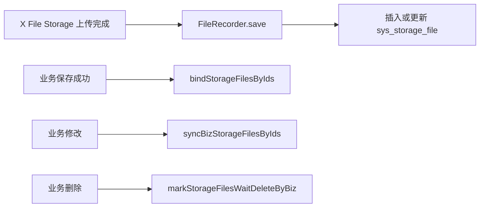

# 完善存储文件记录和生命周期服务

对应提交：`53d36f72 完善存储文件记录和生命周期服务`

## 1. 改造目标

让 `sys_storage_file` 真正承担文件资产记录能力，支持 X File Storage 的 `FileRecorder`、URL 哈希查询、业务绑定、待删除、物理删除、分片记录和文件回显 DTO 构建。

## 2. 改造前存在的问题

上传记录虽然可以入库，但业务保存成功后如何绑定、业务修改后旧文件如何处理、业务删除后附件如何待删除、私有文件如何按 fileId 回显，都缺少统一服务层。

## 3. 改造后的解决方案

扩展 `ISysStorageFileService` 和 `SysStorageFileServiceImpl`，把文件记录保存、更新、删除标记、业务绑定、批量同步、分片保存、清理查询都集中到文件资产服务中。

## 4. 总体链路



## 5. 涉及文件

- `ruoyi-system/src/main/java/com/ruoyi/system/mapper/SysStorageFileMapper.java`
- `ruoyi-system/src/main/java/com/ruoyi/system/service/ISysStorageFileService.java`
- `ruoyi-system/src/main/java/com/ruoyi/system/service/impl/SysStorageFileServiceImpl.java`
- `ruoyi-system/src/main/resources/mapper/system/SysStorageFileMapper.xml`

## 6. 具体改动

### 6.1 FileRecorder 保存记录时按 URL 哈希去重

#### 原代码

```java
public boolean save(FileInfo fileInfo)
{
    SysStorageFile storageFile = toStorageFile(fileInfo);
    storageFile.setFileStatus("0");
    return storageFileMapper.insertStorageFile(storageFile) > 0;
}
```

#### 现代码

```java
public boolean save(FileInfo fileInfo)
{
    // 上传成功后框架会调用该方法，没有 URL 的记录无法用于后续按 URL 查询
    if (fileInfo == null || StringUtils.isBlank(fileInfo.getUrl()))
    {
        return false;
    }
    // 同一个 URL 重复保存时按更新处理，避免重试上传造成唯一索引冲突
    SysStorageFile exists = storageFileMapper.selectStorageFileByUrl(sha256Hex(fileInfo.getUrl()), fileInfo.getUrl());
    SysStorageFile storageFile = toStorageFile(fileInfo);
    if (exists != null)
    {
        // 保留原主键并刷新最新元数据
        storageFile.setFileId(exists.getFileId());
        storageFile.setUpdateTime(DateUtils.getNowDate());
        return storageFileMapper.updateStorageFile(storageFile) > 0;
    }
    // 新上传文件先记录为临时状态，等业务保存成功后再绑定为已使用
    storageFile.setFileStatus(StorageFileStatus.TEMP.getCode());
    // 记录上传人，私有临时文件下载时可判断是否属于当前登录用户
    storageFile.setCreateBy(getCurrentUsernameQuietly());
    storageFile.setCreateTime(fileInfo.getCreateTime() == null ? DateUtils.getNowDate() : fileInfo.getCreateTime());
    return storageFileMapper.insertStorageFile(storageFile) > 0;
}
```

#### 涉及改动部分

```java
// 省略
SysStorageFile exists = storageFileMapper.selectStorageFileByUrl(sha256Hex(fileInfo.getUrl()), fileInfo.getUrl());
SysStorageFile storageFile = toStorageFile(fileInfo);
if (exists != null)
{
    // 保留原主键并刷新最新元数据
    storageFile.setFileId(exists.getFileId());
    storageFile.setUpdateTime(DateUtils.getNowDate());
    return storageFileMapper.updateStorageFile(storageFile) > 0;
}
// 新上传文件先记录为临时状态，等业务保存成功后再绑定为已使用
storageFile.setFileStatus(StorageFileStatus.TEMP.getCode());
// 省略
```

#### 改动说明

原来只插入记录，重复保存同一个 URL 时可能产生重复数据。现在先按 `url_hash + url` 查询，存在则更新，不存在才插入，并把新文件默认标记为临时文件。

### 6.2 增加 fileId 版绑定和同步

#### 原代码

```java
public int bindStorageFile(String url, String bizType, String bizId, String updateBy);

public int syncBizStorageFiles(Collection<String> newUrls, Collection<String> oldUrls, String bizType, String bizId,
        String updateBy);
```

#### 现代码

```java
public int bindStorageFilesByIds(Collection<Long> fileIds, String bizType, String bizId, String updateBy);

public int syncBizStorageFilesByIds(Collection<Long> newFileIds, Collection<Long> oldFileIds, String bizType,
        String bizId, String updateBy);
```

```java
@Override
@Transactional(rollbackFor = Exception.class)
public int syncBizStorageFilesByIds(Collection<Long> newFileIds, Collection<Long> oldFileIds, String bizType,
        String bizId, String updateBy)
{
    // 先把当前表单仍保存的文件绑定为已使用，防止临时清理任务误删
    int rows = bindStorageFilesByIds(newFileIds, bizType, bizId, updateBy);
    Set<Long> currentFileIds = new HashSet<Long>(normalizeFileIdList(newFileIds));
    if (oldFileIds == null || oldFileIds.isEmpty())
    {
        return rows;
    }
    List<Long> waitDeleteFileIds = new ArrayList<Long>();
    for (Long oldFileId : oldFileIds)
    {
        // 旧文件ID不在新集合中，说明用户从业务表单里移除了这个文件
        if (oldFileId != null && !currentFileIds.contains(oldFileId))
        {
            waitDeleteFileIds.add(oldFileId);
        }
    }
    // 被移除的文件不立即物理删除，先进入待删除状态，后续由清理任务统一处理
    rows += markStorageFilesWaitDeleteByIds(waitDeleteFileIds, bizType, bizId, updateBy);
    return rows;
}
```

#### 涉及改动部分

```java
// 省略
int rows = bindStorageFilesByIds(newFileIds, bizType, bizId, updateBy);
Set<Long> currentFileIds = new HashSet<Long>(normalizeFileIdList(newFileIds));
// 省略
if (oldFileId != null && !currentFileIds.contains(oldFileId))
{
    waitDeleteFileIds.add(oldFileId);
}
rows += markStorageFilesWaitDeleteByIds(waitDeleteFileIds, bizType, bizId, updateBy);
// 省略
```

#### 改动说明

业务表保存 fileId 时，不应该再依赖 URL 去绑定文件。新增 fileId 版绑定和同步后，业务保存只需要把表单里的文件 ID 集合传给文件服务，文件服务负责把新增文件绑定为已使用，把移除的旧文件标记为待删除。

### 6.3 待删除必须带业务边界

#### 原代码

```java
public int markStorageFilesWaitDeleteByIds(Collection<Long> fileIds, String bizType, String updateBy)
{
    return storageFileMapper.markStorageFilesWaitDeleteByIds(fileIds, bizType, deleteTime, updateBy);
}
```

#### 现代码

```java
public int markStorageFilesWaitDeleteByIds(Collection<Long> fileIds, String bizType, String bizId, String updateBy)
{
    List<Long> idList = normalizeFileIdList(fileIds);
    if (idList.isEmpty() || StringUtils.isBlank(bizType) || StringUtils.isBlank(bizId))
    {
        return 0;
    }
    int delayHours = storageFileProperties.getDeleteDelayHours(bizType);
    LocalDateTime deleteTime = LocalDateTime.now().plusHours(delayHours);
    // 按主键批量标记待删除时必须带业务归属，避免误删其它业务的同 ID 文件引用
    return storageFileMapper.markStorageFilesWaitDeleteByIds(idList, bizType, bizId, deleteTime, updateBy,
            StorageFileStatus.DELETED.getCode());
}
```

#### 涉及改动部分

```java
// 省略
if (idList.isEmpty() || StringUtils.isBlank(bizType) || StringUtils.isBlank(bizId))
{
    return 0;
}
// 按主键批量标记待删除时必须带业务归属，避免误删其它业务的同 ID 文件引用
return storageFileMapper.markStorageFilesWaitDeleteByIds(idList, bizType, bizId, deleteTime, updateBy,
        StorageFileStatus.DELETED.getCode());
// 省略
```

#### 改动说明

待删除操作从“只按 fileId 和 bizType”收紧为“fileId + bizType + bizId”，防止业务 A 的保存动作误处理业务 B 的文件。

## 7. 验证方式

```powershell
git show --stat --name-status 53d36f72
mvn -pl ruoyi-admin -am -DskipTests "-Dmaven.compiler.useIncrementalCompilation=false" compile
```
