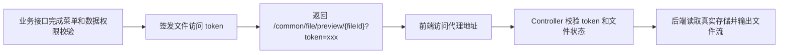

# 完善私有文件访问授权和代理地址

对应提交：`14067e21 完善私有文件访问授权和代理地址`

## 1. 改造目标

私有文件不再向前端暴露真实对象存储地址，统一通过后端代理地址访问，并支持短期访问 token 和高敏感场景的用户绑定 token。

## 2. 改造前存在的问题

如果接口直接返回 COS/OSS/MinIO 真实 URL，私有 Bucket 会出现前端无法回显；如果把 Bucket 改公开，又会让业务附件绕过系统权限。通用下载入口也需要和业务权限边界分离。

## 3. 改造后的解决方案

新增 `StorageFileAccessTokenService` 签发短期 token，新增 `StorageFileAccessUrlBuilder` 根据文件访问级别和访问模式生成对外 URL，同时 Security 放行代理入口，让请求进入 Controller 后再做文件级校验。

## 4. 总体链路



## 5. 涉及文件

- `ruoyi-framework/src/main/java/com/ruoyi/framework/config/SecurityConfig.java`
- `ruoyi-framework/src/main/java/com/ruoyi/framework/config/properties/StorageFileSecurityProperties.java`
- `ruoyi-system/src/main/java/com/ruoyi/system/service/StorageFileAccessTokenService.java`
- `ruoyi-system/src/main/java/com/ruoyi/system/service/StorageFileAccessUrlBuilder.java`

## 6. 具体改动

### 6.1 增加短期访问 token 服务

#### 原代码

改造前没有文件访问 token，私有文件只能依赖登录态或直接 URL，无法表达“业务接口已经授权过这个文件”的临时访问能力。

#### 现代码

```java
/**
 * 存储文件短期访问授权服务
 * <p>
 * 业务接口完成自身权限校验后调用本服务签发 token，通用文件接口只校验 token 是否能访问对应 fileId
 *
 * @author 955Kane
 */
@Service
public class StorageFileAccessTokenService
{
    /**
     * 签发文件短期访问 token
     *
     * @param fileId 文件ID
     * @return 短期访问 token
     */
    public String issueToken(Long fileId)
    {
        return issueToken(fileId, null);
    }

    /**
     * 签发绑定当前登录用户的文件短期访问 token
     *
     * @param fileId 文件ID
     * @return 短期访问 token
     */
    public String issueUserBoundToken(Long fileId)
    {
        return issueToken(fileId, SecurityUtils.getUserId());
    }

    /**
     * 校验文件短期访问 token
     *
     * @param fileId 文件ID
     * @param token 短期访问 token
     * @return true 表示 token 允许访问该文件
     */
    public boolean verifyToken(Long fileId, String token)
    {
        if (fileId == null || StringUtils.isBlank(token))
        {
            return false;
        }
        String tokenValue = redisCache.getCacheObject(getTokenKey(token));
        if (StringUtils.isBlank(tokenValue))
        {
            return false;
        }
        String[] values = tokenValue.split(":", -1);
        // token 必须和当前 fileId 精确匹配，避免拿一个文件的授权访问另一个文件
        if (values.length < 1 || !String.valueOf(fileId).equals(values[0]))
        {
            return false;
        }
        // 没有绑定用户ID的 token 属于普通短期授权，有效期内可直接访问
        if (values.length < 2 || StringUtils.isBlank(values[1]))
        {
            return true;
        }
        try
        {
            // 高敏感 token 必须同时校验当前登录用户，复制链接给其他账号也不能访问
            return values[1].equals(String.valueOf(SecurityUtils.getUserId()));
        }
        catch (Exception e)
        {
            return false;
        }
    }
}
```

#### 涉及改动部分

```java
// 省略
/**
 * 签发绑定当前登录用户的文件短期访问 token
 *
 * @param fileId 文件ID
 * @return 短期访问 token
 */
public String issueUserBoundToken(Long fileId)
{
    return issueToken(fileId, SecurityUtils.getUserId());
}
// 省略
if (values.length < 2 || StringUtils.isBlank(values[1]))
{
    return true;
}
// 高敏感 token 必须同时校验当前登录用户，复制链接给其他账号也不能访问
return values[1].equals(String.valueOf(SecurityUtils.getUserId()));
// 省略
```

#### 改动说明

普通 token 只绑定 `fileId`，适合短期分享式访问；用户绑定 token 同时绑定当前登录用户，适合证件、合同、财务等高敏感文件，链接被复制给其他账号也无法使用。

### 6.2 对外 URL 构建器不暴露私有真实地址

#### 原代码

```java
dto.setUrl(fileInfo.getUrl());
dto.setPreviewUrl(fileInfo.getUrl());
dto.setDownloadUrl(fileInfo.getUrl());
```

#### 现代码

```java
/**
 * 构建原图预览地址
 *
 * @param storageFile 文件记录
 * @return 对外预览地址
 */
public String buildPreviewUrl(SysStorageFile storageFile)
{
    return buildPreviewUrl(storageFile, false);
}

/**
 * 构建下载地址
 *
 * @param storageFile 文件记录
 * @return 对外下载地址
 */
public String buildDownloadUrl(SysStorageFile storageFile)
{
    if (storageFile == null || storageFile.getFileId() == null)
    {
        return null;
    }
    if (isPublic(storageFile) && StorageFileProperties.ACCESS_URL_MODE_DIRECT.equals(getAccessUrlMode()))
    {
        return storageFile.getUrl();
    }
    if (isPublic(storageFile) && StorageFileProperties.ACCESS_URL_MODE_DOMAIN.equals(getAccessUrlMode()))
    {
        return buildDomainUrl(storageFile.getObjectKey(), storageFile.getUrl());
    }
    return StorageFileConstants.DOWNLOAD_PATH + storageFile.getFileId();
}

/**
 * 判断响应中是否允许返回真实存储 URL
 *
 * @param storageFile 文件记录
 * @return true 表示允许返回真实 URL
 */
public boolean allowExposeRealUrl(SysStorageFile storageFile)
{
    // 私有文件永远不向前端暴露真实存储地址，避免绕过后端鉴权
    return isPublic(storageFile) && StorageFileProperties.ACCESS_URL_MODE_DIRECT.equals(getAccessUrlMode());
}
```

#### 涉及改动部分

```java
// 省略
/**
 * 构建下载地址
 *
 * @param storageFile 文件记录
 * @return 对外下载地址
 */
public String buildDownloadUrl(SysStorageFile storageFile)
{
    if (storageFile == null || storageFile.getFileId() == null)
    {
        return null;
    }
    if (isPublic(storageFile) && StorageFileProperties.ACCESS_URL_MODE_DIRECT.equals(getAccessUrlMode()))
    {
        return storageFile.getUrl();
    }
    if (isPublic(storageFile) && StorageFileProperties.ACCESS_URL_MODE_DOMAIN.equals(getAccessUrlMode()))
    {
        return buildDomainUrl(storageFile.getObjectKey(), storageFile.getUrl());
    }
    return StorageFileConstants.DOWNLOAD_PATH + storageFile.getFileId();
}
// 省略
```

#### 改动说明

公开文件可以按配置选择直连、域名或后端代理；私有文件无论真实存储在哪里，都只返回 `/common/file/preview/{fileId}` 或 `/common/file/download/{fileId}` 这种后端代理地址。

### 6.3 Security 放行代理入口

#### 原代码

```java
requests.requestMatchers(HttpMethod.GET, "/", "/*.html", "/**.html", "/**.css", "/**.js", "/profile/**", "/file/**").permitAll();
```

#### 现代码

```java
requests.requestMatchers(HttpMethod.GET, "/", "/*.html", "/**.html", "/**.css", "/**.js", "/profile/**",
        "/common/file/preview/**", "/common/file/download/**").permitAll();
String[] publicPathPatterns = getStorageFilePublicPathPatterns();
if (publicPathPatterns.length > 0)
{
    // 只放行公开文件路径，例如 /file/upload/public/**
    requests.requestMatchers(HttpMethod.GET, publicPathPatterns).permitAll();
}
```

#### 涉及改动部分

```java
// 省略
requests.requestMatchers(HttpMethod.GET, "/", "/*.html", "/**.html", "/**.css", "/**.js", "/profile/**",
        "/common/file/preview/**", "/common/file/download/**").permitAll();
String[] publicPathPatterns = getStorageFilePublicPathPatterns();
// 省略
```

#### 改动说明

代理入口先在 Spring Security 层放行，是为了让图片 ``、浏览器下载、预览请求能进入 Controller。真正的私有文件校验在 Controller 内部继续做，不等于所有私有文件匿名可访问。

## 7. 验证方式

```powershell
git show --stat --name-status 14067e21
mvn -pl ruoyi-admin -am -DskipTests "-Dmaven.compiler.useIncrementalCompilation=false" compile
```
