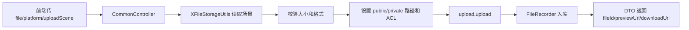

# 完善通用文件上传和批量场景限制

对应提交：`ef31f604 完善通用文件上传和批量场景限制`

## 1. 改造目标

完善 `/common/upload`、`/common/uploads`、分片上传、文件回显、预览下载等通用入口，使它们支持上传场景、平台选择、ACL、缩略图、真实文件校验、批量数量限制和统一 DTO 返回。

## 2. 改造前存在的问题

通用上传入口返回字段分散，批量上传没有数量限制，失败后已上传文件没有补偿删除，私有文件回显容易直接暴露真实 URL，上传场景的大小、格式、缩略图和 ACL 没有完整贯通。

## 3. 改造后的解决方案

`CommonController` 统一调用 `XFileStorageUtils` 上传，并通过 `StorageFileUploadRespDTO` 返回文件信息；`XFileStorageUtils` 根据 `uploadScene` 读取配置，完成大小、格式、路径、ACL、缩略图和批量数量限制。

## 4. 总体链路



## 5. 涉及文件

- `ruoyi-admin/src/main/java/com/ruoyi/web/controller/common/CommonController.java`
- `ruoyi-admin/src/main/resources/application.yml`
- `ruoyi-common/src/main/java/com/ruoyi/common/utils/file/XFileStorageUtils.java`

## 6. 具体改动

### 6.1 单文件上传返回统一 DTO

#### 原代码

```java
AjaxResult ajax = AjaxResult.success();
ajax.put("url", fileInfo.getUrl());
ajax.put("fileName", fileInfo.getUrl());
ajax.put("newFileName", fileInfo.getFilename());
ajax.put("originalFilename", file.getOriginalFilename());
return ajax;
```

#### 现代码

```java
@PostMapping("/upload")
public AjaxResult uploadFile(MultipartFile file, @RequestParam(value = "platform", required = false) String platform,
        @RequestParam(value = "uploadScene", required = false) String uploadScene,
        @RequestParam(value = "thumbnail", defaultValue = "false") Boolean thumbnail,
        @RequestParam(value = "thumbnailWidth", required = false) Integer thumbnailWidth,
        @RequestParam(value = "thumbnailHeight", required = false) Integer thumbnailHeight) throws Exception
{
    try
    {
        // 统一使用工具类处理平台选择、场景规则、格式校验、缩略图和真实上传
        FileInfo fileInfo = xFileStorageUtils.upload(file, platform, uploadScene, MimeTypeUtils.DEFAULT_ALLOWED_EXTENSION,
                Boolean.TRUE.equals(thumbnail), thumbnailWidth, thumbnailHeight);
        // 单文件上传返回 data 对象，字段由 DTO 统一维护
        return AjaxResult.success(buildUploadRespDTO(fileInfo, uploadScene, file.getOriginalFilename()));
    }
    catch (Exception e)
    {
        log.error("上传文件失败，platform={}，uploadScene={}，originalFilename={}，size={}", platform, uploadScene,
                file == null ? null : file.getOriginalFilename(), file == null ? null : file.getSize(), e);
        return AjaxResult.error(e.getMessage());
    }
}
```

#### 涉及改动部分

```java
// 省略
FileInfo fileInfo = xFileStorageUtils.upload(file, platform, uploadScene, MimeTypeUtils.DEFAULT_ALLOWED_EXTENSION,
        Boolean.TRUE.equals(thumbnail), thumbnailWidth, thumbnailHeight);
return AjaxResult.success(buildUploadRespDTO(fileInfo, uploadScene, file.getOriginalFilename()));
// 省略
```

#### 改动说明

原来 Controller 自己拼 Map，字段语义容易散。现在交给 DTO 构建方法统一返回 `fileId`、`url`、`previewUrl`、`downloadUrl`、`originalFilename`、`access` 等字段。

### 6.2 批量上传增加数量限制和失败补偿

#### 原代码

```java
for (MultipartFile file : files)
{
    FileInfo fileInfo = xFileStorageUtils.upload(file, platform);
    urls.add(fileInfo.getUrl());
}
```

#### 现代码

```java
@PostMapping("/uploads")
public AjaxResult uploadFiles(List<MultipartFile> files, @RequestParam(value = "platform", required = false) String platform,
        @RequestParam(value = "uploadScene", required = false) String uploadScene,
        @RequestParam(value = "thumbnail", defaultValue = "false") Boolean thumbnail,
        @RequestParam(value = "thumbnailWidth", required = false) Integer thumbnailWidth,
        @RequestParam(value = "thumbnailHeight", required = false) Integer thumbnailHeight) throws Exception
{
    List<String> uploadedUrls = new ArrayList<String>();
    try
    {
        // 批量数量优先读取上传场景配置，场景未配置时回退到全局配置
        xFileStorageUtils.assertBatchUploadAllowed(files, uploadScene);
        List<StorageFileUploadRespDTO> fileList = new ArrayList<StorageFileUploadRespDTO>();
        for (MultipartFile file : files)
        {
            FileInfo fileInfo = xFileStorageUtils.upload(file, platform, uploadScene, MimeTypeUtils.DEFAULT_ALLOWED_EXTENSION,
                    Boolean.TRUE.equals(thumbnail), thumbnailWidth, thumbnailHeight);
            uploadedUrls.add(fileInfo.getUrl());
            fileList.add(buildUploadRespDTO(fileInfo, uploadScene, file.getOriginalFilename()));
        }
        AjaxResult ajax = AjaxResult.success();
        ajax.put("fileList", fileList);
        return ajax;
    }
    catch (Exception e)
    {
        compensateUploadedFiles(uploadedUrls);
        log.error("批量上传文件失败，platform={}，uploadScene={}，fileCount={}", platform, uploadScene,
                files == null ? null : files.size(), e);
        return AjaxResult.error(e.getMessage());
    }
}
```

#### 涉及改动部分

```java
// 省略
xFileStorageUtils.assertBatchUploadAllowed(files, uploadScene);
// 省略
uploadedUrls.add(fileInfo.getUrl());
fileList.add(buildUploadRespDTO(fileInfo, uploadScene, file.getOriginalFilename()));
// 省略
catch (Exception e)
{
    compensateUploadedFiles(uploadedUrls);
// 省略
```

#### 改动说明

批量接口本质仍然是循环逐个上传，因为 X File Storage 没有把多个 `MultipartFile` 一次提交给多个平台的统一批量 API。这里新增的是入口数量限制和失败补偿：只要中途有文件失败，已上传成功的文件会尝试删除，减少孤儿文件。

### 6.3 上传工具按场景设置 ACL 和路径

#### 原代码

```java
UploadPretreatment upload = fileStorageService.of(file)
        .setPath(DateUtils.datePath())
        .setSaveFilename(FileUploadUtils.uuidFilename(file));
return upload.upload();
```

#### 现代码

```java
public FileInfo upload(MultipartFile file, String platform, String uploadScene, String[] allowedExtension,
        boolean thumbnail, Integer thumbnailWidth, Integer thumbnailHeight) throws Exception
{
    Scene scene = getScene(uploadScene);
    String[] actualAllowedExtension = getAllowedExtension(scene, allowedExtension);
    long maxSize = getMaxSize(scene);
    boolean actualThumbnail = scene != null && scene.getThumbnail() != null ? scene.getThumbnail() : thumbnail;
    Integer actualThumbnailWidth = scene != null && scene.getThumbnailWidth() != null ? scene.getThumbnailWidth() : thumbnailWidth;
    Integer actualThumbnailHeight = scene != null && scene.getThumbnailHeight() != null ? scene.getThumbnailHeight() : thumbnailHeight;
    String actualThumbnailSuffix = getThumbnailSuffix(scene);
    assertAllowed(file, actualAllowedExtension, maxSize);
    String datePath = DateUtils.datePath();
    String storagePath = buildStoragePath(scene, uploadScene, datePath);
    UploadPretreatment upload = fileStorageService.of(file)
            .setPath(storagePath)
            .setSaveFilename(FileUploadUtils.uuidFilename(file).substring(datePath.length() + 1));
    if (StringUtils.isNotBlank(platform))
    {
        upload.setPlatform(platform);
    }
    if (scene != null)
    {
        applyAcl(upload, scene);
    }
    if (actualThumbnail)
    {
        setThumbnail(upload, file, actualThumbnailWidth, actualThumbnailHeight, actualThumbnailSuffix);
    }
    return upload.upload();
}
```

#### 涉及改动部分

```java
// 省略
String storagePath = buildStoragePath(scene, uploadScene, datePath);
UploadPretreatment upload = fileStorageService.of(file)
        .setPath(storagePath)
        .setSaveFilename(FileUploadUtils.uuidFilename(file).substring(datePath.length() + 1));
// 省略
if (scene != null)
{
    applyAcl(upload, scene);
}
// 省略
return upload.upload();
```

#### 改动说明

上传路径由场景决定，例如 `public/image/yyyy/MM/dd/` 或 `private/file/yyyy/MM/dd/`。声明场景时同步设置对象 ACL，公开文件设置 `public-read`，私有文件设置 `private`，解决腾讯 COS 私有 Bucket 上传后公开图片无法回显的问题。

### 6.4 配置上传场景和批量数量

#### 原代码

```yaml
ruoyi:
  upload-scenes:
    commonImg:
      max-size: 5MB
      allowed-extension: png,jpg,jpeg
```

#### 现代码

```yaml
ruoyi:
  upload-scenes:
    commonImg:
      # 公开图片允许匿名访问，适合富文本图片、封面图等业务
      access: public
      # 场景路径前缀，最终路径形如 upload/public/image/yyyy/MM/dd/文件名
      path-prefix: image
      max-size: 5MB
      allowed-extension: png,jpg,jpeg
      thumbnail: true
      thumbnail-width: 100
      thumbnail-height: 100
      thumbnail-suffix: ".min.jpg"
      # 批量上传图片时单次最多允许上传的文件数量
      max-batch-upload-count: 10
    commonFile:
      # 普通附件默认私有访问，避免业务资料被匿名访问
      access: private
      path-prefix: file
      max-size: 5MB
      allowed-extension: doc,xls,ppt,txt,pdf
      thumbnail: false
      max-batch-upload-count: 10
  storage-file:
    access-url-mode: direct
    require-upload-scene: false
    max-batch-upload-count: 20
```

#### 涉及改动部分

```yaml
# 省略
commonImg:
  access: public
  path-prefix: image
  max-batch-upload-count: 10
commonFile:
  access: private
  path-prefix: file
  max-batch-upload-count: 10
storage-file:
  max-batch-upload-count: 20
# 省略
```

#### 改动说明

全局 `max-batch-upload-count` 是兜底值，具体场景可以覆盖。后端代码还可以调用 `assertBatchUploadAllowed(files, uploadScene, customMax)` 临时覆盖，满足 A 业务最多 5 个、B 业务最多 10 个这种需求。

## 7. 验证方式

```powershell
git show --stat --name-status ef31f604
mvn -pl ruoyi-admin -am -DskipTests "-Dmaven.compiler.useIncrementalCompilation=false" compile
```
