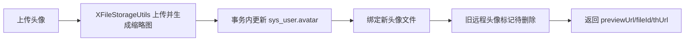

# 完善头像上传文件资产处理

对应提交：`f2016e72 完善头像上传文件资产处理`

## 1. 改造目标

把用户头像上传纳入文件资产管理，支持平台选择、头像缩略图、文件绑定、旧头像延迟清理、保存失败补偿删除，以及返回可回显的代理地址。

## 2. 改造前存在的问题

若依原头像上传只保存本地 `/profile` 路径，更新成功后直接删除旧头像。接入对象存储后，旧头像可能是远程对象，不能继续用本地磁盘删除；新头像上传成功但用户表更新失败时，也会产生孤儿文件。

## 3. 改造后的解决方案

头像上传改用 `XFileStorageUtils`，用户表保存头像 URL 后，把新文件绑定到 `avatar + userId`，旧 X File Storage 头像标记待删除，历史 `/profile` 本地头像在事务成功后继续磁盘删除。

## 4. 总体链路



## 5. 涉及文件

- `ruoyi-admin/src/main/java/com/ruoyi/web/controller/system/SysProfileController.java`

## 6. 具体改动

### 6.1 头像接口支持 platform 并使用文件资产上传

#### 原代码

```java
@PostMapping("/avatar")
public AjaxResult avatar(@RequestParam("avatarfile") MultipartFile file) throws Exception
{
    if (!file.isEmpty())
    {
        LoginUser loginUser = getLoginUser();
        String avatar = FileUploadUtils.upload(RuoYiConfig.getAvatarPath(), file, MimeTypeUtils.IMAGE_EXTENSION, true);
        if (userService.updateUserAvatar(loginUser.getUserId(), avatar))
        {
            AjaxResult ajax = AjaxResult.success();
            ajax.put("imgUrl", avatar);
            loginUser.getUser().setAvatar(avatar);
            tokenService.setLoginUser(loginUser);
            return ajax;
        }
    }
    return error("上传图片异常，请联系管理员");
}
```

#### 现代码

```java
@PostMapping("/avatar")
public AjaxResult avatar(@RequestParam("avatarfile") MultipartFile file,
        @RequestParam(value = "platform", required = false) String platform) throws Exception
{
    // 空文件直接走统一失败返回
    if (!file.isEmpty())
    {
        LoginUser loginUser = getLoginUser();
        // 工具类负责图片校验，并根据 platform 选择指定平台或默认平台
        // 头像默认生成缩略图，原图仍作为数据库头像地址保存
        FileInfo fileInfo = xFileStorageUtils.upload(file, platform, BIZ_TYPE_AVATAR, MimeTypeUtils.IMAGE_EXTENSION, true,
                AVATAR_THUMBNAIL_WIDTH, AVATAR_THUMBNAIL_HEIGHT);
        // 数据库存储最终可访问的头像 URL
        String avatar = fileInfo.getUrl();
        // 先记录旧头像，事务提交成功后再处理历史本地文件删除
        String oldAvatar = loginUser.getUser().getAvatar();
        boolean avatarSaved;
        try
        {
            // 头像业务数据库动作放在同一事务里，避免用户表已更新但文件资产未绑定
            avatarSaved = Boolean.TRUE.equals(transactionTemplate.execute(status ->
            {
                if (!userService.updateUserAvatar(loginUser.getUserId(), avatar))
                {
                    return false;
                }
                storageFileService.bindStorageFile(avatar, BIZ_TYPE_AVATAR, String.valueOf(loginUser.getUserId()),
                        loginUser.getUsername());
                if (StringUtils.isNotEmpty(oldAvatar) && !oldAvatar.startsWith(Constants.RESOURCE_PREFIX))
                {
                    storageFileService.markStorageFileWaitDelete(oldAvatar, BIZ_TYPE_AVATAR, loginUser.getUsername());
                }
                return true;
            }));
        }
        catch (Exception e)
        {
            deleteUploadedAvatar(avatar);
            throw e;
        }
    }
    return error("上传图片异常，请联系管理员");
}
```

#### 涉及改动部分

```java
// 省略
FileInfo fileInfo = xFileStorageUtils.upload(file, platform, BIZ_TYPE_AVATAR, MimeTypeUtils.IMAGE_EXTENSION, true,
        AVATAR_THUMBNAIL_WIDTH, AVATAR_THUMBNAIL_HEIGHT);
String avatar = fileInfo.getUrl();
// 省略
avatarSaved = Boolean.TRUE.equals(transactionTemplate.execute(status ->
{
    if (!userService.updateUserAvatar(loginUser.getUserId(), avatar))
    {
        return false;
    }
    storageFileService.bindStorageFile(avatar, BIZ_TYPE_AVATAR, String.valueOf(loginUser.getUserId()),
            loginUser.getUsername());
// 省略
```

#### 改动说明

头像接口从若依本地上传改成 X File Storage 上传，`platform` 为空时走默认平台，传值时上传到指定平台。用户表更新和文件绑定放到同一个事务里，避免头像字段已变更但文件仍是临时状态。

### 6.2 旧头像清理区分历史本地文件和文件资产

#### 原代码

```java
String oldAvatar = loginUser.getUser().getAvatar();
if (StringUtils.isNotEmpty(oldAvatar))
{
    FileUtils.deleteFile(RuoYiConfig.getProfile() + FileUtils.stripPrefix(oldAvatar));
}
```

#### 现代码

```java
if (StringUtils.isNotEmpty(oldAvatar) && oldAvatar.startsWith(Constants.RESOURCE_PREFIX))
{
    // 历史若依本地头像不参与数据库事务，等数据库提交成功后再删除磁盘文件
    FileUtils.deleteFile(RuoYiConfig.getProfile() + FileUtils.stripPrefix(oldAvatar));
}
```

```java
if (StringUtils.isNotEmpty(oldAvatar) && !oldAvatar.startsWith(Constants.RESOURCE_PREFIX))
{
    // X File Storage 上传的旧头像先标记待删除，交给定时任务延迟物理清理
    storageFileService.markStorageFileWaitDelete(oldAvatar, BIZ_TYPE_AVATAR, loginUser.getUsername());
}
```

#### 涉及改动部分

```java
// 省略
if (StringUtils.isNotEmpty(oldAvatar) && !oldAvatar.startsWith(Constants.RESOURCE_PREFIX))
{
    storageFileService.markStorageFileWaitDelete(oldAvatar, BIZ_TYPE_AVATAR, loginUser.getUsername());
}
// 省略
if (StringUtils.isNotEmpty(oldAvatar) && oldAvatar.startsWith(Constants.RESOURCE_PREFIX))
{
    FileUtils.deleteFile(RuoYiConfig.getProfile() + FileUtils.stripPrefix(oldAvatar));
}
// 省略
```

#### 改动说明

历史 `/profile` 文件还是磁盘文件，继续用若依原方式删除；对象存储头像不立即物理删除，而是进入待删除状态，由清理任务统一处理，降低误删和事务失败风险。

### 6.3 保存失败补偿删除新头像

#### 原代码

```java
if (!userService.updateUserAvatar(loginUser.getUserId(), avatar))
{
    return error("上传图片异常，请联系管理员");
}
```

#### 现代码

```java
private void deleteUploadedAvatar(String avatar)
{
    try
    {
        // 这里删除的是本次刚上传的新文件，不影响当前登录用户原头像
        xFileStorageUtils.delete(avatar);
    }
    catch (Exception e)
    {
        // 补偿删除失败只记录日志，接口仍返回原业务失败信息
        log.warn("头像保存失败后删除新头像失败，avatar={}", avatar, e);
    }
}
```

#### 涉及改动部分

```java
// 省略
catch (Exception e)
{
    // 数据库事务异常时立即补偿删除本次新头像，避免用户头像未保存但对象存储残留
    deleteUploadedAvatar(avatar);
    throw e;
}
// 省略
```

#### 改动说明

上传对象存储和数据库事务不是同一个事务资源，所以数据库保存失败时需要补偿删除新头像。补偿失败只记日志，不覆盖原始业务异常。

## 7. 验证方式

```powershell
git show --stat --name-status f2016e72
mvn -pl ruoyi-admin -am -DskipTests "-Dmaven.compiler.useIncrementalCompilation=false" compile
```
