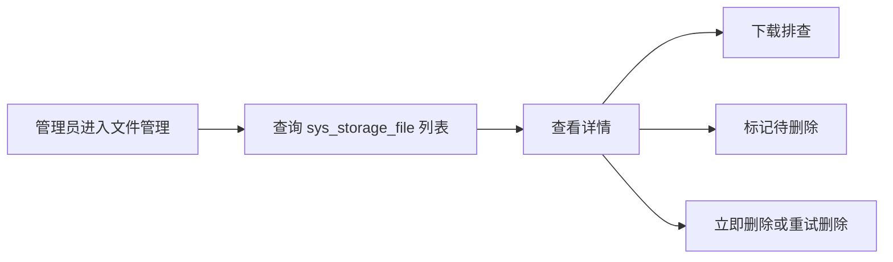

# 增加存储文件管理后台接口

对应提交：`11e1a0a4 增加存储文件管理后台接口`

## 1. 改造目标

给文件资产管理预留后台管理入口，支持列表、详情、管理员下载、标记待删除、立即删除和重试删除。

## 2. 改造前存在的问题

文件记录虽然入库，但没有后台接口查看和处理。运维或管理员遇到孤儿文件、删除失败、业务绑定异常时，只能查数据库或手动处理对象存储。

## 3. 改造后的解决方案

新增 `SysStorageFileController`，按若依权限体系提供 `/system/storage/file` 管理接口。普通业务私有文件仍建议走业务接口下载，后台下载只给拥有存储管理权限的管理员排查使用。

## 4. 总体链路



## 5. 涉及文件

- `ruoyi-system/src/main/java/com/ruoyi/system/controller/SysStorageFileController.java`

## 6. 具体改动

### 6.1 新增文件管理 Controller

#### 原代码

改造前没有 `/system/storage/file` 管理接口。

#### 现代码

```java
/**
 * 存储文件管理
 * <p>
 * 提供文件资产列表、详情、下载和删除处理能力，业务文件下载仍应优先走业务模块专用接口
 *
 * @author 955Kane
 */
@RestController
@RequestMapping("/system/storage/file")
public class SysStorageFileController extends BaseController
{
    /**
     * 存储文件记录服务
     */
    private final ISysStorageFileService storageFileService;

    /**
     * X File Storage 上传下载工具
     */
    private final XFileStorageUtils xFileStorageUtils;

    /**
     * 构造存储文件管理控制器
     *
     * @param storageFileService 存储文件记录服务
     * @param xFileStorageUtils X File Storage 工具
     */
    public SysStorageFileController(ISysStorageFileService storageFileService, XFileStorageUtils xFileStorageUtils)
    {
        this.storageFileService = storageFileService;
        this.xFileStorageUtils = xFileStorageUtils;
    }
}
```

#### 涉及改动部分

```java
// 省略
/**
 * 存储文件管理
 * <p>
 * 提供文件资产列表、详情、下载和删除处理能力，业务文件下载仍应优先走业务模块专用接口
 *
 * @author 955Kane
 */
@RestController
@RequestMapping("/system/storage/file")
public class SysStorageFileController extends BaseController
{
    /**
     * 存储文件记录服务
     */
    private final ISysStorageFileService storageFileService;

    /**
     * X File Storage 上传下载工具
     */
    private final XFileStorageUtils xFileStorageUtils;
// 省略
```

#### 改动说明

后台接口放在 `ruoyi-system`，和 `SysStorageFile` 文件资产业务归属一致。它不是业务附件下载入口，而是面向文件资产管理和运维排查的管理入口。

### 6.2 增加列表和详情

#### 原代码

```java
// 无文件资产列表和详情接口
```

#### 现代码

```java
/**
 * 查询存储文件列表
 *
 * @param storageFile 查询条件
 * @return 分页文件列表
 */
@PreAuthorize("@ss.hasPermi('system:storage:list')")
@GetMapping("/list")
public TableDataInfo list(SysStorageFile storageFile)
{
    // 文件资产列表可能较大，继续沿用若依分页约定
    startPage();
    List<SysStorageFile> list = storageFileService.selectStorageFileList(storageFile);
    return getDataTable(list);
}

/**
 * 查询存储文件详情
 *
 * @param fileId 文件ID
 * @return 文件详情
 */
@PreAuthorize("@ss.hasPermi('system:storage:query')")
@GetMapping("/{fileId}")
public AjaxResult getInfo(@PathVariable Long fileId)
{
    return success(storageFileService.selectStorageFileById(fileId));
}
```

#### 涉及改动部分

```java
// 省略
@PreAuthorize("@ss.hasPermi('system:storage:list')")
@GetMapping("/list")
public TableDataInfo list(SysStorageFile storageFile)
// 省略
@PreAuthorize("@ss.hasPermi('system:storage:query')")
@GetMapping("/{fileId}")
public AjaxResult getInfo(@PathVariable Long fileId)
// 省略
```

#### 改动说明

列表和详情沿用若依 `BaseController`、`TableDataInfo`、`@PreAuthorize` 风格，便于后续补前端文件管理页面或作为管理接口给运维使用。

### 6.3 管理后台下载和删除操作

#### 原代码

```java
// 通用下载入口和业务下载入口之外，没有管理员后台兜底下载接口
```

#### 现代码

```java
/**
 * 管理后台下载文件
 *
 * @param fileId 文件ID
 * @param response 响应对象
 */
@PreAuthorize("@ss.hasPermi(T(com.ruoyi.common.constant.StorageFileConstants).PERMISSION_STORAGE_DOWNLOAD)")
@GetMapping("/download/{fileId}")
public void download(@PathVariable Long fileId, HttpServletResponse response)
{
    SysStorageFile storageFile = storageFileService.selectStorageFileById(fileId);
    if (storageFile == null)
    {
        response.setStatus(HttpServletResponse.SC_NOT_FOUND);
        return;
    }
    FileInfo fileInfo = storageFileService.toFileInfo(storageFile);
    if (fileInfo == null)
    {
        response.setStatus(HttpServletResponse.SC_NOT_FOUND);
        return;
    }
    try
    {
        // 管理后台下载经过权限控制，可用于排查公开和私有文件
        String downloadName = StringUtils.isNotBlank(fileInfo.getOriginalFilename()) ? fileInfo.getOriginalFilename()
                : FileUtils.getName(fileInfo.getUrl());
        response.setContentType(StringUtils.isNotBlank(fileInfo.getContentType()) ? fileInfo.getContentType()
                : MediaType.APPLICATION_OCTET_STREAM_VALUE);
        FileUtils.setAttachmentResponseHeader(response, downloadName);
        response.getOutputStream().write(xFileStorageUtils.downloadBytes(fileInfo));
    }
    catch (Exception e)
    {
        response.setStatus(HttpServletResponse.SC_INTERNAL_SERVER_ERROR);
    }
}
```

```java
/**
 * 标记文件为待删除
 *
 * @param fileId 文件ID
 * @return 操作结果
 */
@PreAuthorize("@ss.hasPermi('system:storage:edit')")
@PutMapping("/waitDelete/{fileId}")
public AjaxResult waitDelete(@PathVariable Long fileId)
{
    return toAjax(storageFileService.markStorageFileWaitDeleteById(fileId, SecurityUtils.getUsername()));
}

/**
 * 立即删除文件
 *
 * @param fileId 文件ID
 * @return 操作结果
 */
@PreAuthorize("@ss.hasPermi('system:storage:remove')")
@PostMapping("/deleteNow/{fileId}")
public AjaxResult deleteNow(@PathVariable Long fileId)
{
    return storageFileService.deleteStorageFileNow(fileId, SecurityUtils.getUsername()) ? success() : error("删除文件失败");
}
```

#### 涉及改动部分

```java
// 省略
@PreAuthorize("@ss.hasPermi(T(com.ruoyi.common.constant.StorageFileConstants).PERMISSION_STORAGE_DOWNLOAD)")
@GetMapping("/download/{fileId}")
public void download(@PathVariable Long fileId, HttpServletResponse response)
// 省略
@PreAuthorize("@ss.hasPermi('system:storage:remove')")
@PostMapping("/deleteNow/{fileId}")
public AjaxResult deleteNow(@PathVariable Long fileId)
// 省略
```

#### 改动说明

后台下载保留管理员兜底能力，但它和 `/common/file/download/{fileId}` 的业务下载不是一回事。业务用户下载私有附件应由业务接口先完成菜单权限、数据权限和业务归属校验；后台接口只给文件管理员或运维角色使用。

## 7. 验证方式

```powershell
git show --stat --name-status 11e1a0a4
mvn -pl ruoyi-admin -am -DskipTests "-Dmaven.compiler.useIncrementalCompilation=false" compile
```
