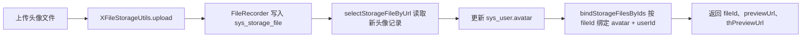

# 头像上传改用文件ID绑定文件资产

对应提交：`26369424 头像上传改用文件ID绑定文件资产`

## 1. 改造目标

消除 `SysProfileController` 中调用 URL 版过期绑定接口的问题，让头像新文件绑定也遵循当前文件资产管理主方案：使用 `fileId + bizType + bizId` 绑定业务归属。

## 2. 改造前存在的问题

头像上传已经接入 X File Storage 和文件资产表，但新头像绑定仍调用：

```java
storageFileService.bindStorageFile(avatar, BIZ_TYPE_AVATAR, String.valueOf(loginUser.getUserId()),
        loginUser.getUsername());
```

该方法是 URL 版兼容接口，已经在 `ISysStorageFileService` 中标记为 `@Deprecated`。编译时会出现 `SysProfileController.java 使用或覆盖了已过时的 API` 的提示。

## 3. 改造后的解决方案

头像上传成功后，先按头像 URL 查询本次上传生成的 `SysStorageFile` 记录，拿到文件资产主键 `fileId`。用户头像字段更新成功后，在同一数据库事务中使用 `bindStorageFilesByIds` 绑定新头像文件。

## 4. 总体链路



## 5. 涉及文件

- `ruoyi-admin/src/main/java/com/ruoyi/web/controller/system/SysProfileController.java`

## 6. 具体改动

### 6.1 引入 Collections 用于构造单文件 ID 集合

#### 原代码

```java
package com.ruoyi.web.controller.system;

import java.util.Map;
import org.dromara.x.file.storage.core.FileInfo;
```

#### 现代码

```java
package com.ruoyi.web.controller.system;

import java.util.Collections;
import java.util.Map;
import org.dromara.x.file.storage.core.FileInfo;
```

#### 涉及改动部分

```java
// 省略
package com.ruoyi.web.controller.system;

import java.util.Collections;
import java.util.Map;
import org.dromara.x.file.storage.core.FileInfo;
// 省略
```

#### 改动说明

`bindStorageFilesByIds` 接收的是 `Collection<Long>`。头像只有一个文件，因此使用 `Collections.singletonList(newAvatarFile.getFileId())` 构造单元素集合，不额外引入可变集合。

### 6.2 上传后提前读取新头像文件记录

#### 原代码

```java
// 工具类负责图片校验，并根据 platform 选择指定平台或默认平台
// 头像默认生成缩略图，原图仍作为数据库头像地址保存
FileInfo fileInfo = xFileStorageUtils.upload(file, platform, BIZ_TYPE_AVATAR, MimeTypeUtils.IMAGE_EXTENSION, true,
        AVATAR_THUMBNAIL_WIDTH, AVATAR_THUMBNAIL_HEIGHT);
// 数据库存储最终可访问的头像 URL
String avatar = fileInfo.getUrl();
// 先记录旧头像，事务提交成功后再处理历史本地文件删除
String oldAvatar = loginUser.getUser().getAvatar();
```

#### 现代码

```java
// 工具类负责图片校验，并根据 platform 选择指定平台或默认平台
// 头像默认生成缩略图，原图仍作为数据库头像地址保存
FileInfo fileInfo = xFileStorageUtils.upload(file, platform, BIZ_TYPE_AVATAR, MimeTypeUtils.IMAGE_EXTENSION, true,
        AVATAR_THUMBNAIL_WIDTH, AVATAR_THUMBNAIL_HEIGHT);
// 数据库存储最终可访问的头像 URL
String avatar = fileInfo.getUrl();
// 上传成功后先读取文件资产记录，后续使用 fileId + bizType + bizId 绑定新头像
SysStorageFile newAvatarFile = storageFileService.selectStorageFileByUrl(avatar);
// 先记录旧头像，事务提交成功后再处理历史本地文件删除
String oldAvatar = loginUser.getUser().getAvatar();
```

#### 涉及改动部分

```java
// 省略
// 数据库存储最终可访问的头像 URL
String avatar = fileInfo.getUrl();
// 上传成功后先读取文件资产记录，后续使用 fileId + bizType + bizId 绑定新头像
SysStorageFile newAvatarFile = storageFileService.selectStorageFileByUrl(avatar);
// 先记录旧头像，事务提交成功后再处理历史本地文件删除
String oldAvatar = loginUser.getUser().getAvatar();
// 省略
```

#### 改动说明

X File Storage 上传完成后会通过 `FileRecorder.save` 写入 `sys_storage_file`。这里按 URL 读取本次上传记录，是为了拿到新文件的 `fileId`，后续绑定不再直接使用 URL 版接口。

### 6.3 新头像绑定改为 fileId 版绑定 API

#### 原代码

```java
// 更新用户头像字段，用户表仍保存最终可访问的原图 URL
if (!userService.updateUserAvatar(loginUser.getUserId(), avatar))
{
    return false;
}
// 头像保存成功后把本次上传的新文件绑定到用户业务，避免被临时文件清理任务误删
storageFileService.bindStorageFile(avatar, BIZ_TYPE_AVATAR, String.valueOf(loginUser.getUserId()),
        loginUser.getUsername());
if (StringUtils.isNotEmpty(oldAvatar) && !oldAvatar.startsWith(Constants.RESOURCE_PREFIX))
{
    // X File Storage 上传的旧头像先标记待删除，交给定时任务延迟物理清理
    storageFileService.markStorageFileWaitDelete(oldAvatar, BIZ_TYPE_AVATAR, loginUser.getUsername());
}
```

#### 现代码

```java
// 更新用户头像字段，用户表仍保存最终可访问的原图 URL
if (!userService.updateUserAvatar(loginUser.getUserId(), avatar))
{
    return false;
}
// 头像保存成功后按文件资产主键绑定到用户业务，避免继续使用 URL 版兼容接口
if (newAvatarFile != null && newAvatarFile.getFileId() != null)
{
    storageFileService.bindStorageFilesByIds(Collections.singletonList(newAvatarFile.getFileId()),
            BIZ_TYPE_AVATAR, String.valueOf(loginUser.getUserId()), loginUser.getUsername());
}
if (StringUtils.isNotEmpty(oldAvatar) && !oldAvatar.startsWith(Constants.RESOURCE_PREFIX))
{
    // X File Storage 上传的旧头像先标记待删除，交给定时任务延迟物理清理
    storageFileService.markStorageFileWaitDelete(oldAvatar, BIZ_TYPE_AVATAR, loginUser.getUsername());
}
```

#### 涉及改动部分

```java
// 省略
// 更新用户头像字段，用户表仍保存最终可访问的原图 URL
if (!userService.updateUserAvatar(loginUser.getUserId(), avatar))
{
    return false;
}
// 头像保存成功后按文件资产主键绑定到用户业务，避免继续使用 URL 版兼容接口
if (newAvatarFile != null && newAvatarFile.getFileId() != null)
{
    storageFileService.bindStorageFilesByIds(Collections.singletonList(newAvatarFile.getFileId()),
            BIZ_TYPE_AVATAR, String.valueOf(loginUser.getUserId()), loginUser.getUsername());
}
if (StringUtils.isNotEmpty(oldAvatar) && !oldAvatar.startsWith(Constants.RESOURCE_PREFIX))
// 省略
```

#### 改动说明

新头像绑定从 `bindStorageFile(String url, ...)` 切换为 `bindStorageFilesByIds(Collection<Long> fileIds, String bizType, String bizId, String updateBy)`。这和普通业务文件一致，都是通过 `fileId` 定位文件，通过 `BIZ_TYPE_AVATAR + userId` 标识业务归属。

这里保留了旧头像的 URL 版待删除逻辑，因为历史头像字段只存 URL，旧头像不一定能直接拿到 `fileId`。这是历史兼容边界，不属于新头像绑定链路。

### 6.4 返回阶段复用已查询的新头像记录

#### 原代码

```java
if (StringUtils.isNotEmpty(oldAvatar) && oldAvatar.startsWith(Constants.RESOURCE_PREFIX))
{
    // 历史若依本地头像不参与数据库事务，等数据库提交成功后再删除磁盘文件
    FileUtils.deleteFile(RuoYiConfig.getProfile() + FileUtils.stripPrefix(oldAvatar));
}
// 绑定后按 URL 读取文件资产记录，头像接口也同步返回 fileId、access 和对象 Key
SysStorageFile storageFile = storageFileService.selectStorageFileByUrl(avatar);
// 头像返回给前端时使用对外预览地址，避免私有或代理模式泄露真实存储 URL
String displayAvatar = storageFile == null ? avatar : storageFileAccessUrlBuilder.buildPreviewUrl(storageFile);
```

#### 现代码

```java
if (StringUtils.isNotEmpty(oldAvatar) && oldAvatar.startsWith(Constants.RESOURCE_PREFIX))
{
    // 历史若依本地头像不参与数据库事务，等数据库提交成功后再删除磁盘文件
    FileUtils.deleteFile(RuoYiConfig.getProfile() + FileUtils.stripPrefix(oldAvatar));
}
// 头像接口同步返回 fileId、access 和对象 Key
SysStorageFile storageFile = newAvatarFile;
// 头像返回给前端时使用对外预览地址，避免私有或代理模式泄露真实存储 URL
String displayAvatar = storageFile == null ? avatar : storageFileAccessUrlBuilder.buildPreviewUrl(storageFile);
```

#### 涉及改动部分

```java
// 省略
// 头像接口同步返回 fileId、access 和对象 Key
SysStorageFile storageFile = newAvatarFile;
// 头像返回给前端时使用对外预览地址，避免私有或代理模式泄露真实存储 URL
String displayAvatar = storageFile == null ? avatar : storageFileAccessUrlBuilder.buildPreviewUrl(storageFile);
// 省略
```

#### 改动说明

上传后已经读取过 `newAvatarFile`，返回阶段不再重复按 URL 查询一次。这样链路更清楚：上传后读取文件资产记录，事务内绑定它，响应时也使用同一个文件资产记录构造返回字段。

## 7. 验证方式

```powershell
git show --stat --name-status 26369424
mvn -pl ruoyi-admin -am -DskipTests "-Dmaven.compiler.useIncrementalCompilation=false" "-Dmaven.compiler.showDeprecation=true" compile
```

验证结果：

```text
BUILD SUCCESS
```

并且不再出现 `SysProfileController.java 使用或覆盖了已过时的 API` 的 warning。
