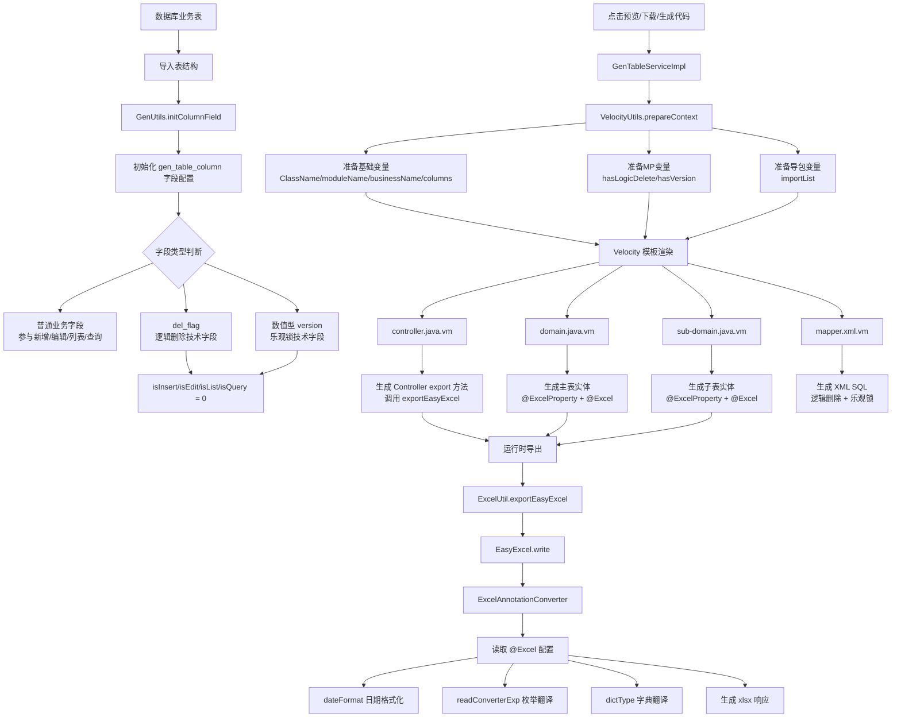

# f09a6942 全代码阅读与改动高亮说明

## 1. 阅读方式说明

提交：

```text
f09a6942fd7a9f388cfd8a655a47e893deb8256f
```

提交说明：

```text
集成easyExcel，改造代码生成模板
```

本提交涉及 7 个代码文件：

```text
ruoyi-common/src/main/java/com/ruoyi/common/utils/poi/ExcelAnnotationConverter.java
ruoyi-generator/src/main/java/com/ruoyi/generator/util/GenUtils.java
ruoyi-generator/src/main/java/com/ruoyi/generator/util/VelocityUtils.java
ruoyi-generator/src/main/resources/vm/java/controller.java.vm
ruoyi-generator/src/main/resources/vm/java/domain.java.vm
ruoyi-generator/src/main/resources/vm/java/sub-domain.java.vm
ruoyi-generator/src/main/resources/vm/xml/mapper.xml.vm
```

Markdown 的普通代码块无法给某几行单独设置背景色，因此本文采用更适合代码评审和教学的方式：

1. 先给出每个文件在该提交中的完整代码查看命令。
2. 再用 `diff` 代码块展示改动内容，`+` 表示新增，`-` 表示删除，相当于改动高亮。
3. 最后解释每个文件的改造意图和关键代码作用。

查看某个文件在本提交中的完整代码：

```bash
git show f09a6942:文件路径
```

例如：

```bash
git show f09a6942:ruoyi-generator/src/main/resources/vm/java/domain.java.vm
```

## 2. 总体链路流程图

本次提交虽然改的是多个文件，但整体链路可以分成三段：

```text
导入表结构阶段 -> 生成代码阶段 -> 运行时导出阶段
```



从这个图可以看到：

- `GenUtils` 影响的是导入表时保存到 `gen_table_column` 的字段元数据。
- `VelocityUtils` 影响的是模板渲染时能拿到哪些变量和 import。
- `*.vm` 模板决定最终生成的 Java/XML 源码长什么样。
- `ExcelAnnotationConverter` 是运行时能力，只有生成代码执行 EasyExcel 导出/导入时才会被调用。

## 3. ExcelAnnotationConverter.java

完整代码查看：

```bash
git show f09a6942:ruoyi-common/src/main/java/com/ruoyi/common/utils/poi/ExcelAnnotationConverter.java
```

该文件是本提交新增文件，因此整份文件都是新增内容。

```diff
+public class ExcelAnnotationConverter implements Converter<Object>
+{
+    @Override
+    public Class<?> supportJavaTypeKey()
+    {
+        // 注解指定converter时EasyExcel会优先使用该转换器，这里声明Object以覆盖常见字段类型。
+        return Object.class;
+    }
+
+    @Override
+    public CellDataTypeEnum supportExcelTypeKey()
+    {
+        // 经过@Excel规则翻译后的值统一按字符串写入Excel。
+        return CellDataTypeEnum.STRING;
+    }
+}
```

核心作用：把 EasyExcel 的字段转换能力和若依原有 `@Excel` 注解规则接起来。

导出时主要走：

```java
convertToExcelData(...)
```

它会读取字段上的：

```text
@Excel(dateFormat)
@Excel(readConverterExp)
@Excel(dictType)
@Excel(scale)
```

然后分别完成日期格式化、枚举表达式翻译、字典值转标签、BigDecimal 精度处理。

导入时主要走：

```java
convertToJavaData(...)
```

它会把 Excel 单元格的展示值反向转成系统内部值，再通过 `convertToFieldType` 转成实体字段真实类型。

## 4. GenUtils.java

完整代码查看：

```bash
git show f09a6942:ruoyi-generator/src/main/java/com/ruoyi/generator/util/GenUtils.java
```

本文件在提交中主要改动 `initColumnField` 末尾的技术字段处理。

```diff
-        // del_flag/version属于技术字段，按字段存在性生成逻辑删除和乐观锁，不暴露给前端手动维护。
-        if (StringUtils.equalsAnyIgnoreCase(columnName, "del_flag", "version"))
+        // del_flag属于逻辑删除技术字段，不暴露给前端手动维护。
+        if (StringUtils.equalsIgnoreCase(columnName, "del_flag"))
         {
-            if (StringUtils.equalsIgnoreCase(columnName, "version"))
-            {
-                // version约定使用Integer，匹配数据库int类型并配合MP乐观锁插件递增。
-                column.setJavaType(GenConstants.TYPE_INTEGER);
-            }
             column.setIsInsert("0");
             column.setIsEdit("0");
             column.setIsList("0");
             column.setIsQuery("0");
         }
+        // 只有数值型version才按MP乐观锁字段处理；timestamp类型version保留LocalDateTime映射，避免TIMESTAMP映射到Integer。
+        if (StringUtils.equalsIgnoreCase(columnName, "version") && arraysContains(GenConstants.COLUMNTYPE_NUMBER, dataType))
+        {
+            column.setIsInsert("0");
+            column.setIsEdit("0");
+            column.setIsList("0");
+            column.setIsQuery("0");
+        }
```

改造目的：

- `del_flag` 是逻辑删除字段，不应该出现在新增、编辑、列表、查询页面。
- `version` 是乐观锁字段，也不应该由前端手动维护。
- `version` 增加数字类型判断，是为了避免非数值同名字段被错误生成 `version = version + 1`。

注意：这里没有改若依原有数字类型映射规则，数字类型仍按若依原逻辑处理。

## 5. VelocityUtils.java

完整代码查看：

```bash
git show f09a6942:ruoyi-generator/src/main/java/com/ruoyi/generator/util/VelocityUtils.java
```

本文件负责给 Velocity 模板准备变量。

### 4.1 hasVersion 判断调整

```diff
         GenTableColumn logicDeleteColumn = getColumnByColumnName(genTable, LOGIC_DELETE_COLUMN_NAME);
         GenTableColumn versionColumn = getColumnByColumnName(genTable, VERSION_COLUMN_NAME);
+        // 只有数值型version字段才启用XML里的version + 1乐观锁逻辑，避免timestamp version被映射为Integer。
+        boolean hasVersion = StringUtils.isNotNull(versionColumn) && isNumberVersionColumn(versionColumn);
         String keyPrefix = StringUtils.isEmpty(prefix) ? "" : prefix;
```

原来只要存在 `version` 字段，模板变量 `hasVersion` 就是 true。

现在改成：

```java
StringUtils.isNotNull(versionColumn) && isNumberVersionColumn(versionColumn)
```

也就是必须同时满足：

```text
存在 version 字段
version 的 Java 类型是 Integer 或 Long
```

### 4.2 新增 isNumberVersionColumn

```diff
+    /**
+     * 判断version字段是否适合按数值型乐观锁生成。
+     */
+    private static boolean isNumberVersionColumn(GenTableColumn column)
+    {
+        return StringUtils.equalsAny(column.getJavaType(), GenConstants.TYPE_INTEGER, GenConstants.TYPE_LONG);
+    }
```

作用：避免字符串、时间等非数值 `version` 字段被当作乐观锁字段。

### 4.3 importList 更精确

```diff
-        if (StringUtils.isNotNull(getColumnByColumnName(genTable, LOGIC_DELETE_COLUMN_NAME)))
+        GenTableColumn logicDeleteColumn = getColumnByColumnName(genTable, LOGIC_DELETE_COLUMN_NAME);
+        GenTableColumn versionColumn = getColumnByColumnName(genTable, VERSION_COLUMN_NAME);
+        if (StringUtils.isNotNull(logicDeleteColumn))
         {
             // 存在del_flag时只生成TableName，逻辑删除字段和值交给mybatis-plus全局配置。
             importList.add("com.baomidou.mybatisplus.annotation.TableName");
         }
-        if (StringUtils.isNotNull(getColumnByColumnName(genTable, VERSION_COLUMN_NAME)))
+        if (StringUtils.isNotNull(versionColumn) && isNumberVersionColumn(versionColumn))
         {
-            // 存在version时生成MP乐观锁注解，配合已注册的OptimisticLockerInnerInterceptor使用。
+            // 只有数值型version才生成MP乐观锁注解，避免timestamp等同名字段被当作版本号。
             importList.add("com.baomidou.mybatisplus.annotation.Version");
             importList.add("com.baomidou.mybatisplus.annotation.TableName");
         }
```

作用：只有确实需要 `@Version` 时才导入 `Version`，防止模板生成多余 import。

## 6. controller.java.vm

完整代码查看：

```bash
git show f09a6942:ruoyi-generator/src/main/resources/vm/java/controller.java.vm
```

本文件是 Controller 代码生成模板。

```diff
-        util.exportExcel(response, list, "${functionName}数据");
+        // 代码生成默认使用EasyExcel导出，实体上的@ExcelProperty负责声明表头和转换器。
+        // 若需要使用若依原POI导出能力，可切换为util.exportExcel(response, list, "${functionName}数据")。
+        util.exportEasyExcel(response, list, "${functionName}数据");
```

改造后，新生成的业务 Controller 默认使用 EasyExcel 导出。

执行链路：

```text
Controller.export
    -> service.selectXxxList
    -> new ExcelUtil<>(Xxx.class)
    -> util.exportEasyExcel(...)
    -> EasyExcel.write(...)
    -> ExcelAnnotationConverter
```

保留注释中的 POI 调用方式，是为了后续需要回退时有明确入口。

## 7. domain.java.vm

完整代码查看：

```bash
git show f09a6942:ruoyi-generator/src/main/resources/vm/java/domain.java.vm
```

本文件是主表实体代码生成模板。

### 6.1 新增 EasyExcel import

```diff
-## 导入项目自定义的Excel注解，用于生成Excel
+## 导入EasyExcel注解和若依原有Excel注解，生成实体同时兼容EasyExcel和POI两套导出方式。
+import com.alibaba.excel.annotation.ExcelIgnoreUnannotated;
+import com.alibaba.excel.annotation.ExcelProperty;
 import com.ruoyi.common.annotation.Excel;
+## 通用转换器会读取字段上的@Excel配置，避免每个字典或枚举字段都生成专用Converter类。
+import com.ruoyi.common.utils.poi.ExcelAnnotationConverter;
```

作用：

- `ExcelProperty`：让 EasyExcel 识别字段表头。
- `ExcelIgnoreUnannotated`：只导出显式标注的字段。
- `ExcelAnnotationConverter`：复用若依 `@Excel` 的转换规则。

### 6.2 Lombok 注解组合

```diff
 @Data
+@NoArgsConstructor
+@AllArgsConstructor
 @Builder
+## 明确保持Lombok默认的不比较父类字段行为，避免继承BaseEntity时产生编译警告。
+@EqualsAndHashCode(callSuper = false)
+## @NoArgsConstructor保留MyBatis JavaBean映射需要的无参构造；@Builder仅作为业务代码便捷构造方式。
+## EasyExcel只导出带@ExcelProperty的字段，避免BaseEntity中的公共字段被默认导出。
+// EasyExcel仅处理显式标注@ExcelProperty的字段，避免继承字段被误导出。
+@ExcelIgnoreUnannotated
```

作用：

- `@NoArgsConstructor`：保留 MyBatis 需要的无参构造。
- `@AllArgsConstructor`：配合 `@Builder` 使用。
- `@Builder`：方便业务代码构造对象。
- `@EqualsAndHashCode(callSuper = false)`：明确 Lombok 不比较父类字段。
- `@ExcelIgnoreUnannotated`：避免 EasyExcel 把继承字段也默认导出。

### 6.3 字段级 EasyExcel 注解

枚举表达式字段：

```diff
+    // EasyExcel通过通用转换器复用@Excel(readConverterExp)的枚举翻译规则。
+    @ExcelProperty(value = "${comment}", converter = ExcelAnnotationConverter.class)
     @Excel(name = "${comment}", readConverterExp = "$column.readConverterExp()")
```

日期字段：

```diff
     @JsonFormat(pattern = "yyyy-MM-dd")
+    // EasyExcel通过通用转换器复用@Excel(dateFormat)的日期格式。
+    @ExcelProperty(value = "${comment}", converter = ExcelAnnotationConverter.class)
     @Excel(name = "${comment}", width = 30, dateFormat = "yyyy-MM-dd")
```

日期时间字段：

```diff
     @JsonFormat(pattern = "yyyy-MM-dd HH:mm:ss")
+    // EasyExcel通过通用转换器复用@Excel(dateFormat)的日期时间格式。
+    @ExcelProperty(value = "${comment}", converter = ExcelAnnotationConverter.class)
     @Excel(name = "${comment}", width = 30, dateFormat = "yyyy-MM-dd HH:mm:ss")
```

字典字段：

```diff
+    // EasyExcel通过通用转换器复用@Excel(dictType)的字典翻译规则。
+    @ExcelProperty(value = "${comment}", converter = ExcelAnnotationConverter.class)
+    @Excel(name = "${comment}", dictType = "$column.dictType")
```

普通字段：

```diff
+    @ExcelProperty(value = "${comment}")
     @Excel(name = "${comment}")
```

## 8. sub-domain.java.vm

完整代码查看：

```bash
git show f09a6942:ruoyi-generator/src/main/resources/vm/java/sub-domain.java.vm
```

本文件是主子表模式下的子表实体模板。

### 7.1 移除手写方法相关 import

```diff
-import org.apache.commons.lang3.builder.ToStringBuilder;
-import org.apache.commons.lang3.builder.ToStringStyle;
```

原因：子表实体改用 Lombok 生成 getter、setter、toString 等方法，不再需要手写。

### 7.2 新增 Lombok 和 EasyExcel 注解

```diff
+import com.alibaba.excel.annotation.ExcelIgnoreUnannotated;
+import com.alibaba.excel.annotation.ExcelProperty;
+import com.ruoyi.common.utils.poi.ExcelAnnotationConverter;
+import lombok.AllArgsConstructor;
+import lombok.Builder;
+import lombok.Data;
+import lombok.EqualsAndHashCode;
+import lombok.NoArgsConstructor;
```

类注解：

```diff
+@Data
+@NoArgsConstructor
+@AllArgsConstructor
+@Builder
+@EqualsAndHashCode(callSuper = false)
+@ExcelIgnoreUnannotated
```

作用：让子表实体和主表实体保持一致的生成风格。

### 7.3 移除手写 getter、setter、toString

```diff
-    public void set${AttrName}($column.javaType $column.javaField) 
-    {
-        this.$column.javaField = $column.javaField;
-    }
-
-    public $column.javaType get${AttrName}() 
-    {
-        return $column.javaField;
-    }
-
-    @Override
-    public String toString() {
-        return new ToStringBuilder(this,ToStringStyle.MULTI_LINE_STYLE)
-            .append("${column.javaField}", get${AttrName}())
-            .toString();
-    }
```

移除后，这些方法由 Lombok 自动生成。

## 9. mapper.xml.vm

完整代码查看：

```bash
git show f09a6942:ruoyi-generator/src/main/resources/vm/xml/mapper.xml.vm
```

本文件负责生成 Mapper XML。

### 8.1 查询增加逻辑删除过滤说明

```diff
+            <!-- del_flag存在时按逻辑删除规则只查询未删除数据。 -->
             and ${logicDeleteColumn.columnName} = '0'
```

生成后类似：

```sql
and del_flag = '0'
```

作用：列表查询只查未删除数据。

### 8.2 详情查询过滤已删除数据

```diff
+          <!-- del_flag存在时详情查询同样过滤已删除数据。 -->
           and ${logicDeleteColumn.columnName} = '0'
```

作用：防止通过详情接口查到已经逻辑删除的数据。

### 8.3 新增时初始化 del_flag

```diff
+            <!-- 新增时初始化逻辑删除标识。 -->
             $column.columnName,
```

值部分：

```diff
+            <!-- 新增时默认写入未删除状态。 -->
             '0',
```

作用：新增数据默认是未删除状态。

### 8.4 新增时初始化 version

```diff
+            <!-- 新增时初始化数值型乐观锁版本号。 -->
             $column.columnName,
```

值部分：

```diff
+            <!-- 新增时默认从0版本开始。 -->
             0,
```

作用：新增数据默认版本号为 0。

### 8.5 更新时递增 version

```diff
+            <!-- 更新成功时版本号递增，配合where里的旧版本条件实现乐观锁。 -->
             <if test="${versionColumn.javaField} != null">${versionColumn.columnName} = ${versionColumn.columnName} + 1,</if>
```

作用：更新成功后版本号加 1。

### 8.6 更新时校验旧 version

```diff
+        <!-- 提交旧版本号时才进行乐观锁校验。 -->
         <if test="${versionColumn.javaField} != null"> and ${versionColumn.columnName} = #{${versionColumn.javaField}}</if>
```

作用：防止并发覆盖。

例如两个用户都读到 `version = 0`：

```text
用户A更新成功：version 从 0 变成 1
用户B再用 version = 0 更新：where 条件不匹配，更新失败
```

## 10. 本提交的学习主线

本次提交可以按三层理解。

第一层：运行时转换能力。

```text
ExcelAnnotationConverter
```

它让 EasyExcel 可以读取若依 `@Excel` 注解，并复用原来的表达式、字典、日期转换规则。

第二层：生成器元数据和模板变量。

```text
GenUtils
VelocityUtils
```

它们决定哪些字段是技术字段、哪些模板变量可用、哪些 import 需要生成。

第三层：最终代码模板输出。

```text
controller.java.vm
domain.java.vm
sub-domain.java.vm
mapper.xml.vm
```

它们决定新生成出来的 Controller、实体和 Mapper XML 最终长什么样。

## 11. 总结

`f09a6942` 的核心价值是把 EasyExcel 纳入代码生成体系，而不是只在某一个手写 Controller 里临时使用 EasyExcel。

改造完成后，新生成的代码具备这些能力：

- Controller 默认调用 `exportEasyExcel`
- 实体字段同时保留 `@Excel` 和新增 `@ExcelProperty`
- EasyExcel 可复用若依原有字典、枚举、日期格式化规则
- 主表和子表实体统一使用 Lombok
- `del_flag` 在 XML 中生成逻辑删除 SQL
- 数值型 `version` 在 XML 中生成乐观锁 SQL
