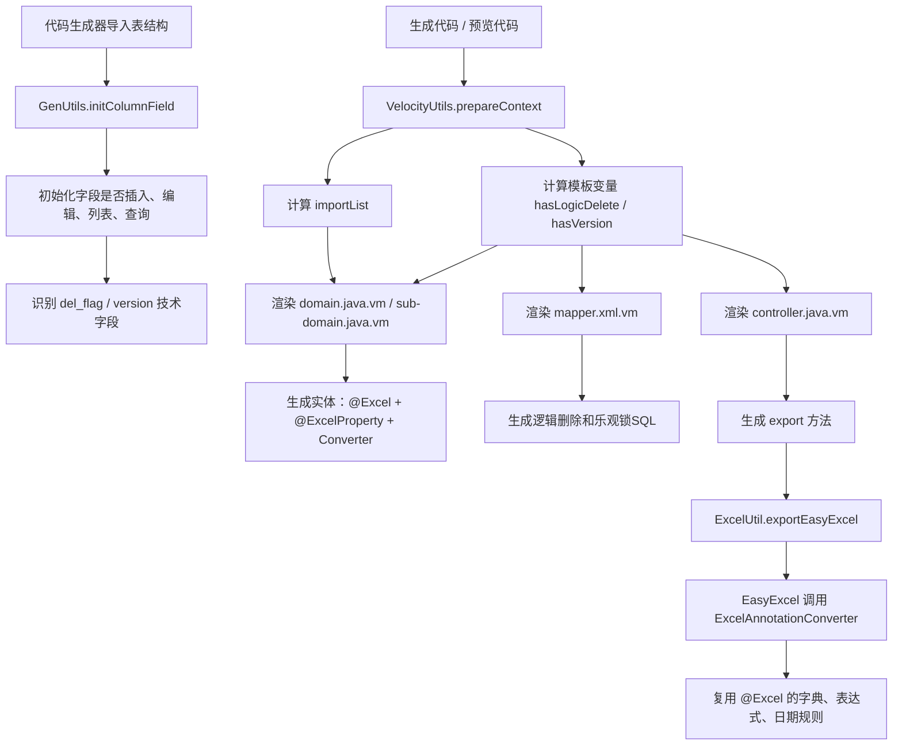
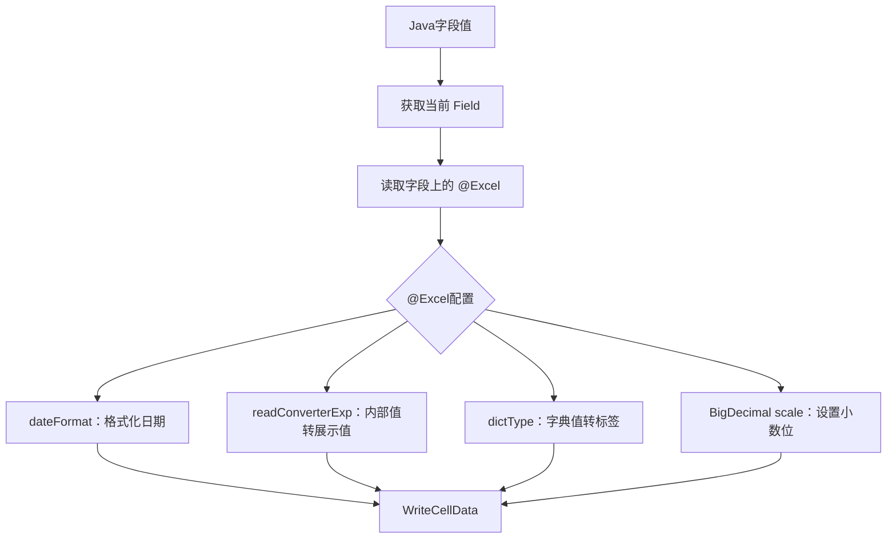
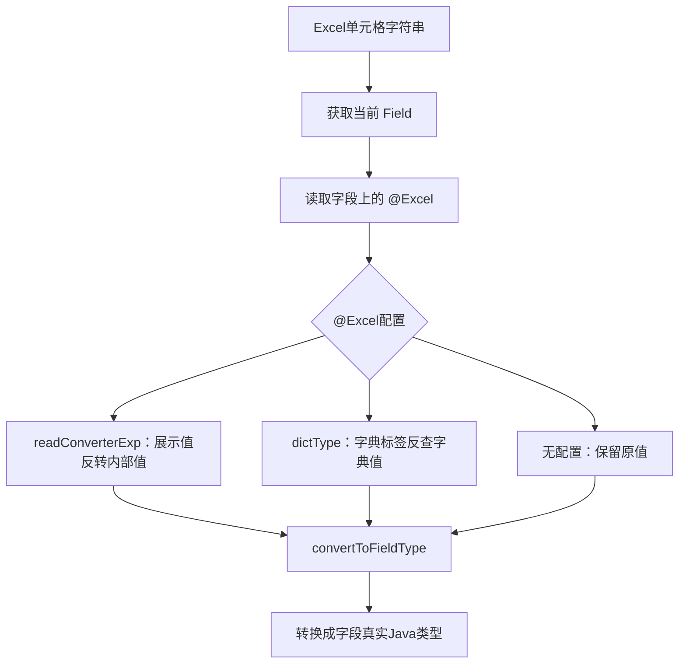
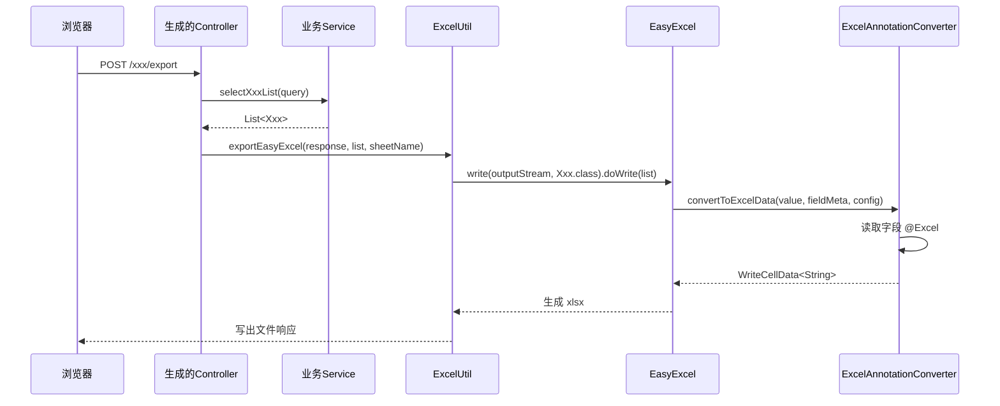

# f09a6942：集成 EasyExcel 并改造代码生成模板

## 1. 提交概览

提交号：

```text
f09a6942fd7a9f388cfd8a655a47e893deb8256f
```

提交说明：

```text
集成easyExcel，改造代码生成模板
```

本次提交涉及 7 个文件：

```text
ruoyi-common/src/main/java/com/ruoyi/common/utils/poi/ExcelAnnotationConverter.java
ruoyi-generator/src/main/java/com/ruoyi/generator/util/GenUtils.java
ruoyi-generator/src/main/java/com/ruoyi/generator/util/VelocityUtils.java
ruoyi-generator/src/main/resources/vm/java/controller.java.vm
ruoyi-generator/src/main/resources/vm/java/domain.java.vm
ruoyi-generator/src/main/resources/vm/java/sub-domain.java.vm
ruoyi-generator/src/main/resources/vm/xml/mapper.xml.vm
```

整体目标是：让代码生成器生成出来的后端代码默认支持 EasyExcel 导出，同时继续复用若依原有 `@Excel` 注解能力，并补齐逻辑删除 `del_flag`、乐观锁 `version` 在模板层面的处理。

## 2. 改造前的问题

若依原有代码生成模板默认使用 POI 体系：

```java
ExcelUtil<Xxx> util = new ExcelUtil<Xxx>(Xxx.class);
util.exportExcel(response, list, "xxx数据");
```

实体字段主要依赖若依自定义注解：

```java
@Excel(name = "状态", readConverterExp = "0=正常,1=停用")
private String status;
```

集成 EasyExcel 后，如果只在实体字段上加：

```java
@ExcelProperty("状态")
```

EasyExcel 并不会自动理解若依的这些配置：

- `readConverterExp`
- `dictType`
- `dateFormat`
- `scale`
- `roundingMode`

因此会出现两个典型问题：

- 字典字段导出的是内部值，不是中文标签。
- 日期字段、枚举字段无法复用若依原有 POI 导出规则。

本次提交的核心思路是：新增一个 EasyExcel 通用转换器，让它读取字段上的若依 `@Excel` 注解，把原有转换规则桥接给 EasyExcel。

## 3. 总体链路



## 4. ExcelAnnotationConverter

文件：

```text
ruoyi-common/src/main/java/com/ruoyi/common/utils/poi/ExcelAnnotationConverter.java
```

这是本次提交新增的核心类。

类定义：

```java
public class ExcelAnnotationConverter implements Converter<Object>
```

它实现 EasyExcel 的 `Converter<Object>`，用于处理 EasyExcel 导入和导出时的字段值转换。

### 4.1 supportJavaTypeKey

```java
public Class<?> supportJavaTypeKey()
{
    return Object.class;
}
```

作用：声明该转换器支持的 Java 类型。

这里返回 `Object.class`，表示它是一个通用转换器。模板可以把它挂到 String、Integer、Long、Date、LocalDate、LocalDateTime、BigDecimal 等多种字段上。

这样做的好处是减少重复 Converter 类。

### 4.2 supportExcelTypeKey

```java
public CellDataTypeEnum supportExcelTypeKey()
{
    return CellDataTypeEnum.STRING;
}
```

作用：声明转换后的 Excel 单元格类型。

本转换器会把字典标签、枚举文本、日期格式化结果统一写成字符串，因此这里返回 `STRING`。

### 4.3 convertToExcelData

```java
public WriteCellData<String> convertToExcelData(
        Object value,
        ExcelContentProperty contentProperty,
        GlobalConfiguration globalConfiguration)
```

这是导出方向的方法。

执行过程：



例如：

```java
@Excel(name = "状态", readConverterExp = "0=正常,1=停用")
private String status;
```

导出时：

```text
0 -> 正常
1 -> 停用
```

字典字段：

```java
@Excel(name = "性别", dictType = "sys_user_sex")
private String sex;
```

导出时会通过 `DictUtils.getDictLabel` 把字典值转成字典标签。

日期字段：

```java
@Excel(name = "创建时间", dateFormat = "yyyy-MM-dd HH:mm:ss")
private LocalDateTime createTime;
```

导出时会格式化成指定字符串。

### 4.4 convertToJavaData

```java
public Object convertToJavaData(
        ReadCellData<?> cellData,
        ExcelContentProperty contentProperty,
        GlobalConfiguration globalConfiguration)
```

这是导入方向的方法。

执行过程：



例如 Excel 中填写：

```text
正常
```

实体字段配置：

```java
@Excel(readConverterExp = "0=正常,1=停用")
private String status;
```

导入后会得到：

```text
0
```

### 4.5 convertToFieldType

```java
private Object convertToFieldType(String value, Field field)
```

作用：把字符串转换成实体字段真实类型。

支持类型：

```text
String
Integer / int
Long / long
Double / double
Float / float
BigDecimal
Date
Boolean / boolean
LocalDateTime
LocalDate
```

这个方法保证 EasyExcel 导入后，不会把所有字段都停留在字符串状态。

### 4.6 parseDateToStr

```java
private String parseDateToStr(String dateFormat, Object value)
```

作用：按 `@Excel(dateFormat)` 格式化日期字段。

支持：

```text
Date
LocalDateTime
LocalDate
```

这和代码生成器支持 `LocalDate`、`LocalDateTime` 的方向配套。

## 5. GenUtils 改动

文件：

```text
ruoyi-generator/src/main/java/com/ruoyi/generator/util/GenUtils.java
```

本次提交主要调整了 `initColumnField` 中对技术字段的处理。

### 5.1 del_flag

新增逻辑：

```java
if (StringUtils.equalsIgnoreCase(columnName, "del_flag"))
{
    column.setIsInsert("0");
    column.setIsEdit("0");
    column.setIsList("0");
    column.setIsQuery("0");
}
```

作用：导入表结构时，如果发现字段是 `del_flag`，就不让它参与前端新增、编辑、列表、查询。

原因：`del_flag` 是逻辑删除技术字段，应该由后端统一维护。

典型规则：

```text
新增：del_flag = 0
删除：del_flag = 2
查询：只查 del_flag = 0
```

### 5.2 version

新增逻辑：

```java
if (StringUtils.equalsIgnoreCase(columnName, "version")
        && arraysContains(GenConstants.COLUMNTYPE_NUMBER, dataType))
{
    column.setIsInsert("0");
    column.setIsEdit("0");
    column.setIsList("0");
    column.setIsQuery("0");
}
```

作用：只有字段名为 `version`，并且数据库类型属于数值类型时，才把它当作乐观锁字段处理。

这样可以避免非数值型同名字段被错误生成：

```sql
version = version + 1
```

`version` 作为乐观锁字段时，也不应该由前端用户手动维护。

## 6. VelocityUtils 改动

文件：

```text
ruoyi-generator/src/main/java/com/ruoyi/generator/util/VelocityUtils.java
```

`VelocityUtils` 是模板变量装配中心。本次提交主要增强了 MyBatis-Plus 相关模板变量。

### 6.1 setMybatisPlusVelocityContext

该方法会查找当前表中是否存在：

```text
del_flag
version
```

并向 Velocity 模板上下文放入变量：

```text
logicDeleteColumn
versionColumn
hasLogicDelete
hasVersion
```

主表使用：

```text
logicDeleteColumn
versionColumn
hasLogicDelete
hasVersion
```

子表使用 prefix 生成：

```text
subLogicDeleteColumn
subVersionColumn
subhasLogicDelete
subhasVersion
```

这些变量会被 `domain.java.vm`、`sub-domain.java.vm`、`mapper.xml.vm` 使用。

### 6.2 isNumberVersionColumn

新增方法：

```java
private static boolean isNumberVersionColumn(GenTableColumn column)
{
    return StringUtils.equalsAny(column.getJavaType(), GenConstants.TYPE_INTEGER, GenConstants.TYPE_LONG);
}
```

作用：判断 `version` 字段是否适合作为数值型乐观锁字段。

只有 `Integer` 或 `Long` 才启用：

- `@Version`
- XML 中的 `version = version + 1`
- XML 中的旧版本号 where 条件

### 6.3 getImportList

本次提交让 import 列表更精确：

- 存在 `del_flag` 时，导入 `TableName`
- 存在数值型 `version` 时，导入 `Version` 和 `TableName`
- 存在 `LocalDate` / `LocalDateTime` 时，导入 `DateTimeFormat` 和 `JsonFormat`
- 存在 `BigDecimal` 时，导入 `java.math.BigDecimal`

这样生成实体时不会出现缺失 import 或无意义 import。

## 7. controller.java.vm 改动

文件：

```text
ruoyi-generator/src/main/resources/vm/java/controller.java.vm
```

改动前：

```java
util.exportExcel(response, list, "${functionName}数据");
```

改动后：

```java
// 代码生成默认使用EasyExcel导出，实体上的@ExcelProperty负责声明表头和转换器。
// 若需要使用若依原POI导出能力，可切换为util.exportExcel(response, list, "${functionName}数据")。
util.exportEasyExcel(response, list, "${functionName}数据");
```

作用：新生成的 Controller 默认使用 EasyExcel 导出。

这要求 `ExcelUtil` 中已经存在：

```java
exportEasyExcel(...)
```

也要求生成实体中带有 EasyExcel 注解：

```java
@ExcelProperty
```

## 8. domain.java.vm 改动

文件：

```text
ruoyi-generator/src/main/resources/vm/java/domain.java.vm
```

这是主表实体模板。

### 8.1 EasyExcel 注解

新增导入：

```java
import com.alibaba.excel.annotation.ExcelIgnoreUnannotated;
import com.alibaba.excel.annotation.ExcelProperty;
import com.ruoyi.common.utils.poi.ExcelAnnotationConverter;
```

新增类注解：

```java
@ExcelIgnoreUnannotated
```

作用：EasyExcel 只导出显式标注 `@ExcelProperty` 的字段，避免 `BaseEntity` 中的公共字段被默认导出。

### 8.2 Lombok 注解组合

模板生成：

```java
@Data
@NoArgsConstructor
@AllArgsConstructor
@Builder
@EqualsAndHashCode(callSuper = false)
```

作用：

- `@Data`：生成 getter、setter、toString、equals、hashCode。
- `@NoArgsConstructor`：保留 MyBatis JavaBean 映射需要的无参构造。
- `@AllArgsConstructor`：提供全参构造，配合 Builder 使用。
- `@Builder`：便于业务代码构造对象。
- `@EqualsAndHashCode(callSuper = false)`：明确不把 `BaseEntity` 字段纳入 equals/hashCode，消除 Lombok 继承警告。

### 8.3 字段级 EasyExcel 支持

普通字段：

```java
@ExcelProperty(value = "名称")
@Excel(name = "名称")
private String name;
```

日期字段：

```java
@JsonFormat(pattern = "yyyy-MM-dd")
@ExcelProperty(value = "日期", converter = ExcelAnnotationConverter.class)
@Excel(name = "日期", width = 30, dateFormat = "yyyy-MM-dd")
private LocalDate testDate;
```

日期时间字段：

```java
@JsonFormat(pattern = "yyyy-MM-dd HH:mm:ss")
@ExcelProperty(value = "日期时间", converter = ExcelAnnotationConverter.class)
@Excel(name = "日期时间", width = 30, dateFormat = "yyyy-MM-dd HH:mm:ss")
private LocalDateTime testDateTime;
```

枚举表达式字段：

```java
@ExcelProperty(value = "状态", converter = ExcelAnnotationConverter.class)
@Excel(name = "状态", readConverterExp = "0=正常,1=停用")
private String status;
```

字典字段：

```java
@ExcelProperty(value = "类型", converter = ExcelAnnotationConverter.class)
@Excel(name = "类型", dictType = "xxx_type")
private String type;
```

这些字段都保留若依 `@Excel`，同时新增 EasyExcel `@ExcelProperty`。

## 9. sub-domain.java.vm 改动

文件：

```text
ruoyi-generator/src/main/resources/vm/java/sub-domain.java.vm
```

这是主子表模式下的子表实体模板。

本次提交将它同步改造成与主表实体类似的 Lombok + EasyExcel 风格。

移除：

```java
ToStringBuilder
ToStringStyle
手写 getter
手写 setter
手写 toString
```

新增：

```java
@Data
@NoArgsConstructor
@AllArgsConstructor
@Builder
@EqualsAndHashCode(callSuper = false)
@ExcelIgnoreUnannotated
```

意义：主表实体和子表实体生成风格保持一致。

## 10. mapper.xml.vm 改动

文件：

```text
ruoyi-generator/src/main/resources/vm/xml/mapper.xml.vm
```

该模板负责生成 Mapper XML。

### 10.1 查询过滤逻辑删除

如果存在 `del_flag`：

```xml
and ${logicDeleteColumn.columnName} = '0'
```

生成后类似：

```sql
and del_flag = '0'
```

作用：列表查询和详情查询默认只查未删除数据。

### 10.2 新增初始化 del_flag

如果存在 `del_flag`，insert 时固定写入：

```sql
del_flag = '0'
```

作用：新增数据默认未删除。

### 10.3 删除改为逻辑删除

如果存在 `del_flag`，删除 SQL 从物理删除：

```sql
delete from xxx where id = #{id}
```

变为逻辑删除：

```sql
update xxx set del_flag = '2'
where id = #{id}
  and del_flag = '0'
```

批量删除同理。

### 10.4 version 乐观锁

如果存在数值型 `version`，insert 时默认写入：

```sql
version = 0
```

update 时生成：

```sql
version = version + 1
```

并增加旧版本条件：

```sql
and version = #{version}
```

作用：防止并发更新覆盖。

典型流程：

```text
1. 用户A查询到 version = 0
2. 用户B也查询到 version = 0
3. 用户A更新成功，数据库 version 改成 1
4. 用户B再提交 version = 0
5. where version = 0 不匹配，更新失败
```

## 11. 生成后的导出执行链路



## 12. 这次改造的设计取舍

### 12.1 为什么保留 @Excel

因为若依已有大量能力围绕 `@Excel` 构建：

- 字典转换
- 枚举表达式转换
- 日期格式化
- BigDecimal 精度
- POI 导入导出

如果完全切换成 EasyExcel 注解体系，迁移成本会比较高。

因此本次采用“双注解”策略：

```java
@ExcelProperty(...)
@Excel(...)
```

`@ExcelProperty` 给 EasyExcel 使用。

`@Excel` 保留若依原能力，并被 `ExcelAnnotationConverter` 读取。

### 12.2 为什么增加通用转换器

不用通用转换器的话，每个字典字段都可能需要生成一个 Converter。

通用转换器把规则集中起来：

```text
模板负责声明字段是否需要转换
转换器负责读取 @Excel 并执行转换
```

这样模板更干净，后续新增字段类型也更容易统一维护。

### 12.3 为什么技术字段不展示在前端

`del_flag` 和 `version` 都是系统维护字段，不是业务人员手工录入字段。

如果暴露到页面：

- 用户可能误改删除状态。
- 用户可能手动改版本号，破坏乐观锁。
- 查询条件会变复杂且容易误用。

因此在导入表结构时直接设置：

```text
is_insert = 0
is_edit = 0
is_list = 0
is_query = 0
```

## 13. 注意事项

### 13.1 EasyExcel 转换器依赖 @Excel

如果模板只生成：

```java
@ExcelProperty(value = "状态", converter = ExcelAnnotationConverter.class)
```

但没有生成：

```java
@Excel(readConverterExp = "0=正常,1=停用")
```

那么通用转换器无法读取若依转换规则。

### 13.2 LocalDateTime 导入格式仍需注意

当前转换器中：

```java
LocalDateTime.parse(value.replace(" ", "T"))
```

适合：

```text
2026-08-27 10:30:00
2026-08-27T10:30:00
```

如果 Excel 输入是：

```text
2026/08/27 10:30
```

可能需要后续增强解析逻辑。

### 13.3 XML 模板中的逻辑删除不依赖 MP 自动注入

本次 `mapper.xml.vm` 是直接生成 SQL：

```sql
and del_flag = '0'
update xxx set del_flag = '2'
```

这和 MyBatis-Plus 的全局逻辑删除配置不是同一套执行路径。

因为若依生成的 XML SQL 是手写 SQL，不能完全依赖 MP 自动拼接逻辑删除条件。

### 13.4 version 只适合数值字段

模板中的乐观锁逻辑是：

```sql
version = version + 1
```

所以只有 `Integer`、`Long` 这类数值字段适合启用。

## 14. 学习重点

这次提交可以理解为三个层面的改造：

```text
运行时能力：ExcelAnnotationConverter 让 EasyExcel 复用 @Excel
生成器逻辑：GenUtils / VelocityUtils 决定字段和模板变量
模板输出：controller / domain / sub-domain / mapper.xml 生成最终代码
```

其中最关键的是职责分离：

- `GenUtils`：导入表时初始化字段元数据。
- `VelocityUtils`：生成代码时准备模板变量和 import。
- `domain.java.vm`：生成主表实体。
- `sub-domain.java.vm`：生成子表实体。
- `controller.java.vm`：生成导出接口。
- `mapper.xml.vm`：生成 SQL。
- `ExcelAnnotationConverter`：运行时执行 EasyExcel 字段转换。

这条链路打通后，新导入的业务表在生成代码时，就可以自动获得 EasyExcel 导出、字典转换、日期格式化、逻辑删除和乐观锁相关代码。

