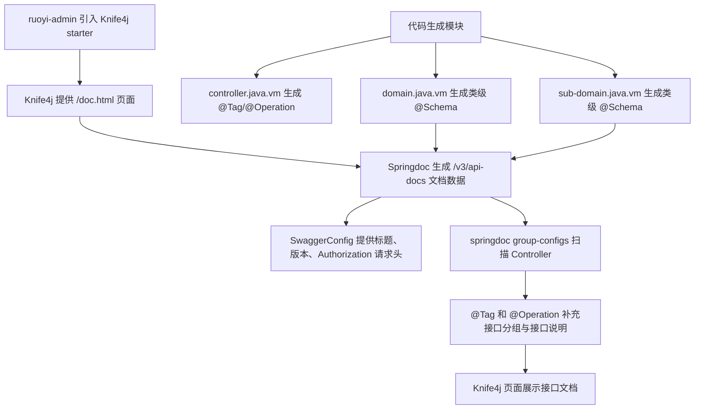

# RuoYi-Vue-X 集成 Knife4j 与代码生成注解改造说明

## 1. 改造目标

本次改造采用 RuoYi Spring Boot 3 项目推荐的 Knife4j OpenAPI3 方案，同时补齐代码生成模板里的文档注解能力。

核心目标：

- 后端通过 Knife4j 提供 `/doc.html` 增强文档页面
- Springdoc 负责生成 `/v3/api-docs/**` OpenAPI 文档数据
- 代码生成的 Controller 自动带 `@Tag` 和 `@Operation`
- 代码生成的主表实体和子表实体自动带类级 `@Schema`
- 只在公共模块引入轻量级 OpenAPI3 注解依赖，不把 Knife4j 页面能力下沉到业务公共包
- 不修改 `ResourcesConfig` 额外映射 Knife4j 静态资源

## 2. 总体链路



## 3. 父 POM 依赖管理

文件：

```text
pom.xml
```

父 POM 统一管理 Knife4j、Springdoc 和 swagger annotations 版本：

```xml
<knife4j.version>4.4.0</knife4j.version>
<!-- Knife4j 4.4.0默认传递的springdoc 2.3.0与当前Spring Boot不兼容 -->
<springdoc.version>2.9.0</springdoc.version>
<!-- 生成代码使用OpenAPI3注解，版本与springdoc 2.9.0依赖的swagger-core保持一致 -->
<swagger-annotations.version>2.2.52</swagger-annotations.version>
```

Knife4j 依赖管理：

```xml
<dependency>
    <groupId>com.github.xiaoymin</groupId>
    <artifactId>knife4j-openapi3-jakarta-spring-boot-starter</artifactId>
    <version>${knife4j.version}</version>
</dependency>
```

Springdoc UI 依赖管理：

```xml
<!-- 只管理UI starter版本，由它带齐webmvc-api、common和swagger-core版本 -->
<dependency>
    <groupId>org.springdoc</groupId>
    <artifactId>springdoc-openapi-starter-webmvc-ui</artifactId>
    <version>${springdoc.version}</version>
</dependency>
```

OpenAPI3 注解依赖管理：

```xml
<!-- 仅提供OpenAPI3注解给生成实体和Controller使用，不引入Knife4j页面能力 -->
<dependency>
    <groupId>io.swagger.core.v3</groupId>
    <artifactId>swagger-annotations-jakarta</artifactId>
    <version>${swagger-annotations.version}</version>
</dependency>
```

这里额外声明 Springdoc UI 是为了解决 Knife4j `4.4.0` 默认传递的 Springdoc `2.3.0` 与当前 Spring Boot / Spring Framework 不兼容的问题，避免运行时出现 `ControllerAdviceBean` 或 swagger-core 方法签名冲突。

## 4. 启动模块

文件：

```text
ruoyi-admin/pom.xml
```

启动模块引入 Knife4j：

```xml
<dependency>
    <groupId>com.github.xiaoymin</groupId>
    <artifactId>knife4j-openapi3-jakarta-spring-boot-starter</artifactId>
</dependency>
```

同时直接声明 Springdoc UI，实际版本由父 POM 管理为 `2.9.0`：

```xml
<!-- 直接声明springdoc 2.9.0覆盖Knife4j传递的2.3.0避免ControllerAdviceBean运行期错误 -->
<dependency>
    <groupId>org.springdoc</groupId>
    <artifactId>springdoc-openapi-starter-webmvc-ui</artifactId>
</dependency>
```

## 5. 公共模块

文件：

```text
ruoyi-common/pom.xml
```

公共模块引入 `swagger-annotations-jakarta`：

```xml
<!-- OpenAPI3注解供代码生成后的业务实体和Controller使用，不包含Knife4j页面资源 -->
<dependency>
    <groupId>io.swagger.core.v3</groupId>
    <artifactId>swagger-annotations-jakarta</artifactId>
</dependency>
```

这样生成后的实体类和 Controller 所在业务模块可以直接使用 `@Schema`、`@Tag`、`@Operation`，又不会把 Knife4j UI 和 Springdoc 自动配置扩散到公共模块。

## 6. Springdoc 与 Knife4j 配置

文件：

```text
ruoyi-admin/src/main/resources/application.yml
```

开发环境配置：

```yaml
springdoc:
  api-docs:
    path: /v3/api-docs
  swagger-ui:
    enabled: true
    path: /swagger-ui.html
    # 使用相对地址兼容后端直连和前端/dev-api代理入口
    config-url: ./v3/api-docs/swagger-config
    tags-sorter: alpha
    urls:
      - name: '若依接口'
        # 分组地址保持相对避免前端iframe请求到localhost/v3/api-docs
        url: ./v3/api-docs/default
  group-configs:
    - group: 'default'
      display-name: '若依接口'
      paths-to-match: '/**'
      # 扫描后台Controller根包让Knife4j展示全部业务接口
      packages-to-scan: com.ruoyi.web.controller

knife4j:
  # 开启Knife4j增强页面
  enable: true
  # 开发环境不是生产模式
  production: false
  # 基础认证默认关闭
  basic:
    # 需要文档密码时再开启
    enable: false
    username: ruoyi
    password: 123456
  setting:
    # 自定义左侧菜单中Schema的显示名称
    swagger-model-name: 实体类列表
```

`config-url` 和 `urls.url` 使用相对地址，是为了同时兼容：

- 后端直连访问：`http://localhost:8080/doc.html`
- 前端代理访问：`/dev-api/doc.html`

生产环境建议显式关闭文档入口：

```yaml
springdoc:
  api-docs:
    enabled: false
  swagger-ui:
    enabled: false

knife4j:
  enable: false
  production: true
```

## 7. SwaggerConfig

文件：

```text
ruoyi-admin/src/main/java/com/ruoyi/web/core/config/SwaggerConfig.java
```

该配置类负责定义 OpenAPI 基础信息：

- 文档标题
- 文档描述
- 作者信息
- 系统版本
- `Authorization` 全局请求头

这里使用的是 `io.swagger.v3.oas.models.*` 模型对象，不是旧版 Swagger2 的 `@Api`、`@ApiOperation` 注解。

## 8. 代码生成模板

### MyBatis-Plus 基类

代码生成模板接入 MyBatis-Plus 基类，同时保留若依原有 XML 自定义方法：

```java
public interface XxxMapper extends BaseMapper<Xxx>
```

```java
public interface IXxxService extends IService<Xxx>
```

```java
public class XxxServiceImpl extends ServiceImpl<XxxMapper, Xxx> implements IXxxService
```

实体类统一生成表名注解：

```java
@TableName(value = "去前缀后的表名", keepGlobalPrefix = true)
```

这样既可以继续使用若依生成的 `selectXxxList`、`insertXxx` 等 XML 方法，也可以在业务代码中按需使用 MyBatis-Plus 的通用 CRUD 能力。`@TableName` 不再写死 `tb_node` 这类真实物理表名，而是配合 `mybatis-plus.global-config.db-config.table-prefix` 还原真实表名。

### Controller 模板

文件：

```text
ruoyi-generator/src/main/resources/vm/java/controller.java.vm
```

新增导入：

```java
import io.swagger.v3.oas.annotations.Operation;
import io.swagger.v3.oas.annotations.tags.Tag;
```

生成类注解：

```java
// Knife4j/OpenAPI3根据@Tag将当前Controller归类到对应接口分组
@Tag(name = "${functionName}")
```

生成接口注解：

```java
@Operation(summary = "查询${functionName}列表")
@Operation(summary = "导出${functionName}列表")
@Operation(summary = "获取${functionName}详细信息")
@Operation(summary = "新增${functionName}")
@Operation(summary = "修改${functionName}")
@Operation(summary = "删除${functionName}")
```

### 主表实体模板

文件：

```text
ruoyi-generator/src/main/resources/vm/java/domain.java.vm
```

新增导入：

```java
import io.swagger.v3.oas.annotations.media.Schema;
```

生成类注解：

```java
## Knife4j/OpenAPI3根据@Schema展示实体模型名称
@Schema(description = "${functionName}实体")
```

类上的 JavaDoc 注释继续沿用若依原格式 `${functionName}对象 ${tableName}`，只调整 `@Schema` 展示给 Knife4j 的模型描述。

字段上不生成 `@Schema`，避免实体字段注解过多；字段含义仍保留 JavaDoc、数据库字段备注和 Excel 注解。

### 子表实体模板

文件：

```text
ruoyi-generator/src/main/resources/vm/java/sub-domain.java.vm
```

子表实体与主表保持一致，只生成类级 `@Schema` 注解，描述格式为 `${subTable.functionName}实体`；JavaDoc 注释仍保留若依原格式 `${subTable.functionName}对象 ${subTableName}`。

## 9. 为什么不用旧注解

当前项目是 Spring Boot 3 / Jakarta 体系，应该使用 OpenAPI3 注解：

- `@Tag`
- `@Operation`
- `@Schema`

旧版 Swagger2 注解不再作为首选：

- `@Api`
- `@ApiOperation`
- `@ApiModel`
- `@ApiModelProperty`

Knife4j 现在只是文档增强 UI，接口扫描和 OpenAPI 文档生成由 Springdoc 完成，所以模板里使用 OpenAPI3 注解更合适。

## 10. 不改 ResourcesConfig

RuoYi 官网集成 Knife4j 的步骤不要求修改 `ResourcesConfig`。当前方案不新增：

```text
/doc.html
/webjars/**
/swagger-ui/**
```

Knife4j starter 与 Spring Boot 默认静态资源处理会负责文档页面资源。

## 11. 验证方式

编译：

```powershell
$env:JAVA_HOME='D:\software\jdk17'; $env:Path='D:\software\jdk17\bin;' + $env:Path; mvn -pl ruoyi-admin -am -DskipTests "-Dmaven.compiler.useIncrementalCompilation=false" compile
```

后端直连访问：

```text
http://localhost:8080/doc.html
http://localhost:8080/v3/api-docs/swagger-config
http://localhost:8080/v3/api-docs/default
```

前端菜单访问：

```text
/dev-api/doc.html
```

如果出现 `NoSuchMethodError`，优先检查最终运行时是否仍加载了不兼容的 Springdoc 或 swagger-core 旧版本。
