# 文件存储与上传体系

> 本文档为功能点整合版，按来源文件合并原始内容。原始文档仍保留在 `doc` 目录，便于按历史记录溯源。

## 整合说明

整合文件存储、上传场景、文件校验、文件资产记录、私有访问、分片上传、文件清理、文件管理接口、策略模式和相关提交记录。

## 来源索引

- `doc/01-集成x-file-storage及存储SDK依赖.md`
- `doc/02-启用x-file-storage并增加存储基础配置.md`
- `doc/03-增强上传文件校验.md`
- `doc/04-增加统一文件上传门面.md`
- `doc/05-增加存储文件记录能力.md`
- `doc/06-增加存储文件清理任务.md`
- `doc/07-增加存储文件访问策略配置.md`
- `doc/08-改造通用文件上传接口.md`
- `doc/09-头像上传接入文件资产管理.md`
- `doc/10-P0P1文件上传优化说明.md`
- `doc/12-私有文件访问授权最终方案.md`
- `doc/13-私有文件token策略调整说明.md`
- `doc/14-文件管理接口方法去留说明.md`
- `doc/15-文件管理常量和枚举收敛说明.md`
- `doc/16-私有文件绑定和待删除边界收紧说明.md`
- `doc/18-分片上传fileId优先适配说明.md`
- `doc/19-文件访问权限策略模式改造说明.md`
- `doc/20-上传场景策略模式改造说明.md`
- `doc/21-文件生命周期策略模式改造说明.md`
- `doc/22-文件应用服务和响应组装器重构说明.md`
- `doc/gitlog-commit/10-完善文件管理公共模型和配置.md`
- `doc/gitlog-commit/11-完善存储文件记录和生命周期服务.md`
- `doc/gitlog-commit/13-完善私有文件访问授权和代理地址.md`
- `doc/gitlog-commit/14-完善通用文件上传和批量场景限制.md`
- `doc/gitlog-commit/15-完善头像上传文件资产处理.md`
- `doc/gitlog-commit/16-增加存储文件管理后台接口.md`
- `doc/gitlog-commit/17-头像上传改用文件ID绑定文件资产.md`
- `doc/gitlog-commit/18-收敛文件管理对外接口和URL兼容方法.md`

---

## 原文：doc/01-集成x-file-storage及存储SDK依赖.md

# 集成 x-file-storage 及存储 SDK 依赖

## 1. 改造目标

本次提交把 X File Storage 和当前需要接入的对象存储 SDK 纳入 Maven 依赖体系，并把版本统一放到父 POM 管理。

核心目标：

- 父 POM 统一管理 X File Storage、阿里云 OSS、MinIO、腾讯云 COS 版本
- `ruoyi-common` 只声明依赖，不重复写版本号
- 为后续统一上传门面和多平台上传能力打基础

## 改造前存在的问题

- 项目原有文件上传主要依赖若依本地上传工具，缺少统一的第三方存储依赖基础
- 如果各模块自行引入 OSS、MinIO、COS SDK，后续容易出现版本不一致和依赖冲突
- 后续要做多平台上传、文件记录、分片上传时，公共模块缺少 X File Storage 的基础能力

## 改造后的解决方案

- 在父 POM 统一管理 X File Storage 和对象存储 SDK 版本
- `ruoyi-common` 只声明依赖坐标，不写版本号
- 为后续 `XFileStorageUtils`、平台配置、文件记录和分片上传提供依赖基础

提交：

```text
b8d87bc7 集成 x-file-storage 及存储 SDK 依赖
```

## 2. 总体链路

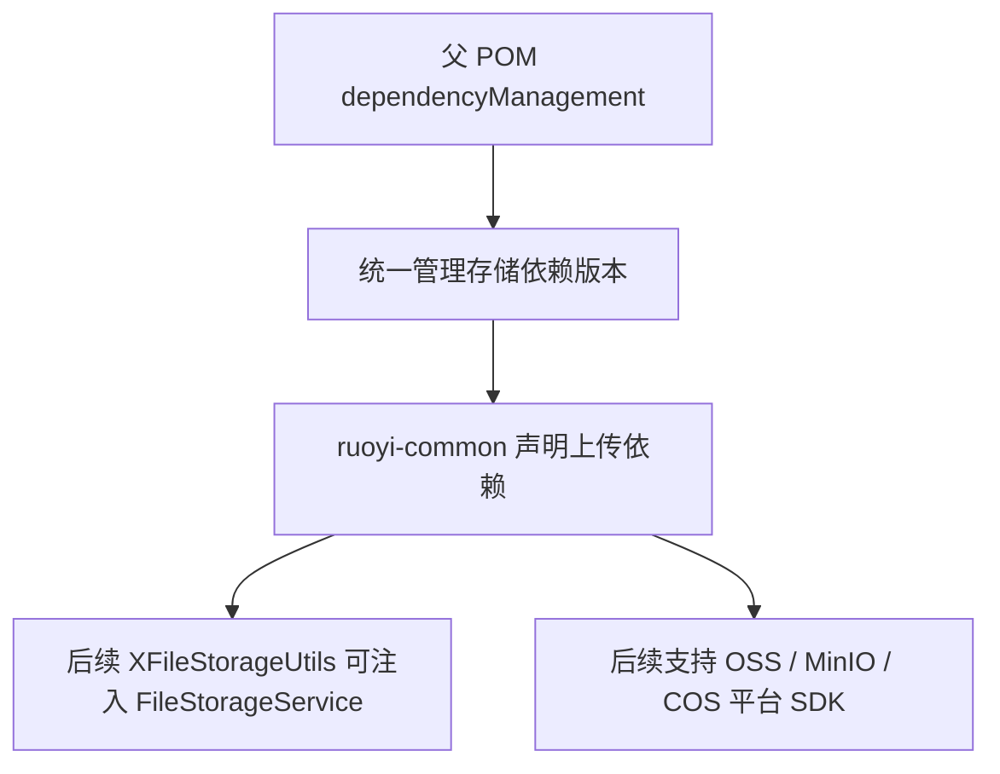

## 3. 涉及文件

- `pom.xml`
- `ruoyi-common/pom.xml`

## 4. 父 POM 版本管理

文件：

```text
pom.xml
```

### 改动说明

父 POM 的 `properties` 中新增存储相关版本属性。这样后续无论 `ruoyi-common`、`ruoyi-system` 还是其它模块使用这些依赖，都不需要在子模块里重复写版本号。

### 涉及改动部分

```xml
<!-- 省略 -->
        <!-- 生成代码使用OpenAPI3注解，版本与springdoc 2.9.0依赖的swagger-core保持一致 -->
        <swagger-annotations.version>2.2.52</swagger-annotations.version>
        <!-- X File Storage及当前启用的OSS平台SDK版本统一放在父pom管理。 -->
        <x-file-storage.version>2.3.0</x-file-storage.version>
        <aliyun-sdk-oss.version>3.16.1</aliyun-sdk-oss.version>
        <minio.version>8.5.2</minio.version>
        <qcloud-cos.version>5.6.137</qcloud-cos.version>
    </properties>
<!-- 省略 -->
```

新增的版本含义：

- `x-file-storage.version`：X File Storage Spring 集成包版本
- `aliyun-sdk-oss.version`：阿里云 OSS SDK 版本
- `minio.version`：MinIO Java SDK 版本
- `qcloud-cos.version`：腾讯云 COS SDK 版本

## 5. 父 POM 依赖管理

文件：

```text
pom.xml
```

### 改动说明

父 POM 的 `dependencyManagement` 中新增存储依赖管理。这里写版本，子模块只需要写 `groupId` 和 `artifactId`。

### 涉及改动部分

```xml
<!-- 省略 -->
            <!-- 阿里JSON解析器 -->
            <dependency>
                <groupId>com.alibaba.fastjson2</groupId>
                <artifactId>fastjson2</artifactId>
                <version>${fastjson.version}</version>
            </dependency>

            <!-- X File Storage -->
            <dependency>
                <groupId>org.dromara.x-file-storage</groupId>
                <artifactId>x-file-storage-spring</artifactId>
                <version>${x-file-storage.version}</version>
            </dependency>

            <!-- Aliyun OSS -->
            <dependency>
                <groupId>com.aliyun.oss</groupId>
                <artifactId>aliyun-sdk-oss</artifactId>
                <version>${aliyun-sdk-oss.version}</version>
            </dependency>

            <!-- MinIO -->
            <dependency>
                <groupId>io.minio</groupId>
                <artifactId>minio</artifactId>
                <version>${minio.version}</version>
            </dependency>

            <!-- 腾讯云Qcloud COS -->
            <dependency>
                <groupId>com.qcloud</groupId>
                <artifactId>cos_api</artifactId>
                <version>${qcloud-cos.version}</version>
            </dependency>

            <!-- Token生成与解析-->
<!-- 省略 -->
```

这里选择放在父 POM 的原因：

- 防止各模块引入不同版本的对象存储 SDK
- 后续升级存储 SDK 时只改一个地方
- 子模块 POM 更干净，依赖意图更清晰

## 6. common 模块依赖

文件：

```text
ruoyi-common/pom.xml
```

### 改动说明

`ruoyi-common` 增加上传基础依赖。由于后续 `XFileStorageUtils` 位于 common 模块，所以 common 需要能注入 `FileStorageService`，也需要具备当前启用平台的 SDK 类。

### 涉及改动部分

```xml
<!-- 省略 -->
        <!-- easyexcel -->
        <dependency>
            <groupId>com.alibaba</groupId>
            <artifactId>easyexcel</artifactId>
            <version>${easyexcel.version}</version>
        </dependency>

        <!-- 文件上传-->
        <dependency>
            <groupId>org.dromara.x-file-storage</groupId>
            <artifactId>x-file-storage-spring</artifactId>
        </dependency>

        <!-- 阿里云oss-->
        <dependency>
            <groupId>com.aliyun.oss</groupId>
            <artifactId>aliyun-sdk-oss</artifactId>
        </dependency>

        <!-- minio oss依赖 -->
        <dependency>
            <groupId>io.minio</groupId>
            <artifactId>minio</artifactId>
        </dependency>

        <!-- 腾讯云qcloud cos依赖 -->
        <dependency>
            <groupId>com.qcloud</groupId>
            <artifactId>cos_api</artifactId>
        </dependency>

    </dependencies>
<!-- 省略 -->
```

`ruoyi-common` 不写版本号，实际版本由父 POM 管理。

## 7. 变更小结

本次提交只完成依赖接入，不涉及上传接口、配置文件和数据库表。

依赖关系调整后，后续提交才能继续完成：

- 启用 X File Storage 自动配置
- 配置本地、阿里云 OSS、MinIO、腾讯云 COS 平台
- 编写统一上传门面 `XFileStorageUtils`
- 实现文件记录和分片记录能力

---

## 原文：doc/02-启用x-file-storage并增加存储基础配置.md

# 启用x-file-storage并增加存储基础配置

## 1. 改造目标

本篇文档对应一次独立 git 提交，用原代码和现代码对比说明本次改造。

核心目标：

- 在启动类启用 X File Storage 自动配置
- 在 application.yml 中配置默认平台和多存储平台
- 通过上传场景配置管理路径、大小、格式、缩略图和访问策略

## 改造前存在的问题

- 项目虽然引入了依赖，但启动类还没有启用 X File Storage 自动配置
- 上传平台、默认平台、上传路径、缩略图、访问策略都没有统一配置入口
- 本地、阿里云 OSS、MinIO、腾讯云 COS 如果靠代码硬编码，后续切换平台和新增平台成本高

## 改造后的解决方案

- 启动类增加 `@EnableFileStorage`，让 X File Storage 按配置初始化平台
- 在 `application.yml` 中集中配置默认平台和多个存储平台
- 新增上传场景配置，把大小、格式、路径、缩略图、访问级别交给配置管理

## 总体链路

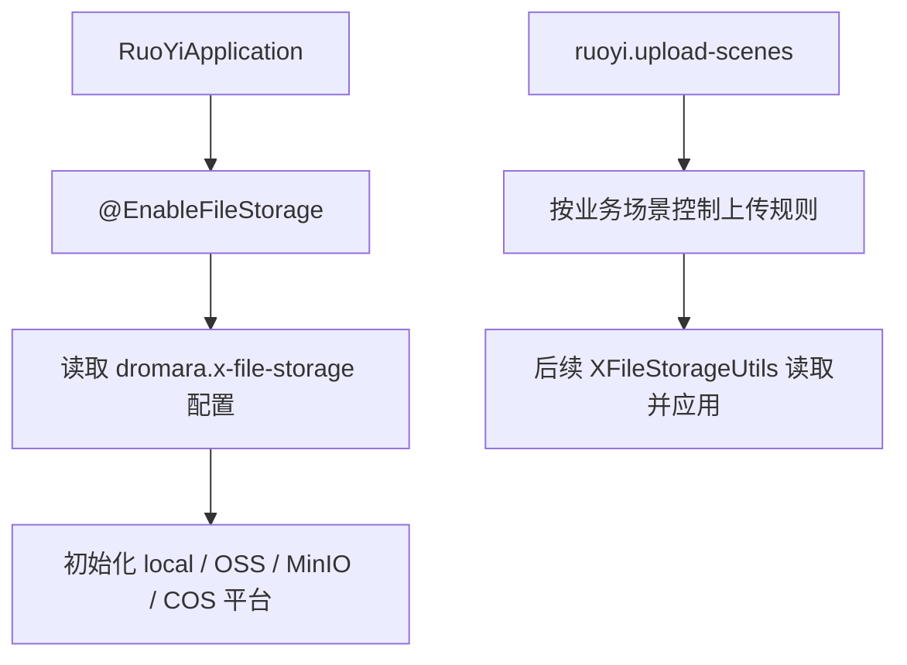

提交：

```
33a688ca 启用 x-file-storage 并增加存储基础配置
```

## 2. 涉及文件

- `ruoyi-admin/src/main/java/com/ruoyi/RuoYiApplication.java`
- `ruoyi-admin/src/main/resources/application.yml`

## 3. 改动点清单

- RuoYiApplication 增加启用 X File Storage 的注解
- application.yml 增加 dromara.x-file-storage 配置块
- 新增默认平台、平台列表、上传场景、缩略图后缀和访问策略配置

## 4. ruoyi-admin/src/main/java/com/ruoyi/RuoYiApplication.java

### 原代码

```java
package com.ruoyi;

import org.springframework.boot.SpringApplication;
import org.springframework.boot.autoconfigure.SpringBootApplication;
import org.springframework.boot.autoconfigure.jdbc.DataSourceAutoConfiguration;

/**
 * 启动程序
 * 
 * @author ruoyi
 */
@SpringBootApplication(exclude = { DataSourceAutoConfiguration.class })
public class RuoYiApplication
{
    public static void main(String[] args)
    {
        // System.setProperty("spring.devtools.restart.enabled", "false");
        SpringApplication.run(RuoYiApplication.class, args);
        System.out.println("(♥◠‿◠)ﾉﾞ  若依启动成功   ლ(´ڡ`ლ)ﾞ  \n" +
                " .-------.       ____     __        \n" +
                " |  _ _   \\      \\   \\   /  /    \n" +
                " | ( ' )  |       \\  _. /  '       \n" +
                " |(_ o _) /        _( )_ .'         \n" +
                " | (_,_).' __  ___(_ o _)'          \n" +
                " |  |\\ \\  |  ||   |(_,_)'         \n" +
                " |  | \\ `'   /|   `-'  /           \n" +
                " |  |  \\    /  \\      /           \n" +
                " ''-'   `'-'    `-..-'              ");
    }
}
```

### 现代码

```java
package com.ruoyi;

import org.dromara.x.file.storage.spring.EnableFileStorage;
import org.springframework.boot.SpringApplication;
import org.springframework.boot.autoconfigure.SpringBootApplication;
import org.springframework.boot.autoconfigure.jdbc.DataSourceAutoConfiguration;

/**
 * 启动程序
 * 
 * @author ruoyi
 */
@EnableFileStorage
@SpringBootApplication(exclude = { DataSourceAutoConfiguration.class })
public class RuoYiApplication
{
    public static void main(String[] args)
    {
        // System.setProperty("spring.devtools.restart.enabled", "false");
        SpringApplication.run(RuoYiApplication.class, args);
        System.out.println("(♥◠‿◠)ﾉﾞ  若依启动成功   ლ(´ڡ`ლ)ﾞ  \n" +
                " .-------.       ____     __        \n" +
                " |  _ _   \\      \\   \\   /  /    \n" +
                " | ( ' )  |       \\  _. /  '       \n" +
                " |(_ o _) /        _( )_ .'         \n" +
                " | (_,_).' __  ___(_ o _)'          \n" +
                " |  |\\ \\  |  ||   |(_,_)'         \n" +
                " |  | \\ `'   /|   `-'  /           \n" +
                " |  |  \\    /  \\      /           \n" +
                " ''-'   `'-'    `-..-'              ");
    }
}
```

### 涉及改动部分

#### 改动后代码 1

```java
// 省略
@EnableFileStorage
@SpringBootApplication(exclude = { DataSourceAutoConfiguration.class })
public class RuoYiApplication
{
// 省略
```

### 改动说明

- 启动类增加 `@EnableFileStorage`，让 X File Storage 的 Spring 自动配置生效
- 没有这个注解时，`FileStorageService` 不会按配置初始化，本地、OSS、MinIO、COS 平台都无法被统一上传工具使用

## 5. ruoyi-admin/src/main/resources/application.yml

### 原代码

```yaml
# 项目相关配置
ruoyi:
  # 名称
  name: RuoYi
  # 版本
  version: 3.9.2
  # 版权年份
  copyrightYear: 2026
  # 文件路径 示例（ Windows配置D:/ruoyi/uploadPath，Linux配置 /home/ruoyi/uploadPath）
  profile: D:/ruoyi/uploadPath
  # 获取ip地址开关
  addressEnabled: false
  # 验证码类型 math 数字计算 char 字符验证
  captchaType: math

# 开发环境配置
server:
  # 服务器的HTTP端口，默认为8080
  port: 8080
  servlet:
    # 应用的访问路径
    context-path: /
  tomcat:
    # tomcat的URI编码
    uri-encoding: UTF-8
    # 连接数满后的排队数，默认为100
    accept-count: 1000
    threads:
      # tomcat最大线程数，默认为200
      max: 800
      # Tomcat启动初始化的线程数，默认值10
      min-spare: 100

# 日志配置
logging:
  level:
    com.ruoyi: debug
    org.springframework: warn

# 用户配置
user:
  password:
    # 密码最大错误次数
    maxRetryCount: 5
    # 密码锁定时间（默认10分钟）
    lockTime: 10

# Spring配置
spring:
  # 资源信息
  messages:
    # 国际化资源文件路径
    basename: i18n/messages
  profiles:
    active: druid
  # 文件上传
  servlet:
    multipart:
      # 单个文件大小
      max-file-size: 10MB
      # 设置总上传的文件大小
      max-request-size: 20MB
  # 服务模块
  devtools:
    restart:
      # 热部署开关
      enabled: true
  data:
    # redis 配置
    redis:
      # 地址
      #      host: localhost
      host: 192.168.159.167
      # 端口，默认为6379
      port: 6379
      # 数据库索引
      database: 0
      # 密码
      password:
      # 连接超时时间
      timeout: 10s
      lettuce:
        pool:
          # 连接池中的最小空闲连接
          min-idle: 0
          # 连接池中的最大空闲连接
          max-idle: 8
          # 连接池的最大数据库连接数
          max-active: 8
          # #连接池最大阻塞等待时间（使用负值表示没有限制）
          max-wait: -1ms

# token配置
token:

# MyBatis Plus配置
mybatis-plus:
  # 搜索指定包别名
  typeAliasesPackage: com.ruoyi.**.domain
  # 配置mapper的扫描，找到所有的mapper.xml映射文件
  mapperLocations: classpath*:mapper/**/*Mapper.xml
  # 加载全局的配置文件
  configLocation: classpath:mybatis/mybatis-config.xml
  global-config:
    db-config:
      # 逻辑删除字段统一约定为del_flag / delFlag，MP方法按该配置自动追加未删除条件。
      logic-delete-field: delFlag
      logic-not-delete-value: 0
      logic-delete-value: 2

# PageHelper分页插件
pagehelper:
  helperDialect: mysql
  supportMethodsArguments: true
  params: count=countSql

# Springdoc配置
springdoc:
  api-docs:
    path: /v3/api-docs
  swagger-ui:
    enabled: true
    path: /swagger-ui.html
    # 使用相对地址兼容后端直连和前端/dev-api代理入口
    config-url: ./v3/api-docs/swagger-config
    tags-sorter: alpha
    urls:
      - name: '若依接口'
        # 分组地址保持相对避免前端iframe请求到localhost/v3/api-docs
        url: ./v3/api-docs/default
      - name: '系统管理'
        url: ./v3/api-docs/system
  group-configs:
    - group: 'default'
      display-name: '若依接口'
      paths-to-match: '/**'
      # 扫描后台Controller根包让Knife4j展示全部业务接口
      packages-to-scan: com.ruoyi.web.controller
    - group: 'system'
      display-name: '系统管理'
      paths-to-match: '/**'
      # 扫描后台Controller根包让Knife4j展示全部业务接口
      packages-to-scan: com.ruoyi.system.controller

# Knife4j配置
knife4j:
  # 开启Knife4j增强页面
  enable: true
  # 生产环境可通过环境变量关闭文档增强接口
  production: false
  # 基础认证默认关闭
  basic:
    # 需要文档密码时再开启
    enable: false
    username: ruoyi
    password: 123456
  setting:
    # 自定义左侧菜单中Schema的显示名称
    swagger-model-name: 实体类列表

# 防盗链配置
referer:
  # 防盗链开关
  enabled: false
  # 允许的域名列表
  allowed-domains: localhost,127.0.0.1,ruoyi.vip,www.ruoyi.vip

# 防止XSS攻击
xss:
  # 过滤开关
  enabled: true
  # 排除链接（多个用逗号分隔）
  excludes: /system/notice
  # 匹配链接
  urlPatterns: /system/*,/monitor/*,/tool/*
```

### 现代码

```yaml
# 项目相关配置
ruoyi:
  # 名称
  name: RuoYi
  # 版本
  version: 3.9.2
  # 版权年份
  copyrightYear: 2026
  # 文件路径 示例（ Windows配置D:/ruoyi/uploadPath，Linux配置 /home/ruoyi/uploadPath）
  profile: D:/ruoyi/uploadPath
  # 获取ip地址开关
  addressEnabled: false
  # 验证码类型 math 数字计算 char 字符验证
  captchaType: math
  # 通用上传场景配置
  upload-scenes:
    # 头像上传场景，前端传 uploadScene=avatar 时生效
    avatar:
      # 访问级别，public 表示可匿名访问，private 表示需要登录认证
      access: public
      # 场景路径前缀，最终路径形如 upload/public/avatar/yyyy/MM/dd/文件名
      path-prefix: avatar
      # 最大上传大小
      max-size: 5MB
      # 允许上传的扩展名，不带点号
      allowed-extension: png,jpg,jpeg
      # 是否生成缩略图
      thumbnail: true
      # 缩略图宽度
      thumbnail-width: 100
      # 缩略图高度
      thumbnail-height: 100
    # 图片上传场景，前端传 uploadScene=commonImg 时生效
    commonImg:
      # 公开图片允许匿名访问，适合富文本图片、封面图等业务
      access: public
      # 场景路径前缀，最终路径形如 upload/public/image/yyyy/MM/dd/文件名
      path-prefix: image
      # 最大上传大小
      max-size: 5MB
      # 允许上传的扩展名，不带点号
      allowed-extension: png,jpg,jpeg
      # 是否生成缩略图
      thumbnail: true
      # 缩略图宽度
      thumbnail-width: 100
      # 缩略图高度
      thumbnail-height: 100
    commonFile:
      # 普通附件默认私有访问，避免业务资料被匿名访问
      access: private
      # 场景路径前缀，最终路径形如 upload/private/file/yyyy/MM/dd/文件名
      path-prefix: file
      # 最大上传大小
      max-size: 5MB
      # 允许上传的扩展名，不带点号
      allowed-extension: doc,xls,ppt,txt,pdf
      # 是否生成缩略图
      thumbnail: false
    video:
      # 视频默认私有访问，需要公开时再改成 public 或单独走签名 URL
      access: private
      # 场景路径前缀，最终路径形如 upload/private/video/yyyy/MM/dd/文件名
      path-prefix: video
      max-size: 200MB
      allowed-extension: mp4,avi,rmvb
    audio:
      # 音频默认私有访问，需要公开时再改成 public 或单独走签名 URL
      access: private
      # 场景路径前缀，最终路径形如 upload/private/audio/yyyy/MM/dd/文件名
      path-prefix: audio
      max-size: 50MB
      allowed-extension: mp3,wav,wma,ogg
  # 存储文件管理配置
  storage-file:
    # 公开文件访问路径，匹配到的 GET 请求允许匿名访问
    public-path-patterns:
      # local-plus 的 domain 为 /file/，base-path 为 upload/，公开场景 path 第一层为 public
      - /file/upload/public/**
    # 临时文件超过该小时数仍未绑定业务时允许定时任务清理
    temp-expire-hours: 24
    # 未配置业务类型时使用的默认待删除延迟小时数
    default-delete-delay-hours: 24
    # 不同业务类型的待删除延迟小时数
    delete-delay-hours:
      # 头像旧文件延迟清理时间
      avatar: 24

# 开发环境配置
server:
  # 服务器的HTTP端口，默认为8080
  port: 8080
  servlet:
    # 应用的访问路径
    context-path: /
  tomcat:
    # tomcat的URI编码
    uri-encoding: UTF-8
    # 连接数满后的排队数，默认为100
    accept-count: 1000
    threads:
      # tomcat最大线程数，默认为200
      max: 800
      # Tomcat启动初始化的线程数，默认值10
      min-spare: 100

# 日志配置
logging:
  level:
    com.ruoyi: debug
    org.springframework: warn

# 用户配置
user:
  password:
    # 密码最大错误次数
    maxRetryCount: 5
    # 密码锁定时间（默认10分钟）
    lockTime: 10

# Spring配置
spring:
  # 资源信息
  messages:
    # 国际化资源文件路径
    basename: i18n/messages
  profiles:
    active: druid
  # 文件上传
  servlet:
    multipart:
      # 单个文件大小
      max-file-size: 10MB
      # 设置总上传的文件大小
      max-request-size: 20MB
  # 服务模块
  devtools:
    restart:
      # 热部署开关
      enabled: true
  data:
    # redis 配置
    redis:
      # 地址
      #      host: localhost
      host: 192.168.159.167
      # 端口，默认为6379
      port: 6379
      # 数据库索引
      database: 0
      # 密码
      password:
      # 连接超时时间
      timeout: 10s
      lettuce:
        pool:
          # 连接池中的最小空闲连接
          min-idle: 0
          # 连接池中的最大空闲连接
          max-idle: 8
          # 连接池的最大数据库连接数
          max-active: 8
          # #连接池最大阻塞等待时间（使用负值表示没有限制）
          max-wait: -1ms

# token配置
token:

# MyBatis Plus配置
mybatis-plus:
  # 搜索指定包别名
  typeAliasesPackage: com.ruoyi.**.domain
  # 配置mapper的扫描，找到所有的mapper.xml映射文件
  mapperLocations: classpath*:mapper/**/*Mapper.xml
  # 加载全局的配置文件
  configLocation: classpath:mybatis/mybatis-config.xml
  global-config:
    db-config:
      # 逻辑删除字段统一约定为del_flag / delFlag，MP方法按该配置自动追加未删除条件。
      logic-delete-field: delFlag
      logic-not-delete-value: 0
      logic-delete-value: 2

# PageHelper分页插件
pagehelper:
  helperDialect: mysql
  supportMethodsArguments: true
  params: count=countSql

# Springdoc配置
springdoc:
  api-docs:
    path: /v3/api-docs
  swagger-ui:
    enabled: true
    path: /swagger-ui.html
    # 使用相对地址兼容后端直连和前端/dev-api代理入口
    config-url: ./v3/api-docs/swagger-config
    tags-sorter: alpha
    urls:
      - name: '若依接口'
        # 分组地址保持相对避免前端iframe请求到localhost/v3/api-docs
        url: ./v3/api-docs/default
      - name: '系统管理'
        url: ./v3/api-docs/system
  group-configs:
    - group: 'default'
      display-name: '若依接口'
      paths-to-match: '/**'
      # 扫描后台Controller根包让Knife4j展示全部业务接口
      packages-to-scan: com.ruoyi.web.controller
    - group: 'system'
      display-name: '系统管理'
      paths-to-match: '/**'
      # 扫描后台Controller根包让Knife4j展示全部业务接口
      packages-to-scan: com.ruoyi.system.controller

# Knife4j配置
knife4j:
  # 开启Knife4j增强页面
  enable: true
  # 生产环境可通过环境变量关闭文档增强接口
  production: false
  # 基础认证默认关闭
  basic:
    # 需要文档密码时再开启
    enable: false
    username: ruoyi
    password: 123456
  setting:
    # 自定义左侧菜单中Schema的显示名称
    swagger-model-name: 实体类列表

# 防盗链配置
referer:
  # 防盗链开关
  enabled: false
  # 允许的域名列表
  allowed-domains: localhost,127.0.0.1,ruoyi.vip,www.ruoyi.vip

# 防止XSS攻击
xss:
  # 过滤开关
  enabled: true
  # 排除链接（多个用逗号分隔）
  excludes: /system/notice
  # 匹配链接
  urlPatterns: /system/*,/monitor/*,/tool/*

# 文件上传
dromara:
  # X File Storage 统一文件存储配置
  x-file-storage:
    # 默认使用的存储平台，不在接口参数中传 platform 时使用这个平台
    default-platform: local-1
    # 缩略图文件名后缀，生成缩略图时会追加到原文件名后面
    thumbnail-suffix: ".min.jpg"
    # 本地增强存储平台，适合开发环境或单机部署使用
    local-plus:
      # 平台标识，上传接口的 platform 参数可以传这个值指定上传到本地
      - platform: local-1
        # 是否允许把文件上传并保存到该平台
        enable-storage: true
        # 是否开启本地文件访问映射，开启后可通过 domain 加文件路径直接访问
        enable-access: true
        # 访问域名，生产环境建议改成实际域名，并保持以 /file/ 结尾
        domain: http://localhost:${server.port}/file/
        # 存储基础路径，会作为文件对象路径的统一前缀
        base-path: upload/
        # 本地访问映射路径，enable-access 为 true 时用于匹配文件访问请求
        path-patterns:
          - /file/**
        # 本地文件实际存储目录，文件会落到这个磁盘目录下
        storage-path: ${ruoyi.profile}/x-file-storage/
    # 阿里云 OSS 存储平台，适合生产环境对象存储
    aliyun-oss:
      # 平台标识，上传接口的 platform 参数可以传这个值指定上传到阿里云 OSS
      - platform: aliyun-oss-1
        # 是否允许把文件上传并保存到该平台
        enable-storage: true
        # 阿里云 OSS AccessKey ID，建议生产环境使用环境变量或配置中心托管
        access-key: ??
        # 阿里云 OSS AccessKey Secret，建议不要提交真实密钥到代码仓库
        secret-key: ??
        # OSS 访问端点，例如 oss-cn-hangzhou.aliyuncs.com
        end-point: ??
        # OSS Bucket 名称
        bucket-name: ??
        # 文件访问域名，注意以 / 结尾，可以使用 Bucket 域名或自定义 CDN 域名
        domain: ??
        # OSS 对象基础路径，用于把当前系统文件放到固定目录前缀下
        base-path: ruoyi-images/
    # MinIO 存储平台，适合私有化部署或自建对象存储
    minio:
      # 平台标识，上传接口的 platform 参数可以传这个值指定上传到 MinIO
      - platform: minio-1
        # 是否允许把文件上传并保存到该平台
        enable-storage: true
        # MinIO AccessKey
        access-key: ??
        # MinIO SecretKey
        secret-key: ??
        # MinIO 服务端点，例如 http://127.0.0.1:9000
        end-point: ??
        # MinIO Bucket 名称
        bucket-name: ??
        # 文件访问域名，注意以 / 结尾，通常是 MinIO 公网地址或反向代理地址
        domain: ??
        # MinIO 对象基础路径，用于区分当前系统上传文件
        base-path: test/
    tencent-cos:
#      - platform: tencent-cos-1 # 存储平台标识
#        enable-storage: true  # 启用存储
#        secret-id: ??
#        secret-key: ??
#        region: ?? #存仓库所在地域
#        bucket-name: ??
#        domain: ?? # 访问域名，注意“/”结尾，例如：https://abc.cos.ap-nanjing.myqcloud.com/
#        base-path: test/ # 基础路径
      - platform: tencent-cos-1 # 存储平台标识
        enable-storage: true  # 启用存储
        secret-id: ${TENCENT_COS_SECRET_ID:??}
        secret-key: ${TENCENT_COS_SECRET_KEY:??}
        region: ${TENCENT_COS_REGION:ap-shanghai} #存仓库所在地域
        bucket-name: ${TENCENT_COS_BUCKET_NAME:??}
        domain: ${TENCENT_COS_DOMAIN:??} # COS 默认访问域名，自定义域名需先在腾讯云完成绑定、证书和回源配置
        base-path: ${TENCENT_COS_BASE_PATH:test/} # 基础路径
```

### 涉及改动部分

#### 改动后代码 1

```yaml
# 省略
  addressEnabled: false
  captchaType: math
  upload-scenes:
    avatar:
      access: public
      path-prefix: avatar
      max-size: 5MB
      allowed-extension: png,jpg,jpeg
      thumbnail: true
      thumbnail-width: 100
      thumbnail-height: 100
    commonImg:
      access: public
      path-prefix: image
      max-size: 5MB
      allowed-extension: png,jpg,jpeg
      thumbnail: true
      thumbnail-width: 100
      thumbnail-height: 100
    commonFile:
      access: private
      path-prefix: file
      max-size: 5MB
      allowed-extension: doc,xls,ppt,txt,pdf
      thumbnail: false
    video:
      access: private
      path-prefix: video
      max-size: 200MB
      allowed-extension: mp4,avi,rmvb
    audio:
      access: private
      path-prefix: audio
      max-size: 50MB
      allowed-extension: mp3,wav,wma,ogg
  storage-file:
    public-path-patterns:
      - /file/upload/public/**
    temp-expire-hours: 24
    default-delete-delay-hours: 24
    delete-delay-hours:
      avatar: 24
server:
# 省略
```

#### 改动后代码 2

```yaml
# 省略
  excludes: /system/notice
  urlPatterns: /system/*,/monitor/*,/tool/*
dromara:
  x-file-storage:
    default-platform: local-1
    thumbnail-suffix: ".min.jpg"
    local-plus:
      - platform: local-1
        enable-storage: true
        enable-access: true
        domain: http://localhost:${server.port}/file/
        base-path: upload/
        path-patterns:
          - /file/**
        storage-path: ${ruoyi.profile}/x-file-storage/
    aliyun-oss:
      - platform: aliyun-oss-1
        enable-storage: true
        access-key: ??
        secret-key: ??
        end-point: ??
        bucket-name: ??
        domain: ??
        base-path: ruoyi-images/
    minio:
      - platform: minio-1
        enable-storage: true
        access-key: ??
        secret-key: ??
        end-point: ??
        bucket-name: ??
        domain: ??
        base-path: test/
    tencent-cos:
      - platform: tencent-cos-1 # 存储平台标识
        enable-storage: true  # 启用存储
        secret-id: ${TENCENT_COS_SECRET_ID:??}
        secret-key: ${TENCENT_COS_SECRET_KEY:??}
        region: ${TENCENT_COS_REGION:ap-shanghai} #存仓库所在地域
        bucket-name: ${TENCENT_COS_BUCKET_NAME:??}
        domain: ${TENCENT_COS_DOMAIN:??} # COS 默认访问域名，自定义域名需先在腾讯云完成绑定、证书和回源配置
        base-path: ${TENCENT_COS_BASE_PATH:test/} # 基础路径
# 省略
```

### 改动说明

- 新增 `dromara.x-file-storage` 配置块，集中声明默认平台、本地存储、阿里云 OSS、MinIO、腾讯云 COS
- 新增 `ruoyi.upload-scenes`，通过场景控制路径、大小、格式、缩略图和访问策略
- 新增 `ruoyi.storage-file`，给文件访问和清理任务提供基础配置

## 变更小结

本篇只记录该提交自身涉及的代码和配置变化，不混入其它提交。

---

## 原文：doc/03-增强上传文件校验.md

# 增强上传文件校验

## 1. 改造目标

本篇文档对应一次独立 git 提交，用原代码和现代码对比说明本次改造。

核心目标：

- 补充文件后缀和真实文件类型校验
- 增强图片真实性校验，避免伪装扩展名绕过上传限制
- 补充通用文件类型白名单，给上传场景复用

## 改造前存在的问题

- 若依原上传校验主要依赖文件大小和扩展名，无法识别 txt 改 jpg 这类伪装图片
- 文件大小限制不方便按业务场景动态调整
- 图片内容不合法和后缀不合法共用相近提示，前端和用户不容易判断真实原因

## 改造后的解决方案

- 增加真实图片内容校验，图片扩展名通过后继续用 `ImageIO` 判断内容是否有效
- 增加可传入最大大小的校验方法，后续上传场景可以覆盖默认大小
- 增加图片内容异常，让后缀错误和真实内容错误分开提示

## 总体链路

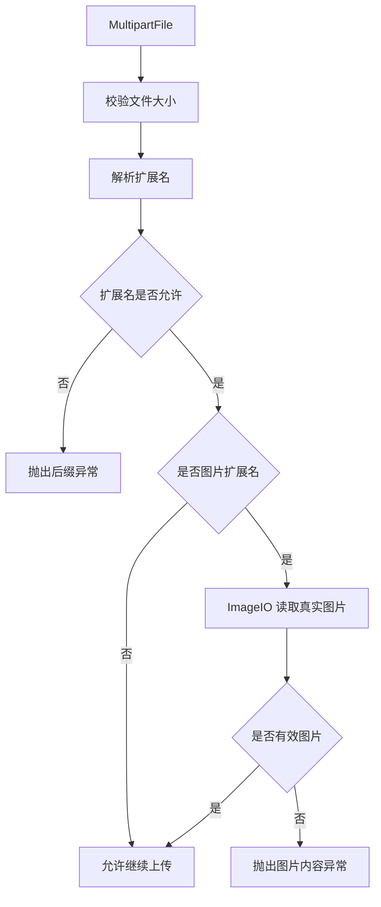

提交：

```
203dd6da 增强上传文件校验
```

## 2. 涉及文件

- `ruoyi-common/src/main/java/com/ruoyi/common/exception/file/InvalidExtensionException.java`
- `ruoyi-common/src/main/java/com/ruoyi/common/utils/file/FileTypeUtils.java`
- `ruoyi-common/src/main/java/com/ruoyi/common/utils/file/FileUploadUtils.java`
- `ruoyi-common/src/main/java/com/ruoyi/common/utils/file/FileUtils.java`
- `ruoyi-common/src/main/java/com/ruoyi/common/utils/file/ImageUtils.java`
- `ruoyi-common/src/main/java/com/ruoyi/common/utils/file/MimeTypeUtils.java`

## 3. 改动点清单

- InvalidExtensionException 增加真实文件类型不匹配异常
- FileTypeUtils 增加文件真实类型识别
- FileUploadUtils 上传流程增加真实图片校验
- FileUtils、ImageUtils、MimeTypeUtils 补充安全校验支撑方法和白名单

## 4. ruoyi-common/src/main/java/com/ruoyi/common/exception/file/InvalidExtensionException.java

### 原代码

```java
package com.ruoyi.common.exception.file;

import java.util.Arrays;

/**
 * 文件上传无效扩展名异常类
 * 
 * @author ruoyi
 */
public class InvalidExtensionException extends FileUploadException
{
    private static final long serialVersionUID = 1L;

    private String[] allowedExtension;
    private String extension;
    private String filename;

    public InvalidExtensionException(String[] allowedExtension, String extension, String filename)
    {
        super("文件[" + filename + "]后缀[" + extension + "]不正确，请上传" + Arrays.toString(allowedExtension) + "格式");
        this.allowedExtension = allowedExtension;
        this.extension = extension;
        this.filename = filename;
    }

    public String[] getAllowedExtension()
    {
        return allowedExtension;
    }

    public String getExtension()
    {
        return extension;
    }

    public String getFilename()
    {
        return filename;
    }

    public static class InvalidImageExtensionException extends InvalidExtensionException
    {
        private static final long serialVersionUID = 1L;

        public InvalidImageExtensionException(String[] allowedExtension, String extension, String filename)
        {
            super(allowedExtension, extension, filename);
        }
    }

    public static class InvalidFlashExtensionException extends InvalidExtensionException
    {
        private static final long serialVersionUID = 1L;

        public InvalidFlashExtensionException(String[] allowedExtension, String extension, String filename)
        {
            super(allowedExtension, extension, filename);
        }
    }

    public static class InvalidMediaExtensionException extends InvalidExtensionException
    {
        private static final long serialVersionUID = 1L;

        public InvalidMediaExtensionException(String[] allowedExtension, String extension, String filename)
        {
            super(allowedExtension, extension, filename);
        }
    }

    public static class InvalidVideoExtensionException extends InvalidExtensionException
    {
        private static final long serialVersionUID = 1L;

        public InvalidVideoExtensionException(String[] allowedExtension, String extension, String filename)
        {
            super(allowedExtension, extension, filename);
        }
    }
}
```

### 现代码

```java
package com.ruoyi.common.exception.file;

import java.util.Arrays;

/**
 * 文件上传无效扩展名异常类
 * 
 * @author ruoyi
 */
public class InvalidExtensionException extends FileUploadException
{
    private static final long serialVersionUID = 1L;

    private String[] allowedExtension;
    private String extension;
    private String filename;

    public InvalidExtensionException(String[] allowedExtension, String extension, String filename)
    {
        super("文件[" + filename + "]后缀[" + extension + "]不正确，请上传" + Arrays.toString(allowedExtension) + "格式");
        this.allowedExtension = allowedExtension;
        this.extension = extension;
        this.filename = filename;
    }

    public InvalidExtensionException(String message, String[] allowedExtension, String extension, String filename)
    {
        super(message);
        this.allowedExtension = allowedExtension;
        this.extension = extension;
        this.filename = filename;
    }

    public String[] getAllowedExtension()
    {
        return allowedExtension;
    }

    public String getExtension()
    {
        return extension;
    }

    public String getFilename()
    {
        return filename;
    }

    public static class InvalidImageExtensionException extends InvalidExtensionException
    {
        private static final long serialVersionUID = 1L;

        public InvalidImageExtensionException(String[] allowedExtension, String extension, String filename)
        {
            super("图片文件[" + filename + "]后缀[" + extension + "]不正确，请上传" + Arrays.toString(allowedExtension) + "格式图片",
                    allowedExtension, extension, filename);
        }
    }

    public static class InvalidImageContentException extends InvalidExtensionException
    {
        private static final long serialVersionUID = 1L;

        public InvalidImageContentException(String[] allowedExtension, String extension, String filename)
        {
            super("文件[" + filename + "]内容不是有效图片，请上传真实的" + Arrays.toString(allowedExtension) + "格式图片",
                    allowedExtension, extension, filename);
        }
    }

    public static class InvalidFlashExtensionException extends InvalidExtensionException
    {
        private static final long serialVersionUID = 1L;

        public InvalidFlashExtensionException(String[] allowedExtension, String extension, String filename)
        {
            super(allowedExtension, extension, filename);
        }
    }

    public static class InvalidMediaExtensionException extends InvalidExtensionException
    {
        private static final long serialVersionUID = 1L;

        public InvalidMediaExtensionException(String[] allowedExtension, String extension, String filename)
        {
            super(allowedExtension, extension, filename);
        }
    }

    public static class InvalidVideoExtensionException extends InvalidExtensionException
    {
        private static final long serialVersionUID = 1L;

        public InvalidVideoExtensionException(String[] allowedExtension, String extension, String filename)
        {
            super(allowedExtension, extension, filename);
        }
    }
}
```

### 涉及改动部分

#### 改动后代码 1

```java
// 省略
        this.filename = filename;
    }
    public InvalidExtensionException(String message, String[] allowedExtension, String extension, String filename)
    {
        super(message);
        this.allowedExtension = allowedExtension;
        this.extension = extension;
        this.filename = filename;
    }
    public String[] getAllowedExtension()
    {
        return allowedExtension;
// 省略
```

#### 改动后代码 2

```java
// 省略
        public InvalidImageExtensionException(String[] allowedExtension, String extension, String filename)
        {
            super("图片文件[" + filename + "]后缀[" + extension + "]不正确，请上传" + Arrays.toString(allowedExtension) + "格式图片",
                    allowedExtension, extension, filename);
        }
    }
    public static class InvalidImageContentException extends InvalidExtensionException
    {
        private static final long serialVersionUID = 1L;
        public InvalidImageContentException(String[] allowedExtension, String extension, String filename)
        {
            super("文件[" + filename + "]内容不是有效图片，请上传真实的" + Arrays.toString(allowedExtension) + "格式图片",
                    allowedExtension, extension, filename);
        }
    }
// 省略
```

### 改动说明

- 增加可传入自定义错误消息的构造方法，方便区分“后缀不合法”和“真实内容不合法”
- 图片后缀错误使用图片专用提示
- 新增 `InvalidImageContentException`，专门表示扩展名是图片但内容不是有效图片

## 5. ruoyi-common/src/main/java/com/ruoyi/common/utils/file/FileTypeUtils.java

### 原代码

```java
package com.ruoyi.common.utils.file;

import java.io.File;
import org.apache.commons.lang3.StringUtils;

/**
 * 文件类型工具类
 *
 * @author ruoyi
 */
public class FileTypeUtils
{
    /**
     * 获取文件类型
     * <p>
     * 例如: ruoyi.txt, 返回: txt
     * 
     * @param file 文件名
     * @return 后缀（不含".")
     */
    public static String getFileType(File file)
    {
        if (null == file)
        {
            return StringUtils.EMPTY;
        }
        return getFileType(file.getName());
    }

    /**
     * 获取文件类型
     * <p>
     * 例如: ruoyi.txt, 返回: txt
     *
     * @param fileName 文件名
     * @return 后缀（不含".")
     */
    public static String getFileType(String fileName)
    {
        int separatorIndex = fileName.lastIndexOf(".");
        if (separatorIndex < 0)
        {
            return "";
        }
        return fileName.substring(separatorIndex + 1).toLowerCase();
    }

    /**
     * 获取文件类型
     * 
     * @param photoByte 文件字节码
     * @return 后缀（不含".")
     */
    public static String getFileExtendName(byte[] photoByte)
    {
        String strFileExtendName = "JPG";
        if ((photoByte[0] == 71) && (photoByte[1] == 73) && (photoByte[2] == 70) && (photoByte[3] == 56)
                && ((photoByte[4] == 55) || (photoByte[4] == 57)) && (photoByte[5] == 97))
        {
            strFileExtendName = "GIF";
        }
        else if ((photoByte[6] == 74) && (photoByte[7] == 70) && (photoByte[8] == 73) && (photoByte[9] == 70))
        {
            strFileExtendName = "JPG";
        }
        else if ((photoByte[0] == 66) && (photoByte[1] == 77))
        {
            strFileExtendName = "BMP";
        }
        else if ((photoByte[1] == 80) && (photoByte[2] == 78) && (photoByte[3] == 71))
        {
            strFileExtendName = "PNG";
        }
        return strFileExtendName;
    }
}
```

### 现代码

```java
package com.ruoyi.common.utils.file;

import java.io.File;
import org.apache.commons.lang3.StringUtils;

/**
 * 文件类型工具类
 * <p>
 * 该工具只根据文件扩展名或少量常见图片文件头判断类型，不做完整 MIME 检测
 * 接收用户上传文件时，仍需要结合上传白名单进行校验
 *
 * @author ruoyi
 */
public class FileTypeUtils
{
    /**
     * 从 File 对象中获取小写扩展名
     *
     * @param file 目标文件，为 null 时返回空字符串
     * @return 不带点号的扩展名，例如 txt
     */
    public static String getFileType(File file)
    {
        // 空文件对象直接返回空扩展名，避免调用 getName 触发空指针
        if (null == file)
        {
            return StringUtils.EMPTY;
        }
        // File 场景最终仍复用文件名解析逻辑
        return getFileType(file.getName());
    }

    /**
     * 从文件名或路径中获取小写扩展名
     * <p>
     * 例如 ruoyi.txt 返回 txt；没有点号的文件名返回空字符串，便于白名单校验拒绝
     *
     * @param fileName 文件名或资源路径
     * @return 不带点号的扩展名
     */
    public static String getFileType(String fileName)
    {
        // 取最后一个点号，兼容 a.b.txt 这类文件名
        int separatorIndex = fileName.lastIndexOf(".");
        if (separatorIndex < 0)
        {
            // 没有扩展名时返回空字符串，让白名单校验自然失败
            return "";
        }
        // 白名单比较不区分大小写，这里先统一转成小写
        return fileName.substring(separatorIndex + 1).toLowerCase();
    }

    /**
     * 根据图片文件头猜测扩展名
     * <p>
     * 当前覆盖 GIF、JPG/JFIF、BMP、PNG
     * 默认返回 JPG，主要用于图片字节写入类场景
     *
     * @param photoByte 图片字节，调用方需要保证至少包含文件头所需长度
     * @return 大写扩展名，例如 JPG、PNG
     */
    public static String getFileExtendName(byte[] photoByte)
    {
        // 默认按 JPG 处理，保持若依原有兜底行为
        String strFileExtendName = "JPG";
        // GIF 文件头通常以 GIF87a 或 GIF89a 开头
        if ((photoByte[0] == 71) && (photoByte[1] == 73) && (photoByte[2] == 70) && (photoByte[3] == 56)
                && ((photoByte[4] == 55) || (photoByte[4] == 57)) && (photoByte[5] == 97))
        {
            strFileExtendName = "GIF";
        }
        // JFIF 是常见 JPEG 文件头片段
        else if ((photoByte[6] == 74) && (photoByte[7] == 70) && (photoByte[8] == 73) && (photoByte[9] == 70))
        {
            strFileExtendName = "JPG";
        }
        // BMP 文件头以 BM 开头
        else if ((photoByte[0] == 66) && (photoByte[1] == 77))
        {
            strFileExtendName = "BMP";
        }
        // PNG 文件头中包含 PNG 标识
        else if ((photoByte[1] == 80) && (photoByte[2] == 78) && (photoByte[3] == 71))
        {
            strFileExtendName = "PNG";
        }
        return strFileExtendName;
    }
}
```

### 涉及改动部分

#### 改动后代码 1

```java
// 省略
public class FileTypeUtils
{
    public static String getFileType(File file)
    {
        if (null == file)
        {
            return StringUtils.EMPTY;
        }
        return getFileType(file.getName());
    }
    public static String getFileType(String fileName)
    {
        int separatorIndex = fileName.lastIndexOf(".");
        if (separatorIndex < 0)
        {
            return "";
        }
        return fileName.substring(separatorIndex + 1).toLowerCase();
    }
    public static String getFileExtendName(byte[] photoByte)
    {
        String strFileExtendName = "JPG";
        if ((photoByte[0] == 71) && (photoByte[1] == 73) && (photoByte[2] == 70) && (photoByte[3] == 56)
                && ((photoByte[4] == 55) || (photoByte[4] == 57)) && (photoByte[5] == 97))
        {
            strFileExtendName = "GIF";
        }
        else if ((photoByte[6] == 74) && (photoByte[7] == 70) && (photoByte[8] == 73) && (photoByte[9] == 70))
        {
            strFileExtendName = "JPG";
        }
        else if ((photoByte[0] == 66) && (photoByte[1] == 77))
        {
            strFileExtendName = "BMP";
        }
        else if ((photoByte[1] == 80) && (photoByte[2] == 78) && (photoByte[3] == 71))
        {
            strFileExtendName = "PNG";
        }
        return strFileExtendName;
    }
}
// 省略
```

### 改动说明

- 增加文件真实类型识别能力，后续可根据文件头或内容类型辅助判断文件合法性
- 工具类只负责识别，不直接决定业务是否允许上传

## 6. ruoyi-common/src/main/java/com/ruoyi/common/utils/file/FileUploadUtils.java

### 原代码

```java
package com.ruoyi.common.utils.file;

import java.io.File;
import java.io.IOException;
import java.nio.file.Paths;
import java.util.Objects;
import org.apache.commons.io.FilenameUtils;
import org.springframework.web.multipart.MultipartFile;
import com.ruoyi.common.config.RuoYiConfig;
import com.ruoyi.common.constant.Constants;
import com.ruoyi.common.exception.file.FileNameLengthLimitExceededException;
import com.ruoyi.common.exception.file.FileSizeLimitExceededException;
import com.ruoyi.common.exception.file.InvalidExtensionException;
import com.ruoyi.common.utils.DateUtils;
import com.ruoyi.common.utils.StringUtils;
import com.ruoyi.common.utils.uuid.IdUtils;
import com.ruoyi.common.utils.uuid.Seq;

/**
 * 文件上传工具类
 * 
 * @author ruoyi
 */
public class FileUploadUtils
{
    /**
     * 默认大小 50M
     */
    public static final long DEFAULT_MAX_SIZE = 50 * 1024 * 1024L;

    /**
     * 默认的文件名最大长度 100
     */
    public static final int DEFAULT_FILE_NAME_LENGTH = 100;

    /**
     * 默认上传的地址
     */
    private static String defaultBaseDir = RuoYiConfig.getProfile();

    public static void setDefaultBaseDir(String defaultBaseDir)
    {
        FileUploadUtils.defaultBaseDir = defaultBaseDir;
    }

    public static String getDefaultBaseDir()
    {
        return defaultBaseDir;
    }

    /**
     * 以默认配置进行文件上传
     *
     * @param file 上传的文件
     * @return 文件名称
     * @throws Exception
     */
    public static final String upload(MultipartFile file) throws IOException
    {
        try
        {
            return upload(getDefaultBaseDir(), file, MimeTypeUtils.DEFAULT_ALLOWED_EXTENSION);
        }
        catch (Exception e)
        {
            throw new IOException(e.getMessage(), e);
        }
    }

    /**
     * 根据文件路径上传
     *
     * @param baseDir 相对应用的基目录
     * @param file 上传的文件
     * @return 文件名称
     * @throws IOException
     */
    public static final String upload(String baseDir, MultipartFile file) throws IOException
    {
        try
        {
            return upload(baseDir, file, MimeTypeUtils.DEFAULT_ALLOWED_EXTENSION);
        }
        catch (Exception e)
        {
            throw new IOException(e.getMessage(), e);
        }
    }

    /**
     * 文件上传
     *
     * @param baseDir 相对应用的基目录
     * @param file 上传的文件
     * @param allowedExtension 上传文件类型
     * @return 返回上传成功的文件名
     * @throws FileSizeLimitExceededException 如果超出最大大小
     * @throws FileNameLengthLimitExceededException 文件名太长
     * @throws IOException 比如读写文件出错时
     * @throws InvalidExtensionException 文件校验异常
     */
    public static final String upload(String baseDir, MultipartFile file, String[] allowedExtension)
            throws FileSizeLimitExceededException, IOException, FileNameLengthLimitExceededException,
            InvalidExtensionException
    {
        return upload(baseDir, file, allowedExtension, false);
    }
    
    /**
     * 文件上传
     *
     * @param baseDir 相对应用的基目录
     * @param file 上传的文件
     * @param useCustomNaming 系统自定义文件名
     * @param allowedExtension 上传文件类型
     * @return 返回上传成功的文件名
     * @throws FileSizeLimitExceededException 如果超出最大大小
     * @throws FileNameLengthLimitExceededException 文件名太长
     * @throws IOException 比如读写文件出错时
     * @throws InvalidExtensionException 文件校验异常
     */
    public static final String upload(String baseDir, MultipartFile file, String[] allowedExtension, boolean useCustomNaming)
            throws FileSizeLimitExceededException, IOException, FileNameLengthLimitExceededException,
            InvalidExtensionException
    {
        int fileNameLength = Objects.requireNonNull(file.getOriginalFilename()).length();
        if (fileNameLength > FileUploadUtils.DEFAULT_FILE_NAME_LENGTH)
        {
            throw new FileNameLengthLimitExceededException(FileUploadUtils.DEFAULT_FILE_NAME_LENGTH);
        }

        assertAllowed(file, allowedExtension);

        String fileName = useCustomNaming ? uuidFilename(file) : extractFilename(file);

        String absPath = getAbsoluteFile(baseDir, fileName).getAbsolutePath();
        file.transferTo(Paths.get(absPath));
        return getPathFileName(baseDir, fileName);
    }

    /**
     * 编码文件名(日期格式目录 + 原文件名 + 序列值 + 后缀)
     */
    public static final String extractFilename(MultipartFile file)
    {
        return StringUtils.format("{}/{}_{}.{}", DateUtils.datePath(), FilenameUtils.getBaseName(file.getOriginalFilename()), Seq.getId(Seq.uploadSeqType), getExtension(file));
    }

    /**
     * 编编码文件名(日期格式目录 + UUID + 后缀)
     */
    public static final String uuidFilename(MultipartFile file)
    {
        return StringUtils.format("{}/{}.{}", DateUtils.datePath(), IdUtils.fastSimpleUUID(), getExtension(file));
    }

    public static final File getAbsoluteFile(String uploadDir, String fileName) throws IOException
    {
        File desc = new File(uploadDir + File.separator + fileName);

        if (!desc.exists())
        {
            if (!desc.getParentFile().exists())
            {
                desc.getParentFile().mkdirs();
            }
        }
        return desc;
    }

    public static final String getPathFileName(String uploadDir, String fileName) throws IOException
    {
        int dirLastIndex = RuoYiConfig.getProfile().length() + 1;
        String currentDir = StringUtils.substring(uploadDir, dirLastIndex);
        return Constants.RESOURCE_PREFIX + "/" + currentDir + "/" + fileName;
    }

    /**
     * 文件大小校验
     *
     * @param file 上传的文件
     * @return
     * @throws FileSizeLimitExceededException 如果超出最大大小
     * @throws InvalidExtensionException
     */
    public static final void assertAllowed(MultipartFile file, String[] allowedExtension)
            throws FileSizeLimitExceededException, InvalidExtensionException
    {
        long size = file.getSize();
        if (size > DEFAULT_MAX_SIZE)
        {
            throw new FileSizeLimitExceededException(DEFAULT_MAX_SIZE / 1024 / 1024);
        }

        String fileName = file.getOriginalFilename();
        String extension = getExtension(file);
        if (allowedExtension != null && !isAllowedExtension(extension, allowedExtension))
        {
            if (allowedExtension == MimeTypeUtils.IMAGE_EXTENSION)
            {
                throw new InvalidExtensionException.InvalidImageExtensionException(allowedExtension, extension,
                        fileName);
            }
            else if (allowedExtension == MimeTypeUtils.FLASH_EXTENSION)
            {
                throw new InvalidExtensionException.InvalidFlashExtensionException(allowedExtension, extension,
                        fileName);
            }
            else if (allowedExtension == MimeTypeUtils.MEDIA_EXTENSION)
            {
                throw new InvalidExtensionException.InvalidMediaExtensionException(allowedExtension, extension,
                        fileName);
            }
            else if (allowedExtension == MimeTypeUtils.VIDEO_EXTENSION)
            {
                throw new InvalidExtensionException.InvalidVideoExtensionException(allowedExtension, extension,
                        fileName);
            }
            else
            {
                throw new InvalidExtensionException(allowedExtension, extension, fileName);
            }
        }
    }

    /**
     * 判断MIME类型是否是允许的MIME类型
     *
     * @param extension
     * @param allowedExtension
     * @return
     */
    public static final boolean isAllowedExtension(String extension, String[] allowedExtension)
    {
        for (String str : allowedExtension)
        {
            if (str.equalsIgnoreCase(extension))
            {
                return true;
            }
        }
        return false;
    }

    /**
     * 获取文件名的后缀
     * 
     * @param file 表单文件
     * @return 后缀名
     */
    public static final String getExtension(MultipartFile file)
    {
        String extension = FilenameUtils.getExtension(file.getOriginalFilename());
        if (StringUtils.isEmpty(extension))
        {
            extension = MimeTypeUtils.getExtension(Objects.requireNonNull(file.getContentType()));
        }
        return extension;
    }
}
```

### 现代码

```java
package com.ruoyi.common.utils.file;

import java.io.File;
import java.io.IOException;
import java.nio.file.Paths;
import java.util.Objects;
import javax.imageio.ImageIO;
import org.apache.commons.io.FilenameUtils;
import org.springframework.web.multipart.MultipartFile;
import com.ruoyi.common.config.RuoYiConfig;
import com.ruoyi.common.constant.Constants;
import com.ruoyi.common.exception.file.FileNameLengthLimitExceededException;
import com.ruoyi.common.exception.file.FileSizeLimitExceededException;
import com.ruoyi.common.exception.file.InvalidExtensionException;
import com.ruoyi.common.utils.DateUtils;
import com.ruoyi.common.utils.StringUtils;
import com.ruoyi.common.utils.uuid.IdUtils;
import com.ruoyi.common.utils.uuid.Seq;

/**
 * 本地文件上传工具类
 * <p>
 * 这是若依原有的本地磁盘上传实现。当前通用上传已经改由 {@link XFileStorageUtils}
 * 接入 X File Storage，但本类仍用于上传校验、文件命名、本地导入导出文件
 * 历史 /profile 路径处理等场景
 *
 * @author ruoyi
 */
public class FileUploadUtils
{
    /**
     * 默认最大上传大小：50MB
     */
    public static final long DEFAULT_MAX_SIZE = 50 * 1024 * 1024L;

    /**
     * 原始文件名允许的最大长度
     */
    public static final int DEFAULT_FILE_NAME_LENGTH = 100;

    /**
     * 默认本地上传根目录
     * <p>
     * 默认指向 ruoyi.profile；测试或自定义模块可以通过 {@link #setDefaultBaseDir(String)} 覆盖
     */
    private static String defaultBaseDir = RuoYiConfig.getProfile();

    /**
     * 设置默认本地上传根目录
     *
     * @param defaultBaseDir 绝对路径形式的上传根目录
     */
    public static void setDefaultBaseDir(String defaultBaseDir)
    {
        // 覆盖静态根目录，主要服务测试或特殊本地上传场景
        FileUploadUtils.defaultBaseDir = defaultBaseDir;
    }

    /**
     * 获取当前默认本地上传根目录
     *
     * @return 绝对路径形式的上传根目录
     */
    public static String getDefaultBaseDir()
    {
        // 返回当前生效的本地上传根目录
        return defaultBaseDir;
    }

    /**
     * 按默认本地根目录上传文件
     *
     * @param file 前端提交的 Multipart 文件
     * @return 若依资源路径，例如 /profile/upload/yyyy/MM/dd/xxx.png
     * @throws IOException 校验失败或本地写入失败时抛出
     */
    public static final String upload(MultipartFile file) throws IOException
    {
        try
        {
            // 未指定目录时使用 ruoyi.profile 作为本地上传根目录
            return upload(getDefaultBaseDir(), file, MimeTypeUtils.DEFAULT_ALLOWED_EXTENSION);
        }
        catch (Exception e)
        {
            // 保持若依原方法签名，把校验异常包装为 IOException 向上抛出
            throw new IOException(e.getMessage(), e);
        }
    }

    /**
     * 按指定本地根目录上传文件，并使用默认扩展名白名单
     *
     * @param baseDir 绝对路径形式的本地上传根目录
     * @param file 前端提交的 Multipart 文件
     * @return 若依资源路径
     * @throws IOException 校验失败或本地写入失败时抛出
     */
    public static final String upload(String baseDir, MultipartFile file) throws IOException
    {
        try
        {
            // 指定目录但未指定白名单时使用通用上传白名单
            return upload(baseDir, file, MimeTypeUtils.DEFAULT_ALLOWED_EXTENSION);
        }
        catch (Exception e)
        {
            // 保持若依原方法签名，把校验异常包装为 IOException 向上抛出
            throw new IOException(e.getMessage(), e);
        }
    }

    /**
     * 按指定扩展名白名单上传文件到本地磁盘
     *
     * @param baseDir 绝对路径形式的本地上传根目录
     * @param file 前端提交的 Multipart 文件
     * @param allowedExtension 允许的扩展名数组，不带点号
     * @return 若依资源路径
     * @throws FileSizeLimitExceededException 文件超过默认大小限制时抛出
     * @throws FileNameLengthLimitExceededException 原始文件名过长时抛出
     * @throws IOException 本地写入失败时抛出
     * @throws InvalidExtensionException 扩展名不在白名单内时抛出
     */
    public static final String upload(String baseDir, MultipartFile file, String[] allowedExtension)
            throws FileSizeLimitExceededException, IOException, FileNameLengthLimitExceededException,
            InvalidExtensionException
    {
        // 默认使用若依原命名策略，保留原文件名主体并追加序列号
        return upload(baseDir, file, allowedExtension, false);
    }

    /**
     * 上传文件到本地磁盘，并指定命名策略
     *
     * @param baseDir 绝对路径形式的本地上传根目录
     * @param file 前端提交的 Multipart 文件
     * @param allowedExtension 允许的扩展名数组，不带点号
     * @param useCustomNaming true 表示使用 UUID 文件名，false 表示保留原文件名主体并追加序列号
     * @return 若依资源路径
     * @throws FileSizeLimitExceededException 文件超过默认大小限制时抛出
     * @throws FileNameLengthLimitExceededException 原始文件名过长时抛出
     * @throws IOException 本地写入失败时抛出
     * @throws InvalidExtensionException 扩展名不在白名单内时抛出
     */
    public static final String upload(String baseDir, MultipartFile file, String[] allowedExtension, boolean useCustomNaming)
            throws FileSizeLimitExceededException, IOException, FileNameLengthLimitExceededException,
            InvalidExtensionException
    {
        // 原始文件名必须存在，并且长度不能超过系统限制
        int fileNameLength = Objects.requireNonNull(file.getOriginalFilename()).length();
        if (fileNameLength > FileUploadUtils.DEFAULT_FILE_NAME_LENGTH)
        {
            throw new FileNameLengthLimitExceededException(FileUploadUtils.DEFAULT_FILE_NAME_LENGTH);
        }

        // 先校验大小和扩展名，避免非法文件落盘
        assertAllowed(file, allowedExtension);

        // 根据调用方选择决定使用 UUID 命名还是若依原命名
        String fileName = useCustomNaming ? uuidFilename(file) : extractFilename(file);

        // 解析真实落盘路径，并确保父目录已经创建
        String absPath = getAbsoluteFile(baseDir, fileName).getAbsolutePath();
        // MultipartFile 写入本地文件系统
        file.transferTo(Paths.get(absPath));
        // 返回前端可保存的 /profile 资源路径
        return getPathFileName(baseDir, fileName);
    }

    /**
     * 生成默认本地上传文件名
     * <p>
     * 格式为 yyyy/MM/dd/原文件名主体_序列号.扩展名
     * 序列号用于降低重名概率，同时保留原文件名可读性
     *
     * @param file 前端提交的 Multipart 文件
     * @return 上传目录下的相对路径和文件名
     */
    public static final String extractFilename(MultipartFile file)
    {
        // 日期目录便于按天归档，序列号降低同名文件覆盖风险
        return StringUtils.format("{}/{}_{}.{}", DateUtils.datePath(), FilenameUtils.getBaseName(file.getOriginalFilename()), Seq.getId(Seq.uploadSeqType), getExtension(file));
    }

    /**
     * 生成 UUID 文件名
     * <p>
     * 格式为 yyyy/MM/dd/uuid.扩展名
     * XFileStorageUtils 也复用该方法，让远程对象名称和本地头像命名规则保持一致
     *
     * @param file 前端提交的 Multipart 文件
     * @return 上传目录下的相对路径和 UUID 文件名
     */
    public static final String uuidFilename(MultipartFile file)
    {
        // UUID 文件名避免暴露原始文件名，也降低对象存储中的重名风险
        return StringUtils.format("{}/{}.{}", DateUtils.datePath(), IdUtils.fastSimpleUUID(), getExtension(file));
    }

    /**
     * 将上传目录和相对文件名解析成本地绝对文件，并创建父目录
     *
     * @param uploadDir 绝对路径形式的上传根目录
     * @param fileName 上传根目录下的相对路径和文件名
     * @return 目标文件对象
     * @throws IOException 路径解析失败时抛出
     */
    public static final File getAbsoluteFile(String uploadDir, String fileName) throws IOException
    {
        // uploadDir 是绝对根目录，fileName 是日期目录加文件名
        File desc = new File(uploadDir + File.separator + fileName);

        if (!desc.exists())
        {
            // 目标文件不存在时先确保父目录存在
            if (!desc.getParentFile().exists())
            {
                // mkdirs 可一次性创建 yyyy/MM/dd 多级目录
                desc.getParentFile().mkdirs();
            }
        }
        return desc;
    }

    /**
     * 将本地上传文件路径转换成若依公开的 /profile 资源路径
     *
     * @param uploadDir 绝对路径形式的上传目录，通常是 ruoyi.profile 的子目录
     * @param fileName uploadDir 下的相对文件名
     * @return 前端可保存和访问的资源路径
     * @throws IOException 保留若依原方法签名
     */
    public static final String getPathFileName(String uploadDir, String fileName) throws IOException
    {
        // ruoyi.profile 后面的目录部分会作为 /profile 的二级路径
        int dirLastIndex = RuoYiConfig.getProfile().length() + 1;
        String currentDir = StringUtils.substring(uploadDir, dirLastIndex);
        // 拼成前端可访问和可保存的若依资源地址
        return Constants.RESOURCE_PREFIX + "/" + currentDir + "/" + fileName;
    }

    /**
     * 校验上传文件大小和扩展名
     *
     * @param file 前端提交的 Multipart 文件
     * @param allowedExtension 允许的扩展名数组，不带点号；为 null 时不校验扩展名
     * @throws FileSizeLimitExceededException 文件超过默认大小限制时抛出
     * @throws InvalidExtensionException 扩展名不在白名单内时抛出
     */
    public static final void assertAllowed(MultipartFile file, String[] allowedExtension)
            throws FileSizeLimitExceededException, InvalidExtensionException
    {
        // 未指定场景大小时使用若依默认 50MB 限制
        assertAllowed(file, allowedExtension, DEFAULT_MAX_SIZE);
    }

    /**
     * 校验上传文件大小和扩展名
     *
     * @param file 前端提交的 Multipart 文件
     * @param allowedExtension 允许的扩展名数组，不带点号；为 null 时不校验扩展名
     * @param maxSize 最大上传大小，单位字节
     * @throws FileSizeLimitExceededException 文件超过最大大小限制时抛出
     * @throws InvalidExtensionException 扩展名不在白名单内时抛出
     */
    public static final void assertAllowed(MultipartFile file, String[] allowedExtension, long maxSize)
            throws FileSizeLimitExceededException, InvalidExtensionException
    {
        // 超过当前场景允许大小时直接拒绝上传
        long size = file.getSize();
        if (size > maxSize)
        {
            throw new FileSizeLimitExceededException(toMb(maxSize));
        }

        // 扩展名优先来自原始文件名，没有扩展名时按 Content-Type 兜底
        String fileName = file.getOriginalFilename();
        String extension = getExtension(file);
        // allowedExtension 为 null 时仅校验大小，不校验扩展名
        if (allowedExtension != null && !isAllowedExtension(extension, allowedExtension))
        {
            // 图片白名单失败时抛出图片专用异常，前端提示更准确
            if (allowedExtension == MimeTypeUtils.IMAGE_EXTENSION)
            {
                throw new InvalidExtensionException.InvalidImageExtensionException(allowedExtension, extension,
                        fileName);
            }
            // Flash 白名单失败时保留若依原异常类型
            else if (allowedExtension == MimeTypeUtils.FLASH_EXTENSION)
            {
                throw new InvalidExtensionException.InvalidFlashExtensionException(allowedExtension, extension,
                        fileName);
            }
            // 媒体白名单失败时保留若依原异常类型
            else if (allowedExtension == MimeTypeUtils.MEDIA_EXTENSION)
            {
                throw new InvalidExtensionException.InvalidMediaExtensionException(allowedExtension, extension,
                        fileName);
            }
            // 视频白名单失败时保留若依原异常类型
            else if (allowedExtension == MimeTypeUtils.VIDEO_EXTENSION)
            {
                throw new InvalidExtensionException.InvalidVideoExtensionException(allowedExtension, extension,
                        fileName);
            }
            else
            {
                // 其它白名单使用通用非法扩展名异常
                throw new InvalidExtensionException(allowedExtension, extension, fileName);
            }
        }

        // 扩展名通过后只对图片做真实内容校验，PDF、音频、视频等普通文件不走 ImageIO
        assertRealImage(file, extension, allowedExtension);
    }

    /**
     * 将字节数转换为向上取整的 MB
     *
     * @param size 文件大小，单位字节
     * @return 文件大小，单位 MB
     */
    private static long toMb(long size)
    {
        // 异常消息按 MB 展示，非整 MB 时向上取整避免提示偏小
        return (size + 1024 * 1024 - 1) / 1024 / 1024;
    }

    /**
     * 判断扩展名是否在允许列表中
     *
     * @param extension 不带点号的扩展名
     * @param allowedExtension 允许的扩展名数组，不带点号
     * @return true 表示允许，不区分大小写
     */
    public static final boolean isAllowedExtension(String extension, String[] allowedExtension)
    {
        // 遍历白名单并忽略大小写，兼容 JPG、Png 等用户上传文件名
        for (String str : allowedExtension)
        {
            if (str.equalsIgnoreCase(extension))
            {
                // 命中任意一个白名单扩展名即可通过
                return true;
            }
        }
        // 遍历结束仍未命中则拒绝
        return false;
    }

    /**
     * 获取上传文件扩展名
     * <p>
     * 优先使用原始文件名中的扩展名；原始文件名没有扩展名时，再根据 Content-Type 兜底推断
     *
     * @param file 前端提交的 Multipart 文件
     * @return 不带点号的扩展名
     */
    public static final String getExtension(MultipartFile file)
    {
        // 先从原始文件名提取扩展名
        String extension = FilenameUtils.getExtension(file.getOriginalFilename());
        if (StringUtils.isEmpty(extension))
        {
            // 原始文件名没有扩展名时，根据 Content-Type 做图片类型兜底
            extension = MimeTypeUtils.getExtension(Objects.requireNonNull(file.getContentType()));
        }
        return extension;
    }

    /**
     * 校验图片文件真实内容
     *
     * @param file 前端提交的 Multipart 文件
     * @param extension 不带点号的扩展名
     * @param allowedExtension 允许的扩展名数组，不带点号
     * @throws InvalidExtensionException 图片扩展名与真实内容不匹配时抛出
     */
    private static void assertRealImage(MultipartFile file, String extension, String[] allowedExtension)
            throws InvalidExtensionException
    {
        // 非图片文件直接跳过真实图片校验，避免 PDF、音频、视频等文件被 ImageIO 误处理
        if (!shouldAssertRealImage(extension, allowedExtension))
        {
            return;
        }
        try
        {
            // ImageIO 能成功解析图片头时才认为是真实图片
            if (ImageIO.read(file.getInputStream()) == null)
            {
                // 扩展名已经通过白名单，但内容无法按图片解码时提示真实图片错误
                throw new InvalidExtensionException.InvalidImageContentException(allowedExtension, extension,
                        file.getOriginalFilename());
            }
        }
        catch (IOException e)
        {
            // 图片流读取异常按非法图片处理，避免损坏文件或伪造文件继续上传
            throw new InvalidExtensionException.InvalidImageContentException(allowedExtension, extension,
                    file.getOriginalFilename());
        }
    }

    /**
     * 判断当前文件是否需要做真实图片校验
     *
     * @param extension 不带点号的扩展名
     * @param allowedExtension 允许的扩展名数组，不带点号
     * @return true 表示需要按图片内容读取校验
     */
    private static boolean shouldAssertRealImage(String extension, String[] allowedExtension)
    {
        // 没有扩展名白名单时不做真实图片校验，保持原有宽松调用方式
        if (allowedExtension == null)
        {
            return false;
        }
        // 只有当前上传文件本身是图片扩展名时才需要读取图片头
        return isAllowedExtension(extension, MimeTypeUtils.IMAGE_EXTENSION);
    }

}
```

### 涉及改动部分

#### 改动后代码 1

```java
// 省略
import com.ruoyi.common.utils.uuid.Seq;
public class FileUploadUtils
{
    public static final long DEFAULT_MAX_SIZE = 50 * 1024 * 1024L;
    public static final int DEFAULT_FILE_NAME_LENGTH = 100;
    private static String defaultBaseDir = RuoYiConfig.getProfile();
    public static void setDefaultBaseDir(String defaultBaseDir)
    {
        FileUploadUtils.defaultBaseDir = defaultBaseDir;
    }
    public static String getDefaultBaseDir()
    {
        return defaultBaseDir;
    }
    public static final String upload(MultipartFile file) throws IOException
    {
        try
        {
            return upload(getDefaultBaseDir(), file, MimeTypeUtils.DEFAULT_ALLOWED_EXTENSION);
        }
        catch (Exception e)
        {
            throw new IOException(e.getMessage(), e);
        }
    }
    public static final String upload(String baseDir, MultipartFile file) throws IOException
    {
        try
        {
            return upload(baseDir, file, MimeTypeUtils.DEFAULT_ALLOWED_EXTENSION);
        }
        catch (Exception e)
        {
            throw new IOException(e.getMessage(), e);
        }
    }
    public static final String upload(String baseDir, MultipartFile file, String[] allowedExtension)
            throws FileSizeLimitExceededException, IOException, FileNameLengthLimitExceededException,
            InvalidExtensionException
    {
        return upload(baseDir, file, allowedExtension, false);
    }
    public static final String upload(String baseDir, MultipartFile file, String[] allowedExtension, boolean useCustomNaming)
            throws FileSizeLimitExceededException, IOException, FileNameLengthLimitExceededException,
            InvalidExtensionException
    {
        int fileNameLength = Objects.requireNonNull(file.getOriginalFilename()).length();
        if (fileNameLength > FileUploadUtils.DEFAULT_FILE_NAME_LENGTH)
        {
            throw new FileNameLengthLimitExceededException(FileUploadUtils.DEFAULT_FILE_NAME_LENGTH);
        }
        assertAllowed(file, allowedExtension);
        String fileName = useCustomNaming ? uuidFilename(file) : extractFilename(file);
        String absPath = getAbsoluteFile(baseDir, fileName).getAbsolutePath();
        file.transferTo(Paths.get(absPath));
        return getPathFileName(baseDir, fileName);
    }
    public static final String extractFilename(MultipartFile file)
    {
        return StringUtils.format("{}/{}_{}.{}", DateUtils.datePath(), FilenameUtils.getBaseName(file.getOriginalFilename()), Seq.getId(Seq.uploadSeqType), getExtension(file));
    }
    public static final String uuidFilename(MultipartFile file)
    {
        return StringUtils.format("{}/{}.{}", DateUtils.datePath(), IdUtils.fastSimpleUUID(), getExtension(file));
    }
    public static final File getAbsoluteFile(String uploadDir, String fileName) throws IOException
    {
        File desc = new File(uploadDir + File.separator + fileName);
        if (!desc.exists())
        {
            if (!desc.getParentFile().exists())
            {
                desc.getParentFile().mkdirs();
            }
        }
        return desc;
    }
    public static final String getPathFileName(String uploadDir, String fileName) throws IOException
    {
        int dirLastIndex = RuoYiConfig.getProfile().length() + 1;
        String currentDir = StringUtils.substring(uploadDir, dirLastIndex);
        return Constants.RESOURCE_PREFIX + "/" + currentDir + "/" + fileName;
    }
    public static final void assertAllowed(MultipartFile file, String[] allowedExtension)
            throws FileSizeLimitExceededException, InvalidExtensionException
    {
        assertAllowed(file, allowedExtension, DEFAULT_MAX_SIZE);
    }
    public static final void assertAllowed(MultipartFile file, String[] allowedExtension, long maxSize)
            throws FileSizeLimitExceededException, InvalidExtensionException
    {
        long size = file.getSize();
        if (size > maxSize)
        {
            throw new FileSizeLimitExceededException(toMb(maxSize));
        }
        String fileName = file.getOriginalFilename();
        String extension = getExtension(file);
        if (allowedExtension != null && !isAllowedExtension(extension, allowedExtension))
        {
            if (allowedExtension == MimeTypeUtils.IMAGE_EXTENSION)
            {
                throw new InvalidExtensionException.InvalidImageExtensionException(allowedExtension, extension,
                        fileName);
            }
            else if (allowedExtension == MimeTypeUtils.FLASH_EXTENSION)
            {
                throw new InvalidExtensionException.InvalidFlashExtensionException(allowedExtension, extension,
                        fileName);
            }
            else if (allowedExtension == MimeTypeUtils.MEDIA_EXTENSION)
            {
                throw new InvalidExtensionException.InvalidMediaExtensionException(allowedExtension, extension,
                        fileName);
            }
            else if (allowedExtension == MimeTypeUtils.VIDEO_EXTENSION)
            {
                throw new InvalidExtensionException.InvalidVideoExtensionException(allowedExtension, extension,
// 省略
```

#### 改动后代码 2

```java
// 省略
            }
            else
            {
                throw new InvalidExtensionException(allowedExtension, extension, fileName);
            }
        }
        assertRealImage(file, extension, allowedExtension);
    }
    private static long toMb(long size)
    {
        return (size + 1024 * 1024 - 1) / 1024 / 1024;
    }
    public static final boolean isAllowedExtension(String extension, String[] allowedExtension)
    {
        for (String str : allowedExtension)
        {
            if (str.equalsIgnoreCase(extension))
            {
                return true;
            }
        }
        return false;
    }
    public static final String getExtension(MultipartFile file)
    {
        String extension = FilenameUtils.getExtension(file.getOriginalFilename());
        if (StringUtils.isEmpty(extension))
        {
            extension = MimeTypeUtils.getExtension(Objects.requireNonNull(file.getContentType()));
        }
        return extension;
    }
    private static void assertRealImage(MultipartFile file, String extension, String[] allowedExtension)
            throws InvalidExtensionException
    {
        if (!shouldAssertRealImage(extension, allowedExtension))
        {
            return;
        }
        try
        {
            if (ImageIO.read(file.getInputStream()) == null)
            {
                throw new InvalidExtensionException.InvalidImageContentException(allowedExtension, extension,
                        file.getOriginalFilename());
            }
        }
        catch (IOException e)
        {
            throw new InvalidExtensionException.InvalidImageContentException(allowedExtension, extension,
                    file.getOriginalFilename());
        }
    }
    private static boolean shouldAssertRealImage(String extension, String[] allowedExtension)
    {
        if (allowedExtension == null)
        {
            return false;
        }
        return isAllowedExtension(extension, MimeTypeUtils.IMAGE_EXTENSION);
    }
}
// 省略
```

### 改动说明

- 上传校验增加 `maxSize` 参数，支持按上传场景覆盖大小限制
- 扩展名校验通过后，如果当前文件属于图片白名单，再进入真实图片校验
- 非图片文件不会走 `ImageIO` 解码，避免 PDF、音频、视频被误判

## 7. ruoyi-common/src/main/java/com/ruoyi/common/utils/file/FileUtils.java

### 原代码

```java
package com.ruoyi.common.utils.file;

import java.io.File;
import java.io.FileInputStream;
import java.io.FileNotFoundException;
import java.io.FileOutputStream;
import java.io.IOException;
import java.io.OutputStream;
import java.io.UnsupportedEncodingException;
import java.net.URLEncoder;
import java.nio.charset.StandardCharsets;
import jakarta.servlet.http.HttpServletRequest;
import jakarta.servlet.http.HttpServletResponse;
import org.apache.commons.io.FilenameUtils;
import org.apache.commons.io.IOUtils;
import org.apache.commons.lang3.ArrayUtils;
import com.ruoyi.common.config.RuoYiConfig;
import com.ruoyi.common.constant.Constants;
import com.ruoyi.common.utils.DateUtils;
import com.ruoyi.common.utils.StringUtils;
import com.ruoyi.common.utils.uuid.IdUtils;

/**
 * 文件处理工具类
 * 
 * @author ruoyi
 */
public class FileUtils
{
    public static String FILENAME_PATTERN = "[a-zA-Z0-9_\\-\\|\\.\\u4e00-\\u9fa5]+";

    /**
     * 输出指定文件的byte数组
     * 
     * @param filePath 文件路径
     * @param os 输出流
     * @return
     */
    public static void writeBytes(String filePath, OutputStream os) throws IOException
    {
        FileInputStream fis = null;
        try
        {
            File file = new File(filePath);
            if (!file.exists())
            {
                throw new FileNotFoundException(filePath);
            }
            fis = new FileInputStream(file);
            byte[] b = new byte[1024];
            int length;
            while ((length = fis.read(b)) > 0)
            {
                os.write(b, 0, length);
            }
        }
        catch (IOException e)
        {
            throw e;
        }
        finally
        {
            IOUtils.close(os);
            IOUtils.close(fis);
        }
    }

    /**
     * 写数据到文件中
     *
     * @param data 数据
     * @return 目标文件
     * @throws IOException IO异常
     */
    public static String writeImportBytes(byte[] data) throws IOException
    {
        return writeBytes(data, RuoYiConfig.getImportPath());
    }

    /**
     * 写数据到文件中
     *
     * @param data 数据
     * @param uploadDir 目标文件
     * @return 目标文件
     * @throws IOException IO异常
     */
    public static String writeBytes(byte[] data, String uploadDir) throws IOException
    {
        FileOutputStream fos = null;
        String pathName = "";
        try
        {
            String extension = getFileExtendName(data);
            pathName = DateUtils.datePath() + "/" + IdUtils.fastUUID() + "." + extension;
            File file = FileUploadUtils.getAbsoluteFile(uploadDir, pathName);
            fos = new FileOutputStream(file);
            fos.write(data);
        }
        finally
        {
            IOUtils.close(fos);
        }
        return FileUploadUtils.getPathFileName(uploadDir, pathName);
    }

    /**
     * 移除路径中的请求前缀片段
     * 
     * @param filePath 文件路径
     * @return 移除后的文件路径
     */
    public static String stripPrefix(String filePath)
    {
        return StringUtils.substringAfter(filePath, Constants.RESOURCE_PREFIX);
    }

    /**
     * 删除文件
     * 
     * @param filePath 文件
     * @return
     */
    public static boolean deleteFile(String filePath)
    {
        boolean flag = false;
        File file = new File(filePath);
        // 路径为文件且不为空则进行删除
        if (file.isFile() && file.exists())
        {
            flag = file.delete();
        }
        return flag;
    }

    /**
     * 文件名称验证
     * 
     * @param filename 文件名称
     * @return true 正常 false 非法
     */
    public static boolean isValidFilename(String filename)
    {
        return filename.matches(FILENAME_PATTERN);
    }

    /**
     * 检查文件是否可下载
     * 
     * @param resource 需要下载的文件
     * @return true 正常 false 非法
     */
    public static boolean checkAllowDownload(String resource)
    {
        // 禁止目录上跳级别
        if (StringUtils.contains(resource, ".."))
        {
            return false;
        }

        // 检查允许下载的文件规则
        if (ArrayUtils.contains(MimeTypeUtils.DEFAULT_ALLOWED_EXTENSION, FileTypeUtils.getFileType(resource)))
        {
            return true;
        }

        // 不在允许下载的文件规则
        return false;
    }

    /**
     * 下载文件名重新编码
     * 
     * @param request 请求对象
     * @param fileName 文件名
     * @return 编码后的文件名
     */
    public static String setFileDownloadHeader(HttpServletRequest request, String fileName) throws UnsupportedEncodingException
    {
        final String agent = request.getHeader("USER-AGENT");
        String filename = fileName;
        if (agent.contains("MSIE"))
        {
            // IE浏览器
            filename = URLEncoder.encode(filename, "utf-8");
            filename = filename.replace("+", " ");
        }
        else if (agent.contains("Firefox"))
        {
            // 火狐浏览器
            filename = new String(fileName.getBytes(), "ISO8859-1");
        }
        else if (agent.contains("Chrome"))
        {
            // google浏览器
            filename = URLEncoder.encode(filename, "utf-8");
        }
        else
        {
            // 其它浏览器
            filename = URLEncoder.encode(filename, "utf-8");
        }
        return filename;
    }

    /**
     * 下载文件名重新编码
     *
     * @param response 响应对象
     * @param realFileName 真实文件名
     */
    public static void setAttachmentResponseHeader(HttpServletResponse response, String realFileName) throws UnsupportedEncodingException
    {
        String percentEncodedFileName = percentEncode(realFileName);

        StringBuilder contentDispositionValue = new StringBuilder();
        contentDispositionValue.append("attachment; filename=")
                .append(percentEncodedFileName)
                .append(";")
                .append("filename*=")
                .append("utf-8''")
                .append(percentEncodedFileName);

        response.addHeader("Access-Control-Expose-Headers", "Content-Disposition,download-filename");
        response.setHeader("Content-disposition", contentDispositionValue.toString());
        response.setHeader("download-filename", percentEncodedFileName);
    }

    /**
     * 百分号编码工具方法
     *
     * @param s 需要百分号编码的字符串
     * @return 百分号编码后的字符串
     */
    public static String percentEncode(String s) throws UnsupportedEncodingException
    {
        String encode = URLEncoder.encode(s, StandardCharsets.UTF_8.toString());
        return encode.replaceAll("\\+", "%20");
    }

    /**
     * 获取图像后缀
     * 
     * @param photoByte 图像数据
     * @return 后缀名
     */
    public static String getFileExtendName(byte[] photoByte)
    {
        String strFileExtendName = "jpg";
        if ((photoByte[0] == 71) && (photoByte[1] == 73) && (photoByte[2] == 70) && (photoByte[3] == 56)
                && ((photoByte[4] == 55) || (photoByte[4] == 57)) && (photoByte[5] == 97))
        {
            strFileExtendName = "gif";
        }
        else if ((photoByte[6] == 74) && (photoByte[7] == 70) && (photoByte[8] == 73) && (photoByte[9] == 70))
        {
            strFileExtendName = "jpg";
        }
        else if ((photoByte[0] == 66) && (photoByte[1] == 77))
        {
            strFileExtendName = "bmp";
        }
        else if ((photoByte[1] == 80) && (photoByte[2] == 78) && (photoByte[3] == 71))
        {
            strFileExtendName = "png";
        }
        return strFileExtendName;
    }

    /**
     * 获取文件名称 /profile/upload/2022/04/16/ruoyi.png -- ruoyi.png
     * 
     * @param fileName 路径名称
     * @return 没有文件路径的名称
     */
    public static String getName(String fileName)
    {
        if (fileName == null)
        {
            return null;
        }
        int lastUnixPos = fileName.lastIndexOf('/');
        int lastWindowsPos = fileName.lastIndexOf('\\');
        int index = Math.max(lastUnixPos, lastWindowsPos);
        return fileName.substring(index + 1);
    }

    /**
     * 获取不带后缀文件名称 /profile/upload/2022/04/16/ruoyi.png -- ruoyi
     * 
     * @param fileName 路径名称
     * @return 没有文件路径和后缀的名称
     */
    public static String getNameNotSuffix(String fileName)
    {
        if (fileName == null)
        {
            return null;
        }
        String baseName = FilenameUtils.getBaseName(fileName);
        return baseName;
    }
}
```

### 现代码

```java
package com.ruoyi.common.utils.file;

import java.io.File;
import java.io.FileInputStream;
import java.io.FileNotFoundException;
import java.io.FileOutputStream;
import java.io.IOException;
import java.io.OutputStream;
import java.io.UnsupportedEncodingException;
import java.net.URLEncoder;
import java.nio.charset.StandardCharsets;
import jakarta.servlet.http.HttpServletRequest;
import jakarta.servlet.http.HttpServletResponse;
import org.apache.commons.io.FilenameUtils;
import org.apache.commons.io.IOUtils;
import org.apache.commons.lang3.ArrayUtils;
import com.ruoyi.common.config.RuoYiConfig;
import com.ruoyi.common.constant.Constants;
import com.ruoyi.common.utils.DateUtils;
import com.ruoyi.common.utils.StringUtils;
import com.ruoyi.common.utils.uuid.IdUtils;

/**
 * 文件处理工具类
 * <p>
 * 本类主要面向本地文件和若依 /profile 资源路径。对象存储上传会通过
 * X File Storage 返回远程 URL；历史本地资源、导入导出临时文件仍继续使用本工具
 *
 * @author ruoyi
 */
public class FileUtils
{
    /**
     * 简单文件名允许的字符范围
     * <p>
     * 该规则故意保持较窄范围，不包含路径分隔符，用于降低路径注入风险
     */
    public static String FILENAME_PATTERN = "[a-zA-Z0-9_\\-\\|\\.\\u4e00-\\u9fa5]+";

    /**
     * 将本地文件写入输出流
     * <p>
     * 该方法会在 finally 中关闭输出流，保持若依原有下载接口行为
     *
     * @param filePath 本地绝对文件路径
     * @param os 目标输出流
     * @throws IOException 文件不存在或写出失败时抛出
     */
    public static void writeBytes(String filePath, OutputStream os) throws IOException
    {
        FileInputStream fis = null;
        try
        {
            // 根据绝对路径定位本地文件
            File file = new File(filePath);
            if (!file.exists())
            {
                // 文件不存在时直接抛出异常，由调用方统一记录下载失败
                throw new FileNotFoundException(filePath);
            }
            // 使用文件输入流分块读取，避免一次性加载大文件
            fis = new FileInputStream(file);
            byte[] b = new byte[1024];
            int length;
            while ((length = fis.read(b)) > 0)
            {
                // 每次只写入本轮实际读取的字节数
                os.write(b, 0, length);
            }
        }
        catch (IOException e)
        {
            throw e;
        }
        finally
        {
            // 若依原逻辑会关闭响应输出流和文件输入流
            IOUtils.close(os);
            IOUtils.close(fis);
        }
    }

    /**
     * 将字节内容写入配置的导入目录
     *
     * @param data 文件字节
     * @return 写入后的 /profile 资源路径
     * @throws IOException 写入失败时抛出
     */
    public static String writeImportBytes(byte[] data) throws IOException
    {
        // 导入场景统一写入 ruoyi.profile/import 目录
        return writeBytes(data, RuoYiConfig.getImportPath());
    }

    /**
     * 将字节内容写入指定本地上传目录
     * <p>
     * 文件名使用日期目录 + UUID + 根据文件头推断的扩展名
     *
     * @param data 文件字节
     * @param uploadDir 本地绝对上传目录
     * @return 写入后的 /profile 资源路径
     * @throws IOException 写入失败时抛出
     */
    public static String writeBytes(byte[] data, String uploadDir) throws IOException
    {
        FileOutputStream fos = null;
        String pathName = "";
        try
        {
            // 根据文件头推断扩展名，常用于图片字节写入
            String extension = getFileExtendName(data);
            // 日期目录加 UUID 文件名，降低目录过大和文件重名风险
            pathName = DateUtils.datePath() + "/" + IdUtils.fastUUID() + "." + extension;
            // 获取真实文件对象并创建父目录
            File file = FileUploadUtils.getAbsoluteFile(uploadDir, pathName);
            fos = new FileOutputStream(file);
            // 将字节数组完整写入本地文件
            fos.write(data);
        }
        finally
        {
            // 写入完成后关闭文件输出流
            IOUtils.close(fos);
        }
        // 返回若依 /profile 资源路径
        return FileUploadUtils.getPathFileName(uploadDir, pathName);
    }

    /**
     * 移除资源路径中的 /profile 前缀
     *
     * @param filePath 资源路径，例如 /profile/avatar/a.png
     * @return 去掉 /profile 后的路径
     */
    public static String stripPrefix(String filePath)
    {
        // substringAfter 会返回 /profile 之后的相对路径
        return StringUtils.substringAfter(filePath, Constants.RESOURCE_PREFIX);
    }

    /**
     * 删除本地文件
     *
     * @param filePath 本地绝对文件路径
     * @return true 表示删除成功
     */
    public static boolean deleteFile(String filePath)
    {
        boolean flag = false;
        File file = new File(filePath);
        // 只删除普通文件，目录或不存在的路径直接忽略
        if (file.isFile() && file.exists())
        {
            // 删除结果由 File.delete 返回，调用方可据此判断是否成功
            flag = file.delete();
        }
        return flag;
    }

    /**
     * 校验简单文件名是否合法
     *
     * @param filename 不包含路径分隔符的文件名
     * @return true 表示文件名合法
     */
    public static boolean isValidFilename(String filename)
    {
        // 仅允许预设字符范围，不允许路径分隔符
        return filename.matches(FILENAME_PATTERN);
    }

    /**
     * 检查请求的资源是否允许下载
     * <p>
     * 这里会阻止路径穿越，并且只允许 {@link MimeTypeUtils#DEFAULT_ALLOWED_EXTENSION}
     * 白名单中的扩展名
     *
     * @param resource 客户端请求的资源路径或文件名
     * @return true 表示通过基础安全检查
     */
    public static boolean checkAllowDownload(String resource)
    {
        // 阻止 ../secret.txt 这类目录穿越路径
        if (StringUtils.contains(resource, ".."))
        {
            return false;
        }

        // 下载扩展名复用通用上传白名单
        if (ArrayUtils.contains(MimeTypeUtils.DEFAULT_ALLOWED_EXTENSION, FileTypeUtils.getFileType(resource)))
        {
            return true;
        }

        // 未命中白名单的文件不允许下载
        return false;
    }

    /**
     * 按浏览器类型编码下载文件名
     *
     * @param request 当前请求对象
     * @param fileName 原始文件名
     * @return 编码后的文件名
     * @throws UnsupportedEncodingException 编码不支持时抛出
     */
    public static String setFileDownloadHeader(HttpServletRequest request, String fileName) throws UnsupportedEncodingException
    {
        // 读取 User-Agent，用于兼容不同浏览器的文件名编码差异
        final String agent = request.getHeader("USER-AGENT");
        String filename = fileName;
        if (agent.contains("MSIE"))
        {
            // IE 使用 URL 编码并把加号还原为空格
            filename = URLEncoder.encode(filename, "utf-8");
            filename = filename.replace("+", " ");
        }
        else if (agent.contains("Firefox"))
        {
            // Firefox 走 ISO8859-1 字节转换逻辑
            filename = new String(fileName.getBytes(), "ISO8859-1");
        }
        else if (agent.contains("Chrome"))
        {
            // Chrome 使用 UTF-8 URL 编码
            filename = URLEncoder.encode(filename, "utf-8");
        }
        else
        {
            // 其它浏览器按通用 UTF-8 URL 编码处理
            filename = URLEncoder.encode(filename, "utf-8");
        }
        return filename;
    }

    /**
     * 设置附件下载响应头
     * <p>
     * 同时暴露 Content-Disposition 和 download-filename，方便前端跨域请求后读取文件名
     *
     * @param response 响应对象
     * @param realFileName 展示给客户端的下载文件名
     * @throws UnsupportedEncodingException 编码不支持时抛出
     */
    public static void setAttachmentResponseHeader(HttpServletResponse response, String realFileName) throws UnsupportedEncodingException
    {
        // 先对中文文件名做百分号编码
        String percentEncodedFileName = percentEncode(realFileName);

        // Content-Disposition 同时设置 filename 和 RFC 5987 filename*
        StringBuilder contentDispositionValue = new StringBuilder();
        contentDispositionValue.append("attachment; filename=")
                .append(percentEncodedFileName)
                .append(";")
                .append("filename*=")
                .append("utf-8''")
                .append(percentEncodedFileName);

        // 暴露响应头，便于前端在跨域下载时读取文件名
        response.addHeader("Access-Control-Expose-Headers", "Content-Disposition,download-filename");
        response.setHeader("Content-disposition", contentDispositionValue.toString());
        response.setHeader("download-filename", percentEncodedFileName);
    }

    /**
     * 对字符串做 HTTP 头可用的百分号编码
     *
     * @param s 原始字符串
     * @return 编码后的字符串，空格会编码为 %20
     * @throws UnsupportedEncodingException 编码不支持时抛出
     */
    public static String percentEncode(String s) throws UnsupportedEncodingException
    {
        // URLEncoder 会把空格编码成加号
        String encode = URLEncoder.encode(s, StandardCharsets.UTF_8.toString());
        // 下载响应头中使用 %20 表示空格更稳妥
        return encode.replaceAll("\\+", "%20");
    }

    /**
     * 根据图片文件头猜测扩展名
     *
     * @param photoByte 图片字节，调用方需要保证至少包含文件头所需长度
     * @return 小写扩展名，默认 jpg
     */
    public static String getFileExtendName(byte[] photoByte)
    {
        // 默认按 jpg 处理，保持若依原有兜底行为
        String strFileExtendName = "jpg";
        // GIF 文件头通常以 GIF87a 或 GIF89a 开头
        if ((photoByte[0] == 71) && (photoByte[1] == 73) && (photoByte[2] == 70) && (photoByte[3] == 56)
                && ((photoByte[4] == 55) || (photoByte[4] == 57)) && (photoByte[5] == 97))
        {
            strFileExtendName = "gif";
        }
        // JFIF 是常见 JPEG 文件头片段
        else if ((photoByte[6] == 74) && (photoByte[7] == 70) && (photoByte[8] == 73) && (photoByte[9] == 70))
        {
            strFileExtendName = "jpg";
        }
        // BMP 文件头以 BM 开头
        else if ((photoByte[0] == 66) && (photoByte[1] == 77))
        {
            strFileExtendName = "bmp";
        }
        // PNG 文件头中包含 PNG 标识
        else if ((photoByte[1] == 80) && (photoByte[2] == 78) && (photoByte[3] == 71))
        {
            strFileExtendName = "png";
        }
        return strFileExtendName;
    }

    /**
     * 从路径中提取文件名
     * <p>
     * 例如 /profile/upload/2022/04/16/ruoyi.png 返回 ruoyi.png
     *
     * @param fileName 路径或文件名
     * @return 不包含父路径的文件名；入参为 null 时返回 null
     */
    public static String getName(String fileName)
    {
        if (fileName == null)
        {
            // 入参为空时保持空返回，避免调用方额外判空
            return null;
        }
        // 同时兼容 URL 路径和 Windows 本地路径
        int lastUnixPos = fileName.lastIndexOf('/');
        int lastWindowsPos = fileName.lastIndexOf('\\');
        int index = Math.max(lastUnixPos, lastWindowsPos);
        // 取最后一个路径分隔符后面的文件名
        return fileName.substring(index + 1);
    }

    /**
     * 从路径中提取不带扩展名的文件名
     * <p>
     * 例如 /profile/upload/2022/04/16/ruoyi.png 返回 ruoyi
     *
     * @param fileName 路径或文件名
     * @return 不包含父路径和扩展名的文件名；入参为 null 时返回 null
     */
    public static String getNameNotSuffix(String fileName)
    {
        if (fileName == null)
        {
            // 入参为空时保持空返回，避免调用方额外判空
            return null;
        }
        // FilenameUtils 会处理路径分隔符和扩展名截断
        String baseName = FilenameUtils.getBaseName(fileName);
        return baseName;
    }
}
```

### 涉及改动部分

```java
// 省略
public class FileUtils
{
    public static String FILENAME_PATTERN = "[a-zA-Z0-9_\\-|.\\u4e00-\\u9fa5]+";

    public static String getName(String fileName)
    {
        if (fileName == null)
        {
            return null;
        }
        int lastUnixPos = fileName.lastIndexOf('/');
        int lastWindowsPos = fileName.lastIndexOf('\\');
        int index = Math.max(lastUnixPos, lastWindowsPos);
        return fileName.substring(index + 1);
    }
// 省略
```
### 改动说明

- 补充文件名、路径和下载安全相关工具能力
- 给上传和下载流程提供统一的路径处理支撑

## 8. ruoyi-common/src/main/java/com/ruoyi/common/utils/file/ImageUtils.java

### 原代码

```java
package com.ruoyi.common.utils.file;

import java.io.ByteArrayInputStream;
import java.io.FileInputStream;
import java.io.InputStream;
import java.net.URL;
import java.net.URLConnection;
import java.util.Arrays;
import org.apache.poi.util.IOUtils;
import org.slf4j.Logger;
import org.slf4j.LoggerFactory;
import com.ruoyi.common.config.RuoYiConfig;
import com.ruoyi.common.constant.Constants;
import com.ruoyi.common.utils.StringUtils;

/**
 * 图片处理工具类
 *
 * @author ruoyi
 */
public class ImageUtils
{
    private static final Logger log = LoggerFactory.getLogger(ImageUtils.class);

    public static byte[] getImage(String imagePath)
    {
        InputStream is = getFile(imagePath);
        try
        {
            return IOUtils.toByteArray(is);
        }
        catch (Exception e)
        {
            log.error("图片加载异常 {}", e);
            return null;
        }
        finally
        {
            IOUtils.closeQuietly(is);
        }
    }

    public static InputStream getFile(String imagePath)
    {
        try
        {
            byte[] result = readFile(imagePath);
            result = Arrays.copyOf(result, result.length);
            return new ByteArrayInputStream(result);
        }
        catch (Exception e)
        {
            log.error("获取图片异常 {}", e);
        }
        return null;
    }

    /**
     * 读取文件为字节数据
     * 
     * @param url 地址
     * @return 字节数据
     */
    public static byte[] readFile(String url)
    {
        InputStream in = null;
        try
        {
            if (url.startsWith("http"))
            {
                // 网络地址
                URL urlObj = new URL(url);
                URLConnection urlConnection = urlObj.openConnection();
                urlConnection.setConnectTimeout(30 * 1000);
                urlConnection.setReadTimeout(60 * 1000);
                urlConnection.setDoInput(true);
                in = urlConnection.getInputStream();
            }
            else
            {
                // 本机地址
                String localPath = RuoYiConfig.getProfile();
                String downloadPath = localPath + StringUtils.substringAfter(url, Constants.RESOURCE_PREFIX);
                in = new FileInputStream(downloadPath);
            }
            return IOUtils.toByteArray(in);
        }
        catch (Exception e)
        {
            log.error("获取文件路径异常 {}", e);
            return null;
        }
        finally
        {
            IOUtils.closeQuietly(in);
        }
    }
}
```

### 现代码

```java
package com.ruoyi.common.utils.file;

import java.io.ByteArrayInputStream;
import java.io.FileInputStream;
import java.io.InputStream;
import java.net.URL;
import java.net.URLConnection;
import java.util.Arrays;
import org.apache.poi.util.IOUtils;
import org.slf4j.Logger;
import org.slf4j.LoggerFactory;
import com.ruoyi.common.config.RuoYiConfig;
import com.ruoyi.common.constant.Constants;
import com.ruoyi.common.utils.StringUtils;

/**
 * 图片读取工具类
 * <p>
 * 同时支持远程 HTTP 图片地址和若依历史本地 /profile 资源路径
 * 导出、导入等需要读取图片字节的功能，可以不关心图片当前存储在本地还是对象存储
 *
 * @author ruoyi
 */
public class ImageUtils
{
    private static final Logger log = LoggerFactory.getLogger(ImageUtils.class);

    /**
     * 将图片读取为字节数组
     *
     * @param imagePath HTTP 图片 URL 或 /profile 资源路径
     * @return 图片字节；读取失败时返回 null
     */
    public static byte[] getImage(String imagePath)
    {
        // 先把图片路径统一转换成输入流
        InputStream is = getFile(imagePath);
        try
        {
            // 调用方通常需要字节数组，例如导出 Excel 图片
            return IOUtils.toByteArray(is);
        }
        catch (Exception e)
        {
            log.error("图片加载异常 {}", e);
            return null;
        }
        finally
        {
            // 读取完成后安静关闭输入流
            IOUtils.closeQuietly(is);
        }
    }

    /**
     * 将图片路径读取为输入流
     * <p>
     * 这里先读成字节数组再包装成 ByteArrayInputStream，便于调用方重复按流式 API 使用
     *
     * @param imagePath HTTP 图片 URL 或 /profile 资源路径
     * @return 图片输入流；读取失败时返回 null
     */
    public static InputStream getFile(String imagePath)
    {
        try
        {
            // 统一读取远程或本地图片字节
            byte[] result = readFile(imagePath);
            // 复制一份字节，避免外部引用影响后续输入流内容
            result = Arrays.copyOf(result, result.length);
            // 包装成内存输入流交给调用方
            return new ByteArrayInputStream(result);
        }
        catch (Exception e)
        {
            log.error("获取图片异常 {}", e);
        }
        return null;
    }

    /**
     * 读取远程或本地图片文件为字节数组
     * <p>
     * http 开头的路径会直接发起网络读取，并设置连接和读取超时
     * 非 http 路径会按若依 /profile 资源处理，从 ruoyi.profile 下读取本地文件
     *
     * @param url HTTP 图片 URL 或 /profile 资源路径
     * @return 文件字节；读取失败时返回 null
     */
    public static byte[] readFile(String url)
    {
        InputStream in = null;
        try
        {
            // 远程 URL 直接按 HTTP 资源读取
            if (url.startsWith("http"))
            {
                // 对象存储公开 URL 或其它公网图片地址，通过 HTTP 读取
                URL urlObj = new URL(url);
                URLConnection urlConnection = urlObj.openConnection();
                // 连接超时控制，避免导出时长时间卡住
                urlConnection.setConnectTimeout(30 * 1000);
                // 读取超时控制，避免大图或网络异常阻塞线程
                urlConnection.setReadTimeout(60 * 1000);
                urlConnection.setDoInput(true);
                in = urlConnection.getInputStream();
            }
            else
            {
                // 历史本地资源去掉 /profile 前缀后，从 ruoyi.profile 下解析真实文件
                String localPath = RuoYiConfig.getProfile();
                String downloadPath = localPath + StringUtils.substringAfter(url, Constants.RESOURCE_PREFIX);
                in = new FileInputStream(downloadPath);
            }
            // 将输入流完整转换成字节数组
            return IOUtils.toByteArray(in);
        }
        catch (Exception e)
        {
            log.error("获取文件路径异常 {}", e);
            return null;
        }
        finally
        {
            // 无论远程还是本地读取，都需要关闭输入流
            IOUtils.closeQuietly(in);
        }
    }
}
```

### 涉及改动部分

```java
// 省略
public class ImageUtils
{
    public static BufferedImage readImage(MultipartFile file) throws IOException
    {
        if (file == null || file.isEmpty())
        {
            return null;
        }
        return ImageIO.read(file.getInputStream());
    }

    public static boolean isImage(MultipartFile file)
    {
        try
        {
            return readImage(file) != null;
        }
        catch (IOException e)
        {
            return false;
        }
    }
}
// 省略
```
### 改动说明

- 增加图片读取和真实性判断支撑
- 上传图片时可以识别 txt 改 jpg 这类伪装文件

## 9. ruoyi-common/src/main/java/com/ruoyi/common/utils/file/MimeTypeUtils.java

### 原代码

```java
package com.ruoyi.common.utils.file;

/**
 * 媒体类型工具类
 * 
 * @author ruoyi
 */
public class MimeTypeUtils
{
    public static final String IMAGE_PNG = "image/png";

    public static final String IMAGE_JPG = "image/jpg";

    public static final String IMAGE_JPEG = "image/jpeg";

    public static final String IMAGE_BMP = "image/bmp";

    public static final String IMAGE_GIF = "image/gif";
    
    public static final String[] IMAGE_EXTENSION = { "bmp", "gif", "jpg", "jpeg", "png" };

    public static final String[] FLASH_EXTENSION = { "swf", "flv" };

    public static final String[] MEDIA_EXTENSION = { "swf", "flv", "mp3", "wav", "wma", "wmv", "mid", "avi", "mpg",
            "asf", "rm", "rmvb" };

    public static final String[] VIDEO_EXTENSION = { "mp4", "avi", "rmvb" };

    public static final String[] DEFAULT_ALLOWED_EXTENSION = {
            // 图片
            "bmp", "gif", "jpg", "jpeg", "png",
            // word excel powerpoint
            "doc", "docx", "xls", "xlsx", "ppt", "pptx", "txt",
            // 压缩文件
            "rar", "zip", "gz", "bz2",
            // 视频格式
            "mp4", "avi", "rmvb",
            // pdf
            "pdf" };

    public static String getExtension(String prefix)
    {
        switch (prefix)
        {
            case IMAGE_PNG:
                return "png";
            case IMAGE_JPG:
                return "jpg";
            case IMAGE_JPEG:
                return "jpeg";
            case IMAGE_BMP:
                return "bmp";
            case IMAGE_GIF:
                return "gif";
            default:
                return "";
        }
    }
}
```

### 现代码

```java
package com.ruoyi.common.utils.file;

/**
 * MIME 类型和文件扩展名白名单常量
 * <p>
 * {@link FileUploadUtils} 和 {@link XFileStorageUtils} 会使用这些扩展名数组做上传校验
 * 如果要新增允许上传的文件类型，应先在这里扩展白名单，再决定哪些接口使用新的白名单
 *
 * @author ruoyi
 */
public class MimeTypeUtils
{
    /**
     * PNG 图片 MIME 类型
     */
    public static final String IMAGE_PNG = "image/png";

    /**
     * JPG 图片常见 MIME 类型
     */
    public static final String IMAGE_JPG = "image/jpg";

    /**
     * JPEG 图片标准 MIME 类型
     */
    public static final String IMAGE_JPEG = "image/jpeg";

    /**
     * BMP 图片 MIME 类型
     */
    public static final String IMAGE_BMP = "image/bmp";

    /**
     * GIF 图片 MIME 类型
     */
    public static final String IMAGE_GIF = "image/gif";

    /**
     * 图片上传允许的扩展名，头像上传等图片专用接口使用该白名单
     */
    public static final String[] IMAGE_EXTENSION = { "bmp", "gif", "jpg", "jpeg", "png" };

    /**
     * Flash 相关扩展名，保留若依原有兼容逻辑
     */
    public static final String[] FLASH_EXTENSION = { "swf", "flv" };

    /**
     * 音视频媒体扩展名，供媒体类上传校验使用
     */
    public static final String[] MEDIA_EXTENSION = { "swf", "flv", "mp3", "wav", "wma", "wmv", "mid", "avi", "mpg",
            "asf", "rm", "rmvb" };

    /**
     * 视频扩展名，供视频类上传校验使用
     */
    public static final String[] VIDEO_EXTENSION = { "mp4", "avi", "rmvb" };

    /**
     * 通用上传接口默认允许的扩展名
     * <p>
     * 该列表会同时用于通用上传和下载校验，应保持谨慎，不建议加入可执行脚本类文件
     */
    public static final String[] DEFAULT_ALLOWED_EXTENSION = {
            // 图片
            "bmp", "gif", "jpg", "jpeg", "png",
            // Office 文档和文本
            "doc", "docx", "xls", "xlsx", "ppt", "pptx", "txt",
            // 压缩文件
            "rar", "zip", "gz", "bz2",
            // 视频格式
            "mp4", "avi", "rmvb",
            // PDF 文档
            "pdf" };

    /**
     * 将图片 Content-Type 映射为默认扩展名
     * <p>
     * 当 MultipartFile 的原始文件名没有扩展名时，上传工具会尝试根据 Content-Type 兜底
     *
     * @param prefix 请求中的 Content-Type
     * @return 不带点号的扩展名，不支持时返回空字符串
     */
    public static String getExtension(String prefix)
    {
        // 只处理图片 Content-Type，未知类型返回空字符串
        switch (prefix)
        {
            case IMAGE_PNG:
                // image/png 对应 png 扩展名
                return "png";
            case IMAGE_JPG:
                // image/jpg 对应 jpg 扩展名
                return "jpg";
            case IMAGE_JPEG:
                // image/jpeg 对应 jpeg 扩展名
                return "jpeg";
            case IMAGE_BMP:
                // image/bmp 对应 bmp 扩展名
                return "bmp";
            case IMAGE_GIF:
                // image/gif 对应 gif 扩展名
                return "gif";
            default:
                // 非图片或未知 Content-Type 不做扩展名推断
                return "";
        }
    }
}
```

### 涉及改动部分

```java
// 省略
public class MimeTypeUtils
{
    public static final String[] IMAGE_EXTENSION = { "bmp", "gif", "jpg", "jpeg", "png" };

    public static final String[] MEDIA_EXTENSION = { "swf", "flv", "mp3", "wav", "wma", "wmv", "mid", "avi", "mpg",
            "asf", "rm", "rmvb", "mp4" };

    public static final String[] DEFAULT_ALLOWED_EXTENSION = {
            "bmp", "gif", "jpg", "jpeg", "png", "doc", "docx", "xls", "xlsx", "ppt", "pptx", "html", "htm", "txt",
            "rar", "zip", "gz", "bz2", "pdf", "swf", "flv", "mp3", "wav", "wma", "wmv", "mid", "avi", "mpg", "asf",
            "rm", "rmvb", "mp4" };
}
// 省略
```
### 改动说明

- 补充常用文件类型白名单
- 将图片、文档、音频、视频等扩展名集中维护，方便上传场景复用

## 变更小结

本篇只记录该提交自身涉及的代码和配置变化，不混入其它提交。

---

## 原文：doc/04-增加统一文件上传门面.md

# 增加统一文件上传门面

## 1. 改造目标

本篇文档对应一次独立 git 提交，用原代码和现代码对比说明本次改造。

核心目标：

- 新增上传场景配置对象
- 新增 XFileStorageUtils 统一封装上传、删除、下载、缩略图、ACL 和分片能力
- 控制器后续只依赖统一门面，不直接散落平台 SDK 调用

## 改造前存在的问题

- Controller 如果直接调用本地上传或具体平台 SDK，平台选择、路径生成、校验、缩略图、ACL 会散落在多个接口中
- 不同业务上传规则不一致时，只能继续增加接口或在 Controller 写分支
- 后续删除、下载、分片上传如果没有统一门面，调用方需要了解 X File Storage 的细节

## 改造后的解决方案

- 新增 `UploadSceneProperties`，用配置描述不同业务上传规则
- 新增 `XFileStorageUtils`，统一封装上传、删除、下载、缩略图、ACL 和分片上传
- Controller 只传文件、平台和场景，具体规则由统一门面处理

## 总体链路

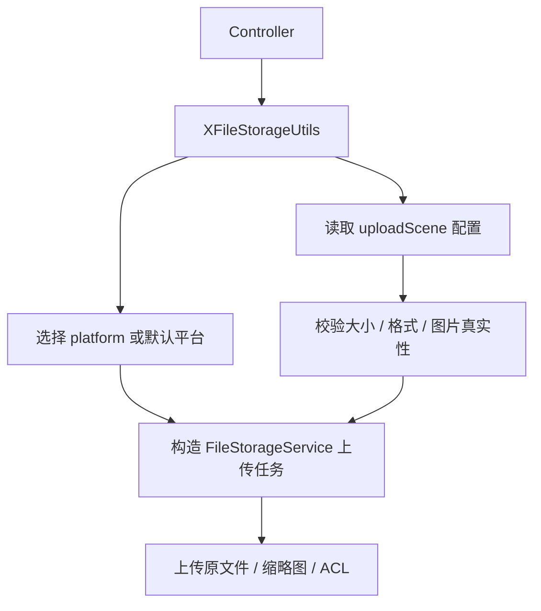

提交：

```
d5c951da 增加统一文件上传门面
```

## 2. 涉及文件

- `ruoyi-common/src/main/java/com/ruoyi/common/config/UploadSceneProperties.java`
- `ruoyi-common/src/main/java/com/ruoyi/common/utils/file/XFileStorageUtils.java`

## 3. 改动点清单

- 新增 UploadSceneProperties 读取上传场景配置
- 新增 XFileStorageUtils 统一处理上传参数、场景规则、平台选择、缩略图、ACL 和分片能力

## 4. ruoyi-common/src/main/java/com/ruoyi/common/config/UploadSceneProperties.java

### 原代码

```text
本次新增，提交前不存在该文件
```

### 现代码

```java
package com.ruoyi.common.config;

import java.util.HashMap;
import java.util.List;
import java.util.Map;
import org.springframework.boot.context.properties.ConfigurationProperties;
import org.springframework.stereotype.Component;
import org.springframework.util.unit.DataSize;
import com.ruoyi.common.utils.StringUtils;

/**
 * 上传场景配置
 * <p>
 * 用于让同一个通用上传接口根据不同业务场景使用不同大小、格式和缩略图规则
 *
 * @author ruoyi
 */
@Component
@ConfigurationProperties(prefix = "ruoyi")
public class UploadSceneProperties
{
    /** 场景配置集合 */
    private Map<String, Scene> uploadScenes = new HashMap<String, Scene>();

    public Map<String, Scene> getUploadScenes()
    {
        return uploadScenes;
    }

    public void setUploadScenes(Map<String, Scene> uploadScenes)
    {
        this.uploadScenes = uploadScenes;
    }

    /**
     * 根据场景编码获取上传场景
     *
     * @param scene 上传场景编码
     * @return 上传场景配置
     */
    public Scene getScene(String scene)
    {
        // 场景为空时不启用场景规则，保持通用上传原有默认行为
        if (StringUtils.isBlank(scene) || uploadScenes == null)
        {
            return null;
        }
        // 按配置键直接查找场景，调用方传 avatar、contract 等稳定编码
        return uploadScenes.get(scene);
    }

    /**
     * 上传场景规则
     */
    public static class Scene
    {
        /** 最大上传大小 */
        private DataSize maxSize;

        /** 允许上传的扩展名 */
        private List<String> allowedExtension;

        /** 是否生成缩略图 */
        private Boolean thumbnail;

        /** 缩略图宽度 */
        private Integer thumbnailWidth;

        /** 缩略图高度 */
        private Integer thumbnailHeight;

        /** 访问级别，public 表示公开访问，private 表示私有访问 */
        private String access;

        /** 场景路径前缀，例如 avatar、image、contract */
        private String pathPrefix;

        public DataSize getMaxSize()
        {
            return maxSize;
        }

        public void setMaxSize(DataSize maxSize)
        {
            this.maxSize = maxSize;
        }

        public List<String> getAllowedExtension()
        {
            return allowedExtension;
        }

        public void setAllowedExtension(List<String> allowedExtension)
        {
            this.allowedExtension = allowedExtension;
        }

        public Boolean getThumbnail()
        {
            return thumbnail;
        }

        public void setThumbnail(Boolean thumbnail)
        {
            this.thumbnail = thumbnail;
        }

        public Integer getThumbnailWidth()
        {
            return thumbnailWidth;
        }

        public void setThumbnailWidth(Integer thumbnailWidth)
        {
            this.thumbnailWidth = thumbnailWidth;
        }

        public Integer getThumbnailHeight()
        {
            return thumbnailHeight;
        }

        public void setThumbnailHeight(Integer thumbnailHeight)
        {
            this.thumbnailHeight = thumbnailHeight;
        }

        public String getAccess()
        {
            return access;
        }

        public void setAccess(String access)
        {
            this.access = access;
        }

        public String getPathPrefix()
        {
            return pathPrefix;
        }

        public void setPathPrefix(String pathPrefix)
        {
            this.pathPrefix = pathPrefix;
        }
    }
}
```

### 涉及改动部分

```java
// 省略
package com.ruoyi.common.config;

import java.util.HashMap;
import java.util.List;
import java.util.Map;
import org.springframework.boot.context.properties.ConfigurationProperties;
import org.springframework.stereotype.Component;
import org.springframework.util.unit.DataSize;
import com.ruoyi.common.utils.StringUtils;

/**
 * 上传场景配置
 * <p>
 * 用于让同一个通用上传接口根据不同业务场景使用不同大小、格式和缩略图规则
 *
 * @author ruoyi
 */
@Component
@ConfigurationProperties(prefix = "ruoyi")
public class UploadSceneProperties
{
    /** 场景配置集合 */
    private Map<String, Scene> uploadScenes = new HashMap<String, Scene>();

    public Map<String, Scene> getUploadScenes()
    {
        return uploadScenes;
    }

    public void setUploadScenes(Map<String, Scene> uploadScenes)
    {
        this.uploadScenes = uploadScenes;
    }

    /**
     * 根据场景编码获取上传场景
     *
     * @param scene 上传场景编码
     * @return 上传场景配置
     */
    public Scene getScene(String scene)
    {
        // 场景为空时不启用场景规则，保持通用上传原有默认行为
        if (StringUtils.isBlank(scene) || uploadScenes == null)
        {
            return null;
        }
        // 按配置键直接查找场景，调用方传 avatar、contract 等稳定编码
        return uploadScenes.get(scene);
    }

    /**
     * 上传场景规则
     */
    public static class Scene
    {
        /** 最大上传大小 */
        private DataSize maxSize;

        /** 允许上传的扩展名 */
        private List<String> allowedExtension;

        /** 是否生成缩略图 */
        private Boolean thumbnail;

        /** 缩略图宽度 */
        private Integer thumbnailWidth;

        /** 缩略图高度 */
        private Integer thumbnailHeight;

        /** 访问级别，public 表示公开访问，private 表示私有访问 */
        private String access;

        /** 场景路径前缀，例如 avatar、image、contract */
        private String pathPrefix;

        public DataSize getMaxSize()
        {
            return maxSize;
        }

        public void setMaxSize(DataSize maxSize)
        {
            this.maxSize = maxSize;
        }

        public List<String> getAllowedExtension()
        {
            return allowedExtension;
        }

        public void setAllowedExtension(List<String> allowedExtension)
        {
            this.allowedExtension = allowedExtension;
        }

        public Boolean getThumbnail()
        {
            return thumbnail;
        }

        public void setThumbnail(Boolean thumbnail)
        {
            this.thumbnail = thumbnail;
        }

        public Integer getThumbnailWidth()
        {
            return thumbnailWidth;
        }

        public void setThumbnailWidth(Integer thumbnailWidth)
        {
            this.thumbnailWidth = thumbnailWidth;
        }

        public Integer getThumbnailHeight()
        {
            return thumbnailHeight;
// 省略
```
### 改动说明

- 新增上传场景配置类，用配置描述不同业务的大小、格式、路径、缩略图和访问策略
- Controller 只传 `uploadScene`，具体规则由配置读取

## 5. ruoyi-common/src/main/java/com/ruoyi/common/utils/file/XFileStorageUtils.java

### 原代码

```text
本次新增，提交前不存在该文件
```

### 现代码

```java
package com.ruoyi.common.utils.file;

import org.dromara.x.file.storage.core.FileInfo;
import org.dromara.x.file.storage.core.FileStorageService;
import org.dromara.x.file.storage.core.constant.Constant;
import org.dromara.x.file.storage.core.upload.FilePartInfo;
import org.dromara.x.file.storage.core.upload.FilePartInfoList;
import org.dromara.x.file.storage.core.upload.MultipartUploadSupportInfo;
import org.dromara.x.file.storage.core.upload.UploadPretreatment;
import org.apache.commons.io.FilenameUtils;
import org.springframework.stereotype.Component;
import org.springframework.web.multipart.MultipartFile;
import com.ruoyi.common.exception.file.FileNameLengthLimitExceededException;
import com.ruoyi.common.exception.file.FileSizeLimitExceededException;
import com.ruoyi.common.exception.file.InvalidExtensionException;
import com.ruoyi.common.config.UploadSceneProperties;
import com.ruoyi.common.config.UploadSceneProperties.Scene;
import com.ruoyi.common.utils.DateUtils;
import com.ruoyi.common.utils.StringUtils;
import com.ruoyi.common.utils.uuid.IdUtils;

/**
 * X File Storage 上传适配工具
 * <p>
 * 控制器应优先调用该工具类，而不是直接使用 {@link FileStorageService}
 * 这样可以把平台选择、上传校验、文件命名、远程删除等行为集中维护
 * 保证通用上传和头像上传的行为一致
 */
@Component
public class XFileStorageUtils
{
    /**
     * 公开文件访问级别
     */
    private static final String ACCESS_PUBLIC = "public";

    /**
     * 私有文件访问级别
     */
    private static final String ACCESS_PRIVATE = "private";

    /**
     * 由 @EnableFileStorage 和 application.yml 平台配置自动创建的统一文件存储服务
     */
    private final FileStorageService fileStorageService;

    /**
     * 上传场景配置
     */
    private final UploadSceneProperties uploadSceneProperties;

    /**
     * 构造上传适配工具
     *
     * @param fileStorageService X File Storage 自动配置提供的统一存储服务
     * @param uploadSceneProperties 上传场景配置
     */
    public XFileStorageUtils(FileStorageService fileStorageService, UploadSceneProperties uploadSceneProperties)
    {
        this.fileStorageService = fileStorageService;
        this.uploadSceneProperties = uploadSceneProperties;
    }

    /**
     * 使用默认平台和默认扩展名白名单上传文件
     *
     * @param file 前端提交的 Multipart 文件
     * @return 存储平台返回的文件元数据
     * @throws Exception 校验失败或上传失败时抛出
     */
    public FileInfo upload(MultipartFile file) throws Exception
    {
        // 默认上传入口统一委托到完整参数方法
        return upload(file, null, MimeTypeUtils.DEFAULT_ALLOWED_EXTENSION);
    }

    /**
     * 使用默认平台和指定扩展名白名单上传文件
     *
     * @param file 前端提交的 Multipart 文件
     * @param allowedExtension 允许的扩展名数组，不带点号
     * @return 存储平台返回的文件元数据
     * @throws Exception 校验失败或上传失败时抛出
     */
    public FileInfo upload(MultipartFile file, String[] allowedExtension) throws Exception
    {
        // 图片上传等场景会传入更严格的扩展名白名单
        return upload(file, null, allowedExtension);
    }

    /**
     * 使用可选平台和默认扩展名白名单上传文件
     *
     * @param file 前端提交的 Multipart 文件
     * @param platform 可选平台标识；为空时使用配置中的默认平台
     * @return 存储平台返回的文件元数据
     * @throws Exception 校验失败或上传失败时抛出
     */
    public FileInfo upload(MultipartFile file, String platform) throws Exception
    {
        // 指定平台但不指定白名单时使用通用白名单
        return upload(file, platform, MimeTypeUtils.DEFAULT_ALLOWED_EXTENSION);
    }

    /**
     * 使用可选平台和指定扩展名白名单上传文件
     * <p>
     * 平台标识来自 application.yml，例如 local-1、aliyun-oss-1、minio-1
     * 后续新增腾讯云 COS、华为 OBS、S3 等平台时，只要补充对应配置和依赖
     * 再把新的 platform 标识传入这里即可
     *
     * @param file 前端提交的 Multipart 文件
     * @param platform 可选平台标识；为空时使用配置中的默认平台
     * @param allowedExtension 允许的扩展名数组，不带点号
     * @return 存储平台返回的文件元数据
     * @throws Exception 校验失败或上传失败时抛出
     */
    public FileInfo upload(MultipartFile file, String platform, String[] allowedExtension) throws Exception
    {
        // 默认不生成缩略图，保持普通上传原有行为
        return upload(file, platform, allowedExtension, false, null, null);
    }

    /**
     * 使用可选平台和指定扩展名白名单上传文件，并可按需生成缩略图
     * <p>
     * 生成缩略图时，原图和缩略图都会上传
     * 原图地址通过 FileInfo#getUrl 获取，缩略图地址通过 FileInfo#getThUrl 获取
     *
     * @param file 前端提交的 Multipart 文件
     * @param platform 可选平台标识；为空时使用配置中的默认平台
     * @param allowedExtension 允许的扩展名数组，不带点号
     * @param thumbnail true 表示生成缩略图
     * @param thumbnailWidth 缩略图宽度，和 thumbnailHeight 同时为空时使用框架默认尺寸
     * @param thumbnailHeight 缩略图高度，和 thumbnailWidth 同时为空时使用框架默认尺寸
     * @return 存储平台返回的文件元数据
     * @throws Exception 校验失败、缩略图生成失败或上传失败时抛出
     */
    public FileInfo upload(MultipartFile file, String platform, String[] allowedExtension, boolean thumbnail,
            Integer thumbnailWidth, Integer thumbnailHeight) throws Exception
    {
        // 未指定上传场景时使用调用方传入的白名单、大小和缩略图规则
        return upload(file, platform, null, allowedExtension, thumbnail, thumbnailWidth, thumbnailHeight);
    }

    /**
     * 使用可选平台和上传场景上传文件，并可按需生成缩略图
     * <p>
     * uploadScene 为空时使用调用方传入的规则
     * uploadScene 不为空时优先使用 ruoyi.upload-scenes 中配置的大小、格式和缩略图规则
     *
     * @param file 前端提交的 Multipart 文件
     * @param platform 可选平台标识；为空时使用配置中的默认平台
     * @param uploadScene 可选上传场景编码
     * @param allowedExtension 默认允许的扩展名数组，不带点号
     * @param thumbnail true 表示生成缩略图
     * @param thumbnailWidth 缩略图宽度，和 thumbnailHeight 同时为空时使用框架默认尺寸
     * @param thumbnailHeight 缩略图高度，和 thumbnailWidth 同时为空时使用框架默认尺寸
     * @return 存储平台返回的文件元数据
     * @throws Exception 校验失败、缩略图生成失败或上传失败时抛出
     */
    public FileInfo upload(MultipartFile file, String platform, String uploadScene, String[] allowedExtension,
            boolean thumbnail, Integer thumbnailWidth, Integer thumbnailHeight) throws Exception
    {
        // 根据场景编码读取场景规则，没有配置时回退到通用上传默认规则
        Scene scene = getScene(uploadScene);
        // 场景配置了扩展名时优先使用场景白名单
        String[] actualAllowedExtension = getAllowedExtension(scene, allowedExtension);
        // 场景配置了最大大小时优先使用场景大小限制
        long maxSize = getMaxSize(scene);
        // 场景配置了缩略图开关时优先使用场景缩略图策略
        boolean actualThumbnail = scene != null && scene.getThumbnail() != null ? scene.getThumbnail() : thumbnail;
        // 场景配置了缩略图宽度时优先使用场景宽度
        Integer actualThumbnailWidth = scene != null && scene.getThumbnailWidth() != null ? scene.getThumbnailWidth() : thumbnailWidth;
        // 场景配置了缩略图高度时优先使用场景高度
        Integer actualThumbnailHeight = scene != null && scene.getThumbnailHeight() != null ? scene.getThumbnailHeight() : thumbnailHeight;
        // 先执行若依原有文件安全校验
        assertAllowed(file, actualAllowedExtension, maxSize);
        // 日期目录保持 yyyy/MM/dd，便于按天归档
        String datePath = DateUtils.datePath();
        // 按上传场景生成 public/private 分层路径，便于 Spring Security 按 URL 粗粒度放行
        String storagePath = buildStoragePath(scene, uploadScene, datePath);
        // 保留若依原来的日期目录和 UUID 文件名规则，只把真实存储交给 X File Storage
        UploadPretreatment upload = fileStorageService.of(file)
                .setPath(storagePath)
                // 只取 UUID 文件名部分，避免 setPath 后重复日期目录
                .setSaveFilename(FileUploadUtils.uuidFilename(file).substring(datePath.length() + 1));
        if (platform != null && !platform.isBlank())
        {
            // 指定平台时覆盖配置中的默认平台
            upload.setPlatform(platform);
        }
        if (scene != null)
        {
            // 只有声明了上传场景时才按场景访问级别同步对象 ACL，未声明场景时保留平台默认权限
            applyAcl(upload, scene);
        }
        if (actualThumbnail)
        {
            // 调用方明确要求缩略图时再开启，避免普通文件上传被误处理
            setThumbnail(upload, file, actualThumbnailWidth, actualThumbnailHeight);
        }
        // platform 为空时，X File Storage 会自动使用 dromara.x-file-storage.default-platform
        // 真正执行上传并返回平台生成的元数据
        return upload.upload();
    }

    /**
     * 按 X File Storage 返回的 URL 删除远程对象
     * <p>
     * 该方法适用于本工具上传后返回的 URL
     * 若依历史本地 /profile 资源仍应使用 {@link FileUtils#deleteFile(String)} 删除
     * 文件存在缩略图时优先按 FileInfo 删除，让框架有机会同时处理缩略图
     *
     * @param url X File Storage 上传后返回的文件 URL
     * @return true 表示存储平台确认删除成功
     */
    public boolean delete(String url)
    {
        // 空 URL 不交给存储服务处理
        if (url == null || url.isBlank())
        {
            return false;
        }
        // 先根据 URL 还原 FileInfo，里面可能包含缩略图文件名等完整元数据
        FileInfo fileInfo = fileStorageService.getFileInfoByUrl(url);
        if (fileInfo != null)
        {
            // 使用 FileInfo 删除时，框架能拿到比单纯 URL 更完整的信息
            return fileStorageService.delete(fileInfo);
        }
        // 没有 FileInfo 时说明当前运行期没有记录，直接返回 true 避免历史 URL 影响主业务
        return true;
    }

    /**
     * 根据 URL 获取文件信息
     *
     * @param url X File Storage 上传后返回的文件 URL
     * @return 文件信息
     */
    public FileInfo getFileInfoByUrl(String url)
    {
        // URL 为空时无法定位文件记录
        if (StringUtils.isBlank(url))
        {
            throw new IllegalArgumentException("文件URL不能为空");
        }
        // 通过 FileRecorder 从数据库还原 FileInfo
        FileInfo fileInfo = fileStorageService.getFileInfoByUrl(url);
        if (fileInfo == null)
        {
            throw new IllegalArgumentException("文件记录不存在");
        }
        return fileInfo;
    }

    /**
     * 下载文件内容
     *
     * @param fileInfo 文件信息
     * @return 文件字节内容
     */
    public byte[] downloadBytes(FileInfo fileInfo)
    {
        // 下载必须依赖完整 FileInfo，里面包含平台、路径和文件名
        if (fileInfo == null)
        {
            throw new IllegalArgumentException("文件信息不能为空");
        }
        // 由 X File Storage 根据 FileInfo 中的平台信息选择实际存储平台下载
        return fileStorageService.download(fileInfo).bytes();
    }

    /**
     * 查询指定平台是否支持手动分片上传
     *
     * @param platform 可选平台标识；为空时使用配置中的默认平台
     * @return 分片上传支持信息
     */
    public MultipartUploadSupportInfo isSupportMultipartUpload(String platform)
    {
        // platform 为空时查询默认平台的分片上传能力
        if (StringUtils.isBlank(platform))
        {
            return fileStorageService.isSupportMultipartUpload();
        }
        // platform 不为空时查询指定平台的分片上传能力
        return fileStorageService.isSupportMultipartUpload(platform);
    }

    /**
     * 初始化手动分片上传
     *
     * @param originalFilename 原始文件名
     * @param size 文件总大小
     * @param contentType 文件内容类型
     * @param platform 可选平台标识；为空时使用配置中的默认平台
     * @param allowedExtension 允许的扩展名数组，不带点号
     * @return 初始化后的文件信息
     * @throws FileNameLengthLimitExceededException 原始文件名过长时抛出
     * @throws InvalidExtensionException 扩展名不在白名单内时抛出
     */
    public FileInfo initiateMultipartUpload(String originalFilename, Long size, String contentType, String platform,
            String[] allowedExtension) throws FileNameLengthLimitExceededException, FileSizeLimitExceededException,
            InvalidExtensionException
    {
        // 未指定上传场景时使用调用方传入的白名单和默认大小规则
        return initiateMultipartUpload(originalFilename, size, contentType, platform, null, allowedExtension);
    }

    /**
     * 初始化手动分片上传
     *
     * @param originalFilename 原始文件名
     * @param size 文件总大小
     * @param contentType 文件内容类型
     * @param platform 可选平台标识；为空时使用配置中的默认平台
     * @param uploadScene 可选上传场景编码
     * @param allowedExtension 默认允许的扩展名数组，不带点号
     * @return 初始化后的文件信息
     * @throws FileNameLengthLimitExceededException 原始文件名过长时抛出
     * @throws InvalidExtensionException 扩展名不在白名单内时抛出
     */
    public FileInfo initiateMultipartUpload(String originalFilename, Long size, String contentType, String platform,
            String uploadScene, String[] allowedExtension) throws FileNameLengthLimitExceededException,
            FileSizeLimitExceededException, InvalidExtensionException
    {
        // 根据场景编码读取场景规则，没有配置时回退到通用上传默认规则
        Scene scene = getScene(uploadScene);
        // 初始化阶段同样按场景限制文件格式和声明大小
        String[] actualAllowedExtension = getAllowedExtension(scene, allowedExtension);
        long maxSize = getMaxSize(scene);
        // 初始化阶段还没有完整文件内容，只能先校验文件名、扩展名和声明大小
        assertInitiateAllowed(originalFilename, size, actualAllowedExtension, maxSize);
        // 日期目录保持 yyyy/MM/dd，便于和普通上传使用相同归档规则
        String datePath = DateUtils.datePath();
        // 分片上传也使用同一套 public/private 分层路径，避免普通上传和大文件上传访问策略不一致
        String storagePath = buildStoragePath(scene, uploadScene, datePath);
        // 分片上传也使用 UUID 文件名，避免暴露用户原始文件名和降低重名风险
        String saveFilename = IdUtils.fastSimpleUUID() + "." + FilenameUtils.getExtension(originalFilename);
        // 构造初始化请求，返回的 FileInfo 会携带 uploadId 供后续分片上传使用
        org.dromara.x.file.storage.core.upload.InitiateMultipartUploadPretreatment upload = fileStorageService
                .initiateMultipartUpload()
                .setPath(storagePath)
                .setSaveFilename(saveFilename)
                .setOriginalFilename(originalFilename)
                .setSize(size)
                .setContentType(contentType);
        if (StringUtils.isNotBlank(platform))
        {
            // 指定平台时覆盖配置中的默认平台
            upload.setPlatform(platform);
        }
        if (scene != null)
        {
            // 分片上传初始化也按场景访问级别设置对象 ACL，避免合并后的文件权限和普通上传不一致
            applyMultipartAcl(upload, scene);
        }
        // 执行初始化，框架会通过 FileRecorder.save 保存分片上传会话
        return upload.init();
    }

    /**
     * 上传一个文件分片
     *
     * @param url 初始化分片上传后返回的文件地址
     * @param partNumber 分片编号
     * @param file 当前分片文件
     * @return 已上传的分片信息
     */
    public FilePartInfo uploadPart(String url, Integer partNumber, MultipartFile file)
    {
        // 分片编号从 1 开始，非法编号直接拒绝
        if (partNumber == null || partNumber <= 0)
        {
            throw new IllegalArgumentException("分片编号必须大于0");
        }
        // 分片内容不能为空，避免上传空分片污染分片记录
        if (file == null || file.isEmpty())
        {
            throw new IllegalArgumentException("分片文件不能为空");
        }
        // 从数据库记录按 URL 还原 FileInfo，里面包含平台、路径和 uploadId
        FileInfo fileInfo = getRequiredFileInfo(url);
        // 上传当前分片，框架成功后会通过 FileRecorder.saveFilePart 保存分片记录
        return fileStorageService.uploadPart(fileInfo, partNumber, file, file.getSize()).upload();
    }

    /**
     * 查询已经上传的分片列表
     *
     * @param url 初始化分片上传后返回的文件地址
     * @param maxParts 本次最多返回的分片数量
     * @param partNumberMarker 分页起始分片编号
     * @return 分片列表
     */
    public FilePartInfoList listParts(String url, Integer maxParts, Integer partNumberMarker)
    {
        // 从数据库记录按 URL 还原 FileInfo，里面包含平台、路径和 uploadId
        FileInfo fileInfo = getRequiredFileInfo(url);
        // 构造列举请求，部分平台可能不支持列举，由框架根据平台能力决定
        org.dromara.x.file.storage.core.upload.ListPartsPretreatment listParts = fileStorageService.listParts(fileInfo);
        if (maxParts != null && maxParts > 0)
        {
            // 设置本次最多返回的分片数量
            listParts.setMaxParts(maxParts);
        }
        if (partNumberMarker != null && partNumberMarker > 0)
        {
            // 设置分页起始分片编号
            listParts.setPartNumberMarker(partNumberMarker);
        }
        return listParts.listParts();
    }

    /**
     * 完成手动分片上传
     *
     * @param url 初始化分片上传后返回的文件地址
     * @return 合并后的文件信息
     */
    public FileInfo completeMultipartUpload(String url)
    {
        // 从数据库记录按 URL 还原 FileInfo，里面包含平台、路径和 uploadId
        FileInfo fileInfo = getRequiredFileInfo(url);
        // 通知存储平台合并分片，成功后框架会更新主文件记录并清理分片记录
        return fileStorageService.completeMultipartUpload(fileInfo).complete();
    }

    /**
     * 取消手动分片上传
     *
     * @param url 初始化分片上传后返回的文件地址
     * @return 取消后的文件信息
     */
    public FileInfo abortMultipartUpload(String url)
    {
        // 从数据库记录按 URL 还原 FileInfo，里面包含平台、路径和 uploadId
        FileInfo fileInfo = getRequiredFileInfo(url);
        // 通知存储平台取消分片上传，成功后框架会清理分片记录
        return fileStorageService.abortMultipartUpload(fileInfo).abort();
    }

    /**
     * 复用若依本地上传的校验规则
     *
     * @param file 前端提交的 Multipart 文件
     * @param allowedExtension 允许的扩展名数组，不带点号
     * @throws FileSizeLimitExceededException 文件超过默认大小限制时抛出
     * @throws InvalidExtensionException 扩展名不在白名单内时抛出
     * @throws FileNameLengthLimitExceededException 原始文件名过长时抛出
     */
    private void assertAllowed(MultipartFile file, String[] allowedExtension, long maxSize)
            throws FileSizeLimitExceededException, InvalidExtensionException, FileNameLengthLimitExceededException
    {
        // 切换存储平台不应放宽上传限制，因此仍沿用若依原来的文件名长度、大小和扩展名校验
        int fileNameLength = file.getOriginalFilename() == null ? 0 : file.getOriginalFilename().length();
        if (fileNameLength > FileUploadUtils.DEFAULT_FILE_NAME_LENGTH)
        {
            // 原始文件名过长时抛出若依原有异常
            throw new FileNameLengthLimitExceededException(FileUploadUtils.DEFAULT_FILE_NAME_LENGTH);
        }
        // 文件大小和扩展名校验统一委托给若依原工具
        FileUploadUtils.assertAllowed(file, allowedExtension, maxSize);
    }

    /**
     * 校验分片上传初始化参数
     *
     * @param originalFilename 原始文件名
     * @param size 文件总大小
     * @param allowedExtension 允许的扩展名数组，不带点号
     * @throws FileNameLengthLimitExceededException 原始文件名过长时抛出
     * @throws InvalidExtensionException 扩展名不在白名单内时抛出
     */
    private void assertInitiateAllowed(String originalFilename, Long size, String[] allowedExtension, long maxSize)
            throws FileNameLengthLimitExceededException, InvalidExtensionException
    {
        // 原始文件名不能为空，否则无法判断扩展名和生成最终保存名
        if (StringUtils.isBlank(originalFilename))
        {
            throw new IllegalArgumentException("文件名不能为空");
        }
        // 分片上传声明大小必须大于 0，避免创建无意义的上传会话
        if (size == null || size <= 0)
        {
            throw new IllegalArgumentException("文件大小必须大于0");
        }
        // 声明大小超过当前场景允许大小时直接拒绝初始化分片上传
        if (size > maxSize)
        {
            throw new FileSizeLimitExceededException((maxSize + 1024 * 1024 - 1) / 1024 / 1024);
        }
        // 复用若依原有文件名长度限制
        if (originalFilename.length() > FileUploadUtils.DEFAULT_FILE_NAME_LENGTH)
        {
            throw new FileNameLengthLimitExceededException(FileUploadUtils.DEFAULT_FILE_NAME_LENGTH);
        }
        // 初始化阶段按原始文件名后缀做白名单校验，真实内容校验放在普通图片上传链路
        String extension = FilenameUtils.getExtension(originalFilename);
        if (allowedExtension != null && !FileUploadUtils.isAllowedExtension(extension, allowedExtension))
        {
            throw new InvalidExtensionException(allowedExtension, extension, originalFilename);
        }
    }

    /**
     * 根据上传场景编码获取场景配置
     *
     * @param uploadScene 上传场景编码
     * @return 上传场景配置
     */
    private Scene getScene(String uploadScene)
    {
        // 没有传场景时不启用场景规则
        if (StringUtils.isBlank(uploadScene))
        {
            return null;
        }
        // 场景不存在时直接拒绝，避免前端传错后退回到更宽松的默认规则
        Scene scene = uploadSceneProperties.getScene(uploadScene);
        if (scene == null)
        {
            throw new IllegalArgumentException("上传场景不存在：" + uploadScene);
        }
        return scene;
    }

    /**
     * 获取当前上传允许的扩展名
     *
     * @param scene 上传场景配置
     * @param defaultAllowedExtension 默认扩展名白名单
     * @return 实际扩展名白名单
     */
    private String[] getAllowedExtension(Scene scene, String[] defaultAllowedExtension)
    {
        // 场景没有配置扩展名时使用调用方默认白名单
        if (scene == null || scene.getAllowedExtension() == null || scene.getAllowedExtension().isEmpty())
        {
            return defaultAllowedExtension;
        }
        // 将配置列表转换为若依校验工具使用的字符串数组
        return scene.getAllowedExtension().toArray(new String[0]);
    }

    /**
     * 获取当前上传最大大小
     *
     * @param scene 上传场景配置
     * @return 最大上传大小，单位字节
     */
    private long getMaxSize(Scene scene)
    {
        // 场景没有配置大小时使用若依默认 50MB
        if (scene == null || scene.getMaxSize() == null)
        {
            return FileUploadUtils.DEFAULT_MAX_SIZE;
        }
        // DataSize 会把 5MB、10MB 等配置换算成字节
        return scene.getMaxSize().toBytes();
    }

    /**
     * 构建场景化存储路径
     *
     * @param scene 上传场景配置
     * @param uploadScene 上传场景编码
     * @param datePath 日期路径
     * @return X File Storage setPath 使用的相对路径
     */
    private String buildStoragePath(Scene scene, String uploadScene, String datePath)
    {
        // 访问级别作为路径第一层，便于 /file/upload/public/** 直接匿名放行
        String access = getAccess(scene);
        // 场景路径作为第二层，方便按业务分类管理文件
        String pathPrefix = getPathPrefix(scene, uploadScene);
        return access + "/" + pathPrefix + "/" + datePath + "/";
    }

    /**
     * 按上传场景设置对象访问权限
     *
     * @param upload 当前上传预处理对象
     * @param scene 上传场景配置
     */
    private void applyAcl(UploadPretreatment upload, Scene scene)
    {
        // 部分平台不支持对象 ACL，例如本地存储，关闭抛错可以保持多平台上传入口通用
        upload.setNotSupportAclThrowException(false);
        // public 场景需要匿名可读，否则腾讯 COS、阿里云 OSS 等私有 Bucket 会返回 AccessDenied
        if (ACCESS_PUBLIC.equals(getAccess(scene)))
        {
            upload.setAcl(Constant.ACL.PUBLIC_READ);
            return;
        }
        // 未配置或非 public 场景统一按私有处理，避免业务附件被误公开
        upload.setAcl(Constant.ACL.PRIVATE);
    }

    /**
     * 按上传场景设置分片上传对象访问权限
     *
     * @param upload 当前分片上传初始化预处理对象
     * @param scene 上传场景配置
     */
    private void applyMultipartAcl(org.dromara.x.file.storage.core.upload.InitiateMultipartUploadPretreatment upload,
            Scene scene)
    {
        // 部分平台不支持对象 ACL，关闭抛错可以避免影响分片上传初始化
        upload.setNotSupportAclThrowException(false);
        // public 场景的分片文件合并后需要匿名可读，否则 COS 等平台会返回 AccessDenied
        if (ACCESS_PUBLIC.equals(getAccess(scene)))
        {
            upload.setFileAcl(Constant.ACL.PUBLIC_READ);
            return;
        }
        // private 场景显式设置私有，避免平台默认公开导致业务附件泄露
        upload.setFileAcl(Constant.ACL.PRIVATE);
    }

    /**
     * 获取上传场景访问级别
     *
     * @param scene 上传场景配置
     * @return public 或 private
     */
    private String getAccess(Scene scene)
    {
        // 未配置场景或未配置访问级别时默认私有，避免新业务文件误公开
        if (scene == null || StringUtils.isBlank(scene.getAccess()))
        {
            return ACCESS_PRIVATE;
        }
        // 只接受 public，其他值一律按 private 处理
        return ACCESS_PUBLIC.equalsIgnoreCase(scene.getAccess()) ? ACCESS_PUBLIC : ACCESS_PRIVATE;
    }

    /**
     * 获取上传场景路径前缀
     *
     * @param scene 上传场景配置
     * @param uploadScene 上传场景编码
     * @return 已清洗的相对路径前缀
     */
    private String getPathPrefix(Scene scene, String uploadScene)
    {
        // 场景 path-prefix 优先，未配置时使用 uploadScene，再没有时落到 common
        String pathPrefix = scene != null && StringUtils.isNotBlank(scene.getPathPrefix()) ? scene.getPathPrefix() : uploadScene;
        if (StringUtils.isBlank(pathPrefix))
        {
            pathPrefix = "common";
        }
        return normalizePathPrefix(pathPrefix);
    }

    /**
     * 清洗场景路径前缀
     *
     * @param pathPrefix 配置中的路径前缀
     * @return 安全的相对路径前缀
     */
    private String normalizePathPrefix(String pathPrefix)
    {
        // 统一路径分隔符并去掉首尾空白
        String normalized = pathPrefix.trim().replace("\\", "/");
        // 去掉开头结尾斜杠，避免拼接出绝对路径或重复斜杠
        while (normalized.startsWith("/"))
        {
            normalized = normalized.substring(1);
        }
        while (normalized.endsWith("/"))
        {
            normalized = normalized.substring(0, normalized.length() - 1);
        }
        // 禁止路径穿越，场景路径只允许作为存储相对目录
        if (normalized.contains(".."))
        {
            throw new IllegalArgumentException("上传场景路径前缀不能包含..");
        }
        return StringUtils.isBlank(normalized) ? "common" : normalized;
    }

    /**
     * 根据 URL 获取必须存在的文件信息
     *
     * @param url 文件访问地址
     * @return 文件信息
     */
    private FileInfo getRequiredFileInfo(String url)
    {
        // URL 为空时无法定位分片上传会话
        if (StringUtils.isBlank(url))
        {
            throw new IllegalArgumentException("文件URL不能为空");
        }
        // 通过 FileRecorder 从数据库还原 FileInfo
        FileInfo fileInfo = fileStorageService.getFileInfoByUrl(url);
        if (fileInfo == null)
        {
            throw new IllegalArgumentException("文件记录不存在");
        }
        // 分片上传后续操作必须依赖 uploadId
        if (StringUtils.isBlank(fileInfo.getUploadId()))
        {
            throw new IllegalArgumentException("文件不是有效的分片上传会话");
        }
        return fileInfo;
    }

    /**
     * 为上传任务设置缩略图参数
     *
     * @param upload 当前上传预处理对象
     * @param file 前端提交的 Multipart 文件
     * @param thumbnailWidth 缩略图宽度
     * @param thumbnailHeight 缩略图高度
     */
    private void setThumbnail(UploadPretreatment upload, MultipartFile file, Integer thumbnailWidth,
            Integer thumbnailHeight)
    {
        // 缩略图只支持图片文件，避免 PDF、压缩包等普通文件进入图片处理流程
        if (!FileUploadUtils.isAllowedExtension(FileUploadUtils.getExtension(file), MimeTypeUtils.IMAGE_EXTENSION))
        {
            throw new IllegalArgumentException("缩略图只支持图片文件");
        }
        // 宽高同时不传时使用 X File Storage 和 Thumbnailator 的默认缩略图策略
        if (thumbnailWidth == null && thumbnailHeight == null)
        {
            upload.thumbnail();
            return;
        }
        // 只传一个值或传入非正数时直接拒绝，避免生成尺寸不可预期
        if (thumbnailWidth == null || thumbnailHeight == null || thumbnailWidth <= 0 || thumbnailHeight <= 0)
        {
            throw new IllegalArgumentException("缩略图宽高必须同时大于0");
        }
        // 指定宽高时按调用方要求生成缩略图
        upload.thumbnail(thumbnailWidth, thumbnailHeight);
    }

}
```

### 涉及改动部分

```java
// 省略
package com.ruoyi.common.utils.file;

import org.dromara.x.file.storage.core.FileInfo;
import org.dromara.x.file.storage.core.FileStorageService;
import org.dromara.x.file.storage.core.constant.Constant;
import org.dromara.x.file.storage.core.upload.FilePartInfo;
import org.dromara.x.file.storage.core.upload.FilePartInfoList;
import org.dromara.x.file.storage.core.upload.MultipartUploadSupportInfo;
import org.dromara.x.file.storage.core.upload.UploadPretreatment;
import org.apache.commons.io.FilenameUtils;
import org.springframework.stereotype.Component;
import org.springframework.web.multipart.MultipartFile;
import com.ruoyi.common.exception.file.FileNameLengthLimitExceededException;
import com.ruoyi.common.exception.file.FileSizeLimitExceededException;
import com.ruoyi.common.exception.file.InvalidExtensionException;
import com.ruoyi.common.config.UploadSceneProperties;
import com.ruoyi.common.config.UploadSceneProperties.Scene;
import com.ruoyi.common.utils.DateUtils;
import com.ruoyi.common.utils.StringUtils;
import com.ruoyi.common.utils.uuid.IdUtils;

/**
 * X File Storage 上传适配工具
 * <p>
 * 控制器应优先调用该工具类，而不是直接使用 {@link FileStorageService}
 * 这样可以把平台选择、上传校验、文件命名、远程删除等行为集中维护
 * 保证通用上传和头像上传的行为一致
 */
@Component
public class XFileStorageUtils
{
    /**
     * 公开文件访问级别
     */
    private static final String ACCESS_PUBLIC = "public";

    /**
     * 私有文件访问级别
     */
    private static final String ACCESS_PRIVATE = "private";

    /**
     * 由 @EnableFileStorage 和 application.yml 平台配置自动创建的统一文件存储服务
     */
    private final FileStorageService fileStorageService;

    /**
     * 上传场景配置
     */
    private final UploadSceneProperties uploadSceneProperties;

    /**
     * 构造上传适配工具
     *
     * @param fileStorageService X File Storage 自动配置提供的统一存储服务
     * @param uploadSceneProperties 上传场景配置
     */
    public XFileStorageUtils(FileStorageService fileStorageService, UploadSceneProperties uploadSceneProperties)
    {
        this.fileStorageService = fileStorageService;
        this.uploadSceneProperties = uploadSceneProperties;
    }

    /**
     * 使用默认平台和默认扩展名白名单上传文件
     *
     * @param file 前端提交的 Multipart 文件
     * @return 存储平台返回的文件元数据
     * @throws Exception 校验失败或上传失败时抛出
     */
    public FileInfo upload(MultipartFile file) throws Exception
    {
        // 默认上传入口统一委托到完整参数方法
        return upload(file, null, MimeTypeUtils.DEFAULT_ALLOWED_EXTENSION);
    }

    /**
     * 使用默认平台和指定扩展名白名单上传文件
     *
     * @param file 前端提交的 Multipart 文件
     * @param allowedExtension 允许的扩展名数组，不带点号
     * @return 存储平台返回的文件元数据
     * @throws Exception 校验失败或上传失败时抛出
     */
    public FileInfo upload(MultipartFile file, String[] allowedExtension) throws Exception
    {
        // 图片上传等场景会传入更严格的扩展名白名单
        return upload(file, null, allowedExtension);
    }

    /**
     * 使用可选平台和默认扩展名白名单上传文件
     *
     * @param file 前端提交的 Multipart 文件
     * @param platform 可选平台标识；为空时使用配置中的默认平台
     * @return 存储平台返回的文件元数据
     * @throws Exception 校验失败或上传失败时抛出
     */
    public FileInfo upload(MultipartFile file, String platform) throws Exception
    {
        // 指定平台但不指定白名单时使用通用白名单
        return upload(file, platform, MimeTypeUtils.DEFAULT_ALLOWED_EXTENSION);
    }

    /**
     * 使用可选平台和指定扩展名白名单上传文件
     * <p>
     * 平台标识来自 application.yml，例如 local-1、aliyun-oss-1、minio-1
     * 后续新增腾讯云 COS、华为 OBS、S3 等平台时，只要补充对应配置和依赖
     * 再把新的 platform 标识传入这里即可
     *
     * @param file 前端提交的 Multipart 文件
     * @param platform 可选平台标识；为空时使用配置中的默认平台
     * @param allowedExtension 允许的扩展名数组，不带点号
     * @return 存储平台返回的文件元数据
     * @throws Exception 校验失败或上传失败时抛出
     */
    public FileInfo upload(MultipartFile file, String platform, String[] allowedExtension) throws Exception
    {
        // 默认不生成缩略图，保持普通上传原有行为
// 省略
```
### 改动说明

- 新增统一上传门面，集中处理平台选择、文件校验、路径生成、缩略图、ACL、删除、下载和分片上传
- Controller 不再直接调用本地上传工具或具体对象存储 SDK
- `platform` 不传时走默认平台，传入时上传到指定平台

## 变更小结

本篇只记录该提交自身涉及的代码和配置变化，不混入其它提交。

---

## 原文：doc/05-增加存储文件记录能力.md

# 增加存储文件记录能力

## 1. 改造目标

本篇文档对应一次独立 git 提交，用原代码和现代码对比说明本次改造。

核心目标：

- 新增 sys_storage_file 和 sys_storage_file_part 表
- 实现 X File Storage 的 FileRecorder 接口
- 支持文件记录保存、业务绑定、待删除标记和分片记录管理

## 改造前存在的问题

- 只拿到 URL 时，后端无法可靠知道文件属于哪个平台、哪个路径、是否有缩略图
- X File Storage 的按 URL 删除、下载、存在判断等高级能力需要 `FileRecorder` 支持
- 没有文件表时，临时文件、业务文件、待删除文件、分片文件无法做生命周期管理

## 改造后的解决方案

- 新增 `sys_storage_file` 保存主文件、平台、路径、缩略图、业务绑定和清理状态
- 新增 `sys_storage_file_part` 保存分片上传过程中的分片记录
- 在 system 模块实现 `FileRecorder`，让上传记录入库，并支持按 URL 还原 `FileInfo`

## 总体链路

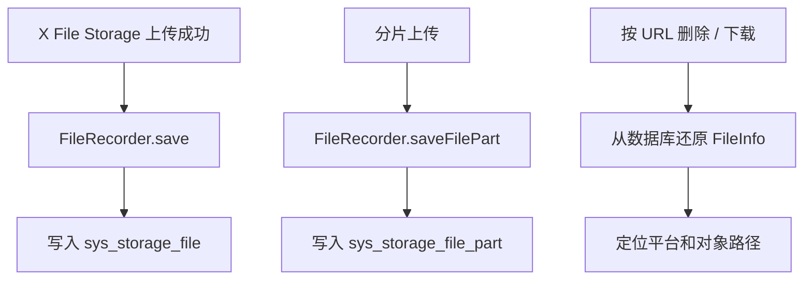

提交：

```
b4e523b9 增加存储文件记录能力
```

## 2. 涉及文件

- `ruoyi-system/pom.xml`
- `ruoyi-system/src/main/java/com/ruoyi/system/config/StorageFileProperties.java`
- `ruoyi-system/src/main/java/com/ruoyi/system/domain/SysStorageFile.java`
- `ruoyi-system/src/main/java/com/ruoyi/system/domain/SysStorageFilePart.java`
- `ruoyi-system/src/main/java/com/ruoyi/system/mapper/SysStorageFileMapper.java`
- `ruoyi-system/src/main/java/com/ruoyi/system/mapper/SysStorageFilePartMapper.java`
- `ruoyi-system/src/main/java/com/ruoyi/system/service/ISysStorageFileService.java`
- `ruoyi-system/src/main/java/com/ruoyi/system/service/impl/SysStorageFileServiceImpl.java`
- `ruoyi-system/src/main/resources/mapper/system/SysStorageFileMapper.xml`
- `ruoyi-system/src/main/resources/mapper/system/SysStorageFilePartMapper.xml`
- `sql/ry_20260417.sql`
- `sql/sys_storage_file_20260901.sql`

## 3. 改动点清单

- ruoyi-system 增加 x-file-storage-spring 依赖
- 新增文件记录表和分片记录表 SQL
- 新增文件记录领域对象、Mapper、Service 和 XML
- 实现 FileRecorder 保存文件主记录和分片记录

## 4. ruoyi-system/pom.xml

### 涉及改动部分

POM 文件只展示依赖或版本的插入位置，不展开完整原代码和现代码。

### 改动说明

- `ruoyi-system` 增加 X File Storage 依赖，用于实现数据库版 `FileRecorder`
- 文件记录属于系统业务能力，所以实现类放在 system 模块

## 5. ruoyi-system/src/main/java/com/ruoyi/system/config/StorageFileProperties.java

### 原代码

```text
本次新增，提交前不存在该文件
```

### 现代码

```java
package com.ruoyi.system.config;

import java.util.HashMap;
import java.util.Map;
import org.springframework.boot.context.properties.ConfigurationProperties;
import org.springframework.stereotype.Component;
import com.ruoyi.common.utils.StringUtils;

/**
 * 存储文件管理配置
 * <p>
 * 用于控制临时文件过期时间，以及不同业务类型旧文件进入待删除后的保留时间
 *
 * @author ruoyi
 */
@Component
@ConfigurationProperties(prefix = "ruoyi.storage-file")
public class StorageFileProperties
{
    /** 临时文件过期小时数 */
    private int tempExpireHours = 24;

    /** 默认待删除延迟小时数 */
    private int defaultDeleteDelayHours = 24;

    /** 业务类型对应的待删除延迟小时数 */
    private Map<String, Integer> deleteDelayHours = new HashMap<>();

    public int getTempExpireHours()
    {
        return tempExpireHours;
    }

    public void setTempExpireHours(int tempExpireHours)
    {
        this.tempExpireHours = tempExpireHours;
    }

    public int getDefaultDeleteDelayHours()
    {
        return defaultDeleteDelayHours;
    }

    public void setDefaultDeleteDelayHours(int defaultDeleteDelayHours)
    {
        this.defaultDeleteDelayHours = defaultDeleteDelayHours;
    }

    public Map<String, Integer> getDeleteDelayHours()
    {
        return deleteDelayHours;
    }

    public void setDeleteDelayHours(Map<String, Integer> deleteDelayHours)
    {
        this.deleteDelayHours = deleteDelayHours;
    }

    /**
     * 根据业务类型获取待删除延迟小时数
     *
     * @param bizType 业务类型
     * @return 待删除延迟小时数
     */
    public int getDeleteDelayHours(String bizType)
    {
        // 业务类型为空时直接使用默认值，适配通用文件删除场景
        if (StringUtils.isBlank(bizType) || deleteDelayHours == null)
        {
            return getPositiveOrDefault(defaultDeleteDelayHours);
        }
        // 业务单独配置了延迟时间时优先使用业务值
        Integer delayHours = deleteDelayHours.get(bizType);
        if (delayHours != null && delayHours > 0)
        {
            return delayHours;
        }
        // 未配置或配置非法时回退到默认延迟时间
        return getPositiveOrDefault(defaultDeleteDelayHours);
    }

    /**
     * 获取有效的临时文件过期小时数
     *
     * @return 临时文件过期小时数
     */
    public int getEffectiveTempExpireHours()
    {
        // 配置小于等于 0 时使用 24 小时兜底，避免误配置导致立即清理
        return getPositiveOrDefault(tempExpireHours);
    }

    /**
     * 获取正数配置或默认值
     *
     * @param value 配置值
     * @return 有效小时数
     */
    private int getPositiveOrDefault(int value)
    {
        // 所有小时数配置都要求是正数，非法值统一回退到 24 小时
        return value > 0 ? value : 24;
    }
}
```

### 涉及改动部分

```java
// 省略
package com.ruoyi.system.config;

import java.util.HashMap;
import java.util.Map;
import org.springframework.boot.context.properties.ConfigurationProperties;
import org.springframework.stereotype.Component;
import com.ruoyi.common.utils.StringUtils;

/**
 * 存储文件管理配置
 * <p>
 * 用于控制临时文件过期时间，以及不同业务类型旧文件进入待删除后的保留时间
 *
 * @author ruoyi
 */
@Component
@ConfigurationProperties(prefix = "ruoyi.storage-file")
public class StorageFileProperties
{
    /** 临时文件过期小时数 */
    private int tempExpireHours = 24;

    /** 默认待删除延迟小时数 */
    private int defaultDeleteDelayHours = 24;

    /** 业务类型对应的待删除延迟小时数 */
    private Map<String, Integer> deleteDelayHours = new HashMap<>();

    public int getTempExpireHours()
    {
        return tempExpireHours;
    }

    public void setTempExpireHours(int tempExpireHours)
    {
        this.tempExpireHours = tempExpireHours;
    }

    public int getDefaultDeleteDelayHours()
    {
        return defaultDeleteDelayHours;
    }

    public void setDefaultDeleteDelayHours(int defaultDeleteDelayHours)
    {
        this.defaultDeleteDelayHours = defaultDeleteDelayHours;
    }

    public Map<String, Integer> getDeleteDelayHours()
    {
        return deleteDelayHours;
    }

    public void setDeleteDelayHours(Map<String, Integer> deleteDelayHours)
    {
        this.deleteDelayHours = deleteDelayHours;
    }

    /**
     * 根据业务类型获取待删除延迟小时数
     *
     * @param bizType 业务类型
     * @return 待删除延迟小时数
     */
    public int getDeleteDelayHours(String bizType)
    {
        // 业务类型为空时直接使用默认值，适配通用文件删除场景
        if (StringUtils.isBlank(bizType) || deleteDelayHours == null)
        {
            return getPositiveOrDefault(defaultDeleteDelayHours);
        }
        // 业务单独配置了延迟时间时优先使用业务值
        Integer delayHours = deleteDelayHours.get(bizType);
        if (delayHours != null && delayHours > 0)
        {
            return delayHours;
        }
        // 未配置或配置非法时回退到默认延迟时间
        return getPositiveOrDefault(defaultDeleteDelayHours);
    }

    /**
     * 获取有效的临时文件过期小时数
     *
     * @return 临时文件过期小时数
     */
    public int getEffectiveTempExpireHours()
    {
        // 配置小于等于 0 时使用 24 小时兜底，避免误配置导致立即清理
        return getPositiveOrDefault(tempExpireHours);
    }

    /**
     * 获取正数配置或默认值
     *
     * @param value 配置值
     * @return 有效小时数
     */
    private int getPositiveOrDefault(int value)
    {
        // 所有小时数配置都要求是正数，非法值统一回退到 24 小时
        return value > 0 ? value : 24;
    }
}
```
### 改动说明

- 新增文件记录配置属性，读取临时文件保留时间、待删除保留时间和分片保留时间
- 清理任务和文件服务通过该配置决定什么时候可以物理删除文件

## 6. ruoyi-system/src/main/java/com/ruoyi/system/domain/SysStorageFile.java

### 原代码

```text
本次新增，提交前不存在该文件
```

### 现代码

```java
package com.ruoyi.system.domain;

import java.time.LocalDateTime;
import org.apache.commons.lang3.builder.ToStringBuilder;
import org.apache.commons.lang3.builder.ToStringStyle;
import com.ruoyi.common.core.domain.BaseEntity;

/**
 * 存储文件记录 sys_storage_file
 * <p>
 * 类名避免使用 SysFile，防止和若依服务监控模块的磁盘信息类产生 MyBatis 别名冲突
 *
 * @author ruoyi
 */
public class SysStorageFile extends BaseEntity
{
    private static final long serialVersionUID = 1L;

    /** 文件ID */
    private Long fileId;

    /** X File Storage 内部文件ID，由框架生成或由存储平台返回 */
    private String storageId;

    /** 原图访问地址 */
    private String url;

    /** 原图大小，单位字节 */
    private Long size;

    /** 原图文件名 */
    private String filename;

    /** 原始文件名 */
    private String originalFilename;

    /** 存储基础路径 */
    private String basePath;

    /** 文件路径 */
    private String path;

    /** 文件扩展名 */
    private String ext;

    /** 文件内容类型 */
    private String contentType;

    /** 存储平台 */
    private String platform;

    /** 缩略图访问地址 */
    private String thUrl;

    /** 缩略图文件名 */
    private String thFilename;

    /** 缩略图大小，单位字节 */
    private Long thSize;

    /** 缩略图内容类型 */
    private String thContentType;

    /** X File Storage 关联对象ID，框架扩展字段，不等同于本系统 bizId */
    private String objectId;

    /** X File Storage 关联对象类型，框架扩展字段，不等同于本系统 bizType */
    private String objectType;

    /** 原图存储平台元数据JSON，例如对象存储 Header 或自定义元信息 */
    private String metadata;

    /** 原图用户自定义元数据JSON，例如上传方传入的业务扩展元信息 */
    private String userMetadata;

    /** 缩略图存储平台元数据JSON */
    private String thMetadata;

    /** 缩略图用户自定义元数据JSON */
    private String thUserMetadata;

    /** X File Storage 附加属性JSON，只用于程序内部扩展，不会写入对象存储元数据 */
    private String attr;

    /** 原图访问控制ACL JSON，例如私有、公共读或平台专有权限配置 */
    private String fileAcl;

    /** 缩略图访问控制ACL JSON */
    private String thFileAcl;

    /** 原图哈希信息JSON，例如 MD5、SHA1、SHA256 等摘要结果 */
    private String hashInfo;

    /** 分片上传ID */
    private String uploadId;

    /** 分片上传状态 */
    private Integer uploadStatus;

    /** 文件状态（0临时 1已使用 2待删除 3已删除） */
    private String fileStatus;

    /** 业务类型 */
    private String bizType;

    /** 业务ID */
    private String bizId;

    /** 删除时间 */
    private LocalDateTime deleteTime;

    public Long getFileId()
    {
        return fileId;
    }

    public void setFileId(Long fileId)
    {
        this.fileId = fileId;
    }

    public String getStorageId()
    {
        return storageId;
    }

    public void setStorageId(String storageId)
    {
        this.storageId = storageId;
    }

    public String getUrl()
    {
        return url;
    }

    public void setUrl(String url)
    {
        this.url = url;
    }

    public Long getSize()
    {
        return size;
    }

    public void setSize(Long size)
    {
        this.size = size;
    }

    public String getFilename()
    {
        return filename;
    }

    public void setFilename(String filename)
    {
        this.filename = filename;
    }

    public String getOriginalFilename()
    {
        return originalFilename;
    }

    public void setOriginalFilename(String originalFilename)
    {
        this.originalFilename = originalFilename;
    }

    public String getBasePath()
    {
        return basePath;
    }

    public void setBasePath(String basePath)
    {
        this.basePath = basePath;
    }

    public String getPath()
    {
        return path;
    }

    public void setPath(String path)
    {
        this.path = path;
    }

    public String getExt()
    {
        return ext;
    }

    public void setExt(String ext)
    {
        this.ext = ext;
    }

    public String getContentType()
    {
        return contentType;
    }

    public void setContentType(String contentType)
    {
        this.contentType = contentType;
    }

    public String getPlatform()
    {
        return platform;
    }

    public void setPlatform(String platform)
    {
        this.platform = platform;
    }

    public String getThUrl()
    {
        return thUrl;
    }

    public void setThUrl(String thUrl)
    {
        this.thUrl = thUrl;
    }

    public String getThFilename()
    {
        return thFilename;
    }

    public void setThFilename(String thFilename)
    {
        this.thFilename = thFilename;
    }

    public Long getThSize()
    {
        return thSize;
    }

    public void setThSize(Long thSize)
    {
        this.thSize = thSize;
    }

    public String getThContentType()
    {
        return thContentType;
    }

    public void setThContentType(String thContentType)
    {
        this.thContentType = thContentType;
    }

    public String getObjectId()
    {
        return objectId;
    }

    public void setObjectId(String objectId)
    {
        this.objectId = objectId;
    }

    public String getObjectType()
    {
        return objectType;
    }

    public void setObjectType(String objectType)
    {
        this.objectType = objectType;
    }

    public String getMetadata()
    {
        return metadata;
    }

    public void setMetadata(String metadata)
    {
        this.metadata = metadata;
    }

    public String getUserMetadata()
    {
        return userMetadata;
    }

    public void setUserMetadata(String userMetadata)
    {
        this.userMetadata = userMetadata;
    }

    public String getThMetadata()
    {
        return thMetadata;
    }

    public void setThMetadata(String thMetadata)
    {
        this.thMetadata = thMetadata;
    }

    public String getThUserMetadata()
    {
        return thUserMetadata;
    }

    public void setThUserMetadata(String thUserMetadata)
    {
        this.thUserMetadata = thUserMetadata;
    }

    public String getAttr()
    {
        return attr;
    }

    public void setAttr(String attr)
    {
        this.attr = attr;
    }

    public String getFileAcl()
    {
        return fileAcl;
    }

    public void setFileAcl(String fileAcl)
    {
        this.fileAcl = fileAcl;
    }

    public String getThFileAcl()
    {
        return thFileAcl;
    }

    public void setThFileAcl(String thFileAcl)
    {
        this.thFileAcl = thFileAcl;
    }

    public String getHashInfo()
    {
        return hashInfo;
    }

    public void setHashInfo(String hashInfo)
    {
        this.hashInfo = hashInfo;
    }

    public String getUploadId()
    {
        return uploadId;
    }

    public void setUploadId(String uploadId)
    {
        this.uploadId = uploadId;
    }

    public Integer getUploadStatus()
    {
        return uploadStatus;
    }

    public void setUploadStatus(Integer uploadStatus)
    {
        this.uploadStatus = uploadStatus;
    }

    public String getFileStatus()
    {
        return fileStatus;
    }

    public void setFileStatus(String fileStatus)
    {
        this.fileStatus = fileStatus;
    }

    public String getBizType()
    {
        return bizType;
    }

    public void setBizType(String bizType)
    {
        this.bizType = bizType;
    }

    public String getBizId()
    {
        return bizId;
    }

    public void setBizId(String bizId)
    {
        this.bizId = bizId;
    }

    public LocalDateTime getDeleteTime()
    {
        return deleteTime;
    }

    public void setDeleteTime(LocalDateTime deleteTime)
    {
        this.deleteTime = deleteTime;
    }

    @Override
    public String toString()
    {
        return new ToStringBuilder(this, ToStringStyle.MULTI_LINE_STYLE)
                .append("fileId", getFileId())
                .append("storageId", getStorageId())
                .append("url", getUrl())
                .append("platform", getPlatform())
                .append("filename", getFilename())
                .append("fileStatus", getFileStatus())
                .append("bizType", getBizType())
                .append("bizId", getBizId())
                .append("createTime", getCreateTime())
                .append("updateTime", getUpdateTime())
                .append("remark", getRemark())
                .toString();
    }
}
```

### 涉及改动部分

```java
// 省略
package com.ruoyi.system.domain;

import java.time.LocalDateTime;
import org.apache.commons.lang3.builder.ToStringBuilder;
import org.apache.commons.lang3.builder.ToStringStyle;
import com.ruoyi.common.core.domain.BaseEntity;

/**
 * 存储文件记录 sys_storage_file
 * <p>
 * 类名避免使用 SysFile，防止和若依服务监控模块的磁盘信息类产生 MyBatis 别名冲突
 *
 * @author ruoyi
 */
public class SysStorageFile extends BaseEntity
{
    private static final long serialVersionUID = 1L;

    /** 文件ID */
    private Long fileId;

    /** X File Storage 内部文件ID，由框架生成或由存储平台返回 */
    private String storageId;

    /** 原图访问地址 */
    private String url;

    /** 原图大小，单位字节 */
    private Long size;

    /** 原图文件名 */
    private String filename;

    /** 原始文件名 */
    private String originalFilename;

    /** 存储基础路径 */
    private String basePath;

    /** 文件路径 */
    private String path;

    /** 文件扩展名 */
    private String ext;

    /** 文件内容类型 */
    private String contentType;

    /** 存储平台 */
    private String platform;

    /** 缩略图访问地址 */
    private String thUrl;

    /** 缩略图文件名 */
    private String thFilename;

    /** 缩略图大小，单位字节 */
    private Long thSize;

    /** 缩略图内容类型 */
    private String thContentType;

    /** X File Storage 关联对象ID，框架扩展字段，不等同于本系统 bizId */
    private String objectId;

    /** X File Storage 关联对象类型，框架扩展字段，不等同于本系统 bizType */
    private String objectType;

    /** 原图存储平台元数据JSON，例如对象存储 Header 或自定义元信息 */
    private String metadata;

    /** 原图用户自定义元数据JSON，例如上传方传入的业务扩展元信息 */
    private String userMetadata;

    /** 缩略图存储平台元数据JSON */
    private String thMetadata;

    /** 缩略图用户自定义元数据JSON */
    private String thUserMetadata;

    /** X File Storage 附加属性JSON，只用于程序内部扩展，不会写入对象存储元数据 */
    private String attr;

    /** 原图访问控制ACL JSON，例如私有、公共读或平台专有权限配置 */
    private String fileAcl;

    /** 缩略图访问控制ACL JSON */
    private String thFileAcl;

    /** 原图哈希信息JSON，例如 MD5、SHA1、SHA256 等摘要结果 */
    private String hashInfo;

    /** 分片上传ID */
    private String uploadId;

    /** 分片上传状态 */
    private Integer uploadStatus;

    /** 文件状态（0临时 1已使用 2待删除 3已删除） */
    private String fileStatus;

    /** 业务类型 */
    private String bizType;

    /** 业务ID */
    private String bizId;

    /** 删除时间 */
    private LocalDateTime deleteTime;

    public Long getFileId()
    {
        return fileId;
    }

    public void setFileId(Long fileId)
    {
        this.fileId = fileId;
    }
// 省略
```
### 改动说明

- 新增主文件记录实体，对应 `sys_storage_file` 表
- 保存原文件 URL、大小、平台、缩略图、业务绑定状态、清理状态等信息

## 7. ruoyi-system/src/main/java/com/ruoyi/system/domain/SysStorageFilePart.java

### 原代码

```text
本次新增，提交前不存在该文件
```

### 现代码

```java
package com.ruoyi.system.domain;

import java.time.LocalDateTime;
import org.apache.commons.lang3.builder.ToStringBuilder;
import org.apache.commons.lang3.builder.ToStringStyle;
import com.ruoyi.common.core.domain.BaseEntity;

/**
 * 存储文件分片记录 sys_storage_file_part
 * <p>
 * 用于承接 X File Storage 手动分片上传回调，和 sys_storage_file 主文件记录分开保存
 *
 * @author ruoyi
 */
public class SysStorageFilePart extends BaseEntity
{
    private static final long serialVersionUID = 1L;

    /** 分片ID */
    private Long partId;

    /** X File Storage 内部分片ID，由框架生成或由存储平台返回 */
    private String storageId;

    /** 存储平台 */
    private String platform;

    /** 分片上传ID */
    private String uploadId;

    /** 分片编号 */
    private Integer partNumber;

    /** 分片大小，单位字节 */
    private Long partSize;

    /** 分片ETag，存储平台返回的分片唯一校验标识 */
    private String etag;

    /** 分片哈希信息JSON，例如 MD5、SHA1、SHA256 等摘要结果 */
    private String hashInfo;

    /** 分片最后修改时间 */
    private LocalDateTime lastModified;

    public Long getPartId()
    {
        return partId;
    }

    public void setPartId(Long partId)
    {
        this.partId = partId;
    }

    public String getStorageId()
    {
        return storageId;
    }

    public void setStorageId(String storageId)
    {
        this.storageId = storageId;
    }

    public String getPlatform()
    {
        return platform;
    }

    public void setPlatform(String platform)
    {
        this.platform = platform;
    }

    public String getUploadId()
    {
        return uploadId;
    }

    public void setUploadId(String uploadId)
    {
        this.uploadId = uploadId;
    }

    public Integer getPartNumber()
    {
        return partNumber;
    }

    public void setPartNumber(Integer partNumber)
    {
        this.partNumber = partNumber;
    }

    public Long getPartSize()
    {
        return partSize;
    }

    public void setPartSize(Long partSize)
    {
        this.partSize = partSize;
    }

    public String getEtag()
    {
        return etag;
    }

    public void setEtag(String etag)
    {
        this.etag = etag;
    }

    public String getHashInfo()
    {
        return hashInfo;
    }

    public void setHashInfo(String hashInfo)
    {
        this.hashInfo = hashInfo;
    }

    public LocalDateTime getLastModified()
    {
        return lastModified;
    }

    public void setLastModified(LocalDateTime lastModified)
    {
        this.lastModified = lastModified;
    }

    @Override
    public String toString()
    {
        return new ToStringBuilder(this, ToStringStyle.MULTI_LINE_STYLE)
                .append("partId", getPartId())
                .append("storageId", getStorageId())
                .append("platform", getPlatform())
                .append("uploadId", getUploadId())
                .append("partNumber", getPartNumber())
                .append("partSize", getPartSize())
                .append("etag", getEtag())
                .append("createTime", getCreateTime())
                .append("lastModified", getLastModified())
                .toString();
    }
}
```

### 涉及改动部分

```java
// 省略
package com.ruoyi.system.domain;

import java.time.LocalDateTime;
import org.apache.commons.lang3.builder.ToStringBuilder;
import org.apache.commons.lang3.builder.ToStringStyle;
import com.ruoyi.common.core.domain.BaseEntity;

/**
 * 存储文件分片记录 sys_storage_file_part
 * <p>
 * 用于承接 X File Storage 手动分片上传回调，和 sys_storage_file 主文件记录分开保存
 *
 * @author ruoyi
 */
public class SysStorageFilePart extends BaseEntity
{
    private static final long serialVersionUID = 1L;

    /** 分片ID */
    private Long partId;

    /** X File Storage 内部分片ID，由框架生成或由存储平台返回 */
    private String storageId;

    /** 存储平台 */
    private String platform;

    /** 分片上传ID */
    private String uploadId;

    /** 分片编号 */
    private Integer partNumber;

    /** 分片大小，单位字节 */
    private Long partSize;

    /** 分片ETag，存储平台返回的分片唯一校验标识 */
    private String etag;

    /** 分片哈希信息JSON，例如 MD5、SHA1、SHA256 等摘要结果 */
    private String hashInfo;

    /** 分片最后修改时间 */
    private LocalDateTime lastModified;

    public Long getPartId()
    {
        return partId;
    }

    public void setPartId(Long partId)
    {
        this.partId = partId;
    }

    public String getStorageId()
    {
        return storageId;
    }

    public void setStorageId(String storageId)
    {
        this.storageId = storageId;
    }

    public String getPlatform()
    {
        return platform;
    }

    public void setPlatform(String platform)
    {
        this.platform = platform;
    }

    public String getUploadId()
    {
        return uploadId;
    }

    public void setUploadId(String uploadId)
    {
        this.uploadId = uploadId;
    }

    public Integer getPartNumber()
    {
        return partNumber;
    }

    public void setPartNumber(Integer partNumber)
    {
        this.partNumber = partNumber;
    }

    public Long getPartSize()
    {
        return partSize;
    }

    public void setPartSize(Long partSize)
    {
        this.partSize = partSize;
    }

    public String getEtag()
    {
        return etag;
    }

    public void setEtag(String etag)
    {
        this.etag = etag;
    }

    public String getHashInfo()
    {
        return hashInfo;
    }

// 省略
```
### 改动说明

- 新增分片文件记录实体，对应 `sys_storage_file_part` 表
- 保存 uploadId、partNumber、partSize、etag 等分片上传信息

## 8. ruoyi-system/src/main/java/com/ruoyi/system/mapper/SysStorageFileMapper.java

### 原代码

```text
本次新增，提交前不存在该文件
```

### 现代码

```java
package com.ruoyi.system.mapper;

import java.time.LocalDateTime;
import java.util.List;
import org.apache.ibatis.annotations.Param;
import com.ruoyi.system.domain.SysStorageFile;

/**
 * 存储文件记录 数据层
 *
 * @author ruoyi
 */
public interface SysStorageFileMapper
{
    /**
     * 根据 URL 查询文件记录
     *
     * @param url 文件访问地址
     * @return 文件记录
     */
    public SysStorageFile selectStorageFileByUrl(String url);

    /**
     * 查询可清理的文件记录
     *
     * @param tempBefore 临时文件过期时间
     * @param waitDeleteBefore 待删除文件到期时间
     * @return 文件记录集合
     */
    public List<SysStorageFile> selectCleanableStorageFiles(@Param("tempBefore") LocalDateTime tempBefore,
            @Param("waitDeleteBefore") LocalDateTime waitDeleteBefore);

    /**
     * 新增文件记录
     *
     * @param storageFile 文件记录
     * @return 结果
     */
    public int insertStorageFile(SysStorageFile storageFile);

    /**
     * 更新文件记录
     *
     * @param storageFile 文件记录
     * @return 结果
     */
    public int updateStorageFile(SysStorageFile storageFile);

    /**
     * 根据 URL 删除文件记录
     *
     * @param url 文件访问地址
     * @return 结果
     */
    public int deleteStorageFileByUrl(String url);

    /**
     * 绑定文件到业务
     *
     * @param url 文件访问地址
     * @param bizType 业务类型
     * @param bizId 业务ID
     * @param updateBy 更新者
     * @return 结果
     */
    public int bindStorageFile(@Param("url") String url, @Param("bizType") String bizType,
            @Param("bizId") String bizId, @Param("updateBy") String updateBy);

    /**
     * 标记文件为待删除
     *
     * @param url 文件访问地址
     * @param deleteTime 删除时间
     * @param updateBy 更新者
     * @return 结果
     */
    public int markStorageFileWaitDelete(@Param("url") String url, @Param("deleteTime") LocalDateTime deleteTime,
            @Param("updateBy") String updateBy);

    /**
     * 标记文件为已删除
     *
     * @param url 文件访问地址
     * @param updateBy 更新者
     * @return 结果
     */
    public int markStorageFileDeleted(@Param("url") String url, @Param("updateBy") String updateBy);
}
```

### 涉及改动部分

```java
// 省略
package com.ruoyi.system.mapper;

import java.time.LocalDateTime;
import java.util.List;
import org.apache.ibatis.annotations.Param;
import com.ruoyi.system.domain.SysStorageFile;

/**
 * 存储文件记录 数据层
 *
 * @author ruoyi
 */
public interface SysStorageFileMapper
{
    /**
     * 根据 URL 查询文件记录
     *
     * @param url 文件访问地址
     * @return 文件记录
     */
    public SysStorageFile selectStorageFileByUrl(String url);

    /**
     * 查询可清理的文件记录
     *
     * @param tempBefore 临时文件过期时间
     * @param waitDeleteBefore 待删除文件到期时间
     * @return 文件记录集合
     */
    public List<SysStorageFile> selectCleanableStorageFiles(@Param("tempBefore") LocalDateTime tempBefore,
            @Param("waitDeleteBefore") LocalDateTime waitDeleteBefore);

    /**
     * 新增文件记录
     *
     * @param storageFile 文件记录
     * @return 结果
     */
    public int insertStorageFile(SysStorageFile storageFile);

    /**
     * 更新文件记录
     *
     * @param storageFile 文件记录
     * @return 结果
     */
    public int updateStorageFile(SysStorageFile storageFile);

    /**
     * 根据 URL 删除文件记录
     *
     * @param url 文件访问地址
     * @return 结果
     */
    public int deleteStorageFileByUrl(String url);

    /**
     * 绑定文件到业务
     *
     * @param url 文件访问地址
     * @param bizType 业务类型
     * @param bizId 业务ID
     * @param updateBy 更新者
     * @return 结果
     */
    public int bindStorageFile(@Param("url") String url, @Param("bizType") String bizType,
            @Param("bizId") String bizId, @Param("updateBy") String updateBy);

    /**
     * 标记文件为待删除
     *
     * @param url 文件访问地址
     * @param deleteTime 删除时间
     * @param updateBy 更新者
     * @return 结果
     */
    public int markStorageFileWaitDelete(@Param("url") String url, @Param("deleteTime") LocalDateTime deleteTime,
            @Param("updateBy") String updateBy);

    /**
     * 标记文件为已删除
     *
     * @param url 文件访问地址
     * @param updateBy 更新者
     * @return 结果
     */
    public int markStorageFileDeleted(@Param("url") String url, @Param("updateBy") String updateBy);
}
```
### 改动说明

- 新增主文件记录 Mapper，提供按 URL 查询、可清理文件查询、状态更新等数据库操作

## 9. ruoyi-system/src/main/java/com/ruoyi/system/mapper/SysStorageFilePartMapper.java

### 原代码

```text
本次新增，提交前不存在该文件
```

### 现代码

```java
package com.ruoyi.system.mapper;

import org.apache.ibatis.annotations.Param;
import com.ruoyi.system.domain.SysStorageFilePart;

/**
 * 存储文件分片记录 数据层
 *
 * @author ruoyi
 */
public interface SysStorageFilePartMapper
{
    /**
     * 新增或更新分片记录
     *
     * @param storageFilePart 分片记录
     * @return 结果
     */
    public int saveStorageFilePart(SysStorageFilePart storageFilePart);

    /**
     * 根据分片上传ID删除分片记录
     *
     * @param uploadId 分片上传ID
     * @return 结果
     */
    public int deleteStorageFilePartByUploadId(@Param("uploadId") String uploadId);
}
```

### 涉及改动部分

```java
// 省略
package com.ruoyi.system.mapper;

import org.apache.ibatis.annotations.Param;
import com.ruoyi.system.domain.SysStorageFilePart;

/**
 * 存储文件分片记录 数据层
 *
 * @author ruoyi
 */
public interface SysStorageFilePartMapper
{
    /**
     * 新增或更新分片记录
     *
     * @param storageFilePart 分片记录
     * @return 结果
     */
    public int saveStorageFilePart(SysStorageFilePart storageFilePart);

    /**
     * 根据分片上传ID删除分片记录
     *
     * @param uploadId 分片上传ID
     * @return 结果
     */
    public int deleteStorageFilePartByUploadId(@Param("uploadId") String uploadId);
}
```
### 改动说明

- 新增分片记录 Mapper，提供保存、查询和删除分片记录能力

## 10. ruoyi-system/src/main/java/com/ruoyi/system/service/ISysStorageFileService.java

### 原代码

```text
本次新增，提交前不存在该文件
```

### 现代码

```java
package com.ruoyi.system.service;

import java.util.List;
import org.dromara.x.file.storage.core.FileInfo;
import org.dromara.x.file.storage.core.recorder.FileRecorder;
import com.ruoyi.system.domain.SysStorageFile;

/**
 * 存储文件记录 服务层
 *
 * @author ruoyi
 */
public interface ISysStorageFileService extends FileRecorder
{
    /**
     * 绑定文件到业务
     *
     * @param url 文件访问地址
     * @param bizType 业务类型
     * @param bizId 业务ID
     * @param updateBy 更新者
     * @return 结果
     */
    public int bindStorageFile(String url, String bizType, String bizId, String updateBy);

    /**
     * 标记文件为待删除
     *
     * @param url 文件访问地址
     * @param delayHours 延迟删除小时数
     * @param updateBy 更新者
     * @return 结果
     */
    public int markStorageFileWaitDelete(String url, int delayHours, String updateBy);

    /**
     * 按业务类型标记文件为待删除
     *
     * @param url 文件访问地址
     * @param bizType 业务类型
     * @param updateBy 更新者
     * @return 结果
     */
    public int markStorageFileWaitDelete(String url, String bizType, String updateBy);

    /**
     * 标记文件为已删除
     *
     * @param url 文件访问地址
     * @param updateBy 更新者
     * @return 结果
     */
    public int markStorageFileDeleted(String url, String updateBy);

    /**
     * 查询可清理的文件记录
     *
     * @param tempExpireHours 临时文件过期小时数
     * @return 文件记录集合
     */
    public List<SysStorageFile> selectCleanableStorageFiles(int tempExpireHours);

    /**
     * 将数据库记录还原为 X File Storage 文件信息
     *
     * @param storageFile 数据库文件记录
     * @return X File Storage 文件信息
     */
    public FileInfo toFileInfo(SysStorageFile storageFile);
}
```

### 涉及改动部分

```java
// 省略
package com.ruoyi.system.service;

import java.util.List;
import org.dromara.x.file.storage.core.FileInfo;
import org.dromara.x.file.storage.core.recorder.FileRecorder;
import com.ruoyi.system.domain.SysStorageFile;

/**
 * 存储文件记录 服务层
 *
 * @author ruoyi
 */
public interface ISysStorageFileService extends FileRecorder
{
    /**
     * 绑定文件到业务
     *
     * @param url 文件访问地址
     * @param bizType 业务类型
     * @param bizId 业务ID
     * @param updateBy 更新者
     * @return 结果
     */
    public int bindStorageFile(String url, String bizType, String bizId, String updateBy);

    /**
     * 标记文件为待删除
     *
     * @param url 文件访问地址
     * @param delayHours 延迟删除小时数
     * @param updateBy 更新者
     * @return 结果
     */
    public int markStorageFileWaitDelete(String url, int delayHours, String updateBy);

    /**
     * 按业务类型标记文件为待删除
     *
     * @param url 文件访问地址
     * @param bizType 业务类型
     * @param updateBy 更新者
     * @return 结果
     */
    public int markStorageFileWaitDelete(String url, String bizType, String updateBy);

    /**
     * 标记文件为已删除
     *
     * @param url 文件访问地址
     * @param updateBy 更新者
     * @return 结果
     */
    public int markStorageFileDeleted(String url, String updateBy);

    /**
     * 查询可清理的文件记录
     *
     * @param tempExpireHours 临时文件过期小时数
     * @return 文件记录集合
     */
    public List<SysStorageFile> selectCleanableStorageFiles(int tempExpireHours);

    /**
     * 将数据库记录还原为 X File Storage 文件信息
     *
     * @param storageFile 数据库文件记录
     * @return X File Storage 文件信息
     */
    public FileInfo toFileInfo(SysStorageFile storageFile);
}
```
### 改动说明

- 新增文件记录服务接口，同时承接 X File Storage `FileRecorder` 能力
- 对外提供业务绑定、待删除标记、清理查询和 URL 还原 FileInfo 能力

## 11. ruoyi-system/src/main/java/com/ruoyi/system/service/impl/SysStorageFileServiceImpl.java

### 原代码

```text
本次新增，提交前不存在该文件
```

### 现代码

```java
package com.ruoyi.system.service.impl;

import java.time.LocalDateTime;
import java.time.ZoneId;
import java.util.Date;
import java.util.List;
import java.util.Map;
import org.dromara.x.file.storage.core.FileInfo;
import org.dromara.x.file.storage.core.hash.HashInfo;
import org.dromara.x.file.storage.core.upload.FilePartInfo;
import org.springframework.beans.factory.annotation.Autowired;
import org.springframework.stereotype.Service;
import com.alibaba.fastjson2.JSON;
import com.alibaba.fastjson2.TypeReference;
import com.ruoyi.common.utils.DateUtils;
import com.ruoyi.common.utils.StringUtils;
import com.ruoyi.system.config.StorageFileProperties;
import com.ruoyi.system.domain.SysStorageFile;
import com.ruoyi.system.domain.SysStorageFilePart;
import com.ruoyi.system.mapper.SysStorageFileMapper;
import com.ruoyi.system.mapper.SysStorageFilePartMapper;
import com.ruoyi.system.service.ISysStorageFileService;

/**
 * 存储文件记录 服务层实现
 * <p>
 * 该类同时实现 X File Storage 的 FileRecorder 接口，让上传记录真正落到 sys_storage_file
 *
 * @author ruoyi
 */
@Service
public class SysStorageFileServiceImpl implements ISysStorageFileService
{
    /** 临时文件 */
    private static final String STATUS_TEMP = "0";

    /** 已使用文件 */
    private static final String STATUS_USED = "1";

    /** 待删除文件 */
    private static final String STATUS_WAIT_DELETE = "2";

    /** 已删除文件 */
    private static final String STATUS_DELETED = "3";

    @Autowired
    private SysStorageFileMapper storageFileMapper;

    @Autowired
    private SysStorageFilePartMapper storageFilePartMapper;

    @Autowired
    private StorageFileProperties storageFileProperties;

    /**
     * 保存上传文件记录
     *
     * @param fileInfo X File Storage 上传后生成的文件元数据
     * @return true 表示保存成功
     */
    @Override
    public boolean save(FileInfo fileInfo)
    {
        // 上传成功后框架会调用该方法，没有 URL 的记录无法用于后续按 URL 查询
        if (fileInfo == null || StringUtils.isBlank(fileInfo.getUrl()))
        {
            return false;
        }
        // 同一个 URL 重复保存时按更新处理，避免重试上传造成唯一索引冲突
        SysStorageFile exists = storageFileMapper.selectStorageFileByUrl(fileInfo.getUrl());
        SysStorageFile storageFile = toStorageFile(fileInfo);
        if (exists != null)
        {
            // 保留原主键并刷新最新元数据
            storageFile.setFileId(exists.getFileId());
            storageFile.setUpdateTime(DateUtils.getNowDate());
            return storageFileMapper.updateStorageFile(storageFile) > 0;
        }
        // 新上传文件先记录为临时状态，等业务保存成功后再绑定为已使用
        storageFile.setFileStatus(STATUS_TEMP);
        storageFile.setCreateTime(fileInfo.getCreateTime() == null ? DateUtils.getNowDate() : fileInfo.getCreateTime());
        return storageFileMapper.insertStorageFile(storageFile) > 0;
    }

    /**
     * 更新上传文件记录
     *
     * @param fileInfo X File Storage 文件元数据
     */
    @Override
    public void update(FileInfo fileInfo)
    {
        // 框架更新记录时复用保存逻辑，保证 URL 对应的元数据保持最新
        save(fileInfo);
    }

    /**
     * 根据 URL 查询文件信息
     *
     * @param url 文件访问地址
     * @return X File Storage 文件信息
     */
    @Override
    public FileInfo getByUrl(String url)
    {
        // 按 URL 从 sys_storage_file 还原 FileInfo，支持官网文档中的 delete(url)、exists(url) 等操作
        return toFileInfo(storageFileMapper.selectStorageFileByUrl(url));
    }

    /**
     * 删除文件记录
     *
     * @param url 文件访问地址
     * @return true 表示删除记录成功
     */
    @Override
    public boolean delete(String url)
    {
        // 物理删除成功后框架会调用该方法，这里保留记录并标记已删除，便于审计和排查
        return markStorageFileDeleted(url, "") >= 0;
    }

    /**
     * 保存分片上传记录
     *
     * @param filePartInfo 分片上传元数据
     */
    @Override
    public void saveFilePart(FilePartInfo filePartInfo)
    {
        // 分片上传没有 uploadId 时无法在后续合并或取消时定位同一批分片
        if (filePartInfo == null || StringUtils.isBlank(filePartInfo.getUploadId()))
        {
            return;
        }
        // 将框架回调的分片信息转换为数据库记录，和主文件记录拆开保存
        SysStorageFilePart storageFilePart = toStorageFilePart(filePartInfo);
        storageFilePartMapper.saveStorageFilePart(storageFilePart);
    }

    /**
     * 根据 uploadId 删除分片上传记录
     *
     * @param uploadId 分片上传 ID
     */
    @Override
    public void deleteFilePartByUploadId(String uploadId)
    {
        // 框架完成、取消或清理分片上传时会按 uploadId 删除这批分片记录
        if (StringUtils.isBlank(uploadId))
        {
            return;
        }
        storageFilePartMapper.deleteStorageFilePartByUploadId(uploadId);
    }

    /**
     * 绑定文件到业务
     *
     * @param url 文件访问地址
     * @param bizType 业务类型
     * @param bizId 业务ID
     * @param updateBy 更新者
     * @return 结果
     */
    @Override
    public int bindStorageFile(String url, String bizType, String bizId, String updateBy)
    {
        // 业务保存成功后把临时文件转为已使用，避免被临时文件清理任务误删
        if (StringUtils.isBlank(url))
        {
            return 0;
        }
        return storageFileMapper.bindStorageFile(url, bizType, bizId, updateBy);
    }

    /**
     * 标记文件为待删除
     *
     * @param url 文件访问地址
     * @param delayHours 延迟删除小时数
     * @param updateBy 更新者
     * @return 结果
     */
    @Override
    public int markStorageFileWaitDelete(String url, int delayHours, String updateBy)
    {
        // 历史本地 /profile 文件没有 X File Storage 记录，直接跳过状态标记
        if (StringUtils.isBlank(url))
        {
            return 0;
        }
        // 延迟删除给浏览器缓存、CDN 缓存和短时间回滚留出缓冲
        LocalDateTime deleteTime = LocalDateTime.now().plusHours(delayHours);
        return storageFileMapper.markStorageFileWaitDelete(url, deleteTime, updateBy);
    }

    /**
     * 按业务类型标记文件为待删除
     *
     * @param url 文件访问地址
     * @param bizType 业务类型
     * @param updateBy 更新者
     * @return 结果
     */
    @Override
    public int markStorageFileWaitDelete(String url, String bizType, String updateBy)
    {
        // 不同业务可以配置不同保留时间，例如头像短保留、合同附件长保留
        int delayHours = storageFileProperties.getDeleteDelayHours(bizType);
        return markStorageFileWaitDelete(url, delayHours, updateBy);
    }

    /**
     * 标记文件为已删除
     *
     * @param url 文件访问地址
     * @param updateBy 更新者
     * @return 结果
     */
    @Override
    public int markStorageFileDeleted(String url, String updateBy)
    {
        // 物理文件删除成功后保留记录并标记删除，便于后续审计和排查
        if (StringUtils.isBlank(url))
        {
            return 0;
        }
        return storageFileMapper.markStorageFileDeleted(url, updateBy);
    }

    /**
     * 查询可清理的文件记录
     *
     * @param tempExpireHours 临时文件过期小时数
     * @return 文件记录集合
     */
    @Override
    public List<SysStorageFile> selectCleanableStorageFiles(int tempExpireHours)
    {
        // 定时任务未传参数或参数非法时使用配置文件中的临时文件过期时间
        int expireHours = tempExpireHours <= 0 ? storageFileProperties.getEffectiveTempExpireHours() : tempExpireHours;
        // 临时文件按创建时间过期，待删除文件按 delete_time 到期
        LocalDateTime now = LocalDateTime.now();
        LocalDateTime tempBefore = now.minusHours(expireHours);
        return storageFileMapper.selectCleanableStorageFiles(tempBefore, now);
    }

    /**
     * 将数据库记录还原为 X File Storage 文件信息
     *
     * @param storageFile 数据库文件记录
     * @return X File Storage 文件信息
     */
    @Override
    public FileInfo toFileInfo(SysStorageFile storageFile)
    {
        // 没有数据库记录时返回 null，让框架或调用方自行决定是否跳过
        if (storageFile == null)
        {
            return null;
        }
        // FileInfo 需要 platform、basePath、path、filename 才能让具体平台定位对象
        FileInfo fileInfo = new FileInfo()
                .setId(storageFile.getStorageId())
                .setUrl(storageFile.getUrl())
                .setSize(storageFile.getSize())
                .setFilename(storageFile.getFilename())
                .setOriginalFilename(storageFile.getOriginalFilename())
                .setBasePath(storageFile.getBasePath())
                .setPath(storageFile.getPath())
                .setExt(storageFile.getExt())
                .setContentType(storageFile.getContentType())
                .setPlatform(storageFile.getPlatform())
                .setThUrl(storageFile.getThUrl())
                .setThFilename(storageFile.getThFilename())
                .setThSize(storageFile.getThSize())
                .setThContentType(storageFile.getThContentType())
                .setObjectId(storageFile.getObjectId())
                .setObjectType(storageFile.getObjectType())
                .setMetadata(parseMap(storageFile.getMetadata()))
                .setUserMetadata(parseMap(storageFile.getUserMetadata()))
                .setThMetadata(parseMap(storageFile.getThMetadata()))
                .setThUserMetadata(parseMap(storageFile.getThUserMetadata()))
                .setFileAcl(parseObject(storageFile.getFileAcl()))
                .setThFileAcl(parseObject(storageFile.getThFileAcl()))
                .setHashInfo(parseHashInfo(storageFile.getHashInfo()))
                .setUploadId(storageFile.getUploadId())
                .setUploadStatus(storageFile.getUploadStatus())
                .setCreateTime(storageFile.getCreateTime());
        return fileInfo;
    }

    /**
     * 将 X File Storage 文件信息转换为数据库记录
     *
     * @param fileInfo X File Storage 文件信息
     * @return 数据库文件记录
     */
    private SysStorageFile toStorageFile(FileInfo fileInfo)
    {
        SysStorageFile storageFile = new SysStorageFile();
        // 原样保存框架生成的元数据，保证后续可按 URL 还原 FileInfo 做删除、下载、判断存在
        storageFile.setStorageId(fileInfo.getId());
        storageFile.setUrl(fileInfo.getUrl());
        storageFile.setSize(fileInfo.getSize());
        storageFile.setFilename(fileInfo.getFilename());
        storageFile.setOriginalFilename(fileInfo.getOriginalFilename());
        storageFile.setBasePath(fileInfo.getBasePath());
        storageFile.setPath(fileInfo.getPath());
        storageFile.setExt(fileInfo.getExt());
        storageFile.setContentType(fileInfo.getContentType());
        storageFile.setPlatform(fileInfo.getPlatform());
        storageFile.setThUrl(fileInfo.getThUrl());
        storageFile.setThFilename(fileInfo.getThFilename());
        storageFile.setThSize(fileInfo.getThSize());
        storageFile.setThContentType(fileInfo.getThContentType());
        storageFile.setObjectId(fileInfo.getObjectId());
        storageFile.setObjectType(fileInfo.getObjectType());
        storageFile.setMetadata(toJson(fileInfo.getMetadata()));
        storageFile.setUserMetadata(toJson(fileInfo.getUserMetadata()));
        storageFile.setThMetadata(toJson(fileInfo.getThMetadata()));
        storageFile.setThUserMetadata(toJson(fileInfo.getThUserMetadata()));
        storageFile.setAttr(toJson(fileInfo.getAttr()));
        storageFile.setFileAcl(toJson(fileInfo.getFileAcl()));
        storageFile.setThFileAcl(toJson(fileInfo.getThFileAcl()));
        storageFile.setHashInfo(toJson(fileInfo.getHashInfo()));
        storageFile.setUploadId(fileInfo.getUploadId());
        storageFile.setUploadStatus(fileInfo.getUploadStatus());
        return storageFile;
    }

    /**
     * 将 X File Storage 分片信息转换为数据库记录
     *
     * @param filePartInfo X File Storage 分片信息
     * @return 数据库分片记录
     */
    private SysStorageFilePart toStorageFilePart(FilePartInfo filePartInfo)
    {
        SysStorageFilePart storageFilePart = new SysStorageFilePart();
        // 分片记录只保存断点续传需要的分片维度信息，不混入主文件业务绑定状态
        storageFilePart.setStorageId(filePartInfo.getId());
        storageFilePart.setPlatform(filePartInfo.getPlatform());
        storageFilePart.setUploadId(filePartInfo.getUploadId());
        storageFilePart.setPartNumber(filePartInfo.getPartNumber());
        storageFilePart.setPartSize(filePartInfo.getPartSize());
        storageFilePart.setEtag(filePartInfo.getETag());
        storageFilePart.setHashInfo(toJson(filePartInfo.getHashInfo()));
        storageFilePart.setCreateTime(filePartInfo.getCreateTime() == null ? DateUtils.getNowDate() : filePartInfo.getCreateTime());
        storageFilePart.setLastModified(toLocalDateTime(filePartInfo.getLastModified()));
        return storageFilePart;
    }

    /**
     * 将原始依赖中的 Date 转换为业务记录使用的 LocalDateTime
     *
     * @param date 原始时间
     * @return 本地日期时间
     */
    private LocalDateTime toLocalDateTime(Date date)
    {
        // X File Storage 的 FilePartInfo 使用 Date，这里只在落库前转换一次
        return date == null ? null : LocalDateTime.ofInstant(date.toInstant(), ZoneId.systemDefault());
    }

    /**
     * 转换为 JSON 字符串
     *
     * @param value 待转换对象
     * @return JSON 字符串
     */
    private String toJson(Object value)
    {
        // 空值不写 JSON，减少数据库里的无意义空对象
        return value == null ? null : JSON.toJSONString(value);
    }

    /**
     * 解析字符串键值元数据
     *
     * @param json JSON 字符串
     * @return 字符串键值 Map
     */
    private Map<String, String> parseMap(String json)
    {
        // 元数据为空时直接返回 null，保持和 FileInfo 原始语义一致
        if (StringUtils.isBlank(json))
        {
            return null;
        }
        return JSON.parseObject(json, new TypeReference<Map<String, String>>()
        {
        });
    }

    /**
     * 解析普通对象
     *
     * @param json JSON 字符串
     * @return 普通对象
     */
    private Object parseObject(String json)
    {
        // ACL 等字段类型由不同平台决定，这里还原为通用 JSON 对象即可
        return StringUtils.isBlank(json) ? null : JSON.parse(json);
    }

    /**
     * 解析哈希信息
     *
     * @param json JSON 字符串
     * @return 哈希信息
     */
    private HashInfo parseHashInfo(String json)
    {
        // 哈希信息本质是字符串键值 Map，重新包装成 HashInfo 交回框架
        Map<String, String> map = parseMap(json);
        return map == null ? null : new HashInfo(map);
    }
}
```

### 涉及改动部分

```java
// 省略
package com.ruoyi.system.service.impl;

import java.time.LocalDateTime;
import java.time.ZoneId;
import java.util.Date;
import java.util.List;
import java.util.Map;
import org.dromara.x.file.storage.core.FileInfo;
import org.dromara.x.file.storage.core.hash.HashInfo;
import org.dromara.x.file.storage.core.upload.FilePartInfo;
import org.springframework.beans.factory.annotation.Autowired;
import org.springframework.stereotype.Service;
import com.alibaba.fastjson2.JSON;
import com.alibaba.fastjson2.TypeReference;
import com.ruoyi.common.utils.DateUtils;
import com.ruoyi.common.utils.StringUtils;
import com.ruoyi.system.config.StorageFileProperties;
import com.ruoyi.system.domain.SysStorageFile;
import com.ruoyi.system.domain.SysStorageFilePart;
import com.ruoyi.system.mapper.SysStorageFileMapper;
import com.ruoyi.system.mapper.SysStorageFilePartMapper;
import com.ruoyi.system.service.ISysStorageFileService;

/**
 * 存储文件记录 服务层实现
 * <p>
 * 该类同时实现 X File Storage 的 FileRecorder 接口，让上传记录真正落到 sys_storage_file
 *
 * @author ruoyi
 */
@Service
public class SysStorageFileServiceImpl implements ISysStorageFileService
{
    /** 临时文件 */
    private static final String STATUS_TEMP = "0";

    /** 已使用文件 */
    private static final String STATUS_USED = "1";

    /** 待删除文件 */
    private static final String STATUS_WAIT_DELETE = "2";

    /** 已删除文件 */
    private static final String STATUS_DELETED = "3";

    @Autowired
    private SysStorageFileMapper storageFileMapper;

    @Autowired
    private SysStorageFilePartMapper storageFilePartMapper;

    @Autowired
    private StorageFileProperties storageFileProperties;

    /**
     * 保存上传文件记录
     *
     * @param fileInfo X File Storage 上传后生成的文件元数据
     * @return true 表示保存成功
     */
    @Override
    public boolean save(FileInfo fileInfo)
    {
        // 上传成功后框架会调用该方法，没有 URL 的记录无法用于后续按 URL 查询
        if (fileInfo == null || StringUtils.isBlank(fileInfo.getUrl()))
        {
            return false;
        }
        // 同一个 URL 重复保存时按更新处理，避免重试上传造成唯一索引冲突
        SysStorageFile exists = storageFileMapper.selectStorageFileByUrl(fileInfo.getUrl());
        SysStorageFile storageFile = toStorageFile(fileInfo);
        if (exists != null)
        {
            // 保留原主键并刷新最新元数据
            storageFile.setFileId(exists.getFileId());
            storageFile.setUpdateTime(DateUtils.getNowDate());
            return storageFileMapper.updateStorageFile(storageFile) > 0;
        }
        // 新上传文件先记录为临时状态，等业务保存成功后再绑定为已使用
        storageFile.setFileStatus(STATUS_TEMP);
        storageFile.setCreateTime(fileInfo.getCreateTime() == null ? DateUtils.getNowDate() : fileInfo.getCreateTime());
        return storageFileMapper.insertStorageFile(storageFile) > 0;
    }

    /**
     * 更新上传文件记录
     *
     * @param fileInfo X File Storage 文件元数据
     */
    @Override
    public void update(FileInfo fileInfo)
    {
        // 框架更新记录时复用保存逻辑，保证 URL 对应的元数据保持最新
        save(fileInfo);
    }

    /**
     * 根据 URL 查询文件信息
     *
     * @param url 文件访问地址
     * @return X File Storage 文件信息
     */
    @Override
    public FileInfo getByUrl(String url)
    {
        // 按 URL 从 sys_storage_file 还原 FileInfo，支持官网文档中的 delete(url)、exists(url) 等操作
        return toFileInfo(storageFileMapper.selectStorageFileByUrl(url));
    }

    /**
     * 删除文件记录
     *
     * @param url 文件访问地址
     * @return true 表示删除记录成功
     */
    @Override
    public boolean delete(String url)
    {
        // 物理删除成功后框架会调用该方法，这里保留记录并标记已删除，便于审计和排查
        return markStorageFileDeleted(url, "") >= 0;
// 省略
```
### 改动说明

- 实现 `FileRecorder`，上传成功后把 FileInfo 保存到数据库
- 支持根据 URL 还原 FileInfo，让删除、下载、存在判断可以直接按 URL 操作
- 支持业务绑定和待删除标记，形成文件资产生命周期管理

## 12. ruoyi-system/src/main/resources/mapper/system/SysStorageFileMapper.xml

### 原代码

```text
本次新增，提交前不存在该文件
```

### 现代码

```xml
<?xml version="1.0" encoding="UTF-8" ?>
<!DOCTYPE mapper
PUBLIC "-//mybatis.org//DTD Mapper 3.0//EN"
"http://mybatis.org/dtd/mybatis-3-mapper.dtd">
<mapper namespace="com.ruoyi.system.mapper.SysStorageFileMapper">

    <resultMap type="SysStorageFile" id="SysStorageFileResult">
        <id     property="fileId"           column="file_id"           />
        <result property="storageId"        column="storage_id"        />
        <result property="url"              column="url"               />
        <result property="size"             column="size"              />
        <result property="filename"         column="filename"          />
        <result property="originalFilename" column="original_filename" />
        <result property="basePath"         column="base_path"         />
        <result property="path"             column="path"              />
        <result property="ext"              column="ext"               />
        <result property="contentType"      column="content_type"      />
        <result property="platform"         column="platform"          />
        <result property="thUrl"            column="th_url"            />
        <result property="thFilename"       column="th_filename"       />
        <result property="thSize"           column="th_size"           />
        <result property="thContentType"    column="th_content_type"   />
        <result property="objectId"         column="object_id"         />
        <result property="objectType"       column="object_type"       />
        <result property="metadata"         column="metadata"          />
        <result property="userMetadata"     column="user_metadata"     />
        <result property="thMetadata"       column="th_metadata"       />
        <result property="thUserMetadata"   column="th_user_metadata"  />
        <result property="attr"             column="attr"              />
        <result property="fileAcl"          column="file_acl"          />
        <result property="thFileAcl"        column="th_file_acl"       />
        <result property="hashInfo"         column="hash_info"         />
        <result property="uploadId"         column="upload_id"         />
        <result property="uploadStatus"     column="upload_status"     />
        <result property="fileStatus"       column="file_status"       />
        <result property="bizType"          column="biz_type"          />
        <result property="bizId"            column="biz_id"            />
        <result property="deleteTime"       column="delete_time"       />
        <result property="createBy"         column="create_by"         />
        <result property="createTime"       column="create_time"       />
        <result property="updateBy"         column="update_by"         />
        <result property="updateTime"       column="update_time"       />
        <result property="remark"           column="remark"            />
    </resultMap>

    <sql id="selectStorageFileVo">
        select file_id, storage_id, url, size, filename, original_filename, base_path, path, ext, content_type,
               platform, th_url, th_filename, th_size, th_content_type, object_id, object_type, metadata,
               user_metadata, th_metadata, th_user_metadata, attr, file_acl, th_file_acl, hash_info,
               upload_id, upload_status, file_status, biz_type, biz_id, delete_time,
               create_by, create_time, update_by, update_time, remark
        from sys_storage_file
    </sql>

    <select id="selectStorageFileByUrl" parameterType="String" resultMap="SysStorageFileResult">
        <include refid="selectStorageFileVo"/>
        where url = #{url}
        limit 1
    </select>

    <select id="selectCleanableStorageFiles" resultMap="SysStorageFileResult">
        <include refid="selectStorageFileVo"/>
        where (file_status = '0' and create_time &lt; #{tempBefore})
           or (file_status = '2' and delete_time is not null and delete_time &lt;= #{waitDeleteBefore})
        order by create_time asc
    </select>

    <insert id="insertStorageFile" parameterType="SysStorageFile" useGeneratedKeys="true" keyProperty="fileId">
        insert into sys_storage_file (
            storage_id, url, size, filename, original_filename, base_path, path, ext, content_type,
            platform, th_url, th_filename, th_size, th_content_type, object_id, object_type, metadata,
            user_metadata, th_metadata, th_user_metadata, attr, file_acl, th_file_acl, hash_info,
            upload_id, upload_status, file_status, biz_type, biz_id, delete_time,
            create_by, create_time, update_by, update_time, remark
        ) values (
            #{storageId}, #{url}, #{size}, #{filename}, #{originalFilename}, #{basePath}, #{path}, #{ext}, #{contentType},
            #{platform}, #{thUrl}, #{thFilename}, #{thSize}, #{thContentType}, #{objectId}, #{objectType}, #{metadata},
            #{userMetadata}, #{thMetadata}, #{thUserMetadata}, #{attr}, #{fileAcl}, #{thFileAcl}, #{hashInfo},
            #{uploadId}, #{uploadStatus}, #{fileStatus}, #{bizType}, #{bizId}, #{deleteTime},
            #{createBy}, #{createTime}, #{updateBy}, #{updateTime}, #{remark}
        )
    </insert>

    <update id="updateStorageFile" parameterType="SysStorageFile">
        update sys_storage_file
        <set>
            storage_id = #{storageId},
            size = #{size},
            filename = #{filename},
            original_filename = #{originalFilename},
            base_path = #{basePath},
            path = #{path},
            ext = #{ext},
            content_type = #{contentType},
            platform = #{platform},
            th_url = #{thUrl},
            th_filename = #{thFilename},
            th_size = #{thSize},
            th_content_type = #{thContentType},
            object_id = #{objectId},
            object_type = #{objectType},
            metadata = #{metadata},
            user_metadata = #{userMetadata},
            th_metadata = #{thMetadata},
            th_user_metadata = #{thUserMetadata},
            attr = #{attr},
            file_acl = #{fileAcl},
            th_file_acl = #{thFileAcl},
            hash_info = #{hashInfo},
            upload_id = #{uploadId},
            upload_status = #{uploadStatus},
            update_time = #{updateTime}
        </set>
        where file_id = #{fileId}
    </update>

    <delete id="deleteStorageFileByUrl" parameterType="String">
        delete from sys_storage_file where url = #{url}
    </delete>

    <update id="bindStorageFile">
        update sys_storage_file
        set file_status = '1',
            biz_type = #{bizType},
            biz_id = #{bizId},
            update_by = #{updateBy},
            update_time = sysdate()
        where url = #{url}
          and file_status != '3'
    </update>

    <update id="markStorageFileWaitDelete">
        update sys_storage_file
        set file_status = '2',
            delete_time = #{deleteTime},
            update_by = #{updateBy},
            update_time = sysdate()
        where url = #{url}
          and file_status != '3'
    </update>

    <update id="markStorageFileDeleted">
        update sys_storage_file
        set file_status = '3',
            delete_time = sysdate(),
            update_by = #{updateBy},
            update_time = sysdate()
        where url = #{url}
    </update>
</mapper>
```

### 涉及改动部分

```xml
<!-- 省略 -->
<?xml version="1.0" encoding="UTF-8" ?>
<!DOCTYPE mapper
PUBLIC "-//mybatis.org//DTD Mapper 3.0//EN"
"http://mybatis.org/dtd/mybatis-3-mapper.dtd">
<mapper namespace="com.ruoyi.system.mapper.SysStorageFileMapper">

    <resultMap type="SysStorageFile" id="SysStorageFileResult">
        <id     property="fileId"           column="file_id"           />
        <result property="storageId"        column="storage_id"        />
        <result property="url"              column="url"               />
        <result property="size"             column="size"              />
        <result property="filename"         column="filename"          />
        <result property="originalFilename" column="original_filename" />
        <result property="basePath"         column="base_path"         />
        <result property="path"             column="path"              />
        <result property="ext"              column="ext"               />
        <result property="contentType"      column="content_type"      />
        <result property="platform"         column="platform"          />
        <result property="thUrl"            column="th_url"            />
        <result property="thFilename"       column="th_filename"       />
        <result property="thSize"           column="th_size"           />
        <result property="thContentType"    column="th_content_type"   />
        <result property="objectId"         column="object_id"         />
        <result property="objectType"       column="object_type"       />
        <result property="metadata"         column="metadata"          />
        <result property="userMetadata"     column="user_metadata"     />
        <result property="thMetadata"       column="th_metadata"       />
        <result property="thUserMetadata"   column="th_user_metadata"  />
        <result property="attr"             column="attr"              />
        <result property="fileAcl"          column="file_acl"          />
        <result property="thFileAcl"        column="th_file_acl"       />
        <result property="hashInfo"         column="hash_info"         />
        <result property="uploadId"         column="upload_id"         />
        <result property="uploadStatus"     column="upload_status"     />
        <result property="fileStatus"       column="file_status"       />
        <result property="bizType"          column="biz_type"          />
        <result property="bizId"            column="biz_id"            />
        <result property="deleteTime"       column="delete_time"       />
        <result property="createBy"         column="create_by"         />
        <result property="createTime"       column="create_time"       />
        <result property="updateBy"         column="update_by"         />
        <result property="updateTime"       column="update_time"       />
        <result property="remark"           column="remark"            />
    </resultMap>

    <sql id="selectStorageFileVo">
        select file_id, storage_id, url, size, filename, original_filename, base_path, path, ext, content_type,
               platform, th_url, th_filename, th_size, th_content_type, object_id, object_type, metadata,
               user_metadata, th_metadata, th_user_metadata, attr, file_acl, th_file_acl, hash_info,
               upload_id, upload_status, file_status, biz_type, biz_id, delete_time,
               create_by, create_time, update_by, update_time, remark
        from sys_storage_file
    </sql>

    <select id="selectStorageFileByUrl" parameterType="String" resultMap="SysStorageFileResult">
        <include refid="selectStorageFileVo"/>
        where url = #{url}
        limit 1
    </select>

    <select id="selectCleanableStorageFiles" resultMap="SysStorageFileResult">
        <include refid="selectStorageFileVo"/>
        where (file_status = '0' and create_time &lt; #{tempBefore})
           or (file_status = '2' and delete_time is not null and delete_time &lt;= #{waitDeleteBefore})
        order by create_time asc
    </select>

    <insert id="insertStorageFile" parameterType="SysStorageFile" useGeneratedKeys="true" keyProperty="fileId">
        insert into sys_storage_file (
            storage_id, url, size, filename, original_filename, base_path, path, ext, content_type,
            platform, th_url, th_filename, th_size, th_content_type, object_id, object_type, metadata,
            user_metadata, th_metadata, th_user_metadata, attr, file_acl, th_file_acl, hash_info,
            upload_id, upload_status, file_status, biz_type, biz_id, delete_time,
            create_by, create_time, update_by, update_time, remark
        ) values (
            #{storageId}, #{url}, #{size}, #{filename}, #{originalFilename}, #{basePath}, #{path}, #{ext}, #{contentType},
            #{platform}, #{thUrl}, #{thFilename}, #{thSize}, #{thContentType}, #{objectId}, #{objectType}, #{metadata},
            #{userMetadata}, #{thMetadata}, #{thUserMetadata}, #{attr}, #{fileAcl}, #{thFileAcl}, #{hashInfo},
            #{uploadId}, #{uploadStatus}, #{fileStatus}, #{bizType}, #{bizId}, #{deleteTime},
            #{createBy}, #{createTime}, #{updateBy}, #{updateTime}, #{remark}
        )
    </insert>

    <update id="updateStorageFile" parameterType="SysStorageFile">
        update sys_storage_file
        <set>
            storage_id = #{storageId},
            size = #{size},
            filename = #{filename},
            original_filename = #{originalFilename},
            base_path = #{basePath},
            path = #{path},
            ext = #{ext},
            content_type = #{contentType},
            platform = #{platform},
            th_url = #{thUrl},
            th_filename = #{thFilename},
            th_size = #{thSize},
            th_content_type = #{thContentType},
            object_id = #{objectId},
            object_type = #{objectType},
            metadata = #{metadata},
            user_metadata = #{userMetadata},
            th_metadata = #{thMetadata},
            th_user_metadata = #{thUserMetadata},
            attr = #{attr},
            file_acl = #{fileAcl},
            th_file_acl = #{thFileAcl},
            hash_info = #{hashInfo},
            upload_id = #{uploadId},
            upload_status = #{uploadStatus},
            update_time = #{updateTime}
        </set>
        where file_id = #{fileId}
    </update>

    <delete id="deleteStorageFileByUrl" parameterType="String">
        delete from sys_storage_file where url = #{url}
    </delete>

<!-- 省略 -->
```
### 改动说明

- 新增主文件记录 MyBatis XML，映射 `sys_storage_file` 字段和查询语句

## 13. ruoyi-system/src/main/resources/mapper/system/SysStorageFilePartMapper.xml

### 原代码

```text
本次新增，提交前不存在该文件
```

### 现代码

```xml
<?xml version="1.0" encoding="UTF-8" ?>
<!DOCTYPE mapper
PUBLIC "-//mybatis.org//DTD Mapper 3.0//EN"
"http://mybatis.org/dtd/mybatis-3-mapper.dtd">
<mapper namespace="com.ruoyi.system.mapper.SysStorageFilePartMapper">

    <resultMap type="SysStorageFilePart" id="SysStorageFilePartResult">
        <id     property="partId"       column="part_id"       />
        <result property="storageId"    column="storage_id"    />
        <result property="platform"     column="platform"      />
        <result property="uploadId"     column="upload_id"     />
        <result property="partNumber"   column="part_number"   />
        <result property="partSize"     column="part_size"     />
        <result property="etag"         column="etag"          />
        <result property="hashInfo"     column="hash_info"     />
        <result property="createTime"   column="create_time"   />
        <result property="lastModified" column="last_modified" />
    </resultMap>

    <insert id="saveStorageFilePart" parameterType="SysStorageFilePart">
        insert into sys_storage_file_part (
            storage_id, platform, upload_id, part_number, part_size, etag, hash_info, create_time, last_modified
        ) values (
            #{storageId}, #{platform}, #{uploadId}, #{partNumber}, #{partSize}, #{etag}, #{hashInfo}, #{createTime}, #{lastModified}
        )
        on duplicate key update
            storage_id = values(storage_id),
            platform = values(platform),
            part_size = values(part_size),
            etag = values(etag),
            hash_info = values(hash_info),
            last_modified = values(last_modified)
    </insert>

    <delete id="deleteStorageFilePartByUploadId" parameterType="String">
        delete from sys_storage_file_part where upload_id = #{uploadId}
    </delete>
</mapper>
```

### 涉及改动部分

```xml
<!-- 省略 -->
<?xml version="1.0" encoding="UTF-8" ?>
<!DOCTYPE mapper
PUBLIC "-//mybatis.org//DTD Mapper 3.0//EN"
"http://mybatis.org/dtd/mybatis-3-mapper.dtd">
<mapper namespace="com.ruoyi.system.mapper.SysStorageFilePartMapper">

    <resultMap type="SysStorageFilePart" id="SysStorageFilePartResult">
        <id     property="partId"       column="part_id"       />
        <result property="storageId"    column="storage_id"    />
        <result property="platform"     column="platform"      />
        <result property="uploadId"     column="upload_id"     />
        <result property="partNumber"   column="part_number"   />
        <result property="partSize"     column="part_size"     />
        <result property="etag"         column="etag"          />
        <result property="hashInfo"     column="hash_info"     />
        <result property="createTime"   column="create_time"   />
        <result property="lastModified" column="last_modified" />
    </resultMap>

    <insert id="saveStorageFilePart" parameterType="SysStorageFilePart">
        insert into sys_storage_file_part (
            storage_id, platform, upload_id, part_number, part_size, etag, hash_info, create_time, last_modified
        ) values (
            #{storageId}, #{platform}, #{uploadId}, #{partNumber}, #{partSize}, #{etag}, #{hashInfo}, #{createTime}, #{lastModified}
        )
        on duplicate key update
            storage_id = values(storage_id),
            platform = values(platform),
            part_size = values(part_size),
            etag = values(etag),
            hash_info = values(hash_info),
            last_modified = values(last_modified)
    </insert>

    <delete id="deleteStorageFilePartByUploadId" parameterType="String">
        delete from sys_storage_file_part where upload_id = #{uploadId}
    </delete>
</mapper>
```
### 改动说明

- 新增分片记录 MyBatis XML，映射 `sys_storage_file_part` 字段和查询语句

## 14. sql/ry_20260417.sql

### 原代码

```sql
insert into sys_dict_data values(25, 7,  '强退',     '7',       'sys_oper_type',       '',   'danger',  'N', '0', 'admin', sysdate(), '', null, '强退操作');
insert into sys_dict_data values(26, 8,  '生成代码', '8',       'sys_oper_type',       '',   'warning', 'N', '0', 'admin', sysdate(), '', null, '生成操作');
insert into sys_dict_data values(27, 9,  '清空数据', '9',       'sys_oper_type',       '',   'danger',  'N', '0', 'admin', sysdate(), '', null, '清空操作');
insert into sys_dict_data values(28, 1,  '成功',     '0',       'sys_common_status',   '',   'primary', 'N', '0', 'admin', sysdate(), '', null, '正常状态');
insert into sys_dict_data values(29, 2,  '失败',     '1',       'sys_common_status',   '',   'danger',  'N', '0', 'admin', sysdate(), '', null, '停用状态');


-- ----------------------------
-- 13、参数配置表
-- ----------------------------
drop table if exists sys_config;
create table sys_config (
  config_id         int(5)          not null auto_increment    comment '参数主键',
  config_name       varchar(100)    default ''                 comment '参数名称',
  config_key        varchar(100)    default ''                 comment '参数键名',
  config_value      varchar(500)    default ''                 comment '参数键值',
  config_type       char(1)         default 'N'                comment '系统内置（Y是 N否）',
  create_by         varchar(64)     default ''                 comment '创建者',
  create_time       datetime                                   comment '创建时间',
  update_by         varchar(64)     default ''                 comment '更新者',
  update_time       datetime                                   comment '更新时间',
  remark            varchar(500)    default null               comment '备注',
  primary key (config_id)
) engine=innodb auto_increment=100 comment = '参数配置表';

insert into sys_config values(1, '主框架页-默认皮肤样式名称',     'sys.index.skinName',               'skin-blue',     'Y', 'admin', sysdate(), '', null, '蓝色 skin-blue、绿色 skin-green、紫色 skin-purple、红色 skin-red、黄色 skin-yellow' );
insert into sys_config values(2, '用户管理-账号初始密码',         'sys.user.initPassword',            '123456',        'Y', 'admin', sysdate(), '', null, '初始化密码 123456' );
insert into sys_config values(3, '主框架页-侧边栏主题',           'sys.index.sideTheme',              'theme-dark',    'Y', 'admin', sysdate(), '', null, '深色主题theme-dark，浅色主题theme-light' );
insert into sys_config values(4, '账号自助-验证码开关',           'sys.account.captchaEnabled',       'true',          'Y', 'admin', sysdate(), '', null, '是否开启验证码功能（true开启，false关闭）');
insert into sys_config values(5, '账号自助-是否开启用户注册功能', 'sys.account.registerUser',         'false',         'Y', 'admin', sysdate(), '', null, '是否开启注册用户功能（true开启，false关闭）');
insert into sys_config values(6, '用户登录-黑名单列表',           'sys.login.blackIPList',            '',              'Y', 'admin', sysdate(), '', null, '设置登录IP黑名单限制，多个匹配项以;分隔，支持匹配（*通配、网段）');
insert into sys_config values(7, '用户管理-初始密码修改策略',     'sys.account.initPasswordModify',   '1',             'Y', 'admin', sysdate(), '', null, '0：初始密码修改策略关闭，没有任何提示，1：提醒用户，如果未修改初始密码，则在登录时就会提醒修改密码对话框');
insert into sys_config values(8, '用户管理-账号密码更新周期',     'sys.account.passwordValidateDays', '0',             'Y', 'admin', sysdate(), '', null, '密码更新周期（填写数字，数据初始化值为0不限制，若修改必须为大于0小于365的正整数），如果超过这个周期登录系统时，则在登录时就会提醒修改密码对话框');
insert into sys_config values(9, '用户管理-密码字符范围',         'sys.account.chrtype',              '0',             'Y', 'admin', sysdate(), '', null, '默认任意字符范围，0任意（密码可以输入任意字符），1数字（密码只能为0-9数字），2英文字母（密码只能为a-z和A-Z字母），3字母和数字（密码必须包含字母，数字）,4字母数字和特殊字符（目前支持的特殊字符包括：~!@#$%^&*()-=_+）');


-- ----------------------------
-- 14、系统访问记录
-- ----------------------------
drop table if exists sys_logininfor;
create table sys_logininfor (
  info_id        bigint(20)     not null auto_increment   comment '访问ID',
  user_name      varchar(50)    default ''                comment '用户账号',
  ipaddr         varchar(128)   default ''                comment '登录IP地址',
  login_location varchar(255)   default ''                comment '登录地点',
  browser        varchar(50)    default ''                comment '浏览器类型',
  os             varchar(50)    default ''                comment '操作系统',
  status         char(1)        default '0'               comment '登录状态（0成功 1失败）',
  msg            varchar(255)   default ''                comment '提示消息',
  login_time     datetime                                 comment '访问时间',
  primary key (info_id),
  key idx_sys_logininfor_s  (status),
  key idx_sys_logininfor_lt (login_time)
) engine=innodb auto_increment=100 comment = '系统访问记录';


-- ----------------------------
-- 15、定时任务调度表
-- ----------------------------
drop table if exists sys_job;
create table sys_job (
  job_id              bigint(20)    not null auto_increment    comment '任务ID',
  job_name            varchar(64)   default ''                 comment '任务名称',
  job_group           varchar(64)   default 'DEFAULT'          comment '任务组名',
  invoke_target       varchar(500)  not null                   comment '调用目标字符串',
  cron_expression     varchar(255)  default ''                 comment 'cron执行表达式',
  misfire_policy      varchar(20)   default '3'                comment '计划执行错误策略（1立即执行 2执行一次 3放弃执行）',
  concurrent          char(1)       default '1'                comment '是否并发执行（0允许 1禁止）',
  status              char(1)       default '0'                comment '状态（0正常 1暂停）',
  create_by           varchar(64)   default ''                 comment '创建者',
  create_time         datetime                                 comment '创建时间',
  update_by           varchar(64)   default ''                 comment '更新者',
  update_time         datetime                                 comment '更新时间',
  remark              varchar(500)  default ''                 comment '备注信息',
  primary key (job_id, job_name, job_group)
) engine=innodb auto_increment=100 comment = '定时任务调度表';

insert into sys_job values(1, '系统默认（无参）', 'DEFAULT', 'ryTask.ryNoParams',        '0/10 * * * * ?', '3', '1', '1', 'admin', sysdate(), '', null, '');
insert into sys_job values(2, '系统默认（有参）', 'DEFAULT', 'ryTask.ryParams(\'ry\')',  '0/15 * * * * ?', '3', '1', '1', 'admin', sysdate(), '', null, '');
insert into sys_job values(3, '系统默认（多参）', 'DEFAULT', 'ryTask.ryMultipleParams(\'ry\', true, 2000L, 316.50D, 100)',  '0/20 * * * * ?', '3', '1', '1', 'admin', sysdate(), '', null, '');


-- ----------------------------
-- 16、定时任务调度日志表
-- ----------------------------
drop table if exists sys_job_log;
create table sys_job_log (
  job_log_id          bigint(20)     not null auto_increment    comment '任务日志ID',
  job_name            varchar(64)    not null                   comment '任务名称',
  job_group           varchar(64)    not null                   comment '任务组名',
  invoke_target       varchar(500)   not null                   comment '调用目标字符串',
  job_message         varchar(500)                              comment '日志信息',
  status              char(1)        default '0'                comment '执行状态（0正常 1失败）',
  exception_info      varchar(2000)  default ''                 comment '异常信息',
  start_time          datetime                                  comment '执行开始时间',
  end_time            datetime                                  comment '执行结束时间',
  create_time         datetime                                  comment '创建时间',
  primary key (job_log_id)
) engine=innodb comment = '定时任务调度日志表';


-- ----------------------------
-- 17、通知公告表
-- ----------------------------
drop table if exists sys_notice;
create table sys_notice (
  notice_id         int(4)          not null auto_increment    comment '公告ID',
  notice_title      varchar(50)     not null                   comment '公告标题',
  notice_type       char(1)         not null                   comment '公告类型（1通知 2公告）',
  notice_content    longblob        default null               comment '公告内容',
  status            char(1)         default '0'                comment '公告状态（0正常 1关闭）',
  create_by         varchar(64)     default ''                 comment '创建者',
  create_time       datetime                                   comment '创建时间',
  update_by         varchar(64)     default ''                 comment '更新者',
  update_time       datetime                                   comment '更新时间',
  remark            varchar(255)    default null               comment '备注',
  primary key (notice_id)
) engine=innodb auto_increment=10 comment = '通知公告表';

-- ----------------------------
-- 初始化-公告信息表数据
-- ----------------------------
insert into sys_notice values('1', '温馨提醒：2018-07-01 若依新版本发布啦', '2', '新版本内容', '0', 'admin', sysdate(), '', null, '管理员');
insert into sys_notice values('2', '维护通知：2018-07-01 若依系统凌晨维护', '1', '维护内容',   '0', 'admin', sysdate(), '', null, '管理员');
insert into sys_notice values('3', '若依开源框架介绍', '1', '<p><span style=\"color: rgb(230, 0, 0);\">项目介绍</span></p><p><font color=\"#333333\">RuoYi开源项目是为企业用户定制的后台脚手架框架，为企业打造的一站式解决方案，降低企业开发成本，提升开发效率。主要包括用户管理、角色管理、部门管理、菜单管理、参数管理、字典管理、</font><span style=\"color: rgb(51, 51, 51);\">岗位管理</span><span style=\"color: rgb(51, 51, 51);\">、定时任务</span><span style=\"color: rgb(51, 51, 51);\">、</span><span style=\"color: rgb(51, 51, 51);\">服务监控、登录日志、操作日志、代码生成等功能。其中，还支持多数据源、数据权限、国际化、Redis缓存、Docker部署、滑动验证码、第三方认证登录、分布式事务、</span><font color=\"#333333\">分布式文件存储</font><span style=\"color: rgb(51, 51, 51);\">、分库分表处理等技术特点。</span></p><p><br></p><p><span style=\"color: rgb(230, 0, 0);\">官网及演示</span></p><p><span style=\"color: rgb(51, 51, 51);\">若依官网地址：&nbsp;</span><a href=\"http://ruoyi.vip\" target=\"_blank\">http://ruoyi.vip</a><a href=\"http://ruoyi.vip\" target=\"_blank\"></a></p><p><span style=\"color: rgb(51, 51, 51);\">若依文档地址：&nbsp;</span><a href=\"http://doc.ruoyi.vip\" target=\"_blank\">http://doc.ruoyi.vip</a><br></p><p><span style=\"color: rgb(51, 51, 51);\">演示地址【不分离版】：&nbsp;</span><a href=\"http://demo.ruoyi.vip\" target=\"_blank\">http://demo.ruoyi.vip</a></p><p><span style=\"color: rgb(51, 51, 51);\">演示地址【分离版本】：&nbsp;</span><a href=\"http://vue.ruoyi.vip\" target=\"_blank\">http://vue.ruoyi.vip</a></p><p><span style=\"color: rgb(51, 51, 51);\">演示地址【微服务版】：&nbsp;</span><a href=\"http://cloud.ruoyi.vip\" target=\"_blank\">http://cloud.ruoyi.vip</a></p><p><span style=\"color: rgb(51, 51, 51);\">演示地址【移动端版】：&nbsp;</span><a href=\"http://h5.ruoyi.vip\" target=\"_blank\">http://h5.ruoyi.vip</a></p><p><br style=\"color: rgb(48, 49, 51); font-family: &quot;Helvetica Neue&quot;, Helvetica, Arial, sans-serif; font-size: 12px;\"></p>', '0', 'admin', sysdate(), '', null, '管理员');


-- ----------------------------
-- 18、公告已读记录表
-- ----------------------------
drop table if exists sys_notice_read;
create table sys_notice_read (
  read_id          bigint(20)       not null auto_increment    comment '已读主键',
  notice_id        int(4)           not null                   comment '公告id',
  user_id          bigint(20)       not null                   comment '用户id',
  read_time        datetime         not null                   comment '阅读时间',
  primary key (read_id),
  unique key uk_user_notice (user_id, notice_id)   comment '同一用户同一公告只记录一次'
) engine=innodb auto_increment=1 comment='公告已读记录表';


-- ----------------------------
-- ----------------------------
drop table if exists gen_table;
create table gen_table (
  table_id          bigint(20)      not null auto_increment    comment '编号',
  table_name        varchar(200)    default ''                 comment '表名称',
  table_comment     varchar(500)    default ''                 comment '表描述',
  sub_table_name    varchar(64)     default null               comment '关联子表的表名',
  sub_table_fk_name varchar(64)     default null               comment '子表关联的外键名',
  class_name        varchar(100)    default ''                 comment '实体类名称',
  tpl_category      varchar(200)    default 'crud'             comment '使用的模板（crud单表操作 tree树表操作）',
  tpl_web_type      varchar(30)     default ''                 comment '前端模板类型（element-ui模版 element-plus模版）',
  package_name      varchar(100)                               comment '生成包路径',
  module_name       varchar(30)                                comment '生成模块名',
  business_name     varchar(30)                                comment '生成业务名',
  function_name     varchar(50)                                comment '生成功能名',
  function_author   varchar(50)                                comment '生成功能作者',
  form_col_num      int(1)          default 1                  comment '表单布局（单列 双列 三列）',
  gen_type          char(1)         default '0'                comment '生成代码方式（0zip压缩包 1自定义路径）',
  gen_path          varchar(200)    default '/'                comment '生成路径（不填默认项目路径）',
  options           varchar(1000)                              comment '其它生成选项',
  create_by         varchar(64)     default ''                 comment '创建者',
  create_time 	    datetime                                   comment '创建时间',
  update_by         varchar(64)     default ''                 comment '更新者',
  update_time       datetime                                   comment '更新时间',
  remark            varchar(500)    default null               comment '备注',
  primary key (table_id)
) engine=innodb auto_increment=1 comment = '代码生成业务表';


-- ----------------------------
-- ----------------------------
drop table if exists gen_table_column;
create table gen_table_column (
  column_id         bigint(20)      not null auto_increment    comment '编号',
  table_id          bigint(20)                                 comment '归属表编号',
  column_name       varchar(200)                               comment '列名称',
  column_comment    varchar(500)                               comment '列描述',
  column_type       varchar(100)                               comment '列类型',
  java_type         varchar(500)                               comment 'JAVA类型',
  java_field        varchar(200)                               comment 'JAVA字段名',
  is_pk             char(1)                                    comment '是否主键（1是）',
  is_increment      char(1)                                    comment '是否自增（1是）',
  is_required       char(1)                                    comment '是否必填（1是）',
  is_insert         char(1)                                    comment '是否为插入字段（1是）',
  is_edit           char(1)                                    comment '是否编辑字段（1是）',
  is_list           char(1)                                    comment '是否列表字段（1是）',
  is_query          char(1)                                    comment '是否查询字段（1是）',
  query_type        varchar(200)    default 'EQ'               comment '查询方式（等于、不等于、大于、小于、范围）',
  html_type         varchar(200)                               comment '显示类型（文本框、文本域、下拉框、复选框、单选框、日期控件）',
  dict_type         varchar(200)    default ''                 comment '字典类型',
  sort              int                                        comment '排序',
  create_by         varchar(64)     default ''                 comment '创建者',
  create_time 	    datetime                                   comment '创建时间',
  update_by         varchar(64)     default ''                 comment '更新者',
  update_time       datetime                                   comment '更新时间',
  primary key (column_id)
) engine=innodb auto_increment=1 comment = '代码生成业务表字段';
```

### 现代码

```sql
insert into sys_dict_data values(25, 7,  '强退',     '7',       'sys_oper_type',       '',   'danger',  'N', '0', 'admin', sysdate(), '', null, '强退操作');
insert into sys_dict_data values(26, 8,  '生成代码', '8',       'sys_oper_type',       '',   'warning', 'N', '0', 'admin', sysdate(), '', null, '生成操作');
insert into sys_dict_data values(27, 9,  '清空数据', '9',       'sys_oper_type',       '',   'danger',  'N', '0', 'admin', sysdate(), '', null, '清空操作');
insert into sys_dict_data values(28, 1,  '成功',     '0',       'sys_common_status',   '',   'primary', 'N', '0', 'admin', sysdate(), '', null, '正常状态');
insert into sys_dict_data values(29, 2,  '失败',     '1',       'sys_common_status',   '',   'danger',  'N', '0', 'admin', sysdate(), '', null, '停用状态');


-- ----------------------------
-- 13、参数配置表
-- ----------------------------
drop table if exists sys_config;
create table sys_config (
  config_id         int(5)          not null auto_increment    comment '参数主键',
  config_name       varchar(100)    default ''                 comment '参数名称',
  config_key        varchar(100)    default ''                 comment '参数键名',
  config_value      varchar(500)    default ''                 comment '参数键值',
  config_type       char(1)         default 'N'                comment '系统内置（Y是 N否）',
  create_by         varchar(64)     default ''                 comment '创建者',
  create_time       datetime                                   comment '创建时间',
  update_by         varchar(64)     default ''                 comment '更新者',
  update_time       datetime                                   comment '更新时间',
  remark            varchar(500)    default null               comment '备注',
  primary key (config_id)
) engine=innodb auto_increment=100 comment = '参数配置表';

insert into sys_config values(1, '主框架页-默认皮肤样式名称',     'sys.index.skinName',               'skin-blue',     'Y', 'admin', sysdate(), '', null, '蓝色 skin-blue、绿色 skin-green、紫色 skin-purple、红色 skin-red、黄色 skin-yellow' );
insert into sys_config values(2, '用户管理-账号初始密码',         'sys.user.initPassword',            '123456',        'Y', 'admin', sysdate(), '', null, '初始化密码 123456' );
insert into sys_config values(3, '主框架页-侧边栏主题',           'sys.index.sideTheme',              'theme-dark',    'Y', 'admin', sysdate(), '', null, '深色主题theme-dark，浅色主题theme-light' );
insert into sys_config values(4, '账号自助-验证码开关',           'sys.account.captchaEnabled',       'true',          'Y', 'admin', sysdate(), '', null, '是否开启验证码功能（true开启，false关闭）');
insert into sys_config values(5, '账号自助-是否开启用户注册功能', 'sys.account.registerUser',         'false',         'Y', 'admin', sysdate(), '', null, '是否开启注册用户功能（true开启，false关闭）');
insert into sys_config values(6, '用户登录-黑名单列表',           'sys.login.blackIPList',            '',              'Y', 'admin', sysdate(), '', null, '设置登录IP黑名单限制，多个匹配项以;分隔，支持匹配（*通配、网段）');
insert into sys_config values(7, '用户管理-初始密码修改策略',     'sys.account.initPasswordModify',   '1',             'Y', 'admin', sysdate(), '', null, '0：初始密码修改策略关闭，没有任何提示，1：提醒用户，如果未修改初始密码，则在登录时就会提醒修改密码对话框');
insert into sys_config values(8, '用户管理-账号密码更新周期',     'sys.account.passwordValidateDays', '0',             'Y', 'admin', sysdate(), '', null, '密码更新周期（填写数字，数据初始化值为0不限制，若修改必须为大于0小于365的正整数），如果超过这个周期登录系统时，则在登录时就会提醒修改密码对话框');
insert into sys_config values(9, '用户管理-密码字符范围',         'sys.account.chrtype',              '0',             'Y', 'admin', sysdate(), '', null, '默认任意字符范围，0任意（密码可以输入任意字符），1数字（密码只能为0-9数字），2英文字母（密码只能为a-z和A-Z字母），3字母和数字（密码必须包含字母，数字）,4字母数字和特殊字符（目前支持的特殊字符包括：~!@#$%^&*()-=_+）');


-- ----------------------------
-- 14、系统访问记录
-- ----------------------------
drop table if exists sys_logininfor;
create table sys_logininfor (
  info_id        bigint(20)     not null auto_increment   comment '访问ID',
  user_name      varchar(50)    default ''                comment '用户账号',
  ipaddr         varchar(128)   default ''                comment '登录IP地址',
  login_location varchar(255)   default ''                comment '登录地点',
  browser        varchar(50)    default ''                comment '浏览器类型',
  os             varchar(50)    default ''                comment '操作系统',
  status         char(1)        default '0'               comment '登录状态（0成功 1失败）',
  msg            varchar(255)   default ''                comment '提示消息',
  login_time     datetime                                 comment '访问时间',
  primary key (info_id),
  key idx_sys_logininfor_s  (status),
  key idx_sys_logininfor_lt (login_time)
) engine=innodb auto_increment=100 comment = '系统访问记录';


-- ----------------------------
-- 15、定时任务调度表
-- ----------------------------
drop table if exists sys_job;
create table sys_job (
  job_id              bigint(20)    not null auto_increment    comment '任务ID',
  job_name            varchar(64)   default ''                 comment '任务名称',
  job_group           varchar(64)   default 'DEFAULT'          comment '任务组名',
  invoke_target       varchar(500)  not null                   comment '调用目标字符串',
  cron_expression     varchar(255)  default ''                 comment 'cron执行表达式',
  misfire_policy      varchar(20)   default '3'                comment '计划执行错误策略（1立即执行 2执行一次 3放弃执行）',
  concurrent          char(1)       default '1'                comment '是否并发执行（0允许 1禁止）',
  status              char(1)       default '0'                comment '状态（0正常 1暂停）',
  create_by           varchar(64)   default ''                 comment '创建者',
  create_time         datetime                                 comment '创建时间',
  update_by           varchar(64)   default ''                 comment '更新者',
  update_time         datetime                                 comment '更新时间',
  remark              varchar(500)  default ''                 comment '备注信息',
  primary key (job_id, job_name, job_group)
) engine=innodb auto_increment=100 comment = '定时任务调度表';

insert into sys_job values(1, '系统默认（无参）', 'DEFAULT', 'ryTask.ryNoParams',        '0/10 * * * * ?', '3', '1', '1', 'admin', sysdate(), '', null, '');
insert into sys_job values(2, '系统默认（有参）', 'DEFAULT', 'ryTask.ryParams(\'ry\')',  '0/15 * * * * ?', '3', '1', '1', 'admin', sysdate(), '', null, '');
insert into sys_job values(3, '系统默认（多参）', 'DEFAULT', 'ryTask.ryMultipleParams(\'ry\', true, 2000L, 316.50D, 100)',  '0/20 * * * * ?', '3', '1', '1', 'admin', sysdate(), '', null, '');
insert into sys_job values(4, '清理存储文件', 'SYSTEM', 'storageFileTask.clearStorageFile()', '0 0 * * * ?', '3', '1', '1', 'admin', sysdate(), '', null, '清理超过配置时间未绑定业务或已经到期的待删除文件');


-- ----------------------------
-- 16、定时任务调度日志表
-- ----------------------------
drop table if exists sys_job_log;
create table sys_job_log (
  job_log_id          bigint(20)     not null auto_increment    comment '任务日志ID',
  job_name            varchar(64)    not null                   comment '任务名称',
  job_group           varchar(64)    not null                   comment '任务组名',
  invoke_target       varchar(500)   not null                   comment '调用目标字符串',
  job_message         varchar(500)                              comment '日志信息',
  status              char(1)        default '0'                comment '执行状态（0正常 1失败）',
  exception_info      varchar(2000)  default ''                 comment '异常信息',
  start_time          datetime                                  comment '执行开始时间',
  end_time            datetime                                  comment '执行结束时间',
  create_time         datetime                                  comment '创建时间',
  primary key (job_log_id)
) engine=innodb comment = '定时任务调度日志表';


-- ----------------------------
-- 17、通知公告表
-- ----------------------------
drop table if exists sys_notice;
create table sys_notice (
  notice_id         int(4)          not null auto_increment    comment '公告ID',
  notice_title      varchar(50)     not null                   comment '公告标题',
  notice_type       char(1)         not null                   comment '公告类型（1通知 2公告）',
  notice_content    longblob        default null               comment '公告内容',
  status            char(1)         default '0'                comment '公告状态（0正常 1关闭）',
  create_by         varchar(64)     default ''                 comment '创建者',
  create_time       datetime                                   comment '创建时间',
  update_by         varchar(64)     default ''                 comment '更新者',
  update_time       datetime                                   comment '更新时间',
  remark            varchar(255)    default null               comment '备注',
  primary key (notice_id)
) engine=innodb auto_increment=10 comment = '通知公告表';

-- ----------------------------
-- 初始化-公告信息表数据
-- ----------------------------
insert into sys_notice values('1', '温馨提醒：2018-07-01 若依新版本发布啦', '2', '新版本内容', '0', 'admin', sysdate(), '', null, '管理员');
insert into sys_notice values('2', '维护通知：2018-07-01 若依系统凌晨维护', '1', '维护内容',   '0', 'admin', sysdate(), '', null, '管理员');
insert into sys_notice values('3', '若依开源框架介绍', '1', '<p><span style=\"color: rgb(230, 0, 0);\">项目介绍</span></p><p><font color=\"#333333\">RuoYi开源项目是为企业用户定制的后台脚手架框架，为企业打造的一站式解决方案，降低企业开发成本，提升开发效率。主要包括用户管理、角色管理、部门管理、菜单管理、参数管理、字典管理、</font><span style=\"color: rgb(51, 51, 51);\">岗位管理</span><span style=\"color: rgb(51, 51, 51);\">、定时任务</span><span style=\"color: rgb(51, 51, 51);\">、</span><span style=\"color: rgb(51, 51, 51);\">服务监控、登录日志、操作日志、代码生成等功能。其中，还支持多数据源、数据权限、国际化、Redis缓存、Docker部署、滑动验证码、第三方认证登录、分布式事务、</span><font color=\"#333333\">分布式文件存储</font><span style=\"color: rgb(51, 51, 51);\">、分库分表处理等技术特点。</span></p><p><br></p><p><span style=\"color: rgb(230, 0, 0);\">官网及演示</span></p><p><span style=\"color: rgb(51, 51, 51);\">若依官网地址：&nbsp;</span><a href=\"http://ruoyi.vip\" target=\"_blank\">http://ruoyi.vip</a><a href=\"http://ruoyi.vip\" target=\"_blank\"></a></p><p><span style=\"color: rgb(51, 51, 51);\">若依文档地址：&nbsp;</span><a href=\"http://doc.ruoyi.vip\" target=\"_blank\">http://doc.ruoyi.vip</a><br></p><p><span style=\"color: rgb(51, 51, 51);\">演示地址【不分离版】：&nbsp;</span><a href=\"http://demo.ruoyi.vip\" target=\"_blank\">http://demo.ruoyi.vip</a></p><p><span style=\"color: rgb(51, 51, 51);\">演示地址【分离版本】：&nbsp;</span><a href=\"http://vue.ruoyi.vip\" target=\"_blank\">http://vue.ruoyi.vip</a></p><p><span style=\"color: rgb(51, 51, 51);\">演示地址【微服务版】：&nbsp;</span><a href=\"http://cloud.ruoyi.vip\" target=\"_blank\">http://cloud.ruoyi.vip</a></p><p><span style=\"color: rgb(51, 51, 51);\">演示地址【移动端版】：&nbsp;</span><a href=\"http://h5.ruoyi.vip\" target=\"_blank\">http://h5.ruoyi.vip</a></p><p><br style=\"color: rgb(48, 49, 51); font-family: &quot;Helvetica Neue&quot;, Helvetica, Arial, sans-serif; font-size: 12px;\"></p>', '0', 'admin', sysdate(), '', null, '管理员');


-- ----------------------------
-- 18、公告已读记录表
-- ----------------------------
drop table if exists sys_notice_read;
create table sys_notice_read (
  read_id          bigint(20)       not null auto_increment    comment '已读主键',
  notice_id        int(4)           not null                   comment '公告id',
  user_id          bigint(20)       not null                   comment '用户id',
  read_time        datetime         not null                   comment '阅读时间',
  primary key (read_id),
  unique key uk_user_notice (user_id, notice_id)   comment '同一用户同一公告只记录一次'
) engine=innodb auto_increment=1 comment='公告已读记录表';


-- ----------------------------
-- 19、存储文件记录表
-- ----------------------------
drop table if exists sys_storage_file;
create table sys_storage_file (
  file_id           bigint(20)       not null auto_increment    comment '文件ID',
  storage_id        varchar(64)      default null               comment 'X File Storage内部文件ID',
  url               varchar(1000)    not null                   comment '原图访问地址',
  size              bigint(20)       default 0                  comment '原图大小，单位字节',
  filename          varchar(255)     default ''                 comment '原图文件名',
  original_filename varchar(255)     default ''                 comment '原始文件名',
  base_path         varchar(255)     default ''                 comment '存储基础路径',
  path              varchar(255)     default ''                 comment '文件路径',
  ext               varchar(32)      default ''                 comment '扩展名',
  content_type      varchar(128)     default ''                 comment 'Content-Type',
  platform          varchar(64)      default ''                 comment '存储平台',
  th_url            varchar(1000)    default null               comment '缩略图访问地址',
  th_filename       varchar(255)     default ''                 comment '缩略图文件名',
  th_size           bigint(20)       default 0                  comment '缩略图大小，单位字节',
  th_content_type   varchar(128)     default ''                 comment '缩略图Content-Type',
  object_id         varchar(64)      default ''                 comment 'X File Storage关联对象ID',
  object_type       varchar(64)      default ''                 comment 'X File Storage关联对象类型',
  metadata          text                                        comment '原图存储平台元数据JSON',
  user_metadata     text                                        comment '原图用户自定义元数据JSON',
  th_metadata       text                                        comment '缩略图存储平台元数据JSON',
  th_user_metadata  text                                        comment '缩略图用户自定义元数据JSON',
  attr              text                                        comment 'X File Storage附加属性JSON',
  file_acl          text                                        comment '原图访问控制ACL JSON',
  th_file_acl       text                                        comment '缩略图访问控制ACL JSON',
  hash_info         text                                        comment '原图哈希信息JSON',
  upload_id         varchar(255)     default ''                 comment '分片上传ID',
  upload_status     int(1)           default null               comment '分片上传状态',
  file_status       char(1)          default '0'                comment '文件状态（0临时 1已使用 2待删除 3已删除）',
  biz_type          varchar(64)      default ''                 comment '业务类型',
  biz_id            varchar(64)      default ''                 comment '业务ID',
  delete_time       datetime                                   comment '删除时间',
  create_by         varchar(64)      default ''                 comment '创建者',
  create_time       datetime                                   comment '创建时间',
  update_by         varchar(64)      default ''                 comment '更新者',
  update_time       datetime                                   comment '更新时间',
  remark            varchar(500)     default null               comment '备注',
  primary key (file_id),
  unique key uk_sys_storage_file_url (url(191)),
  key idx_sys_storage_file_status_time (file_status, create_time),
  key idx_sys_storage_file_biz (biz_type, biz_id)
) engine=innodb auto_increment=1 comment = '存储文件记录表';

-- ----------------------------
-- 20、存储文件分片记录表
-- ----------------------------
drop table if exists sys_storage_file_part;
create table sys_storage_file_part (
  part_id           bigint(20)       not null auto_increment    comment '分片ID',
  storage_id        varchar(64)      default null               comment 'X File Storage内部分片ID',
  platform          varchar(64)      default ''                 comment '存储平台',
  upload_id         varchar(255)     not null                   comment '分片上传ID',
  part_number       int(11)          not null                   comment '分片编号',
  part_size         bigint(20)       default 0                  comment '分片大小，单位字节',
  etag              varchar(255)     default ''                 comment '分片ETag，存储平台返回的分片唯一校验标识',
  hash_info         text                                        comment '分片哈希信息JSON',
  create_time       datetime                                   comment '创建时间',
  last_modified     datetime                                   comment '分片最后修改时间',
  primary key (part_id),
  unique key uk_sys_storage_file_part_upload_part (upload_id, part_number),
  key idx_sys_storage_file_part_upload_id (upload_id)
) engine=innodb auto_increment=1 comment = '存储文件分片记录表';


-- ----------------------------
-- 21、代码生成业务表
-- ----------------------------
drop table if exists gen_table;
create table gen_table (
  table_id          bigint(20)      not null auto_increment    comment '编号',
  table_name        varchar(200)    default ''                 comment '表名称',
  table_comment     varchar(500)    default ''                 comment '表描述',
  sub_table_name    varchar(64)     default null               comment '关联子表的表名',
  sub_table_fk_name varchar(64)     default null               comment '子表关联的外键名',
  class_name        varchar(100)    default ''                 comment '实体类名称',
  tpl_category      varchar(200)    default 'crud'             comment '使用的模板（crud单表操作 tree树表操作）',
  tpl_web_type      varchar(30)     default ''                 comment '前端模板类型（element-ui模版 element-plus模版）',
  package_name      varchar(100)                               comment '生成包路径',
  module_name       varchar(30)                                comment '生成模块名',
  business_name     varchar(30)                                comment '生成业务名',
  function_name     varchar(50)                                comment '生成功能名',
  function_author   varchar(50)                                comment '生成功能作者',
  form_col_num      int(1)          default 1                  comment '表单布局（单列 双列 三列）',
  gen_type          char(1)         default '0'                comment '生成代码方式（0zip压缩包 1自定义路径）',
  gen_path          varchar(200)    default '/'                comment '生成路径（不填默认项目路径）',
  options           varchar(1000)                              comment '其它生成选项',
  create_by         varchar(64)     default ''                 comment '创建者',
  create_time 	    datetime                                   comment '创建时间',
  update_by         varchar(64)     default ''                 comment '更新者',
  update_time       datetime                                   comment '更新时间',
  remark            varchar(500)    default null               comment '备注',
  primary key (table_id)
) engine=innodb auto_increment=1 comment = '代码生成业务表';


-- ----------------------------
-- 22、代码生成业务表字段
-- ----------------------------
drop table if exists gen_table_column;
create table gen_table_column (
  column_id         bigint(20)      not null auto_increment    comment '编号',
  table_id          bigint(20)                                 comment '归属表编号',
  column_name       varchar(200)                               comment '列名称',
  column_comment    varchar(500)                               comment '列描述',
  column_type       varchar(100)                               comment '列类型',
  java_type         varchar(500)                               comment 'JAVA类型',
  java_field        varchar(200)                               comment 'JAVA字段名',
  is_pk             char(1)                                    comment '是否主键（1是）',
  is_increment      char(1)                                    comment '是否自增（1是）',
  is_required       char(1)                                    comment '是否必填（1是）',
  is_insert         char(1)                                    comment '是否为插入字段（1是）',
  is_edit           char(1)                                    comment '是否编辑字段（1是）',
  is_list           char(1)                                    comment '是否列表字段（1是）',
  is_query          char(1)                                    comment '是否查询字段（1是）',
  query_type        varchar(200)    default 'EQ'               comment '查询方式（等于、不等于、大于、小于、范围）',
  html_type         varchar(200)                               comment '显示类型（文本框、文本域、下拉框、复选框、单选框、日期控件）',
  dict_type         varchar(200)    default ''                 comment '字典类型',
  sort              int                                        comment '排序',
  create_by         varchar(64)     default ''                 comment '创建者',
  create_time 	    datetime                                   comment '创建时间',
  update_by         varchar(64)     default ''                 comment '更新者',
  update_time       datetime                                   comment '更新时间',
  primary key (column_id)
) engine=innodb auto_increment=1 comment = '代码生成业务表字段';
```

### 涉及改动部分

#### 改动后代码 1

```sql
-- 省略
insert into sys_job values(1, '系统默认（无参）', 'DEFAULT', 'ryTask.ryNoParams',        '0/10 * * * * ?', '3', '1', '1', 'admin', sysdate(), '', null, '');
insert into sys_job values(2, '系统默认（有参）', 'DEFAULT', 'ryTask.ryParams(\'ry\')',  '0/15 * * * * ?', '3', '1', '1', 'admin', sysdate(), '', null, '');
insert into sys_job values(3, '系统默认（多参）', 'DEFAULT', 'ryTask.ryMultipleParams(\'ry\', true, 2000L, 316.50D, 100)',  '0/20 * * * * ?', '3', '1', '1', 'admin', sysdate(), '', null, '');
insert into sys_job values(4, '清理存储文件', 'SYSTEM', 'storageFileTask.clearStorageFile()', '0 0 * * * ?', '3', '1', '1', 'admin', sysdate(), '', null, '清理超过配置时间未绑定业务或已经到期的待删除文件');
-- 省略
```

#### 改动后代码 2

```sql
-- 省略
drop table if exists sys_storage_file;
create table sys_storage_file (
  file_id           bigint(20)       not null auto_increment    comment '文件ID',
  storage_id        varchar(64)      default null               comment 'X File Storage内部文件ID',
  url               varchar(1000)    not null                   comment '原图访问地址',
  size              bigint(20)       default 0                  comment '原图大小，单位字节',
  filename          varchar(255)     default ''                 comment '原图文件名',
  original_filename varchar(255)     default ''                 comment '原始文件名',
  base_path         varchar(255)     default ''                 comment '存储基础路径',
  path              varchar(255)     default ''                 comment '文件路径',
  ext               varchar(32)      default ''                 comment '扩展名',
  content_type      varchar(128)     default ''                 comment 'Content-Type',
  platform          varchar(64)      default ''                 comment '存储平台',
  th_url            varchar(1000)    default null               comment '缩略图访问地址',
  th_filename       varchar(255)     default ''                 comment '缩略图文件名',
  th_size           bigint(20)       default 0                  comment '缩略图大小，单位字节',
  th_content_type   varchar(128)     default ''                 comment '缩略图Content-Type',
  object_id         varchar(64)      default ''                 comment 'X File Storage关联对象ID',
  object_type       varchar(64)      default ''                 comment 'X File Storage关联对象类型',
  metadata          text                                        comment '原图存储平台元数据JSON',
  user_metadata     text                                        comment '原图用户自定义元数据JSON',
  th_metadata       text                                        comment '缩略图存储平台元数据JSON',
  th_user_metadata  text                                        comment '缩略图用户自定义元数据JSON',
  attr              text                                        comment 'X File Storage附加属性JSON',
  file_acl          text                                        comment '原图访问控制ACL JSON',
  th_file_acl       text                                        comment '缩略图访问控制ACL JSON',
  hash_info         text                                        comment '原图哈希信息JSON',
  upload_id         varchar(255)     default ''                 comment '分片上传ID',
  upload_status     int(1)           default null               comment '分片上传状态',
  file_status       char(1)          default '0'                comment '文件状态（0临时 1已使用 2待删除 3已删除）',
  biz_type          varchar(64)      default ''                 comment '业务类型',
  biz_id            varchar(64)      default ''                 comment '业务ID',
  delete_time       datetime                                   comment '删除时间',
  create_by         varchar(64)      default ''                 comment '创建者',
  create_time       datetime                                   comment '创建时间',
  update_by         varchar(64)      default ''                 comment '更新者',
  update_time       datetime                                   comment '更新时间',
  remark            varchar(500)     default null               comment '备注',
  primary key (file_id),
  unique key uk_sys_storage_file_url (url(191)),
  key idx_sys_storage_file_status_time (file_status, create_time),
  key idx_sys_storage_file_biz (biz_type, biz_id)
) engine=innodb auto_increment=1 comment = '存储文件记录表';
drop table if exists sys_storage_file_part;
create table sys_storage_file_part (
  part_id           bigint(20)       not null auto_increment    comment '分片ID',
  storage_id        varchar(64)      default null               comment 'X File Storage内部分片ID',
  platform          varchar(64)      default ''                 comment '存储平台',
  upload_id         varchar(255)     not null                   comment '分片上传ID',
  part_number       int(11)          not null                   comment '分片编号',
  part_size         bigint(20)       default 0                  comment '分片大小，单位字节',
  etag              varchar(255)     default ''                 comment '分片ETag，存储平台返回的分片唯一校验标识',
  hash_info         text                                        comment '分片哈希信息JSON',
  create_time       datetime                                   comment '创建时间',
  last_modified     datetime                                   comment '分片最后修改时间',
  primary key (part_id),
  unique key uk_sys_storage_file_part_upload_part (upload_id, part_number),
  key idx_sys_storage_file_part_upload_id (upload_id)
) engine=innodb auto_increment=1 comment = '存储文件分片记录表';
drop table if exists gen_table;
create table gen_table (
-- 省略
```

#### 改动后代码 3

```sql
-- 省略
  update_by         varchar(64)     default ''                 comment '更新者',
  update_time       datetime                                   comment '更新时间',
  primary key (column_id)
) engine=innodb auto_increment=1 comment = '代码生成业务表字段';
-- 省略
```

### 改动说明

- 在总初始化脚本中追加文件记录相关表结构，方便新环境一次性初始化

## 15. sql/sys_storage_file_20260901.sql

### 原代码

```text
本次新增，提交前不存在该文件
```

### 现代码

```sql
-- ----------------------------
-- 存储文件记录表
-- ----------------------------
drop table if exists sys_storage_file;
create table sys_storage_file (
  file_id           bigint(20)       not null auto_increment    comment '文件ID',
  storage_id        varchar(64)      default null               comment 'X File Storage内部文件ID',
  url               varchar(1000)    not null                   comment '原图访问地址',
  size              bigint(20)       default 0                  comment '原图大小，单位字节',
  filename          varchar(255)     default ''                 comment '原图文件名',
  original_filename varchar(255)     default ''                 comment '原始文件名',
  base_path         varchar(255)     default ''                 comment '存储基础路径',
  path              varchar(255)     default ''                 comment '文件路径',
  ext               varchar(32)      default ''                 comment '扩展名',
  content_type      varchar(128)     default ''                 comment 'Content-Type',
  platform          varchar(64)      default ''                 comment '存储平台',
  th_url            varchar(1000)    default null               comment '缩略图访问地址',
  th_filename       varchar(255)     default ''                 comment '缩略图文件名',
  th_size           bigint(20)       default 0                  comment '缩略图大小，单位字节',
  th_content_type   varchar(128)     default ''                 comment '缩略图Content-Type',
  object_id         varchar(64)      default ''                 comment 'X File Storage关联对象ID',
  object_type       varchar(64)      default ''                 comment 'X File Storage关联对象类型',
  metadata          text                                        comment '原图存储平台元数据JSON',
  user_metadata     text                                        comment '原图用户自定义元数据JSON',
  th_metadata       text                                        comment '缩略图存储平台元数据JSON',
  th_user_metadata  text                                        comment '缩略图用户自定义元数据JSON',
  attr              text                                        comment 'X File Storage附加属性JSON',
  file_acl          text                                        comment '原图访问控制ACL JSON',
  th_file_acl       text                                        comment '缩略图访问控制ACL JSON',
  hash_info         text                                        comment '原图哈希信息JSON',
  upload_id         varchar(255)     default ''                 comment '分片上传ID',
  upload_status     int(1)           default null               comment '分片上传状态',
  file_status       char(1)          default '0'                comment '文件状态（0临时 1已使用 2待删除 3已删除）',
  biz_type          varchar(64)      default ''                 comment '业务类型',
  biz_id            varchar(64)      default ''                 comment '业务ID',
  delete_time       datetime                                   comment '删除时间',
  create_by         varchar(64)      default ''                 comment '创建者',
  create_time       datetime                                   comment '创建时间',
  update_by         varchar(64)      default ''                 comment '更新者',
  update_time       datetime                                   comment '更新时间',
  remark            varchar(500)     default null               comment '备注',
  primary key (file_id),
  unique key uk_sys_storage_file_url (url(191)),
  key idx_sys_storage_file_status_time (file_status, create_time),
  key idx_sys_storage_file_biz (biz_type, biz_id)
) engine=innodb auto_increment=1 comment = '存储文件记录表';

-- ----------------------------
-- 存储文件分片记录表
-- ----------------------------
drop table if exists sys_storage_file_part;
create table sys_storage_file_part (
  part_id           bigint(20)       not null auto_increment    comment '分片ID',
  storage_id        varchar(64)      default null               comment 'X File Storage内部分片ID',
  platform          varchar(64)      default ''                 comment '存储平台',
  upload_id         varchar(255)     not null                   comment '分片上传ID',
  part_number       int(11)          not null                   comment '分片编号',
  part_size         bigint(20)       default 0                  comment '分片大小，单位字节',
  etag              varchar(255)     default ''                 comment '分片ETag，存储平台返回的分片唯一校验标识',
  hash_info         text                                        comment '分片哈希信息JSON',
  create_time       datetime                                   comment '创建时间',
  last_modified     datetime                                   comment '分片最后修改时间',
  primary key (part_id),
  unique key uk_sys_storage_file_part_upload_part (upload_id, part_number),
  key idx_sys_storage_file_part_upload_id (upload_id)
) engine=innodb auto_increment=1 comment = '存储文件分片记录表';

-- ----------------------------
-- 存储文件清理任务
-- ----------------------------
delete from sys_job where job_name = '清理存储文件' and job_group = 'SYSTEM';
insert into sys_job values(4, '清理存储文件', 'SYSTEM', 'storageFileTask.clearStorageFile()', '0 0 * * * ?', '3', '1', '1', 'admin', sysdate(), '', null, '清理超过配置时间未绑定业务或已经到期的待删除文件');
```

### 涉及改动部分

```sql
-- 省略
-- ----------------------------
-- 存储文件记录表
-- ----------------------------
drop table if exists sys_storage_file;
create table sys_storage_file (
  file_id           bigint(20)       not null auto_increment    comment '文件ID',
  storage_id        varchar(64)      default null               comment 'X File Storage内部文件ID',
  url               varchar(1000)    not null                   comment '原图访问地址',
  size              bigint(20)       default 0                  comment '原图大小，单位字节',
  filename          varchar(255)     default ''                 comment '原图文件名',
  original_filename varchar(255)     default ''                 comment '原始文件名',
  base_path         varchar(255)     default ''                 comment '存储基础路径',
  path              varchar(255)     default ''                 comment '文件路径',
  ext               varchar(32)      default ''                 comment '扩展名',
  content_type      varchar(128)     default ''                 comment 'Content-Type',
  platform          varchar(64)      default ''                 comment '存储平台',
  th_url            varchar(1000)    default null               comment '缩略图访问地址',
  th_filename       varchar(255)     default ''                 comment '缩略图文件名',
  th_size           bigint(20)       default 0                  comment '缩略图大小，单位字节',
  th_content_type   varchar(128)     default ''                 comment '缩略图Content-Type',
  object_id         varchar(64)      default ''                 comment 'X File Storage关联对象ID',
  object_type       varchar(64)      default ''                 comment 'X File Storage关联对象类型',
  metadata          text                                        comment '原图存储平台元数据JSON',
  user_metadata     text                                        comment '原图用户自定义元数据JSON',
  th_metadata       text                                        comment '缩略图存储平台元数据JSON',
  th_user_metadata  text                                        comment '缩略图用户自定义元数据JSON',
  attr              text                                        comment 'X File Storage附加属性JSON',
  file_acl          text                                        comment '原图访问控制ACL JSON',
  th_file_acl       text                                        comment '缩略图访问控制ACL JSON',
  hash_info         text                                        comment '原图哈希信息JSON',
  upload_id         varchar(255)     default ''                 comment '分片上传ID',
  upload_status     int(1)           default null               comment '分片上传状态',
  file_status       char(1)          default '0'                comment '文件状态（0临时 1已使用 2待删除 3已删除）',
  biz_type          varchar(64)      default ''                 comment '业务类型',
  biz_id            varchar(64)      default ''                 comment '业务ID',
  delete_time       datetime                                   comment '删除时间',
  create_by         varchar(64)      default ''                 comment '创建者',
  create_time       datetime                                   comment '创建时间',
  update_by         varchar(64)      default ''                 comment '更新者',
  update_time       datetime                                   comment '更新时间',
  remark            varchar(500)     default null               comment '备注',
  primary key (file_id),
  unique key uk_sys_storage_file_url (url(191)),
  key idx_sys_storage_file_status_time (file_status, create_time),
  key idx_sys_storage_file_biz (biz_type, biz_id)
) engine=innodb auto_increment=1 comment = '存储文件记录表';

-- ----------------------------
-- 存储文件分片记录表
-- ----------------------------
drop table if exists sys_storage_file_part;
create table sys_storage_file_part (
  part_id           bigint(20)       not null auto_increment    comment '分片ID',
  storage_id        varchar(64)      default null               comment 'X File Storage内部分片ID',
  platform          varchar(64)      default ''                 comment '存储平台',
  upload_id         varchar(255)     not null                   comment '分片上传ID',
  part_number       int(11)          not null                   comment '分片编号',
  part_size         bigint(20)       default 0                  comment '分片大小，单位字节',
  etag              varchar(255)     default ''                 comment '分片ETag，存储平台返回的分片唯一校验标识',
  hash_info         text                                        comment '分片哈希信息JSON',
  create_time       datetime                                   comment '创建时间',
  last_modified     datetime                                   comment '分片最后修改时间',
  primary key (part_id),
  unique key uk_sys_storage_file_part_upload_part (upload_id, part_number),
  key idx_sys_storage_file_part_upload_id (upload_id)
) engine=innodb auto_increment=1 comment = '存储文件分片记录表';

-- ----------------------------
-- 存储文件清理任务
-- ----------------------------
delete from sys_job where job_name = '清理存储文件' and job_group = 'SYSTEM';
insert into sys_job values(4, '清理存储文件', 'SYSTEM', 'storageFileTask.clearStorageFile()', '0 0 * * * ?', '3', '1', '1', 'admin', sysdate(), '', null, '清理超过配置时间未绑定业务或已经到期的待删除文件');
```
### 改动说明

- 独立提供文件记录表和分片表脚本，方便已有环境单独升级

## 变更小结

本篇只记录该提交自身涉及的代码和配置变化，不混入其它提交。

---

## 原文：doc/06-增加存储文件清理任务.md

# 增加存储文件清理任务

## 1. 改造目标

本篇文档对应一次独立 git 提交，用原代码和现代码对比说明本次改造。

核心目标：

- 新增文件清理定时任务
- 按临时文件、待删除文件和分片文件分别清理
- 通过 SQL 初始化定时任务配置

## 改造前存在的问题

- 文件上传后如果业务保存失败或用户替换旧文件，容易留下孤儿文件
- 临时文件和分片文件如果长期不清理，会持续占用本地磁盘或对象存储容量
- 删除逻辑如果写在业务接口里，容易影响主流程稳定性

## 改造后的解决方案

- 在 quartz 模块新增 `StorageFileTask` 定时任务
- 定时查询可清理的临时文件、待删除文件和过期分片文件
- 真实删除交给 X File Storage，文件状态更新交给文件记录服务

## 总体链路

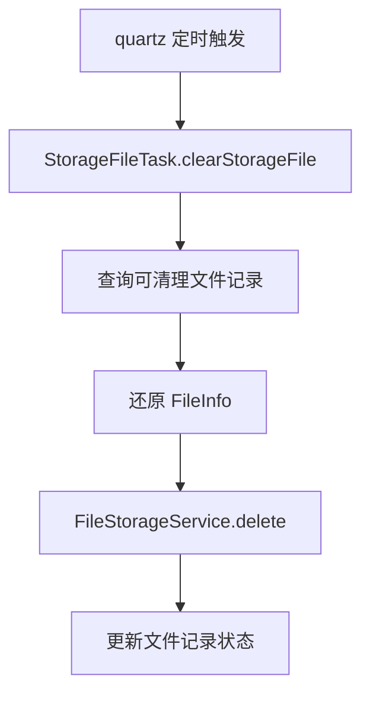

提交：

```
4ffd4e28 增加存储文件清理任务
```

## 2. 涉及文件

- `ruoyi-quartz/pom.xml`
- `ruoyi-quartz/src/main/java/com/ruoyi/quartz/task/StorageFileTask.java`

## 3. 改动点清单

- ruoyi-quartz 增加对 ruoyi-system 的依赖
- 新增 StorageFileTask 调用文件服务清理过期文件
- SQL 新增并启用文件清理定时任务

## 4. ruoyi-quartz/pom.xml

### 涉及改动部分

POM 文件只展示依赖或版本的插入位置，不展开完整原代码和现代码。

### 改动说明

- `ruoyi-quartz` 增加 `ruoyi-system` 依赖，因为清理任务需要调用文件记录服务
- 定时任务仍保留在 quartz 模块，业务删除逻辑收敛到 system 服务

## 5. ruoyi-quartz/src/main/java/com/ruoyi/quartz/task/StorageFileTask.java

### 原代码

```text
本次新增，提交前不存在该文件
```

### 现代码

```java
package com.ruoyi.quartz.task;

import java.util.List;
import org.dromara.x.file.storage.core.FileInfo;
import org.dromara.x.file.storage.core.FileStorageService;
import org.slf4j.Logger;
import org.slf4j.LoggerFactory;
import org.springframework.stereotype.Component;
import com.ruoyi.system.domain.SysStorageFile;
import com.ruoyi.system.service.ISysStorageFileService;

/**
 * 存储文件清理任务
 * <p>
 * 定时清理超时临时文件和已经到期的待删除文件，避免对象存储长期堆积孤儿文件
 *
 * @author ruoyi
 */
@Component("storageFileTask")
public class StorageFileTask
{
    private static final Logger log = LoggerFactory.getLogger(StorageFileTask.class);

    private final ISysStorageFileService storageFileService;

    private final FileStorageService fileStorageService;

    /**
     * 构造存储文件清理任务
     *
     * @param storageFileService 存储文件记录服务
     * @param fileStorageService X File Storage 统一存储服务
     */
    public StorageFileTask(ISysStorageFileService storageFileService, FileStorageService fileStorageService)
    {
        this.storageFileService = storageFileService;
        this.fileStorageService = fileStorageService;
    }

    /**
     * 清理过期存储文件
     */
    public void clearStorageFile()
    {
        // 无参任务使用配置文件中的临时文件过期时间
        clearStorageFile(null);
    }

    /**
     * 清理过期存储文件
     *
     * @param tempExpireHours 临时文件过期小时数
     */
    public void clearStorageFile(Integer tempExpireHours)
    {
        // 未传入过期时间或参数非法时交给服务层读取 ruoyi.storage-file.temp-expire-hours
        int expireHours = tempExpireHours == null ? 0 : tempExpireHours;
        // 查询临时过期和待删除到期的文件记录
        List<SysStorageFile> storageFiles = storageFileService.selectCleanableStorageFiles(expireHours);
        for (SysStorageFile storageFile : storageFiles)
        {
            try
            {
                // 数据库记录还原为 FileInfo 后，框架才能定位具体平台和对象路径
                FileInfo fileInfo = storageFileService.toFileInfo(storageFile);
                if (fileInfo == null)
                {
                    continue;
                }
                // 删除原图和缩略图，成功后 FileRecorder.delete 会把记录标记为已删除
                fileStorageService.delete(fileInfo);
            }
            catch (Exception e)
            {
                // 单个文件删除失败不影响后续文件，避免一次异常中断整批清理
                log.warn("清理存储文件失败，url={}", storageFile.getUrl(), e);
            }
        }
    }
}
```

### 涉及改动部分

```java
// 省略
package com.ruoyi.quartz.task;

import java.util.List;
import org.dromara.x.file.storage.core.FileInfo;
import org.dromara.x.file.storage.core.FileStorageService;
import org.slf4j.Logger;
import org.slf4j.LoggerFactory;
import org.springframework.stereotype.Component;
import com.ruoyi.system.domain.SysStorageFile;
import com.ruoyi.system.service.ISysStorageFileService;

/**
 * 存储文件清理任务
 * <p>
 * 定时清理超时临时文件和已经到期的待删除文件，避免对象存储长期堆积孤儿文件
 *
 * @author ruoyi
 */
@Component("storageFileTask")
public class StorageFileTask
{
    private static final Logger log = LoggerFactory.getLogger(StorageFileTask.class);

    private final ISysStorageFileService storageFileService;

    private final FileStorageService fileStorageService;

    /**
     * 构造存储文件清理任务
     *
     * @param storageFileService 存储文件记录服务
     * @param fileStorageService X File Storage 统一存储服务
     */
    public StorageFileTask(ISysStorageFileService storageFileService, FileStorageService fileStorageService)
    {
        this.storageFileService = storageFileService;
        this.fileStorageService = fileStorageService;
    }

    /**
     * 清理过期存储文件
     */
    public void clearStorageFile()
    {
        // 无参任务使用配置文件中的临时文件过期时间
        clearStorageFile(null);
    }

    /**
     * 清理过期存储文件
     *
     * @param tempExpireHours 临时文件过期小时数
     */
    public void clearStorageFile(Integer tempExpireHours)
    {
        // 未传入过期时间或参数非法时交给服务层读取 ruoyi.storage-file.temp-expire-hours
        int expireHours = tempExpireHours == null ? 0 : tempExpireHours;
        // 查询临时过期和待删除到期的文件记录
        List<SysStorageFile> storageFiles = storageFileService.selectCleanableStorageFiles(expireHours);
        for (SysStorageFile storageFile : storageFiles)
        {
            try
            {
                // 数据库记录还原为 FileInfo 后，框架才能定位具体平台和对象路径
                FileInfo fileInfo = storageFileService.toFileInfo(storageFile);
                if (fileInfo == null)
                {
                    continue;
                }
                // 删除原图和缩略图，成功后 FileRecorder.delete 会把记录标记为已删除
                fileStorageService.delete(fileInfo);
            }
            catch (Exception e)
            {
                // 单个文件删除失败不影响后续文件，避免一次异常中断整批清理
                log.warn("清理存储文件失败，url={}", storageFile.getUrl(), e);
            }
        }
    }
}
```
### 改动说明

- 新增 `storageFileTask` 定时任务 Bean
- 定时查询过期临时文件、待删除文件和过期分片文件
- 清理真实文件后同步更新文件记录状态

## 变更小结

本篇只记录该提交自身涉及的代码和配置变化，不混入其它提交。

---

## 原文：doc/07-增加存储文件访问策略配置.md

# 增加存储文件访问策略配置

## 1. 改造目标

本篇文档对应一次独立 git 提交，用原代码和现代码对比说明本次改造。

核心目标：

- 新增文件访问安全配置
- 公开路径由配置文件控制
- 私有文件不直接放行静态访问，后续走后端下载入口

## 改造前存在的问题

- 如果在 Spring Security 中直接放行 `/file/**`，私有文件也会被匿名访问入口覆盖
- 如果完全不放行文件路径，公开图片、公开附件又无法直接回显
- 公开或私有访问策略写死在代码里，不方便按环境调整

## 改造后的解决方案

- 新增 `StorageFileSecurityProperties` 读取公开文件访问路径
- Spring Security 只放行配置中的公开 GET 路径
- 私有路径继续走认证流程或后端下载接口

## 总体链路

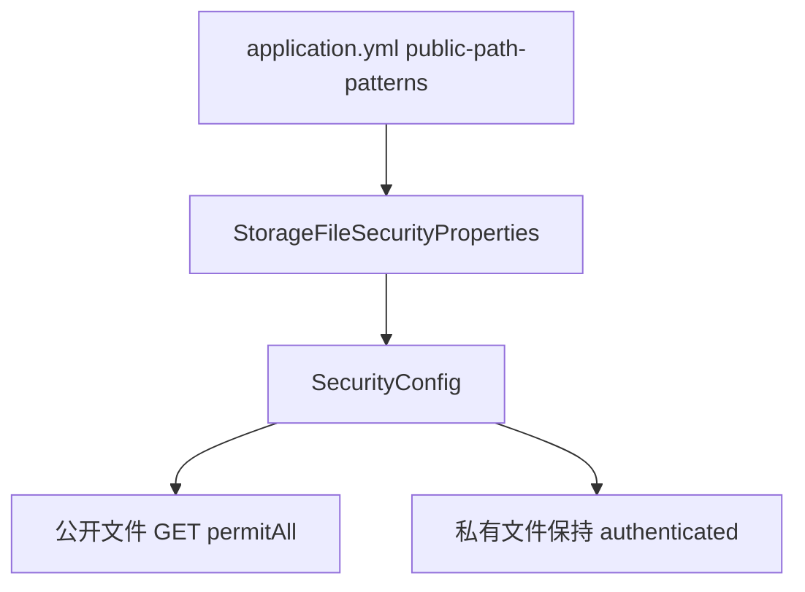

提交：

```
487a2598 增加存储文件访问策略配置
```

## 2. 涉及文件

- `ruoyi-framework/src/main/java/com/ruoyi/framework/config/SecurityConfig.java`
- `ruoyi-framework/src/main/java/com/ruoyi/framework/config/properties/StorageFileSecurityProperties.java`

## 3. 改动点清单

- 新增 StorageFileSecurityProperties 读取公开访问路径
- SecurityConfig 注入访问策略配置
- 静态放行路径从固定 /file/** 改为配置驱动

## 4. ruoyi-framework/src/main/java/com/ruoyi/framework/config/SecurityConfig.java

### 原代码

```java
package com.ruoyi.framework.config;

import org.springframework.beans.factory.annotation.Autowired;
import org.springframework.context.annotation.Bean;
import org.springframework.context.annotation.Configuration;
import org.springframework.http.HttpMethod;
import org.springframework.security.authentication.AuthenticationManager;
import org.springframework.security.config.annotation.authentication.configuration.AuthenticationConfiguration;
import org.springframework.security.config.annotation.method.configuration.EnableMethodSecurity;
import org.springframework.security.config.annotation.web.builders.HttpSecurity;
import org.springframework.security.config.http.SessionCreationPolicy;
import org.springframework.security.crypto.bcrypt.BCryptPasswordEncoder;
import org.springframework.security.web.SecurityFilterChain;
import org.springframework.security.web.authentication.UsernamePasswordAuthenticationFilter;
import org.springframework.security.web.authentication.logout.LogoutFilter;
import org.springframework.web.filter.CorsFilter;
import com.ruoyi.framework.config.properties.PermitAllUrlProperties;
import com.ruoyi.framework.security.filter.JwtAuthenticationTokenFilter;
import com.ruoyi.framework.security.handle.AuthenticationEntryPointImpl;
import com.ruoyi.framework.security.handle.LogoutSuccessHandlerImpl;

/**
 * spring security配置
 * 
 * @author ruoyi
 */
@EnableMethodSecurity(prePostEnabled = true, securedEnabled = true)
@Configuration
public class SecurityConfig
{
    /**
     * 认证失败处理类
     */
    @Autowired
    private AuthenticationEntryPointImpl unauthorizedHandler;

    /**
     * 退出处理类
     */
    @Autowired
    private LogoutSuccessHandlerImpl logoutSuccessHandler;

    /**
     * token认证过滤器
     */
    @Autowired
    private JwtAuthenticationTokenFilter authenticationTokenFilter;
    
    /**
     * 跨域过滤器
     */
    @Autowired
    private CorsFilter corsFilter;

    /**
     * 允许匿名访问的地址
     */
    @Autowired
    private PermitAllUrlProperties permitAllUrl;

	/**
	 * 身份验证实现
	 */
	@Bean
	public AuthenticationManager authenticationManager(AuthenticationConfiguration authenticationConfiguration) throws Exception 
	{
		return authenticationConfiguration.getAuthenticationManager();
	}

    /**
     * anyRequest          |   匹配所有请求路径
     * access              |   SpringEl表达式结果为true时可以访问
     * anonymous           |   匿名可以访问
     * denyAll             |   用户不能访问
     * fullyAuthenticated  |   用户完全认证可以访问（非remember-me下自动登录）
     * hasAnyAuthority     |   如果有参数，参数表示权限，则其中任何一个权限可以访问
     * hasAnyRole          |   如果有参数，参数表示角色，则其中任何一个角色可以访问
     * hasAuthority        |   如果有参数，参数表示权限，则其权限可以访问
     * hasIpAddress        |   如果有参数，参数表示IP地址，如果用户IP和参数匹配，则可以访问
     * hasRole             |   如果有参数，参数表示角色，则其角色可以访问
     * permitAll           |   用户可以任意访问
     * rememberMe          |   允许通过remember-me登录的用户访问
     * authenticated       |   用户登录后可访问
     */
    @Bean
    protected SecurityFilterChain filterChain(HttpSecurity httpSecurity) throws Exception
    {
        return httpSecurity
            // CSRF禁用，因为不使用session
            .csrf(csrf -> csrf.disable())
            // 禁用HTTP响应标头
            .headers((headersCustomizer) -> {
                headersCustomizer.cacheControl(cache -> cache.disable()).frameOptions(options -> options.sameOrigin());
            })
            // 认证失败处理类
            .exceptionHandling(exception -> exception.authenticationEntryPoint(unauthorizedHandler))
            // 基于token，所以不需要session
            .sessionManagement(session -> session.sessionCreationPolicy(SessionCreationPolicy.STATELESS))
            // 注解标记允许匿名访问的url
            .authorizeHttpRequests((requests) -> {
                permitAllUrl.getUrls().forEach(url -> requests.requestMatchers(url).permitAll());
                // 对于登录login 注册register 验证码captchaImage 允许匿名访问
                requests.requestMatchers("/login", "/register", "/captchaImage").permitAll()
                    // 静态资源，可匿名访问
                    .requestMatchers(HttpMethod.GET, "/", "/*.html", "/**.html", "/**.css", "/**.js", "/profile/**").permitAll()
                    // Knife4j依赖 /doc.html、/webjars/** 和 springdoc 的 /v3/api-docs/**，放行后才能匿名打开接口文档
                    .requestMatchers("/doc.html", "/webjars/**", "/swagger-ui.html", "/v3/api-docs/**", "/swagger-ui/**", "/druid/**").permitAll()
                    // 除上面外的所有请求全部需要鉴权认证
                    .anyRequest().authenticated();
            })
            // 添加Logout filter
            .logout(logout -> logout.logoutUrl("/logout").logoutSuccessHandler(logoutSuccessHandler))
            // 添加JWT filter
            .addFilterBefore(authenticationTokenFilter, UsernamePasswordAuthenticationFilter.class)
            // 添加CORS filter
            .addFilterBefore(corsFilter, JwtAuthenticationTokenFilter.class)
            .addFilterBefore(corsFilter, LogoutFilter.class)
            .build();
    }

    /**
     * 强散列哈希加密实现
     */
    @Bean
    public BCryptPasswordEncoder bCryptPasswordEncoder()
    {
        return new BCryptPasswordEncoder();
    }
}
```

### 现代码

```java
package com.ruoyi.framework.config;

import org.springframework.beans.factory.annotation.Autowired;
import org.springframework.context.annotation.Bean;
import org.springframework.context.annotation.Configuration;
import org.springframework.http.HttpMethod;
import org.springframework.security.authentication.AuthenticationManager;
import org.springframework.security.config.annotation.authentication.configuration.AuthenticationConfiguration;
import org.springframework.security.config.annotation.method.configuration.EnableMethodSecurity;
import org.springframework.security.config.annotation.web.builders.HttpSecurity;
import org.springframework.security.config.http.SessionCreationPolicy;
import org.springframework.security.crypto.bcrypt.BCryptPasswordEncoder;
import org.springframework.security.web.SecurityFilterChain;
import org.springframework.security.web.authentication.UsernamePasswordAuthenticationFilter;
import org.springframework.security.web.authentication.logout.LogoutFilter;
import org.springframework.web.filter.CorsFilter;
import com.ruoyi.framework.config.properties.PermitAllUrlProperties;
import com.ruoyi.framework.config.properties.StorageFileSecurityProperties;
import com.ruoyi.framework.security.filter.JwtAuthenticationTokenFilter;
import com.ruoyi.framework.security.handle.AuthenticationEntryPointImpl;
import com.ruoyi.framework.security.handle.LogoutSuccessHandlerImpl;

/**
 * spring security配置
 * 
 * @author ruoyi
 */
@EnableMethodSecurity(prePostEnabled = true, securedEnabled = true)
@Configuration
public class SecurityConfig
{
    /**
     * 认证失败处理类
     */
    @Autowired
    private AuthenticationEntryPointImpl unauthorizedHandler;

    /**
     * 退出处理类
     */
    @Autowired
    private LogoutSuccessHandlerImpl logoutSuccessHandler;

    /**
     * token认证过滤器
     */
    @Autowired
    private JwtAuthenticationTokenFilter authenticationTokenFilter;
    
    /**
     * 跨域过滤器
     */
    @Autowired
    private CorsFilter corsFilter;

    /**
     * 允许匿名访问的地址
     */
    @Autowired
    private PermitAllUrlProperties permitAllUrl;

    /**
     * 公开文件访问路径
     * <p>
     * 只放行配置中的公开路径，私有路径继续进入登录认证
     */
    @Autowired
    private StorageFileSecurityProperties storageFileSecurityProperties;

	/**
	 * 身份验证实现
	 */
	@Bean
	public AuthenticationManager authenticationManager(AuthenticationConfiguration authenticationConfiguration) throws Exception 
	{
		return authenticationConfiguration.getAuthenticationManager();
	}

    /**
     * anyRequest          |   匹配所有请求路径
     * access              |   SpringEl表达式结果为true时可以访问
     * anonymous           |   匿名可以访问
     * denyAll             |   用户不能访问
     * fullyAuthenticated  |   用户完全认证可以访问（非remember-me下自动登录）
     * hasAnyAuthority     |   如果有参数，参数表示权限，则其中任何一个权限可以访问
     * hasAnyRole          |   如果有参数，参数表示角色，则其中任何一个角色可以访问
     * hasAuthority        |   如果有参数，参数表示权限，则其权限可以访问
     * hasIpAddress        |   如果有参数，参数表示IP地址，如果用户IP和参数匹配，则可以访问
     * hasRole             |   如果有参数，参数表示角色，则其角色可以访问
     * permitAll           |   用户可以任意访问
     * rememberMe          |   允许通过remember-me登录的用户访问
     * authenticated       |   用户登录后可访问
     */
    @Bean
    protected SecurityFilterChain filterChain(HttpSecurity httpSecurity) throws Exception
    {
        return httpSecurity
            // CSRF禁用，因为不使用session
            .csrf(csrf -> csrf.disable())
            // 禁用HTTP响应标头
            .headers((headersCustomizer) -> {
                headersCustomizer.cacheControl(cache -> cache.disable()).frameOptions(options -> options.sameOrigin());
            })
            // 认证失败处理类
            .exceptionHandling(exception -> exception.authenticationEntryPoint(unauthorizedHandler))
            // 基于token，所以不需要session
            .sessionManagement(session -> session.sessionCreationPolicy(SessionCreationPolicy.STATELESS))
            // 注解标记允许匿名访问的url
            .authorizeHttpRequests((requests) -> {
                permitAllUrl.getUrls().forEach(url -> requests.requestMatchers(url).permitAll());
                // 对于登录login 注册register 验证码captchaImage 允许匿名访问
                requests.requestMatchers("/login", "/register", "/captchaImage").permitAll();
                // 静态资源和若依历史 /profile 本地资源继续允许匿名访问
                requests.requestMatchers(HttpMethod.GET, "/", "/*.html", "/**.html", "/**.css", "/**.js", "/profile/**").permitAll();
                String[] publicPathPatterns = getStorageFilePublicPathPatterns();
                if (publicPathPatterns.length > 0)
                {
                    // 只放行公开文件路径，例如 /file/upload/public/**
                    requests.requestMatchers(HttpMethod.GET, publicPathPatterns).permitAll();
                }
                // Knife4j依赖 /doc.html、/webjars/** 和 springdoc 的 /v3/api-docs/**，放行后才能匿名打开接口文档
                requests.requestMatchers("/doc.html", "/webjars/**", "/swagger-ui.html", "/v3/api-docs/**", "/swagger-ui/**", "/druid/**").permitAll();
                // 除上面外的所有请求全部需要鉴权认证
                requests.anyRequest().authenticated();
            })
            // 添加Logout filter
            .logout(logout -> logout.logoutUrl("/logout").logoutSuccessHandler(logoutSuccessHandler))
            // 添加JWT filter
            .addFilterBefore(authenticationTokenFilter, UsernamePasswordAuthenticationFilter.class)
            // 添加CORS filter
            .addFilterBefore(corsFilter, JwtAuthenticationTokenFilter.class)
            .addFilterBefore(corsFilter, LogoutFilter.class)
            .build();
    }

    /**
     * 强散列哈希加密实现
     */
    @Bean
    public BCryptPasswordEncoder bCryptPasswordEncoder()
    {
        return new BCryptPasswordEncoder();
    }

    /**
     * 获取公开文件访问路径
     *
     * @return 已清洗的公开文件访问路径
     */
    private String[] getStorageFilePublicPathPatterns()
    {
        // 过滤空配置，允许通过空列表关闭所有 X File Storage 匿名访问
        if (storageFileSecurityProperties.getPublicPathPatterns() == null)
        {
            return new String[0];
        }
        return storageFileSecurityProperties.getPublicPathPatterns().stream()
                .map(String::trim)
                .filter(pattern -> !pattern.isEmpty())
                .toArray(String[]::new);
    }
}
```

### 涉及改动部分

#### 改动后代码 1

```java
// 省略
    @Autowired
    private PermitAllUrlProperties permitAllUrl;
    @Autowired
    private StorageFileSecurityProperties storageFileSecurityProperties;
// 省略
```

#### 改动后代码 2

```java
// 省略
            .authorizeHttpRequests((requests) -> {
                permitAllUrl.getUrls().forEach(url -> requests.requestMatchers(url).permitAll());
                requests.requestMatchers("/login", "/register", "/captchaImage").permitAll();
                requests.requestMatchers(HttpMethod.GET, "/", "/*.html", "/**.html", "/**.css", "/**.js", "/profile/**").permitAll();
                String[] publicPathPatterns = getStorageFilePublicPathPatterns();
                if (publicPathPatterns.length > 0)
                {
                    requests.requestMatchers(HttpMethod.GET, publicPathPatterns).permitAll();
                }
                requests.requestMatchers("/doc.html", "/webjars/**", "/swagger-ui.html", "/v3/api-docs/**", "/swagger-ui/**", "/druid/**").permitAll();
                requests.anyRequest().authenticated();
            })
            .logout(logout -> logout.logoutUrl("/logout").logoutSuccessHandler(logoutSuccessHandler))
// 省略
```

#### 改动后代码 3

```java
// 省略
    {
        return new BCryptPasswordEncoder();
    }
    private String[] getStorageFilePublicPathPatterns()
    {
        if (storageFileSecurityProperties.getPublicPathPatterns() == null)
        {
            return new String[0];
        }
        return storageFileSecurityProperties.getPublicPathPatterns().stream()
                .map(String::trim)
                .filter(pattern -> !pattern.isEmpty())
                .toArray(String[]::new);
    }
}
// 省略
```

### 改动说明

- 注入 `StorageFileSecurityProperties`，从配置读取公开文件路径
- 静态资源放行保留 `/profile/**`，但不再硬编码放行全部 `/file/**`
- 配置为空时不额外放行 X File Storage 文件路径

## 5. ruoyi-framework/src/main/java/com/ruoyi/framework/config/properties/StorageFileSecurityProperties.java

### 原代码

```text
本次新增，提交前不存在该文件
```

### 现代码

```java
package com.ruoyi.framework.config.properties;

import java.util.ArrayList;
import java.util.List;
import org.springframework.boot.context.properties.ConfigurationProperties;
import org.springframework.stereotype.Component;

/**
 * 存储文件安全配置
 * <p>
 * 用于控制哪些 X File Storage 访问路径允许匿名访问
 *
 * @author ruoyi
 */
@Component
@ConfigurationProperties(prefix = "ruoyi.storage-file")
public class StorageFileSecurityProperties
{
    /** 公开文件访问路径 */
    private List<String> publicPathPatterns = new ArrayList<String>();

    public List<String> getPublicPathPatterns()
    {
        return publicPathPatterns;
    }

    public void setPublicPathPatterns(List<String> publicPathPatterns)
    {
        this.publicPathPatterns = publicPathPatterns;
    }
}
```

### 涉及改动部分

```java
// 省略
package com.ruoyi.framework.config.properties;

import java.util.ArrayList;
import java.util.List;
import org.springframework.boot.context.properties.ConfigurationProperties;
import org.springframework.stereotype.Component;

/**
 * 存储文件安全配置
 * <p>
 * 用于控制哪些 X File Storage 访问路径允许匿名访问
 *
 * @author ruoyi
 */
@Component
@ConfigurationProperties(prefix = "ruoyi.storage-file")
public class StorageFileSecurityProperties
{
    /** 公开文件访问路径 */
    private List<String> publicPathPatterns = new ArrayList<String>();

    public List<String> getPublicPathPatterns()
    {
        return publicPathPatterns;
    }

    public void setPublicPathPatterns(List<String> publicPathPatterns)
    {
        this.publicPathPatterns = publicPathPatterns;
    }
}
```
### 改动说明

- 新增文件访问安全配置类
- `publicPathPatterns` 用于声明哪些文件路径允许匿名 GET 访问

## 变更小结

本篇只记录该提交自身涉及的代码和配置变化，不混入其它提交。

---

## 原文：doc/08-改造通用文件上传接口.md

# 改造通用文件上传接口

## 1. 改造目标

本篇文档对应一次独立 git 提交，用原代码和现代码对比说明本次改造。

核心目标：

- 通用上传接口接入 XFileStorageUtils
- 支持平台、上传场景、缩略图参数
- 多文件上传返回 fileList 数组
- 新增大文件分片上传和私有文件下载接口

## 改造前存在的问题

- `/common/upload` 和 `/common/uploads` 只能走若依本地上传，不能指定 OSS、MinIO、COS 等平台
- 多文件上传返回逗号拼接字符串，前端解析不直观，也不方便携带平台、大小、缩略图等元数据
- 私有文件不能直接通过对象存储 URL 访问，需要后端下载入口承接鉴权
- 没有通用分片上传接口，大文件上传缺少统一入口

## 改造后的解决方案

- 通用上传接口统一调用 `XFileStorageUtils`
- 上传参数支持 `platform`、`uploadScene`、`thumbnail`、`thumbnailWidth`、`thumbnailHeight`
- 多文件上传返回 `fileList` 数组，每个文件带 URL、平台、大小、Content-Type、缩略图等信息
- 新增私有文件下载接口和分片上传接口

## 总体链路

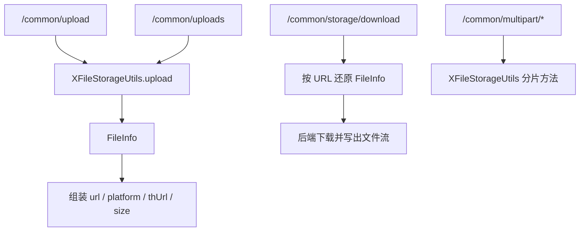

提交：

```
cdabb7b3 改造通用文件上传接口
```

## 2. 涉及文件

- `ruoyi-admin/src/main/java/com/ruoyi/web/controller/common/CommonController.java`

## 3. 改动点清单

- CommonController 上传接口改为调用 XFileStorageUtils
- 新增 platform、uploadScene、thumbnail 等上传参数
- 多文件上传返回 fileList 数组
- 新增分片上传接口和存储文件下载接口

## 4. ruoyi-admin/src/main/java/com/ruoyi/web/controller/common/CommonController.java

### 原代码

```java
package com.ruoyi.web.controller.common;

import java.util.ArrayList;
import java.util.List;
import jakarta.servlet.http.HttpServletRequest;
import jakarta.servlet.http.HttpServletResponse;
import org.slf4j.Logger;
import org.slf4j.LoggerFactory;
import org.springframework.beans.factory.annotation.Autowired;
import org.springframework.http.MediaType;
import org.springframework.web.bind.annotation.GetMapping;
import org.springframework.web.bind.annotation.PostMapping;
import org.springframework.web.bind.annotation.RequestMapping;
import org.springframework.web.bind.annotation.RestController;
import org.springframework.web.multipart.MultipartFile;
import com.ruoyi.common.config.RuoYiConfig;
import com.ruoyi.common.core.domain.AjaxResult;
import com.ruoyi.common.utils.StringUtils;
import com.ruoyi.common.utils.file.FileUploadUtils;
import com.ruoyi.common.utils.file.FileUtils;
import com.ruoyi.framework.config.ServerConfig;

/**
 * 通用请求处理
 * 
 * @author ruoyi
 */
@RestController
@RequestMapping("/common")
public class CommonController
{
    private static final Logger log = LoggerFactory.getLogger(CommonController.class);

    @Autowired
    private ServerConfig serverConfig;

    private static final String FILE_DELIMITER = ",";

    /**
     * 通用下载请求
     * 
     * @param fileName 文件名称
     * @param delete 是否删除
     */
    @GetMapping("/download")
    public void fileDownload(String fileName, Boolean delete, HttpServletResponse response, HttpServletRequest request)
    {
        try
        {
            if (!FileUtils.checkAllowDownload(fileName))
            {
                throw new Exception(StringUtils.format("文件名称({})非法，不允许下载。 ", fileName));
            }
            String realFileName = System.currentTimeMillis() + fileName.substring(fileName.indexOf("_") + 1);
            String filePath = RuoYiConfig.getDownloadPath() + fileName;

            response.setContentType(MediaType.APPLICATION_OCTET_STREAM_VALUE);
            FileUtils.setAttachmentResponseHeader(response, realFileName);
            FileUtils.writeBytes(filePath, response.getOutputStream());
            if (delete)
            {
                FileUtils.deleteFile(filePath);
            }
        }
        catch (Exception e)
        {
            log.error("下载文件失败", e);
        }
    }

    /**
     * 通用上传请求（单个）
     */
    @PostMapping("/upload")
    public AjaxResult uploadFile(MultipartFile file) throws Exception
    {
        try
        {
            // 上传文件路径
            String filePath = RuoYiConfig.getUploadPath();
            // 上传并返回新文件名称
            String fileName = FileUploadUtils.upload(filePath, file);
            String url = serverConfig.getUrl() + fileName;
            AjaxResult ajax = AjaxResult.success();
            ajax.put("url", url);
            ajax.put("fileName", fileName);
            ajax.put("newFileName", FileUtils.getName(fileName));
            ajax.put("originalFilename", file.getOriginalFilename());
            return ajax;
        }
        catch (Exception e)
        {
            return AjaxResult.error(e.getMessage());
        }
    }

    /**
     * 通用上传请求（多个）
     */
    @PostMapping("/uploads")
    public AjaxResult uploadFiles(List<MultipartFile> files) throws Exception
    {
        try
        {
            // 上传文件路径
            String filePath = RuoYiConfig.getUploadPath();
            List<String> urls = new ArrayList<String>();
            List<String> fileNames = new ArrayList<String>();
            List<String> newFileNames = new ArrayList<String>();
            List<String> originalFilenames = new ArrayList<String>();
            for (MultipartFile file : files)
            {
                // 上传并返回新文件名称
                String fileName = FileUploadUtils.upload(filePath, file);
                String url = serverConfig.getUrl() + fileName;
                urls.add(url);
                fileNames.add(fileName);
                newFileNames.add(FileUtils.getName(fileName));
                originalFilenames.add(file.getOriginalFilename());
            }
            AjaxResult ajax = AjaxResult.success();
            ajax.put("urls", StringUtils.join(urls, FILE_DELIMITER));
            ajax.put("fileNames", StringUtils.join(fileNames, FILE_DELIMITER));
            ajax.put("newFileNames", StringUtils.join(newFileNames, FILE_DELIMITER));
            ajax.put("originalFilenames", StringUtils.join(originalFilenames, FILE_DELIMITER));
            return ajax;
        }
        catch (Exception e)
        {
            return AjaxResult.error(e.getMessage());
        }
    }

    /**
     * 本地资源通用下载
     */
    @GetMapping("/download/resource")
    public void resourceDownload(String resource, HttpServletRequest request, HttpServletResponse response)
            throws Exception
    {
        try
        {
            if (!FileUtils.checkAllowDownload(resource))
            {
                throw new Exception(StringUtils.format("资源文件({})非法，不允许下载。 ", resource));
            }
            // 本地资源路径
            String localPath = RuoYiConfig.getProfile();
            // 数据库资源地址
            String downloadPath = localPath + FileUtils.stripPrefix(resource);
            // 下载名称
            String downloadName = StringUtils.substringAfterLast(downloadPath, "/");
            response.setContentType(MediaType.APPLICATION_OCTET_STREAM_VALUE);
            FileUtils.setAttachmentResponseHeader(response, downloadName);
            FileUtils.writeBytes(downloadPath, response.getOutputStream());
        }
        catch (Exception e)
        {
            log.error("下载文件失败", e);
        }
    }
}
```

### 现代码

```java
package com.ruoyi.web.controller.common;

import java.util.ArrayList;
import java.util.LinkedHashMap;
import java.util.List;
import java.util.Map;
import jakarta.servlet.http.HttpServletRequest;
import jakarta.servlet.http.HttpServletResponse;
import org.slf4j.Logger;
import org.slf4j.LoggerFactory;
import org.dromara.x.file.storage.core.FileInfo;
import org.dromara.x.file.storage.core.upload.FilePartInfo;
import org.dromara.x.file.storage.core.upload.FilePartInfoList;
import org.dromara.x.file.storage.core.upload.MultipartUploadSupportInfo;
import org.springframework.http.MediaType;
import org.springframework.web.bind.annotation.GetMapping;
import org.springframework.web.bind.annotation.PostMapping;
import org.springframework.web.bind.annotation.RequestMapping;
import org.springframework.web.bind.annotation.RequestParam;
import org.springframework.web.bind.annotation.RestController;
import org.springframework.web.multipart.MultipartFile;
import com.ruoyi.common.config.RuoYiConfig;
import com.ruoyi.common.core.domain.AjaxResult;
import com.ruoyi.common.utils.StringUtils;
import com.ruoyi.common.utils.file.FileUtils;
import com.ruoyi.common.utils.file.MimeTypeUtils;
import com.ruoyi.common.utils.file.XFileStorageUtils;

/**
 * 通用文件接口
 * <p>
 * 下载接口仍沿用若依原来的本地文件流程；上传接口统一交给
 * {@link XFileStorageUtils} 处理，因此调用方既可以使用配置中的默认平台
 * 也可以通过 platform 参数指定 local-1、aliyun-oss-1、minio-1 等存储平台
 *
 * @author ruoyi
 */
@RestController
@RequestMapping("/common")
public class CommonController
{
    private static final Logger log = LoggerFactory.getLogger(CommonController.class);

    /**
     * X File Storage 适配工具
     * <p>
     * 控制器不直接调用第三方上传 API，而是通过该工具统一复用若依的校验
     * 命名规则和平台选择逻辑
     */
    private final XFileStorageUtils xFileStorageUtils;

    /**
     * 构造器注入上传工具，明确当前控制器依赖的文件存储能力
     *
     * @param xFileStorageUtils 统一上传工具
     */
    public CommonController(XFileStorageUtils xFileStorageUtils)
    {
        this.xFileStorageUtils = xFileStorageUtils;
    }

    /**
     * 从若依本地下载目录下载导出文件
     * <p>
     * 该接口主要服务导出、临时文件下载等本地流程，所以继续保留若依原来的
     * 本地文件读取方式，不走对象存储
     *
     * @param fileName 下载目录下的相对文件名
     * @param delete 下载完成后是否删除本地临时文件
     * @param response 用于输出文件流的响应对象
     * @param request 当前请求对象，保留原始签名兼容性
     */
    @GetMapping("/download")
    public void fileDownload(String fileName, Boolean delete, HttpServletResponse response, HttpServletRequest request)
    {
        try
        {
            // 下载前先校验文件名，避免路径穿越和非法扩展名
            if (!FileUtils.checkAllowDownload(fileName))
            {
                throw new Exception(StringUtils.format("文件名称({})非法，不允许下载。 ", fileName));
            }
            // 导出文件名通常带时间戳前缀，这里生成浏览器看到的真实下载名
            String realFileName = System.currentTimeMillis() + fileName.substring(fileName.indexOf("_") + 1);
            // 拼接若依本地下载目录中的真实文件路径
            String filePath = RuoYiConfig.getDownloadPath() + fileName;

            // 设置附件响应头并把本地文件写入响应流
            response.setContentType(MediaType.APPLICATION_OCTET_STREAM_VALUE);
            FileUtils.setAttachmentResponseHeader(response, realFileName);
            FileUtils.writeBytes(filePath, response.getOutputStream());
            if (delete)
            {
                // 临时导出文件按调用方要求在下载后删除
                FileUtils.deleteFile(filePath);
            }
        }
        catch (Exception e)
        {
            log.error("下载文件失败", e);
        }
    }

    /**
     * 通用单文件上传
     * <p>
     * platform 为空时使用 {@code dromara.x-file-storage.default-platform}
     * 配置的默认平台；platform 不为空时必须匹配 application.yml 中已启用的
     * 存储平台标识
     *
     * @param file 前端上传的文件
     * @param platform 可选存储平台标识，例如 local-1、aliyun-oss-1、minio-1
     * @param uploadScene 可选上传场景编码，例如 avatar、contract、importExcel
     * @param thumbnail 是否生成缩略图，仅图片文件支持
     * @param thumbnailWidth 缩略图宽度，为空时使用框架默认尺寸
     * @param thumbnailHeight 缩略图高度，为空时使用框架默认尺寸
     * @return 兼容若依前端的上传结果，并额外返回实际使用的平台和缩略图地址
     */
    @PostMapping("/upload")
    public AjaxResult uploadFile(MultipartFile file, @RequestParam(value = "platform", required = false) String platform,
            @RequestParam(value = "uploadScene", required = false) String uploadScene,
            @RequestParam(value = "thumbnail", defaultValue = "false") Boolean thumbnail,
            @RequestParam(value = "thumbnailWidth", required = false) Integer thumbnailWidth,
            @RequestParam(value = "thumbnailHeight", required = false) Integer thumbnailHeight) throws Exception
    {
        try
        {
            // platform 为空时走默认平台，不为空时上传到指定平台
            // uploadScene 不为空时按场景配置覆盖大小、格式和缩略图规则
            FileInfo fileInfo = xFileStorageUtils.upload(file, platform, uploadScene, MimeTypeUtils.DEFAULT_ALLOWED_EXTENSION,
                    Boolean.TRUE.equals(thumbnail), thumbnailWidth, thumbnailHeight);
            // 远程 URL 是前端直接访问和保存的主地址
            String url = fileInfo.getUrl();
            AjaxResult ajax = AjaxResult.success();
            // 单文件上传继续返回平铺字段，方便前端直接读取
            ajax.put("url", url);
            ajax.put("fileName", url);
            ajax.put("newFileName", FileUtils.getName(url));
            ajax.put("originalFilename", file.getOriginalFilename());
            // 返回实际平台，便于确认默认平台解析结果和排查上传去向
            ajax.put("platform", fileInfo.getPlatform());
            // 返回当前上传场景，便于前端排查使用了哪套规则
            ajax.put("uploadScene", uploadScene);
            // 缩略图未生成时 thUrl 为空，前端可继续使用原图 URL
            ajax.put("thUrl", fileInfo.getThUrl());
            ajax.put("thFileName", fileInfo.getThUrl());
            ajax.put("thNewFileName", FileUtils.getName(fileInfo.getThUrl()));
            ajax.put("thSize", fileInfo.getThSize());
            ajax.put("size", fileInfo.getSize());
            ajax.put("contentType", fileInfo.getContentType());
            return ajax;
        }
        catch (Exception e)
        {
            return AjaxResult.error(e.getMessage());
        }
    }

    /**
     * 通用多文件上传
     * <p>
     * 本次请求内的多个文件会上传到同一个平台
     * 返回值使用 fileList 数组承载每个文件的完整元数据，前端无需再拆逗号字符串
     *
     * @param files 前端上传的文件集合
     * @param platform 可选存储平台标识，为空时使用默认平台
     * @param uploadScene 可选上传场景编码，例如 avatar、contract、importExcel
     * @param thumbnail 是否生成缩略图，仅图片文件支持
     * @param thumbnailWidth 缩略图宽度，为空时使用框架默认尺寸
     * @param thumbnailHeight 缩略图高度，为空时使用框架默认尺寸
     * @return 结构化文件列表
     */
    @PostMapping("/uploads")
    public AjaxResult uploadFiles(List<MultipartFile> files, @RequestParam(value = "platform", required = false) String platform,
            @RequestParam(value = "uploadScene", required = false) String uploadScene,
            @RequestParam(value = "thumbnail", defaultValue = "false") Boolean thumbnail,
            @RequestParam(value = "thumbnailWidth", required = false) Integer thumbnailWidth,
            @RequestParam(value = "thumbnailHeight", required = false) Integer thumbnailHeight) throws Exception
    {
        try
        {
            // 结构化文件列表给新前端使用，每个元素对应一个上传文件
            List<Map<String, Object>> fileList = new ArrayList<Map<String, Object>>();
            for (MultipartFile file : files)
            {
                // 每个文件使用同一个 platform 策略上传
                // uploadScene 不为空时按场景配置覆盖大小、格式和缩略图规则
                FileInfo fileInfo = xFileStorageUtils.upload(file, platform, uploadScene, MimeTypeUtils.DEFAULT_ALLOWED_EXTENSION,
                        Boolean.TRUE.equals(thumbnail), thumbnailWidth, thumbnailHeight);
                // 远程 URL 是前端保存和展示当前文件的主地址
                String url = fileInfo.getUrl();
                // 使用有序 Map 保持返回字段顺序稳定，便于前端联调和接口排查
                Map<String, Object> fileItem = new LinkedHashMap<String, Object>();
                fileItem.put("url", url);
                fileItem.put("fileName", url);
                fileItem.put("newFileName", FileUtils.getName(url));
                fileItem.put("originalFilename", file.getOriginalFilename());
                fileItem.put("platform", fileInfo.getPlatform());
                fileItem.put("uploadScene", uploadScene);
                fileItem.put("thUrl", fileInfo.getThUrl());
                fileItem.put("thFileName", fileInfo.getThUrl());
                fileItem.put("thNewFileName", FileUtils.getName(fileInfo.getThUrl()));
                fileItem.put("size", fileInfo.getSize());
                fileItem.put("thSize", fileInfo.getThSize());
                fileItem.put("contentType", fileInfo.getContentType());
                // 当前文件元数据组装完成后加入统一 fileList 返回
                fileList.add(fileItem);
            }
            // 只返回新的结构化 fileList，前端按数组逐项处理
            AjaxResult ajax = AjaxResult.success();
            ajax.put("fileList", fileList);
            return ajax;
        }
        catch (Exception e)
        {
            return AjaxResult.error(e.getMessage());
        }
    }

    /**
     * 查询平台是否支持大文件分片上传
     * <p>
     * platform 为空时查询默认平台；platform 不为空时查询指定平台
     *
     * @param platform 可选存储平台标识
     * @return 平台分片上传支持信息
     */
    @GetMapping("/multipart/support")
    public AjaxResult multipartSupport(@RequestParam(value = "platform", required = false) String platform)
    {
        // 支持能力由 X File Storage 根据当前平台适配器返回
        MultipartUploadSupportInfo supportInfo = xFileStorageUtils.isSupportMultipartUpload(platform);
        AjaxResult ajax = AjaxResult.success();
        ajax.put("platform", platform);
        ajax.put("support", supportInfo.getIsSupport());
        ajax.put("supportListParts", supportInfo.getIsSupportListParts());
        ajax.put("supportAbort", supportInfo.getIsSupportAbort());
        ajax.put("listPartsSupportMaxParts", supportInfo.getListPartsSupportMaxParts());
        return ajax;
    }

    /**
     * 初始化大文件分片上传
     * <p>
     * 前端在上传第一个分片前调用，返回的 url 和 uploadId 后续分片上传、合并、取消都要继续传回
     *
     * @param originalFilename 原始文件名
     * @param size 文件总大小
     * @param contentType 文件内容类型
     * @param platform 可选存储平台标识
     * @param uploadScene 可选上传场景编码
     * @return 分片上传会话信息
     */
    @PostMapping("/multipart/init")
    public AjaxResult initiateMultipartUpload(@RequestParam("originalFilename") String originalFilename,
            @RequestParam("size") Long size, @RequestParam(value = "contentType", required = false) String contentType,
            @RequestParam(value = "platform", required = false) String platform,
            @RequestParam(value = "uploadScene", required = false) String uploadScene)
    {
        try
        {
            // 初始化阶段只创建上传会话和文件记录，不上传实际文件内容
            FileInfo fileInfo = xFileStorageUtils.initiateMultipartUpload(originalFilename, size, contentType, platform, uploadScene,
                    MimeTypeUtils.DEFAULT_ALLOWED_EXTENSION);
            AjaxResult ajax = AjaxResult.success(toFileItem(fileInfo, originalFilename));
            ajax.put("uploadScene", uploadScene);
            return ajax;
        }
        catch (Exception e)
        {
            return AjaxResult.error(e.getMessage());
        }
    }

    /**
     * 上传大文件分片
     * <p>
     * partNumber 从 1 开始，前端需要保证同一个 url 下的分片编号稳定
     *
     * @param url 初始化接口返回的文件地址
     * @param partNumber 分片编号
     * @param file 当前分片文件
     * @return 当前分片上传结果
     */
    @PostMapping("/multipart/uploadPart")
    public AjaxResult uploadPart(@RequestParam("url") String url, @RequestParam("partNumber") Integer partNumber,
            @RequestParam("file") MultipartFile file)
    {
        try
        {
            // 分片上传成功后框架会回调 FileRecorder.saveFilePart 保存分片记录
            FilePartInfo filePartInfo = xFileStorageUtils.uploadPart(url, partNumber, file);
            return AjaxResult.success(toFilePartItem(filePartInfo));
        }
        catch (Exception e)
        {
            return AjaxResult.error(e.getMessage());
        }
    }

    /**
     * 查询已上传的大文件分片
     * <p>
     * 用于前端断点续传时判断哪些分片已经上传成功
     *
     * @param url 初始化接口返回的文件地址
     * @param maxParts 本次最多返回的分片数量
     * @param partNumberMarker 分页起始分片编号
     * @return 已上传分片列表
     */
    @GetMapping("/multipart/listParts")
    public AjaxResult listParts(@RequestParam("url") String url,
            @RequestParam(value = "maxParts", required = false) Integer maxParts,
            @RequestParam(value = "partNumberMarker", required = false) Integer partNumberMarker)
    {
        try
        {
            // 部分平台不支持列举分片，具体能力可先调用 support 接口确认
            FilePartInfoList filePartInfoList = xFileStorageUtils.listParts(url, maxParts, partNumberMarker);
            AjaxResult ajax = AjaxResult.success();
            ajax.put("file", toFileItem(filePartInfoList.getFileInfo(), null));
            ajax.put("partList", toFilePartList(filePartInfoList.getList()));
            ajax.put("maxParts", filePartInfoList.getMaxParts());
            ajax.put("truncated", filePartInfoList.getIsTruncated());
            ajax.put("partNumberMarker", filePartInfoList.getPartNumberMarker());
            ajax.put("nextPartNumberMarker", filePartInfoList.getNextPartNumberMarker());
            return ajax;
        }
        catch (Exception e)
        {
            return AjaxResult.error(e.getMessage());
        }
    }

    /**
     * 完成大文件分片上传
     * <p>
     * 前端确认所有分片上传成功后调用，存储平台会把分片合并为最终文件
     *
     * @param url 初始化接口返回的文件地址
     * @return 合并后的文件信息
     */
    @PostMapping("/multipart/complete")
    public AjaxResult completeMultipartUpload(@RequestParam("url") String url)
    {
        try
        {
            // 合并成功后框架会更新主文件记录并删除分片记录
            FileInfo fileInfo = xFileStorageUtils.completeMultipartUpload(url);
            return AjaxResult.success(toFileItem(fileInfo, null));
        }
        catch (Exception e)
        {
            return AjaxResult.error(e.getMessage());
        }
    }

    /**
     * 取消大文件分片上传
     * <p>
     * 用于前端主动放弃上传或业务侧回滚上传会话
     *
     * @param url 初始化接口返回的文件地址
     * @return 取消后的文件信息
     */
    @PostMapping("/multipart/abort")
    public AjaxResult abortMultipartUpload(@RequestParam("url") String url)
    {
        try
        {
            // 取消成功后框架会通知平台释放未合并分片
            FileInfo fileInfo = xFileStorageUtils.abortMultipartUpload(url);
            return AjaxResult.success(toFileItem(fileInfo, null));
        }
        catch (Exception e)
        {
            return AjaxResult.error(e.getMessage());
        }
    }

    /**
     * 下载 /profile 地址引用的本地资源
     * <p>
     * 对象存储返回的是远程 URL 或签名 URL，应直接访问对应 URL；该接口只负责
     * 解析若依历史本地资源
     *
     * @param resource /profile 资源路径
     * @param request 当前请求对象
     * @param response 用于输出本地资源的响应对象
     */
    @GetMapping("/download/resource")
    public void resourceDownload(String resource, HttpServletRequest request, HttpServletResponse response)
            throws Exception
    {
        try
        {
            // 本地资源下载同样先做路径穿越和扩展名白名单校验
            if (!FileUtils.checkAllowDownload(resource))
            {
                throw new Exception(StringUtils.format("资源文件({})非法，不允许下载。 ", resource));
            }
            // 获取若依本地资源根目录
            String localPath = RuoYiConfig.getProfile();
            // 去掉 /profile 前缀后拼接到 ruoyi.profile
            String downloadPath = localPath + FileUtils.stripPrefix(resource);
            // 使用路径最后一段作为浏览器下载文件名
            String downloadName = StringUtils.substringAfterLast(downloadPath, "/");
            // 设置附件响应头并写出本地资源内容
            response.setContentType(MediaType.APPLICATION_OCTET_STREAM_VALUE);
            FileUtils.setAttachmentResponseHeader(response, downloadName);
            FileUtils.writeBytes(downloadPath, response.getOutputStream());
        }
        catch (Exception e)
        {
            log.error("下载文件失败", e);
        }
    }

    /**
     * 下载 X File Storage 管理的文件
     * <p>
     * 私有文件不允许浏览器直接访问 /file/upload/private/**
     * 前端应通过该接口携带登录 token 下载，由后端完成权限入口和文件流输出
     *
     * @param url X File Storage 返回的文件 URL
     * @param response 用于输出文件内容的响应对象
     */
    @PostMapping("/storage/download")
    public void storageDownload(@RequestParam("url") String url, HttpServletResponse response)
    {
        try
        {
            // 先从文件记录表还原 FileInfo，避免只靠 URL 猜平台和对象路径
            FileInfo fileInfo = xFileStorageUtils.getFileInfoByUrl(url);
            // 原始文件名优先用于下载文件名，缺失时使用 URL 最后一段兜底
            String downloadName = StringUtils.isNotBlank(fileInfo.getOriginalFilename()) ? fileInfo.getOriginalFilename()
                    : FileUtils.getName(fileInfo.getUrl());
            // Content-Type 有值时按真实类型返回，便于浏览器识别预览或下载
            response.setContentType(StringUtils.isNotBlank(fileInfo.getContentType()) ? fileInfo.getContentType()
                    : MediaType.APPLICATION_OCTET_STREAM_VALUE);
            // 设置附件响应头，中文文件名由 FileUtils 统一编码
            FileUtils.setAttachmentResponseHeader(response, downloadName);
            // 从实际存储平台下载文件内容并写入响应流
            response.getOutputStream().write(xFileStorageUtils.downloadBytes(fileInfo));
        }
        catch (Exception e)
        {
            // 下载异常写日志并返回 500，前端下载工具会按失败处理
            log.error("下载存储文件失败，url={}", url, e);
            response.setStatus(HttpServletResponse.SC_INTERNAL_SERVER_ERROR);
        }
    }

    /**
     * 将文件信息转换为通用接口返回项
     *
     * @param fileInfo X File Storage 文件信息
     * @param fallbackOriginalFilename 原始文件名兜底值
     * @return 文件返回项
     */
    private Map<String, Object> toFileItem(FileInfo fileInfo, String fallbackOriginalFilename)
    {
        // 使用有序 Map 保持返回字段顺序稳定，便于前端联调和接口排查
        Map<String, Object> fileItem = new LinkedHashMap<String, Object>();
        if (fileInfo == null)
        {
            return fileItem;
        }
        // 远程 URL 是前端保存和展示当前文件的主地址
        String url = fileInfo.getUrl();
        fileItem.put("url", url);
        fileItem.put("fileName", url);
        fileItem.put("newFileName", FileUtils.getName(url));
        fileItem.put("originalFilename",
                StringUtils.isNotBlank(fileInfo.getOriginalFilename()) ? fileInfo.getOriginalFilename() : fallbackOriginalFilename);
        fileItem.put("platform", fileInfo.getPlatform());
        fileItem.put("uploadId", fileInfo.getUploadId());
        fileItem.put("uploadStatus", fileInfo.getUploadStatus());
        fileItem.put("thUrl", fileInfo.getThUrl());
        fileItem.put("thFileName", fileInfo.getThUrl());
        fileItem.put("thNewFileName", FileUtils.getName(fileInfo.getThUrl()));
        fileItem.put("size", fileInfo.getSize());
        fileItem.put("thSize", fileInfo.getThSize());
        fileItem.put("contentType", fileInfo.getContentType());
        return fileItem;
    }

    /**
     * 将分片列表转换为接口返回项
     *
     * @param filePartInfos X File Storage 分片列表
     * @return 分片返回项列表
     */
    private List<Map<String, Object>> toFilePartList(List<FilePartInfo> filePartInfos)
    {
        // 空分片列表返回空数组，前端无需做 null 判断
        List<Map<String, Object>> partList = new ArrayList<Map<String, Object>>();
        if (filePartInfos == null)
        {
            return partList;
        }
        for (FilePartInfo filePartInfo : filePartInfos)
        {
            // 每个分片转换为稳定结构后返回
            partList.add(toFilePartItem(filePartInfo));
        }
        return partList;
    }

    /**
     * 将分片信息转换为接口返回项
     *
     * @param filePartInfo X File Storage 分片信息
     * @return 分片返回项
     */
    private Map<String, Object> toFilePartItem(FilePartInfo filePartInfo)
    {
        // 使用有序 Map 保持返回字段顺序稳定
        Map<String, Object> partItem = new LinkedHashMap<String, Object>();
        if (filePartInfo == null)
        {
            return partItem;
        }
        partItem.put("id", filePartInfo.getId());
        partItem.put("platform", filePartInfo.getPlatform());
        partItem.put("uploadId", filePartInfo.getUploadId());
        partItem.put("partNumber", filePartInfo.getPartNumber());
        partItem.put("partSize", filePartInfo.getPartSize());
        partItem.put("etag", filePartInfo.getETag());
        partItem.put("hashInfo", filePartInfo.getHashInfo());
        partItem.put("createTime", filePartInfo.getCreateTime());
        partItem.put("lastModified", filePartInfo.getLastModified());
        return partItem;
    }

}
```

### 涉及改动部分

#### 改动后代码 1

```java
// 省略
{
    private static final Logger log = LoggerFactory.getLogger(CommonController.class);
    private final XFileStorageUtils xFileStorageUtils;
    public CommonController(XFileStorageUtils xFileStorageUtils)
    {
        this.xFileStorageUtils = xFileStorageUtils;
    }
    @GetMapping("/download")
    public void fileDownload(String fileName, Boolean delete, HttpServletResponse response, HttpServletRequest request)
    {
        try
        {
            if (!FileUtils.checkAllowDownload(fileName))
            {
                throw new Exception(StringUtils.format("文件名称({})非法，不允许下载。 ", fileName));
            }
            String realFileName = System.currentTimeMillis() + fileName.substring(fileName.indexOf("_") + 1);
            String filePath = RuoYiConfig.getDownloadPath() + fileName;
            response.setContentType(MediaType.APPLICATION_OCTET_STREAM_VALUE);
            FileUtils.setAttachmentResponseHeader(response, realFileName);
            FileUtils.writeBytes(filePath, response.getOutputStream());
            if (delete)
            {
                FileUtils.deleteFile(filePath);
            }
        }
// 省略
```

#### 改动后代码 2

```java
// 省略
    }
    @PostMapping("/upload")
    public AjaxResult uploadFile(MultipartFile file, @RequestParam(value = "platform", required = false) String platform,
            @RequestParam(value = "uploadScene", required = false) String uploadScene,
            @RequestParam(value = "thumbnail", defaultValue = "false") Boolean thumbnail,
            @RequestParam(value = "thumbnailWidth", required = false) Integer thumbnailWidth,
            @RequestParam(value = "thumbnailHeight", required = false) Integer thumbnailHeight) throws Exception
    {
        try
        {
            FileInfo fileInfo = xFileStorageUtils.upload(file, platform, uploadScene, MimeTypeUtils.DEFAULT_ALLOWED_EXTENSION,
                    Boolean.TRUE.equals(thumbnail), thumbnailWidth, thumbnailHeight);
            String url = fileInfo.getUrl();
            AjaxResult ajax = AjaxResult.success();
            ajax.put("url", url);
            ajax.put("fileName", url);
            ajax.put("newFileName", FileUtils.getName(url));
            ajax.put("originalFilename", file.getOriginalFilename());
            ajax.put("platform", fileInfo.getPlatform());
            ajax.put("uploadScene", uploadScene);
            ajax.put("thUrl", fileInfo.getThUrl());
            ajax.put("thFileName", fileInfo.getThUrl());
            ajax.put("thNewFileName", FileUtils.getName(fileInfo.getThUrl()));
            ajax.put("thSize", fileInfo.getThSize());
            ajax.put("size", fileInfo.getSize());
            ajax.put("contentType", fileInfo.getContentType());
            return ajax;
        }
        catch (Exception e)
// 省略
```

#### 改动后代码 3

```java
// 省略
    }
    @PostMapping("/uploads")
    public AjaxResult uploadFiles(List<MultipartFile> files, @RequestParam(value = "platform", required = false) String platform,
            @RequestParam(value = "uploadScene", required = false) String uploadScene,
            @RequestParam(value = "thumbnail", defaultValue = "false") Boolean thumbnail,
            @RequestParam(value = "thumbnailWidth", required = false) Integer thumbnailWidth,
            @RequestParam(value = "thumbnailHeight", required = false) Integer thumbnailHeight) throws Exception
    {
        try
        {
            List<Map<String, Object>> fileList = new ArrayList<Map<String, Object>>();
            for (MultipartFile file : files)
            {
                FileInfo fileInfo = xFileStorageUtils.upload(file, platform, uploadScene, MimeTypeUtils.DEFAULT_ALLOWED_EXTENSION,
                        Boolean.TRUE.equals(thumbnail), thumbnailWidth, thumbnailHeight);
                String url = fileInfo.getUrl();
                Map<String, Object> fileItem = new LinkedHashMap<String, Object>();
                fileItem.put("url", url);
                fileItem.put("fileName", url);
                fileItem.put("newFileName", FileUtils.getName(url));
                fileItem.put("originalFilename", file.getOriginalFilename());
                fileItem.put("platform", fileInfo.getPlatform());
                fileItem.put("uploadScene", uploadScene);
                fileItem.put("thUrl", fileInfo.getThUrl());
                fileItem.put("thFileName", fileInfo.getThUrl());
                fileItem.put("thNewFileName", FileUtils.getName(fileInfo.getThUrl()));
                fileItem.put("size", fileInfo.getSize());
                fileItem.put("thSize", fileInfo.getThSize());
                fileItem.put("contentType", fileInfo.getContentType());
                fileList.add(fileItem);
            }
            AjaxResult ajax = AjaxResult.success();
            ajax.put("fileList", fileList);
            return ajax;
        }
        catch (Exception e)
        {
            return AjaxResult.error(e.getMessage());
        }
    }
    @GetMapping("/multipart/support")
    public AjaxResult multipartSupport(@RequestParam(value = "platform", required = false) String platform)
    {
        MultipartUploadSupportInfo supportInfo = xFileStorageUtils.isSupportMultipartUpload(platform);
        AjaxResult ajax = AjaxResult.success();
        ajax.put("platform", platform);
        ajax.put("support", supportInfo.getIsSupport());
        ajax.put("supportListParts", supportInfo.getIsSupportListParts());
        ajax.put("supportAbort", supportInfo.getIsSupportAbort());
        ajax.put("listPartsSupportMaxParts", supportInfo.getListPartsSupportMaxParts());
        return ajax;
    }
    @PostMapping("/multipart/init")
    public AjaxResult initiateMultipartUpload(@RequestParam("originalFilename") String originalFilename,
            @RequestParam("size") Long size, @RequestParam(value = "contentType", required = false) String contentType,
            @RequestParam(value = "platform", required = false) String platform,
            @RequestParam(value = "uploadScene", required = false) String uploadScene)
    {
        try
        {
            FileInfo fileInfo = xFileStorageUtils.initiateMultipartUpload(originalFilename, size, contentType, platform, uploadScene,
                    MimeTypeUtils.DEFAULT_ALLOWED_EXTENSION);
            AjaxResult ajax = AjaxResult.success(toFileItem(fileInfo, originalFilename));
            ajax.put("uploadScene", uploadScene);
            return ajax;
        }
        catch (Exception e)
// 省略
```

#### 改动后代码 4

```java
// 省略
    }
    @PostMapping("/multipart/uploadPart")
    public AjaxResult uploadPart(@RequestParam("url") String url, @RequestParam("partNumber") Integer partNumber,
            @RequestParam("file") MultipartFile file)
    {
        try
        {
            FilePartInfo filePartInfo = xFileStorageUtils.uploadPart(url, partNumber, file);
            return AjaxResult.success(toFilePartItem(filePartInfo));
        }
        catch (Exception e)
        {
            return AjaxResult.error(e.getMessage());
        }
    }
    @GetMapping("/multipart/listParts")
    public AjaxResult listParts(@RequestParam("url") String url,
            @RequestParam(value = "maxParts", required = false) Integer maxParts,
            @RequestParam(value = "partNumberMarker", required = false) Integer partNumberMarker)
    {
        try
        {
            FilePartInfoList filePartInfoList = xFileStorageUtils.listParts(url, maxParts, partNumberMarker);
            AjaxResult ajax = AjaxResult.success();
            ajax.put("file", toFileItem(filePartInfoList.getFileInfo(), null));
            ajax.put("partList", toFilePartList(filePartInfoList.getList()));
            ajax.put("maxParts", filePartInfoList.getMaxParts());
            ajax.put("truncated", filePartInfoList.getIsTruncated());
            ajax.put("partNumberMarker", filePartInfoList.getPartNumberMarker());
            ajax.put("nextPartNumberMarker", filePartInfoList.getNextPartNumberMarker());
            return ajax;
        }
        catch (Exception e)
        {
            return AjaxResult.error(e.getMessage());
        }
    }
    @PostMapping("/multipart/complete")
    public AjaxResult completeMultipartUpload(@RequestParam("url") String url)
    {
        try
        {
            FileInfo fileInfo = xFileStorageUtils.completeMultipartUpload(url);
            return AjaxResult.success(toFileItem(fileInfo, null));
        }
        catch (Exception e)
        {
            return AjaxResult.error(e.getMessage());
        }
    }
    @PostMapping("/multipart/abort")
    public AjaxResult abortMultipartUpload(@RequestParam("url") String url)
    {
        try
        {
            FileInfo fileInfo = xFileStorageUtils.abortMultipartUpload(url);
            return AjaxResult.success(toFileItem(fileInfo, null));
        }
        catch (Exception e)
        {
            return AjaxResult.error(e.getMessage());
        }
    }
    @GetMapping("/download/resource")
    public void resourceDownload(String resource, HttpServletRequest request, HttpServletResponse response)
// 省略
```

#### 改动后代码 5

```java
// 省略
            log.error("下载文件失败", e);
        }
    }
    @PostMapping("/storage/download")
    public void storageDownload(@RequestParam("url") String url, HttpServletResponse response)
    {
        try
        {
            FileInfo fileInfo = xFileStorageUtils.getFileInfoByUrl(url);
            String downloadName = StringUtils.isNotBlank(fileInfo.getOriginalFilename()) ? fileInfo.getOriginalFilename()
                    : FileUtils.getName(fileInfo.getUrl());
            response.setContentType(StringUtils.isNotBlank(fileInfo.getContentType()) ? fileInfo.getContentType()
                    : MediaType.APPLICATION_OCTET_STREAM_VALUE);
            FileUtils.setAttachmentResponseHeader(response, downloadName);
            response.getOutputStream().write(xFileStorageUtils.downloadBytes(fileInfo));
        }
        catch (Exception e)
        {
            log.error("下载存储文件失败，url={}", url, e);
            response.setStatus(HttpServletResponse.SC_INTERNAL_SERVER_ERROR);
        }
    }
    private Map<String, Object> toFileItem(FileInfo fileInfo, String fallbackOriginalFilename)
    {
        Map<String, Object> fileItem = new LinkedHashMap<String, Object>();
        if (fileInfo == null)
        {
            return fileItem;
        }
        String url = fileInfo.getUrl();
        fileItem.put("url", url);
        fileItem.put("fileName", url);
        fileItem.put("newFileName", FileUtils.getName(url));
        fileItem.put("originalFilename",
                StringUtils.isNotBlank(fileInfo.getOriginalFilename()) ? fileInfo.getOriginalFilename() : fallbackOriginalFilename);
        fileItem.put("platform", fileInfo.getPlatform());
        fileItem.put("uploadId", fileInfo.getUploadId());
        fileItem.put("uploadStatus", fileInfo.getUploadStatus());
        fileItem.put("thUrl", fileInfo.getThUrl());
        fileItem.put("thFileName", fileInfo.getThUrl());
        fileItem.put("thNewFileName", FileUtils.getName(fileInfo.getThUrl()));
        fileItem.put("size", fileInfo.getSize());
        fileItem.put("thSize", fileInfo.getThSize());
        fileItem.put("contentType", fileInfo.getContentType());
        return fileItem;
    }
    private List<Map<String, Object>> toFilePartList(List<FilePartInfo> filePartInfos)
    {
        List<Map<String, Object>> partList = new ArrayList<Map<String, Object>>();
        if (filePartInfos == null)
        {
            return partList;
        }
        for (FilePartInfo filePartInfo : filePartInfos)
        {
            partList.add(toFilePartItem(filePartInfo));
        }
        return partList;
    }
    private Map<String, Object> toFilePartItem(FilePartInfo filePartInfo)
    {
        Map<String, Object> partItem = new LinkedHashMap<String, Object>();
        if (filePartInfo == null)
        {
            return partItem;
        }
        partItem.put("id", filePartInfo.getId());
        partItem.put("platform", filePartInfo.getPlatform());
        partItem.put("uploadId", filePartInfo.getUploadId());
        partItem.put("partNumber", filePartInfo.getPartNumber());
        partItem.put("partSize", filePartInfo.getPartSize());
        partItem.put("etag", filePartInfo.getETag());
        partItem.put("hashInfo", filePartInfo.getHashInfo());
        partItem.put("createTime", filePartInfo.getCreateTime());
        partItem.put("lastModified", filePartInfo.getLastModified());
        return partItem;
    }
}
// 省略
```

### 改动说明

- 通用上传接口改为注入并调用 `XFileStorageUtils`
- 单文件上传支持 `platform`、`uploadScene`、`thumbnail`、`thumbnailWidth`、`thumbnailHeight` 参数
- 多文件上传返回 `fileList` 数组，避免前端拆逗号字符串
- 新增私有文件下载接口，通过后端鉴权后读取真实存储文件
- 新增分片上传 support、init、uploadPart、listParts、complete、abort 接口

## 变更小结

本篇只记录该提交自身涉及的代码和配置变化，不混入其它提交。

---

## 原文：doc/09-头像上传接入文件资产管理.md

# 头像上传接入文件资产管理

## 1. 改造目标

本次改造将个人中心头像上传接入 X File Storage 和文件资产管理流程。

核心目标：

- 头像上传走统一上传门面 `XFileStorageUtils`
- 支持 `platform` 指定上传平台
- `platform` 为空时走配置中的默认上传平台
- 头像上传时生成缩略图
- 上传成功后绑定文件到当前用户业务
- 用户头像更新、文件绑定、旧头像标记待删除放入同一个数据库事务
- 用户表保存失败或事务异常时补偿删除本次新上传头像
- 替换头像时兼容若依历史 `/profile` 本地头像和新文件资产
- 返回 `fileId`、`access`、`objectKey`、`thObjectKey`，避免后续业务只依赖 URL

对应提交：

```text
53c0886b 头像上传接入文件资产管理
```

## 2. 改造前存在的问题

- 头像上传只走若依本地目录，不能指定本地、OSS、MinIO、腾讯云 COS 等不同平台
- 用户表保存失败时，已经上传的新头像可能变成孤儿文件
- 替换头像时直接删除旧文件，无法区分历史 `/profile` 本地头像和 X File Storage 文件资产
- 返回结果只有 `imgUrl`，没有实际上传平台、缩略图、文件资产主键和对象 Key
- 用户头像字段更新和文件记录绑定没有统一事务边界，存在用户头像已更新但文件资产未绑定的风险

## 3. 改造后的解决方案

- 头像接口接入 `XFileStorageUtils`，由统一上传门面处理平台选择、真实图片校验、缩略图和 ACL
- 头像接口增加可选 `platform` 入参，前端不传时使用默认平台，传入时上传到指定平台
- 用户表仍保存原图 URL，兼容现有若依头像字段语义
- 头像保存成功后调用 `bindStorageFile` 绑定到 `avatar + userId` 业务
- 历史 `/profile/**` 本地头像继续删除本地文件
- X File Storage 旧头像不立即物理删除，先标记待删除，由定时任务延迟清理
- 使用 `TransactionTemplate` 包住用户表更新、文件绑定和旧头像状态标记
- 事务异常时补偿删除本次新上传头像
- 响应返回 `fileId`、`access`、`objectKey`、`thObjectKey`，方便前端回显、下载、预览和后续业务绑定

## 4. 总体链路

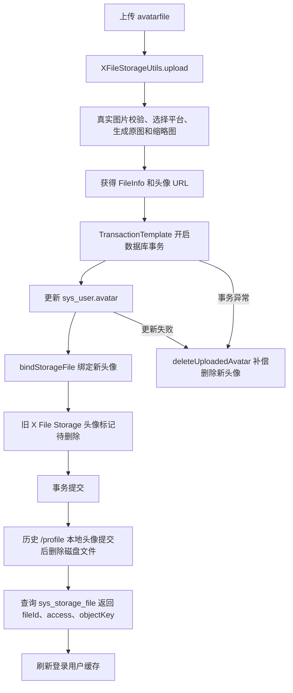

## 5. 涉及文件

- `ruoyi-admin/src/main/java/com/ruoyi/web/controller/system/SysProfileController.java`

## 6. 改动点清单

- 引入 `FileInfo`、`Constants`、`XFileStorageUtils`、`SysStorageFile`、`ISysStorageFileService`、`TransactionTemplate`
- 新增头像上传工具、文件记录服务和事务模板
- 新增头像业务类型和缩略图宽高常量
- 头像上传接口增加 `platform` 参数
- 上传方法从若依 `FileUploadUtils.upload` 改为 `xFileStorageUtils.upload`
- 用户头像保存成功后绑定文件记录
- 旧头像按历史本地头像和新文件资产分流处理
- 数据库动作使用 `TransactionTemplate` 控制事务
- 保存失败或事务异常时补偿删除新头像
- 返回结果补充 `platform`、`fileId`、`access`、`objectKey`、`thObjectKey`、`previewUrl`、`downloadUrl`、`thPreviewUrl`
- 接口返回给前端的是对外预览地址，数据库仍保存真实存储 URL

## 7. 原代码

```java
package com.ruoyi.web.controller.system;

import java.util.Map;
import org.springframework.beans.factory.annotation.Autowired;
import org.springframework.web.bind.annotation.GetMapping;
import org.springframework.web.bind.annotation.PostMapping;
import org.springframework.web.bind.annotation.PutMapping;
import org.springframework.web.bind.annotation.RequestBody;
import org.springframework.web.bind.annotation.RequestMapping;
import org.springframework.web.bind.annotation.RequestParam;
import org.springframework.web.bind.annotation.RestController;
import org.springframework.web.multipart.MultipartFile;
import com.ruoyi.common.annotation.Log;
import com.ruoyi.common.config.RuoYiConfig;
import com.ruoyi.common.core.controller.BaseController;
import com.ruoyi.common.core.domain.AjaxResult;
import com.ruoyi.common.core.domain.entity.SysUser;
import com.ruoyi.common.core.domain.model.LoginUser;
import com.ruoyi.common.enums.BusinessType;
import com.ruoyi.common.utils.DateUtils;
import com.ruoyi.common.utils.SecurityUtils;
import com.ruoyi.common.utils.StringUtils;
import com.ruoyi.common.utils.file.FileUploadUtils;
import com.ruoyi.common.utils.file.FileUtils;
import com.ruoyi.common.utils.file.MimeTypeUtils;
import com.ruoyi.framework.web.service.TokenService;
import com.ruoyi.system.service.ISysUserService;

/**
 * 个人信息 业务处理
 *
 * @author ruoyi
 */
@RestController
@RequestMapping("/system/user/profile")
public class SysProfileController extends BaseController
{
    @Autowired
    private ISysUserService userService;

    @Autowired
    private TokenService tokenService;

    /**
     * 头像上传
     */
    @Log(title = "用户头像", businessType = BusinessType.UPDATE)
    @PostMapping("/avatar")
    public AjaxResult avatar(@RequestParam("avatarfile") MultipartFile file) throws Exception
    {
        if (!file.isEmpty())
        {
            LoginUser loginUser = getLoginUser();
            String avatar = FileUploadUtils.upload(RuoYiConfig.getAvatarPath(), file, MimeTypeUtils.IMAGE_EXTENSION, true);
            if (userService.updateUserAvatar(loginUser.getUserId(), avatar))
            {
                String oldAvatar = loginUser.getUser().getAvatar();
                if (StringUtils.isNotEmpty(oldAvatar))
                {
                    FileUtils.deleteFile(RuoYiConfig.getProfile() + FileUtils.stripPrefix(oldAvatar));
                }
                AjaxResult ajax = AjaxResult.success();
                ajax.put("imgUrl", avatar);
                // 更新缓存用户头像
                loginUser.getUser().setAvatar(avatar);
                tokenService.setLoginUser(loginUser);
                return ajax;
            }
        }
        return error("上传图片异常，请联系管理员");
    }
}
```

## 8. 现代码

```java
package com.ruoyi.web.controller.system;

import java.util.Map;
import org.dromara.x.file.storage.core.FileInfo;
import org.slf4j.Logger;
import org.slf4j.LoggerFactory;
import org.springframework.beans.factory.annotation.Autowired;
import org.springframework.transaction.support.TransactionTemplate;
import org.springframework.web.bind.annotation.GetMapping;
import org.springframework.web.bind.annotation.PostMapping;
import org.springframework.web.bind.annotation.PutMapping;
import org.springframework.web.bind.annotation.RequestBody;
import org.springframework.web.bind.annotation.RequestMapping;
import org.springframework.web.bind.annotation.RequestParam;
import org.springframework.web.bind.annotation.RestController;
import org.springframework.web.multipart.MultipartFile;
import com.ruoyi.common.annotation.Log;
import com.ruoyi.common.constant.Constants;
import com.ruoyi.common.config.RuoYiConfig;
import com.ruoyi.common.core.controller.BaseController;
import com.ruoyi.common.core.domain.AjaxResult;
import com.ruoyi.common.core.domain.entity.SysUser;
import com.ruoyi.common.core.domain.model.LoginUser;
import com.ruoyi.common.enums.BusinessType;
import com.ruoyi.common.utils.DateUtils;
import com.ruoyi.common.utils.SecurityUtils;
import com.ruoyi.common.utils.StringUtils;
import com.ruoyi.common.utils.file.FileUtils;
import com.ruoyi.common.utils.file.MimeTypeUtils;
import com.ruoyi.common.utils.file.XFileStorageUtils;
import com.ruoyi.framework.web.service.TokenService;
import com.ruoyi.system.domain.SysStorageFile;
import com.ruoyi.system.service.ISysStorageFileService;
import com.ruoyi.system.service.ISysUserService;

/**
 * 当前登录用户的个人中心接口
 * <p>
 * 个人资料、密码修改等流程保持若依原有逻辑；头像上传改为使用 X File Storage
 * 因此头像可以存储到本地、阿里云 OSS、MinIO，或后续新增的其它平台
 *
 * @author ruoyi
 */
@RestController
@RequestMapping("/system/user/profile")
public class SysProfileController extends BaseController
{
    private static final Logger log = LoggerFactory.getLogger(SysProfileController.class);

    @Autowired
    private ISysUserService userService;

    @Autowired
    private TokenService tokenService;

    /**
     * 头像上传使用的统一文件存储适配器
     * <p>
     * 控制器只依赖该工具类，不直接依赖具体平台 SDK，后续新增平台时控制器无需改造
     */
    @Autowired
    private XFileStorageUtils xFileStorageUtils;

    /**
     * 存储文件记录服务
     * <p>
     * 头像上传成功后绑定新文件，替换旧头像时只标记待删除，由定时任务延迟清理
     */
    @Autowired
    private ISysStorageFileService storageFileService;

    /**
     * 编程式事务模板
     * <p>
     * 头像上传真实文件不参与数据库事务，只把用户头像更新、文件绑定和旧头像状态标记放入同一个事务
     */
    @Autowired
    private TransactionTemplate transactionTemplate;

    /**
     * 头像业务类型
     */
    private static final String BIZ_TYPE_AVATAR = "avatar";

    /**
     * 头像缩略图宽度，单位像素
     */
    private static final int AVATAR_THUMBNAIL_WIDTH = 100;

    /**
     * 头像缩略图高度，单位像素
     */
    private static final int AVATAR_THUMBNAIL_HEIGHT = 100;

    /**
     * 上传当前用户的新头像
     * <p>
     * platform 为空时使用配置中的默认存储平台；platform 不为空时上传到对应的已启用平台
     * 头像接口只允许图片扩展名
     *
     * @param file avatarfile 表单字段提交的头像文件
     * @param platform 可选存储平台标识，例如 local-1、aliyun-oss-1、minio-1
     * @return 头像访问 URL、缩略图 URL 和实际使用的存储平台
     */
    @Log(title = "用户头像", businessType = BusinessType.UPDATE)
    @PostMapping("/avatar")
    public AjaxResult avatar(@RequestParam("avatarfile") MultipartFile file,
            @RequestParam(value = "platform", required = false) String platform) throws Exception
    {
        // 空文件直接走统一失败返回
        if (!file.isEmpty())
        {
            LoginUser loginUser = getLoginUser();
            // 工具类负责图片校验，并根据 platform 选择指定平台或默认平台
            // 头像默认生成缩略图，原图仍作为数据库头像地址保存
            FileInfo fileInfo = xFileStorageUtils.upload(file, platform, BIZ_TYPE_AVATAR, MimeTypeUtils.IMAGE_EXTENSION, true,
                    AVATAR_THUMBNAIL_WIDTH, AVATAR_THUMBNAIL_HEIGHT);
            // 数据库存储最终可访问的头像 URL
            String avatar = fileInfo.getUrl();
            // 先记录旧头像，事务提交成功后再处理历史本地文件删除
            String oldAvatar = loginUser.getUser().getAvatar();
            boolean avatarSaved;
            try
            {
                // 头像业务数据库动作放在同一事务里，避免用户表已更新但文件资产未绑定
                avatarSaved = Boolean.TRUE.equals(transactionTemplate.execute(status ->
                {
                    // 更新用户头像字段，用户表仍保存最终可访问的原图 URL
                    if (!userService.updateUserAvatar(loginUser.getUserId(), avatar))
                    {
                        return false;
                    }
                    // 头像保存成功后把本次上传的新文件绑定到用户业务，避免被临时文件清理任务误删
                    storageFileService.bindStorageFile(avatar, BIZ_TYPE_AVATAR, String.valueOf(loginUser.getUserId()),
                            loginUser.getUsername());
                    if (StringUtils.isNotEmpty(oldAvatar) && !oldAvatar.startsWith(Constants.RESOURCE_PREFIX))
                    {
                        // X File Storage 上传的旧头像先标记待删除，交给定时任务延迟物理清理
                        storageFileService.markStorageFileWaitDelete(oldAvatar, BIZ_TYPE_AVATAR, loginUser.getUsername());
                    }
                    return true;
                }));
            }
            catch (Exception e)
            {
                // 数据库事务异常时立即补偿删除本次新头像，避免用户头像未保存但对象存储残留
                deleteUploadedAvatar(avatar);
                throw e;
            }
            if (avatarSaved)
            {
                if (StringUtils.isNotEmpty(oldAvatar) && oldAvatar.startsWith(Constants.RESOURCE_PREFIX))
                {
                    // 历史若依本地头像不参与数据库事务，等数据库提交成功后再删除磁盘文件
                    FileUtils.deleteFile(RuoYiConfig.getProfile() + FileUtils.stripPrefix(oldAvatar));
                }
                // 绑定后按 URL 读取文件资产记录，头像接口也同步返回 fileId、access 和对象 Key
                SysStorageFile storageFile = storageFileService.selectStorageFileByUrl(avatar);
                // 返回头像 URL 和实际平台，前端可据此展示当前上传去向
                AjaxResult ajax = AjaxResult.success();
                ajax.put("imgUrl", avatar);
                ajax.put("platform", fileInfo.getPlatform());
                if (storageFile != null)
                {
                    // fileId 是后续前端预览、下载、业务绑定和后台排查的稳定文件资产主键
                    ajax.put("fileId", storageFile.getFileId());
                    // access 从文件记录表返回，前端可区分公开直连和私有授权下载
                    ajax.put("access", storageFile.getAccess());
                    // objectKey 是对象存储里的真实对象定位信息，避免业务只依赖 URL
                    ajax.put("objectKey", storageFile.getObjectKey());
                    // thObjectKey 对应缩略图对象定位信息
                    ajax.put("thObjectKey", storageFile.getThObjectKey());
                }
                // 返回缩略图地址，前端列表或头像小尺寸展示可优先使用
                ajax.put("thUrl", fileInfo.getThUrl());
                // 同步令牌缓存中的头像地址，前端无需重新登录即可看到新头像
                loginUser.getUser().setAvatar(avatar);
                tokenService.setLoginUser(loginUser);
                return ajax;
            }
            // 头像上传成功但用户表保存失败时删除新文件，避免产生无法关联的孤儿文件
            deleteUploadedAvatar(avatar);
        }
        return error("上传图片异常，请联系管理员");
    }

    /**
     * 删除已经上传但业务保存失败的新头像
     *
     * @param avatar 新头像 URL
     */
    private void deleteUploadedAvatar(String avatar)
    {
        try
        {
            // 这里删除的是本次刚上传的新文件，不影响当前登录用户原头像
            xFileStorageUtils.delete(avatar);
        }
        catch (Exception e)
        {
            // 补偿删除失败只记录日志，接口仍返回原业务失败信息
            log.warn("头像保存失败后删除新头像失败，avatar={}", avatar, e);
        }
    }
}
```

## 9. 涉及改动部分

### 改动 1：引入头像上传、文件资产和事务依赖

原代码定位：

```java
// 省略
import java.util.Map;
import org.springframework.beans.factory.annotation.Autowired;
import org.springframework.web.bind.annotation.GetMapping;
// 省略
import com.ruoyi.common.annotation.Log;
import com.ruoyi.common.config.RuoYiConfig;
// 省略
import com.ruoyi.common.utils.file.FileUploadUtils;
import com.ruoyi.common.utils.file.FileUtils;
import com.ruoyi.common.utils.file.MimeTypeUtils;
import com.ruoyi.framework.web.service.TokenService;
import com.ruoyi.system.service.ISysUserService;
// 省略
```

现代码定位：

```java
// 省略
import java.util.Map;
import org.dromara.x.file.storage.core.FileInfo;
import org.slf4j.Logger;
import org.slf4j.LoggerFactory;
import org.springframework.beans.factory.annotation.Autowired;
import org.springframework.transaction.support.TransactionTemplate;
import org.springframework.web.bind.annotation.GetMapping;
// 省略
import com.ruoyi.common.annotation.Log;
import com.ruoyi.common.constant.Constants;
import com.ruoyi.common.config.RuoYiConfig;
// 省略
import com.ruoyi.common.utils.file.FileUtils;
import com.ruoyi.common.utils.file.MimeTypeUtils;
import com.ruoyi.common.utils.file.XFileStorageUtils;
import com.ruoyi.framework.web.service.TokenService;
import com.ruoyi.system.domain.SysStorageFile;
import com.ruoyi.system.service.ISysStorageFileService;
import com.ruoyi.system.service.ISysUserService;
// 省略
```

改动说明：

- 删除 `FileUploadUtils`，头像不再直接走若依本地上传工具
- 新增 `XFileStorageUtils`，统一处理平台选择、校验、缩略图、ACL 和上传
- 新增 `FileInfo`，用于接收 X File Storage 上传结果
- 新增 `ISysStorageFileService` 和 `SysStorageFile`，用于绑定文件资产并返回文件主键、访问级别和对象 Key
- 新增 `TransactionTemplate`，只把数据库动作放进事务，不把真实文件上传动作包进事务
- 新增 `Constants`，用于判断旧头像是否是历史 `/profile/**` 本地文件

### 改动 2：新增上传工具、文件记录服务、事务模板和头像常量

原代码定位：

```java
// 省略
public class SysProfileController extends BaseController
{
    @Autowired
    private ISysUserService userService;

    @Autowired
    private TokenService tokenService;

    @GetMapping
// 省略
```

现代码定位：

```java
// 省略
public class SysProfileController extends BaseController
{
    private static final Logger log = LoggerFactory.getLogger(SysProfileController.class);

    @Autowired
    private ISysUserService userService;

    @Autowired
    private TokenService tokenService;

    /**
     * 头像上传使用的统一文件存储适配器
     * <p>
     * 控制器只依赖该工具类，不直接依赖具体平台 SDK，后续新增平台时控制器无需改造
     */
    @Autowired
    private XFileStorageUtils xFileStorageUtils;

    /**
     * 存储文件记录服务
     * <p>
     * 头像上传成功后绑定新文件，替换旧头像时只标记待删除，由定时任务延迟清理
     */
    @Autowired
    private ISysStorageFileService storageFileService;

    /**
     * 编程式事务模板
     * <p>
     * 头像上传真实文件不参与数据库事务，只把用户头像更新、文件绑定和旧头像状态标记放入同一个事务
     */
    @Autowired
    private TransactionTemplate transactionTemplate;

    /**
     * 头像业务类型
     */
    private static final String BIZ_TYPE_AVATAR = "avatar";

    /**
     * 头像缩略图宽度，单位像素
     */
    private static final int AVATAR_THUMBNAIL_WIDTH = 100;

    /**
     * 头像缩略图高度，单位像素
     */
    private static final int AVATAR_THUMBNAIL_HEIGHT = 100;

    @GetMapping
// 省略
```

改动说明：

- `xFileStorageUtils` 让控制器只依赖统一上传门面，不关心本地、阿里云 OSS、MinIO、腾讯云 COS 的 SDK 细节
- `storageFileService` 负责文件记录绑定、旧头像待删除标记和文件资产回查
- `transactionTemplate` 负责头像业务数据库动作的事务边界
- `BIZ_TYPE_AVATAR` 写入文件记录表 `biz_type`，表示该文件属于头像业务
- 缩略图宽高常量用于头像固定小图生成，避免魔法值散落在方法里

### 改动 3：头像接口支持 platform 参数

原代码定位：

```java
// 省略
    @Log(title = "用户头像", businessType = BusinessType.UPDATE)
    @PostMapping("/avatar")
    public AjaxResult avatar(@RequestParam("avatarfile") MultipartFile file) throws Exception
    {
        if (!file.isEmpty())
// 省略
```

现代码定位：

```java
// 省略
    @Log(title = "用户头像", businessType = BusinessType.UPDATE)
    @PostMapping("/avatar")
    public AjaxResult avatar(@RequestParam("avatarfile") MultipartFile file,
            @RequestParam(value = "platform", required = false) String platform) throws Exception
    {
        // 空文件直接走统一失败返回
        if (!file.isEmpty())
// 省略
```

改动说明：

- `platform` 不是必填字段
- 不传 `platform` 时使用配置中的默认上传平台
- 传入 `local-1`、`aliyun-oss-1`、`minio-1`、`tencent-cos-1` 等平台标识时，会上传到指定平台
- 头像接口因此可以同时支持本地、OSS、MinIO、COS 或后续新增平台

### 改动 4：头像上传从若依本地上传改为 X File Storage 上传

原代码定位：

```java
// 省略
        if (!file.isEmpty())
        {
            LoginUser loginUser = getLoginUser();
            String avatar = FileUploadUtils.upload(RuoYiConfig.getAvatarPath(), file, MimeTypeUtils.IMAGE_EXTENSION, true);
            if (userService.updateUserAvatar(loginUser.getUserId(), avatar))
            {
                String oldAvatar = loginUser.getUser().getAvatar();
// 省略
```

现代码定位：

```java
// 省略
        if (!file.isEmpty())
        {
            LoginUser loginUser = getLoginUser();
            // 工具类负责图片校验，并根据 platform 选择指定平台或默认平台
            // 头像默认生成缩略图，原图仍作为数据库头像地址保存
            FileInfo fileInfo = xFileStorageUtils.upload(file, platform, BIZ_TYPE_AVATAR, MimeTypeUtils.IMAGE_EXTENSION, true,
                    AVATAR_THUMBNAIL_WIDTH, AVATAR_THUMBNAIL_HEIGHT);
            // 数据库存储最终可访问的头像 URL
            String avatar = fileInfo.getUrl();
            // 先记录旧头像，事务提交成功后再处理历史本地文件删除
            String oldAvatar = loginUser.getUser().getAvatar();
// 省略
```

改动说明：

- 原来调用 `FileUploadUtils.upload`，只能按若依本地上传逻辑处理头像
- 现在调用 `xFileStorageUtils.upload`，统一走 X File Storage
- 头像仍限制图片扩展名 `png`、`jpg`、`jpeg`
- 上传工具内部会做真实图片校验，避免 `.txt` 改名成 `.jpg` 绕过校验
- `true` 表示头像场景生成缩略图
- 用户表保存 `fileInfo.getUrl()`，也就是原图 URL

### 改动 5：用户头像更新、文件绑定和旧头像标记放入同一个数据库事务

原代码定位：

```java
// 省略
            String avatar = FileUploadUtils.upload(RuoYiConfig.getAvatarPath(), file, MimeTypeUtils.IMAGE_EXTENSION, true);
            if (userService.updateUserAvatar(loginUser.getUserId(), avatar))
            {
                String oldAvatar = loginUser.getUser().getAvatar();
                if (StringUtils.isNotEmpty(oldAvatar))
                {
                    FileUtils.deleteFile(RuoYiConfig.getProfile() + FileUtils.stripPrefix(oldAvatar));
                }
                AjaxResult ajax = AjaxResult.success();
// 省略
```

现代码定位：

```java
// 省略
            String avatar = fileInfo.getUrl();
            // 先记录旧头像，事务提交成功后再处理历史本地文件删除
            String oldAvatar = loginUser.getUser().getAvatar();
            boolean avatarSaved;
            try
            {
                // 头像业务数据库动作放在同一事务里，避免用户表已更新但文件资产未绑定
                avatarSaved = Boolean.TRUE.equals(transactionTemplate.execute(status ->
                {
                    // 更新用户头像字段，用户表仍保存最终可访问的原图 URL
                    if (!userService.updateUserAvatar(loginUser.getUserId(), avatar))
                    {
                        return false;
                    }
                    // 头像保存成功后把本次上传的新文件绑定到用户业务，避免被临时文件清理任务误删
                    storageFileService.bindStorageFile(avatar, BIZ_TYPE_AVATAR, String.valueOf(loginUser.getUserId()),
                            loginUser.getUsername());
                    if (StringUtils.isNotEmpty(oldAvatar) && !oldAvatar.startsWith(Constants.RESOURCE_PREFIX))
                    {
                        // X File Storage 上传的旧头像先标记待删除，交给定时任务延迟物理清理
                        storageFileService.markStorageFileWaitDelete(oldAvatar, BIZ_TYPE_AVATAR, loginUser.getUsername());
                    }
                    return true;
                }));
            }
            catch (Exception e)
            {
                // 数据库事务异常时立即补偿删除本次新头像，避免用户头像未保存但对象存储残留
                deleteUploadedAvatar(avatar);
                throw e;
            }
// 省略
```

改动说明：

- 真实文件上传不能被数据库事务回滚，所以先上传文件，再处理数据库事务
- 事务里只放数据库动作：更新 `sys_user.avatar`、绑定 `sys_storage_file`、标记旧 X File Storage 头像待删除
- 如果数据库事务异常，立即删除本次刚上传的新头像
- 没有在整个 `avatar` 方法上直接加 `@Transactional`，因为上传真实文件不应该被包进数据库事务

### 改动 6：旧头像清理兼容历史本地头像和新文件资产

原代码定位：

```java
// 省略
                String oldAvatar = loginUser.getUser().getAvatar();
                if (StringUtils.isNotEmpty(oldAvatar))
                {
                    FileUtils.deleteFile(RuoYiConfig.getProfile() + FileUtils.stripPrefix(oldAvatar));
                }
                AjaxResult ajax = AjaxResult.success();
// 省略
```

现代码定位：

```java
// 省略
                    if (StringUtils.isNotEmpty(oldAvatar) && !oldAvatar.startsWith(Constants.RESOURCE_PREFIX))
                    {
                        // X File Storage 上传的旧头像先标记待删除，交给定时任务延迟物理清理
                        storageFileService.markStorageFileWaitDelete(oldAvatar, BIZ_TYPE_AVATAR, loginUser.getUsername());
                    }
                    return true;
                }));
            }
            catch (Exception e)
// 省略
            if (avatarSaved)
            {
                if (StringUtils.isNotEmpty(oldAvatar) && oldAvatar.startsWith(Constants.RESOURCE_PREFIX))
                {
                    // 历史若依本地头像不参与数据库事务，等数据库提交成功后再删除磁盘文件
                    FileUtils.deleteFile(RuoYiConfig.getProfile() + FileUtils.stripPrefix(oldAvatar));
                }
                // 绑定后按 URL 读取文件资产记录，头像接口也同步返回 fileId、access 和对象 Key
                SysStorageFile storageFile = storageFileService.selectStorageFileByUrl(avatar);
// 省略
```

改动说明：

- 历史头像如果是 `/profile/**`，说明它是若依原本的本地文件，数据库事务提交成功后再删除磁盘文件
- 新方案上传的头像是 X File Storage URL，不直接物理删除，而是标记为待删除
- 延迟删除可以避免头像刚替换时因为缓存、浏览器回显、CDN 回源等原因出现短暂访问失败
- 旧头像标记待删除属于数据库动作，所以放在事务里
- 历史本地磁盘删除不属于数据库动作，所以放在事务提交成功后执行

### 改动 7：返回文件资产字段

原代码定位：

```java
// 省略
                AjaxResult ajax = AjaxResult.success();
                ajax.put("imgUrl", avatar);
                // 更新缓存用户头像
                loginUser.getUser().setAvatar(avatar);
                tokenService.setLoginUser(loginUser);
                return ajax;
// 省略
```

现代码定位：

```java
// 省略
                // 绑定后按 URL 读取文件资产记录，头像接口也同步返回 fileId、access 和对象 Key
                SysStorageFile storageFile = storageFileService.selectStorageFileByUrl(avatar);
                // 返回头像 URL 和实际平台，前端可据此展示当前上传去向
                AjaxResult ajax = AjaxResult.success();
                ajax.put("imgUrl", avatar);
                ajax.put("platform", fileInfo.getPlatform());
                if (storageFile != null)
                {
                    // fileId 是后续前端预览、下载、业务绑定和后台排查的稳定文件资产主键
                    ajax.put("fileId", storageFile.getFileId());
                    // access 从文件记录表返回，前端可区分公开直连和私有授权下载
                    ajax.put("access", storageFile.getAccess());
                    // objectKey 是对象存储里的真实对象定位信息，避免业务只依赖 URL
                    ajax.put("objectKey", storageFile.getObjectKey());
                    // thObjectKey 对应缩略图对象定位信息
                    ajax.put("thObjectKey", storageFile.getThObjectKey());
                }
                // 返回缩略图地址，前端列表或头像小尺寸展示可优先使用
                ajax.put("thUrl", fileInfo.getThUrl());
                // 同步令牌缓存中的头像地址，前端无需重新登录即可看到新头像
                loginUser.getUser().setAvatar(avatar);
// 省略
```

改动说明：

- `imgUrl` 保持为头像原图 URL，兼容若依前端头像字段
- `platform` 返回实际使用的上传平台，方便排查默认平台或指定平台是否生效
- `thUrl` 返回缩略图 URL，后续小尺寸头像展示可以优先使用
- `fileId` 是文件资产表主键，比 URL 更适合做后续绑定、下载、预览和后台排查
- `access` 表示公开或私有，前端可以据此判断直连展示还是走授权下载
- `objectKey` 和 `thObjectKey` 是对象存储中的真实对象定位信息，降低系统对 URL 的依赖

### 改动 8：保存失败补偿删除

原代码定位：

```java
// 省略
            if (userService.updateUserAvatar(loginUser.getUserId(), avatar))
            {
                AjaxResult ajax = AjaxResult.success();
                ajax.put("imgUrl", avatar);
                return ajax;
            }
        }
        return error("上传图片异常，请联系管理员");
    }
}
// 省略
```

现代码定位：

```java
// 省略
            if (avatarSaved)
            {
                AjaxResult ajax = AjaxResult.success();
                ajax.put("imgUrl", avatar);
                ajax.put("platform", fileInfo.getPlatform());
                ajax.put("thUrl", fileInfo.getThUrl());
                loginUser.getUser().setAvatar(avatar);
                tokenService.setLoginUser(loginUser);
                return ajax;
            }
            // 头像上传成功但用户表保存失败时删除新文件，避免产生无法关联的孤儿文件
            deleteUploadedAvatar(avatar);
        }
        return error("上传图片异常，请联系管理员");
    }

    /**
     * 删除已经上传但业务保存失败的新头像
     *
     * @param avatar 新头像 URL
     */
    private void deleteUploadedAvatar(String avatar)
    {
        try
        {
            // 这里删除的是本次刚上传的新文件，不影响当前登录用户原头像
            xFileStorageUtils.delete(avatar);
        }
        catch (Exception e)
        {
            // 补偿删除失败只记录日志，接口仍返回原业务失败信息
            log.warn("头像保存失败后删除新头像失败，avatar={}", avatar, e);
        }
    }
}
// 省略
```

改动说明：

- 补偿删除只处理本次刚上传的新头像
- 不删除当前登录用户原头像，避免业务保存失败时把用户现有头像删掉
- 补偿删除失败只记录日志，不覆盖原始业务失败原因
- 事务异常和用户表保存失败都会触发补偿删除

## 10. 返回结果示例

改造前：

```json
{
  "msg": "操作成功",
  "code": 200,
  "imgUrl": "/profile/avatar/2026/09/08/abc.jpg"
}
```

改造后：

```json
{
  "msg": "操作成功",
  "code": 200,
  "imgUrl": "https://ruoyi-1451277880.cos.ap-shanghai.myqcloud.com/test/public/avatar/2026/09/08/d779e160218e4fd9b657312eb4438568.jpg",
  "previewUrl": "https://ruoyi-1451277880.cos.ap-shanghai.myqcloud.com/test/public/avatar/2026/09/08/d779e160218e4fd9b657312eb4438568.jpg",
  "downloadUrl": "https://ruoyi-1451277880.cos.ap-shanghai.myqcloud.com/test/public/avatar/2026/09/08/d779e160218e4fd9b657312eb4438568.jpg",
  "platform": "tencent-cos-1",
  "fileId": 1,
  "access": "public",
  "objectKey": "test/public/avatar/2026/09/08/d779e160218e4fd9b657312eb4438568.jpg",
  "thObjectKey": "test/public/avatar/2026/09/08/d779e160218e4fd9b657312eb4438568.jpg.min.jpg",
  "thUrl": "https://ruoyi-1451277880.cos.ap-shanghai.myqcloud.com/test/public/avatar/2026/09/08/d779e160218e4fd9b657312eb4438568.jpg.min.jpg",
  "thPreviewUrl": "https://ruoyi-1451277880.cos.ap-shanghai.myqcloud.com/test/public/avatar/2026/09/08/d779e160218e4fd9b657312eb4438568.jpg.min.jpg"
}
```

字段说明：

- `imgUrl`：头像对外预览地址，前端头像回显优先使用
- `previewUrl`：头像对外预览地址
- `downloadUrl`：头像下载地址
- `platform`：本次实际上传平台
- `fileId`：`sys_storage_file` 文件资产主键
- `access`：文件访问级别，公开文件可直连，私有文件应走授权下载或预览
- `objectKey`：原图在对象存储中的对象 Key
- `thObjectKey`：缩略图在对象存储中的对象 Key
- `thUrl`：缩略图对外预览地址
- `thPreviewUrl`：缩略图对外预览地址

注意：`sys_user.avatar` 和 `sys_storage_file.url` 仍保存真实存储 URL，用于后端内部和 X File Storage 操作；接口返回给前端的是按访问策略转换后的对外地址。

## 11. 事务边界说明

头像上传流程不能简单给整个方法加 `@Transactional`。

原因：

- 文件已经上传到对象存储或本地磁盘后，数据库事务回滚不会自动删除真实文件
- 如果把上传动作放在数据库事务里，会让数据库事务持有时间变长
- 对象存储上传失败和数据库写入失败属于两类资源失败，需要用补偿逻辑处理

当前做法：

- 先上传真实文件
- 再用 `TransactionTemplate` 执行用户表更新、文件绑定、旧头像标记待删除
- 数据库事务失败时，补偿删除本次新上传头像
- 数据库事务成功后，再删除历史 `/profile/**` 本地头像

## 12. 与文件资产表的关系

头像上传成功后，X File Storage 的 `FileRecorder` 会先保存文件记录到 `sys_storage_file`。

头像业务保存成功后，再通过：

```java
storageFileService.bindStorageFile(avatar, BIZ_TYPE_AVATAR, String.valueOf(loginUser.getUserId()),
        loginUser.getUsername());
```

把文件从临时状态绑定为业务文件。

绑定后的关键字段：

- `biz_type = avatar`
- `biz_id = 当前用户ID`
- `file_status = 已使用`
- `url = 头像原图 URL`
- `th_url = 头像缩略图 URL`
- `access = public/private`
- `object_key = 原图对象 Key`
- `th_object_key = 缩略图对象 Key`

## 13. 变更小结

本次头像上传改造不是单纯替换上传工具，而是把头像纳入文件资产管理流程。

改造后头像上传具备：

- 多平台上传能力
- 真实图片校验能力
- 缩略图生成能力
- 文件资产记录能力
- 业务绑定能力
- 旧文件延迟删除能力
- 保存失败补偿能力
- 数据库事务一致性控制
- 前端回显和后续下载预览所需的稳定文件信息

---

## 原文：doc/10-P0P1文件上传优化说明.md

# P0P1 文件上传优化说明

## 1. 改造目标

本次优化聚焦文件上传模块的 P0、P1 问题，目标是让通用上传入口更适合后续业务复用：

- 通用上传返回结构统一，避免控制器里重复手写 `Map`
- 私有文件下载不再只凭 URL 放行，通用入口只处理公开文件、本人临时文件、本人头像和管理员兜底
- 业务私有文件下载交回业务接口处理，由业务接口先做菜单权限和数据权限，再调用文件服务校验文件归属
- 文件上传失败日志补齐上下文，便于排查平台、场景、文件大小和文件名问题
- 新业务可通过配置强制传入 `uploadScene`，避免绕过场景规则
- 文件资产服务增加批量绑定和业务文件同步能力，方便业务表不保存文件字段时仍能管理附件
- 缩略图后缀支持按上传场景配置，避免所有图片场景被全局 `.min.jpg` 绑定
- 文件资产表使用 `url_hash` 做唯一索引，避免长 URL 前缀索引存在误判风险
- 文件资产表增加 `object_key`、`th_object_key` 和 `access`，后续鉴权、预览和后台排查不再只依赖 URL，访问级别入库时优先根据对象 ACL 判断
- 通用上传和头像上传返回 `fileId`、`objectKey`、`thObjectKey`，前端和业务绑定可优先使用文件资产主键
- 文件资产服务只在业务文件集合同步这种多步数据库写操作上补充事务边界，避免文件绑定和旧文件待删除状态不一致
- 头像上传补充局部事务，用户头像更新、文件绑定、旧头像标记待删除保持一致，事务异常时补偿删除新头像
- 用户头像字段长度扩展到 `varchar(512)`，适配对象存储或 CDN 返回的完整 URL
- 生产环境 COS 配置放入 `application-prod.yml`，主配置通过激活 `prod` profile 读取
- 新增文件作者统一使用当前 Git 用户名 `955Kane`

## 2. 改造前存在的问题

### 2.1 上传返回结构分散

`CommonController` 里单文件上传、多文件上传、分片初始化、分片上传都各自组装返回字段。字段含义相近，但代码散落在多个接口里，后续增加 `access`、`uploadStatus`、缩略图字段时容易漏改。

### 2.2 私有文件下载入口权限偏弱

原来的 X File Storage 下载接口主要根据 URL 还原 `FileInfo` 后直接下载。对于 `private` 场景文件，如果 URL 泄露，同系统登录用户可能绕过业务权限直接下载。

第一版私有下载改造已经增加了 token、上传人、头像本人和 `bizType/bizId` 归属校验，但 `bizType/bizId` 只能证明“文件属于这个业务”，还不能证明“当前用户有权限查看这个业务”。因此最终方案不在文件模块单独维护业务权限映射，而是让业务接口先完成菜单权限和数据权限校验，再调用文件服务校验文件归属。

### 2.3 通用上传可以不传场景

当前为了兼容旧接口，`uploadScene` 可以为空。这个行为对历史接口友好，但新业务如果忘记传场景，就可能使用默认大小、默认格式和默认路径策略。

### 2.4 文件绑定只支持单文件

文件资产表绑定业务时只有单文件绑定方法。实际业务常见附件数组、图片数组、编辑时替换附件等场景，需要业务层自己循环和比较新旧文件集合。

### 2.5 上传异常日志信息不足

上传失败时只返回异常消息，日志缺少 `platform`、`uploadScene`、原始文件名、大小、分片号等关键上下文，排查 OSS/COS/MinIO 权限或场景配置时成本较高。

### 2.6 缩略图后缀只能使用全局配置

原来只使用 `dromara.x-file-storage.thumbnail-suffix` 控制缩略图后缀。头像、普通图片、素材图如果都生成缩略图，就只能统一生成同一种格式，例如全部都是 `.min.jpg`。头像场景这样做问题不大，但透明 PNG、商品图、素材图后续可能需要保留 PNG 或改成 WebP。

### 2.7 文件 URL 唯一索引使用前缀索引

文件表中 `url` 字段较长，原设计使用 `unique key uk_sys_storage_file_url (url(191))` 做兼容型唯一索引。这个方式能解决多数场景，但只比较 URL 前 191 个字符，理论上存在不同长 URL 前缀相同导致误判冲突的风险。

### 2.8 用户头像字段长度不足

若依原始 `sys_user.avatar` 字段为 `varchar(100)`。本地 `/profile/avatar/xxx.jpg` 可以放下，但 COS、OSS、MinIO 或 CDN 返回完整 URL 后很容易超过 100，保存头像时会触发 `Data too long for column 'avatar'`。

### 2.9 生产配置未激活导致占位默认值生效

腾讯 COS 的真实配置已经放入 `application-prod.yml`，但主配置中只激活了 `druid`，导致 `prod` 配置没有加载。运行时仍读取主配置中的 `${TENCENT_COS_BUCKET_NAME:??}`，桶名变成 `??` 后腾讯 COS SDK 会报 `Bucket name only should contain lowercase characters, num and -`。

## 3. 改造后的解决方案

- 新增 `StorageFileUploadRespDTO`，统一普通上传、批量上传、分片初始化、分片合并后的文件返回结构
- 新增 `StorageFilePartRespDTO`，统一分片上传和分片列表中的分片返回结构
- 新增 `StorageFileUploadProperties`，通过 `ruoyi.storage-file.require-upload-scene` 控制是否强制传入上传场景
- `CommonController` 引入 `ISysStorageFileService`，下载私有文件前先查库并校验访问边界
- `CommonController` 不再承接普通业务私有文件下载，避免绕过业务数据权限
- `ISysStorageFileService` 增加 `getBusinessFileInfo`，供业务接口在完成权限和数据权限校验后复用文件归属校验
- `XFileStorageUtils` 读取上传控制配置，在需要时拒绝无场景上传
- `ISysStorageFileService` 增加根据 URL 查询、批量绑定、业务文件集合同步方法
- `SysStorageFileServiceImpl` 保存上传记录时记录上传人，后续私有临时文件下载可判断归属
- `UploadSceneProperties.Scene` 增加 `thumbnailSuffix`，上传时场景配置优先覆盖全局缩略图后缀
- `sys_storage_file` 增加 `url_hash` 字段，使用完整 URL 的 SHA-256 哈希做唯一索引
- `sys_storage_file` 增加 `object_key`、`th_object_key`、`access` 字段，分别保存原图对象 Key、缩略图对象 Key 和访问级别
- `SysStorageFileServiceImpl` 保存文件记录时优先根据对象 ACL 写入 `access`，没有 ACL 时才回退历史路径规则
- `SysStorageFileMapper` 根据 `url_hash + url` 精确查询、绑定和更新文件记录
- `StorageFileUploadRespDTO` 从文件记录表补齐 `fileId`、`objectKey`、`thObjectKey`、`access`
- `SysProfileController` 头像上传成功后回查文件资产记录，头像接口也返回文件资产主键和对象 Key
- `SysStorageFileServiceImpl` 只对 `syncBizStorageFiles` 增加回滚事务，单条数据库操作和对象存储 IO 方法不额外挂事务
- `SysProfileController` 使用 `TransactionTemplate` 包裹头像业务数据库动作，不把对象存储上传动作放入数据库事务
- `SysStorageFileServiceImpl` 延迟获取 `FileStorageService`，避免 FileRecorder 与 X File Storage 自动配置形成循环依赖
- `sys_user.avatar` 扩展为 `varchar(512)`，保存完整对象存储访问 URL
- `application-prod.yml` 保存腾讯 COS 生产配置，`application.yml` 激活 `druid,prod`

## 4. 总体链路

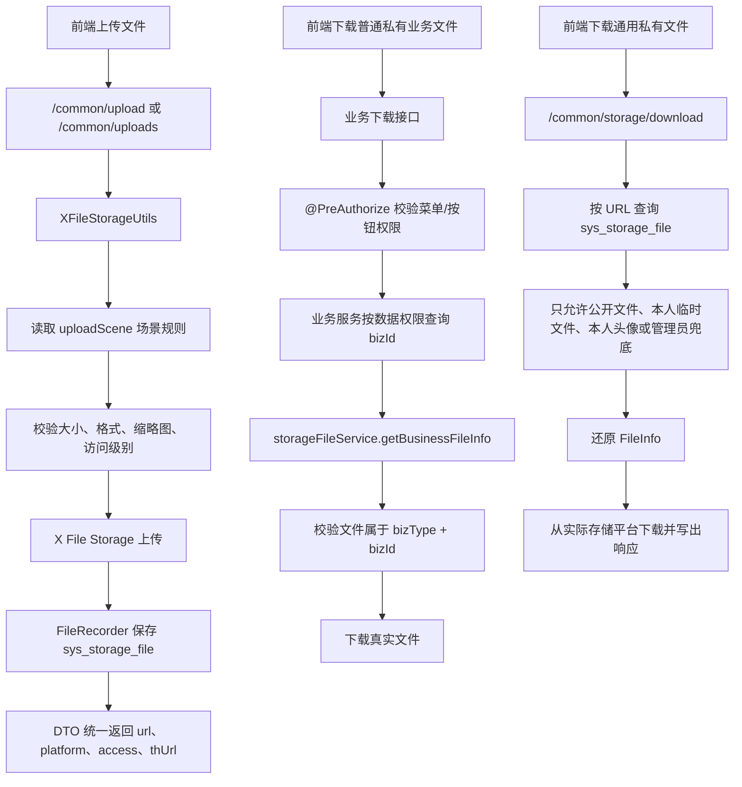

## 5. 涉及文件

- `ruoyi-admin/src/main/java/com/ruoyi/web/controller/common/CommonController.java`
- `ruoyi-admin/src/main/resources/application.yml`
- `ruoyi-common/src/main/java/com/ruoyi/common/config/StorageFileUploadProperties.java`
- `ruoyi-common/src/main/java/com/ruoyi/common/core/domain/model/StorageFileUploadRespDTO.java`
- `ruoyi-common/src/main/java/com/ruoyi/common/core/domain/model/StorageFilePartRespDTO.java`
- `ruoyi-common/src/main/java/com/ruoyi/common/utils/file/XFileStorageUtils.java`
- `ruoyi-framework/src/main/java/com/ruoyi/framework/config/properties/StorageFileSecurityProperties.java`
- `ruoyi-system/src/main/java/com/ruoyi/system/service/ISysStorageFileService.java`
- `ruoyi-system/src/main/java/com/ruoyi/system/service/impl/SysStorageFileServiceImpl.java`
- `ruoyi-system/src/main/java/com/ruoyi/system/domain/SysStorageFile.java`
- `ruoyi-system/src/main/java/com/ruoyi/system/mapper/SysStorageFileMapper.java`
- `ruoyi-system/src/main/resources/mapper/system/SysStorageFileMapper.xml`
- `ruoyi-admin/src/main/java/com/ruoyi/web/controller/system/SysProfileController.java`
- `ruoyi-admin/src/main/resources/application-prod.yml`
- `sql/ry_20260417.sql`
- `sql/sys_user_avatar_20260908.sql`
- `sql/sys_storage_file_20260901.sql`
- `sql/sys_storage_file_url_hash_20260908.sql`

## 6. 具体改动

### 6.1 CommonController 注入文件记录服务

#### 原代码

```java
// 省略
public class CommonController
{
    private static final Logger log = LoggerFactory.getLogger(CommonController.class);

    /**
     * X File Storage 适配工具
     * <p>
     * 控制器不直接调用第三方上传 API，而是通过该工具统一复用若依的校验
     * 命名规则和平台选择逻辑
     */
    private final XFileStorageUtils xFileStorageUtils;

    /**
     * 构造器注入上传工具，明确当前控制器依赖的文件存储能力
     *
     * @param xFileStorageUtils 统一上传工具
     */
    public CommonController(XFileStorageUtils xFileStorageUtils)
    {
        this.xFileStorageUtils = xFileStorageUtils;
    }
// 省略
```

#### 现代码

```java
// 省略
public class CommonController
{
    private static final Logger log = LoggerFactory.getLogger(CommonController.class);

    /** X File Storage 上传适配工具 */
    private final XFileStorageUtils xFileStorageUtils;

    /** 存储文件记录服务，用于私有文件下载鉴权和文件资产记录查询 */
    private final ISysStorageFileService storageFileService;

    /**
     * 构造通用文件控制器
     *
     * @param xFileStorageUtils 统一上传工具
     * @param storageFileService 存储文件记录服务
     */
    public CommonController(XFileStorageUtils xFileStorageUtils, ISysStorageFileService storageFileService)
    {
        this.xFileStorageUtils = xFileStorageUtils;
        this.storageFileService = storageFileService;
    }
// 省略
```

#### 涉及改动部分

```java
// 省略
    /** X File Storage 上传适配工具 */
    private final XFileStorageUtils xFileStorageUtils;

    /** 存储文件记录服务，用于私有文件下载鉴权和文件资产记录查询 */
    private final ISysStorageFileService storageFileService;

    /**
     * 构造通用文件控制器
     *
     * @param xFileStorageUtils 统一上传工具
     * @param storageFileService 存储文件记录服务
     */
    public CommonController(XFileStorageUtils xFileStorageUtils, ISysStorageFileService storageFileService)
    {
        this.xFileStorageUtils = xFileStorageUtils;
        this.storageFileService = storageFileService;
    }
// 省略
```

#### 改动说明

原来 `CommonController` 只依赖上传工具，下载 X File Storage 文件时缺少数据库记录上下文。现在增加 `ISysStorageFileService`，控制器可以先根据 URL 查询 `sys_storage_file`，再判断文件是否公开、是否属于当前用户、是否属于头像本人，或者是否由管理员兜底处理。

### 6.2 CommonController 单文件上传返回 DTO

#### 原代码

```java
// 省略
@PostMapping("/upload")
public AjaxResult uploadFile(MultipartFile file, @RequestParam(value = "platform", required = false) String platform,
        @RequestParam(value = "uploadScene", required = false) String uploadScene,
        @RequestParam(value = "thumbnail", defaultValue = "false") Boolean thumbnail,
        @RequestParam(value = "thumbnailWidth", required = false) Integer thumbnailWidth,
        @RequestParam(value = "thumbnailHeight", required = false) Integer thumbnailHeight) throws Exception
{
    try
    {
        FileInfo fileInfo = xFileStorageUtils.upload(file, platform, uploadScene, MimeTypeUtils.DEFAULT_ALLOWED_EXTENSION,
                Boolean.TRUE.equals(thumbnail), thumbnailWidth, thumbnailHeight);
        String url = fileInfo.getUrl();
        AjaxResult ajax = AjaxResult.success();
        ajax.put("url", url);
        ajax.put("fileName", url);
        ajax.put("newFileName", FileUtils.getName(url));
        ajax.put("originalFilename", file.getOriginalFilename());
        ajax.put("platform", fileInfo.getPlatform());
        ajax.put("uploadScene", uploadScene);
        ajax.put("thUrl", fileInfo.getThUrl());
        ajax.put("thFileName", fileInfo.getThUrl());
        ajax.put("thNewFileName", FileUtils.getName(fileInfo.getThUrl()));
        ajax.put("thSize", fileInfo.getThSize());
        ajax.put("size", fileInfo.getSize());
        ajax.put("contentType", fileInfo.getContentType());
        return ajax;
    }
    catch (Exception e)
    {
        return AjaxResult.error(e.getMessage());
    }
}
// 省略
```

#### 现代码

```java
// 省略
@PostMapping("/upload")
public AjaxResult uploadFile(MultipartFile file, @RequestParam(value = "platform", required = false) String platform,
        @RequestParam(value = "uploadScene", required = false) String uploadScene,
        @RequestParam(value = "thumbnail", defaultValue = "false") Boolean thumbnail,
        @RequestParam(value = "thumbnailWidth", required = false) Integer thumbnailWidth,
        @RequestParam(value = "thumbnailHeight", required = false) Integer thumbnailHeight) throws Exception
{
    try
    {
        // 统一使用工具类处理平台选择、场景规则、格式校验、缩略图和真实上传
        FileInfo fileInfo = xFileStorageUtils.upload(file, platform, uploadScene, MimeTypeUtils.DEFAULT_ALLOWED_EXTENSION,
                Boolean.TRUE.equals(thumbnail), thumbnailWidth, thumbnailHeight);
        // 单文件上传返回 data 对象，字段由 DTO 统一维护
        return AjaxResult.success(StorageFileUploadRespDTO.from(fileInfo, uploadScene, file.getOriginalFilename()));
    }
    catch (Exception e)
    {
        // 上传失败记录上下文，方便排查对象存储配置、场景配置或文件限制问题
        log.error("上传文件失败，platform={}，uploadScene={}，originalFilename={}，size={}", platform, uploadScene,
                file == null ? null : file.getOriginalFilename(), file == null ? null : file.getSize(), e);
        return AjaxResult.error(e.getMessage());
    }
}
// 省略
```

#### 涉及改动部分

```java
// 省略
        FileInfo fileInfo = xFileStorageUtils.upload(file, platform, uploadScene, MimeTypeUtils.DEFAULT_ALLOWED_EXTENSION,
                Boolean.TRUE.equals(thumbnail), thumbnailWidth, thumbnailHeight);
        // 单文件上传返回 data 对象，字段由 DTO 统一维护
        return AjaxResult.success(StorageFileUploadRespDTO.from(fileInfo, uploadScene, file.getOriginalFilename()));
    }
    catch (Exception e)
    {
        // 上传失败记录上下文，方便排查对象存储配置、场景配置或文件限制问题
        log.error("上传文件失败，platform={}，uploadScene={}，originalFilename={}，size={}", platform, uploadScene,
                file == null ? null : file.getOriginalFilename(), file == null ? null : file.getSize(), e);
        return AjaxResult.error(e.getMessage());
    }
// 省略
```

#### 改动说明

原来上传接口把 `url`、`fileName`、`newFileName`、`thUrl` 等字段直接平铺到 `AjaxResult`。现在改为 `AjaxResult.success(StorageFileUploadRespDTO)`，返回字段集中在 DTO 内维护。这样新增 `access`、`uploadId`、`uploadStatus` 等字段时，只需要改 DTO，不需要每个接口重复补字段。

这次也补充了失败日志。以前只返回错误消息，后台日志无法看出是哪一个平台、哪一个场景、哪一个文件失败；现在日志会记录 `platform`、`uploadScene`、`originalFilename` 和 `size`。

### 6.3 CommonController 多文件上传返回 fileList DTO 数组

#### 原代码

```java
// 省略
List<Map<String, Object>> fileList = new ArrayList<Map<String, Object>>();
for (MultipartFile file : files)
{
    FileInfo fileInfo = xFileStorageUtils.upload(file, platform, uploadScene, MimeTypeUtils.DEFAULT_ALLOWED_EXTENSION,
            Boolean.TRUE.equals(thumbnail), thumbnailWidth, thumbnailHeight);
    String url = fileInfo.getUrl();
    Map<String, Object> fileItem = new LinkedHashMap<String, Object>();
    fileItem.put("url", url);
    fileItem.put("fileName", url);
    fileItem.put("newFileName", FileUtils.getName(url));
    fileItem.put("originalFilename", file.getOriginalFilename());
    fileItem.put("platform", fileInfo.getPlatform());
    fileItem.put("uploadScene", uploadScene);
    fileItem.put("thUrl", fileInfo.getThUrl());
    fileItem.put("thFileName", fileInfo.getThUrl());
    fileItem.put("thNewFileName", FileUtils.getName(fileInfo.getThUrl()));
    fileItem.put("size", fileInfo.getSize());
    fileItem.put("thSize", fileInfo.getThSize());
    fileItem.put("contentType", fileInfo.getContentType());
    fileList.add(fileItem);
}
AjaxResult ajax = AjaxResult.success();
ajax.put("fileList", fileList);
return ajax;
// 省略
```

#### 现代码

```java
// 省略
List<StorageFileUploadRespDTO> fileList = new ArrayList<StorageFileUploadRespDTO>();
for (MultipartFile file : files)
{
    // 每个文件使用同一套 platform 和 uploadScene 策略上传
    FileInfo fileInfo = xFileStorageUtils.upload(file, platform, uploadScene, MimeTypeUtils.DEFAULT_ALLOWED_EXTENSION,
            Boolean.TRUE.equals(thumbnail), thumbnailWidth, thumbnailHeight);
    // DTO 内部统一处理 url、缩略图、大小、access 等返回字段
    fileList.add(StorageFileUploadRespDTO.from(fileInfo, uploadScene, file.getOriginalFilename()));
}
// 批量上传继续保留 fileList 字段，前端按数组逐项处理
AjaxResult ajax = AjaxResult.success();
ajax.put("fileList", fileList);
return ajax;
// 省略
```

#### 涉及改动部分

```java
// 省略
        // 结构化文件列表给新前端使用，每个元素对应一个上传文件
        List<StorageFileUploadRespDTO> fileList = new ArrayList<StorageFileUploadRespDTO>();
        for (MultipartFile file : files)
        {
            // 每个文件使用同一套 platform 和 uploadScene 策略上传
            FileInfo fileInfo = xFileStorageUtils.upload(file, platform, uploadScene, MimeTypeUtils.DEFAULT_ALLOWED_EXTENSION,
                    Boolean.TRUE.equals(thumbnail), thumbnailWidth, thumbnailHeight);
            // DTO 内部统一处理 url、缩略图、大小、access 等返回字段
            fileList.add(StorageFileUploadRespDTO.from(fileInfo, uploadScene, file.getOriginalFilename()));
        }
        // 批量上传继续保留 fileList 字段，前端按数组逐项处理
        AjaxResult ajax = AjaxResult.success();
// 省略
```

#### 改动说明

原来多文件接口在循环里手动创建 `LinkedHashMap`，字段逻辑和单文件接口重复。现在统一使用 `StorageFileUploadRespDTO`，批量接口仍保留 `fileList` 数组字段，适配前端按数组展示附件、图片和普通文件。

### 6.4 CommonController 分片上传返回 DTO

#### 原代码

```java
// 省略
FileInfo fileInfo = xFileStorageUtils.initiateMultipartUpload(originalFilename, size, contentType, platform, uploadScene,
        MimeTypeUtils.DEFAULT_ALLOWED_EXTENSION);
AjaxResult ajax = AjaxResult.success(toFileItem(fileInfo, originalFilename));
ajax.put("uploadScene", uploadScene);
return ajax;
// 省略
FilePartInfo filePartInfo = xFileStorageUtils.uploadPart(url, partNumber, file);
return AjaxResult.success(toFilePartItem(filePartInfo));
// 省略
ajax.put("file", toFileItem(filePartInfoList.getFileInfo(), null));
ajax.put("partList", toFilePartList(filePartInfoList.getList()));
// 省略
FileInfo fileInfo = xFileStorageUtils.completeMultipartUpload(url);
return AjaxResult.success(toFileItem(fileInfo, null));
// 省略
```

#### 现代码

```java
// 省略
FileInfo fileInfo = xFileStorageUtils.initiateMultipartUpload(originalFilename, size, contentType, platform, uploadScene,
        MimeTypeUtils.DEFAULT_ALLOWED_EXTENSION);
// 分片初始化返回统一 DTO，前端后续用 url 和 uploadId 继续传分片
return AjaxResult.success(StorageFileUploadRespDTO.from(fileInfo, uploadScene, originalFilename));
// 省略
FilePartInfo filePartInfo = xFileStorageUtils.uploadPart(url, partNumber, file);
return AjaxResult.success(StorageFilePartRespDTO.from(filePartInfo));
// 省略
ajax.put("file", StorageFileUploadRespDTO.from(filePartInfoList.getFileInfo(), null, null));
ajax.put("partList", toFilePartList(filePartInfoList.getList()));
// 省略
FileInfo fileInfo = xFileStorageUtils.completeMultipartUpload(url);
return AjaxResult.success(StorageFileUploadRespDTO.from(fileInfo, null, null));
// 省略
```

#### 涉及改动部分

```java
// 省略
    private List<StorageFilePartRespDTO> toFilePartList(List<FilePartInfo> filePartInfos)
    {
        // 空分片列表返回空数组，前端无需做 null 判断
        List<StorageFilePartRespDTO> partList = new ArrayList<StorageFilePartRespDTO>();
        if (filePartInfos == null)
        {
            return partList;
        }
        for (FilePartInfo filePartInfo : filePartInfos)
        {
            // 每个分片转换为稳定 DTO 后返回
            partList.add(StorageFilePartRespDTO.from(filePartInfo));
        }
        return partList;
    }
// 省略
```

#### 改动说明

原来分片相关接口依赖控制器内部的 `toFileItem`、`toFilePartItem` 组装 Map。现在分片初始化、上传分片、查询分片、完成分片都使用 DTO。分片返回字段里明确包含 `uploadId`、`uploadStatus`、`partNumber`、`partSize` 和 `etag`，前端做断点续传时字段更稳定。

### 6.5 CommonController 私有文件下载鉴权

#### 原代码

```java
// 省略
@PostMapping("/storage/download")
public void storageDownload(@RequestParam("url") String url, HttpServletResponse response)
{
    try
    {
        FileInfo fileInfo = xFileStorageUtils.getFileInfoByUrl(url);
        String downloadName = StringUtils.isNotBlank(fileInfo.getOriginalFilename()) ? fileInfo.getOriginalFilename()
                : FileUtils.getName(fileInfo.getUrl());
        response.setContentType(StringUtils.isNotBlank(fileInfo.getContentType()) ? fileInfo.getContentType()
                : MediaType.APPLICATION_OCTET_STREAM_VALUE);
        FileUtils.setAttachmentResponseHeader(response, downloadName);
        response.getOutputStream().write(xFileStorageUtils.downloadBytes(fileInfo));
    }
    catch (Exception e)
    {
        log.error("下载存储文件失败，url={}", url, e);
        response.setStatus(HttpServletResponse.SC_INTERNAL_SERVER_ERROR);
    }
}
// 省略
```

#### 现代码

```java
// 省略
@PostMapping("/storage/download")
public void storageDownload(@RequestParam("url") String url,
        @RequestParam(value = "bizType", required = false) String bizType,
        @RequestParam(value = "bizId", required = false) String bizId, HttpServletResponse response)
{
    try
    {
        // 先查数据库文件记录，私有下载必须基于记录里的业务归属做鉴权
        SysStorageFile storageFile = storageFileService.selectStorageFileByUrl(url);
        checkStorageDownloadAllowed(storageFile, bizType, bizId);
        // 数据库记录还原为 FileInfo，框架才能定位具体平台和对象路径
        FileInfo fileInfo = storageFileService.toFileInfo(storageFile);
        if (fileInfo == null)
        {
            throw new ServiceException("文件记录不存在");
        }
        // 原始文件名优先用于下载文件名，缺失时使用 URL 最后一段兜底
        String downloadName = StringUtils.isNotBlank(fileInfo.getOriginalFilename()) ? fileInfo.getOriginalFilename()
                : FileUtils.getName(fileInfo.getUrl());
        // Content-Type 有值时按真实类型返回，便于浏览器识别预览或下载
        response.setContentType(StringUtils.isNotBlank(fileInfo.getContentType()) ? fileInfo.getContentType()
                : MediaType.APPLICATION_OCTET_STREAM_VALUE);
        // 设置附件响应头，中文文件名由 FileUtils 统一编码
        FileUtils.setAttachmentResponseHeader(response, downloadName);
        // 从实际存储平台下载文件内容并写入响应流
        response.getOutputStream().write(xFileStorageUtils.downloadBytes(fileInfo));
    }
    catch (ServiceException e)
    {
        // 权限或业务归属校验失败返回 403，避免私有文件 URL 泄露后被同系统用户下载
        log.warn("下载存储文件被拒绝，url={}，bizType={}，bizId={}，reason={}", url, bizType, bizId, e.getMessage());
        response.setStatus(HttpStatus.FORBIDDEN);
    }
    catch (Exception e)
    {
        // 下载异常写日志并返回 500，前端下载工具会按失败处理
        log.error("下载存储文件失败，url={}，bizType={}，bizId={}", url, bizType, bizId, e);
        response.setStatus(HttpServletResponse.SC_INTERNAL_SERVER_ERROR);
    }
}
// 省略
```

#### 涉及改动部分

```java
// 省略
    private void checkStorageDownloadAllowed(SysStorageFile storageFile, String bizType, String bizId)
    {
        if (storageFile == null)
        {
            throw new ServiceException("文件记录不存在");
        }
        // 超级管理员和拥有统一下载权限的用户允许兜底处理跨业务文件
        if (SecurityUtils.isAdmin() || SecurityUtils.hasPermi("system:storage:download"))
        {
            return;
        }
        // 公开文件本身可以走静态资源访问，登录下载入口也允许读取
        if (isPublicStorageFile(storageFile))
        {
            return;
        }
        String username = SecurityUtils.getUsername();
        // 临时文件或未绑定业务文件只允许上传人自己下载，已绑定业务后要继续走业务身份校验
        if (StringUtils.isBlank(storageFile.getBizType()) && StringUtils.isNotBlank(storageFile.getCreateBy())
                && storageFile.getCreateBy().equals(username))
        {
            return;
        }
        // 头像属于用户自身资料，当前用户只能下载自己的头像文件
        if ("avatar".equals(storageFile.getBizType()) && String.valueOf(SecurityUtils.getUserId()).equals(storageFile.getBizId()))
        {
            return;
        }
        // 普通业务私有文件不在通用入口下载，必须回到业务接口做菜单权限和数据权限校验
        if (StringUtils.isBlank(bizType) || StringUtils.isBlank(bizId))
        {
            throw new ServiceException("业务私有文件请通过对应业务下载接口下载");
        }
        // 请求声明的业务身份必须和文件绑定记录一致
        if (!bizType.equals(storageFile.getBizType()) || !bizId.equals(storageFile.getBizId()))
        {
            throw new ServiceException("文件不属于当前业务");
        }
        // 通用入口不承接普通业务私有文件下载，业务接口应先做菜单权限和数据权限校验后再调用文件服务
        throw new ServiceException("业务私有文件请通过对应业务下载接口下载");
    }

    private boolean isPublicStorageFile(SysStorageFile storageFile)
    {
        // 当前上传路径第一层为 public/private，直接按 path 判断访问级别
        return StringUtils.isNotBlank(storageFile.getPath()) && storageFile.getPath().startsWith("public/");
    }
// 省略
```

#### 改动说明

原来下载接口只传 `url`，后端拿到 URL 后直接下载。现在私有下载入口增加 `bizType`、`bizId`，并按以下顺序判断：

- 超级管理员或拥有 `system:storage:download` 权限，允许下载
- `path` 以 `public/` 开头的公开文件，允许下载
- 未绑定业务的临时文件，只允许上传人自己下载
- `avatar` 文件只允许头像所属用户自己下载
- 普通业务私有文件不在通用入口直接下载，即使传入 `bizType`、`bizId` 且文件归属匹配，也会提示走对应业务下载接口

这个改动解决的是“私有对象存储 URL 不能直接访问，但后端通用下载接口也不能绕过业务数据权限”的问题。当前通用下载入口只处理公开文件、本人临时文件、本人头像和管理员兜底下载。普通业务私有文件应由业务 Controller 先做 `@PreAuthorize` 菜单权限和业务数据权限校验，再调用文件服务校验文件归属并下载。

### 6.6 StorageFileSecurityProperties 撤回业务下载权限映射

#### 原代码

```java
package com.ruoyi.framework.config.properties;

import java.util.ArrayList;
import java.util.HashMap;
import java.util.List;
import java.util.Map;
import org.springframework.boot.context.properties.ConfigurationProperties;
import org.springframework.stereotype.Component;

/**
 * 存储文件安全配置
 * <p>
 * 用于控制哪些 X File Storage 访问路径允许匿名访问
 *
 * @author ruoyi
 */
@Component
@ConfigurationProperties(prefix = "ruoyi.storage-file")
public class StorageFileSecurityProperties
{
    /** 公开文件访问路径 */
    private List<String> publicPathPatterns = new ArrayList<String>();

    /** 是否要求私有业务文件必须配置下载权限 */
    private boolean requireBusinessDownloadPermission = true;

    /** 私有业务文件下载权限映射，key 为 bizType，value 为若依权限标识 */
    private Map<String, String> downloadPermissions = new HashMap<String, String>();

    public List<String> getPublicPathPatterns()
    {
        return publicPathPatterns;
    }

    public void setPublicPathPatterns(List<String> publicPathPatterns)
    {
        this.publicPathPatterns = publicPathPatterns == null ? new ArrayList<String>() : publicPathPatterns;
    }

    public boolean isRequireBusinessDownloadPermission()
    {
        return requireBusinessDownloadPermission;
    }

    public void setRequireBusinessDownloadPermission(boolean requireBusinessDownloadPermission)
    {
        this.requireBusinessDownloadPermission = requireBusinessDownloadPermission;
    }

    public Map<String, String> getDownloadPermissions()
    {
        return downloadPermissions;
    }

    public void setDownloadPermissions(Map<String, String> downloadPermissions)
    {
        this.downloadPermissions = downloadPermissions == null ? new HashMap<String, String>() : downloadPermissions;
    }
}
```

这段是上一版临时方案：尝试在文件模块通过 `bizType -> 权限标识` 的配置来判断业务文件下载权限。讨论后确认它会复制业务权限体系，并且无法处理若依数据权限，所以撤回。

#### 现代码

```java
package com.ruoyi.framework.config.properties;

import java.util.ArrayList;
import java.util.List;
import org.springframework.boot.context.properties.ConfigurationProperties;
import org.springframework.stereotype.Component;

/**
 * 存储文件安全配置
 * <p>
 * 用于控制哪些 X File Storage 访问路径允许匿名访问
 *
 * @author ruoyi
 */
@Component
@ConfigurationProperties(prefix = "ruoyi.storage-file")
public class StorageFileSecurityProperties
{
    /** 公开文件访问路径 */
    private List<String> publicPathPatterns = new ArrayList<String>();

    public List<String> getPublicPathPatterns()
    {
        return publicPathPatterns;
    }

    public void setPublicPathPatterns(List<String> publicPathPatterns)
    {
        this.publicPathPatterns = publicPathPatterns == null ? new ArrayList<String>() : publicPathPatterns;
    }
}
```

#### 涉及改动部分

```java
// 省略
    /** 公开文件访问路径 */
    private List<String> publicPathPatterns = new ArrayList<String>();

    public void setPublicPathPatterns(List<String> publicPathPatterns)
    {
        this.publicPathPatterns = publicPathPatterns == null ? new ArrayList<String>() : publicPathPatterns;
    }
// 省略
```

#### 改动说明

最终保留 `StorageFileSecurityProperties` 的职责为“公开路径白名单配置”，不再维护私有业务文件下载权限映射。私有业务文件下载权限应由业务 Controller 的 `@PreAuthorize` 和业务服务的数据权限查询决定，文件模块只校验文件是否属于指定业务。`setPublicPathPatterns` 保留空值兜底，避免配置留空时 Spring Security 构造白名单出现空指针。

### 6.7 新增 StorageFileUploadRespDTO

#### 原代码

```java
// 原来没有统一上传返回 DTO
// CommonController 中直接使用 AjaxResult 和 Map 手动组装 url、fileName、thUrl 等字段
```

#### 现代码

```java
package com.ruoyi.common.core.domain.model;

import org.dromara.x.file.storage.core.FileInfo;
import com.ruoyi.common.utils.StringUtils;
import com.ruoyi.common.utils.file.FileUtils;

/**
 * 存储文件上传返回 DTO
 * <p>
 * 用于统一普通上传、批量上传和分片合并后的返回字段，避免控制器里反复手写 Map
 *
 * @author 955Kane
 */
public class StorageFileUploadRespDTO
{
    /** 原图访问地址 */
    private String url;

    /** 兼容若依上传组件的文件地址字段 */
    private String fileName;

    /** 保存后的文件名 */
    private String newFileName;

    /** 上传时的原始文件名 */
    private String originalFilename;

    /** 实际使用的存储平台 */
    private String platform;

    /** 上传场景编码 */
    private String uploadScene;

    /** 分片上传会话 ID */
    private String uploadId;

    /** 分片上传状态 */
    private Integer uploadStatus;

    /** 缩略图访问地址 */
    private String thUrl;

    /** 兼容若依上传组件的缩略图地址字段 */
    private String thFileName;

    /** 缩略图文件名 */
    private String thNewFileName;

    /** 原图大小，单位字节 */
    private Long size;

    /** 缩略图大小，单位字节 */
    private Long thSize;

    /** 文件内容类型 */
    private String contentType;

    /** 访问级别，public 表示公开访问，private 表示需要后端鉴权下载 */
    private String access;

    public static StorageFileUploadRespDTO from(FileInfo fileInfo, String uploadScene, String fallbackOriginalFilename)
    {
        StorageFileUploadRespDTO resp = new StorageFileUploadRespDTO();
        if (fileInfo == null)
        {
            return resp;
        }
        // URL 是前端保存和展示当前文件的主地址
        String url = fileInfo.getUrl();
        resp.setUrl(url);
        resp.setFileName(url);
        resp.setNewFileName(FileUtils.getName(url));
        // 原始文件名优先使用框架记录，缺失时使用调用方传入的文件名
        resp.setOriginalFilename(StringUtils.isNotBlank(fileInfo.getOriginalFilename()) ? fileInfo.getOriginalFilename()
                : fallbackOriginalFilename);
        resp.setPlatform(fileInfo.getPlatform());
        resp.setUploadScene(uploadScene);
        resp.setUploadId(fileInfo.getUploadId());
        resp.setUploadStatus(fileInfo.getUploadStatus());
        resp.setThUrl(fileInfo.getThUrl());
        resp.setThFileName(fileInfo.getThUrl());
        resp.setThNewFileName(FileUtils.getName(fileInfo.getThUrl()));
        resp.setSize(fileInfo.getSize());
        resp.setThSize(fileInfo.getThSize());
        resp.setContentType(fileInfo.getContentType());
        resp.setAccess(resolveAccess(fileInfo));
        return resp;
    }

    private static String resolveAccess(FileInfo fileInfo)
    {
        // 当前路径规则由 XFileStorageUtils 统一生成，第一层目录就是访问级别
        String path = fileInfo.getPath();
        if (StringUtils.isBlank(path))
        {
            return null;
        }
        if (path.startsWith("public/"))
        {
            return "public";
        }
        if (path.startsWith("private/"))
        {
            return "private";
        }
        return null;
    }

    // 省略标准 getter/setter
}
```

#### 涉及改动部分

```java
// 省略
    /** 分片上传会话 ID */
    private String uploadId;

    /** 分片上传状态 */
    private Integer uploadStatus;

    /** 缩略图访问地址 */
    private String thUrl;

    /** 原图大小，单位字节 */
    private Long size;

    /** 缩略图大小，单位字节 */
    private Long thSize;

    /** 访问级别，public 表示公开访问，private 表示需要后端鉴权下载 */
    private String access;
// 省略
```

#### 改动说明

这个 DTO 把上传接口常用返回字段集中到一个地方。`size`、`thSize` 注释明确单位是字节，`access` 用于告诉前端当前文件是公开资源还是私有资源。公开资源可直接展示，私有资源应走后端下载接口。

### 6.8 新增 StorageFilePartRespDTO

#### 原代码

```java
// 原来没有统一分片返回 DTO
// CommonController 内部通过 toFilePartItem 手动组装分片 Map
```

#### 现代码

```java
package com.ruoyi.common.core.domain.model;

import java.util.Date;
import org.dromara.x.file.storage.core.upload.FilePartInfo;

/**
 * 存储文件分片返回 DTO
 * <p>
 * 用于统一分片上传、分片列表接口的返回字段
 *
 * @author 955Kane
 */
public class StorageFilePartRespDTO
{
    /** 分片记录 ID */
    private String id;

    /** 存储平台 */
    private String platform;

    /** 分片上传会话 ID */
    private String uploadId;

    /** 分片编号，从 1 开始 */
    private Integer partNumber;

    /** 分片大小，单位字节 */
    private Long partSize;

    /** 存储平台返回的分片 ETag */
    private String etag;

    /** 分片哈希信息 */
    private Object hashInfo;

    /** 创建时间 */
    private Date createTime;

    /** 最后修改时间 */
    private Date lastModified;

    public static StorageFilePartRespDTO from(FilePartInfo filePartInfo)
    {
        StorageFilePartRespDTO resp = new StorageFilePartRespDTO();
        if (filePartInfo == null)
        {
            return resp;
        }
        // 分片字段直接来自框架，前端用 uploadId 和 partNumber 做断点续传匹配
        resp.setId(filePartInfo.getId());
        resp.setPlatform(filePartInfo.getPlatform());
        resp.setUploadId(filePartInfo.getUploadId());
        resp.setPartNumber(filePartInfo.getPartNumber());
        resp.setPartSize(filePartInfo.getPartSize());
        resp.setEtag(filePartInfo.getETag());
        resp.setHashInfo(filePartInfo.getHashInfo());
        resp.setCreateTime(filePartInfo.getCreateTime());
        resp.setLastModified(filePartInfo.getLastModified());
        return resp;
    }

    // 省略标准 getter/setter
}
```

#### 涉及改动部分

```java
// 省略
    /** 分片编号，从 1 开始 */
    private Integer partNumber;

    /** 分片大小，单位字节 */
    private Long partSize;

    /** 存储平台返回的分片 ETag */
    private String etag;

    /** 分片哈希信息 */
    private Object hashInfo;
// 省略
```

#### 改动说明

分片上传需要前端根据 `uploadId`、`partNumber` 和 `etag` 判断哪些分片已经上传、哪些需要重传。这里把这些字段固定成 DTO，避免后续接口返回字段不一致。`partSize` 注释明确单位是字节。

### 6.9 新增 StorageFileUploadProperties

#### 原代码

```java
// 原来没有 ruoyi.storage-file 上传控制配置类
// uploadScene 为空时 XFileStorageUtils 始终回退默认上传规则
```

#### 现代码

```java
package com.ruoyi.common.config;

import org.springframework.boot.context.properties.ConfigurationProperties;
import org.springframework.stereotype.Component;

/**
 * 存储文件上传控制配置
 * <p>
 * 用于控制通用上传入口是否必须声明上传场景，避免新业务绕过场景级大小、格式和访问策略
 *
 * @author 955Kane
 */
@Component
@ConfigurationProperties(prefix = "ruoyi.storage-file")
public class StorageFileUploadProperties
{
    /** 是否要求通用上传必须传 uploadScene */
    private boolean requireUploadScene = false;

    public boolean isRequireUploadScene()
    {
        return requireUploadScene;
    }

    public void setRequireUploadScene(boolean requireUploadScene)
    {
        this.requireUploadScene = requireUploadScene;
    }
}
```

#### 涉及改动部分

```java
// 省略
@Component
@ConfigurationProperties(prefix = "ruoyi.storage-file")
public class StorageFileUploadProperties
{
    /** 是否要求通用上传必须传 uploadScene */
    private boolean requireUploadScene = false;
// 省略
```

#### 改动说明

这里新增的是“开关型配置”。默认 `false` 是为了兼容旧接口：不传 `uploadScene` 仍可上传。生产环境如果希望所有新业务都必须声明场景，可以改成 `true`，这样遗漏场景的上传会直接返回“上传场景不能为空”。

### 6.10 application.yml 只保留上传场景强制开关和公开路径配置

#### 配置位置

```yaml
# 省略
ruoyi:
  storage-file:
    # 是否要求通用上传必须传 uploadScene，生产环境建议开启，新业务避免绕过场景规则
    require-upload-scene: false
    # 公开文件访问路径，匹配到的 GET 请求允许匿名访问
    public-path-patterns:
      # local-plus 的 domain 为 /file/，base-path 为 upload/，公开场景 path 第一层为 public
      - /file/upload/public/**
# 省略
```

#### 涉及改动部分

```yaml
# 省略
  storage-file:
    # 是否要求通用上传必须传 uploadScene，生产环境建议开启，新业务避免绕过场景规则
    require-upload-scene: false
    # 公开文件访问路径，匹配到的 GET 请求允许匿名访问
    public-path-patterns:
      # local-plus 的 domain 为 /file/，base-path 为 upload/，公开场景 path 第一层为 public
      - /file/upload/public/**
# 省略
```

#### 改动说明

配置文件只保留文件模块真正应该负责的内容：

- `require-upload-scene`：当前值为 `false`，表示“有场景按场景，没有场景走兼容默认规则”。如果改为 `true`，通用上传接口必须传 `uploadScene`，否则 `XFileStorageUtils.getScene` 会拒绝上传
- `public-path-patterns`：只控制哪些 X File Storage 静态资源路径允许匿名访问，例如 `/file/upload/public/**`

私有业务文件下载权限不放在 `application.yml` 做 `bizType -> permission` 映射，避免形成第二套业务权限配置。最终由业务 Controller 的 `@PreAuthorize` 和业务服务的数据权限查询来决定当前用户能否下载某个业务附件。

### 6.11 XFileStorageUtils 读取上传控制配置

#### 原代码

```java
// 省略
private final FileStorageService fileStorageService;

private final UploadSceneProperties uploadSceneProperties;

public XFileStorageUtils(FileStorageService fileStorageService, UploadSceneProperties uploadSceneProperties)
{
    this.fileStorageService = fileStorageService;
    this.uploadSceneProperties = uploadSceneProperties;
}
// 省略
private Scene getScene(String uploadScene)
{
    // 没有传场景时不启用场景规则
    if (StringUtils.isBlank(uploadScene))
    {
        return null;
    }
    Scene scene = uploadSceneProperties.getScene(uploadScene);
    if (scene == null)
    {
        throw new IllegalArgumentException("上传场景不存在：" + uploadScene);
    }
    return scene;
}
// 省略
```

#### 现代码

```java
// 省略
private final FileStorageService fileStorageService;

/** 上传场景配置 */
private final UploadSceneProperties uploadSceneProperties;

/** 存储文件上传控制配置 */
private final StorageFileUploadProperties storageFileUploadProperties;

public XFileStorageUtils(FileStorageService fileStorageService, UploadSceneProperties uploadSceneProperties,
        StorageFileUploadProperties storageFileUploadProperties)
{
    this.fileStorageService = fileStorageService;
    this.uploadSceneProperties = uploadSceneProperties;
    this.storageFileUploadProperties = storageFileUploadProperties;
}
// 省略
private Scene getScene(String uploadScene)
{
    // 生产环境可开启强制场景，避免新业务误走默认大小、格式和访问策略
    if (storageFileUploadProperties.isRequireUploadScene() && StringUtils.isBlank(uploadScene))
    {
        throw new IllegalArgumentException("上传场景不能为空");
    }
    // 没有传场景时不启用场景规则，保持兼容旧上传入口
    if (StringUtils.isBlank(uploadScene))
    {
        return null;
    }
    // 场景不存在时直接拒绝，避免前端传错后回退到更宽松的默认规则
    Scene scene = uploadSceneProperties.getScene(uploadScene);
    if (scene == null)
    {
        throw new IllegalArgumentException("上传场景不存在：" + uploadScene);
    }
    return scene;
}
// 省略
```

#### 涉及改动部分

```java
// 省略
    /** 存储文件上传控制配置 */
    private final StorageFileUploadProperties storageFileUploadProperties;

    public XFileStorageUtils(FileStorageService fileStorageService, UploadSceneProperties uploadSceneProperties,
            StorageFileUploadProperties storageFileUploadProperties)
    {
        this.fileStorageService = fileStorageService;
        this.uploadSceneProperties = uploadSceneProperties;
        this.storageFileUploadProperties = storageFileUploadProperties;
    }
// 省略
```

#### 改动说明

`XFileStorageUtils` 现在不只读取具体场景配置，还读取上传控制开关。这样场景必传策略放在工具层统一处理，`/common/upload`、`/common/uploads`、分片初始化等入口都会生效，不需要每个 Controller 单独判断。

### 6.12 XFileStorageUtils 上传和分片初始化按配置判断场景

#### 原代码

```java
// 省略
public FileInfo upload(MultipartFile file, String platform, String uploadScene, String[] allowedExtension,
        boolean thumbnail, Integer thumbnailWidth, Integer thumbnailHeight) throws Exception
{
    Scene scene = getScene(uploadScene);
    String[] actualAllowedExtension = getAllowedExtension(scene, allowedExtension);
    long maxSize = getMaxSize(scene);
    boolean actualThumbnail = scene != null && scene.getThumbnail() != null ? scene.getThumbnail() : thumbnail;
    Integer actualThumbnailWidth = scene != null && scene.getThumbnailWidth() != null ? scene.getThumbnailWidth() : thumbnailWidth;
    Integer actualThumbnailHeight = scene != null && scene.getThumbnailHeight() != null ? scene.getThumbnailHeight() : thumbnailHeight;
    assertAllowed(file, actualAllowedExtension, maxSize);
    String datePath = DateUtils.datePath();
    String storagePath = buildStoragePath(scene, uploadScene, datePath);
    UploadPretreatment upload = fileStorageService.of(file)
            .setPath(storagePath)
            .setSaveFilename(FileUploadUtils.uuidFilename(file).substring(datePath.length() + 1));
    if (StringUtils.isNotBlank(platform))
    {
        upload.setPlatform(platform);
    }
    if (scene != null)
    {
        applyAcl(upload, scene);
    }
    if (actualThumbnail)
    {
        setThumbnail(upload, file, actualThumbnailWidth, actualThumbnailHeight);
    }
    return upload.upload();
}
// 省略
```

#### 现代码

```java
// 省略
public FileInfo upload(MultipartFile file, String platform, String uploadScene, String[] allowedExtension,
        boolean thumbnail, Integer thumbnailWidth, Integer thumbnailHeight) throws Exception
{
    // 根据场景编码读取场景规则，未传场景时按配置决定是否允许回退默认规则
    Scene scene = getScene(uploadScene);
    // 场景配置了扩展名时优先使用场景白名单
    String[] actualAllowedExtension = getAllowedExtension(scene, allowedExtension);
    // 场景配置了最大大小时优先使用场景大小限制
    long maxSize = getMaxSize(scene);
    // 场景配置了缩略图开关时优先使用场景缩略图策略
    boolean actualThumbnail = scene != null && scene.getThumbnail() != null ? scene.getThumbnail() : thumbnail;
    // 场景配置了缩略图宽度时优先使用场景宽度
    Integer actualThumbnailWidth = scene != null && scene.getThumbnailWidth() != null ? scene.getThumbnailWidth() : thumbnailWidth;
    // 场景配置了缩略图高度时优先使用场景高度
    Integer actualThumbnailHeight = scene != null && scene.getThumbnailHeight() != null ? scene.getThumbnailHeight() : thumbnailHeight;
    // 先执行若依原有文件安全校验
    assertAllowed(file, actualAllowedExtension, maxSize);
    // 日期目录保持 yyyy/MM/dd，便于按天归档
    String datePath = DateUtils.datePath();
    // 按上传场景生成 public/private 分层路径，便于 Spring Security 放行公开资源
    String storagePath = buildStoragePath(scene, uploadScene, datePath);
    // 构造上传预处理对象，文件名继续使用若依 UUID 规则
    UploadPretreatment upload = fileStorageService.of(file)
            .setPath(storagePath)
            .setSaveFilename(FileUploadUtils.uuidFilename(file).substring(datePath.length() + 1));
    if (StringUtils.isNotBlank(platform))
    {
        // 指定平台时覆盖配置中的默认平台
        upload.setPlatform(platform);
    }
    if (scene != null)
    {
        // 只有声明场景时才同步对象 ACL，未声明场景时保留平台默认权限
        applyAcl(upload, scene);
    }
    if (actualThumbnail)
    {
        // 明确要求缩略图时再开启，避免普通文件被误处理为图片
        setThumbnail(upload, file, actualThumbnailWidth, actualThumbnailHeight);
    }
    // platform 为空时 X File Storage 会使用 dromara.x-file-storage.default-platform
    return upload.upload();
}
// 省略
```

#### 涉及改动部分

```java
// 省略
        // 根据场景编码读取场景规则，未传场景时按配置决定是否允许回退默认规则
        Scene scene = getScene(uploadScene);
// 省略
        if (scene != null)
        {
            // 只有声明场景时才同步对象 ACL，未声明场景时保留平台默认权限
            applyAcl(upload, scene);
        }
// 省略
        // platform 为空时 X File Storage 会使用 dromara.x-file-storage.default-platform
        return upload.upload();
// 省略
```

#### 改动说明

这里主要补清了上传链路注释，并把“未传场景时是否允许继续上传”交给 `getScene` 根据配置判断。普通上传和分片初始化都调用同一个 `getScene`，所以配置开关能覆盖两条上传链路。

### 6.13 ISysStorageFileService 增加文件查询和集合同步能力

#### 原代码

```java
// 省略
public interface ISysStorageFileService extends FileRecorder
{
    /**
     * 绑定文件到业务
     *
     * @param url 文件访问地址
     * @param bizType 业务类型
     * @param bizId 业务ID
     * @param updateBy 更新者
     * @return 结果
     */
    public int bindStorageFile(String url, String bizType, String bizId, String updateBy);
// 省略
}
```

#### 现代码

```java
// 省略
public interface ISysStorageFileService extends FileRecorder
{
    /**
     * 根据 URL 查询存储文件记录
     *
     * @param url 文件访问地址
     * @return 存储文件记录
     */
    public SysStorageFile selectStorageFileByUrl(String url);

    /**
     * 绑定文件到业务
     *
     * @param url 文件访问地址
     * @param bizType 业务类型
     * @param bizId 业务ID
     * @param updateBy 更新者
     * @return 影响行数
     */
    public int bindStorageFile(String url, String bizType, String bizId, String updateBy);

    /**
     * 批量绑定文件到业务
     *
     * @param urls 文件访问地址集合
     * @param bizType 业务类型
     * @param bizId 业务ID
     * @param updateBy 更新者
     * @return 影响行数
     */
    public int bindStorageFiles(Collection<String> urls, String bizType, String bizId, String updateBy);

    /**
     * 同步业务文件集合
     * <p>
     * 新文件会绑定到当前业务，旧文件中不再出现的文件会标记待删除
     *
     * @param newUrls 当前业务保存后的文件地址集合
     * @param oldUrls 修改前业务已关联的文件地址集合
     * @param bizType 业务类型
     * @param bizId 业务ID
     * @param updateBy 更新者
     * @return 影响行数
     */
    public int syncBizStorageFiles(Collection<String> newUrls, Collection<String> oldUrls, String bizType, String bizId,
            String updateBy);

    /**
     * 获取已通过业务权限校验的业务文件信息
     * <p>
     * 调用方需要先完成菜单权限和数据权限校验，本方法只校验文件是否属于指定业务
     *
     * @param url 文件访问地址
     * @param bizType 业务类型
     * @param bizId 业务ID
     * @return X File Storage 文件信息
     */
    public FileInfo getBusinessFileInfo(String url, String bizType, String bizId);
// 省略
}
```

#### 涉及改动部分

```java
// 省略
    public SysStorageFile selectStorageFileByUrl(String url);

    public int bindStorageFiles(Collection<String> urls, String bizType, String bizId, String updateBy);

    public int syncBizStorageFiles(Collection<String> newUrls, Collection<String> oldUrls, String bizType, String bizId,
            String updateBy);

    public FileInfo getBusinessFileInfo(String url, String bizType, String bizId);
// 省略
```

#### 改动说明

接口层增加四个能力：

- `selectStorageFileByUrl`：供私有下载入口按 URL 查文件记录
- `bindStorageFiles`：业务保存成功后批量绑定附件
- `syncBizStorageFiles`：业务编辑时绑定新文件，并把被移除的旧文件标记待删除
- `getBusinessFileInfo`：供业务接口在完成菜单权限和数据权限校验后，校验文件是否属于当前业务并还原 `FileInfo`

这使业务表可以只保存业务字段，文件关系放在 `sys_storage_file.biz_type`、`sys_storage_file.biz_id` 中管理。

### 6.14 SysStorageFileServiceImpl 记录上传人并支持业务文件同步

#### 原代码

```java
// 省略
// 新上传文件先记录为临时状态，等业务保存成功后再绑定为已使用
storageFile.setFileStatus(STATUS_TEMP);
storageFile.setCreateTime(fileInfo.getCreateTime() == null ? DateUtils.getNowDate() : fileInfo.getCreateTime());
return storageFileMapper.insertStorageFile(storageFile) > 0;
// 省略
public int bindStorageFile(String url, String bizType, String bizId, String updateBy)
{
    if (StringUtils.isBlank(url))
    {
        return 0;
    }
    return storageFileMapper.bindStorageFile(url, bizType, bizId, updateBy);
}
// 省略
```

#### 现代码

```java
// 省略
// 新上传文件先记录为临时状态，等业务保存成功后再绑定为已使用
storageFile.setFileStatus(STATUS_TEMP);
// 记录上传人，私有临时文件下载时可判断是否属于当前登录用户
storageFile.setCreateBy(getCurrentUsernameQuietly());
storageFile.setCreateTime(fileInfo.getCreateTime() == null ? DateUtils.getNowDate() : fileInfo.getCreateTime());
return storageFileMapper.insertStorageFile(storageFile) > 0;
// 省略
public int bindStorageFiles(Collection<String> urls, String bizType, String bizId, String updateBy)
{
    // 没有文件地址时无需处理，便于业务保存空附件
    if (urls == null || urls.isEmpty())
    {
        return 0;
    }
    int rows = 0;
    for (String url : urls)
    {
        // 单个空地址跳过，避免前端空字符串污染绑定逻辑
        if (StringUtils.isNotBlank(url))
        {
            rows += bindStorageFile(url, bizType, bizId, updateBy);
        }
    }
    return rows;
}

public int syncBizStorageFiles(Collection<String> newUrls, Collection<String> oldUrls, String bizType, String bizId,
        String updateBy)
{
    // 先绑定当前仍在使用的文件，避免临时文件清理任务误删
    int rows = bindStorageFiles(newUrls, bizType, bizId, updateBy);
    // 当前文件集合用于判断旧文件是否已经被业务替换或移除
    Set<String> currentUrls = normalizeUrlSet(newUrls);
    if (oldUrls == null || oldUrls.isEmpty())
    {
        return rows;
    }
    for (String oldUrl : oldUrls)
    {
        // 旧文件不在新集合中时才进入待删除，仍被使用的文件保持已绑定状态
        if (StringUtils.isNotBlank(oldUrl) && !currentUrls.contains(oldUrl))
        {
            rows += markStorageFileWaitDelete(oldUrl, bizType, updateBy);
        }
    }
    return rows;
}

public FileInfo getBusinessFileInfo(String url, String bizType, String bizId)
{
    // 业务下载必须由业务接口传入明确身份，文件服务只负责校验文件归属
    if (StringUtils.isBlank(url) || StringUtils.isBlank(bizType) || StringUtils.isBlank(bizId))
    {
        throw new ServiceException("文件业务参数不能为空");
    }
    SysStorageFile storageFile = storageFileMapper.selectStorageFileByUrl(url);
    if (storageFile == null)
    {
        throw new ServiceException("文件记录不存在");
    }
    // 已删除或等待删除的文件不再作为业务有效附件下载
    if (STATUS_DELETED.equals(storageFile.getFileStatus()) || STATUS_WAIT_DELETE.equals(storageFile.getFileStatus()))
    {
        throw new ServiceException("文件已失效");
    }
    // 文件记录必须绑定到当前业务，避免业务接口拿错其它业务的文件
    if (!bizType.equals(storageFile.getBizType()) || !bizId.equals(storageFile.getBizId()))
    {
        throw new ServiceException("文件不属于当前业务");
    }
    FileInfo fileInfo = toFileInfo(storageFile);
    if (fileInfo == null)
    {
        throw new ServiceException("文件记录不存在");
    }
    return fileInfo;
}
// 省略
```

#### 涉及改动部分

```java
// 省略
    private Set<String> normalizeUrlSet(Collection<String> urls)
    {
        Set<String> result = new HashSet<String>();
        if (urls == null || urls.isEmpty())
        {
            return result;
        }
        for (String url : urls)
        {
            // 只保留非空 URL，避免空字符串参与旧文件替换判断
            if (StringUtils.isNotBlank(url))
            {
                result.add(url);
            }
        }
        return result;
    }

    private String getCurrentUsernameQuietly()
    {
        try
        {
            // 普通上传请求有登录上下文，框架内部或定时任务回调可能没有登录上下文
            return SecurityUtils.getUsername();
        }
        catch (Exception e)
        {
            return "";
        }
    }

    public FileInfo getBusinessFileInfo(String url, String bizType, String bizId)
    {
        // 业务下载必须由业务接口传入明确身份，文件服务只负责校验文件归属
        if (StringUtils.isBlank(url) || StringUtils.isBlank(bizType) || StringUtils.isBlank(bizId))
        {
            throw new ServiceException("文件业务参数不能为空");
        }
        SysStorageFile storageFile = storageFileMapper.selectStorageFileByUrl(url);
        if (storageFile == null)
        {
            throw new ServiceException("文件记录不存在");
        }
        // 已删除或等待删除的文件不再作为业务有效附件下载
        if (STATUS_DELETED.equals(storageFile.getFileStatus()) || STATUS_WAIT_DELETE.equals(storageFile.getFileStatus()))
        {
            throw new ServiceException("文件已失效");
        }
        // 文件记录必须绑定到当前业务，避免业务接口拿错其它业务的文件
        if (!bizType.equals(storageFile.getBizType()) || !bizId.equals(storageFile.getBizId()))
        {
            throw new ServiceException("文件不属于当前业务");
        }
        FileInfo fileInfo = toFileInfo(storageFile);
        if (fileInfo == null)
        {
            throw new ServiceException("文件记录不存在");
        }
        return fileInfo;
    }
// 省略
```

#### 改动说明

保存文件记录时新增 `createBy`，主要服务私有临时文件下载：业务还没保存时文件没有 `bizType`、`bizId`，只能通过上传人判断是否允许下载。

`syncBizStorageFiles` 解决的是业务编辑场景。比如编辑点位、合同、商品时，前端传回新的附件 URL 集合，服务层可以把新集合绑定到业务，同时把旧集合里不再使用的文件标记为待删除。

`getBusinessFileInfo` 解决的是业务私有文件下载复用问题。业务 Controller 先通过 `@PreAuthorize` 和业务服务查询完成权限、数据权限校验，然后调用该方法确认文件确实属于当前业务。文件模块不判断“用户能不能看点位/合同/订单”，只判断“这个 URL 是否属于 point/contract/order 的这个 bizId”。

### 6.15 上传场景支持缩略图后缀

#### 原代码

```java
// 省略
private Boolean thumbnail;

/**
 * 缩略图宽度
 */
private Integer thumbnailWidth;

/**
 * 缩略图高度
 */
private Integer thumbnailHeight;

/**
 * 访问级别，public 表示公开访问，private 表示私有访问
 */
private String access;
// 省略
```

#### 现代码

```java
// 省略
private Boolean thumbnail;

/**
 * 缩略图宽度
 */
private Integer thumbnailWidth;

/**
 * 缩略图高度
 */
private Integer thumbnailHeight;

/**
 * 缩略图文件名后缀，配置后覆盖全局 thumbnail-suffix
 */
private String thumbnailSuffix;

/**
 * 访问级别，public 表示公开访问，private 表示私有访问
 */
private String access;
// 省略
```

#### 涉及改动部分

```java
// 省略
    /**
     * 缩略图高度
     */
    private Integer thumbnailHeight;

    /**
     * 缩略图文件名后缀，配置后覆盖全局 thumbnail-suffix
     */
    private String thumbnailSuffix;

    /**
     * 访问级别，public 表示公开访问，private 表示私有访问
     */
    private String access;
// 省略
```

#### 改动说明

`UploadSceneProperties.Scene` 增加 `thumbnailSuffix` 后，缩略图后缀不再只能依赖全局 `dromara.x-file-storage.thumbnail-suffix`。头像、普通图片、素材图等场景可以保持不同缩略图格式。

当前 `application.yml` 中 `avatar` 和 `commonImg` 仍配置为 `.min.jpg`，是为了不改变现有上传结果。后续如果普通图片要改 WebP，只需要把 `commonImg.thumbnail-suffix` 改成 `.min.webp`。

### 6.16 XFileStorageUtils 按场景覆盖缩略图后缀

#### 原代码

```java
// 省略
Integer actualThumbnailHeight = scene != null && scene.getThumbnailHeight() != null ? scene.getThumbnailHeight() : thumbnailHeight;
// 先执行若依原有文件安全校验
assertAllowed(file, actualAllowedExtension, maxSize);
// 省略
if (actualThumbnail)
{
    // 明确要求缩略图时再开启，避免普通文件被误处理为图片
    setThumbnail(upload, file, actualThumbnailWidth, actualThumbnailHeight);
}
// 省略
```

#### 现代码

```java
// 省略
Integer actualThumbnailHeight = scene != null && scene.getThumbnailHeight() != null ? scene.getThumbnailHeight() : thumbnailHeight;
// 场景配置了缩略图后缀时覆盖全局缩略图后缀
String actualThumbnailSuffix = getThumbnailSuffix(scene);
// 先执行若依原有文件安全校验
assertAllowed(file, actualAllowedExtension, maxSize);
// 省略
if (actualThumbnail)
{
    // 明确要求缩略图时再开启，避免普通文件被误处理为图片
    setThumbnail(upload, file, actualThumbnailWidth, actualThumbnailHeight, actualThumbnailSuffix);
}
// 省略
```

#### 涉及改动部分

```java
// 省略
        Integer actualThumbnailHeight = scene != null && scene.getThumbnailHeight() != null ? scene.getThumbnailHeight() : thumbnailHeight;
        // 场景配置了缩略图后缀时覆盖全局缩略图后缀
        String actualThumbnailSuffix = getThumbnailSuffix(scene);
        // 先执行若依原有文件安全校验
        assertAllowed(file, actualAllowedExtension, maxSize);
// 省略
        if (actualThumbnail)
        {
            // 明确要求缩略图时再开启，避免普通文件被误处理为图片
            setThumbnail(upload, file, actualThumbnailWidth, actualThumbnailHeight, actualThumbnailSuffix);
        }
// 省略
```

#### 改动说明

上传方法在读取场景大小、扩展名、缩略图宽高后，额外读取 `thumbnailSuffix`。如果场景配置了缩略图后缀，就在生成缩略图前调用 `upload.setThumbnailSuffix(thumbnailSuffix)` 覆盖全局配置。

后缀校验要求必须以 `.` 开头，避免配置成 `min.jpg` 这类没有扩展名边界的值，最终生成出语义不清晰的缩略图文件名。

### 6.17 文件资产表使用 url_hash 唯一索引

#### 原代码

```sql
-- 省略
  url               varchar(1000)    not null                   comment '原图访问地址',
  size              bigint(20)       default 0                  comment '原图大小，单位字节',
-- 省略
  primary key (file_id),
  unique key uk_sys_storage_file_url (url(191)),
  key idx_sys_storage_file_status_time (file_status, create_time),
-- 省略
```

#### 现代码

```sql
-- 省略
  url               varchar(1000)    not null                   comment '原图访问地址',
  url_hash          char(64)         not null                   comment '原图访问地址SHA-256哈希',
  size              bigint(20)       default 0                  comment '原图大小，单位字节',
-- 省略
  primary key (file_id),
  unique key uk_sys_storage_file_url_hash (url_hash),
  key idx_sys_storage_file_status_time (file_status, create_time),
-- 省略
```

#### 涉及改动部分

```sql
-- 省略
  url               varchar(1000)    not null                   comment '原图访问地址',
  url_hash          char(64)         not null                   comment '原图访问地址SHA-256哈希',
  size              bigint(20)       default 0                  comment '原图大小，单位字节',
-- 省略
  primary key (file_id),
  unique key uk_sys_storage_file_url_hash (url_hash),
  key idx_sys_storage_file_status_time (file_status, create_time),
-- 省略
```

#### 改动说明

`url(191)` 是兼容型前缀唯一索引，只比较 URL 前 191 个字符。对象存储 URL、CDN URL、签名 URL 变长后，理论上可能出现前缀相同但完整 URL 不同的误判。

改成 `url_hash char(64)` 后，唯一性由完整 URL 的 SHA-256 哈希保证。数据库索引长度固定，查询和唯一约束都更稳定。

老库增量 SQL 为 `sql/sys_storage_file_url_hash_20260908.sql`，执行顺序是：加字段、回填历史 URL 哈希、改非空、删除旧前缀唯一索引、增加新唯一索引。

### 6.18 文件记录按 url_hash + url 精确查询

#### 原代码

```xml
<!-- 省略 -->
<select id="selectStorageFileByUrl" parameterType="String" resultMap="SysStorageFileResult">
    <include refid="selectStorageFileVo"/>
    where url = #{url}
    limit 1
</select>
<!-- 省略 -->
```

#### 现代码

```xml
<!-- 省略 -->
<select id="selectStorageFileByUrl" resultMap="SysStorageFileResult">
    <include refid="selectStorageFileVo"/>
    where url_hash = #{urlHash}
      and url = #{url}
    limit 1
</select>
<!-- 省略 -->
```

#### 涉及改动部分

```java
// 省略
        // 同一个 URL 重复保存时按更新处理，避免重试上传造成唯一索引冲突
        SysStorageFile exists = storageFileMapper.selectStorageFileByUrl(sha256Hex(fileInfo.getUrl()), fileInfo.getUrl());
        SysStorageFile storageFile = toStorageFile(fileInfo);
// 省略
        storageFile.setStorageId(fileInfo.getId());
        storageFile.setUrl(fileInfo.getUrl());
        storageFile.setUrlHash(sha256Hex(fileInfo.getUrl()));
        storageFile.setSize(fileInfo.getSize());
// 省略
```

#### 改动说明

服务层仍然对外暴露 `selectStorageFileByUrl(String url)`，业务方不需要感知 `url_hash`。进入 mapper 前由 `SysStorageFileServiceImpl.sha256Hex(url)` 计算哈希，再传入 `urlHash + url`。

查询时同时判断 `url_hash` 和完整 `url`，是为了规避极小概率哈希碰撞。即使两个不同 URL 的 SHA-256 理论上发生碰撞，也必须完整 URL 一致才会命中。

绑定业务、标记待删除、标记已删除、删除记录也同步改为 `url_hash + url` 定位，避免只靠长 URL 字符串扫描。

### 6.19 用户头像字段扩展为 varchar(512)

#### 原代码

```sql
-- 省略
  sex               char(1)         default '0'                comment '用户性别（0男 1女 2未知）',
  avatar            varchar(100)    default ''                 comment '头像地址',
  password          varchar(100)    default ''                 comment '密码',
-- 省略
```

#### 现代码

```sql
-- 省略
  sex               char(1)         default '0'                comment '用户性别（0男 1女 2未知）',
  avatar            varchar(512)    default ''                 comment '头像地址',
  password          varchar(100)    default ''                 comment '密码',
-- 省略
```

#### 涉及改动部分

```sql
-- 省略
  sex               char(1)         default '0'                comment '用户性别（0男 1女 2未知）',
  avatar            varchar(512)    default ''                 comment '头像地址',
  password          varchar(100)    default ''                 comment '密码',
-- 省略
```

#### 改动说明

若依原始头像字段只需要保存 `/profile/avatar/xxx.jpg` 这类短路径，`varchar(100)` 足够。接入对象存储后，头像字段保存完整访问 URL，例如 COS 默认域名加 `base-path`、场景路径、日期路径和 UUID 文件名，长度容易超过 100。

本次改为 `varchar(512)`，既能容纳常见 COS、OSS、MinIO、CDN URL，也比 `text` 更适合普通用户表字段。老库增量 SQL 为 `sql/sys_user_avatar_20260908.sql`。

### 6.20 生产环境 COS 配置放入 application-prod.yml

#### 原代码

```yaml
# 省略
spring:
  profiles:
    active: druid
# 省略
dromara:
  x-file-storage:
    tencent-cos:
      - platform: tencent-cos-1
        enable-storage: true
        secret-id: ${TENCENT_COS_SECRET_ID:??}
        secret-key: ${TENCENT_COS_SECRET_KEY:??}
        region: ${TENCENT_COS_REGION:ap-shanghai}
        bucket-name: ${TENCENT_COS_BUCKET_NAME:??}
        domain: ${TENCENT_COS_DOMAIN:??}
        base-path: ${TENCENT_COS_BASE_PATH:test/}
```

#### 现代码

```yaml
# 省略
spring:
  profiles:
    # 激活 druid 和 prod 配置，prod 中保存生产环境 COS 等敏感配置占位默认值
    active: druid,prod
```

```yaml
# application-prod.yml
# 省略
dromara:
  x-file-storage:
    tencent-cos:
      # 腾讯云 COS 存储平台，platform 参数传该值时上传到此平台
      - platform: ${TENCENT_COS_PLATFORM:tencent-cos-1}
        # 是否启用该平台存储能力
        enable-storage: ${TENCENT_COS_ENABLE_STORAGE:true}
        # 腾讯云 SecretId，生产环境建议通过环境变量覆盖
        secret-id: ${TENCENT_COS_SECRET_ID:已省略}
        # 腾讯云 SecretKey，生产环境建议通过环境变量覆盖
        secret-key: ${TENCENT_COS_SECRET_KEY:已省略}
        # COS 存储桶所在地域
        region: ${TENCENT_COS_REGION:ap-shanghai}
        # COS 存储桶名称
        bucket-name: ${TENCENT_COS_BUCKET_NAME:ruoyi-1451277880}
        # 文件访问域名，必须以 / 结尾
        domain: ${TENCENT_COS_DOMAIN:https://aichongwei.com/}
        # COS 对象基础路径
        base-path: ${TENCENT_COS_BASE_PATH:test/}
```

#### 涉及改动部分

```yaml
# 省略
  profiles:
    # 激活 druid 和 prod 配置，prod 中保存生产环境 COS 等敏感配置占位默认值
    active: druid,prod
# 省略
```

```yaml
# application-prod.yml
# 省略
    tencent-cos:
      # 腾讯云 COS 存储平台，platform 参数传该值时上传到此平台
      - platform: ${TENCENT_COS_PLATFORM:tencent-cos-1}
        # 是否启用该平台存储能力
        enable-storage: ${TENCENT_COS_ENABLE_STORAGE:true}
        # 腾讯云 SecretId，生产环境建议通过环境变量覆盖
        secret-id: ${TENCENT_COS_SECRET_ID:已省略}
        # 腾讯云 SecretKey，生产环境建议通过环境变量覆盖
        secret-key: ${TENCENT_COS_SECRET_KEY:已省略}
        # COS 存储桶所在地域
        region: ${TENCENT_COS_REGION:ap-shanghai}
        # COS 存储桶名称
        bucket-name: ${TENCENT_COS_BUCKET_NAME:ruoyi-1451277880}
        # 文件访问域名，必须以 / 结尾
        domain: ${TENCENT_COS_DOMAIN:https://aichongwei.com/}
        # COS 对象基础路径
        base-path: ${TENCENT_COS_BASE_PATH:test/}
```

#### 改动说明

腾讯 COS 的具体生产配置放入 `application-prod.yml`，并使用 `${环境变量:默认值}` 形式读取。部署环境配置了环境变量时优先使用环境变量，未配置时使用 yml 中的默认值。

主配置原来只激活 `druid`，导致 `application-prod.yml` 不生效，运行时桶名可能落到 `${TENCENT_COS_BUCKET_NAME:??}` 的默认 `??`。腾讯 COS SDK 校验 bucket 名称时会因此报错。本次改为 `druid,prod`，确保 prod 配置参与加载。

### 6.12 头像上传接口返回文件资产字段

#### 原代码

```java
// 省略
                // 返回头像 URL 和实际平台，前端可据此展示当前上传去向
                AjaxResult ajax = AjaxResult.success();
                ajax.put("imgUrl", avatar);
                ajax.put("platform", fileInfo.getPlatform());
                // 返回缩略图地址，前端列表或头像小尺寸展示可优先使用
                ajax.put("thUrl", fileInfo.getThUrl());
                // 同步令牌缓存中的头像地址，前端无需重新登录即可看到新头像
                loginUser.getUser().setAvatar(avatar);
// 省略
```

#### 现代码

```java
// 省略
                // 绑定后按 URL 读取文件资产记录，头像接口也同步返回 fileId、access 和对象 Key
                SysStorageFile storageFile = storageFileService.selectStorageFileByUrl(avatar);
                // 返回头像 URL 和实际平台，前端可据此展示当前上传去向
                AjaxResult ajax = AjaxResult.success();
                ajax.put("imgUrl", avatar);
                ajax.put("platform", fileInfo.getPlatform());
                if (storageFile != null)
                {
                    // fileId 是后续前端预览、下载、业务绑定和后台排查的稳定文件资产主键
                    ajax.put("fileId", storageFile.getFileId());
                    // access 从文件记录表返回，前端可区分公开直连和私有授权下载
                    ajax.put("access", storageFile.getAccess());
                    // objectKey 是对象存储里的真实对象定位信息，避免业务只依赖 URL
                    ajax.put("objectKey", storageFile.getObjectKey());
                    // thObjectKey 对应缩略图对象定位信息
                    ajax.put("thObjectKey", storageFile.getThObjectKey());
                }
                // 返回缩略图地址，前端列表或头像小尺寸展示可优先使用
                ajax.put("thUrl", fileInfo.getThUrl());
                // 同步令牌缓存中的头像地址，前端无需重新登录即可看到新头像
                loginUser.getUser().setAvatar(avatar);
// 省略
```

#### 涉及改动部分

```java
// 省略
                storageFileService.bindStorageFile(avatar, BIZ_TYPE_AVATAR, String.valueOf(loginUser.getUserId()),
                        loginUser.getUsername());
                // 绑定后按 URL 读取文件资产记录，头像接口也同步返回 fileId、access 和对象 Key
                SysStorageFile storageFile = storageFileService.selectStorageFileByUrl(avatar);
                // 更新头像成功后再处理旧头像清理
                String oldAvatar = loginUser.getUser().getAvatar();
// 省略
```

```java
// 省略
                ajax.put("imgUrl", avatar);
                ajax.put("platform", fileInfo.getPlatform());
                if (storageFile != null)
                {
                    // fileId 是后续前端预览、下载、业务绑定和后台排查的稳定文件资产主键
                    ajax.put("fileId", storageFile.getFileId());
                    // access 从文件记录表返回，前端可区分公开直连和私有授权下载
                    ajax.put("access", storageFile.getAccess());
                    // objectKey 是对象存储里的真实对象定位信息，避免业务只依赖 URL
                    ajax.put("objectKey", storageFile.getObjectKey());
                    // thObjectKey 对应缩略图对象定位信息
                    ajax.put("thObjectKey", storageFile.getThObjectKey());
                }
                // 返回缩略图地址，前端列表或头像小尺寸展示可优先使用
                ajax.put("thUrl", fileInfo.getThUrl());
// 省略
```

#### 改动说明

头像上传接口属于独立业务接口，不走 `/common/upload`，所以通用上传 DTO 增强后头像接口也要同步增强。现在头像上传成功并绑定 `avatar + userId` 后，会回查 `sys_storage_file`，把 `fileId`、`access`、`objectKey`、`thObjectKey` 一起返回。

这能解决两个问题：一是前端或管理后台后续可以通过 `fileId` 精准定位头像文件，二是对象存储域名变更时，系统仍保留 `objectKey` 作为真实对象定位信息，不需要完全依赖 URL。

### 6.13 文件资产服务事务边界修正

#### 原代码

```java
// 省略
@Override
public int syncBizStorageFiles(Collection<String> newUrls, Collection<String> oldUrls, String bizType, String bizId,
        String updateBy)
{
    // 先绑定当前仍在使用的文件，避免临时文件清理任务误删
    int rows = bindStorageFiles(newUrls, bizType, bizId, updateBy);
    // 当前文件集合用于判断旧文件是否已经被业务替换或移除
    Set<String> currentUrls = normalizeUrlSet(newUrls);
    if (oldUrls == null || oldUrls.isEmpty())
    {
        return rows;
    }
    for (String oldUrl : oldUrls)
    {
        // 旧文件不在新集合中时才进入待删除，仍被使用的文件保持已绑定状态
        if (StringUtils.isNotBlank(oldUrl) && !currentUrls.contains(oldUrl))
        {
            rows += markStorageFileWaitDelete(oldUrl, bizType, updateBy);
        }
    }
    return rows;
}
// 省略
```

#### 现代码

```java
// 省略
import org.springframework.stereotype.Service;
import org.springframework.transaction.annotation.Transactional;
// 省略

@Override
@Transactional(rollbackFor = Exception.class)
public int syncBizStorageFiles(Collection<String> newUrls, Collection<String> oldUrls, String bizType, String bizId,
        String updateBy)
{
    // 先绑定当前仍在使用的文件，避免临时文件清理任务误删
    int rows = bindStorageFiles(newUrls, bizType, bizId, updateBy);
    // 当前文件集合用于判断旧文件是否已经被业务替换或移除
    Set<String> currentUrls = normalizeUrlSet(newUrls);
    if (oldUrls == null || oldUrls.isEmpty())
    {
        return rows;
    }
    for (String oldUrl : oldUrls)
    {
        // 旧文件不在新集合中时才进入待删除，仍被使用的文件保持已绑定状态
        if (StringUtils.isNotBlank(oldUrl) && !currentUrls.contains(oldUrl))
        {
            rows += markStorageFileWaitDelete(oldUrl, bizType, updateBy);
        }
    }
    return rows;
}
// 省略
```

#### 涉及改动部分

```java
// 省略
import org.springframework.stereotype.Service;
import org.springframework.transaction.annotation.Transactional;
import com.alibaba.fastjson2.JSON;
// 省略
```

```java
// 省略
@Override
@Transactional(rollbackFor = Exception.class)
public int syncBizStorageFiles(Collection<String> newUrls, Collection<String> oldUrls, String bizType, String bizId,
        String updateBy)
{
    // 先绑定当前仍在使用的文件，避免临时文件清理任务误删
    int rows = bindStorageFiles(newUrls, bizType, bizId, updateBy);
// 省略
```

#### 改动说明

事务注解不能因为方法访问了数据库就随意添加。适合加事务的情况是：同一个业务动作里存在多条数据库写操作，并且这些写操作必须同时成功或同时失败。

本次最终只在 `syncBizStorageFiles` 上保留 `@Transactional(rollbackFor = Exception.class)`。这个方法会先批量绑定当前文件，再遍历旧文件并标记待删除，属于多步数据库状态变更，需要保证新旧文件状态一致。

`selectStorageFileByUrl`、`selectStorageFileById`、`selectStorageFileList` 这类纯查询方法不额外加事务。`bindStorageFile`、`bindStorageFiles`、`markStorageFileWaitDelete`、`markStorageFileDeleted` 这类单条更新方法也不单独加事务，它们可以参与上层业务事务；如果单独调用，本身就是一个独立数据库动作。

`deleteStorageFileNow` 这类包含对象存储 IO 的方法不建议把远程删除包进数据库事务。对象存储、MinIO、COS、OSS 的物理删除不属于数据库事务，数据库回滚不能恢复已经删除的远程对象，所以这里只在远程删除成功后再更新本地记录状态。

### 6.14 头像上传补充局部事务和补偿删除

#### 原代码

```java
// 省略
            // 数据库存储最终可访问的头像 URL
            String avatar = fileInfo.getUrl();
            if (userService.updateUserAvatar(loginUser.getUserId(), avatar))
            {
                // 头像保存成功后把本次上传的新文件绑定到用户业务，避免被临时文件清理任务误删
                storageFileService.bindStorageFile(avatar, BIZ_TYPE_AVATAR, String.valueOf(loginUser.getUserId()),
                        loginUser.getUsername());
                // 更新头像成功后再处理旧头像清理
                String oldAvatar = loginUser.getUser().getAvatar();
                if (StringUtils.isNotEmpty(oldAvatar))
                {
                    // 历史头像可能仍是本地 /profile 路径，新头像则是 X File Storage 返回的远程 URL
                    if (oldAvatar.startsWith(Constants.RESOURCE_PREFIX))
                    {
                        // 若依历史本地头像继续按本地文件删除
                        FileUtils.deleteFile(RuoYiConfig.getProfile() + FileUtils.stripPrefix(oldAvatar));
                    }
                    else
                    {
                        // X File Storage 上传的旧头像先标记待删除，交给定时任务延迟物理清理
                        storageFileService.markStorageFileWaitDelete(oldAvatar, BIZ_TYPE_AVATAR, loginUser.getUsername());
                    }
                }
// 省略
```

#### 现代码

```java
// 省略
            // 数据库存储最终可访问的头像 URL
            String avatar = fileInfo.getUrl();
            // 先记录旧头像，事务提交成功后再处理历史本地文件删除
            String oldAvatar = loginUser.getUser().getAvatar();
            boolean avatarSaved;
            try
            {
                // 头像业务数据库动作放在同一事务里，避免用户表已更新但文件资产未绑定
                avatarSaved = Boolean.TRUE.equals(transactionTemplate.execute(status ->
                {
                    // 更新用户头像字段，用户表仍保存最终可访问的原图 URL
                    if (!userService.updateUserAvatar(loginUser.getUserId(), avatar))
                    {
                        return false;
                    }
                    // 头像保存成功后把本次上传的新文件绑定到用户业务，避免被临时文件清理任务误删
                    storageFileService.bindStorageFile(avatar, BIZ_TYPE_AVATAR, String.valueOf(loginUser.getUserId()),
                            loginUser.getUsername());
                    if (StringUtils.isNotEmpty(oldAvatar) && !oldAvatar.startsWith(Constants.RESOURCE_PREFIX))
                    {
                        // X File Storage 上传的旧头像先标记待删除，交给定时任务延迟物理清理
                        storageFileService.markStorageFileWaitDelete(oldAvatar, BIZ_TYPE_AVATAR, loginUser.getUsername());
                    }
                    return true;
                }));
            }
            catch (Exception e)
            {
                // 数据库事务异常时立即补偿删除本次新头像，避免用户头像未保存但对象存储残留
                deleteUploadedAvatar(avatar);
                throw e;
            }
            if (avatarSaved)
            {
                if (StringUtils.isNotEmpty(oldAvatar) && oldAvatar.startsWith(Constants.RESOURCE_PREFIX))
                {
                    // 历史若依本地头像不参与数据库事务，等数据库提交成功后再删除磁盘文件
                    FileUtils.deleteFile(RuoYiConfig.getProfile() + FileUtils.stripPrefix(oldAvatar));
                }
// 省略
```

#### 涉及改动部分

```java
// 省略
import org.springframework.beans.factory.annotation.Autowired;
import org.springframework.transaction.support.TransactionTemplate;
import org.springframework.web.bind.annotation.GetMapping;
// 省略
```

```java
// 省略
    @Autowired
    private ISysStorageFileService storageFileService;

    /**
     * 编程式事务模板
     * <p>
     * 头像上传真实文件不参与数据库事务，只把用户头像更新、文件绑定和旧头像状态标记放入同一个事务
     */
    @Autowired
    private TransactionTemplate transactionTemplate;

    /**
     * 头像业务类型
     */
// 省略
```

```java
// 省略
            // 先记录旧头像，事务提交成功后再处理历史本地文件删除
            String oldAvatar = loginUser.getUser().getAvatar();
            boolean avatarSaved;
            try
            {
                // 头像业务数据库动作放在同一事务里，避免用户表已更新但文件资产未绑定
                avatarSaved = Boolean.TRUE.equals(transactionTemplate.execute(status ->
                {
                    // 更新用户头像字段，用户表仍保存最终可访问的原图 URL
                    if (!userService.updateUserAvatar(loginUser.getUserId(), avatar))
                    {
                        return false;
                    }
                    // 头像保存成功后把本次上传的新文件绑定到用户业务，避免被临时文件清理任务误删
                    storageFileService.bindStorageFile(avatar, BIZ_TYPE_AVATAR, String.valueOf(loginUser.getUserId()),
                            loginUser.getUsername());
                    if (StringUtils.isNotEmpty(oldAvatar) && !oldAvatar.startsWith(Constants.RESOURCE_PREFIX))
                    {
                        // X File Storage 上传的旧头像先标记待删除，交给定时任务延迟物理清理
                        storageFileService.markStorageFileWaitDelete(oldAvatar, BIZ_TYPE_AVATAR, loginUser.getUsername());
                    }
                    return true;
                }));
            }
            catch (Exception e)
            {
                // 数据库事务异常时立即补偿删除本次新头像，避免用户头像未保存但对象存储残留
                deleteUploadedAvatar(avatar);
                throw e;
            }
// 省略
```

#### 改动说明

头像上传不能简单把整个接口方法标成 `@Transactional`。因为真实文件已经上传到本地、OSS、COS 或 MinIO，数据库事务回滚不了远程对象；如果把上传和数据库动作放进同一个大事务，后续数据库失败时反而可能出现“远程对象已存在、数据库记录回滚消失”的孤儿文件。

现在的处理方式是：先完成真实上传和文件记录保存；拿到新头像 URL 后，只把 `sys_user.avatar` 更新、新文件绑定、旧 X File Storage 头像标记待删除放进 `TransactionTemplate`。如果这段数据库事务异常，立即调用 `deleteUploadedAvatar(avatar)` 补偿删除本次刚上传的新头像。

历史若依本地头像文件删除属于磁盘物理操作，也不放进数据库事务。只有数据库事务成功后，才删除旧的 `/profile` 本地头像文件。

## 7. 验证方式

### 7.1 后端编译验证

执行命令：

```powershell
$env:JAVA_HOME='D:\software\jdk17'
$env:Path='D:\software\jdk17\bin;' + $env:Path
mvn -pl ruoyi-admin -am -DskipTests "-Dmaven.compiler.useIncrementalCompilation=false" compile
```

验证结果：

```text
BUILD SUCCESS
```

### 7.2 中文注释编码验证

对本次涉及的 Java 文件使用 UTF-8 显式读取，中文注释可正常显示。PowerShell 5 默认 `Get-Content` 读取无 BOM UTF-8 时可能显示乱码，这属于终端读取编码问题，不是文件内容乱码。

### 7.3 作者信息验证

新增文件作者已使用当前 Git 用户名：

```java
@author 955Kane
```

涉及新增文件：

- `StorageFileUploadProperties.java`
- `StorageFileUploadRespDTO.java`
- `StorageFilePartRespDTO.java`

### 7.4 数据库增量 SQL 验证

已有数据库需要按顺序执行以下增量 SQL：

```sql
-- 扩展用户头像字段，适配对象存储完整 URL
alter table sys_user modify column avatar varchar(512) default '' comment '头像地址';

-- 增加 URL 哈希字段
alter table sys_storage_file add column url_hash char(64) default null comment '原图访问地址SHA-256哈希' after url;

-- 回填历史文件记录 URL 哈希
update sys_storage_file set url_hash = sha2(url, 256) where url_hash is null or url_hash = '';

-- URL 哈希回填后改为必填
alter table sys_storage_file modify column url_hash char(64) not null comment '原图访问地址SHA-256哈希';

-- 删除原 URL 前缀唯一索引
alter table sys_storage_file drop index uk_sys_storage_file_url;

-- 增加 URL 哈希唯一索引
alter table sys_storage_file add unique key uk_sys_storage_file_url_hash (url_hash);
```

对应文件：

- `sql/sys_user_avatar_20260908.sql`
- `sql/sys_storage_file_url_hash_20260908.sql`

注意不要执行带 `...` 的摘要 SQL，`...` 只是文档或回复里的省略符，不是合法 SQL。

## 8. 注意事项

- `/common/upload` 当前返回 `data` 对象，前端需要从 `res.data.url`、`res.data.access` 等字段读取
- `/common/uploads` 当前返回 `fileList` 数组，前端按数组逐项处理
- 私有文件不再向前端暴露真实对象存储 URL，上传响应中的 `url`、`fileName` 会被转换为后端代理预览地址
- 上传响应新增 `previewUrl`、`downloadUrl`、`thPreviewUrl`，前端展示优先使用 `previewUrl`，下载优先使用 `downloadUrl`
- 前端文件上传组件列表显示优先使用 `originalFilename`，下载保存名也使用同一套展示名规则
- 新增 `/common/file/listByIds?fileIds=70,73,74,75` 批量文件回显接口，业务表保存多个 `fileId` 时前端可一次反查 `originalFilename`、`previewUrl` 和 `downloadUrl`
- 公开文件默认仍可直连存储地址，配置 `access-url-mode=domain` 后可返回统一文件域名地址，配置 `access-url-mode=backend` 后可返回后端代理地址
- `require-upload-scene` 当前为 `false`，后续新业务稳定后可以改为 `true` 强制所有通用上传声明场景
- 普通业务私有文件不建议让前端直接调用 `/common/storage/download`，新前端应优先使用 `/common/file/download/{fileId}`
- 业务下载接口先做 `@PreAuthorize` 和数据权限查询，再调用 `storageFileService.getBusinessFileInfo(url, bizType, bizId)` 校验文件归属
- `system:storage:download` 只适合作为文件管理后台或运维排查的兜底权限，不作为普通业务附件下载权限

## 9. 本次最终访问地址方案

本次将文件上传模块收口为脚手架友好的三层模型：

```text
数据库层：保存真实 url、url_hash、platform、objectKey、access
接口层：根据 access 和 access-url-mode 生成对外访问地址
前端层：展示用 previewUrl，下载用 downloadUrl
```

### 9.1 访问模式

配置文件新增：

```yaml
ruoyi:
  storage-file:
    # 对外访问地址模式，direct 直连存储地址，domain 使用公开文件域名，backend 使用后端代理地址
    access-url-mode: direct
    # 公开文件域名，access-url-mode 为 domain 时生效，例如 https://file.example.com/
    public-domain:
```

三种模式：

- `direct`：脚手架默认模式，公开文件直接返回 X File Storage 生成的存储地址
- `domain`：公开文件返回 `public-domain + objectKey`，适合 COS/OSS 自定义域名、CDN 或 Nginx 代理
- `backend`：公开文件也返回后端代理地址，适合不想让前端直接接触存储域名的项目

私有文件不受 `direct/domain` 影响，统一返回后端代理地址。

### 9.2 返回字段职责

```text
url：对外预览地址，私有文件不会返回真实存储 URL
previewUrl：前端预览地址
downloadUrl：前端下载地址
thUrl：缩略图对外预览地址
thPreviewUrl：缩略图预览地址
fileId：前端后续下载、删除、绑定具体文件时使用
objectKey：底层辅助定位字段，主要用于 domain 模式拼接公开文件域名
```

数据库中的 `sys_storage_file.url` 仍然保存真实 URL，用于 X File Storage 的 `delete(url)`、`download(FileInfo)`、`getFileInfoByUrl(url)` 等内部能力。

### 9.3 公开文件返回示例

`access-url-mode=direct`：

```json
{
  "fileId": 1,
  "url": "https://ruoyi-1451277880.cos.ap-shanghai.myqcloud.com/test/public/image/a.jpg",
  "previewUrl": "https://ruoyi-1451277880.cos.ap-shanghai.myqcloud.com/test/public/image/a.jpg",
  "downloadUrl": "https://ruoyi-1451277880.cos.ap-shanghai.myqcloud.com/test/public/image/a.jpg",
  "access": "public"
}
```

`access-url-mode=domain`：

```json
{
  "fileId": 1,
  "url": "https://file.example.com/test/public/image/a.jpg",
  "previewUrl": "https://file.example.com/test/public/image/a.jpg",
  "downloadUrl": "https://file.example.com/test/public/image/a.jpg",
  "access": "public"
}
```

### 9.4 私有文件返回示例

```json
{
  "fileId": 2,
  "url": "/common/file/preview/2",
  "previewUrl": "/common/file/preview/2",
  "downloadUrl": "/common/file/download/2",
  "access": "private"
}
```

私有文件真实 COS/OSS/MinIO 地址只保存在数据库和后端内部，接口不返回给前端。

### 9.5 新增代理访问入口

```java
@GetMapping("/file/preview/{fileId}")
public void previewStorageFile(@PathVariable Long fileId,
        @RequestParam(value = "thumbnail", defaultValue = "false") Boolean thumbnail, HttpServletResponse response)
{
    writeStorageFile(fileId, Boolean.TRUE.equals(thumbnail), false, response);
}

@RequestMapping(value = "/file/download/{fileId}", method = { RequestMethod.GET, RequestMethod.POST })
public void downloadStorageFile(@PathVariable Long fileId, HttpServletResponse response)
{
    writeStorageFile(fileId, false, true, response);
}
```

公开文件允许匿名访问代理入口；私有文件进入控制器后继续校验登录用户、上传人、头像归属或管理兜底权限。

## 10. 业务文件生命周期通用服务抽取

### 10.1 改造前问题

点位业务实现类中曾经直接包含大量文件处理辅助方法：

```text
fillNodeStorageFileList
bindNodeStorageFiles
syncNodeStorageFiles
markNodeStorageFilesWaitDelete
parseFileIds
parseFileId
getOperator
```

这些方法并不是点位管理独有逻辑，而是任何“业务表保存 fileId，文件表保存文件资产”的模块都会遇到的通用动作。如果每个业务 Service 都复制一份，会导致：

- 业务实现类越来越臃肿
- 文件绑定和待删除规则分散在多个业务里
- 后续修改文件生命周期策略时需要到处改
- 操作者获取逻辑重复，而且没有统一使用若依当前登录上下文

### 10.2 改造后方案

新增业务文件字段定义：

文件位置：

```text
ruoyi-common/src/main/java/com/ruoyi/common/annotation/StorageFileField.java
```

```java
@Target(ElementType.FIELD)
@Retention(RetentionPolicy.RUNTIME)
public @interface StorageFileField
{
    /**
     * 文件业务类型
     */
    String bizType();

    /**
     * 文件回显列表字段名，默认使用当前字段名 + List
     */
    String listField() default "";
}
```

新增通用业务文件生命周期服务：

```java
public interface IBusinessStorageFileService
{
    public <T> void fillStorageFileList(T business);

    public <T> void fillStorageFileList(Collection<T> businesses);

    public <T> int bindStorageFiles(T business, String bizId, String updateBy);

    public <T> int syncStorageFiles(T newBusiness, T oldBusiness, String bizId, String updateBy);

    public int markStorageFilesWaitDeleteByBiz(Object[] bizIds, Class<?> businessClass, String updateBy);

    public Collection<Long> parseFileIds(String fileIds);

    public String getOperator(BaseEntity entity);
}
```

### 10.3 点位业务现代码

点位实体字段声明文件类型：

```java
/** 图片 */
@StorageFileField(bizType = "pointImage")
private String file1;

/**
 * 图片文件回显列表
 */
private List<StorageFileUploadRespDTO> file1List;
```

查询时填充回显：

```java
public Node selectNodeById(Long id)
{
    Node node = nodeMapper.selectNodeById(id);
    // 详情接口已经由 Controller 完成权限校验，这里只填充点位文件回显信息
    businessStorageFileService.fillStorageFileList(node);
    return node;
}
```

新增时绑定文件：

```java
if (rows > 0)
{
    // 新增点位成功后，生成的点位ID作为 bizId 绑定本次上传的文件
    businessStorageFileService.bindStorageFiles(node, String.valueOf(node.getId()),
            businessStorageFileService.getOperator(node));
}
```

修改时同步文件：

```java
if (rows > 0 && oldNode != null)
{
    // 修改成功后同步新旧文件集合，移除的文件会进入待删除状态
    businessStorageFileService.syncStorageFiles(node, oldNode, String.valueOf(node.getId()),
            businessStorageFileService.getOperator(node));
}
```

删除时标记业务文件：

```java
if (rows > 0)
{
    // 批量删除点位后，将每个点位下各类文件统一标记为待删除
    businessStorageFileService.markStorageFilesWaitDeleteByBiz(ids, Node.class,
            businessStorageFileService.getOperator(null));
}
```

### 10.4 操作者获取

`getOperator` 不再放在具体业务实现类中，而是由 `BusinessStorageFileServiceImpl` 统一处理：

```java
public String getOperator(BaseEntity entity)
{
    if (entity != null && StringUtils.isNotBlank(entity.getUpdateBy()))
    {
        return entity.getUpdateBy();
    }
    if (entity != null && StringUtils.isNotBlank(entity.getCreateBy()))
    {
        return entity.getCreateBy();
    }
    try
    {
        // 若依登录信息保存在 Spring SecurityContextHolder 中，Controller 线程内可直接读取当前登录用户
        return SecurityUtils.getUsername();
    }
    catch (Exception e)
    {
        return "";
    }
}
```

若依当前登录用户不是业务代码自己维护的 ThreadLocal，而是 Spring Security 的 `SecurityContextHolder`。`SecurityUtils.getUsername()` 已经封装了这条链路，业务文件服务复用它即可。

### 10.5 列表回显批量优化

改造前，如果列表页有 10 条业务数据，每条业务有 5 个文件字段，通用服务逐条逐字段调用 `buildAuthorizedFileListByIds`，会产生接近 50 次文件记录查询。

现代码按列表批量处理：

```java
public <T> void fillStorageFileList(Collection<T> businesses)
{
    if (businesses == null || businesses.isEmpty())
    {
        return;
    }
    T firstBusiness = findFirstBusiness(businesses);
    if (firstBusiness == null)
    {
        return;
    }
    // 同一页列表通常是同一种业务实体，字段注解只解析一次
    fillStorageFileListBatchByFields(businesses, resolveStorageFileFields(firstBusiness.getClass()));
}
```

批量收集文件ID：

```java
private <T> Collection<Long> collectFileIds(Collection<T> businesses, Collection<BusinessStorageFileField<T>> fields)
{
    List<Long> fileIds = new ArrayList<Long>();
    Set<Long> exists = new HashSet<Long>();
    if (businesses == null || fields == null)
    {
        return fileIds;
    }
    for (T business : businesses)
    {
        if (business == null)
        {
            continue;
        }
        for (BusinessStorageFileField<T> field : fields)
        {
            if (field == null || field.getFileIdsGetter() == null)
            {
                continue;
            }
            for (Long fileId : parseFileIds(field.getFileIdsGetter().apply(business)))
            {
                if (exists.add(fileId))
                {
                    // 跨字段去重后批量查询，避免列表接口产生 N+1 文件查询
                    fileIds.add(fileId);
                }
            }
        }
    }
    return fileIds;
}
```

批量回填：

```java
Map<Long, StorageFileUploadRespDTO> fileInfoMap = buildAuthorizedFileInfoMap(businesses, fields);
for (T business : businesses)
{
    if (business == null)
    {
        continue;
    }
    for (BusinessStorageFileField<T> field : fields)
    {
        if (field == null || field.getFileIdsGetter() == null || field.getFileListSetter() == null)
        {
            continue;
        }
        // 批量查询结果按当前业务字段原始顺序回填，避免列表回显顺序和业务字段保存顺序不一致
        field.getFileListSetter().accept(business,
                buildFileListByIds(parseFileIds(field.getFileIdsGetter().apply(business)), fileInfoMap));
    }
}
```

改造后，列表页只需要一次批量文件记录查询，再按业务字段原始顺序回填 DTO，避免 N+1 查询。

---

## 原文：doc/12-私有文件访问授权最终方案.md

# 私有文件访问授权最终方案

## 1. 当前问题

私有文件不能只解决“能不能从对象存储下载”，真正要解决的是：

- 浏览器不能直接访问 COS、OSS、MinIO 的私有真实地址
- 通用文件接口不能只要登录就允许下载业务私有文件
- 文件模块不能反向猜测每个业务的菜单权限和数据权限
- 业务接口已经有若依自己的 `@PreAuthorize` 和数据权限体系，不应该再造一套平行权限
- 图片 ``、附件 `<a>` 这类浏览器请求通常不会自动带若依 JWT 请求头

因此最终方案是：

```text
业务接口负责业务权限
文件模块负责短期授权和真实文件输出
```

## 2. 最终职责边界

业务模块负责：

- 用户是否有当前业务菜单权限
- 用户是否能查看当前业务数据
- 当前业务状态是否允许查看附件
- 哪些文件字段应该返回给前端

文件模块负责：

- 保存真实文件信息
- 保存公开或私有访问级别
- 生成后端代理访问地址
- 签发短期文件访问 token
- 签发绑定当前登录用户的高敏感文件 token
- 校验 token 是否允许访问当前 fileId
- 从真实存储平台读取文件并写给浏览器

## 3. 私有文件访问链路

以点位管理为例：

```text
GET /system/node/123
```

点位详情接口先走若依原有权限：

```java
@PreAuthorize("@ss.hasPermi('system:node:query')")
@GetMapping(value = "/{id}")
public AjaxResult getInfo(@PathVariable("id") Long id)
```

业务接口确认用户能看点位数据后，返回带短期授权的文件地址：

```json
{
  "id": 123,
  "file2": "70,73",
  "file2List": [
    {
      "fileId": 70,
      "originalFilename": "合同.pdf",
      "previewUrl": "/common/file/preview/70?token=abc",
      "downloadUrl": "/common/file/download/70?token=abc",
      "access": "private"
    }
  ]
}
```

前端点击下载：

```text
GET /common/file/download/70?token=abc
```

通用文件接口只做：

```text
校验 token 是否能访问 fileId=70
校验文件记录是否存在
校验文件状态是否有效
校验文件是否未删除
通过 x-file-storage 读取真实文件
写出文件流
```

## 4. 当前代码落点

### 4.1 短期访问 token 服务

文件：

```text
ruoyi-system/src/main/java/com/ruoyi/system/service/StorageFileAccessTokenService.java
```

作用：

```text
issueToken(fileId)  签发短期 token
verifyToken(fileId, token)  校验 token 是否属于当前文件
appendToken(url, token)  给代理地址追加 token
```

token 存储在 Redis：

```text
storage_file_access_tokens:{token} -> fileId
```

默认有效期：

```yaml
ruoyi:
  storage-file:
    access-token-expire-seconds: 300
```

### 4.2 通用文件接口

文件：

```text
ruoyi-admin/src/main/java/com/ruoyi/web/controller/common/CommonController.java
```

私有文件访问规则：

```text
公开文件：直接允许
携带有效短期 token：允许
管理员或 system:storage:download：允许
已绑定业务普通私有文件但没有 token：直接拒绝
未绑定业务的临时文件：允许上传人携带登录态访问
头像文件：允许本人携带登录态访问
待删除或已删除文件：拒绝
其他情况：拒绝
```

关键点：

```java
// 私有文件只要携带了有效的短期访问 token，就说明业务接口已经完成业务权限校验
if (storageFileAccessTokenService.verifyToken(storageFile.getFileId(), accessToken))
{
    return;
}

// 已绑定业务的普通私有文件不能继续按登录用户兜底，否则会绕开业务模块自己的菜单权限和数据权限
if (StringUtils.isNotBlank(storageFile.getBizType()) && !"avatar".equals(storageFile.getBizType()))
{
    throw new ServiceException("业务私有文件缺少访问授权");
}
```

通用文件信息接口也使用同一套边界：

```text
GET /common/file/info/{fileId}
GET /common/file/listByIds?fileIds=70,73,74
```

这两个接口不负责给业务私有文件签发授权，避免任意登录用户按 fileId 枚举私有文件名。

业务私有文件的回显信息应该由业务详情或列表接口返回，例如点位接口返回 `file1List`、`file2List`。

### 4.3 文件服务授权 DTO

文件：

```text
ruoyi-system/src/main/java/com/ruoyi/system/service/ISysStorageFileService.java
ruoyi-system/src/main/java/com/ruoyi/system/service/impl/SysStorageFileServiceImpl.java
```

业务接口使用：

```java
storageFileService.buildAuthorizedFileListByIds(fileIds);
```

这个方法的前提是：

```text
调用它之前，业务接口已经完成自己的权限校验
```

它的职责是：

```text
根据 fileId 查询文件记录
公开文件按配置返回访问地址
私有文件生成短期 token
私有文件返回 /common/file/preview/{fileId}?token=xxx
私有文件返回 /common/file/download/{fileId}?token=xxx
```

### 4.4 点位管理示例

文件：

```text
ruoyi-common/src/main/java/com/ruoyi/common/annotation/StorageFileField.java
ruoyi-system/src/main/java/com/ruoyi/system/domain/Node.java
ruoyi-system/src/main/java/com/ruoyi/system/service/impl/NodeServiceImpl.java
ruoyi-system/src/main/java/com/ruoyi/system/service/BusinessStorageFileField.java
ruoyi-system/src/main/java/com/ruoyi/system/service/IBusinessStorageFileService.java
ruoyi-system/src/main/java/com/ruoyi/system/service/impl/BusinessStorageFileServiceImpl.java
```

点位业务字段仍然由业务自己决定：

```text
file1
file2
file3
file4
file5
```

为了回显，点位实体额外返回：

```text
file1List
file2List
file3List
file4List
file5List
```

这些字段不是数据库字段，只是接口返回给前端用的文件 DTO 列表。

文件生命周期的通用动作不写在点位业务里：

```text
parseFileIds：统一解析逗号分隔 fileId
fillStorageFileList：统一填充 fileXList 回显数据
bindStorageFiles：统一把临时文件绑定为业务文件
syncStorageFiles：统一对比新旧文件集合并标记移除文件
markStorageFilesWaitDeleteByBiz：统一在删除业务时标记业务下所有文件
getOperator：统一从业务实体或若依 SecurityContextHolder 获取操作者
```

业务实体字段通过注解声明文件类型：

```java
/** 图片 */
@StorageFileField(bizType = "pointImage")
private String file1;

/**
 * 图片文件回显列表
 */
private List<StorageFileUploadRespDTO> file1List;
```

查询回显：

```java
public Node selectNodeById(Long id)
{
    Node node = nodeMapper.selectNodeById(id);
    // 详情接口已经由 Controller 完成权限校验，这里只填充点位文件回显信息
    businessStorageFileService.fillStorageFileList(node);
    return node;
}
```

新增绑定：

```java
if (rows > 0)
{
    // 新增点位成功后，生成的点位ID作为 bizId 绑定本次上传的文件
    businessStorageFileService.bindStorageFiles(node, String.valueOf(node.getId()),
            businessStorageFileService.getOperator(node));
}
```

修改同步：

```java
if (rows > 0 && oldNode != null)
{
    // 修改成功后同步新旧文件集合，移除的文件会进入待删除状态
    businessStorageFileService.syncStorageFiles(node, oldNode, String.valueOf(node.getId()),
            businessStorageFileService.getOperator(node));
}
```

删除标记：

```java
if (rows > 0)
{
    // 批量删除点位后，将每个点位下各类文件统一标记为待删除
    businessStorageFileService.markStorageFilesWaitDeleteByBiz(ids, Node.class,
            businessStorageFileService.getOperator(null));
}
```

这样业务 Service 不需要再写 `POINT_FILE_FIELDS` 这类映射表。后续其它业务只需要在实体文件字段上标 `@StorageFileField`，业务 Service 调用同一套通用方法即可。

列表回显使用批量策略：

```text
先扫描当前页所有业务数据
按所有 @StorageFileField 字段收集 fileId
去重后一次调用 buildAuthorizedFileListByIds
再按每条业务原始 fileId 顺序回填 file1List、file2List 等回显字段
```

这样一页数据不会因为 10 条业务、5 个文件字段产生 50 次文件查询。

### 4.5 前端回显来源

点位列表和详情接口已经返回 `file1List`、`file2List`、`file4List`、`file5List` 时，前端上传组件优先使用这些业务接口返回的授权列表。

```vue
<image-upload
  v-model="form.file1"
  upload-scene="commonImg"
  platform="tencent-cos-1"
  :storage-file-list="form.file1List"
/>

<file-upload
  v-model="form.file2"
  upload-scene="commonFile"
  platform="tencent-cos-1"
  :storage-file-list="form.file2List"
/>
```

`/common/file/listByIds` 只作为组件兜底回显接口：

```text
业务接口已经返回文件列表：组件直接使用，不再重复请求 listByIds
业务接口没有返回文件列表：组件才按 fileId 调 listByIds 补齐文件名和访问地址
```

这样可以避免页面进入时重复出现下面的请求：

```text
GET /common/file/listByIds?fileIds=73,75,80
```

也避免业务私有文件的授权来源混乱。业务私有文件的 token 应该由业务接口签发，不应该依赖通用 `listByIds` 给任意登录用户补签。

## 5. 为什么不在文件模块反查业务权限

不要让文件模块根据 `bizType=pointAttachment` 去写死：

```text
system:node:query
```

原因：

- 文件模块不知道业务菜单权限是什么
- 文件模块不知道业务是否有数据权限
- 文件模块不知道业务状态是否允许下载
- 每个业务都写映射会变成第二套权限系统
- 若依本来已经在业务 Controller 和 Service 里处理这些事情

所以正确方向是：

```text
业务接口校验业务权限后签发文件短期访问 token
通用文件接口只校验 token
```

## 6. 公开文件和私有文件区别

公开文件：

```text
可以直接返回真实 URL
可以返回统一文件域名
可以返回后端代理地址
由 access-url-mode 控制
```

私有文件：

```text
永远不向前端暴露真实对象存储 URL
统一返回后端代理地址
业务授权后代理地址携带短期 token
```

## 7. 高敏感文件场景

普通私有文件默认使用短期授权 URL：

```text
/common/file/download/70?token=abc
```

这种模式类似对象存储临时签名 URL，拿到链接的人在有效期内可以访问。

对于合同、财务凭证、身份证件、病历、商业机密等高敏感文件，建议使用“短期 token + 当前登录用户”双校验：

```text
业务接口校验业务权限
业务接口签发绑定当前用户的文件 token
前端访问代理下载地址时同时携带若依登录态
文件接口校验 token 属于当前 fileId
文件接口校验 token 绑定的 userId 等于当前登录用户
```

高敏感业务接口调用：

```java
storageFileService.buildUserBoundAuthorizedFileListByIds(fileIds);
```

普通业务接口调用：

```java
storageFileService.buildAuthorizedFileListByIds(fileIds);
```

两者区别：

```text
buildAuthorizedFileListByIds：token 只绑定 fileId，适合普通后台附件
buildUserBoundAuthorizedFileListByIds：token 绑定 fileId + 当前 userId，适合高敏感附件
```

高敏感模式下，复制下载链接给其他账号时，即使 token 没过期，也会因为当前登录用户不匹配而拒绝访问。

注意：

```text
图片 img 标签和普通 a 标签默认不会自动带 Authorization header
高敏感文件如果要在新窗口或 img 中访问，需要前端用带 token header 的请求下载 Blob 后展示
普通业务为了易用性可以继续使用短期授权 URL
```

因此：

```text
普通私有文件：短期 token 只绑定 fileId，不要求额外携带 JWT，适合后台普通附件预览和下载
高敏感私有文件：短期 token 绑定 fileId + 当前 userId，访问时必须携带若依登录 JWT
```

如果高敏感文件只把 `/common/file/download/{fileId}?token=xxx` 放到 `<a>` 或 `` 上裸访问，浏览器不会带 `Authorization` 请求头，后端会因为无法确认当前登录用户而拒绝。这不是 token 多余，而是高敏感模式本来就要求“文件 token + 登录用户”同时成立。

## 8. 后续代码生成适配方向

代码生成不应该固定字段名叫 `fileId` 或 `fileIds`。

字段名仍然由业务表决定，例如：

```text
coverImage
contractFile
attachments
file1
file2
```

生成器后续只需要在识别 `imageUpload`、`fileUpload` 字段时：

- 业务字段继续保存上传组件返回值
- 根据字段配置决定保存 ID、URL 或对象 JSON
- 如果保存 ID 或 ID 集合，生成 Service 绑定和同步文件资产的代码
- 查询详情或列表时生成对应的 `xxxList` 回显字段
- `xxxList` 由业务接口调用 `buildAuthorizedFileListByIds` 填充

## 9. 最终结论

最终方案不是：

```text
登录用户都能下载已绑定业务私有文件
```

也不是：

```text
文件模块反向判断每个业务权限
```

而是：

```text
业务接口负责判断能不能看业务
文件模块负责根据短期授权输出私有文件
```

这套方案贴合若依架构，也能避免私有 COS、OSS、MinIO 地址暴露给浏览器。

---

## 原文：doc/13-私有文件token策略调整说明.md

# 私有文件 token 策略调整说明

## 1. 调整目标

后台管理系统中的私有业务文件默认不再使用可转发的分享式 token，而是使用绑定当前登录用户的 token

最终默认规则为：

```text
私有业务文件 = fileId + 文件 token + 当前登录 JWT
```

业务接口完成菜单权限和数据权限校验后，为当前登录用户签发文件 token

用户 A 拿到的下载地址复制给用户 B 后，用户 B 即使登录也不能下载，因为 token 中绑定的是用户 A 的 userId

## 2. 默认业务私有文件

业务接口继续调用：

```java
storageFileService.buildAuthorizedFileListByIds(fileIds);
```

该方法现在默认签发用户绑定 token

适用场景：

- 后台管理系统业务附件
- 合同、证件、单据、点位附件等跟业务数据权限绑定的文件
- 不希望复制链接后其他用户可访问的私有文件

## 3. 短期分享式 token

短期分享式 token 仍然保留，但需要业务显式调用：

```java
storageFileService.buildShareAuthorizedFileListByIds(fileIds);
```

分享式 token 只绑定 fileId，不绑定 userId

只要 token 未过期，拿到链接的人就可以访问

适用场景：

- 明确需要临时分享链接
- 外部协作下载
- 非敏感临时文件分享

## 4. 通用下载入口

业务页面使用：

```text
GET /common/file/preview/{fileId}?token=xxx
GET /common/file/download/{fileId}?token=xxx
```

普通业务私有文件没有有效 token 时直接拒绝

管理员不再通过 `/common/file/download/{fileId}` 绕过业务私有文件 token

## 5. 文件管理后台入口

管理员下载文件走：

```text
GET /system/storage/file/download/{fileId}
```

该入口由权限 `system:storage:download` 控制

它用于文件管理员排查、管理和下载文件，不混入普通业务下载链路

## 6. 本次涉及代码

`ISysStorageFileService` 新增分享式授权方法：

```java
public List<StorageFileUploadRespDTO> buildShareAuthorizedFileListByIds(Collection<Long> fileIds);
```

`SysStorageFileServiceImpl` 默认业务授权改为用户绑定 token：

```java
@Override
public List<StorageFileUploadRespDTO> buildAuthorizedFileListByIds(Collection<Long> fileIds)
{
    // 业务私有文件默认签发绑定当前登录用户的 token，避免授权链接被复制给其他账号继续访问
    return buildAuthorizedFileListByIds(fileIds, true);
}
```

`SysStorageFileServiceImpl` 保留分享式 token：

```java
@Override
public List<StorageFileUploadRespDTO> buildShareAuthorizedFileListByIds(Collection<Long> fileIds)
{
    // 分享式 token 只绑定 fileId，不绑定当前用户，仅供明确需要短期分享链接的业务主动调用
    return buildAuthorizedFileListByIds(fileIds, false);
}
```

`CommonController` 上传私有临时文件时签发用户绑定 token：

```java
String accessToken = storageFileAccessTokenService.issueUserBoundToken(storageFile.getFileId());
```

`CommonController` 通用下载入口不再让管理员绕过业务私有文件 token：

```java
if (StringUtils.isNotBlank(storageFile.getBizType()) && !"avatar".equals(storageFile.getBizType()))
{
    throw new ServiceException("业务私有文件缺少访问授权");
}

// 超级管理员和拥有统一下载权限的用户只兜底处理非业务绑定文件，业务私有文件请走业务接口签发 token
if (hasStorageDownloadPermission())
{
    return;
}
```

---

## 原文：doc/14-文件管理接口方法去留说明.md

# 文件管理接口方法去留说明

## 1. 处理原则

本次没有直接删除接口和方法，而是先明确使用边界

原因是当前文件模块既要服务新业务，又要兼容若依原有上传逻辑和已经接入过的旧代码

接口按用途分为四类：

```text
推荐新业务使用
兼容旧业务保留
文件管理后台使用
大文件能力预留
```

## 2. 推荐新业务使用

### 2.1 上传

```text
POST /common/upload
POST /common/uploads
```

用于普通单文件、多文件上传

新业务应尽量传入 `uploadScene`，由后端场景配置统一控制大小、格式、路径、公开或私有、缩略图规则

### 2.2 业务回显

```java
storageFileService.buildAuthorizedFileListByIds(fileIds);
```

这是业务私有文件默认推荐方法

调用前业务接口必须先完成菜单权限和数据权限校验

该方法默认签发绑定当前登录用户的文件 token，防止用户复制下载链接给其他账号继续访问

### 2.3 业务绑定和删除

```java
businessStorageFileService.fillStorageFileList(business);
businessStorageFileService.fillStorageFileList(businessList);
businessStorageFileService.bindStorageFiles(business, bizId, updateBy);
businessStorageFileService.syncStorageFiles(newBusiness, oldBusiness, bizId, updateBy);
businessStorageFileService.markStorageFilesWaitDeleteByBiz(bizIds, BusinessClass.class, updateBy);
```

这是推荐给新业务使用的通用生命周期服务

业务实体字段通过 `@StorageFileField` 声明文件字段和业务文件类型，业务服务只调用通用方法，不再自己写大量文件解析、绑定、同步、删除代码

### 2.4 文件代理访问

```text
GET /common/file/preview/{fileId}?token=xxx
GET /common/file/download/{fileId}?token=xxx
```

用于业务页面预览和下载文件

普通业务私有文件必须携带业务接口签发的用户绑定 token

## 3. 兼容旧业务保留

### 3.1 URL 版下载入口

```text
POST /common/storage/download
```

该接口已经标记 `@Deprecated`

它用于兼容历史 URL 版下载逻辑，新业务不推荐继续使用

新业务应使用：

```text
/common/file/download/{fileId}?token=xxx
```

### 3.2 URL 版绑定和同步方法

以下方法已经标记 `@Deprecated`：

```java
storageFileService.bindStorageFile(url, bizType, bizId, updateBy);
storageFileService.bindStorageFiles(urls, bizType, bizId, updateBy);
storageFileService.syncBizStorageFiles(newUrls, oldUrls, bizType, bizId, updateBy);
storageFileService.getBusinessFileInfo(url, bizType, bizId);
```

保留原因：

- 兼容头像等已经按 URL 保存的旧逻辑
- 兼容历史业务表保存 URL 的项目
- 兼容 x-file-storage 自身按 URL 查询 FileInfo 的能力

新业务推荐保存 `fileId/fileIds`，不要再依赖 URL 作为业务关联主键

## 4. 文件管理后台使用

```text
GET /system/storage/file/list
GET /system/storage/file/{fileId}
GET /system/storage/file/download/{fileId}
PUT /system/storage/file/waitDelete/{fileId}
POST /system/storage/file/deleteNow/{fileId}
POST /system/storage/file/retryDelete/{fileId}
```

这些接口用于文件资产管理后台

对应权限：

```text
system:storage:list
system:storage:query
system:storage:download
system:storage:edit
system:storage:remove
```

文件管理员角色可以绑定这些权限，用于排查、下载、标记待删除、立即删除、重试删除文件

这些权限不参与普通业务文件下载

普通业务文件下载仍走业务接口授权后的 `/common/file/download/{fileId}?token=xxx`

## 5. 大文件能力预留

```text
GET /common/multipart/support
POST /common/multipart/init
POST /common/multipart/uploadPart
GET /common/multipart/listParts
POST /common/multipart/complete
POST /common/multipart/abort
```

当前前端还没有独立的大文件上传组件

这些接口是后端大文件上传能力预留，适合后续上传视频、大型附件、安装包等文件

保留原因：

- 已经接入 x-file-storage 分片能力
- 已经保存分片记录
- 已经补充上传人校验
- 后续只需要补前端组件即可使用

## 6. 暂时不删除的原因

当前文件模块处于脚手架建设阶段，不建议刚改完就删除兼容入口

更稳的做法是：

```text
先标记 @Deprecated
文档说明新业务推荐链路
保留旧链路给历史代码过渡
等前端和业务全部切换到 fileId 后再删除 URL 版接口
```

这样既不会影响已经接入过的代码，也能让新项目按更清晰的最终方案开发

---

## 原文：doc/15-文件管理常量和枚举收敛说明.md

# 文件管理常量和枚举收敛说明

## 1. 改造之前的问题

文件管理改造持续迭代后，部分固定值散落在 Controller、工具类、文件记录服务和访问地址构建器里

典型问题包括：

```java
// 省略
if ("2".equals(storageFile.getFileStatus()) || "3".equals(storageFile.getFileStatus()))
{
    throw new ServiceException("文件已失效");
}
// 省略
```

```java
// 省略
return "public".equals(storageFile.getAccess());
// 省略
```

```java
// 省略
return SecurityUtils.isAdmin() || SecurityUtils.hasPermi("system:storage:download");
// 省略
```

这些写法短期能跑，但长期会带来三个问题：

- 状态码和访问级别的含义不直观
- 多处重复字符串容易改漏
- 后续做文件管理后台、私有文件代理、业务授权时边界不够清晰

## 2. 本次处理原则

本次没有把所有字符串都做成枚举

处理规则是：

```text
跨模块共享的固定协议值：放到 StorageFileConstants
有明确状态流转和判断语义的值：放到枚举
Controller 注解路径：保持直写
业务自己的 bizType：由业务模块自己定义，不放进公共枚举
配置类自己的模式值：保留在对应 Properties 中
```

这样既减少硬编码，又不会让脚手架变成“每加一个业务都要改公共枚举”

## 3. 新增公共常量

新增文件：

```text
ruoyi-common/src/main/java/com/ruoyi/common/constant/StorageFileConstants.java
```

现代码：

```java
package com.ruoyi.common.constant;

/**
 * 存储文件公共常量
 * <p>
 * 只收敛跨模块共享的固定协议值，具体业务场景编码仍由业务模块自行定义
 *
 * @author 955Kane
 */
public final class StorageFileConstants
{
    /**
     * 公开文件访问级别
     */
    public static final String ACCESS_PUBLIC = "public";

    /**
     * 私有文件访问级别
     */
    public static final String ACCESS_PRIVATE = "private";

    /**
     * 头像业务类型
     */
    public static final String BIZ_TYPE_AVATAR = "avatar";

    /**
     * 对象存储公开读 ACL
     */
    public static final String ACL_PUBLIC_READ = "public-read";

    /**
     * 存储文件管理下载权限
     */
    public static final String PERMISSION_STORAGE_DOWNLOAD = "system:storage:download";

    /**
     * 文件预览代理路径
     */
    public static final String PREVIEW_PATH = "/common/file/preview/";

    /**
     * 文件下载代理路径
     */
    public static final String DOWNLOAD_PATH = "/common/file/download/";

    private StorageFileConstants()
    {
    }
}
```

这些值属于文件模块的基础协议，多个模块都会用到，所以放在 `ruoyi-common`

## 4. 新增访问级别枚举

新增文件：

```text
ruoyi-common/src/main/java/com/ruoyi/common/enums/StorageFileAccess.java
```

现代码：

```java
package com.ruoyi.common.enums;

import com.ruoyi.common.constant.StorageFileConstants;

/**
 * 存储文件访问级别
 * <p>
 * 数据库 access 字段保存 code，代码中通过枚举表达公开和私有的访问语义
 *
 * @author 955Kane
 */
public enum StorageFileAccess
{
    /**
     * 公开访问文件
     */
    PUBLIC(StorageFileConstants.ACCESS_PUBLIC),

    /**
     * 私有访问文件
     */
    PRIVATE(StorageFileConstants.ACCESS_PRIVATE);

    /**
     * 数据库存储值
     */
    private final String code;

    StorageFileAccess(String code)
    {
        this.code = code;
    }

    public String getCode()
    {
        return code;
    }

    /**
     * 判断访问级别是否为公开
     *
     * @param code 数据库存储访问级别
     * @return true 表示公开文件
     */
    public static boolean isPublic(String code)
    {
        return PUBLIC.code.equals(code);
    }

    /**
     * 判断访问级别是否为私有
     *
     * @param code 数据库存储访问级别
     * @return true 表示私有文件
     */
    public static boolean isPrivate(String code)
    {
        return PRIVATE.code.equals(code);
    }
}
```

访问级别虽然底层还是 `public/private` 字符串，但判断处使用枚举方法，业务含义更清楚

## 5. 新增文件状态枚举

新增文件：

```text
ruoyi-common/src/main/java/com/ruoyi/common/enums/StorageFileStatus.java
```

现代码：

```java
package com.ruoyi.common.enums;

/**
 * 存储文件状态
 * <p>
 * 数据库 file_status 字段保存 code，代码中通过枚举表达状态语义
 *
 * @author 955Kane
 */
public enum StorageFileStatus
{
    /**
     * 临时文件
     */
    TEMP("0"),

    /**
     * 已使用文件
     */
    USED("1"),

    /**
     * 待删除文件
     */
    WAIT_DELETE("2"),

    /**
     * 已删除文件
     */
    DELETED("3");

    /**
     * 数据库存储值
     */
    private final String code;

    StorageFileStatus(String code)
    {
        this.code = code;
    }

    public String getCode()
    {
        return code;
    }

    /**
     * 判断状态是否表示文件已失效
     *
     * @param code 数据库存储状态值
     * @return true 表示文件不可继续访问
     */
    public static boolean isInvalid(String code)
    {
        return WAIT_DELETE.code.equals(code) || DELETED.code.equals(code);
    }
}
```

`file_status` 有明确生命周期语义，适合使用枚举表达

## 6. 关键改动位置

### 6.1 CommonController

原代码：

```java
// 省略
if ("2".equals(storageFile.getFileStatus()) || "3".equals(storageFile.getFileStatus()))
{
    throw new ServiceException("文件已失效");
}
// 省略
```

现代码：

```java
// 省略
if (StorageFileStatus.isInvalid(storageFile.getFileStatus()))
{
    throw new ServiceException("文件已失效");
}
// 省略
```

改动说明：

这里不再直接比较 `"2"`、`"3"`，而是通过 `StorageFileStatus.isInvalid` 表达“待删除和已删除文件不可访问”

原代码：

```java
// 省略
if (StringUtils.isNotBlank(storageFile.getBizType()) && !"avatar".equals(storageFile.getBizType()))
{
    throw new ServiceException("业务私有文件缺少访问授权");
}
// 省略
```

现代码：

```java
// 省略
if (StringUtils.isNotBlank(storageFile.getBizType())
        && !StorageFileConstants.BIZ_TYPE_AVATAR.equals(storageFile.getBizType()))
{
    throw new ServiceException("业务私有文件缺少访问授权");
}
// 省略
```

改动说明：

头像是文件模块内置的特殊业务类型，统一使用 `StorageFileConstants.BIZ_TYPE_AVATAR`

原代码：

```java
// 省略
return "public".equals(storageFile.getAccess());
// 省略
```

现代码：

```java
// 省略
return StorageFileAccess.isPublic(storageFile.getAccess());
// 省略
```

改动说明：

公开文件判断交给 `StorageFileAccess`，避免访问级别字符串散落

原代码：

```java
// 省略
return SecurityUtils.isAdmin() || SecurityUtils.hasPermi("system:storage:download");
// 省略
```

现代码：

```java
// 省略
return SecurityUtils.isAdmin() || SecurityUtils.hasPermi(StorageFileConstants.PERMISSION_STORAGE_DOWNLOAD);
// 省略
```

改动说明：

文件管理下载权限统一放到常量中，避免后台 Controller 和通用入口写出不同权限值

### 6.2 SysStorageFileServiceImpl

原代码：

```java
// 省略
private static final String STATUS_TEMP = "0";
private static final String STATUS_USED = "1";
private static final String STATUS_WAIT_DELETE = "2";
private static final String STATUS_DELETED = "3";
private static final String ACCESS_PUBLIC = "public";
private static final String ACCESS_PRIVATE = "private";
// 省略
```

现代码：

```java
// 省略
import com.ruoyi.common.constant.StorageFileConstants;
import com.ruoyi.common.enums.StorageFileAccess;
import com.ruoyi.common.enums.StorageFileStatus;
// 省略
```

改动说明：

删除服务实现类中的私有状态和访问级别常量，统一引用 common 层定义

原代码：

```java
// 省略
query.setFileStatus("1");
return storageFileMapper.selectStorageFileList(query);
// 省略
```

现代码：

```java
// 省略
query.setFileStatus(StorageFileStatus.USED.getCode());
return storageFileMapper.selectStorageFileList(query);
// 省略
```

改动说明：

业务回显只查已使用文件，状态值使用枚举表达

原代码：

```java
// 省略
storageFile.setFileStatus(STATUS_TEMP);
// 省略
```

现代码：

```java
// 省略
storageFile.setFileStatus(StorageFileStatus.TEMP.getCode());
// 省略
```

改动说明：

新上传文件初始状态为临时文件，等待业务保存成功后再绑定为已使用

原代码：

```java
// 省略
if (StringUtils.isNotBlank(fileAcl) && fileAcl.contains("public-read"))
{
    return ACCESS_PUBLIC;
}
// 省略
```

现代码：

```java
// 省略
if (StringUtils.isNotBlank(fileAcl) && fileAcl.contains(StorageFileConstants.ACL_PUBLIC_READ))
{
    return StorageFileConstants.ACCESS_PUBLIC;
}
// 省略
```

改动说明：

对象存储 ACL 值统一从常量读取，避免平台 ACL 字符串散落

### 6.3 StorageFileAccessUrlBuilder

原代码：

```java
// 省略
private static final String PREVIEW_PATH = "/common/file/preview/";
private static final String DOWNLOAD_PATH = "/common/file/download/";
// 省略
```

现代码：

```java
// 省略
return StorageFileConstants.DOWNLOAD_PATH + storageFile.getFileId();
// 省略
return StorageFileConstants.PREVIEW_PATH + storageFile.getFileId() + (thumbnail ? "?thumbnail=true" : "");
// 省略
```

改动说明：

生成文件访问地址的代理路径统一由常量维护，后续如果代理路径调整，不需要在多个类里搜索替换

### 6.4 XFileStorageUtils

原代码：

```java
// 省略
if (ACCESS_PUBLIC.equals(getAccess(scene)))
{
    upload.setAcl(Constant.ACL.PUBLIC_READ);
    return;
}
// 省略
```

现代码：

```java
// 省略
if (StorageFileConstants.ACCESS_PUBLIC.equals(getAccess(scene)))
{
    upload.setAcl(Constant.ACL.PUBLIC_READ);
    return;
}
// 省略
```

改动说明：

上传 ACL 判断统一使用公共访问级别常量，保持普通上传和分片上传处理一致

### 6.5 StorageFileUploadRespDTO

原代码：

```java
// 省略
if (path.startsWith("public/"))
{
    return "public";
}
if (path.startsWith("private/"))
{
    return "private";
}
// 省略
```

现代码：

```java
// 省略
if (path.startsWith(StorageFileConstants.ACCESS_PUBLIC + "/"))
{
    return StorageFileConstants.ACCESS_PUBLIC;
}
if (path.startsWith(StorageFileConstants.ACCESS_PRIVATE + "/"))
{
    return StorageFileConstants.ACCESS_PRIVATE;
}
// 省略
```

改动说明：

DTO 从路径兜底推断访问级别时也统一使用公共常量

### 6.6 SysStorageFileController

原代码：

```java
// 省略
@PreAuthorize("@ss.hasPermi('system:storage:download')")
@GetMapping("/download/{fileId}")
public void download(@PathVariable Long fileId, HttpServletResponse response)
// 省略
```

现代码：

```java
// 省略
@PreAuthorize("@ss.hasPermi(T(com.ruoyi.common.constant.StorageFileConstants).PERMISSION_STORAGE_DOWNLOAD)")
@GetMapping("/download/{fileId}")
public void download(@PathVariable Long fileId, HttpServletResponse response)
// 省略
```

改动说明：

文件管理后台下载权限也使用统一常量，保证权限值只维护一份

## 7. 为什么不是全部用枚举

`public/private` 和 `file_status` 可以用枚举辅助判断，因为它们会参与代码逻辑

但下面这些不适合做成统一枚举：

```text
pointImage
pointAttachment
pointRichText
pointAudio
pointVideo
```

这些是业务场景编码，脚手架不应该要求每新增一个业务都改公共枚举

推荐做法是：

```java
// 省略
@StorageFileField(bizType = "pointImage", listField = "file1List")
private String file1;
// 省略
```

或者业务自己在本模块定义常量：

```java
// 省略
private static final String BIZ_TYPE_POINT_IMAGE = "pointImage";

@StorageFileField(bizType = BIZ_TYPE_POINT_IMAGE, listField = "file1List")
private String file1;
// 省略
```

## 8. 当前链路影响

本次改动不改变上传、回显、下载链路，只是收敛代码表达

当前链路仍然是：

```text
上传接口
-> XFileStorageUtils 根据 uploadScene 决定路径、格式、大小、ACL、缩略图
-> x-file-storage 上传真实文件
-> FileRecorder 写入 sys_storage_file
-> Controller 返回 fileId、originalFilename、previewUrl、downloadUrl
-> 业务保存时绑定 fileId/fileIds
-> 业务查询时调用通用文件服务签发当前用户 token
-> 前端通过 /common/file/preview/{fileId} 或 /common/file/download/{fileId} 访问文件
```

私有业务文件仍然必须通过业务接口签发用户绑定 token 后访问

---

## 原文：doc/16-私有文件绑定和待删除边界收紧说明.md

# 私有文件绑定和待删除边界收紧说明

## 1. 改造背景

业务接口已经通过若依权限注解控制查询、 新增、 修改、 删除入口，例如点位管理：

```java
// 省略
@PreAuthorize("@ss.hasPermi('system:node:add')")
@PostMapping
public AjaxResult add(@RequestBody Node node)
{
    return toAjax(nodeService.insertNode(node));
}
// 省略
```

但是文件绑定和待删除操作不能只相信业务表传入的 `fileId`

如果只按 `file_id in (...)` 更新文件表，恶意用户理论上可以把其它用户上传的临时文件或其它业务的文件 ID 塞进当前业务表单

## 2. 改造前的问题

### 2.1 绑定文件只按 fileId 更新

原代码：

```xml
<!-- 省略 -->
<update id="bindStorageFilesByIds">
    update sys_storage_file
    set file_status = '1',
        biz_type = #{bizType},
        biz_id = #{bizId},
        update_by = #{updateBy},
        update_time = sysdate()
    where file_status != '3'
      and file_id in
      <foreach collection="fileIds" item="fileId" open="(" separator="," close=")">
          #{fileId}
      </foreach>
</update>
<!-- 省略 -->
```

问题：

```text
只要 fileId 存在且未删除，就可能被绑定到当前业务
没有限制必须是当前用户上传的临时文件
没有限制必须是当前业务已经绑定的文件
```

### 2.2 待删除文件只按 fileId 更新

原代码：

```xml
<!-- 省略 -->
<update id="markStorageFilesWaitDeleteByIds">
    update sys_storage_file
    set file_status = '2',
        delete_time = #{deleteTime},
        update_by = #{updateBy},
        update_time = sysdate()
    where file_status != '3'
      and file_id in
      <foreach collection="fileIds" item="fileId" open="(" separator="," close=")">
          #{fileId}
      </foreach>
</update>
<!-- 省略 -->
```

问题：

```text
方法参数有 bizType，但 SQL 没有使用
业务修改移除文件时，缺少 bizId 边界
```

## 3. 改造后的绑定规则

绑定文件时，只允许两类文件被绑定：

```text
当前用户上传的临时文件
当前业务已经绑定的文件
```

现代码：

```xml
<!-- 省略 -->
<update id="bindStorageFilesByIds">
    update sys_storage_file
    set file_status = #{usedStatus,jdbcType=VARCHAR},
        biz_type = #{bizType},
        biz_id = #{bizId},
        update_by = #{updateBy},
        update_time = sysdate()
    where file_status != #{deletedStatus}
      and file_id in
      <foreach collection="fileIds" item="fileId" open="(" separator="," close=")">
          #{fileId}
      </foreach>
      and (
          (file_status = #{tempStatus} and create_by = #{createBy})
          or (biz_type = #{bizType} and biz_id = #{bizId})
      )
</update>
<!-- 省略 -->
```

对应服务代码：

```java
// 省略
int rows = storageFileMapper.bindStorageFilesByIds(idList, bizType, bizId, updateBy, updateBy,
        StorageFileStatus.TEMP.getCode(), StorageFileStatus.USED.getCode(), StorageFileStatus.DELETED.getCode());
if (rows < idList.size())
{
    // 绑定数量不足说明存在不存在、已删除、非本人临时文件或其它业务文件，直接回滚业务保存
    throw new ServiceException("文件不存在或无权绑定到当前业务");
}
return rows;
// 省略
```

这里必须抛异常，不能只返回绑定失败数量

原因是业务表已经保存了 `fileId/fileIds`，如果文件表绑定失败但业务事务继续提交，后续业务详情回显时仍可能根据业务表里的 fileId 签发文件 token

所以正确做法是：

```text
文件绑定数量不足
-> 认为本次业务保存不合法
-> 抛出 ServiceException
-> 业务事务回滚
```

## 4. 改造后的待删除规则

按文件 ID 标记待删除时，必须同时带上业务类型和业务 ID

现代码：

```xml
<!-- 省略 -->
<update id="markStorageFilesWaitDeleteByIds">
    update sys_storage_file
    set file_status = '2',
        delete_time = #{deleteTime},
        update_by = #{updateBy},
        update_time = sysdate()
    where file_status != #{deletedStatus}
      and biz_type = #{bizType}
      and biz_id = #{bizId}
      and file_id in
      <foreach collection="fileIds" item="fileId" open="(" separator="," close=")">
          #{fileId}
      </foreach>
</update>
<!-- 省略 -->
```

对应服务代码：

```java
// 省略
rows += markStorageFilesWaitDeleteByIds(waitDeleteFileIds, bizType, bizId, updateBy);
// 省略
```

```java
// 省略
public int markStorageFilesWaitDeleteByIds(Collection<Long> fileIds, String bizType, String bizId, String updateBy)
{
    List<Long> idList = normalizeFileIdList(fileIds);
    if (idList.isEmpty() || StringUtils.isBlank(bizType) || StringUtils.isBlank(bizId))
    {
        return 0;
    }
    int delayHours = storageFileProperties.getDeleteDelayHours(bizType);
    LocalDateTime deleteTime = LocalDateTime.now().plusHours(delayHours);
    // 按主键批量标记待删除时必须带业务归属，避免误删其它业务的同 ID 文件引用
    return storageFileMapper.markStorageFilesWaitDeleteByIds(idList, bizType, bizId, deleteTime, updateBy,
            StorageFileStatus.DELETED.getCode());
}
// 省略
```

## 5. 操作者来源调整

绑定校验依赖 `create_by`

因此当前操作者必须来自若依登录上下文，不能优先信任请求体里的 `createBy` 或 `updateBy`

现代码：

```java
// 省略
public String getOperator(BaseEntity entity)
{
    try
    {
        // 优先使用若依当前登录上下文，避免请求体伪造 createBy 或 updateBy 影响文件归属校验
        return SecurityUtils.getUsername();
    }
    catch (Exception e)
    {
        if (entity != null && StringUtils.isNotBlank(entity.getUpdateBy()))
        {
            return entity.getUpdateBy();
        }
        if (entity != null && StringUtils.isNotBlank(entity.getCreateBy()))
        {
            return entity.getCreateBy();
        }
        return "";
    }
}
// 省略
```

## 6. 当前最终链路

```text
用户上传文件
-> 文件记录写入 sys_storage_file，状态为临时，create_by 为当前用户
-> 用户保存业务表单，业务表携带 fileId/fileIds
-> 业务服务调用 bindStorageFiles
-> 文件表只允许绑定本人临时文件或当前业务已有文件
-> 绑定不足则抛异常，业务事务回滚
-> 业务查询通过若依权限后填充文件列表
-> 私有文件签发当前用户绑定 token
-> 下载接口校验 fileId + token + 当前登录用户
```

## 7. 当前效果

本次改造后：

```text
不能把其它用户上传的临时文件绑定到自己的业务
不能把其它业务已绑定文件挪到当前业务
不能在业务修改时按 fileId 误标记其它业务文件待删除
业务表不会提交无权绑定的 fileId
```

---

## 原文：doc/18-分片上传fileId优先适配说明.md

# 分片上传 fileId 优先适配说明

## 1. 改造背景
文件上传模块已经支持公开文件、私有文件、后端代理地址和短期访问 token

普通上传、批量上传和分片初始化接口返回给前端的 `url` 字段，可能不再是对象存储返回的真实 URL，而是后端代理地址，例如：

```text
/common/file/preview/89?token=xxx
```

但是 X File Storage 的分片后续操作需要依赖真实文件记录中的平台、路径、文件名和 `uploadId`

如果后续分片接口继续只接收 `url`，就可能把代理 URL 传给：

```java
fileStorageService.getFileInfoByUrl(url)
```

这会导致框架无法从 `sys_storage_file` 正确还原 `FileInfo`，从而影响上传分片、查询分片、合并分片和取消分片

## 2. 改造前的问题
### 2.1 后续分片接口只按 url 定位
原代码：

```java
// 省略
@PostMapping("/multipart/uploadPart")
public AjaxResult uploadPart(@RequestParam("url") String url, @RequestParam("partNumber") Integer partNumber,
        @RequestParam("file") MultipartFile file)
{
    try
    {
        // 分片上传成功后框架会回调 FileRecorder.saveFilePart 保存分片记录
        storageFileService.checkMultipartOwner(url);
        FilePartInfo filePartInfo = xFileStorageUtils.uploadPart(url, partNumber, file);
        return AjaxResult.success(StorageFilePartRespDTO.from(filePartInfo));
    }
    catch (Exception e)
    {
        // 分片上传失败时记录 url 和分片编号，方便前端重试指定分片
        log.error("上传文件分片失败，url={}，partNumber={}，size={}", url, partNumber,
                file == null ? null : file.getSize(), e);
        return AjaxResult.error(e.getMessage());
    }
}
// 省略
```

问题：

```text
url 可能是代理地址，不一定是数据库保存的真实文件 URL
私有文件 url 可能携带 token，token 变化后也不适合作为分片会话定位条件
访问域名后续调整时，前端持有的 url 可能和 sys_storage_file.url 不一致
```

### 2.2 工具类只提供 url 版本分片操作
原代码：

```java
// 省略
public FilePartInfo uploadPart(String url, Integer partNumber, MultipartFile file)
{
    // 分片编号从 1 开始，非法编号直接拒绝
    if (partNumber == null || partNumber <= 0)
    {
        throw new IllegalArgumentException("分片编号必须大于 0");
    }
    if (file == null || file.isEmpty())
    {
        throw new IllegalArgumentException("分片文件不能为空");
    }
    // 从数据库记录按 URL 还原 FileInfo，里面包含平台、路径和 uploadId
    FileInfo fileInfo = getRequiredFileInfo(url);
    // 上传当前分片，框架成功后会通过 FileRecorder.saveFilePart 保存分片记录
    return fileStorageService.uploadPart(fileInfo, partNumber, file, file.getSize()).upload();
}
// 省略
```

问题：

```text
调用方没有办法直接传已经从 fileId 查询出来的 FileInfo
所有分片后续操作都被迫重新按 url 查询
```

## 3. 改造后方案
### 3.1 分片后续接口优先使用 fileId
现代码：

```java
// 省略
@PostMapping("/multipart/uploadPart")
public AjaxResult uploadPart(@RequestParam(value = "fileId", required = false) Long fileId,
        @RequestParam(value = "url", required = false) String url, @RequestParam("partNumber") Integer partNumber,
        @RequestParam("file") MultipartFile file)
{
    try
    {
        // 分片上传成功后框架会回调 FileRecorder.saveFilePart 保存分片记录
        checkMultipartOwner(fileId, url);
        FilePartInfo filePartInfo = xFileStorageUtils.uploadPart(getMultipartFileInfo(fileId, url), partNumber, file);
        return AjaxResult.success(StorageFilePartRespDTO.from(filePartInfo));
    }
    catch (Exception e)
    {
        // 分片上传失败时记录 url 和分片编号，方便前端重试指定分片
        log.error("上传文件分片失败，url={}，partNumber={}，size={}", url, partNumber,
                file == null ? null : file.getSize(), e);
        return AjaxResult.error(e.getMessage());
    }
}
// 省略
```

改动说明：

```text
新增 fileId 参数，并设置为非必填
fileId 不为空时，优先通过 fileId 查询 sys_storage_file
url 参数继续保留，只作为旧前端兼容
```

### 3.2 listParts、complete、abort 同步改为 fileId 优先
现代码：

```java
// 省略
@GetMapping("/multipart/listParts")
public AjaxResult listParts(@RequestParam(value = "fileId", required = false) Long fileId,
        @RequestParam(value = "url", required = false) String url,
        @RequestParam(value = "maxParts", required = false) Integer maxParts,
        @RequestParam(value = "partNumberMarker", required = false) Integer partNumberMarker)
{
    try
    {
        // 部分平台不支持列举分片，具体能力可先调用 support 接口确认
        checkMultipartOwner(fileId, url);
        FilePartInfoList filePartInfoList = xFileStorageUtils.listParts(getMultipartFileInfo(fileId, url), maxParts,
                partNumberMarker);
        AjaxResult ajax = AjaxResult.success();
        ajax.put("file", buildUploadRespDTO(filePartInfoList.getFileInfo(), null, null));
        ajax.put("partList", toFilePartList(filePartInfoList.getList()));
        ajax.put("maxParts", filePartInfoList.getMaxParts());
        ajax.put("truncated", filePartInfoList.getIsTruncated());
        ajax.put("partNumberMarker", filePartInfoList.getPartNumberMarker());
        ajax.put("nextPartNumberMarker", filePartInfoList.getNextPartNumberMarker());
        return ajax;
    }
    catch (Exception e)
    {
        // 查询分片失败时记录分页参数，便于判断是否平台不支持 listParts
        log.error("查询文件分片失败，url={}，maxParts={}，partNumberMarker={}", url, maxParts, partNumberMarker, e);
        return AjaxResult.error(e.getMessage());
    }
}

@PostMapping("/multipart/complete")
public AjaxResult completeMultipartUpload(@RequestParam(value = "fileId", required = false) Long fileId,
        @RequestParam(value = "url", required = false) String url)
{
    try
    {
        // 合并成功后框架会更新主文件记录并删除分片记录
        checkMultipartOwner(fileId, url);
        FileInfo fileInfo = xFileStorageUtils.completeMultipartUpload(getMultipartFileInfo(fileId, url));
        return AjaxResult.success(buildUploadRespDTO(fileInfo, null, null));
    }
    catch (Exception e)
    {
        // 合并失败时记录 url，便于根据 uploadId 和平台日志继续排查
        log.error("完成分片上传失败，url={}", url, e);
        return AjaxResult.error(e.getMessage());
    }
}

@PostMapping("/multipart/abort")
public AjaxResult abortMultipartUpload(@RequestParam(value = "fileId", required = false) Long fileId,
        @RequestParam(value = "url", required = false) String url)
{
    try
    {
        // 取消成功后框架会通知平台释放未合并分片
        checkMultipartOwner(fileId, url);
        FileInfo fileInfo = xFileStorageUtils.abortMultipartUpload(getMultipartFileInfo(fileId, url));
        return AjaxResult.success(buildUploadRespDTO(fileInfo, null, null));
    }
    catch (Exception e)
    {
        // 取消失败时记录 url，便于后续人工清理未完成的分片会话
        log.error("取消分片上传失败，url={}", url, e);
        return AjaxResult.error(e.getMessage());
    }
}
// 省略
```

改动说明：

```text
四个分片后续接口统一 fileId 优先
前端新版应传 fileId
旧前端仍可传 url
```

## 4. 新增 Controller 辅助方法
现代码：

```java
// 省略
/**
 * 获取分片上传会话文件信息
 *
 * @param fileId 文件ID，优先使用
 * @param url 文件真实地址，仅兼容旧前端
 * @return X File Storage 文件信息
 */
private FileInfo getMultipartFileInfo(Long fileId, String url)
{
    // fileId 不受代理 URL、临时 token 或访问域名变更影响，作为分片后续操作的主定位条件
    if (fileId != null)
    {
        SysStorageFile storageFile = storageFileService.selectStorageFileById(fileId);
        if (storageFile == null)
        {
            throw new ServiceException("文件记录不存在");
        }
        FileInfo fileInfo = storageFileService.toFileInfo(storageFile);
        if (fileInfo == null)
        {
            throw new ServiceException("文件记录不存在");
        }
        return fileInfo;
    }
    // 旧前端只传 url 时仍允许按 URL 还原 FileInfo
    if (StringUtils.isBlank(url))
    {
        throw new ServiceException("文件ID不能为空");
    }
    return xFileStorageUtils.getFileInfoByUrl(url);
}

/**
 * 校验分片上传会话归属
 *
 * @param fileId 文件ID，优先使用
 * @param url 文件真实地址，仅兼容旧前端
 */
private void checkMultipartOwner(Long fileId, String url)
{
    // 新前端按 fileId 校验，避免代理 URL 无法反查真实上传记录
    if (fileId != null)
    {
        storageFileService.checkMultipartOwner(fileId);
        return;
    }
    // 旧前端保留 URL 校验能力
    storageFileService.checkMultipartOwner(url);
}
// 省略
```

改动说明：

```text
getMultipartFileInfo 负责定位真实 FileInfo
checkMultipartOwner 负责复用分片任务归属校验
Controller 不直接拼接 FileInfo，避免分散平台、路径、uploadId 的还原逻辑
```

## 5. XFileStorageUtils 增加 FileInfo 重载
### 5.1 上传分片
现代码：

```java
// 省略
public FilePartInfo uploadPart(String url, Integer partNumber, MultipartFile file)
{
    // URL 版本保留给旧前端，内部统一转为 FileInfo 版本
    return uploadPart(getRequiredFileInfo(url), partNumber, file);
}

/**
 * 上传大文件分片
 *
 * @param fileInfo 分片上传文件信息
 * @param partNumber 分片编号，从 1 开始
 * @param file 当前分片文件
 * @return 已上传的分片信息
 */
public FilePartInfo uploadPart(FileInfo fileInfo, Integer partNumber, MultipartFile file)
{
    // 分片编号从 1 开始，非法编号直接拒绝
    if (partNumber == null || partNumber <= 0)
    {
        throw new IllegalArgumentException("分片编号必须大于 0");
    }
    if (file == null || file.isEmpty())
    {
        throw new IllegalArgumentException("分片文件不能为空");
    }
    // FileInfo 里面包含平台、路径和 uploadId，fileId 调用方可以避免代理 URL 反查失败
    FileInfo requiredFileInfo = getRequiredFileInfo(fileInfo);
    // 上传当前分片，框架成功后会通过 FileRecorder.saveFilePart 保存分片记录
    return fileStorageService.uploadPart(requiredFileInfo, partNumber, file, file.getSize()).upload();
}
// 省略
```

### 5.2 查询分片
现代码：

```java
// 省略
public FilePartInfoList listParts(String url, Integer maxParts, Integer partNumberMarker)
{
    // URL 版本保留给旧前端，内部统一转为 FileInfo 版本
    return listParts(getRequiredFileInfo(url), maxParts, partNumberMarker);
}

/**
 * 查询已经上传的分片列表
 *
 * @param fileInfo 分片上传文件信息
 * @param maxParts 最多返回的分片数量
 * @param partNumberMarker 分页起始分片编号
 * @return 分片列表
 */
public FilePartInfoList listParts(FileInfo fileInfo, Integer maxParts, Integer partNumberMarker)
{
    // FileInfo 里面包含平台、路径和 uploadId，fileId 调用方可以避免代理 URL 反查失败
    FileInfo requiredFileInfo = getRequiredFileInfo(fileInfo);
    // 构造列举请求，由框架根据平台能力决定是否支持
    ListPartsPretreatment listParts = fileStorageService.listParts(requiredFileInfo);
    if (maxParts != null && maxParts > 0)
    {
        // 设置本次最多返回的分片数量
        listParts.setMaxParts(maxParts);
    }
    if (partNumberMarker != null && partNumberMarker > 0)
    {
        // 设置分页起始分片编号
        listParts.setPartNumberMarker(partNumberMarker);
    }
    return listParts.listParts();
}
// 省略
```

### 5.3 完成和取消分片
现代码：

```java
// 省略
public FileInfo completeMultipartUpload(String url)
{
    // URL 版本保留给旧前端，内部统一转为 FileInfo 版本
    return completeMultipartUpload(getRequiredFileInfo(url));
}

/**
 * 完成手动分片上传
 *
 * @param fileInfo 分片上传文件信息
 * @return 合并后的文件信息
 */
public FileInfo completeMultipartUpload(FileInfo fileInfo)
{
    // FileInfo 里面包含平台、路径和 uploadId，fileId 调用方可以避免代理 URL 反查失败
    FileInfo requiredFileInfo = getRequiredFileInfo(fileInfo);
    // 通知存储平台合并分片，成功后框架会更新主文件记录并清理分片记录
    return fileStorageService.completeMultipartUpload(requiredFileInfo).complete();
}

public FileInfo abortMultipartUpload(String url)
{
    // URL 版本保留给旧前端，内部统一转为 FileInfo 版本
    return abortMultipartUpload(getRequiredFileInfo(url));
}

/**
 * 取消手动分片上传
 *
 * @param fileInfo 分片上传文件信息
 * @return 取消后的文件信息
 */
public FileInfo abortMultipartUpload(FileInfo fileInfo)
{
    // FileInfo 里面包含平台、路径和 uploadId，fileId 调用方可以避免代理 URL 反查失败
    FileInfo requiredFileInfo = getRequiredFileInfo(fileInfo);
    // 通知存储平台取消分片上传，成功后框架会清理分片记录
    return fileStorageService.abortMultipartUpload(requiredFileInfo).abort();
}
// 省略
```

### 5.4 FileInfo 分片会话校验
现代码：

```java
// 省略
/**
 * 获取必须存在且带 uploadId 的分片文件信息
 *
 * @param fileInfo 文件信息
 * @return 文件信息
 */
private FileInfo getRequiredFileInfo(FileInfo fileInfo)
{
    // fileId 链路已经在业务层查出 FileInfo，这里只做分片会话必要字段校验
    if (fileInfo == null)
    {
        throw new IllegalArgumentException("文件记录不存在");
    }
    if (StringUtils.isBlank(fileInfo.getUploadId()))
    {
        throw new IllegalArgumentException("文件不是有效的分片上传会话");
    }
    return fileInfo;
}
// 省略
```

改动说明：

```text
URL 版本继续存在，兼容旧调用
FileInfo 版本作为新主链路，避免代理 URL 反查失败
新增 FileInfo 校验方法，确保后续操作必须是有效分片会话
```

## 6. Service 增加 fileId 归属校验
### 6.1 接口层
现代码：

```java
// 省略
/**
 * 校验分片上传会话是否属于当前登录用户
 *
 * @param fileId 文件ID
 */
public void checkMultipartOwner(Long fileId);

/**
 * 校验分片上传会话是否属于当前登录用户
 *
 * @param url 文件访问地址
 */
public void checkMultipartOwner(String url);
// 省略
```

### 6.2 实现层
现代码：

```java
// 省略
@Override
public void checkMultipartOwner(Long fileId)
{
    // fileId 是分片后续操作的推荐定位条件，不受代理 URL 和访问域名变化影响
    checkMultipartOwner(selectStorageFileById(fileId));
}

@Override
public void checkMultipartOwner(String url)
{
    // URL 版本保留给旧前端和旧调用方兼容使用
    checkMultipartOwner(selectStorageFileByUrl(url));
}

/**
 * 校验分片上传会话是否属于当前登录用户
 *
 * @param storageFile 存储文件记录
 */
private void checkMultipartOwner(SysStorageFile storageFile)
{
    if (storageFile == null)
    {
        throw new ServiceException("文件记录不存在");
    }
    if (StringUtils.isBlank(storageFile.getUploadId()))
    {
        throw new ServiceException("文件不是有效的分片上传会话");
    }
    // 超级管理员允许兜底处理异常分片任务，普通用户只能操作自己初始化的分片上传
    if (SecurityUtils.isAdmin())
    {
        return;
    }
    String username = SecurityUtils.getUsername();
    if (!username.equals(storageFile.getCreateBy()))
    {
        throw new ServiceException("只能操作自己创建的分片上传任务");
    }
}
// 省略
```

改动说明：

```text
新增 fileId 版校验入口
URL 版仍然保留兼容
实际校验逻辑统一收敛到 private checkMultipartOwner(SysStorageFile storageFile)
避免 fileId 版和 URL 版未来出现规则不一致
```

## 7. 改造后链路
### 7.1 新前端推荐链路
```text
1. 前端调用 /common/multipart/init
2. 后端创建分片上传会话，并写入 sys_storage_file
3. 返回 fileId、uploadId、url 等信息
4. 前端后续调用 uploadPart/listParts/complete/abort 时传 fileId
5. 后端按 fileId 查询 sys_storage_file
6. 后端将 SysStorageFile 转为 FileInfo
7. XFileStorageUtils 使用 FileInfo 调用 X File Storage 分片能力
```

### 7.2 旧前端兼容链路
```text
1. 旧前端继续传 url
2. 后端按 url 查询 sys_storage_file
3. 找到 FileInfo 后继续执行分片操作
```

旧链路只适合真实 URL 未被代理替换的场景，新业务应优先使用 `fileId`

## 8. 接口调用示例
### 8.1 上传分片
```http
POST /common/multipart/uploadPart
Content-Type: multipart/form-data

fileId=89
partNumber=1
file=@part-1.bin
```

### 8.2 查询分片
```http
GET /common/multipart/listParts?fileId=89&maxParts=100
```

### 8.3 完成分片
```http
POST /common/multipart/complete
Content-Type: application/x-www-form-urlencoded

fileId=89
```

### 8.4 取消分片
```http
POST /common/multipart/abort
Content-Type: application/x-www-form-urlencoded

fileId=89
```

## 9. 本次改造结论
这次改造没有推翻原有分片上传能力，只是把后续分片操作的定位条件从“只依赖 URL”调整为“优先 fileId，兼容 URL”

这样更适合当前脚手架最终方案：

```text
业务表保存 fileId/fileIds
文件资产表保存真实 URL、url_hash、objectKey、uploadId
前端展示和访问可以使用代理 URL
后端内部操作真实文件时通过 fileId 还原 FileInfo
```

---

## 原文：doc/19-文件访问权限策略模式改造说明.md

# 文件访问权限策略模式改造说明

## 1. 改造背景
文件访问权限原来集中写在 `CommonController` 里

Controller 同时负责：

```text
查询文件记录
判断公开文件
校验短期 token
判断业务私有文件
判断文件管理员兜底权限
判断临时文件上传人
判断头像本人访问
构造 FileInfo
写出文件流
```

这样会导致 Controller 变重，也会让后续扩展高敏感文件、一次性 token、下载审计、水印等能力时继续往 Controller 里堆判断

## 2. 改造目标
本次改造不是为了堆设计模式，而是把文件访问权限规则收敛到专门的策略服务

目标：

```text
CommonController 只负责入口和文件流输出
StorageFileAccessPolicyService 负责文件访问权限判断
访问规则按策略链顺序执行
公开文件、token、业务私有、临时文件、头像等规则互不混在一起
```

## 3. 改造前代码
原来 `CommonController` 内部直接判断访问权限：

```java
// 省略
private void checkStorageDownloadAllowed(SysStorageFile storageFile, String bizType, String bizId, String accessToken)
{
    if (storageFile == null)
    {
        throw new ServiceException("文件记录不存在");
    }
    // 待删除和已删除文件不允许继续通过历史授权访问
    if (StorageFileStatus.isInvalid(storageFile.getFileStatus()))
    {
        throw new ServiceException("文件已失效");
    }
    // 公开文件本身可以走静态资源访问，登录下载入口也允许读取
    if (isPublicStorageFile(storageFile))
    {
        return;
    }
    // 私有文件只要携带了有效的短期访问 token，就说明业务接口已经完成业务权限校验
    if (storageFileAccessTokenService.verifyToken(storageFile.getFileId(), accessToken))
    {
        return;
    }
    // 已绑定业务的普通私有文件不能继续按登录用户兜底，否则会绕开业务模块自己的菜单权限和数据权限
    if (StringUtils.isNotBlank(storageFile.getBizType())
            && !StorageFileConstants.BIZ_TYPE_AVATAR.equals(storageFile.getBizType()))
    {
        throw new ServiceException("业务私有文件缺少访问授权");
    }
    // 超级管理员和拥有统一下载权限的用户只兜底处理非业务绑定文件，业务私有文件请走业务接口签发 token
    if (hasStorageDownloadPermission())
    {
        return;
    }
    String username = SecurityUtils.getUsername();
    // 临时文件或未绑定业务文件只允许上传人自己下载，已绑定业务后要继续走业务身份校验
    if (StringUtils.isBlank(storageFile.getBizType()) && StringUtils.isNotBlank(storageFile.getCreateBy())
            && storageFile.getCreateBy().equals(username))
    {
        return;
    }
    // 头像属于用户自身资料，当前用户只能下载自己的头像文件
    if (StorageFileConstants.BIZ_TYPE_AVATAR.equals(storageFile.getBizType())
            && String.valueOf(SecurityUtils.getUserId()).equals(storageFile.getBizId()))
    {
        return;
    }
    // 走到这里说明既不是公开文件，也不是本人临时文件、本人头像或已绑定业务文件
    throw new ServiceException("没有权限访问文件");
}
// 省略
```

问题：

```text
Controller 权限判断过重
不同访问规则混在一个方法里
后续增加新访问规则时容易继续扩大 Controller
权限规则难以复用
```

## 4. 改造后代码
### 4.1 新增策略服务
新增：

```text
ruoyi-system/src/main/java/com/ruoyi/system/service/StorageFileAccessPolicyService.java
```

核心代码：

```java
// 省略
/**
 * 存储文件访问权限策略服务
 * <p>
 * 统一收敛公开文件、私有 token、临时文件、头像和文件管理员兜底下载规则
 *
 * @author 955Kane
 */
@Service
public class StorageFileAccessPolicyService
{
    /**
     * 存储文件短期访问授权服务
     */
    private final StorageFileAccessTokenService storageFileAccessTokenService;

    /**
     * 文件访问策略链
     */
    private final List<StorageFileAccessPolicy> accessPolicies;

    /**
     * 构造存储文件访问权限策略服务
     *
     * @param storageFileAccessTokenService 存储文件短期访问授权服务
     */
    public StorageFileAccessPolicyService(StorageFileAccessTokenService storageFileAccessTokenService)
    {
        this.storageFileAccessTokenService = storageFileAccessTokenService;
        this.accessPolicies = Arrays.asList(this::rejectMissingOrInvalidFile, this::allowPublicFile,
                this::allowValidAccessToken, this::rejectBoundBusinessPrivateFile, this::allowStorageManager,
                this::allowTemporaryOwner, this::allowAvatarOwner);
    }

    /**
     * 校验当前请求是否允许访问文件
     *
     * @param storageFile 存储文件记录
     * @param accessToken 文件访问 token
     */
    public void checkAccessAllowed(SysStorageFile storageFile, String accessToken)
    {
        StorageFileAccessContext context = new StorageFileAccessContext(storageFile, accessToken);
        for (StorageFileAccessPolicy accessPolicy : accessPolicies)
        {
            // 每个策略只处理自己关心的访问场景，未命中则交给下一个策略
            StorageFileAccessDecision decision = accessPolicy.decide(context);
            if (decision.isAllowed())
            {
                return;
            }
            if (decision.isDenied())
            {
                throw new ServiceException(decision.getMessage());
            }
        }
        throw new ServiceException("没有权限访问文件");
    }
// 省略
```

### 4.2 Controller 改为调用策略服务
现代码：

```java
// 省略
/**
 * 存储文件访问权限策略服务
 */
private final StorageFileAccessPolicyService storageFileAccessPolicyService;

public CommonController(XFileStorageUtils xFileStorageUtils, ISysStorageFileService storageFileService,
        StorageFileAccessUrlBuilder storageFileAccessUrlBuilder,
        StorageFileAccessTokenService storageFileAccessTokenService,
        StorageFileAccessPolicyService storageFileAccessPolicyService)
{
    this.xFileStorageUtils = xFileStorageUtils;
    this.storageFileService = storageFileService;
    this.storageFileAccessUrlBuilder = storageFileAccessUrlBuilder;
    this.storageFileAccessTokenService = storageFileAccessTokenService;
    this.storageFileAccessPolicyService = storageFileAccessPolicyService;
}
// 省略
```

下载写流前的校验变为：

```java
// 省略
private void writeStorageFile(Long fileId, boolean thumbnail, boolean attachment, String accessToken,
        HttpServletResponse response)
{
    SysStorageFile storageFile = storageFileService.selectStorageFileById(fileId);
    try
    {
        storageFileAccessPolicyService.checkAccessAllowed(storageFile, accessToken);
        FileInfo fileInfo = buildDownloadFileInfo(storageFile, thumbnail);
        // 省略
    }
    catch (ServiceException e)
    {
        // 省略
    }
}
// 省略
```

私有文件判断也改为：

```java
// 省略
if (storageFileAccessPolicyService.isPrivateStorageFile(storageFile))
{
    // 上传接口返回的是临时文件，私有临时文件也需要短期 token 才能在保存业务前预览
    String accessToken = storageFileAccessTokenService.issueUserBoundToken(storageFile.getFileId());
    resp.setPreviewUrl(storageFileAccessTokenService.appendToken(resp.getPreviewUrl(), accessToken));
    resp.setDownloadUrl(storageFileAccessTokenService.appendToken(resp.getDownloadUrl(), accessToken));
    resp.setThPreviewUrl(storageFileAccessTokenService.appendToken(resp.getThPreviewUrl(), accessToken));
}
// 省略
```

## 5. 策略链顺序
当前策略顺序：

```text
1. 文件不存在或已失效：拒绝
2. 公开文件：允许
3. 有效短期 token：允许
4. 已绑定普通业务私有文件但无 token：拒绝
5. 文件管理员下载权限：允许非业务绑定文件兜底访问
6. 未绑定业务的临时文件：允许上传人访问
7. 头像文件：允许本人访问
8. 其它情况：拒绝
```

这里有一个关键点：

```text
普通业务私有文件无 token 时，会在第 4 步直接拒绝
不会继续走管理员兜底或当前登录用户兜底
```

这样可以避免绕开业务模块自己的菜单权限和数据权限

## 6. 改造后访问链路
```text
前端访问 /common/file/preview/{fileId} 或 /common/file/download/{fileId}
CommonController 根据 fileId 查询 sys_storage_file
CommonController 调用 StorageFileAccessPolicyService.checkAccessAllowed
策略服务按顺序判断公开、token、业务私有、管理员、临时文件、头像
允许访问后 Controller 构造 FileInfo
XFileStorageUtils 下载真实文件内容
Controller 写出响应流
```

## 7. 本次改造收益
```text
Controller 只保留入口、DTO、文件流处理
文件访问规则集中在 StorageFileAccessPolicyService
后续扩展高敏感文件、一次性 token、IP 绑定、下载审计更容易
业务私有文件无 token 直接拒绝的边界更清晰
```

## 8. 后续可继续优化
当前为了控制复杂度，策略接口、上下文和决策对象都作为 `StorageFileAccessPolicyService` 内部类型存在

如果后续访问规则继续增加，可以再拆成独立类：

```text
StorageFileAccessPolicy
PublicStorageFileAccessPolicy
TokenStorageFileAccessPolicy
BusinessPrivateStorageFileAccessPolicy
TemporaryOwnerStorageFileAccessPolicy
AvatarOwnerStorageFileAccessPolicy
```

现在先保持单文件策略链，避免文件管理模块类数量继续膨胀

---

## 原文：doc/20-上传场景策略模式改造说明.md

# 上传场景策略模式改造说明

## 1. 改造背景

上传场景原来直接写在 `XFileStorageUtils` 里，普通上传、批量上传校验、分片上传初始化各自读取场景配置

主要问题：

```text
XFileStorageUtils 同时负责上传编排和场景规则解析
普通上传和分片初始化各写一套场景解析逻辑
大小、格式、路径、缩略图、ACL、批量数量散在同一个工具类里
后续新增场景策略时容易继续扩大上传方法
```

## 2. 改造目标

本次不是增加新的上传能力，而是把上传场景解析收敛成一个独立策略服务

目标：

```text
XFileStorageUtils 只负责编排上传流程
StorageUploadScenePolicyService 负责解析上传场景策略
普通上传和分片初始化复用同一套场景规则
场景规则保持兼容，不改变现有接口行为
```

## 3. 改造前代码

原来 `XFileStorageUtils` 在上传方法里直接读取场景配置：

```java
// 省略
public FileInfo upload(MultipartFile file, String platform, String uploadScene, String[] allowedExtension,
        boolean thumbnail, Integer thumbnailWidth, Integer thumbnailHeight) throws Exception
{
    // 根据场景编码读取场景规则，未传场景时按配置决定是否允许回退默认规则
    Scene scene = getScene(uploadScene);
    // 场景配置了扩展名时优先使用场景白名单
    String[] actualAllowedExtension = getAllowedExtension(scene, allowedExtension);
    // 场景配置了最大大小时优先使用场景大小限制
    long maxSize = getMaxSize(scene);
    // 场景配置了缩略图开关时优先使用场景缩略图策略
    boolean actualThumbnail = scene != null && scene.getThumbnail() != null ? scene.getThumbnail() : thumbnail;
    // 场景配置了缩略图宽度时优先使用场景宽度
    Integer actualThumbnailWidth = scene != null && scene.getThumbnailWidth() != null ? scene.getThumbnailWidth() : thumbnailWidth;
    // 场景配置了缩略图高度时优先使用场景高度
    Integer actualThumbnailHeight = scene != null && scene.getThumbnailHeight() != null ? scene.getThumbnailHeight() : thumbnailHeight;
    // 场景配置了缩略图后缀时覆盖全局缩略图后缀
    String actualThumbnailSuffix = getThumbnailSuffix(scene);
    // 先执行若依原有文件安全校验
    assertAllowed(file, actualAllowedExtension, maxSize);
    // 日期目录保持 yyyy/MM/dd，便于按天归档
    String datePath = DateUtils.datePath();
    // 按上传场景生成 public/private 分层路径，便于 Spring Security 放行公开资源
    String storagePath = buildStoragePath(scene, uploadScene, datePath);
    // 构造上传预处理对象，文件名继续使用若依 UUID 规则
    UploadPretreatment upload = fileStorageService.of(file)
            .setPath(storagePath)
            .setSaveFilename(FileUploadUtils.uuidFilename(file).substring(datePath.length() + 1));
    if (StringUtils.isNotBlank(platform))
    {
        // 指定平台时覆盖配置中的默认平台
        upload.setPlatform(platform);
    }
    if (scene != null)
    {
        // 只有声明场景时才同步对象 ACL，未声明场景时保留平台默认权限
        applyAcl(upload, scene);
    }
    if (actualThumbnail)
    {
        // 明确要求缩略图时再开启，避免普通文件被误处理为图片
        setThumbnail(upload, file, actualThumbnailWidth, actualThumbnailHeight, actualThumbnailSuffix);
    }
    // platform 为空时 X File Storage 会使用 dromara.x-file-storage.default-platform
    return upload.upload();
}
// 省略
```

分片初始化也重复解析场景：

```java
// 省略
public FileInfo initiateMultipartUpload(String originalFilename, Long size, String contentType, String platform,
        String uploadScene, String[] allowedExtension) throws FileNameLengthLimitExceededException,
        FileSizeLimitExceededException, InvalidExtensionException
{
    // 根据场景编码读取场景规则，初始化阶段同样执行场景必传判断
    Scene scene = getScene(uploadScene);
    // 初始化阶段按场景限制文件格式和声明大小
    String[] actualAllowedExtension = getAllowedExtension(scene, allowedExtension);
    long maxSize = getMaxSize(scene);
    // 初始化阶段还没有完整文件内容，只能先校验文件名、扩展名和声明大小
    assertInitiateAllowed(originalFilename, size, actualAllowedExtension, maxSize);
    // 日期目录保持 yyyy/MM/dd，和普通上传使用相同归档规则
    String datePath = DateUtils.datePath();
    // 分片上传也使用 public/private 分层路径，保持访问策略一致
    String storagePath = buildStoragePath(scene, uploadScene, datePath);
    // 分片上传使用 UUID 文件名，避免暴露用户原始文件名并降低重名风险
    String saveFilename = IdUtils.fastSimpleUUID() + "." + FilenameUtils.getExtension(originalFilename);
    // 构造初始化请求，返回的 FileInfo 会携带 uploadId 供后续分片上传使用
    InitiateMultipartUploadPretreatment upload = fileStorageService.initiateMultipartUpload()
            .setPath(storagePath)
            .setSaveFilename(saveFilename)
            .setOriginalFilename(originalFilename)
            .setSize(size)
            .setContentType(contentType);
    if (StringUtils.isNotBlank(platform))
    {
        // 指定平台时覆盖配置中的默认平台
        upload.setPlatform(platform);
    }
    if (scene != null)
    {
        // 分片上传初始化也按场景访问级别设置对象 ACL
        applyMultipartAcl(upload, scene);
    }
    // 执行初始化，框架会通过 FileRecorder.save 保存分片上传会话
    return upload.init();
}
// 省略
```

## 4. 改造后代码

新增上传场景策略服务：

```text
ruoyi-common/src/main/java/com/ruoyi/common/utils/file/StorageUploadScenePolicyService.java
```

核心代码：

```java
// 省略
/**
 * 上传场景策略服务
 * <p>
 * 负责把 uploadScene 配置解析成上传流程可直接使用的大小、格式、路径、缩略图和 ACL 策略
 *
 * @author 955Kane
 */
@Component
public class StorageUploadScenePolicyService
{
    /**
     * 上传场景配置
     */
    private final UploadSceneProperties uploadSceneProperties;

    /**
     * 存储文件上传控制配置
     */
    private final StorageFileUploadProperties storageFileUploadProperties;

    /**
     * 构造上传场景策略服务
     *
     * @param uploadSceneProperties 上传场景配置
     * @param storageFileUploadProperties 存储文件上传控制配置
     */
    public StorageUploadScenePolicyService(UploadSceneProperties uploadSceneProperties,
            StorageFileUploadProperties storageFileUploadProperties)
    {
        this.uploadSceneProperties = uploadSceneProperties;
        this.storageFileUploadProperties = storageFileUploadProperties;
    }

    /**
     * 解析当前上传场景的最终策略
     *
     * @param uploadScene 可选上传场景编码
     * @param fallbackAllowedExtension 调用方兜底扩展名白名单
     * @param thumbnail 调用方兜底缩略图开关
     * @param thumbnailWidth 调用方兜底缩略图宽度
     * @param thumbnailHeight 调用方兜底缩略图高度
     * @param datePath 当前日期路径
     * @return 上传场景策略
     */
    public StorageUploadScenePolicy resolvePolicy(String uploadScene, String[] fallbackAllowedExtension,
            boolean thumbnail, Integer thumbnailWidth, Integer thumbnailHeight, String datePath)
    {
        // 场景解析会统一处理必传校验和未知场景校验
        Scene scene = getScene(uploadScene);
        // 场景配置优先于方法入参，便于同一个通用接口按业务差异收敛规则
        String[] allowedExtension = getAllowedExtension(scene, fallbackAllowedExtension);
        // 文件大小也由场景优先控制，未配置时保留若依默认 50MB
        long maxSize = getMaxSize(scene);
        // 缩略图开关允许业务接口传兜底值，也允许场景配置覆盖
        boolean actualThumbnail = scene != null && scene.getThumbnail() != null ? scene.getThumbnail() : thumbnail;
        // 缩略图宽度优先使用场景配置
        Integer actualThumbnailWidth = scene != null && scene.getThumbnailWidth() != null ? scene.getThumbnailWidth()
                : thumbnailWidth;
        // 缩略图高度优先使用场景配置
        Integer actualThumbnailHeight = scene != null && scene.getThumbnailHeight() != null ? scene.getThumbnailHeight()
                : thumbnailHeight;
        // 缩略图后缀按场景解析，未配置时交给 x-file-storage 全局默认值
        String actualThumbnailSuffix = getThumbnailSuffix(scene);
        // 存储路径由访问级别、场景目录和日期目录组成
        String storagePath = buildStoragePath(scene, uploadScene, datePath);
        // 访问级别后续用于设置对象 ACL，也会通过 path 落到文件记录里
        String access = getAccess(scene);
        return new StorageUploadScenePolicy(scene != null, uploadScene, allowedExtension, maxSize, actualThumbnail,
                actualThumbnailWidth, actualThumbnailHeight, actualThumbnailSuffix, storagePath, access);
    }
// 省略
```

普通上传改为调用策略服务：

```java
// 省略
public FileInfo upload(MultipartFile file, String platform, String uploadScene, String[] allowedExtension,
        boolean thumbnail, Integer thumbnailWidth, Integer thumbnailHeight) throws Exception
{
    // 日期目录保持 yyyy/MM/dd，便于按天归档
    String datePath = DateUtils.datePath();
    // 上传场景策略服务统一解析大小、格式、路径、缩略图和访问级别
    StorageUploadScenePolicy policy = storageUploadScenePolicyService.resolvePolicy(uploadScene, allowedExtension,
            thumbnail, thumbnailWidth, thumbnailHeight, datePath);
    // 先执行若依原有文件安全校验，校验规则来自最终场景策略
    assertAllowed(file, policy.getAllowedExtension(), policy.getMaxSize());
    // 构造上传预处理对象，文件名继续使用若依 UUID 规则
    UploadPretreatment upload = fileStorageService.of(file)
            .setPath(policy.getStoragePath())
            .setSaveFilename(FileUploadUtils.uuidFilename(file).substring(datePath.length() + 1));
    if (StringUtils.isNotBlank(platform))
    {
        // 指定平台时覆盖配置中的默认平台
        upload.setPlatform(platform);
    }
    // ACL 是否设置由场景策略服务决定，未声明场景时保留平台默认权限
    storageUploadScenePolicyService.applyAcl(upload, policy);
    if (policy.isThumbnail())
    {
        // 明确要求缩略图时再开启，避免普通文件被误处理为图片
        setThumbnail(upload, file, policy.getThumbnailWidth(), policy.getThumbnailHeight(),
                policy.getThumbnailSuffix());
    }
    // platform 为空时 X File Storage 会使用 dromara.x-file-storage.default-platform
    return upload.upload();
}
// 省略
```

分片初始化也改为复用策略服务：

```java
// 省略
public FileInfo initiateMultipartUpload(String originalFilename, Long size, String contentType, String platform,
        String uploadScene, String[] allowedExtension) throws FileNameLengthLimitExceededException,
        FileSizeLimitExceededException, InvalidExtensionException
{
    // 日期目录保持 yyyy/MM/dd，和普通上传使用相同归档规则
    String datePath = DateUtils.datePath();
    // 分片初始化复用上传场景策略，保证大小、格式、路径和 ACL 与普通上传一致
    StorageUploadScenePolicy policy = storageUploadScenePolicyService.resolvePolicy(uploadScene, allowedExtension,
            false, null, null, datePath);
    // 初始化阶段还没有完整文件内容，只能先校验文件名、扩展名和声明大小
    assertInitiateAllowed(originalFilename, size, policy.getAllowedExtension(), policy.getMaxSize());
    // 分片上传使用 UUID 文件名，避免暴露用户原始文件名并降低重名风险
    String saveFilename = IdUtils.fastSimpleUUID() + "." + FilenameUtils.getExtension(originalFilename);
    // 构造初始化请求，返回的 FileInfo 会携带 uploadId 供后续分片上传使用
    InitiateMultipartUploadPretreatment upload = fileStorageService.initiateMultipartUpload()
            .setPath(policy.getStoragePath())
            .setSaveFilename(saveFilename)
            .setOriginalFilename(originalFilename)
            .setSize(size)
            .setContentType(contentType);
    if (StringUtils.isNotBlank(platform))
    {
        // 指定平台时覆盖配置中的默认平台
        upload.setPlatform(platform);
    }
    // ACL 是否设置由场景策略服务决定，未声明场景时保留平台默认权限
    storageUploadScenePolicyService.applyMultipartAcl(upload, policy);
    // 执行初始化，框架会通过 FileRecorder.save 保存分片上传会话
    return upload.init();
}
// 省略
```

批量上传数量也改为走策略服务：

```java
// 省略
public void assertBatchUploadAllowed(List<MultipartFile> files, String uploadScene, Integer customMaxBatchUploadCount)
{
    // 批量上传必须至少包含一个文件，避免空请求返回成功造成前端误判
    if (files == null || files.isEmpty())
    {
        throw new IllegalArgumentException("请选择要上传的文件");
    }
    // 获取上传场景时会顺带执行 require-upload-scene 和场景存在性校验
    // 数量优先级为代码指定值、场景配置值、全局配置值、系统兜底值
    int maxBatchUploadCount = storageUploadScenePolicyService.resolveMaxBatchUploadCount(uploadScene,
            customMaxBatchUploadCount);
    if (files.size() > maxBatchUploadCount)
    {
        throw new IllegalArgumentException("单次最多上传 " + maxBatchUploadCount + " 个文件");
    }
}
// 省略
```

## 5. 当前链路

普通上传：

```text
CommonController.upload/uploads
-> XFileStorageUtils.upload
-> StorageUploadScenePolicyService.resolvePolicy
-> assertAllowed
-> fileStorageService.of(file).setPath(...).setSaveFilename(...)
-> StorageUploadScenePolicyService.applyAcl
-> upload.upload
-> FileRecorder.save 写入 sys_storage_file
```

分片上传初始化：

```text
CommonController.initiateMultipartUpload
-> XFileStorageUtils.initiateMultipartUpload
-> StorageUploadScenePolicyService.resolvePolicy
-> assertInitiateAllowed
-> fileStorageService.initiateMultipartUpload().setPath(...).setSaveFilename(...)
-> StorageUploadScenePolicyService.applyMultipartAcl
-> upload.init
-> FileRecorder.save 写入 sys_storage_file
```

## 6. 规则优先级

场景策略保持原有优先级：

```text
扩展名：场景 allowed-extension > 方法入参 allowedExtension
最大大小：场景 max-size > 若依默认 50MB
缩略图：场景 thumbnail/width/height/suffix > 方法入参 > x-file-storage 全局默认
批量数量：代码指定值 > 场景 max-batch-upload-count > 全局 max-batch-upload-count > 20
访问级别：public 才公开，其它值都按 private
路径前缀：场景 path-prefix > uploadScene > common
ACL：声明场景才设置 ACL，未声明场景保留存储平台默认行为
```

## 7. 改造效果

改造后 `XFileStorageUtils` 不再关心场景配置细节，只消费已经解析好的 `StorageUploadScenePolicy`

后续如果要调整：

```text
场景访问级别默认值
路径前缀清洗规则
缩略图后缀规则
批量数量优先级
对象 ACL 映射
```

只需要改 `StorageUploadScenePolicyService`，普通上传和分片上传会同时生效

---

## 原文：doc/21-文件生命周期策略模式改造说明.md

# 文件生命周期策略模式改造说明

## 1. 改造背景

文件生命周期原来主要散在 `SysStorageFileServiceImpl` 里

原来的职责混在一起：

```text
保存上传记录时决定初始状态
绑定业务文件时决定可绑定状态和目标状态
删除旧文件时计算待删除时间
删除整条业务数据时计算多个 bizType 的最长保留时间
定时任务清理时计算临时文件过期时间和待删除文件到期时间
重试删除时判断文件是否处于待删除状态
```

这样会导致 `SysStorageFileServiceImpl` 同时承担数据库操作和生命周期规则判断，后续调整保留时间、状态流转、清理策略时容易继续堆在主 service 里

## 2. 改造目标

本次新增 `StorageFileLifecyclePolicyService`，把生命周期策略集中到一个服务中

目标：

```text
SysStorageFileServiceImpl 保留 Mapper 调用和业务编排
StorageFileLifecyclePolicyService 负责状态语义和时间计算
临时、已使用、待删除、已删除状态从一个入口获取
待删除时间和清理时间范围从一个入口计算
不修改现有表结构和 Mapper SQL
```

## 3. 改造前代码

原来在 `SysStorageFileServiceImpl` 里直接读取配置并计算待删除时间：

```java
// 省略
@Autowired
private StorageFileProperties storageFileProperties;
// 省略

@Override
public int markStorageFileWaitDelete(String url, int delayHours, String updateBy)
{
    // 历史本地 /profile 文件没有 X File Storage 记录，直接跳过状态标记
    if (StringUtils.isBlank(url))
    {
        return 0;
    }
    // 延迟删除给浏览器缓存、CDN 缓存和短时间回滚留出缓冲
    LocalDateTime deleteTime = LocalDateTime.now().plusHours(delayHours);
    return storageFileMapper.markStorageFileWaitDelete(sha256Hex(url), url, deleteTime, updateBy);
}

@Override
public int markStorageFileWaitDelete(String url, String bizType, String updateBy)
{
    // 不同业务可以配置不同保留时间，例如头像短保留、合同附件长保留
    int delayHours = storageFileProperties.getDeleteDelayHours(bizType);
    return markStorageFileWaitDelete(url, delayHours, updateBy);
}
// 省略
```

批量业务删除时在主 service 内部计算最长保留时间：

```java
// 省略
int delayHours = getMaxDeleteDelayHours(typeList);
LocalDateTime deleteTime = LocalDateTime.now().plusHours(delayHours);
return storageFileMapper.markStorageFilesWaitDeleteByBiz(typeList, bizId, deleteTime, updateBy);
// 省略

private int getMaxDeleteDelayHours(Collection<String> bizTypes)
{
    int maxDelayHours = 0;
    for (String bizType : bizTypes)
    {
        // 多个文件场景一起删除时取最长保留时间，避免短保留场景提前删除仍需保留的附件
        maxDelayHours = Math.max(maxDelayHours, storageFileProperties.getDeleteDelayHours(bizType));
    }
    return maxDelayHours;
}
// 省略
```

定时清理时也在主 service 内部计算时间范围：

```java
// 省略
@Override
public List<SysStorageFile> selectCleanableStorageFiles(int tempExpireHours)
{
    // 定时任务未传参数或参数非法时使用配置文件中的临时文件过期时间
    int expireHours = tempExpireHours <= 0 ? storageFileProperties.getEffectiveTempExpireHours() : tempExpireHours;
    // 临时文件按创建时间过期，待删除文件按 delete_time 到期
    LocalDateTime now = LocalDateTime.now();
    LocalDateTime tempBefore = now.minusHours(expireHours);
    return storageFileMapper.selectCleanableStorageFiles(tempBefore, now);
}
// 省略
```

## 4. 改造后代码

新增生命周期策略服务：

```text
ruoyi-system/src/main/java/com/ruoyi/system/service/StorageFileLifecyclePolicyService.java
```

核心代码：

```java
// 省略
/**
 * 存储文件生命周期策略服务
 * <p>
 * 统一维护临时、已使用、待删除、已删除之间的状态语义和时间计算规则
 *
 * @author 955Kane
 */
@Service
public class StorageFileLifecyclePolicyService
{
    /**
     * 存储文件管理配置
     */
    private final StorageFileProperties storageFileProperties;

    /**
     * 获取新上传文件的初始状态
     *
     * @return 临时文件状态编码
     */
    public String getInitialStatus()
    {
        // 文件刚上传时还没有业务归属，统一进入临时状态
        return StorageFileStatus.TEMP.getCode();
    }

    /**
     * 根据业务类型计算待删除时间
     *
     * @param bizType 业务类型
     * @return 待删除时间
     */
    public LocalDateTime resolveDeleteTime(String bizType)
    {
        // 业务类型为空或未配置时由配置类回退到默认延迟
        return LocalDateTime.now().plusHours(storageFileProperties.getDeleteDelayHours(bizType));
    }

    /**
     * 根据多个业务类型计算待删除时间
     *
     * @param bizTypes 业务类型集合
     * @return 待删除时间
     */
    public LocalDateTime resolveDeleteTime(Collection<String> bizTypes)
    {
        // 批量按业务删除时取最长保留时间，避免短保留场景提前删除仍需保留的附件
        int maxDelayHours = 0;
        if (bizTypes != null)
        {
            for (String bizType : bizTypes)
            {
                if (StringUtils.isNotBlank(bizType))
                {
                    maxDelayHours = Math.max(maxDelayHours, storageFileProperties.getDeleteDelayHours(bizType));
                }
            }
        }
        return resolveDeleteTime(maxDelayHours);
    }

    /**
     * 计算可清理文件查询时间范围
     *
     * @param tempExpireHours 临时文件过期小时数
     * @return 可清理文件查询时间范围
     */
    public CleanableStorageFileTimeRange resolveCleanableTimeRange(int tempExpireHours)
    {
        // 定时任务未传参数或参数非法时使用配置文件中的临时文件过期时间
        int expireHours = tempExpireHours <= 0 ? storageFileProperties.getEffectiveTempExpireHours() : tempExpireHours;
        LocalDateTime now = LocalDateTime.now();
        // 临时文件按 create_time 过期，待删除文件按 delete_time 到期
        return new CleanableStorageFileTimeRange(now.minusHours(expireHours), now);
    }
// 省略
```

`SysStorageFileServiceImpl` 改为使用生命周期策略服务：

```java
// 省略
@Autowired
private StorageFileLifecyclePolicyService storageFileLifecyclePolicyService;
// 省略

@Override
public boolean save(FileInfo fileInfo)
{
    // 省略
    // 新上传文件先记录为临时状态，等业务保存成功后再绑定为已使用
    storageFile.setFileStatus(storageFileLifecyclePolicyService.getInitialStatus());
    // 省略
}
// 省略
```

绑定文件时状态码也从策略服务获取：

```java
// 省略
int rows = storageFileMapper.bindStorageFilesByIds(idList, bizType, bizId, updateBy, updateBy,
        storageFileLifecyclePolicyService.getInitialStatus(), storageFileLifecyclePolicyService.getUsedStatus(),
        storageFileLifecyclePolicyService.getDeletedStatus());
// 省略
```

待删除时间改为由策略服务计算：

```java
// 省略
@Override
public int markStorageFileWaitDelete(String url, int delayHours, String updateBy)
{
    // 历史本地 /profile 文件没有 X File Storage 记录，直接跳过状态标记
    if (StringUtils.isBlank(url))
    {
        return 0;
    }
    // 延迟删除给浏览器缓存、CDN 缓存和短时间回滚留出缓冲
    LocalDateTime deleteTime = storageFileLifecyclePolicyService.resolveDeleteTime(delayHours);
    return storageFileMapper.markStorageFileWaitDelete(sha256Hex(url), url, deleteTime, updateBy);
}

@Override
public int markStorageFileWaitDelete(String url, String bizType, String updateBy)
{
    // 历史本地 /profile 文件没有 X File Storage 记录，直接跳过状态标记
    if (StringUtils.isBlank(url))
    {
        return 0;
    }
    // 不同业务可以配置不同保留时间，例如头像短保留、合同附件长保留
    LocalDateTime deleteTime = storageFileLifecyclePolicyService.resolveDeleteTime(bizType);
    return storageFileMapper.markStorageFileWaitDelete(sha256Hex(url), url, deleteTime, updateBy);
}
// 省略
```

定时清理时间范围也由策略服务计算：

```java
// 省略
@Override
public List<SysStorageFile> selectCleanableStorageFiles(int tempExpireHours)
{
    // 生命周期策略服务统一计算临时文件过期时间和待删除文件到期时间
    CleanableStorageFileTimeRange timeRange = storageFileLifecyclePolicyService
            .resolveCleanableTimeRange(tempExpireHours);
    return storageFileMapper.selectCleanableStorageFiles(timeRange.getTempBefore(),
            timeRange.getWaitDeleteBefore());
}
// 省略
```

## 5. 当前生命周期链路

上传成功：

```text
X File Storage upload
-> FileRecorder.save
-> SysStorageFileServiceImpl.save
-> StorageFileLifecyclePolicyService.getInitialStatus
-> sys_storage_file.file_status = 0
```

业务保存成功：

```text
业务 Service
-> BusinessStorageFileServiceImpl.bindStorageFiles/syncStorageFiles
-> SysStorageFileServiceImpl.bindStorageFilesByIds
-> StorageFileLifecyclePolicyService.getInitialStatus/getUsedStatus/getDeletedStatus
-> sys_storage_file.file_status = 1
```

业务移除文件或删除业务：

```text
业务 Service
-> SysStorageFileServiceImpl.markStorageFilesWaitDeleteByIds/markStorageFilesWaitDeleteByBiz
-> StorageFileLifecyclePolicyService.resolveDeleteTime
-> sys_storage_file.file_status = 2
-> sys_storage_file.delete_time = 当前时间 + 延迟小时数
```

定时清理：

```text
StorageFileTask.clearStorageFile
-> SysStorageFileServiceImpl.selectCleanableStorageFiles
-> StorageFileLifecyclePolicyService.resolveCleanableTimeRange
-> 查询临时过期文件和待删除到期文件
-> fileStorageService.delete
-> FileRecorder.delete
-> SysStorageFileServiceImpl.markStorageFileDeleted
-> sys_storage_file.file_status = 3
```

## 6. 改造效果

改造后生命周期规则集中在 `StorageFileLifecyclePolicyService`

后续如果要调整：

```text
临时文件默认状态
业务绑定后的目标状态
待删除延迟时间计算
多业务类型删除时的保留时间策略
定时清理时间窗口
重试删除的状态限制
```

只需要改生命周期策略服务，`SysStorageFileServiceImpl` 不再散落这些规则

---

## 原文：doc/22-文件应用服务和响应组装器重构说明.md

# 文件应用服务和响应组装器重构说明

## 1. 改造背景

文件管理功能经过多轮增强后，已经包含上传场景、真实文件校验、缩略图、文件记录、分片上传、公开私有访问、短期 token、业务绑定和生命周期清理

改造前主要问题不是“功能不够”，而是通用控制器承担了过多职责

```text
CommonController 同时负责
接收 HTTP 参数
调用 x-file-storage 上传
批量上传循环
批量失败补偿删除
分片上传归属校验
分片结果组装
上传返回 DTO 组装
私有文件 token 签发
预览和下载权限校验
文件流输出
```

这样会导致后续继续加功能时，控制器越来越像“大杂烩”，不利于脚手架长期维护

## 2. 改造目标

本次改造不改变接口路径、不改变前端返回结构，只调整职责边界

```text
CommonController
只负责 HTTP 路由、入参接收、异常日志和 AjaxResult 包装

StorageFileApplicationService
负责上传、批量上传、分片上传、预览下载等应用流程编排

StorageFileResponseAssembler
负责 FileInfo / SysStorageFile 到 StorageFileUploadRespDTO 的统一组装

SysStorageFileServiceImpl
继续负责文件记录、业务绑定、状态流转和 FileRecorder 回调
```

## 3. 改造后的整体链路

### 3.1 单文件上传链路

```text
前端调用 /common/upload
-> CommonController.uploadFile
-> StorageFileApplicationService.uploadFile
-> XFileStorageUtils.upload
-> x-file-storage 上传到目标平台
-> FileRecorder.save 写入 sys_storage_file
-> StorageFileApplicationService 按 URL 反查文件记录
-> StorageFileResponseAssembler 组装 fileId、previewUrl、downloadUrl、token、兼容字段
-> 返回 AjaxResult.success(data)
```

### 3.2 批量上传链路

```text
前端调用 /common/uploads
-> CommonController.uploadFiles
-> StorageFileApplicationService.uploadFiles
-> 校验批量数量
-> 循环调用 XFileStorageUtils.upload
-> 每个文件上传成功后组装 DTO
-> 任一文件失败时补偿删除之前已经上传成功的文件
-> 返回 fileList
```

### 3.3 私有文件预览下载链路

```text
业务查询接口先完成菜单权限和数据权限校验
-> 业务 Service 调用 BusinessStorageFileService 填充文件 DTO
-> 私有文件 DTO 中生成带 token 的 previewUrl/downloadUrl
-> 前端点击 /common/file/preview/{fileId}?token=xxx 或 /common/file/download/{fileId}?token=xxx
-> CommonController 转交 StorageFileApplicationService.writeStorageFile
-> StorageFileAccessPolicyService 校验 token、公开私有、临时文件、头像等规则
-> XFileStorageUtils.downloadBytes 下载真实文件内容
-> 后端输出文件流
```

## 4. 设计模式使用

本次主要引入并强化两个模式

```text
Facade 门面模式
StorageFileApplicationService 对 Controller 提供统一文件能力入口

Assembler 组装器模式
StorageFileResponseAssembler 统一构建前端文件 DTO
```

已有模式继续保留

```text
Policy/Strategy
StorageUploadScenePolicyService 负责上传场景策略
StorageFileAccessPolicyService 负责访问权限策略
StorageFileLifecyclePolicyService 负责生命周期策略

Builder
StorageFileAccessUrlBuilder 负责对外访问地址构建

Adapter
XFileStorageUtils 负责适配 x-file-storage 框架调用
```

## 5. 涉及改动部分

### 5.1 CommonController 收敛依赖

改造前 `CommonController` 直接依赖多个文件服务

```java
// 省略
private final XFileStorageUtils xFileStorageUtils;
private final ISysStorageFileService storageFileService;
private final StorageFileAccessUrlBuilder storageFileAccessUrlBuilder;
private final StorageFileAccessTokenService storageFileAccessTokenService;
private final StorageFileAccessPolicyService storageFileAccessPolicyService;
// 省略
```

改造后只依赖文件应用服务

```java
// 省略
/**
 * 存储文件应用服务
 */
private final StorageFileApplicationService storageFileApplicationService;
// 省略
```

### 5.2 单文件上传下沉到应用服务

改造前控制器中直接调用上传工具并组装 DTO

```java
// 省略
FileInfo fileInfo = xFileStorageUtils.upload(file, platform, uploadScene, MimeTypeUtils.DEFAULT_ALLOWED_EXTENSION,
        Boolean.TRUE.equals(thumbnail), thumbnailWidth, thumbnailHeight);
return AjaxResult.success(buildUploadRespDTO(fileInfo, uploadScene, file.getOriginalFilename()));
// 省略
```

改造后控制器只转调应用服务

```java
// 省略
// 控制器只负责接收 HTTP 参数，具体上传编排交给文件应用服务
return AjaxResult.success(storageFileApplicationService.uploadFile(file, platform, uploadScene, thumbnail,
        thumbnailWidth, thumbnailHeight));
// 省略
```

### 5.3 批量上传下沉到应用服务

改造前控制器里维护上传循环和失败补偿

```java
// 省略
List<String> uploadedUrls = new ArrayList<String>();
xFileStorageUtils.assertBatchUploadAllowed(files, uploadScene);
List<StorageFileUploadRespDTO> fileList = new ArrayList<StorageFileUploadRespDTO>();
for (MultipartFile file : files)
{
    FileInfo fileInfo = xFileStorageUtils.upload(file, platform, uploadScene, MimeTypeUtils.DEFAULT_ALLOWED_EXTENSION,
            Boolean.TRUE.equals(thumbnail), thumbnailWidth, thumbnailHeight);
    uploadedUrls.add(fileInfo.getUrl());
    fileList.add(buildUploadRespDTO(fileInfo, uploadScene, file.getOriginalFilename()));
}
ajax.put("fileList", fileList);
// 省略
```

改造后控制器只负责返回 `fileList`

```java
// 省略
// 批量上传的数量校验、逐个上传和失败补偿由应用服务统一处理
AjaxResult ajax = AjaxResult.success();
ajax.put("fileList", storageFileApplicationService.uploadFiles(files, platform, uploadScene, thumbnail,
        thumbnailWidth, thumbnailHeight));
return ajax;
// 省略
```

### 5.4 分片接口下沉到应用服务

改造前控制器直接校验分片归属并调用 x-file-storage

```java
// 省略
checkMultipartOwner(fileId, url);
FilePartInfo filePartInfo = xFileStorageUtils.uploadPart(getMultipartFileInfo(fileId, url), partNumber, file);
return AjaxResult.success(StorageFilePartRespDTO.from(filePartInfo));
// 省略
```

改造后控制器只调用应用服务

```java
// 省略
// 分片归属校验和真实上传动作统一交给应用服务
return AjaxResult.success(storageFileApplicationService.uploadPart(fileId, url, partNumber, file));
// 省略
```

### 5.5 预览下载下沉到应用服务

改造前控制器内部包含文件访问校验、缩略图切换和文件流输出

```java
// 省略
writeStorageFile(fileId, Boolean.TRUE.equals(thumbnail), false, accessToken, response);
writeStorageFile(fileId, false, true, accessToken, response);
// 省略
```

改造后控制器只转交应用服务输出文件流

```java
// 省略
// 公共预览入口只负责转交文件流输出，访问校验由应用服务统一处理
storageFileApplicationService.writeStorageFile(fileId, Boolean.TRUE.equals(thumbnail), false, accessToken,
        response);

// 公共下载入口只负责转交文件流输出，访问校验由应用服务统一处理
storageFileApplicationService.writeStorageFile(fileId, false, true, accessToken, response);
// 省略
```

### 5.6 SysStorageFileServiceImpl 复用响应组装器

改造前文件服务内部也有一套 DTO 组装逻辑

```java
// 省略
StorageFileUploadRespDTO resp = new StorageFileUploadRespDTO();
resp.setFileId(storageFile.getFileId());
resp.setObjectKey(storageFile.getObjectKey());
resp.setNewFileName(storageFile.getFilename());
resp.setOriginalFilename(storageFile.getOriginalFilename());
String previewUrl = storageFileAccessUrlBuilder.buildPreviewUrl(storageFile);
String downloadUrl = storageFileAccessUrlBuilder.buildDownloadUrl(storageFile);
// 省略
```

改造后统一交给 `StorageFileResponseAssembler`

```java
// 省略
// 业务回显 DTO 统一交给响应组装器处理，避免文件服务和控制器各自维护一套返回字段规则
return storageFileResponseAssembler.assemble(storageFile, bindCurrentUser);
// 省略
```

## 6. 新增类说明

### 6.1 StorageFileApplicationService

路径

```text
ruoyi-system/src/main/java/com/ruoyi/system/service/StorageFileApplicationService.java
```

职责

```text
上传单文件
批量上传并补偿删除
初始化分片上传
上传分片
查询分片列表
完成分片上传
取消分片上传
预览和下载文件流输出
```

### 6.2 StorageFileResponseAssembler

路径

```text
ruoyi-system/src/main/java/com/ruoyi/system/service/StorageFileResponseAssembler.java
```

职责

```text
统一填充 fileId、access、objectKey
统一构建 previewUrl、downloadUrl、thPreviewUrl
统一给私有文件追加短期 token
统一处理若依兼容字段 url、fileName、thUrl、thFileName
```

## 7. 改造后的收益

```text
CommonController 明显变薄，只保留接口层职责
上传、批量上传、分片和下载流程集中在应用服务中
DTO 字段语义集中在响应组装器中，减少多处重复拼接
后续调整私有文件返回地址或 token 策略，只需要改组装器和访问策略
后续新增文件接口时，可以复用应用服务，不需要继续往 Controller 里堆流程代码
```

## 8. 验证结果

已执行后端编译

```bash
mvn -pl ruoyi-admin -am -DskipTests "-Dmaven.compiler.useIncrementalCompilation=false" compile
```

编译结果

```text
BUILD SUCCESS
```

---

## 原文：doc/gitlog-commit/10-完善文件管理公共模型和配置.md

# 完善文件管理公共模型和配置

对应提交：`d78587c6 完善文件管理公共模型和配置`

## 1. 改造目标

建立文件资产管理的公共模型、枚举、配置和数据库字段基础，让后续上传、回显、私有访问、分片上传、业务绑定都能使用统一的数据结构。

## 2. 改造前存在的问题

原来文件上传更多停留在“返回 URL 给业务字段保存”的层面，缺少统一的文件资产状态、访问级别、对象 Key、批量上传限制、分片响应 DTO 和业务文件字段标记能力。

## 3. 改造后的解决方案

新增 `StorageFileConstants`、`StorageFileAccess`、`StorageFileStatus`、上传响应 DTO、分片响应 DTO 和 `StorageFileField` 注解，并扩展 `sys_storage_file` 表结构，使文件资产具备可管理的基础字段。

## 4. 总体链路

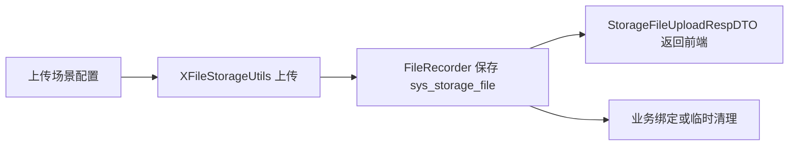

## 5. 涉及文件

- `ruoyi-common/src/main/java/com/ruoyi/common/annotation/StorageFileField.java`
- `ruoyi-common/src/main/java/com/ruoyi/common/config/StorageFileUploadProperties.java`
- `ruoyi-common/src/main/java/com/ruoyi/common/config/UploadSceneProperties.java`
- `ruoyi-common/src/main/java/com/ruoyi/common/constant/CacheConstants.java`
- `ruoyi-common/src/main/java/com/ruoyi/common/constant/StorageFileConstants.java`
- `ruoyi-common/src/main/java/com/ruoyi/common/core/domain/model/StorageFilePartRespDTO.java`
- `ruoyi-common/src/main/java/com/ruoyi/common/core/domain/model/StorageFileUploadRespDTO.java`
- `ruoyi-common/src/main/java/com/ruoyi/common/enums/StorageFileAccess.java`
- `ruoyi-common/src/main/java/com/ruoyi/common/enums/StorageFileStatus.java`
- `ruoyi-system/src/main/java/com/ruoyi/system/config/StorageFileProperties.java`
- `ruoyi-system/src/main/java/com/ruoyi/system/domain/SysStorageFile.java`
- `ruoyi-system/src/main/java/com/ruoyi/system/domain/SysStorageFilePart.java`
- `sql/ry_20260417.sql`
- `sql/sys_storage_file_20260901.sql`

## 6. 具体改动

### 6.1 增加上传控制配置

#### 原代码

改造前没有独立的 `StorageFileUploadProperties`，通用上传入口无法统一控制是否必须传 `uploadScene`，也没有全局批量上传数量兜底。

#### 现代码

```java
@Component
@ConfigurationProperties(prefix = "ruoyi.storage-file")
public class StorageFileUploadProperties
{
    /**
     * 是否要求通用上传必须传 uploadScene
     */
    private boolean requireUploadScene = false;

    /**
     * 单次批量上传最大文件数量
     */
    private int maxBatchUploadCount = 20;

    /**
     * 获取有效的单次批量上传最大文件数量
     *
     * @return 单次批量上传最大文件数量
     */
    public int getEffectiveMaxBatchUploadCount()
    {
        // 配置小于等于 0 时使用 20 个兜底，避免误配置导致批量上传不受限制
        return maxBatchUploadCount > 0 ? maxBatchUploadCount : 20;
    }
}
```

#### 涉及改动部分

```java
// 省略
/**
 * 单次批量上传最大文件数量
 */
private int maxBatchUploadCount = 20;

public int getEffectiveMaxBatchUploadCount()
{
    // 配置小于等于 0 时使用 20 个兜底，避免误配置导致批量上传不受限制
    return maxBatchUploadCount > 0 ? maxBatchUploadCount : 20;
}
// 省略
```

#### 改动说明

原来批量上传没有统一数量上限，容易被某个业务一次性提交过多文件。现在提供全局默认值 `20`，后续上传场景和后端代码还可以覆盖这个值。

### 6.2 扩展上传场景配置

#### 原代码

```java
public static class Scene
{
    private DataSize maxSize;
    private List<String> allowedExtension;
    private Boolean thumbnail;
    private Integer thumbnailWidth;
    private Integer thumbnailHeight;
}
```

#### 现代码

```java
public static class Scene
{
    private DataSize maxSize;
    private List<String> allowedExtension;
    private Boolean thumbnail;
    private Integer thumbnailWidth;
    private Integer thumbnailHeight;

    /**
     * 缩略图文件名后缀，配置后覆盖全局 thumbnail-suffix
     */
    private String thumbnailSuffix;

    /**
     * 单次批量上传最大文件数量，配置后覆盖全局 max-batch-upload-count
     */
    private Integer maxBatchUploadCount;

    /**
     * 访问级别，public 表示公开访问，private 表示私有访问
     */
    private String access;

    /**
     * 场景路径前缀，例如 avatar、image、contract
     */
    private String pathPrefix;
}
```

#### 涉及改动部分

```java
// 省略
private Integer thumbnailHeight;

/**
 * 缩略图文件名后缀，配置后覆盖全局 thumbnail-suffix
 */
private String thumbnailSuffix;

/**
 * 单次批量上传最大文件数量，配置后覆盖全局 max-batch-upload-count
 */
private Integer maxBatchUploadCount;

/**
 * 访问级别，public 表示公开访问，private 表示私有访问
 */
private String access;

/**
 * 场景路径前缀，例如 avatar、image、contract
 */
private String pathPrefix;
// 省略
```

#### 改动说明

上传场景从单纯的大小、格式、缩略图配置，扩展为完整的上传策略配置。`access` 决定公开或私有，`pathPrefix` 决定业务目录，`thumbnailSuffix` 允许不同场景生成不同缩略图后缀，`maxBatchUploadCount` 允许不同业务限制不同批量数量。

### 6.3 增加文件管理常量和枚举

#### 原代码

改造前公开/私有、预览路径、下载路径、文件状态等值散落在代码中，后续判断容易出现硬编码不一致。

#### 现代码

```java
/**
 * 存储文件公共常量
 * <p>
 * 只收敛跨模块共享的固定协议值，具体业务场景编码仍由业务模块自行定义
 *
 * @author 955Kane
 */
public final class StorageFileConstants
{
    /**
     * 公开文件访问级别
     */
    public static final String ACCESS_PUBLIC = "public";

    /**
     * 私有文件访问级别
     */
    public static final String ACCESS_PRIVATE = "private";

    /**
     * 头像业务类型
     */
    public static final String BIZ_TYPE_AVATAR = "avatar";

    /**
     * 对象存储公开读 ACL
     */
    public static final String ACL_PUBLIC_READ = "public-read";

    /**
     * 存储文件管理下载权限
     */
    public static final String PERMISSION_STORAGE_DOWNLOAD = "system:storage:download";

    /**
     * 文件预览代理路径
     */
    public static final String PREVIEW_PATH = "/common/file/preview/";

    /**
     * 文件下载代理路径
     */
    public static final String DOWNLOAD_PATH = "/common/file/download/";

    private StorageFileConstants()
    {
    }
}
```

```java
/**
 * 存储文件访问级别
 * <p>
 * 数据库 access 字段保存 code，代码中通过枚举表达公开和私有的访问语义
 *
 * @author 955Kane
 */
public enum StorageFileAccess
{
    /**
     * 公开访问文件
     */
    PUBLIC(StorageFileConstants.ACCESS_PUBLIC),

    /**
     * 私有访问文件
     */
    PRIVATE(StorageFileConstants.ACCESS_PRIVATE);

    /**
     * 数据库存储值
     */
    private final String code;

    StorageFileAccess(String code)
    {
        this.code = code;
    }

    public String getCode()
    {
        return code;
    }

    /**
     * 判断访问级别是否为公开
     *
     * @param code 数据库存储访问级别
     * @return true 表示公开文件
     */
    public static boolean isPublic(String code)
    {
        return PUBLIC.code.equals(code);
    }

    /**
     * 判断访问级别是否为私有
     *
     * @param code 数据库存储访问级别
     * @return true 表示私有文件
     */
    public static boolean isPrivate(String code)
    {
        return PRIVATE.code.equals(code);
    }
}
```

#### 涉及改动部分

```java
// 省略
/**
 * 公开文件访问级别
 */
public static final String ACCESS_PUBLIC = "public";

/**
 * 私有文件访问级别
 */
public static final String ACCESS_PRIVATE = "private";

/**
 * 文件预览代理路径
 */
public static final String PREVIEW_PATH = "/common/file/preview/";

/**
 * 文件下载代理路径
 */
public static final String DOWNLOAD_PATH = "/common/file/download/";
// 省略
```

#### 改动说明

固定协议值用常量收敛，状态和访问级别用枚举表达语义。这样判断公开文件时不再写字符串比较，构建代理地址时也不再到处拼 `/common/file/preview/`。

### 6.4 扩展文件表字段

#### 原代码

```sql
create table sys_storage_file (
  file_id bigint not null auto_increment,
  url varchar(500) not null,
  size bigint,
  filename varchar(255),
  original_filename varchar(255),
  platform varchar(50),
  file_status char(1) default '0',
  primary key (file_id)
);
```

#### 现代码

```sql
create table sys_storage_file (
  file_id bigint not null auto_increment comment '文件ID',
  storage_id bigint default null comment '存储记录ID',
  url varchar(1000) not null comment '文件访问地址',
  url_hash char(64) not null comment '文件访问地址SHA-256哈希',
  object_key varchar(1000) default null comment '对象存储Key',
  size bigint default null comment '文件大小，单位字节',
  filename varchar(255) default null comment '存储文件名',
  original_filename varchar(255) default null comment '原始文件名',
  platform varchar(50) default null comment '存储平台',
  th_url varchar(1000) default null comment '缩略图访问地址',
  th_object_key varchar(1000) default null comment '缩略图对象存储Key',
  th_size bigint default null comment '缩略图大小，单位字节',
  access varchar(20) default 'private' comment '访问级别 public公开 private私有',
  file_status char(1) default '0' comment '文件状态 0临时 1已使用 2待删除 3已删除',
  biz_type varchar(100) default null comment '业务类型',
  biz_id varchar(64) default null comment '业务ID',
  delete_time datetime default null comment '计划删除时间',
  primary key (file_id),
  unique key uk_sys_storage_file_url_hash (url_hash)
);
```

#### 涉及改动部分

```sql
-- 省略
url varchar(1000) not null comment '文件访问地址',
url_hash char(64) not null comment '文件访问地址SHA-256哈希',
object_key varchar(1000) default null comment '对象存储Key',
size bigint default null comment '文件大小，单位字节',
th_object_key varchar(1000) default null comment '缩略图对象存储Key',
th_size bigint default null comment '缩略图大小，单位字节',
access varchar(20) default 'private' comment '访问级别 public公开 private私有',
unique key uk_sys_storage_file_url_hash (url_hash)
-- 省略
```

#### 改动说明

`url_hash` 解决长 URL 唯一索引长度和前缀索引误判问题，`object_key` 用于稳定定位对象存储中的文件，`access` 把公开/私有入库，不再只靠路径中是否包含 `public/private` 判断。`size`、`th_size` 明确单位为字节，避免后续前端展示或统计时误解。

## 7. 验证方式

```powershell
git show --stat --name-status d78587c6
mvn -pl ruoyi-admin -am -DskipTests "-Dmaven.compiler.useIncrementalCompilation=false" compile
```

---

## 原文：doc/gitlog-commit/11-完善存储文件记录和生命周期服务.md

# 完善存储文件记录和生命周期服务

对应提交：`53d36f72 完善存储文件记录和生命周期服务`

## 1. 改造目标

让 `sys_storage_file` 真正承担文件资产记录能力，支持 X File Storage 的 `FileRecorder`、URL 哈希查询、业务绑定、待删除、物理删除、分片记录和文件回显 DTO 构建。

## 2. 改造前存在的问题

上传记录虽然可以入库，但业务保存成功后如何绑定、业务修改后旧文件如何处理、业务删除后附件如何待删除、私有文件如何按 fileId 回显，都缺少统一服务层。

## 3. 改造后的解决方案

扩展 `ISysStorageFileService` 和 `SysStorageFileServiceImpl`，把文件记录保存、更新、删除标记、业务绑定、批量同步、分片保存、清理查询都集中到文件资产服务中。

## 4. 总体链路

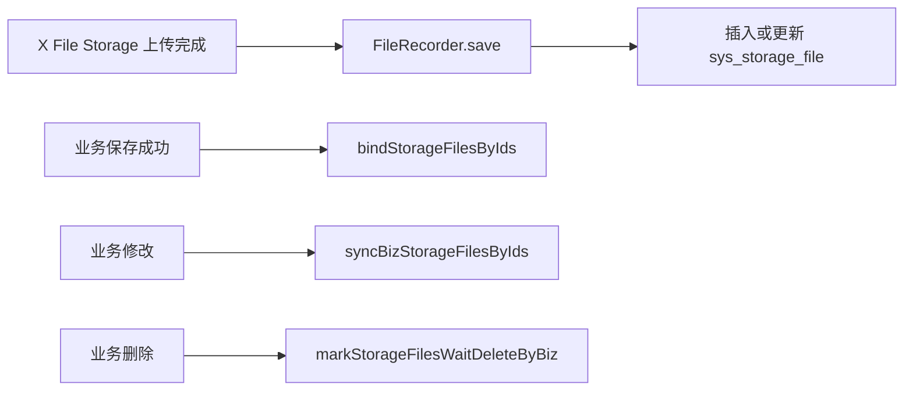

## 5. 涉及文件

- `ruoyi-system/src/main/java/com/ruoyi/system/mapper/SysStorageFileMapper.java`
- `ruoyi-system/src/main/java/com/ruoyi/system/service/ISysStorageFileService.java`
- `ruoyi-system/src/main/java/com/ruoyi/system/service/impl/SysStorageFileServiceImpl.java`
- `ruoyi-system/src/main/resources/mapper/system/SysStorageFileMapper.xml`

## 6. 具体改动

### 6.1 FileRecorder 保存记录时按 URL 哈希去重

#### 原代码

```java
public boolean save(FileInfo fileInfo)
{
    SysStorageFile storageFile = toStorageFile(fileInfo);
    storageFile.setFileStatus("0");
    return storageFileMapper.insertStorageFile(storageFile) > 0;
}
```

#### 现代码

```java
public boolean save(FileInfo fileInfo)
{
    // 上传成功后框架会调用该方法，没有 URL 的记录无法用于后续按 URL 查询
    if (fileInfo == null || StringUtils.isBlank(fileInfo.getUrl()))
    {
        return false;
    }
    // 同一个 URL 重复保存时按更新处理，避免重试上传造成唯一索引冲突
    SysStorageFile exists = storageFileMapper.selectStorageFileByUrl(sha256Hex(fileInfo.getUrl()), fileInfo.getUrl());
    SysStorageFile storageFile = toStorageFile(fileInfo);
    if (exists != null)
    {
        // 保留原主键并刷新最新元数据
        storageFile.setFileId(exists.getFileId());
        storageFile.setUpdateTime(DateUtils.getNowDate());
        return storageFileMapper.updateStorageFile(storageFile) > 0;
    }
    // 新上传文件先记录为临时状态，等业务保存成功后再绑定为已使用
    storageFile.setFileStatus(StorageFileStatus.TEMP.getCode());
    // 记录上传人，私有临时文件下载时可判断是否属于当前登录用户
    storageFile.setCreateBy(getCurrentUsernameQuietly());
    storageFile.setCreateTime(fileInfo.getCreateTime() == null ? DateUtils.getNowDate() : fileInfo.getCreateTime());
    return storageFileMapper.insertStorageFile(storageFile) > 0;
}
```

#### 涉及改动部分

```java
// 省略
SysStorageFile exists = storageFileMapper.selectStorageFileByUrl(sha256Hex(fileInfo.getUrl()), fileInfo.getUrl());
SysStorageFile storageFile = toStorageFile(fileInfo);
if (exists != null)
{
    // 保留原主键并刷新最新元数据
    storageFile.setFileId(exists.getFileId());
    storageFile.setUpdateTime(DateUtils.getNowDate());
    return storageFileMapper.updateStorageFile(storageFile) > 0;
}
// 新上传文件先记录为临时状态，等业务保存成功后再绑定为已使用
storageFile.setFileStatus(StorageFileStatus.TEMP.getCode());
// 省略
```

#### 改动说明

原来只插入记录，重复保存同一个 URL 时可能产生重复数据。现在先按 `url_hash + url` 查询，存在则更新，不存在才插入，并把新文件默认标记为临时文件。

### 6.2 增加 fileId 版绑定和同步

#### 原代码

```java
public int bindStorageFile(String url, String bizType, String bizId, String updateBy);

public int syncBizStorageFiles(Collection<String> newUrls, Collection<String> oldUrls, String bizType, String bizId,
        String updateBy);
```

#### 现代码

```java
public int bindStorageFilesByIds(Collection<Long> fileIds, String bizType, String bizId, String updateBy);

public int syncBizStorageFilesByIds(Collection<Long> newFileIds, Collection<Long> oldFileIds, String bizType,
        String bizId, String updateBy);
```

```java
@Override
@Transactional(rollbackFor = Exception.class)
public int syncBizStorageFilesByIds(Collection<Long> newFileIds, Collection<Long> oldFileIds, String bizType,
        String bizId, String updateBy)
{
    // 先把当前表单仍保存的文件绑定为已使用，防止临时清理任务误删
    int rows = bindStorageFilesByIds(newFileIds, bizType, bizId, updateBy);
    Set<Long> currentFileIds = new HashSet<Long>(normalizeFileIdList(newFileIds));
    if (oldFileIds == null || oldFileIds.isEmpty())
    {
        return rows;
    }
    List<Long> waitDeleteFileIds = new ArrayList<Long>();
    for (Long oldFileId : oldFileIds)
    {
        // 旧文件ID不在新集合中，说明用户从业务表单里移除了这个文件
        if (oldFileId != null && !currentFileIds.contains(oldFileId))
        {
            waitDeleteFileIds.add(oldFileId);
        }
    }
    // 被移除的文件不立即物理删除，先进入待删除状态，后续由清理任务统一处理
    rows += markStorageFilesWaitDeleteByIds(waitDeleteFileIds, bizType, bizId, updateBy);
    return rows;
}
```

#### 涉及改动部分

```java
// 省略
int rows = bindStorageFilesByIds(newFileIds, bizType, bizId, updateBy);
Set<Long> currentFileIds = new HashSet<Long>(normalizeFileIdList(newFileIds));
// 省略
if (oldFileId != null && !currentFileIds.contains(oldFileId))
{
    waitDeleteFileIds.add(oldFileId);
}
rows += markStorageFilesWaitDeleteByIds(waitDeleteFileIds, bizType, bizId, updateBy);
// 省略
```

#### 改动说明

业务表保存 fileId 时，不应该再依赖 URL 去绑定文件。新增 fileId 版绑定和同步后，业务保存只需要把表单里的文件 ID 集合传给文件服务，文件服务负责把新增文件绑定为已使用，把移除的旧文件标记为待删除。

### 6.3 待删除必须带业务边界

#### 原代码

```java
public int markStorageFilesWaitDeleteByIds(Collection<Long> fileIds, String bizType, String updateBy)
{
    return storageFileMapper.markStorageFilesWaitDeleteByIds(fileIds, bizType, deleteTime, updateBy);
}
```

#### 现代码

```java
public int markStorageFilesWaitDeleteByIds(Collection<Long> fileIds, String bizType, String bizId, String updateBy)
{
    List<Long> idList = normalizeFileIdList(fileIds);
    if (idList.isEmpty() || StringUtils.isBlank(bizType) || StringUtils.isBlank(bizId))
    {
        return 0;
    }
    int delayHours = storageFileProperties.getDeleteDelayHours(bizType);
    LocalDateTime deleteTime = LocalDateTime.now().plusHours(delayHours);
    // 按主键批量标记待删除时必须带业务归属，避免误删其它业务的同 ID 文件引用
    return storageFileMapper.markStorageFilesWaitDeleteByIds(idList, bizType, bizId, deleteTime, updateBy,
            StorageFileStatus.DELETED.getCode());
}
```

#### 涉及改动部分

```java
// 省略
if (idList.isEmpty() || StringUtils.isBlank(bizType) || StringUtils.isBlank(bizId))
{
    return 0;
}
// 按主键批量标记待删除时必须带业务归属，避免误删其它业务的同 ID 文件引用
return storageFileMapper.markStorageFilesWaitDeleteByIds(idList, bizType, bizId, deleteTime, updateBy,
        StorageFileStatus.DELETED.getCode());
// 省略
```

#### 改动说明

待删除操作从“只按 fileId 和 bizType”收紧为“fileId + bizType + bizId”，防止业务 A 的保存动作误处理业务 B 的文件。

## 7. 验证方式

```powershell
git show --stat --name-status 53d36f72
mvn -pl ruoyi-admin -am -DskipTests "-Dmaven.compiler.useIncrementalCompilation=false" compile
```

---

## 原文：doc/gitlog-commit/13-完善私有文件访问授权和代理地址.md

# 完善私有文件访问授权和代理地址

对应提交：`14067e21 完善私有文件访问授权和代理地址`

## 1. 改造目标

私有文件不再向前端暴露真实对象存储地址，统一通过后端代理地址访问，并支持短期访问 token 和高敏感场景的用户绑定 token。

## 2. 改造前存在的问题

如果接口直接返回 COS/OSS/MinIO 真实 URL，私有 Bucket 会出现前端无法回显；如果把 Bucket 改公开，又会让业务附件绕过系统权限。通用下载入口也需要和业务权限边界分离。

## 3. 改造后的解决方案

新增 `StorageFileAccessTokenService` 签发短期 token，新增 `StorageFileAccessUrlBuilder` 根据文件访问级别和访问模式生成对外 URL，同时 Security 放行代理入口，让请求进入 Controller 后再做文件级校验。

## 4. 总体链路


## 5. 涉及文件

- `ruoyi-framework/src/main/java/com/ruoyi/framework/config/SecurityConfig.java`
- `ruoyi-framework/src/main/java/com/ruoyi/framework/config/properties/StorageFileSecurityProperties.java`
- `ruoyi-system/src/main/java/com/ruoyi/system/service/StorageFileAccessTokenService.java`
- `ruoyi-system/src/main/java/com/ruoyi/system/service/StorageFileAccessUrlBuilder.java`

## 6. 具体改动

### 6.1 增加短期访问 token 服务

#### 原代码

改造前没有文件访问 token，私有文件只能依赖登录态或直接 URL，无法表达“业务接口已经授权过这个文件”的临时访问能力。

#### 现代码

```java
/**
 * 存储文件短期访问授权服务
 * <p>
 * 业务接口完成自身权限校验后调用本服务签发 token，通用文件接口只校验 token 是否能访问对应 fileId
 *
 * @author 955Kane
 */
@Service
public class StorageFileAccessTokenService
{
    /**
     * 签发文件短期访问 token
     *
     * @param fileId 文件ID
     * @return 短期访问 token
     */
    public String issueToken(Long fileId)
    {
        return issueToken(fileId, null);
    }

    /**
     * 签发绑定当前登录用户的文件短期访问 token
     *
     * @param fileId 文件ID
     * @return 短期访问 token
     */
    public String issueUserBoundToken(Long fileId)
    {
        return issueToken(fileId, SecurityUtils.getUserId());
    }

    /**
     * 校验文件短期访问 token
     *
     * @param fileId 文件ID
     * @param token 短期访问 token
     * @return true 表示 token 允许访问该文件
     */
    public boolean verifyToken(Long fileId, String token)
    {
        if (fileId == null || StringUtils.isBlank(token))
        {
            return false;
        }
        String tokenValue = redisCache.getCacheObject(getTokenKey(token));
        if (StringUtils.isBlank(tokenValue))
        {
            return false;
        }
        String[] values = tokenValue.split(":", -1);
        // token 必须和当前 fileId 精确匹配，避免拿一个文件的授权访问另一个文件
        if (values.length < 1 || !String.valueOf(fileId).equals(values[0]))
        {
            return false;
        }
        // 没有绑定用户ID的 token 属于普通短期授权，有效期内可直接访问
        if (values.length < 2 || StringUtils.isBlank(values[1]))
        {
            return true;
        }
        try
        {
            // 高敏感 token 必须同时校验当前登录用户，复制链接给其他账号也不能访问
            return values[1].equals(String.valueOf(SecurityUtils.getUserId()));
        }
        catch (Exception e)
        {
            return false;
        }
    }
}
```

#### 涉及改动部分

```java
// 省略
/**
 * 签发绑定当前登录用户的文件短期访问 token
 *
 * @param fileId 文件ID
 * @return 短期访问 token
 */
public String issueUserBoundToken(Long fileId)
{
    return issueToken(fileId, SecurityUtils.getUserId());
}
// 省略
if (values.length < 2 || StringUtils.isBlank(values[1]))
{
    return true;
}
// 高敏感 token 必须同时校验当前登录用户，复制链接给其他账号也不能访问
return values[1].equals(String.valueOf(SecurityUtils.getUserId()));
// 省略
```

#### 改动说明

普通 token 只绑定 `fileId`，适合短期分享式访问；用户绑定 token 同时绑定当前登录用户，适合证件、合同、财务等高敏感文件，链接被复制给其他账号也无法使用。

### 6.2 对外 URL 构建器不暴露私有真实地址

#### 原代码

```java
dto.setUrl(fileInfo.getUrl());
dto.setPreviewUrl(fileInfo.getUrl());
dto.setDownloadUrl(fileInfo.getUrl());
```

#### 现代码

```java
/**
 * 构建原图预览地址
 *
 * @param storageFile 文件记录
 * @return 对外预览地址
 */
public String buildPreviewUrl(SysStorageFile storageFile)
{
    return buildPreviewUrl(storageFile, false);
}

/**
 * 构建下载地址
 *
 * @param storageFile 文件记录
 * @return 对外下载地址
 */
public String buildDownloadUrl(SysStorageFile storageFile)
{
    if (storageFile == null || storageFile.getFileId() == null)
    {
        return null;
    }
    if (isPublic(storageFile) && StorageFileProperties.ACCESS_URL_MODE_DIRECT.equals(getAccessUrlMode()))
    {
        return storageFile.getUrl();
    }
    if (isPublic(storageFile) && StorageFileProperties.ACCESS_URL_MODE_DOMAIN.equals(getAccessUrlMode()))
    {
        return buildDomainUrl(storageFile.getObjectKey(), storageFile.getUrl());
    }
    return StorageFileConstants.DOWNLOAD_PATH + storageFile.getFileId();
}

/**
 * 判断响应中是否允许返回真实存储 URL
 *
 * @param storageFile 文件记录
 * @return true 表示允许返回真实 URL
 */
public boolean allowExposeRealUrl(SysStorageFile storageFile)
{
    // 私有文件永远不向前端暴露真实存储地址，避免绕过后端鉴权
    return isPublic(storageFile) && StorageFileProperties.ACCESS_URL_MODE_DIRECT.equals(getAccessUrlMode());
}
```

#### 涉及改动部分

```java
// 省略
/**
 * 构建下载地址
 *
 * @param storageFile 文件记录
 * @return 对外下载地址
 */
public String buildDownloadUrl(SysStorageFile storageFile)
{
    if (storageFile == null || storageFile.getFileId() == null)
    {
        return null;
    }
    if (isPublic(storageFile) && StorageFileProperties.ACCESS_URL_MODE_DIRECT.equals(getAccessUrlMode()))
    {
        return storageFile.getUrl();
    }
    if (isPublic(storageFile) && StorageFileProperties.ACCESS_URL_MODE_DOMAIN.equals(getAccessUrlMode()))
    {
        return buildDomainUrl(storageFile.getObjectKey(), storageFile.getUrl());
    }
    return StorageFileConstants.DOWNLOAD_PATH + storageFile.getFileId();
}
// 省略
```

#### 改动说明

公开文件可以按配置选择直连、域名或后端代理；私有文件无论真实存储在哪里，都只返回 `/common/file/preview/{fileId}` 或 `/common/file/download/{fileId}` 这种后端代理地址。

### 6.3 Security 放行代理入口

#### 原代码

```java
requests.requestMatchers(HttpMethod.GET, "/", "/*.html", "/**.html", "/**.css", "/**.js", "/profile/**", "/file/**").permitAll();
```

#### 现代码

```java
requests.requestMatchers(HttpMethod.GET, "/", "/*.html", "/**.html", "/**.css", "/**.js", "/profile/**",
        "/common/file/preview/**", "/common/file/download/**").permitAll();
String[] publicPathPatterns = getStorageFilePublicPathPatterns();
if (publicPathPatterns.length > 0)
{
    // 只放行公开文件路径，例如 /file/upload/public/**
    requests.requestMatchers(HttpMethod.GET, publicPathPatterns).permitAll();
}
```

#### 涉及改动部分

```java
// 省略
requests.requestMatchers(HttpMethod.GET, "/", "/*.html", "/**.html", "/**.css", "/**.js", "/profile/**",
        "/common/file/preview/**", "/common/file/download/**").permitAll();
String[] publicPathPatterns = getStorageFilePublicPathPatterns();
// 省略
```

#### 改动说明

代理入口先在 Spring Security 层放行，是为了让图片 ``、浏览器下载、预览请求能进入 Controller。真正的私有文件校验在 Controller 内部继续做，不等于所有私有文件匿名可访问。

## 7. 验证方式

```powershell
git show --stat --name-status 14067e21
mvn -pl ruoyi-admin -am -DskipTests "-Dmaven.compiler.useIncrementalCompilation=false" compile
```

---

## 原文：doc/gitlog-commit/14-完善通用文件上传和批量场景限制.md

# 完善通用文件上传和批量场景限制

对应提交：`ef31f604 完善通用文件上传和批量场景限制`

## 1. 改造目标

完善 `/common/upload`、`/common/uploads`、分片上传、文件回显、预览下载等通用入口，使它们支持上传场景、平台选择、ACL、缩略图、真实文件校验、批量数量限制和统一 DTO 返回。

## 2. 改造前存在的问题

通用上传入口返回字段分散，批量上传没有数量限制，失败后已上传文件没有补偿删除，私有文件回显容易直接暴露真实 URL，上传场景的大小、格式、缩略图和 ACL 没有完整贯通。

## 3. 改造后的解决方案

`CommonController` 统一调用 `XFileStorageUtils` 上传，并通过 `StorageFileUploadRespDTO` 返回文件信息；`XFileStorageUtils` 根据 `uploadScene` 读取配置，完成大小、格式、路径、ACL、缩略图和批量数量限制。

## 4. 总体链路

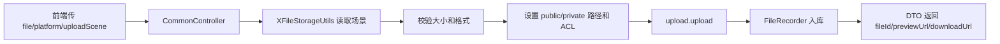

## 5. 涉及文件

- `ruoyi-admin/src/main/java/com/ruoyi/web/controller/common/CommonController.java`
- `ruoyi-admin/src/main/resources/application.yml`
- `ruoyi-common/src/main/java/com/ruoyi/common/utils/file/XFileStorageUtils.java`

## 6. 具体改动

### 6.1 单文件上传返回统一 DTO

#### 原代码

```java
AjaxResult ajax = AjaxResult.success();
ajax.put("url", fileInfo.getUrl());
ajax.put("fileName", fileInfo.getUrl());
ajax.put("newFileName", fileInfo.getFilename());
ajax.put("originalFilename", file.getOriginalFilename());
return ajax;
```

#### 现代码

```java
@PostMapping("/upload")
public AjaxResult uploadFile(MultipartFile file, @RequestParam(value = "platform", required = false) String platform,
        @RequestParam(value = "uploadScene", required = false) String uploadScene,
        @RequestParam(value = "thumbnail", defaultValue = "false") Boolean thumbnail,
        @RequestParam(value = "thumbnailWidth", required = false) Integer thumbnailWidth,
        @RequestParam(value = "thumbnailHeight", required = false) Integer thumbnailHeight) throws Exception
{
    try
    {
        // 统一使用工具类处理平台选择、场景规则、格式校验、缩略图和真实上传
        FileInfo fileInfo = xFileStorageUtils.upload(file, platform, uploadScene, MimeTypeUtils.DEFAULT_ALLOWED_EXTENSION,
                Boolean.TRUE.equals(thumbnail), thumbnailWidth, thumbnailHeight);
        // 单文件上传返回 data 对象，字段由 DTO 统一维护
        return AjaxResult.success(buildUploadRespDTO(fileInfo, uploadScene, file.getOriginalFilename()));
    }
    catch (Exception e)
    {
        log.error("上传文件失败，platform={}，uploadScene={}，originalFilename={}，size={}", platform, uploadScene,
                file == null ? null : file.getOriginalFilename(), file == null ? null : file.getSize(), e);
        return AjaxResult.error(e.getMessage());
    }
}
```

#### 涉及改动部分

```java
// 省略
FileInfo fileInfo = xFileStorageUtils.upload(file, platform, uploadScene, MimeTypeUtils.DEFAULT_ALLOWED_EXTENSION,
        Boolean.TRUE.equals(thumbnail), thumbnailWidth, thumbnailHeight);
return AjaxResult.success(buildUploadRespDTO(fileInfo, uploadScene, file.getOriginalFilename()));
// 省略
```

#### 改动说明

原来 Controller 自己拼 Map，字段语义容易散。现在交给 DTO 构建方法统一返回 `fileId`、`url`、`previewUrl`、`downloadUrl`、`originalFilename`、`access` 等字段。

### 6.2 批量上传增加数量限制和失败补偿

#### 原代码

```java
for (MultipartFile file : files)
{
    FileInfo fileInfo = xFileStorageUtils.upload(file, platform);
    urls.add(fileInfo.getUrl());
}
```

#### 现代码

```java
@PostMapping("/uploads")
public AjaxResult uploadFiles(List<MultipartFile> files, @RequestParam(value = "platform", required = false) String platform,
        @RequestParam(value = "uploadScene", required = false) String uploadScene,
        @RequestParam(value = "thumbnail", defaultValue = "false") Boolean thumbnail,
        @RequestParam(value = "thumbnailWidth", required = false) Integer thumbnailWidth,
        @RequestParam(value = "thumbnailHeight", required = false) Integer thumbnailHeight) throws Exception
{
    List<String> uploadedUrls = new ArrayList<String>();
    try
    {
        // 批量数量优先读取上传场景配置，场景未配置时回退到全局配置
        xFileStorageUtils.assertBatchUploadAllowed(files, uploadScene);
        List<StorageFileUploadRespDTO> fileList = new ArrayList<StorageFileUploadRespDTO>();
        for (MultipartFile file : files)
        {
            FileInfo fileInfo = xFileStorageUtils.upload(file, platform, uploadScene, MimeTypeUtils.DEFAULT_ALLOWED_EXTENSION,
                    Boolean.TRUE.equals(thumbnail), thumbnailWidth, thumbnailHeight);
            uploadedUrls.add(fileInfo.getUrl());
            fileList.add(buildUploadRespDTO(fileInfo, uploadScene, file.getOriginalFilename()));
        }
        AjaxResult ajax = AjaxResult.success();
        ajax.put("fileList", fileList);
        return ajax;
    }
    catch (Exception e)
    {
        compensateUploadedFiles(uploadedUrls);
        log.error("批量上传文件失败，platform={}，uploadScene={}，fileCount={}", platform, uploadScene,
                files == null ? null : files.size(), e);
        return AjaxResult.error(e.getMessage());
    }
}
```

#### 涉及改动部分

```java
// 省略
xFileStorageUtils.assertBatchUploadAllowed(files, uploadScene);
// 省略
uploadedUrls.add(fileInfo.getUrl());
fileList.add(buildUploadRespDTO(fileInfo, uploadScene, file.getOriginalFilename()));
// 省略
catch (Exception e)
{
    compensateUploadedFiles(uploadedUrls);
// 省略
```

#### 改动说明

批量接口本质仍然是循环逐个上传，因为 X File Storage 没有把多个 `MultipartFile` 一次提交给多个平台的统一批量 API。这里新增的是入口数量限制和失败补偿：只要中途有文件失败，已上传成功的文件会尝试删除，减少孤儿文件。

### 6.3 上传工具按场景设置 ACL 和路径

#### 原代码

```java
UploadPretreatment upload = fileStorageService.of(file)
        .setPath(DateUtils.datePath())
        .setSaveFilename(FileUploadUtils.uuidFilename(file));
return upload.upload();
```

#### 现代码

```java
public FileInfo upload(MultipartFile file, String platform, String uploadScene, String[] allowedExtension,
        boolean thumbnail, Integer thumbnailWidth, Integer thumbnailHeight) throws Exception
{
    Scene scene = getScene(uploadScene);
    String[] actualAllowedExtension = getAllowedExtension(scene, allowedExtension);
    long maxSize = getMaxSize(scene);
    boolean actualThumbnail = scene != null && scene.getThumbnail() != null ? scene.getThumbnail() : thumbnail;
    Integer actualThumbnailWidth = scene != null && scene.getThumbnailWidth() != null ? scene.getThumbnailWidth() : thumbnailWidth;
    Integer actualThumbnailHeight = scene != null && scene.getThumbnailHeight() != null ? scene.getThumbnailHeight() : thumbnailHeight;
    String actualThumbnailSuffix = getThumbnailSuffix(scene);
    assertAllowed(file, actualAllowedExtension, maxSize);
    String datePath = DateUtils.datePath();
    String storagePath = buildStoragePath(scene, uploadScene, datePath);
    UploadPretreatment upload = fileStorageService.of(file)
            .setPath(storagePath)
            .setSaveFilename(FileUploadUtils.uuidFilename(file).substring(datePath.length() + 1));
    if (StringUtils.isNotBlank(platform))
    {
        upload.setPlatform(platform);
    }
    if (scene != null)
    {
        applyAcl(upload, scene);
    }
    if (actualThumbnail)
    {
        setThumbnail(upload, file, actualThumbnailWidth, actualThumbnailHeight, actualThumbnailSuffix);
    }
    return upload.upload();
}
```

#### 涉及改动部分

```java
// 省略
String storagePath = buildStoragePath(scene, uploadScene, datePath);
UploadPretreatment upload = fileStorageService.of(file)
        .setPath(storagePath)
        .setSaveFilename(FileUploadUtils.uuidFilename(file).substring(datePath.length() + 1));
// 省略
if (scene != null)
{
    applyAcl(upload, scene);
}
// 省略
return upload.upload();
```

#### 改动说明

上传路径由场景决定，例如 `public/image/yyyy/MM/dd/` 或 `private/file/yyyy/MM/dd/`。声明场景时同步设置对象 ACL，公开文件设置 `public-read`，私有文件设置 `private`，解决腾讯 COS 私有 Bucket 上传后公开图片无法回显的问题。

### 6.4 配置上传场景和批量数量

#### 原代码

```yaml
ruoyi:
  upload-scenes:
    commonImg:
      max-size: 5MB
      allowed-extension: png,jpg,jpeg
```

#### 现代码

```yaml
ruoyi:
  upload-scenes:
    commonImg:
      # 公开图片允许匿名访问，适合富文本图片、封面图等业务
      access: public
      # 场景路径前缀，最终路径形如 upload/public/image/yyyy/MM/dd/文件名
      path-prefix: image
      max-size: 5MB
      allowed-extension: png,jpg,jpeg
      thumbnail: true
      thumbnail-width: 100
      thumbnail-height: 100
      thumbnail-suffix: ".min.jpg"
      # 批量上传图片时单次最多允许上传的文件数量
      max-batch-upload-count: 10
    commonFile:
      # 普通附件默认私有访问，避免业务资料被匿名访问
      access: private
      path-prefix: file
      max-size: 5MB
      allowed-extension: doc,xls,ppt,txt,pdf
      thumbnail: false
      max-batch-upload-count: 10
  storage-file:
    access-url-mode: direct
    require-upload-scene: false
    max-batch-upload-count: 20
```

#### 涉及改动部分

```yaml
# 省略
commonImg:
  access: public
  path-prefix: image
  max-batch-upload-count: 10
commonFile:
  access: private
  path-prefix: file
  max-batch-upload-count: 10
storage-file:
  max-batch-upload-count: 20
# 省略
```

#### 改动说明

全局 `max-batch-upload-count` 是兜底值，具体场景可以覆盖。后端代码还可以调用 `assertBatchUploadAllowed(files, uploadScene, customMax)` 临时覆盖，满足 A 业务最多 5 个、B 业务最多 10 个这种需求。

## 7. 验证方式

```powershell
git show --stat --name-status ef31f604
mvn -pl ruoyi-admin -am -DskipTests "-Dmaven.compiler.useIncrementalCompilation=false" compile
```

---

## 原文：doc/gitlog-commit/15-完善头像上传文件资产处理.md

# 完善头像上传文件资产处理

对应提交：`f2016e72 完善头像上传文件资产处理`

## 1. 改造目标

把用户头像上传纳入文件资产管理，支持平台选择、头像缩略图、文件绑定、旧头像延迟清理、保存失败补偿删除，以及返回可回显的代理地址。

## 2. 改造前存在的问题

若依原头像上传只保存本地 `/profile` 路径，更新成功后直接删除旧头像。接入对象存储后，旧头像可能是远程对象，不能继续用本地磁盘删除；新头像上传成功但用户表更新失败时，也会产生孤儿文件。

## 3. 改造后的解决方案

头像上传改用 `XFileStorageUtils`，用户表保存头像 URL 后，把新文件绑定到 `avatar + userId`，旧 X File Storage 头像标记待删除，历史 `/profile` 本地头像在事务成功后继续磁盘删除。

## 4. 总体链路


## 5. 涉及文件

- `ruoyi-admin/src/main/java/com/ruoyi/web/controller/system/SysProfileController.java`

## 6. 具体改动

### 6.1 头像接口支持 platform 并使用文件资产上传

#### 原代码

```java
@PostMapping("/avatar")
public AjaxResult avatar(@RequestParam("avatarfile") MultipartFile file) throws Exception
{
    if (!file.isEmpty())
    {
        LoginUser loginUser = getLoginUser();
        String avatar = FileUploadUtils.upload(RuoYiConfig.getAvatarPath(), file, MimeTypeUtils.IMAGE_EXTENSION, true);
        if (userService.updateUserAvatar(loginUser.getUserId(), avatar))
        {
            AjaxResult ajax = AjaxResult.success();
            ajax.put("imgUrl", avatar);
            loginUser.getUser().setAvatar(avatar);
            tokenService.setLoginUser(loginUser);
            return ajax;
        }
    }
    return error("上传图片异常，请联系管理员");
}
```

#### 现代码

```java
@PostMapping("/avatar")
public AjaxResult avatar(@RequestParam("avatarfile") MultipartFile file,
        @RequestParam(value = "platform", required = false) String platform) throws Exception
{
    // 空文件直接走统一失败返回
    if (!file.isEmpty())
    {
        LoginUser loginUser = getLoginUser();
        // 工具类负责图片校验，并根据 platform 选择指定平台或默认平台
        // 头像默认生成缩略图，原图仍作为数据库头像地址保存
        FileInfo fileInfo = xFileStorageUtils.upload(file, platform, BIZ_TYPE_AVATAR, MimeTypeUtils.IMAGE_EXTENSION, true,
                AVATAR_THUMBNAIL_WIDTH, AVATAR_THUMBNAIL_HEIGHT);
        // 数据库存储最终可访问的头像 URL
        String avatar = fileInfo.getUrl();
        // 先记录旧头像，事务提交成功后再处理历史本地文件删除
        String oldAvatar = loginUser.getUser().getAvatar();
        boolean avatarSaved;
        try
        {
            // 头像业务数据库动作放在同一事务里，避免用户表已更新但文件资产未绑定
            avatarSaved = Boolean.TRUE.equals(transactionTemplate.execute(status ->
            {
                if (!userService.updateUserAvatar(loginUser.getUserId(), avatar))
                {
                    return false;
                }
                storageFileService.bindStorageFile(avatar, BIZ_TYPE_AVATAR, String.valueOf(loginUser.getUserId()),
                        loginUser.getUsername());
                if (StringUtils.isNotEmpty(oldAvatar) && !oldAvatar.startsWith(Constants.RESOURCE_PREFIX))
                {
                    storageFileService.markStorageFileWaitDelete(oldAvatar, BIZ_TYPE_AVATAR, loginUser.getUsername());
                }
                return true;
            }));
        }
        catch (Exception e)
        {
            deleteUploadedAvatar(avatar);
            throw e;
        }
    }
    return error("上传图片异常，请联系管理员");
}
```

#### 涉及改动部分

```java
// 省略
FileInfo fileInfo = xFileStorageUtils.upload(file, platform, BIZ_TYPE_AVATAR, MimeTypeUtils.IMAGE_EXTENSION, true,
        AVATAR_THUMBNAIL_WIDTH, AVATAR_THUMBNAIL_HEIGHT);
String avatar = fileInfo.getUrl();
// 省略
avatarSaved = Boolean.TRUE.equals(transactionTemplate.execute(status ->
{
    if (!userService.updateUserAvatar(loginUser.getUserId(), avatar))
    {
        return false;
    }
    storageFileService.bindStorageFile(avatar, BIZ_TYPE_AVATAR, String.valueOf(loginUser.getUserId()),
            loginUser.getUsername());
// 省略
```

#### 改动说明

头像接口从若依本地上传改成 X File Storage 上传，`platform` 为空时走默认平台，传值时上传到指定平台。用户表更新和文件绑定放到同一个事务里，避免头像字段已变更但文件仍是临时状态。

### 6.2 旧头像清理区分历史本地文件和文件资产

#### 原代码

```java
String oldAvatar = loginUser.getUser().getAvatar();
if (StringUtils.isNotEmpty(oldAvatar))
{
    FileUtils.deleteFile(RuoYiConfig.getProfile() + FileUtils.stripPrefix(oldAvatar));
}
```

#### 现代码

```java
if (StringUtils.isNotEmpty(oldAvatar) && oldAvatar.startsWith(Constants.RESOURCE_PREFIX))
{
    // 历史若依本地头像不参与数据库事务，等数据库提交成功后再删除磁盘文件
    FileUtils.deleteFile(RuoYiConfig.getProfile() + FileUtils.stripPrefix(oldAvatar));
}
```

```java
if (StringUtils.isNotEmpty(oldAvatar) && !oldAvatar.startsWith(Constants.RESOURCE_PREFIX))
{
    // X File Storage 上传的旧头像先标记待删除，交给定时任务延迟物理清理
    storageFileService.markStorageFileWaitDelete(oldAvatar, BIZ_TYPE_AVATAR, loginUser.getUsername());
}
```

#### 涉及改动部分

```java
// 省略
if (StringUtils.isNotEmpty(oldAvatar) && !oldAvatar.startsWith(Constants.RESOURCE_PREFIX))
{
    storageFileService.markStorageFileWaitDelete(oldAvatar, BIZ_TYPE_AVATAR, loginUser.getUsername());
}
// 省略
if (StringUtils.isNotEmpty(oldAvatar) && oldAvatar.startsWith(Constants.RESOURCE_PREFIX))
{
    FileUtils.deleteFile(RuoYiConfig.getProfile() + FileUtils.stripPrefix(oldAvatar));
}
// 省略
```

#### 改动说明

历史 `/profile` 文件还是磁盘文件，继续用若依原方式删除；对象存储头像不立即物理删除，而是进入待删除状态，由清理任务统一处理，降低误删和事务失败风险。

### 6.3 保存失败补偿删除新头像

#### 原代码

```java
if (!userService.updateUserAvatar(loginUser.getUserId(), avatar))
{
    return error("上传图片异常，请联系管理员");
}
```

#### 现代码

```java
private void deleteUploadedAvatar(String avatar)
{
    try
    {
        // 这里删除的是本次刚上传的新文件，不影响当前登录用户原头像
        xFileStorageUtils.delete(avatar);
    }
    catch (Exception e)
    {
        // 补偿删除失败只记录日志，接口仍返回原业务失败信息
        log.warn("头像保存失败后删除新头像失败，avatar={}", avatar, e);
    }
}
```

#### 涉及改动部分

```java
// 省略
catch (Exception e)
{
    // 数据库事务异常时立即补偿删除本次新头像，避免用户头像未保存但对象存储残留
    deleteUploadedAvatar(avatar);
    throw e;
}
// 省略
```

#### 改动说明

上传对象存储和数据库事务不是同一个事务资源，所以数据库保存失败时需要补偿删除新头像。补偿失败只记日志，不覆盖原始业务异常。

## 7. 验证方式

```powershell
git show --stat --name-status f2016e72
mvn -pl ruoyi-admin -am -DskipTests "-Dmaven.compiler.useIncrementalCompilation=false" compile
```

---

## 原文：doc/gitlog-commit/16-增加存储文件管理后台接口.md

# 增加存储文件管理后台接口

对应提交：`11e1a0a4 增加存储文件管理后台接口`

## 1. 改造目标

给文件资产管理预留后台管理入口，支持列表、详情、管理员下载、标记待删除、立即删除和重试删除。

## 2. 改造前存在的问题

文件记录虽然入库，但没有后台接口查看和处理。运维或管理员遇到孤儿文件、删除失败、业务绑定异常时，只能查数据库或手动处理对象存储。

## 3. 改造后的解决方案

新增 `SysStorageFileController`，按若依权限体系提供 `/system/storage/file` 管理接口。普通业务私有文件仍建议走业务接口下载，后台下载只给拥有存储管理权限的管理员排查使用。

## 4. 总体链路

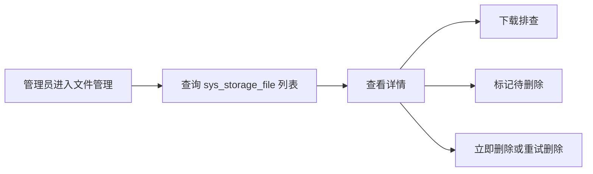

## 5. 涉及文件

- `ruoyi-system/src/main/java/com/ruoyi/system/controller/SysStorageFileController.java`

## 6. 具体改动

### 6.1 新增文件管理 Controller

#### 原代码

改造前没有 `/system/storage/file` 管理接口。

#### 现代码

```java
/**
 * 存储文件管理
 * <p>
 * 提供文件资产列表、详情、下载和删除处理能力，业务文件下载仍应优先走业务模块专用接口
 *
 * @author 955Kane
 */
@RestController
@RequestMapping("/system/storage/file")
public class SysStorageFileController extends BaseController
{
    /**
     * 存储文件记录服务
     */
    private final ISysStorageFileService storageFileService;

    /**
     * X File Storage 上传下载工具
     */
    private final XFileStorageUtils xFileStorageUtils;

    /**
     * 构造存储文件管理控制器
     *
     * @param storageFileService 存储文件记录服务
     * @param xFileStorageUtils X File Storage 工具
     */
    public SysStorageFileController(ISysStorageFileService storageFileService, XFileStorageUtils xFileStorageUtils)
    {
        this.storageFileService = storageFileService;
        this.xFileStorageUtils = xFileStorageUtils;
    }
}
```

#### 涉及改动部分

```java
// 省略
/**
 * 存储文件管理
 * <p>
 * 提供文件资产列表、详情、下载和删除处理能力，业务文件下载仍应优先走业务模块专用接口
 *
 * @author 955Kane
 */
@RestController
@RequestMapping("/system/storage/file")
public class SysStorageFileController extends BaseController
{
    /**
     * 存储文件记录服务
     */
    private final ISysStorageFileService storageFileService;

    /**
     * X File Storage 上传下载工具
     */
    private final XFileStorageUtils xFileStorageUtils;
// 省略
```

#### 改动说明

后台接口放在 `ruoyi-system`，和 `SysStorageFile` 文件资产业务归属一致。它不是业务附件下载入口，而是面向文件资产管理和运维排查的管理入口。

### 6.2 增加列表和详情

#### 原代码

```java
// 无文件资产列表和详情接口
```

#### 现代码

```java
/**
 * 查询存储文件列表
 *
 * @param storageFile 查询条件
 * @return 分页文件列表
 */
@PreAuthorize("@ss.hasPermi('system:storage:list')")
@GetMapping("/list")
public TableDataInfo list(SysStorageFile storageFile)
{
    // 文件资产列表可能较大，继续沿用若依分页约定
    startPage();
    List<SysStorageFile> list = storageFileService.selectStorageFileList(storageFile);
    return getDataTable(list);
}

/**
 * 查询存储文件详情
 *
 * @param fileId 文件ID
 * @return 文件详情
 */
@PreAuthorize("@ss.hasPermi('system:storage:query')")
@GetMapping("/{fileId}")
public AjaxResult getInfo(@PathVariable Long fileId)
{
    return success(storageFileService.selectStorageFileById(fileId));
}
```

#### 涉及改动部分

```java
// 省略
@PreAuthorize("@ss.hasPermi('system:storage:list')")
@GetMapping("/list")
public TableDataInfo list(SysStorageFile storageFile)
// 省略
@PreAuthorize("@ss.hasPermi('system:storage:query')")
@GetMapping("/{fileId}")
public AjaxResult getInfo(@PathVariable Long fileId)
// 省略
```

#### 改动说明

列表和详情沿用若依 `BaseController`、`TableDataInfo`、`@PreAuthorize` 风格，便于后续补前端文件管理页面或作为管理接口给运维使用。

### 6.3 管理后台下载和删除操作

#### 原代码

```java
// 通用下载入口和业务下载入口之外，没有管理员后台兜底下载接口
```

#### 现代码

```java
/**
 * 管理后台下载文件
 *
 * @param fileId 文件ID
 * @param response 响应对象
 */
@PreAuthorize("@ss.hasPermi(T(com.ruoyi.common.constant.StorageFileConstants).PERMISSION_STORAGE_DOWNLOAD)")
@GetMapping("/download/{fileId}")
public void download(@PathVariable Long fileId, HttpServletResponse response)
{
    SysStorageFile storageFile = storageFileService.selectStorageFileById(fileId);
    if (storageFile == null)
    {
        response.setStatus(HttpServletResponse.SC_NOT_FOUND);
        return;
    }
    FileInfo fileInfo = storageFileService.toFileInfo(storageFile);
    if (fileInfo == null)
    {
        response.setStatus(HttpServletResponse.SC_NOT_FOUND);
        return;
    }
    try
    {
        // 管理后台下载经过权限控制，可用于排查公开和私有文件
        String downloadName = StringUtils.isNotBlank(fileInfo.getOriginalFilename()) ? fileInfo.getOriginalFilename()
                : FileUtils.getName(fileInfo.getUrl());
        response.setContentType(StringUtils.isNotBlank(fileInfo.getContentType()) ? fileInfo.getContentType()
                : MediaType.APPLICATION_OCTET_STREAM_VALUE);
        FileUtils.setAttachmentResponseHeader(response, downloadName);
        response.getOutputStream().write(xFileStorageUtils.downloadBytes(fileInfo));
    }
    catch (Exception e)
    {
        response.setStatus(HttpServletResponse.SC_INTERNAL_SERVER_ERROR);
    }
}
```

```java
/**
 * 标记文件为待删除
 *
 * @param fileId 文件ID
 * @return 操作结果
 */
@PreAuthorize("@ss.hasPermi('system:storage:edit')")
@PutMapping("/waitDelete/{fileId}")
public AjaxResult waitDelete(@PathVariable Long fileId)
{
    return toAjax(storageFileService.markStorageFileWaitDeleteById(fileId, SecurityUtils.getUsername()));
}

/**
 * 立即删除文件
 *
 * @param fileId 文件ID
 * @return 操作结果
 */
@PreAuthorize("@ss.hasPermi('system:storage:remove')")
@PostMapping("/deleteNow/{fileId}")
public AjaxResult deleteNow(@PathVariable Long fileId)
{
    return storageFileService.deleteStorageFileNow(fileId, SecurityUtils.getUsername()) ? success() : error("删除文件失败");
}
```

#### 涉及改动部分

```java
// 省略
@PreAuthorize("@ss.hasPermi(T(com.ruoyi.common.constant.StorageFileConstants).PERMISSION_STORAGE_DOWNLOAD)")
@GetMapping("/download/{fileId}")
public void download(@PathVariable Long fileId, HttpServletResponse response)
// 省略
@PreAuthorize("@ss.hasPermi('system:storage:remove')")
@PostMapping("/deleteNow/{fileId}")
public AjaxResult deleteNow(@PathVariable Long fileId)
// 省略
```

#### 改动说明

后台下载保留管理员兜底能力，但它和 `/common/file/download/{fileId}` 的业务下载不是一回事。业务用户下载私有附件应由业务接口先完成菜单权限、数据权限和业务归属校验；后台接口只给文件管理员或运维角色使用。

## 7. 验证方式

```powershell
git show --stat --name-status 11e1a0a4
mvn -pl ruoyi-admin -am -DskipTests "-Dmaven.compiler.useIncrementalCompilation=false" compile
```

---

## 原文：doc/gitlog-commit/17-头像上传改用文件ID绑定文件资产.md

# 头像上传改用文件ID绑定文件资产

对应提交：`26369424 头像上传改用文件ID绑定文件资产`

## 1. 改造目标

消除 `SysProfileController` 中调用 URL 版过期绑定接口的问题，让头像新文件绑定也遵循当前文件资产管理主方案：使用 `fileId + bizType + bizId` 绑定业务归属。

## 2. 改造前存在的问题

头像上传已经接入 X File Storage 和文件资产表，但新头像绑定仍调用：

```java
storageFileService.bindStorageFile(avatar, BIZ_TYPE_AVATAR, String.valueOf(loginUser.getUserId()),
        loginUser.getUsername());
```

该方法是 URL 版兼容接口，已经在 `ISysStorageFileService` 中标记为 `@Deprecated`。编译时会出现 `SysProfileController.java 使用或覆盖了已过时的 API` 的提示。

## 3. 改造后的解决方案

头像上传成功后，先按头像 URL 查询本次上传生成的 `SysStorageFile` 记录，拿到文件资产主键 `fileId`。用户头像字段更新成功后，在同一数据库事务中使用 `bindStorageFilesByIds` 绑定新头像文件。

## 4. 总体链路


## 5. 涉及文件

- `ruoyi-admin/src/main/java/com/ruoyi/web/controller/system/SysProfileController.java`

## 6. 具体改动

### 6.1 引入 Collections 用于构造单文件 ID 集合

#### 原代码

```java
package com.ruoyi.web.controller.system;

import java.util.Map;
import org.dromara.x.file.storage.core.FileInfo;
```

#### 现代码

```java
package com.ruoyi.web.controller.system;

import java.util.Collections;
import java.util.Map;
import org.dromara.x.file.storage.core.FileInfo;
```

#### 涉及改动部分

```java
// 省略
package com.ruoyi.web.controller.system;

import java.util.Collections;
import java.util.Map;
import org.dromara.x.file.storage.core.FileInfo;
// 省略
```

#### 改动说明

`bindStorageFilesByIds` 接收的是 `Collection<Long>`。头像只有一个文件，因此使用 `Collections.singletonList(newAvatarFile.getFileId())` 构造单元素集合，不额外引入可变集合。

### 6.2 上传后提前读取新头像文件记录

#### 原代码

```java
// 工具类负责图片校验，并根据 platform 选择指定平台或默认平台
// 头像默认生成缩略图，原图仍作为数据库头像地址保存
FileInfo fileInfo = xFileStorageUtils.upload(file, platform, BIZ_TYPE_AVATAR, MimeTypeUtils.IMAGE_EXTENSION, true,
        AVATAR_THUMBNAIL_WIDTH, AVATAR_THUMBNAIL_HEIGHT);
// 数据库存储最终可访问的头像 URL
String avatar = fileInfo.getUrl();
// 先记录旧头像，事务提交成功后再处理历史本地文件删除
String oldAvatar = loginUser.getUser().getAvatar();
```

#### 现代码

```java
// 工具类负责图片校验，并根据 platform 选择指定平台或默认平台
// 头像默认生成缩略图，原图仍作为数据库头像地址保存
FileInfo fileInfo = xFileStorageUtils.upload(file, platform, BIZ_TYPE_AVATAR, MimeTypeUtils.IMAGE_EXTENSION, true,
        AVATAR_THUMBNAIL_WIDTH, AVATAR_THUMBNAIL_HEIGHT);
// 数据库存储最终可访问的头像 URL
String avatar = fileInfo.getUrl();
// 上传成功后先读取文件资产记录，后续使用 fileId + bizType + bizId 绑定新头像
SysStorageFile newAvatarFile = storageFileService.selectStorageFileByUrl(avatar);
// 先记录旧头像，事务提交成功后再处理历史本地文件删除
String oldAvatar = loginUser.getUser().getAvatar();
```

#### 涉及改动部分

```java
// 省略
// 数据库存储最终可访问的头像 URL
String avatar = fileInfo.getUrl();
// 上传成功后先读取文件资产记录，后续使用 fileId + bizType + bizId 绑定新头像
SysStorageFile newAvatarFile = storageFileService.selectStorageFileByUrl(avatar);
// 先记录旧头像，事务提交成功后再处理历史本地文件删除
String oldAvatar = loginUser.getUser().getAvatar();
// 省略
```

#### 改动说明

X File Storage 上传完成后会通过 `FileRecorder.save` 写入 `sys_storage_file`。这里按 URL 读取本次上传记录，是为了拿到新文件的 `fileId`，后续绑定不再直接使用 URL 版接口。

### 6.3 新头像绑定改为 fileId 版绑定 API

#### 原代码

```java
// 更新用户头像字段，用户表仍保存最终可访问的原图 URL
if (!userService.updateUserAvatar(loginUser.getUserId(), avatar))
{
    return false;
}
// 头像保存成功后把本次上传的新文件绑定到用户业务，避免被临时文件清理任务误删
storageFileService.bindStorageFile(avatar, BIZ_TYPE_AVATAR, String.valueOf(loginUser.getUserId()),
        loginUser.getUsername());
if (StringUtils.isNotEmpty(oldAvatar) && !oldAvatar.startsWith(Constants.RESOURCE_PREFIX))
{
    // X File Storage 上传的旧头像先标记待删除，交给定时任务延迟物理清理
    storageFileService.markStorageFileWaitDelete(oldAvatar, BIZ_TYPE_AVATAR, loginUser.getUsername());
}
```

#### 现代码

```java
// 更新用户头像字段，用户表仍保存最终可访问的原图 URL
if (!userService.updateUserAvatar(loginUser.getUserId(), avatar))
{
    return false;
}
// 头像保存成功后按文件资产主键绑定到用户业务，避免继续使用 URL 版兼容接口
if (newAvatarFile != null && newAvatarFile.getFileId() != null)
{
    storageFileService.bindStorageFilesByIds(Collections.singletonList(newAvatarFile.getFileId()),
            BIZ_TYPE_AVATAR, String.valueOf(loginUser.getUserId()), loginUser.getUsername());
}
if (StringUtils.isNotEmpty(oldAvatar) && !oldAvatar.startsWith(Constants.RESOURCE_PREFIX))
{
    // X File Storage 上传的旧头像先标记待删除，交给定时任务延迟物理清理
    storageFileService.markStorageFileWaitDelete(oldAvatar, BIZ_TYPE_AVATAR, loginUser.getUsername());
}
```

#### 涉及改动部分

```java
// 省略
// 更新用户头像字段，用户表仍保存最终可访问的原图 URL
if (!userService.updateUserAvatar(loginUser.getUserId(), avatar))
{
    return false;
}
// 头像保存成功后按文件资产主键绑定到用户业务，避免继续使用 URL 版兼容接口
if (newAvatarFile != null && newAvatarFile.getFileId() != null)
{
    storageFileService.bindStorageFilesByIds(Collections.singletonList(newAvatarFile.getFileId()),
            BIZ_TYPE_AVATAR, String.valueOf(loginUser.getUserId()), loginUser.getUsername());
}
if (StringUtils.isNotEmpty(oldAvatar) && !oldAvatar.startsWith(Constants.RESOURCE_PREFIX))
// 省略
```

#### 改动说明

新头像绑定从 `bindStorageFile(String url, ...)` 切换为 `bindStorageFilesByIds(Collection<Long> fileIds, String bizType, String bizId, String updateBy)`。这和普通业务文件一致，都是通过 `fileId` 定位文件，通过 `BIZ_TYPE_AVATAR + userId` 标识业务归属。

这里保留了旧头像的 URL 版待删除逻辑，因为历史头像字段只存 URL，旧头像不一定能直接拿到 `fileId`。这是历史兼容边界，不属于新头像绑定链路。

### 6.4 返回阶段复用已查询的新头像记录

#### 原代码

```java
if (StringUtils.isNotEmpty(oldAvatar) && oldAvatar.startsWith(Constants.RESOURCE_PREFIX))
{
    // 历史若依本地头像不参与数据库事务，等数据库提交成功后再删除磁盘文件
    FileUtils.deleteFile(RuoYiConfig.getProfile() + FileUtils.stripPrefix(oldAvatar));
}
// 绑定后按 URL 读取文件资产记录，头像接口也同步返回 fileId、access 和对象 Key
SysStorageFile storageFile = storageFileService.selectStorageFileByUrl(avatar);
// 头像返回给前端时使用对外预览地址，避免私有或代理模式泄露真实存储 URL
String displayAvatar = storageFile == null ? avatar : storageFileAccessUrlBuilder.buildPreviewUrl(storageFile);
```

#### 现代码

```java
if (StringUtils.isNotEmpty(oldAvatar) && oldAvatar.startsWith(Constants.RESOURCE_PREFIX))
{
    // 历史若依本地头像不参与数据库事务，等数据库提交成功后再删除磁盘文件
    FileUtils.deleteFile(RuoYiConfig.getProfile() + FileUtils.stripPrefix(oldAvatar));
}
// 头像接口同步返回 fileId、access 和对象 Key
SysStorageFile storageFile = newAvatarFile;
// 头像返回给前端时使用对外预览地址，避免私有或代理模式泄露真实存储 URL
String displayAvatar = storageFile == null ? avatar : storageFileAccessUrlBuilder.buildPreviewUrl(storageFile);
```

#### 涉及改动部分

```java
// 省略
// 头像接口同步返回 fileId、access 和对象 Key
SysStorageFile storageFile = newAvatarFile;
// 头像返回给前端时使用对外预览地址，避免私有或代理模式泄露真实存储 URL
String displayAvatar = storageFile == null ? avatar : storageFileAccessUrlBuilder.buildPreviewUrl(storageFile);
// 省略
```

#### 改动说明

上传后已经读取过 `newAvatarFile`，返回阶段不再重复按 URL 查询一次。这样链路更清楚：上传后读取文件资产记录，事务内绑定它，响应时也使用同一个文件资产记录构造返回字段。

## 7. 验证方式

```powershell
git show --stat --name-status 26369424
mvn -pl ruoyi-admin -am -DskipTests "-Dmaven.compiler.useIncrementalCompilation=false" "-Dmaven.compiler.showDeprecation=true" compile
```

验证结果：

```text
BUILD SUCCESS
```

并且不再出现 `SysProfileController.java 使用或覆盖了已过时的 API` 的 warning。

---

## 原文：doc/gitlog-commit/18-收敛文件管理对外接口和URL兼容方法.md

# 收敛文件管理对外接口和URL兼容方法

## 改造目标

删除文件资产管理中不再作为标准链路使用的补查接口和 URL 下载入口，收敛脚手架对外暴露的文件访问方式。

本次改造后，普通业务私有文件回显统一走业务列表或详情接口，由业务层完成权限校验后调用 `businessStorageFileService.fillStorageFileList(...)` 填充文件列表；文件预览和下载继续走 fileId 代理入口。

## 改造前问题

改造前 `CommonController` 同时暴露了三类非核心接口：

```java
@PostMapping("/storage/download")
@Deprecated
public void storageDownload(@RequestParam("url") String url,
        @RequestParam(value = "bizType", required = false) String bizType,
        @RequestParam(value = "bizId", required = false) String bizId,
        @RequestParam(value = "token", required = false) String accessToken, HttpServletResponse response)
```

```java
@GetMapping("/file/info/{fileId}")
public AjaxResult getStorageFileInfo(@PathVariable Long fileId,
        @RequestParam(value = "token", required = false) String accessToken)
```

```java
@GetMapping("/file/listByIds")
public AjaxResult listStorageFileByIds(@RequestParam("fileIds") String fileIds,
        @RequestParam(value = "token", required = false) String accessToken)
```

这些接口不是若依原始接口，而是文件资产管理改造过程中新增的过渡能力。随着最终方案收敛到“业务接口返回 fileList”，这三个接口继续保留会带来两个问题：

1. `/common/storage/download` 鼓励前端继续按真实 URL 下载文件
2. `/common/file/info/{fileId}` 和 `/common/file/listByIds` 缺少业务上下文，容易被误用为普通业务私有文件回显入口

## 改造后方案

对外保留核心入口：

```text
/common/upload
/common/uploads
/common/file/preview/{fileId}
/common/file/download/{fileId}
```

普通业务私有文件标准链路：

```text
业务 Controller 完成 @PreAuthorize 权限校验
-> 业务 Service 查询业务数据
-> businessStorageFileService.fillStorageFileList(...)
-> 返回 file1List、file2List 等文件回显列表
-> 前端使用 previewUrl/downloadUrl 访问文件
```

内部继续保留 x-file-storage 必需的 URL 能力，例如 `getByUrl`、`delete(url)`、`selectStorageFileByUrl`。这些能力用于框架回调、上传后反查记录、头像旧文件兼容和补偿删除，不再作为业务绑定和对外下载主入口。

## 涉及文件

```text
ruoyi-admin/src/main/java/com/ruoyi/web/controller/common/CommonController.java
ruoyi-common/src/main/java/com/ruoyi/common/core/domain/model/StorageFileUploadRespDTO.java
ruoyi-system/src/main/java/com/ruoyi/system/service/ISysStorageFileService.java
ruoyi-system/src/main/java/com/ruoyi/system/service/impl/SysStorageFileServiceImpl.java
ruoyi-system/src/main/java/com/ruoyi/system/mapper/SysStorageFileMapper.java
ruoyi-system/src/main/resources/mapper/system/SysStorageFileMapper.xml
```

## 具体改动

### 1. 删除 URL 下载对外接口

原代码：

```java
/**
 * 下载 X File Storage 管理的文件
 * <p>
 * 私有文件不能只凭 URL 下载，通用入口只处理公开文件、本人临时文件、本人头像和管理员兜底下载
 *
 * @param url X File Storage 返回的文件 URL
 * @param bizType 可选业务类型，仅用于记录排查和识别误用入口
 * @param bizId 可选业务 ID，仅用于记录排查和识别误用入口
 * @param response 响应对象
 */
@PostMapping("/storage/download")
@Deprecated
public void storageDownload(@RequestParam("url") String url,
        @RequestParam(value = "bizType", required = false) String bizType,
        @RequestParam(value = "bizId", required = false) String bizId,
        @RequestParam(value = "token", required = false) String accessToken, HttpServletResponse response)
{
    // 兼容旧的 URL 下载入口，真实鉴权和响应流写出统一交给文件访问服务
    try
    {
        // 先查数据库文件记录，私有下载必须基于记录里的业务归属做鉴权
        SysStorageFile storageFile = storageFileService.selectStorageFileByUrl(url);
        checkStorageDownloadAllowed(storageFile, bizType, bizId, accessToken);
        // 数据库记录还原为 FileInfo，框架才能定位具体平台和对象路径
        FileInfo fileInfo = storageFileService.toFileInfo(storageFile);
        if (fileInfo == null)
        {
            throw new ServiceException("文件记录不存在");
        }
        // 原始文件名优先用于下载文件名，缺失时使用 URL 最后一段兜底
        String downloadName = StringUtils.isNotBlank(fileInfo.getOriginalFilename()) ? fileInfo.getOriginalFilename()
                : FileUtils.getName(fileInfo.getUrl());
        // Content-Type 有值时按真实类型返回，便于浏览器识别预览或下载
        response.setContentType(StringUtils.isNotBlank(fileInfo.getContentType()) ? fileInfo.getContentType()
                : MediaType.APPLICATION_OCTET_STREAM_VALUE);
        // 设置附件响应头，中文文件名由 FileUtils 统一编码
        FileUtils.setAttachmentResponseHeader(response, downloadName);
        // 从实际存储平台下载文件内容并写入响应流
        response.getOutputStream().write(xFileStorageUtils.downloadBytes(fileInfo));
    }
    catch (ServiceException e)
    {
        // 权限或业务归属校验失败返回 403，避免私有文件 URL 泄露后被同系统用户下载
        log.warn("下载存储文件被拒绝，url={}，bizType={}，bizId={}，reason={}", url, bizType, bizId, e.getMessage());
        response.setStatus(HttpStatus.FORBIDDEN);
    }
    catch (Exception e)
    {
        // 下载异常写日志并返回 500，前端下载工具会按失败处理
        log.error("下载存储文件失败，url={}，bizType={}，bizId={}", url, bizType, bizId, e);
        response.setStatus(HttpServletResponse.SC_INTERNAL_SERVER_ERROR);
    }
}
```

现代码：

```java
/**
 * 通过文件ID预览文件
 * <p>
 * 公开文件允许匿名访问，私有文件必须携带登录令牌并通过通用下载规则
 *
 * @param fileId 文件ID
 * @param thumbnail true 表示预览缩略图
 * @param response 响应对象
 */
@GetMapping("/file/preview/{fileId}")
public void previewStorageFile(@PathVariable Long fileId,
        @RequestParam(value = "thumbnail", defaultValue = "false") Boolean thumbnail,
        @RequestParam(value = "token", required = false) String accessToken, HttpServletResponse response)
{
    // 公共预览入口统一通过 fileId 读取文件，私有业务文件必须带业务接口签发的短期 token
    writeStorageFile(fileId, Boolean.TRUE.equals(thumbnail), false, accessToken, response);
}
```

改动说明：删除 URL 下载入口后，外部下载只能通过 fileId 代理地址进入，避免业务继续把真实存储 URL 当作下载入参。

### 2. 删除文件信息补查接口

原代码：

```java
/**
 * 查询文件回显信息
 *
 * @param fileId 文件ID
 * @return 文件回显 DTO
 */
@GetMapping("/file/info/{fileId}")
public AjaxResult getStorageFileInfo(@PathVariable Long fileId,
        @RequestParam(value = "token", required = false) String accessToken)
{
    // 业务表只保存 fileId 时，前端回显需要通过文件表反查 originalFilename、previewUrl 和 downloadUrl
    SysStorageFile storageFile = storageFileService.selectStorageFileById(fileId);
    if (storageFile == null)
    {
        return AjaxResult.error("文件记录不存在");
    }
    checkStorageInfoAllowed(storageFile, accessToken);
    return AjaxResult.success(buildStorageFileRespDTO(storageFile));
}
```

现代码：该接口已删除

改动说明：普通业务文件回显不再由前端按 fileId 单独补查，而是由业务查询接口返回业务数据时一并返回 `fileList`。

### 3. 删除批量文件信息补查接口

原代码：

```java
/**
 * 批量查询文件回显信息
 *
 * @param fileIds 逗号分隔的文件ID，例如 70,73,74,75
 * @return 文件回显 DTO 列表
 */
@GetMapping("/file/listByIds")
public AjaxResult listStorageFileByIds(@RequestParam("fileIds") String fileIds,
        @RequestParam(value = "token", required = false) String accessToken)
{
    // 多文件字段保存逗号分隔 fileId 时，前端通过一次请求获取所有文件名和访问地址
    List<Long> idList = parseFileIds(fileIds);
    List<SysStorageFile> storageFiles = storageFileService.selectStorageFileByIds(idList);
    Map<Long, SysStorageFile> storageFileMap = new LinkedHashMap<Long, SysStorageFile>();
    for (SysStorageFile storageFile : storageFiles)
    {
        // 查询结果转成 Map，后续按入参顺序重新组装，保证前端回显顺序不乱
        storageFileMap.put(storageFile.getFileId(), storageFile);
    }
    List<StorageFileUploadRespDTO> fileList = new ArrayList<StorageFileUploadRespDTO>();
    for (Long fileId : idList)
    {
        SysStorageFile storageFile = storageFileMap.get(fileId);
        if (storageFile != null)
        {
            checkStorageInfoAllowed(storageFile, accessToken);
            fileList.add(buildStorageFileRespDTO(storageFile));
        }
    }
    return AjaxResult.success(fileList);
}
```

现代码：该接口已删除

改动说明：批量文件回显已由 `BusinessStorageFileServiceImpl` 在业务查询链路内完成，避免脱离业务上下文查询私有文件名和访问地址。

### 4. 删除 Controller 内补查专用私有方法

原代码：

```java
/**
 * 校验当前请求是否允许查看文件回显信息
 *
 * @param storageFile 存储文件记录
 * @param accessToken 文件短期访问 token
 */
private void checkStorageInfoAllowed(SysStorageFile storageFile, String accessToken)
{
    // 文件信息和文件内容使用同一套私有访问边界，避免任意登录用户按 fileId 枚举私有文件名
    checkStorageDownloadAllowed(storageFile, null, null, accessToken);
}
```

```java
/**
 * 解析逗号分隔的文件ID
 *
 * @param fileIds 逗号分隔的文件ID
 * @return 文件ID列表
 */
private List<Long> parseFileIds(String fileIds)
```

```java
/**
 * 根据文件记录构造前端回显 DTO
 *
 * @param storageFile 文件记录
 * @return 文件回显 DTO
 */
private StorageFileUploadRespDTO buildStorageFileRespDTO(SysStorageFile storageFile)
```

现代码：三个私有方法已删除

改动说明：这些方法只服务 `/file/info/{fileId}` 和 `/file/listByIds`，接口删除后不再有调用点。

### 5. 删除 URL 版业务绑定和同步服务方法

原代码：

```java
@Deprecated
public int bindStorageFile(String url, String bizType, String bizId, String updateBy);

@Deprecated
public int bindStorageFiles(Collection<String> urls, String bizType, String bizId, String updateBy);

@Deprecated
public int syncBizStorageFiles(Collection<String> newUrls, Collection<String> oldUrls, String bizType, String bizId,
        String updateBy);

@Deprecated
public FileInfo getBusinessFileInfo(String url, String bizType, String bizId);
```

现代码：

```java
/**
 * 根据文件ID集合批量绑定文件到业务
 *
 * @param fileIds 文件ID集合
 * @param bizType 业务类型
 * @param bizId 业务ID
 * @param updateBy 更新者
 * @return 影响行数
 */
public int bindStorageFilesByIds(Collection<Long> fileIds, String bizType, String bizId, String updateBy);

/**
 * 根据文件ID集合同步业务文件集合
 * <p>
 * 新文件会绑定到当前业务，旧文件中不再出现的文件会标记待删除
 *
 * @param newFileIds 当前业务保存后的文件ID集合
 * @param oldFileIds 修改前业务已关联的文件ID集合
 * @param bizType 业务类型
 * @param bizId 业务ID
 * @param updateBy 更新者
 * @return 影响行数
 */
public int syncBizStorageFilesByIds(Collection<Long> newFileIds, Collection<Long> oldFileIds, String bizType,
        String bizId, String updateBy);
```

改动说明：新业务只保留 fileId 版绑定和同步方法，避免 URL 版方法继续成为业务接入入口。

### 6. 删除 URL 批量绑定 Mapper 和 SQL

原代码：

```java
public int bindStorageFile(@Param("urlHash") String urlHash, @Param("url") String url, @Param("bizType") String bizType,
        @Param("bizId") String bizId, @Param("updateBy") String updateBy);

public int bindStorageFiles(@Param("files") List<SysStorageFile> files, @Param("bizType") String bizType,
        @Param("bizId") String bizId, @Param("updateBy") String updateBy);
```

```xml
<update id="bindStorageFile">
    update sys_storage_file
    set file_status = '1',
        biz_type = #{bizType},
        biz_id = #{bizId},
        update_by = #{updateBy},
        update_time = sysdate()
    where url_hash = #{urlHash}
      and url = #{url}
      and file_status != '3'
</update>

<update id="bindStorageFiles">
    update sys_storage_file
    set file_status = '1',
        biz_type = #{bizType},
        biz_id = #{bizId},
        update_by = #{updateBy},
        update_time = sysdate()
    where file_status != '3'
      and
      <foreach collection="files" item="file" open="(" separator="or" close=")">
          (url_hash = #{file.urlHash} and url = #{file.url})
      </foreach>
</update>
```

现代码：

```xml
<update id="bindStorageFilesByIds">
    update sys_storage_file
    set file_status = #{usedStatus,jdbcType=VARCHAR},
        biz_type = #{bizType},
        biz_id = #{bizId},
        update_by = #{updateBy},
        update_time = sysdate()
    where file_status != #{deletedStatus}
      and file_id in
      <foreach collection="fileIds" item="fileId" open="(" separator="," close=")">
          #{fileId}
      </foreach>
      and (
          (file_status = #{tempStatus} and create_by = #{createBy})
          or (biz_type = #{bizType} and biz_id = #{bizId})
      )
</update>
```

改动说明：Mapper 层只保留 fileId 版绑定 SQL，并继续保留“只能绑定本人临时文件或当前业务已绑定文件”的防误绑条件。

### 7. 清理 DTO 重复注释

原代码：

```java
/**
 * 访问级别，public 表示公开访问，private 表示需要后端鉴权下载
 * 访问级别，public 表示公开访问，private 表示需要后端鉴权访问
 */
private String access;
```

现代码：

```java
/**
 * 访问级别，public 表示公开访问，private 表示需要后端鉴权访问
 */
private String access;
```

改动说明：移除重复注释，保持 DTO 字段说明清晰。

## 验证结果

## 前端同步调整

### 1. 上传组件不再调用通用 fileId 补查接口

原代码：

```js
// 省略
function getFileInfoMap() {
    const providedFileInfoMap = getProvidedFileInfoMap();
    const missingFileIds = list.filter(item => isFileIdValue(item) && !providedFileInfoMap[item]);
    if (!missingFileIds.length) {
        return providedFileInfoMap;
    }
    const response = await request({
        url: "/common/file/listByIds",
        method: "get",
        params: { fileIds: missingFileIds.join(",") }
    });
    return mergeFileInfoMap(providedFileInfoMap, response.data || []);
}
// 省略
```

现代码：

```js
// 省略
// 获取业务接口已经返回的文件回显信息
function getFileInfoMap() {
  // 普通业务私有文件必须由业务接口先完成权限校验，再把授权文件列表传给组件
  return getProvidedFileInfoMap();
}

// 将业务接口返回的授权文件列表转成 Map，供 v-model 中的 fileId 回显使用
function getProvidedFileInfoMap() {
  return (props.storageFileList || []).reduce((map, fileInfo) => {
    if (fileInfo && fileInfo.fileId) {
      map[String(fileInfo.fileId)] = fileInfo;
    }
    return map;
  }, {});
}
// 省略
```

改动说明：`FileUpload` 和 `ImageUpload` 都改为只消费 `storageFileList`，不再从组件内部调用 `/common/file/listByIds`。这样普通私有文件的文件名、预览地址、下载地址都必须来自业务接口，避免组件绕过业务查询权限和业务数据权限单独枚举文件。

### 2. 点位列表使用业务接口返回的文件列表回显

原代码：

```js
// 省略
async function loadNodeStorageFileDisplay(rows) {
  const fileIds = collectNodeFileIds(rows)
  if (!fileIds.length) {
    return
  }
  const fileInfoMap = await getStorageFileInfoMap(fileIds)
  rows.forEach(row => {
    row.file1FileList = buildStorageFileList(row.file1, fileInfoMap)
    row.file1PreviewUrl = row.file1FileList[0]?.thPreviewUrl || row.file1FileList[0]?.previewUrl || ""
  })
}
// 省略
```

现代码：

```js
// 省略
/** 加载点位列表文件展示信息 */
function loadNodeStorageFileDisplay(rows) {
  const fileInfoMap = collectProvidedStorageFileMap(rows)
  if (!Object.keys(fileInfoMap).length) {
    return
  }
  rows.forEach(row => {
    // 图片列使用缩略图预览地址，避免列表里继续把 fileId 当图片地址使用
    row.file1FileList = buildStorageFileList(row.file1, fileInfoMap)
    row.file1PreviewUrl = row.file1FileList[0]?.thPreviewUrl || row.file1FileList[0]?.previewUrl || ""
    // 附件、富文本、音频、视频列展示 originalFilename，而不是展示业务表保存的 fileId
    row.file2FileList = buildStorageFileList(row.file2, fileInfoMap)
    row.file3FileList = buildStorageFileList(row.file3, fileInfoMap)
    row.file4FileList = buildStorageFileList(row.file4, fileInfoMap)
    row.file5FileList = buildStorageFileList(row.file5, fileInfoMap)
  })
}

/** 收集业务列表接口已经返回的授权文件信息 */
function collectProvidedStorageFileMap(rows) {
  const fileInfoMap = {}
  rows.forEach(row => {
    ;[row.file1List, row.file2List, row.file3List, row.file4List, row.file5List].forEach(fileList => {
      ;(fileList || []).forEach(fileInfo => {
        if (fileInfo && fileInfo.fileId) {
          fileInfoMap[String(fileInfo.fileId)] = fileInfo
        }
      })
    })
  })
  return fileInfoMap
}
// 省略
```

改动说明：点位管理不再按 `fileId` 主动补查通用文件接口，而是使用 `NodeController.list` / `NodeController.getInfo` 返回的 `file1List`、`file2List`、`file3List`、`file4List`、`file5List` 做回显。业务接口已经带有若依权限注解，文件回显跟业务查询链路保持一致。

### 3. 删除接口后的替代链路

```text
点位列表/详情接口
  -> 若依 @PreAuthorize 校验菜单权限
  -> 业务 Service 查询点位数据
  -> businessStorageFileService.fillStorageFileList 填充授权文件 DTO
  -> 前端 ImageUpload/FileUpload 通过 storageFileList 回显
```

改动说明：删除 `/common/file/listByIds` 后，不再提供“任意页面拿 fileId 直接查文件信息”的通用入口。需要回显业务私有文件时，由对应业务查询接口返回文件 DTO；需要下载时，继续使用 DTO 中的 `downloadUrl` 访问后端代理下载接口。

执行后端编译：

```text
mvn -pl ruoyi-admin -am -DskipTests "-Dmaven.compiler.useIncrementalCompilation=false" compile
```

结果：

```text
BUILD SUCCESS
```

---

