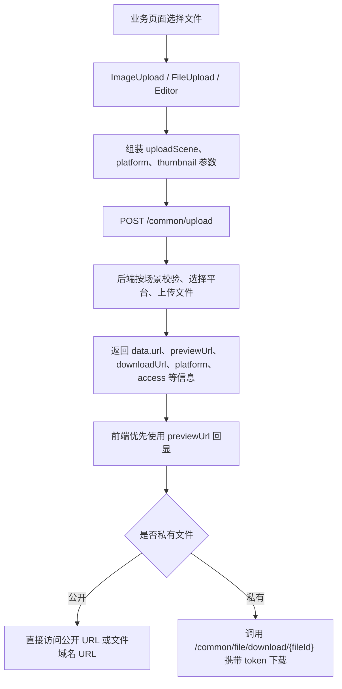

# 业务文件生命周期与前端回显

> 本文档为功能点整合版，按来源文件合并原始内容。原始文档仍保留在 `doc` 目录，便于按历史记录溯源。

## 整合说明

整合业务模块如何接入文件字段、DTO/VO 如何承载文件、Service 如何绑定/同步/删除文件，以及前端上传组件和回显规则。

## 来源索引

- `doc/11-前端文件上传适配说明.md`
- `doc/17-文件字段VO和显式Facade接入说明.md`
- `doc/23-业务模块文件接入规范.md`
- `doc/gitlog-commit/12-增加业务文件生命周期通用服务.md`

---

## 原文：doc/11-前端文件上传适配说明.md

# 前端文件上传适配说明

## 一、改造背景

后端 `/common/upload` 已从若依原来的扁平返回格式，调整为统一 DTO 返回：

```json
{
  "code": 200,
  "msg": "操作成功",
  "data": {
    "url": "https://xxx/test/public/image/2026/09/08/xxx.jpg",
    "fileName": "https://xxx/test/public/image/2026/09/08/xxx.jpg",
    "newFileName": "xxx.jpg",
    "originalFilename": "原文件名.jpg",
    "platform": "tencent-cos-1",
    "uploadScene": "commonImg",
    "access": "public"
  }
}
```

前端原组件仍按 `res.fileName` 读取上传结果，并且默认会把 `VITE_APP_BASE_API` 拼到文件地址前面，导致对象存储返回完整 URL 时出现回显失败、链接错误或地址重复拼接

## 二、改造前问题

1. 图片上传、文件上传、富文本上传只支持若依历史返回格式，不兼容 `res.data.url`
2. 图片和头像回显默认拼接后端接口前缀，遇到 COS、OSS、MinIO 完整 URL 会拼错
3. 前端没有把 `uploadScene`、`platform`、`thumbnail` 等上传策略参数传给后端，业务页无法指定场景和存储平台
4. 文件链接直接打开真实 URL，私有文件会遇到对象存储 `AccessDenied`
5. 头像前端只判断 `image/*`，和后端 `avatar` 场景的 `png/jpg/jpeg` 不完全一致
6. 富文本图片原来允许 `svg`，后端通用图片白名单不支持时会出现前后端校验不一致
7. 业务接口已经返回 `file1List`、`file2List` 等授权文件列表时，上传组件仍会根据 fileId 再调用 `/common/file/listByIds`，导致页面进来多一次查询，也让私有文件 token 来源变得混乱

## 三、改造后方案

1. 通用上传组件新增 `uploadScene`、`platform`、`thumbnail`、`thumbnailWidth`、`thumbnailHeight` 属性
2. 上传时通过 `el-upload` 的 `data` 参数把非空扩展参数传给后端
3. 上传成功后优先读取 `res.data.url`，兼容旧接口的 `res.fileName`
4. 回显地址通过 `normalizeUrl` 统一处理，完整 URL 不再拼接 `VITE_APP_BASE_API`
5. 文件上传组件识别 `/private/` 路径，私有文件改走后端下载接口并携带 token
6. 头像和富文本图片增加前端格式、大小校验，后端仍做最终校验
7. 上传组件新增 `storageFileList` 属性，业务接口已经返回授权文件 DTO 时直接用于回显，不再 fallback 到 `/common/file/listByIds`

## 四、当前前端改动清单

已修改文件：

```text
D:\workspace\p_project\RuoYi\RuoYi-Vue3\src\components\ImageUpload\index.vue
D:\workspace\p_project\RuoYi\RuoYi-Vue3\src\components\FileUpload\index.vue
D:\workspace\p_project\RuoYi\RuoYi-Vue3\src\components\Editor\index.vue
D:\workspace\p_project\RuoYi\RuoYi-Vue3\src\store\modules\user.js
D:\workspace\p_project\RuoYi\RuoYi-Vue3\src\views\system\user\profile\userAvatar.vue
D:\workspace\p_project\RuoYi\RuoYi-Vue3\src\views\tool\gen\editTable.vue
D:\workspace\p_project\RuoYi\RuoYi-Vue3\src\views\tool\gen\importTable.vue
D:\workspace\p_project\RuoYi\RuoYi-Vue3\src\views\tool\swagger\index.vue
```

当前前端工作区新增文件：

```text
D:\workspace\p_project\RuoYi\RuoYi-Vue3\src\api\system\node.js
D:\workspace\p_project\RuoYi\RuoYi-Vue3\src\api\system\student.js
D:\workspace\p_project\RuoYi\RuoYi-Vue3\src\views\system\node\index.vue
D:\workspace\p_project\RuoYi\RuoYi-Vue3\src\views\system\student\index.vue
```

当前前端工作区还存在 Vite 临时文件：

```text
vite.config.js.timestamp-*.mjs
```

这类文件是 Vite 配置热加载产生的临时文件，不属于业务功能改造内容

## 五、通用图片上传组件

文件：

```text
D:\workspace\p_project\RuoYi\RuoYi-Vue3\src\components\ImageUpload\index.vue
```

### 5.1 上传时携带后端场景参数

原代码：

```vue
<el-upload
  multiple
  :action="uploadImgUrl"
  list-type="picture-card"
  :on-success="handleUploadSuccess"
  :before-upload="handleBeforeUpload"
  :headers="headers"
  :file-list="fileList"
>
```

现代码：

```vue
<el-upload
  multiple
  :action="uploadImgUrl"
  list-type="picture-card"
  :on-success="handleUploadSuccess"
  :before-upload="handleBeforeUpload"
  :headers="headers"
  :data="uploadData"
  :file-list="fileList"
>
```

改动说明：

`el-upload` 增加 `:data="uploadData"`，用于把上传场景、指定平台和缩略图参数一并提交到 `/common/upload`

### 5.2 新增上传扩展属性

原代码：

```js
const props = defineProps({
  modelValue: [String, Object, Array],
  limit: {
    type: Number,
    default: 5,
  },
  isShowTip: {
    type: Boolean,
    default: true
  },
});
```

现代码：

```js
const props = defineProps({
  modelValue: [String, Object, Array],
  limit: {
    type: Number,
    default: 5,
  },
  isShowTip: {
    type: Boolean,
    default: true
  },
  // 上传场景编码，对应后端 ruoyi.upload-scenes 配置
  uploadScene: {
    type: String,
    default: ""
  },
  // 存储平台标识，为空时使用后端默认平台
  platform: {
    type: String,
    default: ""
  },
  // 是否生成缩略图，具体规则可被后端上传场景覆盖
  thumbnail: {
    type: Boolean,
    default: false
  },
  // 缩略图宽度，为空时使用后端默认值
  thumbnailWidth: {
    type: Number,
    default: null
  },
  // 缩略图高度，为空时使用后端默认值
  thumbnailHeight: {
    type: Number,
    default: null
  },
  // 业务接口已经返回的授权文件列表，传入后优先用于回显，避免组件再调用通用 listByIds 查询私有文件
  storageFileList: {
    type: Array,
    default: () => []
  },
});
```

改动说明：

图片组件从“只能上传文件”变成“可声明上传场景和平台”的通用组件。业务页只需要写 `upload-scene="commonImg"` 或 `platform="tencent-cos-1"`，不需要为每个业务重新写上传接口

`storageFileList` 用来接收业务接口已经返回的授权文件 DTO。业务接口已经校验过菜单权限和业务数据权限，所以私有文件的短期 token 应该从业务接口返回，不应该让通用上传组件优先通过 `/common/file/listByIds` 再补一次

### 5.3 组装上传参数

新增代码：

```js
const uploadData = computed(() => {
  // 只传有值的扩展参数，后端会继续做真实性校验和场景规则校验
  const data = {};
  if (props.uploadScene) {
    data.uploadScene = props.uploadScene;
  }
  if (props.platform) {
    data.platform = props.platform;
  }
  if (props.thumbnail) {
    data.thumbnail = props.thumbnail;
  }
  if (props.thumbnailWidth) {
    data.thumbnailWidth = props.thumbnailWidth;
  }
  if (props.thumbnailHeight) {
    data.thumbnailHeight = props.thumbnailHeight;
  }
  return data;
});
```

改动说明：

只传有值参数，避免空字符串覆盖后端默认平台。后端仍是规则最终裁决方，前端只做体验和参数透传

### 5.4 兼容完整 URL 回显

原代码：

```js
fileList.value = list.map(item => {
  if (typeof item === "string") {
    if (item.indexOf(baseUrl) === -1) {
      item = { name: baseUrl + item, url: baseUrl + item };
    } else {
      item = { name: item, url: item };
    }
  }
  return item;
});
```

现代码：

```js
fileList.value = list.map(item => {
  if (typeof item === "string") {
    item = { name: normalizeUrl(item), url: normalizeUrl(item) };
  }
  return item;
});

// 兼容 X File Storage 完整 URL 和若依历史相对路径
function normalizeUrl(url) {
  if (!url || url.startsWith("http://") || url.startsWith("https://") || url.startsWith("blob:")) {
    return url;
  }
  return baseUrl + url;
}
```

改动说明：

COS、OSS、MinIO 返回 `https://...` 时直接使用；若依历史 `/profile/...` 或相对路径才拼接 `baseUrl`

### 5.5 优先使用业务返回的授权文件列表

原代码：

```js
watch(() => props.modelValue, async val => {
  if (val) {
    const list = Array.isArray(val) ? val : props.modelValue.split(",");
    const fileInfoMap = await getFileInfoMap(list);
    fileList.value = list.map(item => normalizeImageItem(item, fileInfoMap));
  } else {
    fileList.value = [];
    return [];
  }
},{ deep: true, immediate: true });
```

现代码：

```js
watch([() => props.modelValue, () => props.storageFileList], ([val]) => {
  if (val) {
    const list = Array.isArray(val) ? val : props.modelValue.split(",");
    const fileInfoMap = getFileInfoMap();
    fileList.value = list.map(item => normalizeImageItem(item, fileInfoMap));
  } else {
    fileList.value = [];
    return [];
  }
},{ deep: true, immediate: true });
```

新增代码：

```js
function getFileInfoMap() {
  // 普通业务私有文件必须由业务接口先完成权限校验，再把授权文件列表传给组件
  return { ...getExistingFileInfoMap(), ...getProvidedFileInfoMap() };
}

function getExistingFileInfoMap() {
  return (fileList.value || []).reduce((map, fileInfo) => {
    if (fileInfo && fileInfo.fileId) {
      map[String(fileInfo.fileId)] = fileInfo;
    }
    return map;
  }, {});
}

// 将业务接口返回的授权文件列表转成 Map，供 v-model 中的 fileId 回显使用
function getProvidedFileInfoMap() {
  return (props.storageFileList || []).reduce((map, fileInfo) => {
    if (fileInfo && fileInfo.fileId) {
      map[String(fileInfo.fileId)] = fileInfo;
    }
    return map;
  }, {});
}
```

改动说明：

组件现在同时监听 `modelValue` 和 `storageFileList`。业务接口已经返回文件 DTO 时，组件直接使用 DTO 中的 `originalFilename`、`previewUrl`、`downloadUrl` 回显；如果业务接口没有返回对应文件 DTO，组件不再兜底补查，需要业务接口补齐对应 `fileList`

### 5.6 兼容新上传返回结构

原代码：

```js
function handleUploadSuccess(res, file) {
  if (res.code === 200) {
    uploadList.value.push({ name: res.fileName, url: res.fileName });
    uploadedSuccessfully();
  } else {
    number.value--;
    proxy.$modal.closeLoading();
    proxy.$modal.msgError(res.msg);
  }
}
```

现代码：

```js
function handleUploadSuccess(res, file) {
  if (res.code === 200) {
    // 后端新上传接口返回 data 对象，旧接口返回顶层 fileName，这里同时兼容
    const fileInfo = res.data || res;
    const url = normalizeUrl(fileInfo.previewUrl || fileInfo.url || fileInfo.fileName);
    uploadList.value.push({
      name: fileInfo.originalFilename || fileInfo.newFileName || file.name,
      originalFilename: fileInfo.originalFilename || file.name,
      newFileName: fileInfo.newFileName,
      url,
      previewUrl: normalizeUrl(fileInfo.previewUrl || url),
      downloadUrl: normalizeUrl(fileInfo.downloadUrl || url),
      fileId: fileInfo.fileId,
      access: fileInfo.access
    });
    uploadedSuccessfully();
  } else {
    number.value--;
    proxy.$modal.closeLoading();
    proxy.$modal.msgError(res.msg);
  }
}
```

改动说明：

优先读取新 DTO 的 `previewUrl/url`，旧返回的 `fileName` 仍可兼容。点位管理图片上传后不回显，就是因为这里原来只读取顶层 `res.fileName`

## 六、通用文件上传组件

文件：

```text
D:\workspace\p_project\RuoYi\RuoYi-Vue3\src\components\FileUpload\index.vue
```

### 6.1 上传时携带场景参数

原代码：

```vue
<el-upload
  multiple
  :action="uploadFileUrl"
  :before-upload="handleBeforeUpload"
  :on-error="handleUploadError"
  :on-success="handleUploadSuccess"
  :headers="headers"
>
```

现代码：

```vue
<el-upload
  multiple
  :action="uploadFileUrl"
  :before-upload="handleBeforeUpload"
  :on-error="handleUploadError"
  :on-success="handleUploadSuccess"
  :headers="headers"
  :data="uploadData"
>
```

改动说明：

文件上传组件和图片上传组件保持一致，支持向后端透传 `uploadScene/platform/thumbnail`

### 6.2 文件链接支持私有下载

原代码：

```vue
<el-link :href="`${baseUrl}${file.url}`" :underline="false" target="_blank">
  <span class="el-icon-document"> {{ getFileName(file.name) }} </span>
</el-link>
```

现代码：

```vue
<el-link :href="getFileHref(file.url)" :underline="false" target="_blank" @click="handleFileClick(file, $event)">
  <span class="el-icon-document"> {{ getFileName(file.name) }} </span>
</el-link>
```

新增代码：

```js
// 点击文件时按公开或私有访问策略处理
async function handleFileClick(file, event) {
  if (!isPrivateStorageUrl(file.url)) {
    return;
  }
  event.preventDefault();
  if (file.downloadUrl || file.fileId) {
    await downloadPrivateStorageFile(file);
    return;
  }
  proxy.$modal.msgError("文件缺少下载地址");
}

async function downloadPrivateStorageFile(file) {
  const url = toRequestUrl(file.downloadUrl || `/common/file/download/${file.fileId}`);
  const data = await request({
    url,
    method: "get",
    responseType: "blob"
  });
  if (blobValidate(data)) {
    saveAs(new Blob([data]), getDisplayName(file));
  }
}
```

改动说明：

公开文件仍然直接打开 URL；私有文件不再直接访问对象存储地址，也不再调用已删除的 `common/storage/download`，而是调用业务接口返回的 `downloadUrl` 或 `/common/file/download/{fileId}` 后端代理下载接口

### 6.3 成功回调兼容新 DTO

原代码：

```js
function handleUploadSuccess(res, file) {
  if (res.code === 200) {
    uploadList.value.push({ name: res.fileName, url: res.fileName });
    uploadedSuccessfully();
  } else {
    number.value--;
    proxy.$modal.closeLoading();
    proxy.$modal.msgError(res.msg);
  }
}
```

现代码：

```js
function handleUploadSuccess(res, file) {
  if (res.code === 200) {
    // 后端新上传接口返回 data 对象，旧接口返回顶层 fileName，这里同时兼容
    const fileInfo = res.data || res;
    const url = normalizeUrl(fileInfo.previewUrl || fileInfo.url || fileInfo.fileName);
    uploadList.value.push({
      name: fileInfo.originalFilename || fileInfo.newFileName || file.name,
      originalFilename: fileInfo.originalFilename || file.name,
      newFileName: fileInfo.newFileName,
      url,
      previewUrl: normalizeUrl(fileInfo.previewUrl || url),
      downloadUrl: normalizeUrl(fileInfo.downloadUrl || url),
      fileId: fileInfo.fileId,
      access: fileInfo.access
    });
    uploadedSuccessfully();
  } else {
    number.value--;
    proxy.$modal.closeLoading();
    proxy.$modal.msgError(res.msg);
  }
}
```

改动说明：

修复文件上传成功后列表只显示文件名但无法正确打开对象存储完整 URL 的问题，同时保留 `originalFilename` 供列表展示和下载保存名使用

## 七、富文本编辑器上传

文件：

```text
D:\workspace\p_project\RuoYi\RuoYi-Vue3\src\components\Editor\index.vue
```

### 7.1 上传时携带扩展参数

原代码：

```vue
<el-upload
  :action="uploadUrl"
  :before-upload="handleBeforeUpload"
  :on-success="handleUploadSuccess"
  :on-error="handleUploadError"
  name="file"
  :headers="headers"
>
```

现代码：

```vue
<el-upload
  :action="uploadUrl"
  :before-upload="handleBeforeUpload"
  :on-success="handleUploadSuccess"
  :on-error="handleUploadError"
  name="file"
  :headers="headers"
  :data="uploadData"
>
```

改动说明：

富文本内上传图片也可按业务场景传入平台和缩略图参数，默认不传时继续走后端默认平台

### 7.2 图片格式校验与后端保持一致

原代码：

```js
function handleBeforeUpload(file) {
  const type = ["image/jpeg", "image/jpg", "image/png", "image/svg"];
  const isJPG = type.includes(file.type);
  //检验文件格式
  if (!isJPG) {
    proxy.$modal.msgError(`图片格式错误!`);
    return false;
  }
}
```

现代码：

```js
function handleBeforeUpload(file) {
  // 富文本图片格式要和后端通用上传白名单保持一致，避免前端放行后端不支持的 svg
  const type = ["image/jpeg", "image/jpg", "image/png", "image/gif", "image/bmp"];
  const isImage = type.includes(file.type);
  // 检验图片格式
  if (!isImage) {
    proxy.$modal.msgError(`图片格式错误，请上传 jpg/jpeg/png/gif/bmp 格式图片`);
    return false;
  }
}
```

改动说明：

移除前端 `svg` 放行，补齐 `gif/bmp`，避免“前端能选，后端拒绝”的体验不一致

### 7.3 插入图片兼容完整 URL

原代码：

```js
// 插入图片，res.url为服务器返回的图片链接地址
quill.insertEmbed(length, "image", import.meta.env.VITE_APP_BASE_API + res.fileName);
```

现代码：

```js
// 插入图片，兼容后端新 data 对象和若依历史顶层 fileName
const fileInfo = res.data || res;
const url = fileInfo.url || fileInfo.fileName;
quill.insertEmbed(length, "image", normalizeUrl(url));
```

新增代码：

```js
// 兼容 X File Storage 完整 URL 和若依历史相对路径
function normalizeUrl(url) {
  if (!url || url.startsWith("http://") || url.startsWith("https://") || url.startsWith("blob:")) {
    return url;
  }
  return import.meta.env.VITE_APP_BASE_API + url;
}
```

改动说明：

富文本上传后直接把真实可访问 URL 插入编辑器，避免对象存储地址被拼成 `/dev-api/https://...`

## 八、头像上传页面

文件：

```text
D:\workspace\p_project\RuoYi\RuoYi-Vue3\src\views\system\user\profile\userAvatar.vue
```

### 8.1 头像前端白名单

原代码：

```js
function beforeUpload(file) {
  if (file.type.indexOf("image/") == -1) {
    proxy.$modal.msgError("文件格式错误，请上传图片类型,如：JPG，PNG后缀的文件。");
  } else {
    const reader = new FileReader();
    reader.readAsDataURL(file);
    reader.onload = () => {
      options.img = reader.result;
      options.filename = file.name;
    };
  }
}
```

现代码：

```js
const avatarMaxSize = 5;
const avatarFileTypes = ["png", "jpg", "jpeg"];

function beforeUpload(file) {
  // 头像只允许上传 png、jpg、jpeg，和后端 avatar 场景保持一致
  if (!isAllowedAvatarType(file)) {
    proxy.$modal.msgError(`文件格式错误，请上传 ${avatarFileTypes.join("/")} 格式的图片`);
    return false;
  }
  // 前端先拦截超过 5MB 的头像，后端仍会再次校验
  if (file.size / 1024 / 1024 > avatarMaxSize) {
    proxy.$modal.msgError(`上传头像图片大小不能超过 ${avatarMaxSize} MB`);
    return false;
  }
  // 读取本地图片用于裁剪预览，不会直接上传原始文件
  const reader = new FileReader();
  reader.readAsDataURL(file);
  reader.onload = () => {
    options.img = reader.result;
    options.filename = file.name;
  };
  return true;
}
```

改动说明：

头像前端限制从泛化 `image/*` 改成 `png/jpg/jpeg + 5MB`，和后端 `avatar` 场景保持一致。前端校验只负责体验，后端仍做真实性校验

### 8.2 头像返回 URL 兼容

原代码：

```js
uploadAvatar(formData).then(response => {
  open.value = false;
  options.img = import.meta.env.VITE_APP_BASE_API + response.imgUrl;
  userStore.avatar = options.img;
  proxy.$modal.msgSuccess("修改成功");
  visible.value = false;
});
```

现代码：

```js
uploadAvatar(formData).then(response => {
  const avatarUrl = getAvatarUrl(response);
  options.img = avatarUrl;
  userStore.avatar = avatarUrl;
  proxy.$modal.msgSuccess("修改成功");
  visible.value = false;
  open.value = false;
});

/** 从上传响应中获取头像地址 */
function getAvatarUrl(response) {
  const data = response && response.data ? response.data : response;
  return normalizeAvatarUrl(data && (data.imgUrl || data.url || data.thUrl));
}

/** 关闭窗口 */
function closeDialog() {
  options.img = userStore.avatar;
  visible.value = false;
}

/** 兼容后端返回绝对地址和相对地址 */
function normalizeAvatarUrl(url) {
  // X File Storage 会返回完整 URL，若依历史本地上传可能返回 /profile 相对路径
  if (!url || url.startsWith("http://") || url.startsWith("https://") || url.startsWith("blob:")) {
    return url;
  }
  return import.meta.env.VITE_APP_BASE_API + url;
}
```

改动说明：

后端头像保存的是 X File Storage 返回的完整 URL，前端不再强行拼接 `/dev-api`

头像弹窗回显失败的直接原因是上传成功后先执行了 `open.value = false`，弹窗关闭时触发 `closeDialog()`，又把 `options.img` 重置成旧的 `userStore.avatar`。现在改为先从响应中解析新头像地址，更新 `options.img` 和 `userStore.avatar`，最后再关闭弹窗，避免新头像被旧缓存覆盖。

`getAvatarUrl` 同时兼容 `response.imgUrl` 和 `response.data.imgUrl` 两种结构，也兜底支持 `url`、`thUrl` 字段，避免后端返回格式调整后头像回显再次失效。

## 九、用户头像缓存

文件：

```text
D:\workspace\p_project\RuoYi\RuoYi-Vue3\src\store\modules\user.js
```

原代码：

```js
const avatar = (user.avatar == "" || user.avatar == null) ? defAva : import.meta.env.VITE_APP_BASE_API + user.avatar;
```

现代码：

```js
const avatar = (user.avatar == "" || user.avatar == null) ? defAva : normalizeAvatarUrl(user.avatar);

// 兼容 X File Storage 完整 URL 和若依历史相对路径
function normalizeAvatarUrl(url) {
  if (!url || url.startsWith("http://") || url.startsWith("https://") || url.startsWith("blob:")) {
    return url;
  }
  return import.meta.env.VITE_APP_BASE_API + url;
}
```

改动说明：

登录后用户信息里的头像如果是对象存储完整 URL，直接用于页面展示；如果是若依历史相对路径，继续拼接后端接口前缀

## 十、代码生成前端页面

### 10.1 编辑生成表字段

文件：

```text
D:\workspace\p_project\RuoYi\RuoYi-Vue3\src\views\tool\gen\editTable.vue
```

原代码：

```vue
<el-select v-model="scope.row.javaType">
  <el-option label="Long" value="Long" />
  <el-option label="String" value="String" />
  <el-option label="Integer" value="Integer" />
  <el-option label="Double" value="Double" />
  <el-option label="BigDecimal" value="BigDecimal" />
  <el-option label="Date" value="Date" />
  <el-option label="Boolean" value="Boolean" />
</el-select>
```

现代码：

```vue
<el-select v-model="scope.row.javaType" @change="value => handleJavaTypeChange(scope.row, value)">
  <el-option label="Long" value="Long" />
  <el-option label="String" value="String" />
  <el-option label="Integer" value="Integer" />
  <el-option label="Double" value="Double" />
  <el-option label="BigDecimal" value="BigDecimal" />
  <el-option label="Date" value="Date" />
  <el-option label="LocalDate" value="LocalDate" />
  <el-option label="LocalDateTime" value="LocalDateTime" />
  <el-option label="Boolean" value="Boolean" />
</el-select>
```

原代码：

```vue
<el-option label="日期控件" value="datetime" />
<el-option label="图片上传" value="imageUpload" />
<el-option label="文件上传" value="fileUpload" />
```

现代码：

```vue
<el-option label="日期控件" value="date" />
<el-option label="日期时间控件" value="datetime" />
<el-option label="图片上传" value="imageUpload" />
<el-option label="文件上传" value="fileUpload" />
```

新增代码：

```js
// Java日期类型与显示类型联动，避免LocalDate仍按datetime控件生成。
function handleJavaTypeChange(row, javaType) {
  syncDateHtmlType(row, javaType);
}

// 加载已保存字段时也归一化日期显示类型，修复历史配置中的LocalDate + datetime组合。
function syncDateHtmlType(row, javaType = row.javaType) {
  if (javaType === "LocalDate") {
    row.htmlType = "date";
  } else if (javaType === "LocalDateTime" || javaType === "Date") {
    row.htmlType = "datetime";
  }
}
```

改动说明：

这部分属于代码生成配套优化：前端生成页面支持 `LocalDate/LocalDateTime`，并把 `LocalDate` 自动联动为日期控件，避免生成代码时日期类型和控件类型错配

### 10.2 导入表时指定前端模板类型

文件：

```text
D:\workspace\p_project\RuoYi\RuoYi-Vue3\src\views\tool\gen\importTable.vue
```

原代码：

```js
importTable({ tables: tableNames }).then(res => {
  proxy.$modal.msgSuccess(res.msg);
});
```

现代码：

```js
importTable({ tables: tableNames, tplWebType: "element-plus" }).then(res => {
  proxy.$modal.msgSuccess(res.msg);
});
```

改动说明：

导入表时明确传 `element-plus`，让后端代码生成器按 Vue3/Element Plus 模板初始化前端字段配置

## 十一、Swagger 页面入口

文件：

```text
D:\workspace\p_project\RuoYi\RuoYi-Vue3\src\views\tool\swagger\index.vue
```

原代码：

```js
import iFrame from '@/components/iFrame'

const url = ref(import.meta.env.VITE_APP_BASE_API + "/swagger-ui/index.html")
```

现代码：

```js
import { ref } from 'vue'
import iFrame from '@/components/iFrame'

const url = ref(import.meta.env.VITE_APP_BASE_API + "/doc.html")
```

改动说明：

前端 Swagger 菜单从 Springdoc 默认页面切换为 Knife4j `doc.html` 页面，同时补齐 `ref` 导入

## 十二、新增生成页面说明

当前前端工作区存在新增的点位管理和学生信息生成文件：

```text
src/api/system/node.js
src/views/system/node/index.vue
src/api/system/student.js
src/views/system/student/index.vue
```

其中点位管理页面已经生成了文件上传相关控件，用于验证 `upload-scene` 和 `platform` 是否能从前端传到后端

关键现代码：

```vue
<image-upload v-model="form.file1"
  upload-scene="commonImg"
  platform="tencent-cos-1"
/>

<file-upload v-model="form.file2"
  upload-scene="commonFile"
  platform="tencent-cos-1"
/>

<file-upload
  v-model="form.file4"
  upload-scene="audio"
  platform="tencent-cos-1"
  :file-type="['mp3', 'wav', 'wma', 'ogg']"
  :file-size="50"
/>

<file-upload
  v-model="form.file5"
  upload-scene="video"
  platform="tencent-cos-1"
  :file-type="['mp4', 'avi', 'rmvb']"
  :file-size="100"
/>
```

说明：

1. `upload-scene` 决定后端使用哪个业务场景规则，例如图片、附件、音频、视频
2. `platform` 指定上传到哪个存储平台，不传时使用后端默认平台
3. 音频、视频仍复用 `file-upload` 组件，通过 `file-type` 和 `file-size` 做前端体验校验
4. 新增生成文件当前存在中文乱码，属于生成输出编码问题，后续需要从代码生成模板或生成流程修正

## 十三、前端上传链路



## 十四、对外访问地址适配

后端上传响应现在会根据公开或私有访问级别返回对外地址：

```json
{
  "fileId": 2,
  "url": "/common/file/preview/2",
  "previewUrl": "/common/file/preview/2",
  "downloadUrl": "/common/file/download/2",
  "access": "private"
}
```

前端组件适配规则：

- 图片回显优先使用 `previewUrl`，没有时回退 `url`
- 文件下载优先使用 `downloadUrl`
- 文件列表展示优先使用 `originalFilename`，避免页面展示 UUID 文件名或完整代理地址
- 业务字段保存多个 `fileId` 时，上传组件只使用业务接口返回的 `storageFileList` 做回显，不再调用 `/common/file/listByIds`
- 私有文件优先使用业务接口返回的 `downloadUrl` 下载，缺少 `downloadUrl` 时通过 `fileId` 调用 `/common/file/download/{fileId}`
- 后端返回相对地址时，前端继续通过 `VITE_APP_BASE_API` 补成接口代理地址

`ImageUpload` 上传成功后保存：

```js
const url = normalizeUrl(fileInfo.previewUrl || fileInfo.url || fileInfo.fileName);
uploadList.value.push({
  name: fileInfo.originalFilename || fileInfo.newFileName || file.name,
  originalFilename: fileInfo.originalFilename || file.name,
  newFileName: fileInfo.newFileName,
  url,
  previewUrl: normalizeUrl(fileInfo.previewUrl || url),
  downloadUrl: normalizeUrl(fileInfo.downloadUrl || url),
  fileId: fileInfo.fileId,
  access: fileInfo.access
});
```

`FileUpload` 私有文件下载：

```js
const url = toRequestUrl(file.downloadUrl || `/common/file/download/${file.fileId}`);
const data = await request({
  url,
  method: "get",
  responseType: "blob"
});
if (blobValidate(data)) {
  saveAs(new Blob([data]), getDisplayName(file));
}
```

`FileUpload` 文件名展示：

```vue
<span class="el-icon-document"> {{ getDisplayName(file) }} </span>
```

`FileUpload` 通过 `fileId` 批量回显：

```js
watch([() => props.modelValue, () => props.storageFileList], ([val]) => {
  if (val) {
    let temp = 1;
    const list = Array.isArray(val) ? val : props.modelValue.split(",");
    const fileInfoMap = getFileInfoMap();
    fileList.value = list.map(item => {
      item = normalizeFileItem(item, fileInfoMap);
      item.uid = item.uid || new Date().getTime() + temp++;
      return item;
    });
  } else {
    fileList.value = [];
    return [];
  }
},{ deep: true, immediate: true });
```

```js
function getFileInfoMap() {
  return { ...getExistingFileInfoMap(), ...getProvidedFileInfoMap() };
}
```

```js
function normalizeFileItem(item, fileInfoMap) {
  if (typeof item === "string") {
    const value = item.trim();
    if (isFileIdValue(value)) {
      const fileInfo = fileInfoMap[value];
      if (fileInfo) {
        return buildFileItem(fileInfo, value);
      }
    }
    return { name: getFileName(value), url: value };
  }
  item.name = item.originalFilename || item.name || item.newFileName || getFileName(item.url || "");
  item.url = normalizeUrl(item.previewUrl || item.url);
  item.downloadUrl = normalizeUrl(item.downloadUrl || item.url);
  return item;
}
```

```js
function getDisplayName(file) {
  if (!file) {
    return "";
  }
  if (file.originalFilename) {
    return file.originalFilename;
  }
  if (file.name && !isPathLike(file.name)) {
    return file.name;
  }
  if (file.newFileName) {
    return file.newFileName;
  }
  return getFileName(file.name || file.url || "");
}
```

回显已有文件对象时，也会把 `originalFilename` 映射到 `name`：

```js
function buildFileItem(fileInfo, fallbackFileId) {
  const url = normalizeUrl(fileInfo.previewUrl || fileInfo.url || fileInfo.fileName || "");
  return {
    name: fileInfo.originalFilename || fileInfo.newFileName || fileInfo.filename || fallbackFileId,
    originalFilename: fileInfo.originalFilename,
    newFileName: fileInfo.newFileName || fileInfo.filename,
    url,
    previewUrl: normalizeUrl(fileInfo.previewUrl || url),
    downloadUrl: normalizeUrl(fileInfo.downloadUrl || url),
    fileId: fileInfo.fileId || fallbackFileId,
    access: fileInfo.access
  };
}
```

`FileUpload` 回传业务字段时优先使用 `fileId`：

```js
const value = list[i].fileId || list[i].url;
if (value) {
  strs += value + separator;
}
```

这样新上传的文件保存到业务表时是文件资产 ID，当前页面会从组件已有文件对象中继续展示 `originalFilename`。重新打开表单时由业务详情接口返回授权文件 DTO，组件通过 `storageFileList` 展示 `originalFilename`。老数据如果仍是 URL，会继续按 URL 最后一段兜底显示。

`ImageUpload` 同步支持 `fileId` 回显，图片类字段保存 `70,73,74,75` 时也只消费业务接口返回的 `storageFileList`，不再发起 `/common/file/listByIds` 请求。

头像上传弹窗优先使用后端返回的代理或文件域名预览地址：

```js
return normalizeAvatarUrl(data && (data.previewUrl || data.imgUrl || data.url || data.thUrl));
```

## 十五、验证结果

已执行前端构建：

```bash
npm run build:prod
```

结果：

```text
构建成功
仅存在 Vite chunk size warning
```

该警告为构建产物体积提示，不影响本次上传组件适配功能

## 十六、上传 Loading 收尾修复

问题表现：

```text
图片上传接口已经成功返回，但页面一直停留在“正在上传图片，请稍候...”
```

原因：

```text
ImageUpload / FileUpload 使用 number 记录本轮上传数量，使用 uploadList 记录成功上传数量
原逻辑只有 uploadList.length === number 时才关闭 loading
如果之前发生过上传失败、移除、重复回调或计数残留，就会导致两者不相等，loading 无法关闭
```

现代码：

```js
function uploadedSuccessfully() {
  if (number.value > 0 && uploadList.value.length >= number.value) {
    fileList.value = fileList.value.filter(f => f.url !== undefined).concat(uploadList.value);
    uploadList.value = [];
    number.value = 0;
    emit("update:modelValue", listToString(fileList.value));
    proxy.$modal.closeLoading();
  }
}
```

上传失败时同步重置本轮计数：

```js
function handleUploadError() {
  number.value = Math.max(number.value - 1, 0);
  proxy.$modal.msgError("上传图片失败");
  if (number.value === 0) {
    uploadList.value = [];
    proxy.$modal.closeLoading();
  }
}
```

`ImageUpload` 的 `before-upload` 明确返回 `true`：

```js
proxy.$modal.loading("正在上传图片，请稍候...");
number.value++;
return true;
```

改动后，上传成功、上传失败、批量上传部分成功等场景都能正确收尾，不会因为计数偏差导致 loading 常驻

## 十七、业务授权文件列表优先回显

问题表现：

```text
进入点位管理页面时，除了 /system/node/list，还会额外请求：
GET /common/file/listByIds?fileIds=73,75,80...
```

原因：

```text
点位列表接口已经返回 file1List、file2List 等文件 DTO
但是前端页面和上传组件仍然根据业务字段里的 fileId 再调用 /common/file/listByIds 回查
这会导致同一批私有文件同时存在“业务接口授权”和“通用接口回查”两条来源
```

现代码：

```vue
<image-upload
  v-model="form.file1"
  upload-scene="commonImg"
  platform="tencent-cos-1"
  :storage-file-list="form.file1List"
/>

<file-upload
  v-model="form.file2"
  upload-scene="commonFile"
  platform="tencent-cos-1"
  :storage-file-list="form.file2List"
/>
```

组件处理：

```js
watch([() => props.modelValue, () => props.storageFileList], ([val]) => {
  if (val) {
    const list = Array.isArray(val) ? val : props.modelValue.split(",");
    // 文件回显信息由业务列表或详情接口返回，组件不再绕过业务权限单独补查
    const fileInfoMap = getFileInfoMap();
    fileList.value = list.map(item => normalizeFileItem(item, fileInfoMap));
  } else {
    fileList.value = [];
    return [];
  }
},{ deep: true, immediate: true });
```

```js
function getFileInfoMap() {
  // 普通业务私有文件必须由业务接口先完成权限校验，再把授权文件列表传给组件
  return { ...getExistingFileInfoMap(), ...getProvidedFileInfoMap() };
}

function getExistingFileInfoMap() {
  return (fileList.value || []).reduce((map, fileInfo) => {
    if (fileInfo && fileInfo.fileId) {
      map[String(fileInfo.fileId)] = fileInfo;
    }
    return map;
  }, {});
}

function getProvidedFileInfoMap() {
  return (props.storageFileList || []).reduce((map, fileInfo) => {
    if (fileInfo && fileInfo.fileId) {
      map[String(fileInfo.fileId)] = fileInfo;
    }
    return map;
  }, {});
}
```

点位列表处理：

```js
function loadNodeStorageFileDisplay(rows) {
  const fileInfoMap = collectProvidedStorageFileMap(rows)
  if (!Object.keys(fileInfoMap).length) {
    return
  }
  rows.forEach(row => {
    // 图片列使用缩略图预览地址，避免列表里继续把 fileId 当图片地址使用
    row.file1FileList = buildStorageFileList(row.file1, fileInfoMap)
    row.file1PreviewUrl = row.file1FileList[0]?.thPreviewUrl || row.file1FileList[0]?.previewUrl || ""
    // 附件、富文本、音频、视频列展示 originalFilename，而不是展示业务表保存的 fileId
    row.file2FileList = buildStorageFileList(row.file2, fileInfoMap)
    row.file3FileList = buildStorageFileList(row.file3, fileInfoMap)
    row.file4FileList = buildStorageFileList(row.file4, fileInfoMap)
    row.file5FileList = buildStorageFileList(row.file5, fileInfoMap)
  })
}
```

改动后链路：

```text
业务列表或详情接口有 fileXList：前端直接回显，不再额外查通用 fileId 补查接口
业务列表或详情接口缺少文件 DTO：前端不再兜底补查，需要业务接口补齐对应 fileList
业务私有文件 token 来源：业务接口签发
通用 listByIds 定位：已删除，避免组件绕过业务查询权限枚举文件
```

上传成功后的文件名显示：

```js
function handleUploadSuccess(res, file) {
  if (res.code === 200) {
    const fileInfo = res.data || res;
    uploadList.value.push({
      name: fileInfo.originalFilename || fileInfo.newFileName || file.name,
      originalFilename: fileInfo.originalFilename || file.name,
      newFileName: fileInfo.newFileName,
      fileId: fileInfo.fileId,
      access: fileInfo.access
    });
    uploadedSuccessfully();
  }
}
```

说明：上传成功后业务字段仍保存 `fileId`，但组件会先从已有 `fileList` 中读取刚上传的文件对象，因此页面展示继续使用 `originalFilename`，不会在父组件回写 v-model 后退化成显示数字。

私有文件下载：

```js
async function handleFileClick(file, event) {
  if (!isPrivateStorageFile(file)) {
    return;
  }
  event.preventDefault();
  if (file.downloadUrl || file.fileId) {
    await downloadPrivateStorageFile(file);
    return;
  }
  proxy.$modal.msgError("文件缺少下载地址");
}

async function downloadPrivateStorageFile(file) {
  const url = toRequestUrl(file.downloadUrl || `/common/file/download/${file.fileId}`);
  const data = await request({
    url,
    method: "get",
    responseType: "blob"
  });
  if (blobValidate(data)) {
    saveAs(new Blob([data]), getDisplayName(file));
  }
}
```

说明：私有文件点击时不再依赖已删除的 `/common/storage/download`，而是走业务接口返回的 `downloadUrl` 或后端代理下载接口 `/common/file/download/{fileId}`。`downloadUrl` 中如果带有文件 token，会由后端继续做私有文件授权校验。

---

## 原文：doc/17-文件字段VO和显式Facade接入说明.md

# 文件字段VO和显式Facade接入说明

## 一、改造前存在的问题

上一版文件回显方案把文件字段注解和文件回显列表都放在业务实体上：

```java
@StorageFileField(bizType = "pointImage")
private String file1;

private List<StorageFileUploadRespDTO> file1List;
```

这种方式虽然能自动回填文件列表，但实体类同时承担了数据库映射、接口返回、文件回显配置三类职责

主要问题：

- Entity 依赖文件 DTO，数据库实体被接口返回结构污染
- Entity 上的 `@StorageFileField` 需要反射扫描，字段关系不够直观
- 不同业务文件字段数量不同，实体注解方式容易让生成代码和业务代码耦合
- 业务查询权限在 Controller/Service，文件 token 签发却由通用反射隐式触发，链路不够清晰

## 二、最终版方案

本次改造后，文件和业务关系保持不变：

- 继续保留 `sys_storage_file`
- 继续保留业务表中的 `fileId/fileIds` 字段
- 继续保留文件表中的 `bizType/bizId` 作为辅助管理字段
- Entity 只保留数据库字段，不再放 `@StorageFileField`
- Entity 不再放 `fileList`
- 查询和保存使用 DTO
- 接口返回使用 VO，VO 中放文件回显列表
- 业务 Service 显式调用文件 facade 填充 `fileList`
- 私有文件 token 只由业务查询接口签发
- `/common/file/download/{fileId}` 只负责校验 token 和输出文件流

## 三、当前点位模块链路

### 1. 列表查询链路

```text
GET /system/node/list
  -> NodeController.list(NodeQueryDTO)
  -> NodeServiceImpl.selectNodeList(NodeQueryDTO)
  -> NodeMapper.selectNodeList(Node)
  -> Node 转 NodeVo
  -> businessStorageFileService.fillStorageFileList(nodes, NODE_VO_FILE_FIELDS)
  -> sys_storage_file 批量查询文件记录
  -> 私有文件生成短期 token
  -> 返回 NodeVo 列表
```

### 2. 详情查询链路

```text
GET /system/node/{id}
  -> NodeController.getInfo(id)
  -> NodeServiceImpl.selectNodeById(id)
  -> NodeMapper.selectNodeById(id)
  -> Node 转 NodeVo
  -> businessStorageFileService.fillStorageFileList(nodeVo, NODE_VO_FILE_FIELDS)
  -> 返回 NodeVo
```

### 3. 新增绑定链路

```text
POST /system/node
  -> NodeController.add(NodeSaveDTO)
  -> NodeServiceImpl.insertNode(NodeSaveDTO)
  -> 保存业务表
  -> 使用生成后的业务ID作为 bizId
  -> businessStorageFileService.bindStorageFiles(entity, bizId, NODE_FILE_FIELDS, operator)
  -> sys_storage_file 从临时文件绑定为业务文件
```

### 4. 修改同步链路

```text
PUT /system/node
  -> NodeController.edit(NodeSaveDTO)
  -> NodeServiceImpl.updateNode(NodeSaveDTO)
  -> 先查询旧业务数据
  -> 更新业务表
  -> businessStorageFileService.syncStorageFiles(entity, oldNode, bizId, NODE_FILE_FIELDS, operator)
  -> 新增文件绑定业务，移除文件标记待删除
```

### 5. 删除清理链路

```text
DELETE /system/node/{ids}
  -> NodeController.remove(ids)
  -> NodeServiceImpl.deleteNodeByIds(ids)
  -> 删除业务表记录
  -> businessStorageFileService.markStorageFilesWaitDeleteByBiz(ids, NODE_FILE_FIELDS, operator)
  -> 将业务下声明的文件类型统一标记待删除
```

## 四、核心代码

### 1. Entity 只保留数据库字段

`Node` 中只保留 `file1` 到 `file5` 这类业务表字段，不再声明 `@StorageFileField`，也不再声明 `file1List` 到 `file5List`

```java
/** 图片 */
@ExcelProperty(value = "图片")
@Excel(name = "图片")
private String file1;

/** 附件 */
@ExcelProperty(value = "附件")
@Excel(name = "附件")
private String file2;

/** 富文本 */
@ExcelProperty(value = "富文本")
@Excel(name = "富文本")
private String file3;

/** 音频 */
@ExcelProperty(value = "音频")
@Excel(name = "音频")
private String file4;

/** 视频 */
@ExcelProperty(value = "视频")
@Excel(name = "视频")
private String file5;
```

### 2. 保存 DTO 接收文件ID

`NodeSaveDTO` 只接收业务保存字段，文件字段保存 `fileId` 或逗号分隔的 `fileIds`

```java
/**
 * 图片文件ID，多个文件使用逗号分隔
 */
private String file1;

/**
 * 附件文件ID，多个文件使用逗号分隔
 */
private String file2;

/**
 * 富文本文件ID，多个文件使用逗号分隔
 */
private String file3;

/**
 * 音频文件ID，多个文件使用逗号分隔
 */
private String file4;

/**
 * 视频文件ID，多个文件使用逗号分隔
 */
private String file5;
```

### 3. VO 承载文件回显列表

`NodeVo` 保留业务表中的文件ID字段，同时额外提供 `fileList` 给前端回显

```java
/**
 * 图片文件ID，多个文件使用逗号分隔
 */
private String file1;

/**
 * 图片文件回显列表
 */
private List<StorageFileUploadRespDTO> file1List;

/**
 * 附件文件ID，多个文件使用逗号分隔
 */
private String file2;

/**
 * 附件文件回显列表
 */
private List<StorageFileUploadRespDTO> file2List;
```

### 4. 业务 Service 显式声明文件字段映射

点位模块显式声明两组映射：

- `NODE_FILE_FIELDS` 用于新增、修改、删除时绑定或标记文件
- `NODE_VO_FILE_FIELDS` 用于列表、详情返回时填充文件回显列表

```java
/**
 * 点位实体文件字段映射
 * <p>
 * 业务表仍保存 fileId/fileIds，bizType 只作为文件资产辅助归类和生命周期管理维度
 */
private static final List<BusinessStorageFileField<Node>> NODE_FILE_FIELDS = Arrays.asList(
        BusinessStorageFileField.of(BIZ_TYPE_POINT_IMAGE, Node::getFile1, null),
        BusinessStorageFileField.of(BIZ_TYPE_POINT_ATTACHMENT, Node::getFile2, null),
        BusinessStorageFileField.of(BIZ_TYPE_POINT_RICH_TEXT, Node::getFile3, null),
        BusinessStorageFileField.of(BIZ_TYPE_POINT_AUDIO, Node::getFile4, null),
        BusinessStorageFileField.of(BIZ_TYPE_POINT_VIDEO, Node::getFile5, null));

/**
 * 点位返回对象文件回显字段映射
 * <p>
 * VO 承载 fileList 回显字段，避免数据库实体依赖文件 DTO
 */
private static final List<BusinessStorageFileField<NodeVo>> NODE_VO_FILE_FIELDS = Arrays.asList(
        BusinessStorageFileField.of(BIZ_TYPE_POINT_IMAGE, NodeVo::getFile1, NodeVo::setFile1List),
        BusinessStorageFileField.of(BIZ_TYPE_POINT_ATTACHMENT, NodeVo::getFile2, NodeVo::setFile2List),
        BusinessStorageFileField.of(BIZ_TYPE_POINT_RICH_TEXT, NodeVo::getFile3, NodeVo::setFile3List),
        BusinessStorageFileField.of(BIZ_TYPE_POINT_AUDIO, NodeVo::getFile4, NodeVo::setFile4List),
        BusinessStorageFileField.of(BIZ_TYPE_POINT_VIDEO, NodeVo::getFile5, NodeVo::setFile5List));
```

### 5. 查询时显式填充 VO 文件列表

```java
@Override
public List<NodeVo> selectNodeList(NodeQueryDTO node)
{
    List<NodeVo> nodes = toNodeVoList(nodeMapper.selectNodeList(toNode(node)));
    // 列表接口已经由若依分页和权限链路控制，文件服务按显式 mapping 批量生成授权地址
    businessStorageFileService.fillStorageFileList(nodes, NODE_VO_FILE_FIELDS);
    return nodes;
}
```

### 6. 新增时显式绑定文件

```java
@Override
@Transactional(rollbackFor = Exception.class)
public int insertNode(NodeSaveDTO node)
{
    Node entity = toNode(node);
    entity.setCreateTime(DateUtils.getNowDate());
    int rows = nodeMapper.insertNode(entity);
    if (rows > 0)
    {
        // 新增点位成功后，生成的点位ID作为 bizId 绑定本次上传的文件
        businessStorageFileService.bindStorageFiles(entity, String.valueOf(entity.getId()), NODE_FILE_FIELDS,
                businessStorageFileService.getOperator(entity));
    }
    return rows;
}
```

### 7. 修改时显式同步文件

```java
@Override
@Transactional(rollbackFor = Exception.class)
public int updateNode(NodeSaveDTO node)
{
    // 修改前先查询旧数据，用于判断哪些文件已经从表单中被移除
    Node oldNode = nodeMapper.selectNodeById(node.getId());
    Node entity = toNode(node);
    entity.setUpdateTime(DateUtils.getNowDate());
    int rows = nodeMapper.updateNode(entity);
    if (rows > 0 && oldNode != null)
    {
        // 修改成功后同步新旧文件集合，移除的文件会进入待删除状态
        businessStorageFileService.syncStorageFiles(entity, oldNode, String.valueOf(entity.getId()), NODE_FILE_FIELDS,
                businessStorageFileService.getOperator(entity));
    }
    return rows;
}
```

### 8. 删除时显式标记待删除

```java
@Override
@Transactional(rollbackFor = Exception.class)
public int deleteNodeByIds(Long[] ids)
{
    int rows = nodeMapper.deleteNodeByIds(ids);
    if (rows > 0)
    {
        // 批量删除点位后，将每个点位下各类文件统一标记为待删除
        businessStorageFileService.markStorageFilesWaitDeleteByBiz(ids, NODE_FILE_FIELDS,
                businessStorageFileService.getOperator(null));
    }
    return rows;
}
```

### 9. 通用文件 facade 新增显式映射 API

```java
public <T> void fillStorageFileList(T business, Collection<BusinessStorageFileField<T>> fields);

public <T> void fillStorageFileList(Collection<T> businesses, Collection<BusinessStorageFileField<T>> fields);

public <T> int bindStorageFiles(T business, String bizId, Collection<BusinessStorageFileField<T>> fields,
        String updateBy);

public <T> int syncStorageFiles(T newBusiness, T oldBusiness, String bizId,
        Collection<BusinessStorageFileField<T>> fields, String updateBy);

public <T> int markStorageFilesWaitDeleteByBiz(Object[] bizIds, Collection<BusinessStorageFileField<T>> fields,
        String updateBy);
```

旧的注解扫描 API 和 `@StorageFileField` 注解已删除，文件接入只保留显式映射方式

### 10. 下载入口只校验 token 和输出流

```java
/**
 * 写出文件内容
 * <p>
 * 该方法只负责统一校验访问 token、构造 FileInfo 并输出文件流，不判断具体业务菜单权限和数据权限
 * 普通业务私有文件的业务权限应在列表或详情接口里完成，文件 token 也只能由这些业务查询接口签发
 *
 * @param fileId 文件ID
 * @param thumbnail true 表示写出缩略图
 * @param attachment true 表示作为附件下载
 * @param response 响应对象
 */
private void writeStorageFile(Long fileId, boolean thumbnail, boolean attachment, String accessToken,
        HttpServletResponse response)
{
    SysStorageFile storageFile = storageFileService.selectStorageFileById(fileId);
    try
    {
        checkStorageDownloadAllowed(storageFile, null, null, accessToken);
        FileInfo fileInfo = buildDownloadFileInfo(storageFile, thumbnail);
        if (fileInfo == null)
        {
            response.setStatus(HttpServletResponse.SC_NOT_FOUND);
            return;
        }
        String downloadName = StringUtils.isNotBlank(fileInfo.getOriginalFilename()) ? fileInfo.getOriginalFilename()
                : FileUtils.getName(fileInfo.getUrl());
        response.setContentType(StringUtils.isNotBlank(fileInfo.getContentType()) ? fileInfo.getContentType()
                : MediaType.APPLICATION_OCTET_STREAM_VALUE);
        if (attachment)
        {
            // 下载入口设置附件响应头，预览入口则让浏览器按 Content-Type 尝试打开
            FileUtils.setAttachmentResponseHeader(response, downloadName);
        }
        response.getOutputStream().write(xFileStorageUtils.downloadBytes(fileInfo));
    }
    catch (ServiceException e)
    {
        log.warn("访问存储文件被拒绝，fileId={}，thumbnail={}，attachment={}，reason={}", fileId, thumbnail, attachment,
                e.getMessage());
        // ServiceException 可能只传业务提示不传错误码，默认按 403 访问拒绝处理
        Integer code = e.getCode();
        response.setStatus(code != null && code == HttpStatus.UNAUTHORIZED ? HttpServletResponse.SC_UNAUTHORIZED
                : HttpServletResponse.SC_FORBIDDEN);
    }
    catch (Exception e)
    {
        log.error("访问存储文件失败，fileId={}，thumbnail={}，attachment={}", fileId, thumbnail, attachment, e);
        response.setStatus(HttpServletResponse.SC_INTERNAL_SERVER_ERROR);
    }
}
```

## 五、为什么保留 bizType/bizId

业务表中的 `fileId/fileIds` 是主关联方式，适合表单保存、编辑回显和代码生成

文件表中的 `bizType/bizId` 是辅助管理字段，主要用于：

- 删除业务数据时批量标记该业务下的文件
- 按业务类型设置差异化清理或审计规则
- 文件后台管理按业务归类查询
- 避免只靠 URL 判断文件和业务关系

所以最终关系是：

```text
业务表 fileId/fileIds -> 精确找到文件
文件表 bizType/bizId -> 反向辅助管理文件生命周期
```

## 六、新业务接入规范

新业务建议按下面方式接入：

1. 业务表保留 `fileId` 或 `fileIds` 字段
2. Entity 只放数据库字段
3. 新增保存 DTO，接收业务字段和文件ID字段
4. 新增返回 VO，在 VO 中放 `fileList`
5. Service 中声明 `BusinessStorageFileField` 显式映射
6. 查询列表或详情时调用 `fillStorageFileList`
7. 新增成功后调用 `bindStorageFiles`
8. 修改成功后调用 `syncStorageFiles`
9. 删除成功后调用 `markStorageFilesWaitDeleteByBiz`

这套方式不再依赖实体注解和反射绑定，文件字段数量由业务 Service 自己声明，结构更直观

## 七、验证结果

已执行后端编译：

```text
mvn -pl ruoyi-admin -am -DskipTests "-Dmaven.compiler.useIncrementalCompilation=false" compile
```

编译结果：

```text
BUILD SUCCESS
```

---

## 原文：doc/23-业务模块文件接入规范.md

# 业务模块文件接入规范

## 一、规范目标

这份规范用于固定业务模块接入文件管理的标准写法，避免每个业务都重新发明一套文件绑定、回显、下载和删除逻辑

最终固定为以下方案：

- 业务表只保存 `fileId/fileIds`
- Entity 只表示数据库字段，不放文件回显列表
- SaveDTO 接收前端提交的 `fileId/fileIds`
- VO 放业务返回字段和 `fileList`
- Service 显式调用 `IBusinessStorageFileService` 填充、绑定、同步、删除文件
- 私有文件 token 只由业务查询接口签发
- `/common/file/preview/{fileId}` 和 `/common/file/download/{fileId}` 只负责校验 token 并输出文件流

这套方案的核心思想是：业务是否可见由业务接口决定，文件是否可访问由文件 token 决定，文件资产生命周期由文件服务统一处理

## 二、改造前容易出现的问题

如果把文件逻辑直接散落在业务代码里，后续会出现这些问题：

- 业务 Entity 既映射数据库，又承载前端回显 DTO，职责混乱
- 文件字段靠注解和反射自动扫描，业务链路不够直观
- 私有文件在通用接口回显，绕开业务查询权限
- 修改业务时只更新了业务表，没有同步被删除的文件
- 删除业务时只删业务数据，没有把关联文件标记为待删除
- 多文件字段各写一套解析、绑定、回显逻辑，重复代码越来越多

现在的标准写法是：业务 Service 明确声明本业务有哪些文件字段，然后统一交给 `IBusinessStorageFileService` 处理

## 三、整体链路

### 1. 上传链路

```text
前端上传组件
  -> POST /common/upload 或 /common/uploads
  -> 后端按 uploadScene 校验格式、大小、访问级别、缩略图规则
  -> X File Storage 上传真实文件
  -> sys_storage_file 保存文件资产记录
  -> 返回 fileId、originalFilename、previewUrl、downloadUrl
  -> 前端把 fileId 或逗号分隔 fileIds 写入业务表单字段
```

上传接口只负责产生文件资产，不直接绑定具体业务

### 2. 新增业务链路

```text
POST /system/xxx
  -> Controller 完成菜单权限校验
  -> Service 保存业务表
  -> 使用生成后的业务主键作为 bizId
  -> businessStorageFileService.bindStorageFiles(...)
  -> sys_storage_file 从临时文件绑定为业务文件
```

新增业务时必须先保存业务表，因为文件表绑定需要业务主键

### 3. 修改业务链路

```text
PUT /system/xxx
  -> Controller 完成菜单权限校验
  -> Service 先查询旧业务数据
  -> Service 更新业务表
  -> businessStorageFileService.syncStorageFiles(...)
  -> 新增文件绑定业务
  -> 被移除的旧文件标记待删除
```

修改业务时必须拿到旧数据，否则无法判断用户从表单里删掉了哪些文件

### 4. 查询回显链路

```text
GET /system/xxx/list 或 GET /system/xxx/{id}
  -> Controller 完成查询权限校验
  -> Service 查询业务数据
  -> Entity 转 VO
  -> businessStorageFileService.fillStorageFileList(...)
  -> 批量查询 sys_storage_file
  -> 私有文件生成短期 token
  -> VO 返回 fileList
```

私有文件 token 只在业务查询接口中签发，因为只有业务查询接口知道当前用户是否能看到这条业务数据

### 5. 删除业务链路

```text
DELETE /system/xxx/{ids}
  -> Controller 完成删除权限校验
  -> Service 删除业务表数据
  -> businessStorageFileService.markStorageFilesWaitDeleteByBiz(...)
  -> 业务下声明的文件统一标记待删除
  -> 定时任务延迟物理删除真实文件
```

删除业务时不立即物理删除对象存储文件，避免事务回滚、误删或短时间内仍有页面引用

## 四、数据库字段规范

业务表只存文件 ID，不存真实 URL

单文件字段建议：

```sql
file_id bigint null comment '文件ID';
```

多文件字段建议：

```sql
file_ids varchar(500) null comment '文件ID，多个使用英文逗号分隔';
```

如果业务里有多类文件，按业务含义拆字段，不要所有文件混在一个字段里：

```sql
image_file_ids varchar(500) null comment '图片文件ID，多个使用英文逗号分隔';
attachment_file_ids varchar(500) null comment '附件文件ID，多个使用英文逗号分隔';
video_file_ids varchar(500) null comment '视频文件ID，多个使用英文逗号分隔';
```

推荐这样做的原因：

- 业务表能直接表达“这个业务有几个文件字段”
- 代码生成表单更容易保留文件上传点位
- 文件表仍然通过 `bizType/bizId` 反向管理生命周期
- 文件访问不依赖真实 URL，后续域名、代理、存储平台调整影响更小

## 五、后端代码模板

下面以 `Demo` 业务为例，展示一套完整接入方式

### 1. Entity 只保留数据库字段

Entity 不放 `fileList`，不依赖 `StorageFileUploadRespDTO`

```java
/**
 * 图片文件ID，多个使用英文逗号分隔
 */
private String imageFileIds;

/**
 * 附件文件ID，多个使用英文逗号分隔
 */
private String attachmentFileIds;
```

Entity 的职责是映射业务表，不能承载接口回显结构

### 2. SaveDTO 接收文件 ID

SaveDTO 用于新增和修改，字段名建议和业务表保持一致

```java
/**
 * 图片文件ID，多个使用英文逗号分隔
 */
private String imageFileIds;

/**
 * 附件文件ID，多个使用英文逗号分隔
 */
private String attachmentFileIds;
```

前端上传完成后，把上传接口返回的 `fileId` 拼成这个字段提交

### 3. VO 承载文件回显列表

VO 可以同时返回 `fileIds` 和 `fileList`

```java
/**
 * 图片文件ID，多个使用英文逗号分隔
 */
private String imageFileIds;

/**
 * 图片文件回显列表
 */
private List<StorageFileUploadRespDTO> imageFileList;

/**
 * 附件文件ID，多个使用英文逗号分隔
 */
private String attachmentFileIds;

/**
 * 附件文件回显列表
 */
private List<StorageFileUploadRespDTO> attachmentFileList;
```

前端展示名称使用 `originalFilename`，预览使用 `previewUrl`，下载使用 `downloadUrl`

### 4. Service 声明文件字段映射

业务 Service 中显式声明本业务有哪些文件字段

```java
/**
 * 示例业务图片文件类型
 */
private static final String BIZ_TYPE_DEMO_IMAGE = "demoImage";

/**
 * 示例业务附件文件类型
 */
private static final String BIZ_TYPE_DEMO_ATTACHMENT = "demoAttachment";

/**
 * 示例业务实体文件字段映射
 * <p>
 * 用于新增、修改、删除时绑定或标记文件
 */
private static final List<BusinessStorageFileField<Demo>> DEMO_FILE_FIELDS = Arrays.asList(
        BusinessStorageFileField.of(BIZ_TYPE_DEMO_IMAGE, Demo::getImageFileIds, null),
        BusinessStorageFileField.of(BIZ_TYPE_DEMO_ATTACHMENT, Demo::getAttachmentFileIds, null));

/**
 * 示例业务返回对象文件字段映射
 * <p>
 * 用于列表和详情回显文件信息
 */
private static final List<BusinessStorageFileField<DemoVo>> DEMO_VO_FILE_FIELDS = Arrays.asList(
        BusinessStorageFileField.of(BIZ_TYPE_DEMO_IMAGE, DemoVo::getImageFileIds, DemoVo::setImageFileList),
        BusinessStorageFileField.of(BIZ_TYPE_DEMO_ATTACHMENT, DemoVo::getAttachmentFileIds, DemoVo::setAttachmentFileList));
```

`bizType` 用于文件资产分类、生命周期管理和业务反查，不建议随意复用其它业务的值

### 5. 列表查询填充文件回显

```java
@Override
public List<DemoVo> selectDemoList(DemoQueryDTO dto)
{
    List<DemoVo> list = toDemoVoList(demoMapper.selectDemoList(toDemo(dto)));
    // 业务列表接口已经完成权限校验，这里只负责为可见业务数据签发文件访问地址
    businessStorageFileService.fillStorageFileList(list, DEMO_VO_FILE_FIELDS);
    return list;
}
```

列表填充必须使用批量方法，避免每一行都单独查一次文件表

### 6. 详情查询填充文件回显

```java
@Override
public DemoVo selectDemoById(Long id)
{
    Demo demo = demoMapper.selectDemoById(id);
    DemoVo demoVo = toDemoVo(demo);
    // 业务详情接口已经完成权限校验，这里只负责填充当前业务的文件回显列表
    businessStorageFileService.fillStorageFileList(demoVo, DEMO_VO_FILE_FIELDS);
    return demoVo;
}
```

详情接口返回的私有文件地址同样由这里签发短期 token

### 7. 新增业务后绑定文件

```java
@Override
@Transactional(rollbackFor = Exception.class)
public int insertDemo(DemoSaveDTO dto)
{
    Demo entity = toDemo(dto);
    entity.setCreateTime(DateUtils.getNowDate());
    int rows = demoMapper.insertDemo(entity);
    if (rows > 0)
    {
        // 新增成功后使用业务主键绑定本次上传的临时文件
        businessStorageFileService.bindStorageFiles(entity, String.valueOf(entity.getId()), DEMO_FILE_FIELDS,
                businessStorageFileService.getOperator(entity));
    }
    return rows;
}
```

这里需要事务，因为业务表新增和文件绑定属于同一个业务动作

### 8. 修改业务后同步文件

```java
@Override
@Transactional(rollbackFor = Exception.class)
public int updateDemo(DemoSaveDTO dto)
{
    // 修改前先读取旧数据，用于计算哪些文件被移除
    Demo oldDemo = demoMapper.selectDemoById(dto.getId());
    Demo entity = toDemo(dto);
    entity.setUpdateTime(DateUtils.getNowDate());
    int rows = demoMapper.updateDemo(entity);
    if (rows > 0 && oldDemo != null)
    {
        // 同步新旧文件集合，新增的绑定业务，移除的标记待删除
        businessStorageFileService.syncStorageFiles(entity, oldDemo, String.valueOf(entity.getId()), DEMO_FILE_FIELDS,
                businessStorageFileService.getOperator(entity));
    }
    return rows;
}
```

这里需要事务，因为业务表修改和文件同步要保持一致

### 9. 删除业务后标记文件待删除

```java
@Override
@Transactional(rollbackFor = Exception.class)
public int deleteDemoByIds(Long[] ids)
{
    int rows = demoMapper.deleteDemoByIds(ids);
    if (rows > 0)
    {
        // 删除业务后将当前业务声明的文件统一标记待删除
        businessStorageFileService.markStorageFilesWaitDeleteByBiz(ids, DEMO_FILE_FIELDS,
                businessStorageFileService.getOperator(null));
    }
    return rows;
}
```

这里标记的是文件记录状态，不直接删除真实文件

## 六、前端接入约定

### 1. 上传组件提交 fileId

上传组件收到后端返回后，业务表单只保存 `fileId/fileIds`

```js
form.imageFileIds = fileList.map(item => item.fileId).join(',')
```

不要把 `url`、`previewUrl`、`downloadUrl` 保存到业务表

### 2. 回显使用 VO 的 fileList

列表或详情接口返回后，前端使用 `imageFileList`、`attachmentFileList` 回显

```js
form.imageFileIds = data.imageFileIds
form.imageFileList = data.imageFileList || []
```

展示文件名使用：

```js
file.originalFilename
```

预览地址使用：

```js
file.previewUrl
```

下载地址使用：

```js
file.downloadUrl
```

### 3. 私有文件不要自己拼地址

私有文件地址必须使用业务查询接口返回的 `previewUrl/downloadUrl`

不要在前端用 `fileId` 手动拼：

```js
'/common/file/download/' + fileId
```

因为私有文件需要业务查询链路签发 token，手动拼接会缺少授权

## 七、权限和 token 规则

### 1. 业务查询权限

业务 Controller 继续使用若依权限注解控制业务数据是否可见

```java
@PreAuthorize("@ss.hasPermi('system:demo:list')")
@GetMapping("/list")
public TableDataInfo list(DemoQueryDTO dto)
{
    startPage();
    List<DemoVo> list = demoService.selectDemoList(dto);
    return getDataTable(list);
}
```

用户能拿到 `fileList` 的前提，是他已经通过业务接口权限校验

### 2. 私有文件 token

私有文件 token 只在 `fillStorageFileList` 中签发

通用下载接口不判断业务数据权限，只校验文件 token 是否有效，然后输出文件流

这样做的原因是：

- 业务权限由业务接口负责
- 文件接口不需要知道每个业务的数据权限细节
- token 很短期，只用于当前业务查询结果里的预览或下载
- 避免通用文件接口变成一个复杂的业务权限总入口

### 3. 高敏感业务

如果某个业务文件非常敏感，可以在业务接口中增加更严格的处理：

- 只在详情接口签发 token，列表接口不返回私有文件 token
- 缩短 token 有效期
- 下载时增加审计日志
- 下载时增加水印或脱敏
- 独立业务下载接口进行二次校验

普通业务默认使用统一的短期 token 方案即可

## 八、事务规则

需要加事务的场景：

- 新增业务后绑定文件
- 修改业务后同步文件
- 删除业务后标记文件待删除
- 同一个业务方法内同时修改业务表和文件表

不建议加事务的场景：

- 纯查询和文件回显填充
- 单纯上传真实文件
- 文件流预览或下载
- 只读配置解析

上传真实文件本身不是数据库事务资源，上传成功但业务保存失败时，应通过补偿删除或临时文件清理兜底

## 九、bizType 命名规范

`bizType` 建议使用业务名 + 文件语义

推荐：

```text
demoImage
demoAttachment
contractMainFile
contractAppendix
orderInvoice
```

不推荐：

```text
image
file
attachment
common
test
```

原因是 `bizType` 会用于文件生命周期管理、待删除标记和后续反查，太泛的名称会导致不同业务互相干扰

## 十、接入检查清单

新业务接文件时按下面逐项确认：

- 业务表是否只保存 `fileId/fileIds`
- Entity 是否没有 `fileList`
- Entity 是否没有文件回显 DTO 依赖
- SaveDTO 是否接收文件 ID 字段
- VO 是否声明文件回显列表
- Service 是否声明 `BusinessStorageFileField`
- 列表接口是否调用 `fillStorageFileList`
- 详情接口是否调用 `fillStorageFileList`
- 新增接口是否调用 `bindStorageFiles`
- 修改接口是否先查旧数据再调用 `syncStorageFiles`
- 删除接口是否调用 `markStorageFilesWaitDeleteByBiz`
- 新增、修改、删除是否按需加事务
- 前端是否保存 `fileId/fileIds`，而不是保存 URL
- 前端是否使用 `originalFilename` 展示文件名
- 前端是否使用后端返回的 `previewUrl/downloadUrl`
- 私有文件是否只依赖业务查询接口签发 token

## 十一、推荐结论

后续所有业务模块统一按这个模板接入文件管理

不要再使用 Entity 注解扫描、Entity 放 `fileList`、通用接口按 fileId 给普通业务补回显这几种方式

业务模块只声明“我有哪些文件字段”，具体的文件查询、token 签发、绑定、同步、待删除，都交给 `IBusinessStorageFileService` 统一处理

---

## 原文：doc/gitlog-commit/12-增加业务文件生命周期通用服务.md

# 增加业务文件生命周期通用服务

对应提交：`33b410d6 增加业务文件生命周期通用服务`

## 1. 改造目标

把业务模块里重复出现的文件回显、文件绑定、文件同步、文件待删除逻辑收敛成通用服务，避免每个业务都手写 `parseFileIds`、`bind`、`sync`、`fillFileList`。

## 2. 改造前存在的问题

点位管理这类业务如果使用多个文件字段，服务实现类里会出现大量和业务无关的文件处理方法。换一个业务，又要复制一套相同逻辑，维护成本高，也容易出现绑定和待删除边界不一致。

## 3. 改造后的解决方案

新增 `@StorageFileField` 注解配合 `IBusinessStorageFileService`，业务实体只声明哪个字段是哪个 `bizType`，业务服务在新增、修改、删除、查询时调用通用服务即可。

## 4. 总体链路


## 5. 涉及文件

- `ruoyi-system/src/main/java/com/ruoyi/system/service/BusinessStorageFileField.java`
- `ruoyi-system/src/main/java/com/ruoyi/system/service/IBusinessStorageFileService.java`
- `ruoyi-system/src/main/java/com/ruoyi/system/service/impl/BusinessStorageFileServiceImpl.java`

## 6. 具体改动

### 6.1 新增业务文件字段定义

#### 原代码

改造前没有 `BusinessStorageFileField`，业务文件字段只能由具体业务代码手工枚举。

#### 现代码

```java
public class BusinessStorageFileField<T>
{
    /**
     * 文件业务类型
     */
    private final String bizType;

    /**
     * 业务实体文件ID读取器
     */
    private final Function<T, String> fileIdsGetter;

    /**
     * 业务实体文件回显列表写入器
     */
    private final BiConsumer<T, List<StorageFileUploadRespDTO>> fileListSetter;

    public static <T> BusinessStorageFileField<T> of(String bizType, Function<T, String> fileIdsGetter,
            BiConsumer<T, List<StorageFileUploadRespDTO>> fileListSetter)
    {
        return new BusinessStorageFileField<T>(bizType, fileIdsGetter, fileListSetter);
    }
}
```

#### 涉及改动部分

```java
// 省略
/**
 * 文件业务类型
 */
private final String bizType;

/**
 * 业务实体文件ID读取器
 */
private final Function<T, String> fileIdsGetter;

/**
 * 业务实体文件回显列表写入器
 */
private final BiConsumer<T, List<StorageFileUploadRespDTO>> fileListSetter;

/**
 * 创建业务文件字段定义
 *
 * @param bizType 文件业务类型
 * @param fileIdsGetter 业务实体文件ID读取器
 * @param fileListSetter 业务实体文件回显列表写入器
 * @param <T> 业务实体类型
 * @return 业务文件字段定义
 */
public static <T> BusinessStorageFileField<T> of(String bizType, Function<T, String> fileIdsGetter,
        BiConsumer<T, List<StorageFileUploadRespDTO>> fileListSetter)
// 省略
```

#### 改动说明

这个类把“业务字段里的 fileId 字符串怎么读”和“文件回显列表怎么写回实体”封装起来，既能支持注解解析，也能给特殊业务保留代码式配置入口。

### 6.2 新增业务文件生命周期接口

#### 原代码

```java
// 业务服务中手写
fillNodeStorageFileList(list);
bindNodeStorageFiles(node);
syncNodeStorageFiles(newNode, oldNode);
markNodeStorageFilesWaitDelete(ids);
```

#### 现代码

```java
public interface IBusinessStorageFileService
{
    /**
     * 根据实体字段注解填充单条业务数据的文件回显列表
     *
     * @param business 业务数据
     * @param <T> 业务实体类型
     */
    public <T> void fillStorageFileList(T business);

    /**
     * 根据实体字段注解填充业务列表的文件回显列表
     *
     * @param businesses 业务数据列表
     * @param <T> 业务实体类型
     */
    public <T> void fillStorageFileList(Collection<T> businesses);

    /**
     * 根据实体字段注解绑定业务数据中的文件ID
     *
     * @param business 业务数据
     * @param bizId 业务ID
     * @param updateBy 更新者
     * @param <T> 业务实体类型
     * @return 影响行数
     */
    public <T> int bindStorageFiles(T business, String bizId, String updateBy);

    /**
     * 根据实体字段注解同步业务修改前后的文件ID
     *
     * @param newBusiness 修改后的业务数据
     * @param oldBusiness 修改前的业务数据
     * @param bizId 业务ID
     * @param updateBy 更新者
     * @param <T> 业务实体类型
     * @return 影响行数
     */
    public <T> int syncStorageFiles(T newBusiness, T oldBusiness, String bizId, String updateBy);

    /**
     * 根据实体字段注解按业务ID数组标记业务下所有文件为待删除
     *
     * @param bizIds 业务ID数组
     * @param businessClass 业务实体类型
     * @param updateBy 更新者
     * @return 影响行数
     */
    public int markStorageFilesWaitDeleteByBiz(Object[] bizIds, Class<?> businessClass, String updateBy);

    /**
     * 解析逗号分隔的文件ID
     *
     * @param fileIds 文件ID字符串
     * @return 文件ID集合
     */
    public Collection<Long> parseFileIds(String fileIds);

    /**
     * 获取当前操作者
     *
     * @param entity 业务实体
     * @return 操作者用户名
     */
    public String getOperator(BaseEntity entity);
}
```

#### 涉及改动部分

```java
// 省略
/**
 * 根据实体字段注解填充业务列表的文件回显列表
 *
 * @param businesses 业务数据列表
 * @param <T> 业务实体类型
 */
public <T> void fillStorageFileList(Collection<T> businesses);

/**
 * 根据实体字段注解绑定业务数据中的文件ID
 *
 * @param business 业务数据
 * @param bizId 业务ID
 * @param updateBy 更新者
 * @param <T> 业务实体类型
 * @return 影响行数
 */
public <T> int bindStorageFiles(T business, String bizId, String updateBy);

/**
 * 根据实体字段注解同步业务修改前后的文件ID
 *
 * @param newBusiness 修改后的业务数据
 * @param oldBusiness 修改前的业务数据
 * @param bizId 业务ID
 * @param updateBy 更新者
 * @param <T> 业务实体类型
 * @return 影响行数
 */
public <T> int syncStorageFiles(T newBusiness, T oldBusiness, String bizId, String updateBy);

/**
 * 根据实体字段注解按业务ID数组标记业务下所有文件为待删除
 *
 * @param bizIds 业务ID数组
 * @param businessClass 业务实体类型
 * @param updateBy 更新者
 * @return 影响行数
 */
public int markStorageFilesWaitDeleteByBiz(Object[] bizIds, Class<?> businessClass, String updateBy);
// 省略
```

#### 改动说明

业务层只需要在正确的生命周期节点调用通用服务：查询后填充回显、新增后绑定文件、修改后同步差集、删除后按业务 ID 标记待删除。

### 6.3 批量回显避免多文件逐个查询

#### 原代码

```java
for (Long fileId : fileIds)
{
    fileList.add(storageFileService.buildAuthorizedFileListByIds(Arrays.asList(fileId)).get(0));
}
```

#### 现代码

```java
private <T> void fillStorageFileListBatchByFields(Collection<T> businesses, Collection<BusinessStorageFileField<T>> fields)
{
    Map<Long, StorageFileUploadRespDTO> fileInfoMap = buildAuthorizedFileInfoMap(businesses, fields);
    for (T business : businesses)
    {
        for (BusinessStorageFileField<T> field : fields)
        {
            // 批量查询结果按当前业务字段原始顺序回填，避免列表回显顺序和业务字段保存顺序不一致
            field.getFileListSetter().accept(business,
                    buildFileListByIds(parseFileIds(field.getFileIdsGetter().apply(business)), fileInfoMap));
        }
    }
}
```

#### 涉及改动部分

```java
// 省略
Map<Long, StorageFileUploadRespDTO> fileInfoMap = buildAuthorizedFileInfoMap(businesses, fields);
// 省略
field.getFileListSetter().accept(business,
        buildFileListByIds(parseFileIds(field.getFileIdsGetter().apply(business)), fileInfoMap));
// 省略
```

#### 改动说明

列表页中多个业务、多文件字段如果逐个 fileId 查询，会产生很多 `/common/file/listByIds` 或数据库查询。现在服务内部先汇总全部 fileId 批量查询，再按原字段顺序回填，兼顾性能和回显顺序。

## 7. 验证方式

```powershell
git show --stat --name-status 33b410d6
mvn -pl ruoyi-admin -am -DskipTests "-Dmaven.compiler.useIncrementalCompilation=false" compile
```

---

