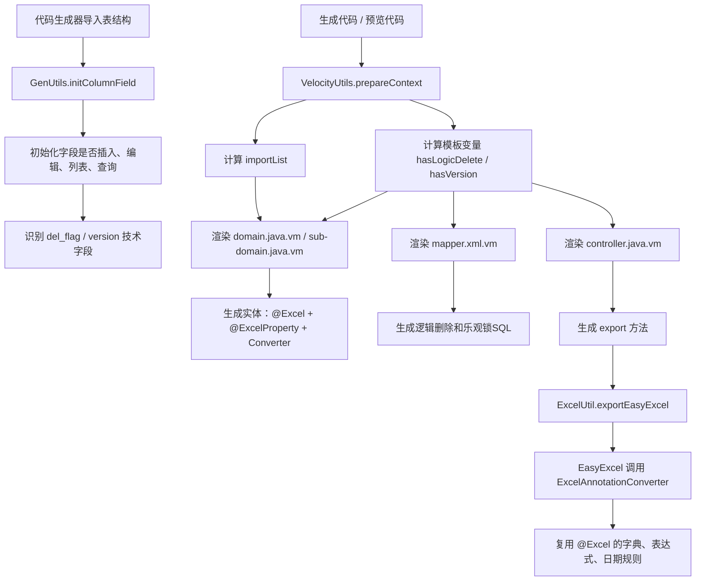
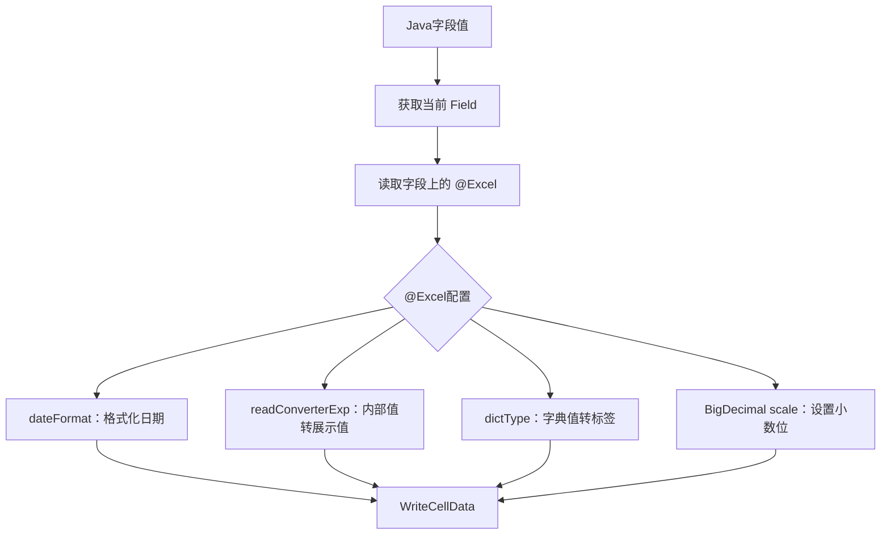
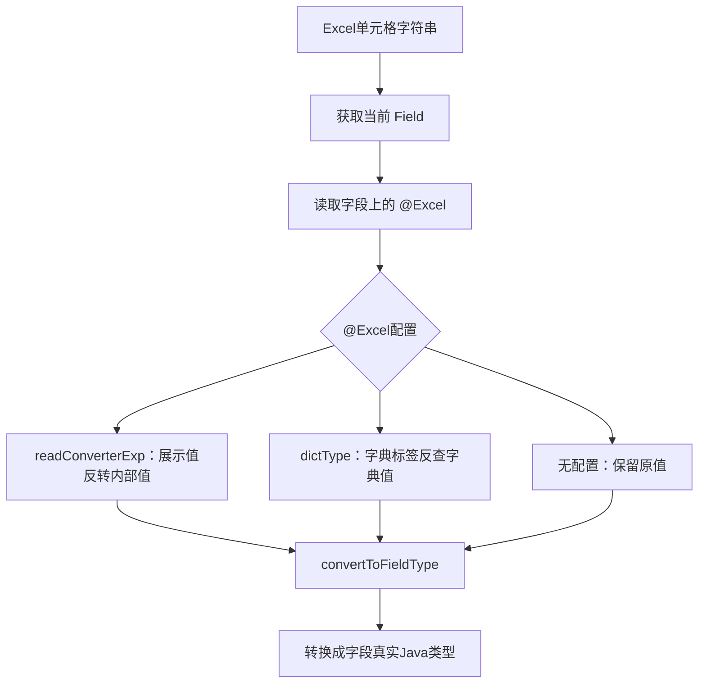
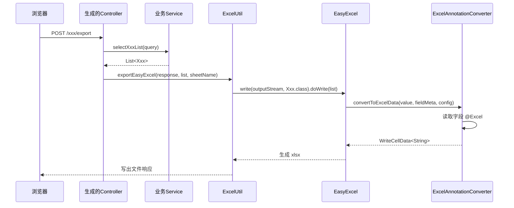
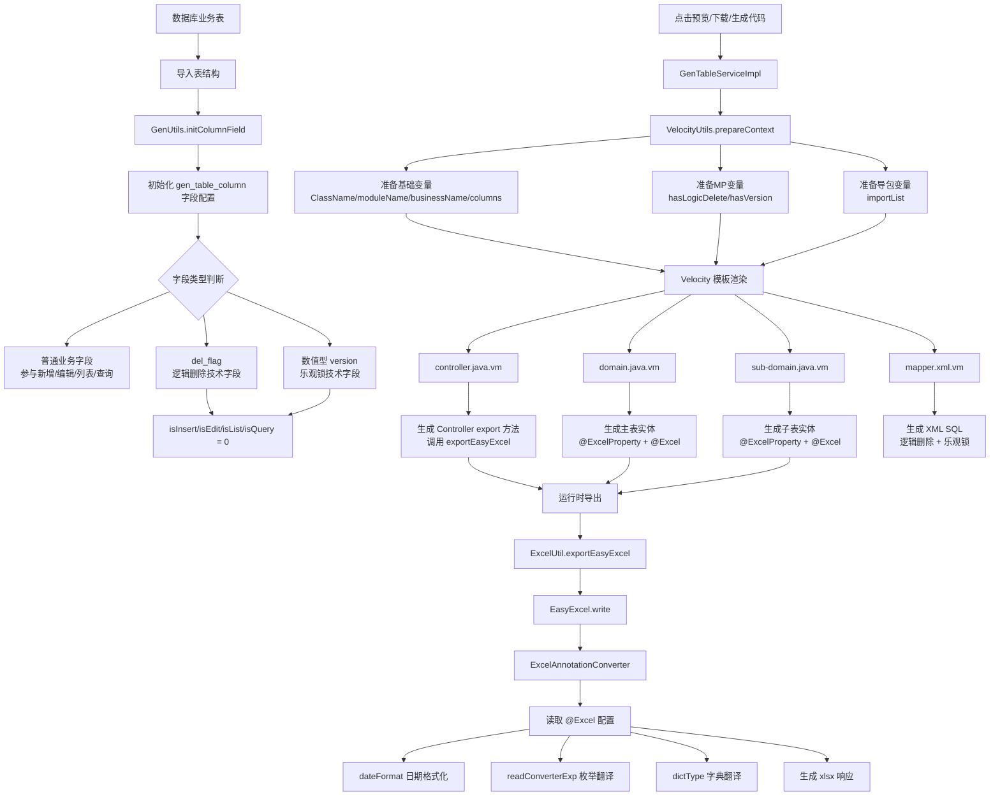

# 代码生成体系

> 本文档为功能点整合版，按来源文件合并原始内容。原始文档仍保留在 `doc` 目录，便于按历史记录溯源。

## 整合说明

整合代码生成器相关文档，包括 MyBatis-Plus 模板、DTO 校验、DTO/VO 与文件生命周期生成、前端上传模板、EasyExcel 生成和完整代码阅读说明。

## 来源索引

- `doc/DTO参数校验生成说明.md`
- `doc/MyBatis-Plus代码生成模板改造说明.md`
- `doc/前端文件上传组件与代码生成器适配说明.md`
- `doc/后端DTO-VO与文件生命周期代码生成说明.md`
- `doc/f09a6942-easyexcel-codegen-guide.md`
- `doc/f09a6942-full-code-reading-guide.md`

---

## 原文：doc/DTO参数校验生成说明.md

# DTO参数校验生成说明

## 改造目标

代码生成器在生成新增、编辑接口时，自动为 DTO 生成基础参数校验，减少每个业务模块重复手写 `@NotBlank`、`@NotNull` 和 `@Validated` 的成本。

## 生成规则

1. `SaveDto` 根据代码生成页面的“必填”配置生成校验注解。
2. `EditDto` 默认对主键字段生成 `@NotNull`，保证编辑接口必须带上业务主键。
3. `EditDto` 中勾选“必填”的编辑字段，也会生成对应校验注解。
4. `QueryDto` 默认不生成必填校验，避免列表查询条件被强约束。
5. 字符串字段使用 `@NotBlank(message = "xxx不能为空")`。
6. 非字符串字段使用 `@NotNull(message = "xxx不能为空")`。
7. Controller 的新增、编辑接口会生成 `@Validated @RequestBody`，由全局异常处理统一返回校验失败信息。

示例：

```java
@PostMapping
public Response<Void> add(@Validated @RequestBody DemoSaveDto demo)
{
    return Response.toResponse(demoService.insertDemo(demo));
}

@PutMapping
public Response<Void> edit(@Validated @RequestBody DemoEditDto demo)
{
    return Response.toResponse(demoService.updateDemo(demo));
}
```

生成后的 DTO 示例：

```java
public class DemoSaveDto extends BaseEntity
{
    @NotBlank(message = "名称不能为空")
    private String name;

    @NotNull(message = "排序不能为空")
    private Long sort;
}
```

```java
public class DemoEditDto extends BaseEntity
{
    @NotNull(message = "主键不能为空")
    private Long id;

    @NotBlank(message = "名称不能为空")
    private String name;
}
```

## 使用建议

DTO 校验只放通用、稳定、和接口入参强相关的规则，例如必填、长度、数字范围、格式等。

跨字段校验、状态流转校验、唯一性校验、权限相关校验、文件归属校验，建议继续放在 Service 层或领域服务里处理。这样 DTO 保持轻量，业务规则也不会被前端表单结构绑死。

当前编辑接口仍按若依常见的整表单提交方式生成，所以 `EditDto` 会按编辑表单的必填配置生成校验。如果某个业务以后需要真正的 PATCH 局部更新，可以单独新增 Patch DTO，避免和普通编辑接口混用。

---

## 原文：doc/MyBatis-Plus代码生成模板改造说明.md

# MyBatis-Plus 代码生成模板改造说明

## 1. 改造目标

若依原生代码生成模板会生成普通 `Mapper`、`Service` 和 `ServiceImpl`，即使实体类已经增加了 MyBatis-Plus 的 `@TableName`、`@Version` 等注解，生成后的业务层仍不能直接使用 MyBatis-Plus 的通用 CRUD 能力。

本次改造目标：

- `Mapper` 继承 `BaseMapper<T>`
- `Service` 继承 `IService<T>`
- `ServiceImpl` 继承 `ServiceImpl<Mapper, T>`
- 保留若依原有 XML 自定义方法
- 实体类生成 `@TableName("数据库原始表名")`
- `@TableName` 不参与代码生成去前缀逻辑，避免生成器类名规则影响 MP 运行时映射

## 2. 生成链路

```mermaid
flowchart TD
    A["导入业务表"] --> B["GenUtils 初始化字段信息"]
    B --> C["VelocityUtils 准备模板变量"]
    C --> D["mapper.java.vm"]
    C --> E["service.java.vm"]
    C --> F["serviceImpl.java.vm"]
    C --> G["domain.java.vm / sub-domain.java.vm"]
    D --> H["XxxMapper extends BaseMapper<Xxx>"]
    E --> I["IXxxService extends IService<Xxx>"]
    F --> J["XxxServiceImpl extends ServiceImpl<XxxMapper, Xxx>"]
    G --> K["@TableName(\"数据库原始表名\")"]
    K --> L["MP 通用方法直接使用真实物理表名"]
```

## 3. Mapper 模板

文件：

```text
ruoyi-generator/src/main/resources/vm/java/mapper.java.vm
```

生成结果：

```java
public interface NodeMapper extends BaseMapper<Node>
```

说明：

- `BaseMapper<Node>` 提供 MP 通用 CRUD 方法
- 若依原有 `selectNodeList`、`insertNode` 等 XML 方法继续保留
- Controller 和 Service 原有调用链不需要被迫改成 MP 写法

## 4. Service 模板

文件：

```text
ruoyi-generator/src/main/resources/vm/java/service.java.vm
```

生成结果：

```java
public interface INodeService extends IService<Node>
```

说明：

- `IService<Node>` 提供 MP 通用 Service 方法
- 若依生成的业务方法继续保留，兼容现有 Controller 调用方式

## 5. ServiceImpl 模板

文件：

```text
ruoyi-generator/src/main/resources/vm/java/serviceImpl.java.vm
```

生成结果：

```java
public class NodeServiceImpl extends ServiceImpl<NodeMapper, Node> implements INodeService
```

说明：

- `ServiceImpl<NodeMapper, Node>` 让实现类接入 MP 通用 Service 能力
- 原有 `nodeMapper.selectNodeList(node)` 这类 XML 方法继续可用

## 6. 实体表名注解

文件：

```text
ruoyi-generator/src/main/resources/vm/java/domain.java.vm
ruoyi-generator/src/main/resources/vm/java/sub-domain.java.vm
```

生成结果示例：

```java
@TableName("tb_node")
public class Node extends BaseEntity
```

如果真实表名是：

```text
tb_node
```

实体注解也直接写：

```text
tb_node
```

说明：

- 代码生成器去前缀只用于类名、业务名等代码命名
- `@TableName` 使用数据库原始表名
- XML 自定义 SQL 与 MP 通用方法都指向同一张真实表

## 7. VelocityUtils 模板变量

文件：

```text
ruoyi-generator/src/main/java/com/ruoyi/generator/util/VelocityUtils.java
```

当前模板变量在若依原有实体、Mapper、Service、Controller、XML 和前端模板生成链路基础上，额外提供 `dtoImportList` 和 `voImportList`：

- `dto.java.vm` 生成 `domain` 同级 `dto` 包下的 `${ClassName}Dto`
- `vo.java.vm` 生成 `domain` 同级 `vo` 包下的 `${ClassName}Vo`
- DTO/VO 继承 `BaseEntity`，类上生成 `@Schema`、`@Data`、`@EqualsAndHashCode(callSuper = false)`
- DTO/VO 只保留接口对象需要的日期和数值导入，不生成 `@TableName`、`@Version` 等实体持久化注解
- `common.ts.vm` 不参与生成，前端 TypeScript 仍按现有 `api.ts.vm`、`type.ts.vm`、`index.ts.vm` 链路生成

## 8. 注意事项

- `@TableName` 应使用数据库原始表名，例如 `tb_node`
- 代码生成器表前缀配置只影响 Java 类名，不影响 `@TableName`
- XML 自定义 SQL 仍然直接使用真实表名，与 `@TableName` 保持一致
- 已经生成过的业务代码不会自动变化，需要重新生成或手动同步 Mapper、Service、ServiceImpl 和实体注解

---

## 原文：doc/前端文件上传组件与代码生成器适配说明.md

# 前端文件上传组件与代码生成器适配说明

## 一、改造目标

前端继续使用若依原有的 `ImageUpload`、`FileUpload` 作为上传入口，不再新增业务上传组件，避免新旧页面之间出现两套上传写法。

旧页面不传 `value-type` 时，仍按若依原逻辑保存 URL；新生成业务页面显式传入 `value-type="fileId"` 后，表单字段保存文件资产 ID，并使用业务详情接口返回的授权文件列表完成回显。

## 二、上传组件约定

`ImageUpload` 和 `FileUpload` 均保留原有属性，同时增强以下属性：

| 属性 | 默认值 | 说明 |
| --- | --- | --- |
| `value-type` | `url` | `url` 保持若依原逻辑，`fileId` 表示 `v-model` 保存文件资产 ID。 |
| `storage-file-list` | `[]` | 业务详情接口返回的授权文件列表，用于文件名、预览地址、下载地址回显。 |
| `upload-scene` | `undefined` | 上传场景，传入时透传给后端 `/common/upload`，不传则使用后端默认策略。 |
| `platform` | `undefined` | 指定存储平台，不传时使用后端默认平台。 |

旧业务继续这样写：

```vue
<image-upload v-model="form.avatar" />
<file-upload v-model="form.attachment" />
```

新业务保存文件资产 ID 时这样写：

```vue
<image-upload
  v-model="form.file1"
  value-type="fileId"
  :storage-file-list="form.file1List"
/>

<file-upload
  v-model="form.file2"
  value-type="fileId"
  :storage-file-list="form.file2List"
/>
```

## 三、列表展示组件

列表页不再直接写 `getStorageImagePreviewUrl(...)`、`getStorageFileNames(...)`，统一使用只读展示组件：

```vue
<storage-image-preview
  :value="scope.row.file1"
  :file-list="scope.row.file1List"
  :width="50"
  :height="50"
/>

<storage-file-names
  :value="scope.row.file2"
  :file-list="scope.row.file2List"
/>
```

图片展示优先取 `fileList` 中的 `thPreviewUrl`、`previewUrl`、`thUrl`、`url`，取不到时回退到字段原值。文件展示优先使用 `originalFilename`，避免列表直接显示业务表保存的 fileId。

## 四、代码生成器规则

前端 Vue3 和 Vue3 TypeScript 模板已同步：

```text
ruoyi-generator/src/main/resources/vm/vue/v3/index.vue.vm
ruoyi-generator/src/main/resources/vm/vue/v3/index-tree.vue.vm
ruoyi-generator/src/main/resources/vm/vue/v3ts/index.vue.vm
ruoyi-generator/src/main/resources/vm/vue/v3ts/index-tree.vue.vm
```

生成规则：

1. 字段控件类型为 `imageUpload` / `fileUpload`，且勾选“插入”时，新增表单生成原始上传组件，并显式传入 `value-type="fileId"` 与 `字段名List`。
2. 字段控件类型为 `imageUpload` / `fileUpload`，且勾选“列表”时，列表列生成统一只读展示组件。
3. 生成的 VO 需要包含 `字段名List`，用于承载业务接口返回的授权文件列表。
4. 页面不再生成文件回显工具函数调用，文件展示逻辑收敛在公共组件内。

## 五、后端数据约定

业务表字段只保存文件 ID：

```text
file1 = "70,73,75"
```

业务详情或列表接口在 VO 中返回对应授权文件列表：

```json
{
  "file1": "70,73,75",
  "file1List": [
    {
      "fileId": 70,
      "originalFilename": "合同.pdf",
      "previewUrl": "/common/file/preview/70?token=xxx",
      "downloadUrl": "/common/file/download/70?token=xxx"
    }
  ]
}
```

组件只消费业务接口返回的数据，不主动绕过业务接口查询文件信息。这样私有文件的授权入口仍统一放在业务接口中。

## 六、上传后立即回显

文件上传成功后，组件会先使用上传接口返回的文件信息在本地构建回显列表，因此即使业务详情接口还没有重新返回最新的 `字段名List`，页面也能立即显示图片预览或附件原文件名。

再次打开编辑页时，回显仍以业务详情接口返回的 `字段名List` 为准。

---

## 原文：doc/后端DTO-VO与文件生命周期代码生成说明.md

# 后端 DTO、VO 与文件生命周期代码生成说明

## 一、改造目标

后端代码生成器从“实体直进直出”调整为更清晰的接口对象分层：

```text
XxxSaveDto
XxxEditDto
XxxQueryDto
XxxVo
```

并根据代码生成页面中的字段配置，自动生成文件资产生命周期处理代码。

## 二、DTO/VO 字段生成规则

字段来源按代码生成页面的勾选项决定：

| 生成对象 | 字段来源 |
| --- | --- |
| `XxxVo` | “列表”勾选为 true 的字段，另强制包含主键 |
| `XxxSaveDto` | “插入”勾选为 true 的字段；自增主键不生成，非自增主键可生成 |
| `XxxEditDto` | “编辑”勾选为 true 的字段，另强制包含主键 |
| `XxxQueryDto` | “查询”勾选为 true 的字段 |

分页参数仍沿用若依原有 `pageNum/pageSize/orderByColumn/isAsc/reasonable`，通过 `BaseEntity` 和 `startPage()` 处理。

## 三、VO 文件回显字段规则

如果字段同时满足：

```text
列表 = true
显示类型 = imageUpload 或 fileUpload
```

则 `XxxVo` 会额外生成文件回显列表：

```java
private List<StorageFileUploadRespDTO> file1List;
```

字段名按原字段追加 `List`，例如：

```text
file1 -> file1List
contractFile -> contractFileList
```

这个字段用于前端 Storage 上传组件的 `storage-file-list` 回显。

## 四、文件生命周期自动生成规则

当字段显示类型选择为：

```text
imageUpload
fileUpload
```

代码生成器默认把该字段纳入文件资产生命周期管理。生成的 Service 实现会自动声明：

```java
private static final List<BusinessStorageFileField<Xxx>> STORAGE_FILE_FIELDS = Arrays.asList(
    BusinessStorageFileField.of("system:demo:file1", Xxx::getFile1, null)
);
```

如果该字段还满足“列表=true”，则同时生成 VO 回显映射：

```java
private static final List<BusinessStorageFileField<XxxVo>> VO_STORAGE_FILE_FIELDS = Arrays.asList(
    BusinessStorageFileField.of("system:demo:file1", XxxVo::getFile1, XxxVo::setFile1List)
);
```

生成的 `bizType` 约定为：

```text
模块名:业务名:字段名
```

例如：

```text
system:node:file1
```

## 五、生成代码处理的生命周期场景

| 场景 | 生成逻辑 |
| --- | --- |
| 查询列表 | 填充 VO 的 `xxxList` |
| 查询详情 | 填充 VO 的 `xxxList` |
| 新增成功后 | 绑定表单提交的 fileId/fileIds 到当前业务 ID |
| 修改成功后 | 对比新旧 fileId/fileIds，同步绑定关系，移除的文件标记待删除 |
| 删除成功后 | 按业务 ID 和文件业务类型标记待删除 |

## 六、Controller 和 Service 生成规则

Controller 生成规则：

| 接口 | 入参 | 返回 |
| --- | --- | --- |
| 分页列表 | `XxxQueryDto` | `TableDataInfo`，rows 为 `XxxVo` |
| 树列表 | `XxxQueryDto` | `Response<List<XxxVo>>` |
| 详情 | 主键 | `Response<XxxVo>` |
| 新增 | `XxxSaveDto` | `Response<Void>` |
| 修改 | `XxxEditDto` | `Response<Void>` |
| 删除 | 主键数组 | `Response<Void>` |
| 导出 | `XxxQueryDto` | 实体列表导出 |

Service 生成规则：

1. 查询列表和详情时，实体转换为 VO。
2. 新增 DTO、编辑 DTO、查询 DTO 分别转换为实体。
3. 导出继续使用实体，保留实体上的 Excel 注解语义。
4. 有文件字段时，新增、修改、删除方法自动加事务。

## 七、相关模板文件

```text
ruoyi-generator/src/main/resources/vm/java/saveDto.java.vm
ruoyi-generator/src/main/resources/vm/java/editDto.java.vm
ruoyi-generator/src/main/resources/vm/java/queryDto.java.vm
ruoyi-generator/src/main/resources/vm/java/vo.java.vm
ruoyi-generator/src/main/resources/vm/java/controller.java.vm
ruoyi-generator/src/main/resources/vm/java/service.java.vm
ruoyi-generator/src/main/resources/vm/java/serviceImpl.java.vm
ruoyi-generator/src/main/java/com/ruoyi/generator/util/VelocityUtils.java
```

旧的单一 `dto.java.vm` 已删除，避免后续生成对象职责混淆。

---

## 原文：doc/f09a6942-easyexcel-codegen-guide.md

# f09a6942：集成 EasyExcel 并改造代码生成模板

## 1. 提交概览

提交号：

```text
f09a6942fd7a9f388cfd8a655a47e893deb8256f
```

提交说明：

```text
集成easyExcel，改造代码生成模板
```

本次提交涉及 7 个文件：

```text
ruoyi-common/src/main/java/com/ruoyi/common/utils/poi/ExcelAnnotationConverter.java
ruoyi-generator/src/main/java/com/ruoyi/generator/util/GenUtils.java
ruoyi-generator/src/main/java/com/ruoyi/generator/util/VelocityUtils.java
ruoyi-generator/src/main/resources/vm/java/controller.java.vm
ruoyi-generator/src/main/resources/vm/java/domain.java.vm
ruoyi-generator/src/main/resources/vm/java/sub-domain.java.vm
ruoyi-generator/src/main/resources/vm/xml/mapper.xml.vm
```

整体目标是：让代码生成器生成出来的后端代码默认支持 EasyExcel 导出，同时继续复用若依原有 `@Excel` 注解能力，并补齐逻辑删除 `del_flag`、乐观锁 `version` 在模板层面的处理。

## 2. 改造前的问题

若依原有代码生成模板默认使用 POI 体系：

```java
ExcelUtil<Xxx> util = new ExcelUtil<Xxx>(Xxx.class);
util.exportExcel(response, list, "xxx数据");
```

实体字段主要依赖若依自定义注解：

```java
@Excel(name = "状态", readConverterExp = "0=正常,1=停用")
private String status;
```

集成 EasyExcel 后，如果只在实体字段上加：

```java
@ExcelProperty("状态")
```

EasyExcel 并不会自动理解若依的这些配置：

- `readConverterExp`
- `dictType`
- `dateFormat`
- `scale`
- `roundingMode`

因此会出现两个典型问题：

- 字典字段导出的是内部值，不是中文标签。
- 日期字段、枚举字段无法复用若依原有 POI 导出规则。

本次提交的核心思路是：新增一个 EasyExcel 通用转换器，让它读取字段上的若依 `@Excel` 注解，把原有转换规则桥接给 EasyExcel。

## 3. 总体链路



## 4. ExcelAnnotationConverter

文件：

```text
ruoyi-common/src/main/java/com/ruoyi/common/utils/poi/ExcelAnnotationConverter.java
```

这是本次提交新增的核心类。

类定义：

```java
public class ExcelAnnotationConverter implements Converter<Object>
```

它实现 EasyExcel 的 `Converter<Object>`，用于处理 EasyExcel 导入和导出时的字段值转换。

### 4.1 supportJavaTypeKey

```java
public Class<?> supportJavaTypeKey()
{
    return Object.class;
}
```

作用：声明该转换器支持的 Java 类型。

这里返回 `Object.class`，表示它是一个通用转换器。模板可以把它挂到 String、Integer、Long、Date、LocalDate、LocalDateTime、BigDecimal 等多种字段上。

这样做的好处是减少重复 Converter 类。

### 4.2 supportExcelTypeKey

```java
public CellDataTypeEnum supportExcelTypeKey()
{
    return CellDataTypeEnum.STRING;
}
```

作用：声明转换后的 Excel 单元格类型。

本转换器会把字典标签、枚举文本、日期格式化结果统一写成字符串，因此这里返回 `STRING`。

### 4.3 convertToExcelData

```java
public WriteCellData<String> convertToExcelData(
        Object value,
        ExcelContentProperty contentProperty,
        GlobalConfiguration globalConfiguration)
```

这是导出方向的方法。

执行过程：



例如：

```java
@Excel(name = "状态", readConverterExp = "0=正常,1=停用")
private String status;
```

导出时：

```text
0 -> 正常
1 -> 停用
```

字典字段：

```java
@Excel(name = "性别", dictType = "sys_user_sex")
private String sex;
```

导出时会通过 `DictUtils.getDictLabel` 把字典值转成字典标签。

日期字段：

```java
@Excel(name = "创建时间", dateFormat = "yyyy-MM-dd HH:mm:ss")
private LocalDateTime createTime;
```

导出时会格式化成指定字符串。

### 4.4 convertToJavaData

```java
public Object convertToJavaData(
        ReadCellData<?> cellData,
        ExcelContentProperty contentProperty,
        GlobalConfiguration globalConfiguration)
```

这是导入方向的方法。

执行过程：



例如 Excel 中填写：

```text
正常
```

实体字段配置：

```java
@Excel(readConverterExp = "0=正常,1=停用")
private String status;
```

导入后会得到：

```text
0
```

### 4.5 convertToFieldType

```java
private Object convertToFieldType(String value, Field field)
```

作用：把字符串转换成实体字段真实类型。

支持类型：

```text
String
Integer / int
Long / long
Double / double
Float / float
BigDecimal
Date
Boolean / boolean
LocalDateTime
LocalDate
```

这个方法保证 EasyExcel 导入后，不会把所有字段都停留在字符串状态。

### 4.6 parseDateToStr

```java
private String parseDateToStr(String dateFormat, Object value)
```

作用：按 `@Excel(dateFormat)` 格式化日期字段。

支持：

```text
Date
LocalDateTime
LocalDate
```

这和代码生成器支持 `LocalDate`、`LocalDateTime` 的方向配套。

## 5. GenUtils 改动

文件：

```text
ruoyi-generator/src/main/java/com/ruoyi/generator/util/GenUtils.java
```

本次提交主要调整了 `initColumnField` 中对技术字段的处理。

### 5.1 del_flag

新增逻辑：

```java
if (StringUtils.equalsIgnoreCase(columnName, "del_flag"))
{
    column.setIsInsert("0");
    column.setIsEdit("0");
    column.setIsList("0");
    column.setIsQuery("0");
}
```

作用：导入表结构时，如果发现字段是 `del_flag`，就不让它参与前端新增、编辑、列表、查询。

原因：`del_flag` 是逻辑删除技术字段，应该由后端统一维护。

典型规则：

```text
新增：del_flag = 0
删除：del_flag = 2
查询：只查 del_flag = 0
```

### 5.2 version

新增逻辑：

```java
if (StringUtils.equalsIgnoreCase(columnName, "version")
        && arraysContains(GenConstants.COLUMNTYPE_NUMBER, dataType))
{
    column.setIsInsert("0");
    column.setIsEdit("0");
    column.setIsList("0");
    column.setIsQuery("0");
}
```

作用：只有字段名为 `version`，并且数据库类型属于数值类型时，才把它当作乐观锁字段处理。

这样可以避免非数值型同名字段被错误生成：

```sql
version = version + 1
```

`version` 作为乐观锁字段时，也不应该由前端用户手动维护。

## 6. VelocityUtils 改动

文件：

```text
ruoyi-generator/src/main/java/com/ruoyi/generator/util/VelocityUtils.java
```

`VelocityUtils` 是模板变量装配中心。本次提交主要增强了 MyBatis-Plus 相关模板变量。

### 6.1 setMybatisPlusVelocityContext

该方法会查找当前表中是否存在：

```text
del_flag
version
```

并向 Velocity 模板上下文放入变量：

```text
logicDeleteColumn
versionColumn
hasLogicDelete
hasVersion
```

主表使用：

```text
logicDeleteColumn
versionColumn
hasLogicDelete
hasVersion
```

子表使用 prefix 生成：

```text
subLogicDeleteColumn
subVersionColumn
subhasLogicDelete
subhasVersion
```

这些变量会被 `domain.java.vm`、`sub-domain.java.vm`、`mapper.xml.vm` 使用。

### 6.2 isNumberVersionColumn

新增方法：

```java
private static boolean isNumberVersionColumn(GenTableColumn column)
{
    return StringUtils.equalsAny(column.getJavaType(), GenConstants.TYPE_INTEGER, GenConstants.TYPE_LONG);
}
```

作用：判断 `version` 字段是否适合作为数值型乐观锁字段。

只有 `Integer` 或 `Long` 才启用：

- `@Version`
- XML 中的 `version = version + 1`
- XML 中的旧版本号 where 条件

### 6.3 getImportList

本次提交让 import 列表更精确：

- 存在 `del_flag` 时，导入 `TableName`
- 存在数值型 `version` 时，导入 `Version` 和 `TableName`
- 存在 `LocalDate` / `LocalDateTime` 时，导入 `DateTimeFormat` 和 `JsonFormat`
- 存在 `BigDecimal` 时，导入 `java.math.BigDecimal`

这样生成实体时不会出现缺失 import 或无意义 import。

## 7. controller.java.vm 改动

文件：

```text
ruoyi-generator/src/main/resources/vm/java/controller.java.vm
```

改动前：

```java
util.exportExcel(response, list, "${functionName}数据");
```

改动后：

```java
// 代码生成默认使用EasyExcel导出，实体上的@ExcelProperty负责声明表头和转换器。
// 若需要使用若依原POI导出能力，可切换为util.exportExcel(response, list, "${functionName}数据")。
util.exportEasyExcel(response, list, "${functionName}数据");
```

作用：新生成的 Controller 默认使用 EasyExcel 导出。

这要求 `ExcelUtil` 中已经存在：

```java
exportEasyExcel(...)
```

也要求生成实体中带有 EasyExcel 注解：

```java
@ExcelProperty
```

## 8. domain.java.vm 改动

文件：

```text
ruoyi-generator/src/main/resources/vm/java/domain.java.vm
```

这是主表实体模板。

### 8.1 EasyExcel 注解

新增导入：

```java
import com.alibaba.excel.annotation.ExcelIgnoreUnannotated;
import com.alibaba.excel.annotation.ExcelProperty;
import com.ruoyi.common.utils.poi.ExcelAnnotationConverter;
```

新增类注解：

```java
@ExcelIgnoreUnannotated
```

作用：EasyExcel 只导出显式标注 `@ExcelProperty` 的字段，避免 `BaseEntity` 中的公共字段被默认导出。

### 8.2 Lombok 注解组合

模板生成：

```java
@Data
@NoArgsConstructor
@AllArgsConstructor
@Builder
@EqualsAndHashCode(callSuper = false)
```

作用：

- `@Data`：生成 getter、setter、toString、equals、hashCode。
- `@NoArgsConstructor`：保留 MyBatis JavaBean 映射需要的无参构造。
- `@AllArgsConstructor`：提供全参构造，配合 Builder 使用。
- `@Builder`：便于业务代码构造对象。
- `@EqualsAndHashCode(callSuper = false)`：明确不把 `BaseEntity` 字段纳入 equals/hashCode，消除 Lombok 继承警告。

### 8.3 字段级 EasyExcel 支持

普通字段：

```java
@ExcelProperty(value = "名称")
@Excel(name = "名称")
private String name;
```

日期字段：

```java
@JsonFormat(pattern = "yyyy-MM-dd")
@ExcelProperty(value = "日期", converter = ExcelAnnotationConverter.class)
@Excel(name = "日期", width = 30, dateFormat = "yyyy-MM-dd")
private LocalDate testDate;
```

日期时间字段：

```java
@JsonFormat(pattern = "yyyy-MM-dd HH:mm:ss")
@ExcelProperty(value = "日期时间", converter = ExcelAnnotationConverter.class)
@Excel(name = "日期时间", width = 30, dateFormat = "yyyy-MM-dd HH:mm:ss")
private LocalDateTime testDateTime;
```

枚举表达式字段：

```java
@ExcelProperty(value = "状态", converter = ExcelAnnotationConverter.class)
@Excel(name = "状态", readConverterExp = "0=正常,1=停用")
private String status;
```

字典字段：

```java
@ExcelProperty(value = "类型", converter = ExcelAnnotationConverter.class)
@Excel(name = "类型", dictType = "xxx_type")
private String type;
```

这些字段都保留若依 `@Excel`，同时新增 EasyExcel `@ExcelProperty`。

## 9. sub-domain.java.vm 改动

文件：

```text
ruoyi-generator/src/main/resources/vm/java/sub-domain.java.vm
```

这是主子表模式下的子表实体模板。

本次提交将它同步改造成与主表实体类似的 Lombok + EasyExcel 风格。

移除：

```java
ToStringBuilder
ToStringStyle
手写 getter
手写 setter
手写 toString
```

新增：

```java
@Data
@NoArgsConstructor
@AllArgsConstructor
@Builder
@EqualsAndHashCode(callSuper = false)
@ExcelIgnoreUnannotated
```

意义：主表实体和子表实体生成风格保持一致。

## 10. mapper.xml.vm 改动

文件：

```text
ruoyi-generator/src/main/resources/vm/xml/mapper.xml.vm
```

该模板负责生成 Mapper XML。

### 10.1 查询过滤逻辑删除

如果存在 `del_flag`：

```xml
and ${logicDeleteColumn.columnName} = '0'
```

生成后类似：

```sql
and del_flag = '0'
```

作用：列表查询和详情查询默认只查未删除数据。

### 10.2 新增初始化 del_flag

如果存在 `del_flag`，insert 时固定写入：

```sql
del_flag = '0'
```

作用：新增数据默认未删除。

### 10.3 删除改为逻辑删除

如果存在 `del_flag`，删除 SQL 从物理删除：

```sql
delete from xxx where id = #{id}
```

变为逻辑删除：

```sql
update xxx set del_flag = '2'
where id = #{id}
  and del_flag = '0'
```

批量删除同理。

### 10.4 version 乐观锁

如果存在数值型 `version`，insert 时默认写入：

```sql
version = 0
```

update 时生成：

```sql
version = version + 1
```

并增加旧版本条件：

```sql
and version = #{version}
```

作用：防止并发更新覆盖。

典型流程：

```text
1. 用户A查询到 version = 0
2. 用户B也查询到 version = 0
3. 用户A更新成功，数据库 version 改成 1
4. 用户B再提交 version = 0
5. where version = 0 不匹配，更新失败
```

## 11. 生成后的导出执行链路



## 12. 这次改造的设计取舍

### 12.1 为什么保留 @Excel

因为若依已有大量能力围绕 `@Excel` 构建：

- 字典转换
- 枚举表达式转换
- 日期格式化
- BigDecimal 精度
- POI 导入导出

如果完全切换成 EasyExcel 注解体系，迁移成本会比较高。

因此本次采用“双注解”策略：

```java
@ExcelProperty(...)
@Excel(...)
```

`@ExcelProperty` 给 EasyExcel 使用。

`@Excel` 保留若依原能力，并被 `ExcelAnnotationConverter` 读取。

### 12.2 为什么增加通用转换器

不用通用转换器的话，每个字典字段都可能需要生成一个 Converter。

通用转换器把规则集中起来：

```text
模板负责声明字段是否需要转换
转换器负责读取 @Excel 并执行转换
```

这样模板更干净，后续新增字段类型也更容易统一维护。

### 12.3 为什么技术字段不展示在前端

`del_flag` 和 `version` 都是系统维护字段，不是业务人员手工录入字段。

如果暴露到页面：

- 用户可能误改删除状态。
- 用户可能手动改版本号，破坏乐观锁。
- 查询条件会变复杂且容易误用。

因此在导入表结构时直接设置：

```text
is_insert = 0
is_edit = 0
is_list = 0
is_query = 0
```

## 13. 注意事项

### 13.1 EasyExcel 转换器依赖 @Excel

如果模板只生成：

```java
@ExcelProperty(value = "状态", converter = ExcelAnnotationConverter.class)
```

但没有生成：

```java
@Excel(readConverterExp = "0=正常,1=停用")
```

那么通用转换器无法读取若依转换规则。

### 13.2 LocalDateTime 导入格式仍需注意

当前转换器中：

```java
LocalDateTime.parse(value.replace(" ", "T"))
```

适合：

```text
2026-08-27 10:30:00
2026-08-27T10:30:00
```

如果 Excel 输入是：

```text
2026/08/27 10:30
```

可能需要后续增强解析逻辑。

### 13.3 XML 模板中的逻辑删除不依赖 MP 自动注入

本次 `mapper.xml.vm` 是直接生成 SQL：

```sql
and del_flag = '0'
update xxx set del_flag = '2'
```

这和 MyBatis-Plus 的全局逻辑删除配置不是同一套执行路径。

因为若依生成的 XML SQL 是手写 SQL，不能完全依赖 MP 自动拼接逻辑删除条件。

### 13.4 version 只适合数值字段

模板中的乐观锁逻辑是：

```sql
version = version + 1
```

所以只有 `Integer`、`Long` 这类数值字段适合启用。

## 14. 学习重点

这次提交可以理解为三个层面的改造：

```text
运行时能力：ExcelAnnotationConverter 让 EasyExcel 复用 @Excel
生成器逻辑：GenUtils / VelocityUtils 决定字段和模板变量
模板输出：controller / domain / sub-domain / mapper.xml 生成最终代码
```

其中最关键的是职责分离：

- `GenUtils`：导入表时初始化字段元数据。
- `VelocityUtils`：生成代码时准备模板变量和 import。
- `domain.java.vm`：生成主表实体。
- `sub-domain.java.vm`：生成子表实体。
- `controller.java.vm`：生成导出接口。
- `mapper.xml.vm`：生成 SQL。
- `ExcelAnnotationConverter`：运行时执行 EasyExcel 字段转换。

这条链路打通后，新导入的业务表在生成代码时，就可以自动获得 EasyExcel 导出、字典转换、日期格式化、逻辑删除和乐观锁相关代码。

---

## 原文：doc/f09a6942-full-code-reading-guide.md

# f09a6942 全代码阅读与改动高亮说明

## 1. 阅读方式说明

提交：

```text
f09a6942fd7a9f388cfd8a655a47e893deb8256f
```

提交说明：

```text
集成easyExcel，改造代码生成模板
```

本提交涉及 7 个代码文件：

```text
ruoyi-common/src/main/java/com/ruoyi/common/utils/poi/ExcelAnnotationConverter.java
ruoyi-generator/src/main/java/com/ruoyi/generator/util/GenUtils.java
ruoyi-generator/src/main/java/com/ruoyi/generator/util/VelocityUtils.java
ruoyi-generator/src/main/resources/vm/java/controller.java.vm
ruoyi-generator/src/main/resources/vm/java/domain.java.vm
ruoyi-generator/src/main/resources/vm/java/sub-domain.java.vm
ruoyi-generator/src/main/resources/vm/xml/mapper.xml.vm
```

Markdown 的普通代码块无法给某几行单独设置背景色，因此本文采用更适合代码评审和教学的方式：

1. 先给出每个文件在该提交中的完整代码查看命令。
2. 再用 `diff` 代码块展示改动内容，`+` 表示新增，`-` 表示删除，相当于改动高亮。
3. 最后解释每个文件的改造意图和关键代码作用。

查看某个文件在本提交中的完整代码：

```bash
git show f09a6942:文件路径
```

例如：

```bash
git show f09a6942:ruoyi-generator/src/main/resources/vm/java/domain.java.vm
```

## 2. 总体链路流程图

本次提交虽然改的是多个文件，但整体链路可以分成三段：

```text
导入表结构阶段 -> 生成代码阶段 -> 运行时导出阶段
```



从这个图可以看到：

- `GenUtils` 影响的是导入表时保存到 `gen_table_column` 的字段元数据。
- `VelocityUtils` 影响的是模板渲染时能拿到哪些变量和 import。
- `*.vm` 模板决定最终生成的 Java/XML 源码长什么样。
- `ExcelAnnotationConverter` 是运行时能力，只有生成代码执行 EasyExcel 导出/导入时才会被调用。

## 3. ExcelAnnotationConverter.java

完整代码查看：

```bash
git show f09a6942:ruoyi-common/src/main/java/com/ruoyi/common/utils/poi/ExcelAnnotationConverter.java
```

该文件是本提交新增文件，因此整份文件都是新增内容。

```diff
+public class ExcelAnnotationConverter implements Converter<Object>
+{
+    @Override
+    public Class<?> supportJavaTypeKey()
+    {
+        // 注解指定converter时EasyExcel会优先使用该转换器，这里声明Object以覆盖常见字段类型。
+        return Object.class;
+    }
+
+    @Override
+    public CellDataTypeEnum supportExcelTypeKey()
+    {
+        // 经过@Excel规则翻译后的值统一按字符串写入Excel。
+        return CellDataTypeEnum.STRING;
+    }
+}
```

核心作用：把 EasyExcel 的字段转换能力和若依原有 `@Excel` 注解规则接起来。

导出时主要走：

```java
convertToExcelData(...)
```

它会读取字段上的：

```text
@Excel(dateFormat)
@Excel(readConverterExp)
@Excel(dictType)
@Excel(scale)
```

然后分别完成日期格式化、枚举表达式翻译、字典值转标签、BigDecimal 精度处理。

导入时主要走：

```java
convertToJavaData(...)
```

它会把 Excel 单元格的展示值反向转成系统内部值，再通过 `convertToFieldType` 转成实体字段真实类型。

## 4. GenUtils.java

完整代码查看：

```bash
git show f09a6942:ruoyi-generator/src/main/java/com/ruoyi/generator/util/GenUtils.java
```

本文件在提交中主要改动 `initColumnField` 末尾的技术字段处理。

```diff
-        // del_flag/version属于技术字段，按字段存在性生成逻辑删除和乐观锁，不暴露给前端手动维护。
-        if (StringUtils.equalsAnyIgnoreCase(columnName, "del_flag", "version"))
+        // del_flag属于逻辑删除技术字段，不暴露给前端手动维护。
+        if (StringUtils.equalsIgnoreCase(columnName, "del_flag"))
         {
-            if (StringUtils.equalsIgnoreCase(columnName, "version"))
-            {
-                // version约定使用Integer，匹配数据库int类型并配合MP乐观锁插件递增。
-                column.setJavaType(GenConstants.TYPE_INTEGER);
-            }
             column.setIsInsert("0");
             column.setIsEdit("0");
             column.setIsList("0");
             column.setIsQuery("0");
         }
+        // 只有数值型version才按MP乐观锁字段处理；timestamp类型version保留LocalDateTime映射，避免TIMESTAMP映射到Integer。
+        if (StringUtils.equalsIgnoreCase(columnName, "version") && arraysContains(GenConstants.COLUMNTYPE_NUMBER, dataType))
+        {
+            column.setIsInsert("0");
+            column.setIsEdit("0");
+            column.setIsList("0");
+            column.setIsQuery("0");
+        }
```

改造目的：

- `del_flag` 是逻辑删除字段，不应该出现在新增、编辑、列表、查询页面。
- `version` 是乐观锁字段，也不应该由前端手动维护。
- `version` 增加数字类型判断，是为了避免非数值同名字段被错误生成 `version = version + 1`。

注意：这里没有改若依原有数字类型映射规则，数字类型仍按若依原逻辑处理。

## 5. VelocityUtils.java

完整代码查看：

```bash
git show f09a6942:ruoyi-generator/src/main/java/com/ruoyi/generator/util/VelocityUtils.java
```

本文件负责给 Velocity 模板准备变量。

### 4.1 hasVersion 判断调整

```diff
         GenTableColumn logicDeleteColumn = getColumnByColumnName(genTable, LOGIC_DELETE_COLUMN_NAME);
         GenTableColumn versionColumn = getColumnByColumnName(genTable, VERSION_COLUMN_NAME);
+        // 只有数值型version字段才启用XML里的version + 1乐观锁逻辑，避免timestamp version被映射为Integer。
+        boolean hasVersion = StringUtils.isNotNull(versionColumn) && isNumberVersionColumn(versionColumn);
         String keyPrefix = StringUtils.isEmpty(prefix) ? "" : prefix;
```

原来只要存在 `version` 字段，模板变量 `hasVersion` 就是 true。

现在改成：

```java
StringUtils.isNotNull(versionColumn) && isNumberVersionColumn(versionColumn)
```

也就是必须同时满足：

```text
存在 version 字段
version 的 Java 类型是 Integer 或 Long
```

### 4.2 新增 isNumberVersionColumn

```diff
+    /**
+     * 判断version字段是否适合按数值型乐观锁生成。
+     */
+    private static boolean isNumberVersionColumn(GenTableColumn column)
+    {
+        return StringUtils.equalsAny(column.getJavaType(), GenConstants.TYPE_INTEGER, GenConstants.TYPE_LONG);
+    }
```

作用：避免字符串、时间等非数值 `version` 字段被当作乐观锁字段。

### 4.3 importList 更精确

```diff
-        if (StringUtils.isNotNull(getColumnByColumnName(genTable, LOGIC_DELETE_COLUMN_NAME)))
+        GenTableColumn logicDeleteColumn = getColumnByColumnName(genTable, LOGIC_DELETE_COLUMN_NAME);
+        GenTableColumn versionColumn = getColumnByColumnName(genTable, VERSION_COLUMN_NAME);
+        if (StringUtils.isNotNull(logicDeleteColumn))
         {
             // 存在del_flag时只生成TableName，逻辑删除字段和值交给mybatis-plus全局配置。
             importList.add("com.baomidou.mybatisplus.annotation.TableName");
         }
-        if (StringUtils.isNotNull(getColumnByColumnName(genTable, VERSION_COLUMN_NAME)))
+        if (StringUtils.isNotNull(versionColumn) && isNumberVersionColumn(versionColumn))
         {
-            // 存在version时生成MP乐观锁注解，配合已注册的OptimisticLockerInnerInterceptor使用。
+            // 只有数值型version才生成MP乐观锁注解，避免timestamp等同名字段被当作版本号。
             importList.add("com.baomidou.mybatisplus.annotation.Version");
             importList.add("com.baomidou.mybatisplus.annotation.TableName");
         }
```

作用：只有确实需要 `@Version` 时才导入 `Version`，防止模板生成多余 import。

## 6. controller.java.vm

完整代码查看：

```bash
git show f09a6942:ruoyi-generator/src/main/resources/vm/java/controller.java.vm
```

本文件是 Controller 代码生成模板。

```diff
-        util.exportExcel(response, list, "${functionName}数据");
+        // 代码生成默认使用EasyExcel导出，实体上的@ExcelProperty负责声明表头和转换器。
+        // 若需要使用若依原POI导出能力，可切换为util.exportExcel(response, list, "${functionName}数据")。
+        util.exportEasyExcel(response, list, "${functionName}数据");
```

改造后，新生成的业务 Controller 默认使用 EasyExcel 导出。

执行链路：

```text
Controller.export
    -> service.selectXxxList
    -> new ExcelUtil<>(Xxx.class)
    -> util.exportEasyExcel(...)
    -> EasyExcel.write(...)
    -> ExcelAnnotationConverter
```

保留注释中的 POI 调用方式，是为了后续需要回退时有明确入口。

## 7. domain.java.vm

完整代码查看：

```bash
git show f09a6942:ruoyi-generator/src/main/resources/vm/java/domain.java.vm
```

本文件是主表实体代码生成模板。

### 6.1 新增 EasyExcel import

```diff
-## 导入项目自定义的Excel注解，用于生成Excel
+## 导入EasyExcel注解和若依原有Excel注解，生成实体同时兼容EasyExcel和POI两套导出方式。
+import com.alibaba.excel.annotation.ExcelIgnoreUnannotated;
+import com.alibaba.excel.annotation.ExcelProperty;
 import com.ruoyi.common.annotation.Excel;
+## 通用转换器会读取字段上的@Excel配置，避免每个字典或枚举字段都生成专用Converter类。
+import com.ruoyi.common.utils.poi.ExcelAnnotationConverter;
```

作用：

- `ExcelProperty`：让 EasyExcel 识别字段表头。
- `ExcelIgnoreUnannotated`：只导出显式标注的字段。
- `ExcelAnnotationConverter`：复用若依 `@Excel` 的转换规则。

### 6.2 Lombok 注解组合

```diff
 @Data
+@NoArgsConstructor
+@AllArgsConstructor
 @Builder
+## 明确保持Lombok默认的不比较父类字段行为，避免继承BaseEntity时产生编译警告。
+@EqualsAndHashCode(callSuper = false)
+## @NoArgsConstructor保留MyBatis JavaBean映射需要的无参构造；@Builder仅作为业务代码便捷构造方式。
+## EasyExcel只导出带@ExcelProperty的字段，避免BaseEntity中的公共字段被默认导出。
+// EasyExcel仅处理显式标注@ExcelProperty的字段，避免继承字段被误导出。
+@ExcelIgnoreUnannotated
```

作用：

- `@NoArgsConstructor`：保留 MyBatis 需要的无参构造。
- `@AllArgsConstructor`：配合 `@Builder` 使用。
- `@Builder`：方便业务代码构造对象。
- `@EqualsAndHashCode(callSuper = false)`：明确 Lombok 不比较父类字段。
- `@ExcelIgnoreUnannotated`：避免 EasyExcel 把继承字段也默认导出。

### 6.3 字段级 EasyExcel 注解

枚举表达式字段：

```diff
+    // EasyExcel通过通用转换器复用@Excel(readConverterExp)的枚举翻译规则。
+    @ExcelProperty(value = "${comment}", converter = ExcelAnnotationConverter.class)
     @Excel(name = "${comment}", readConverterExp = "$column.readConverterExp()")
```

日期字段：

```diff
     @JsonFormat(pattern = "yyyy-MM-dd")
+    // EasyExcel通过通用转换器复用@Excel(dateFormat)的日期格式。
+    @ExcelProperty(value = "${comment}", converter = ExcelAnnotationConverter.class)
     @Excel(name = "${comment}", width = 30, dateFormat = "yyyy-MM-dd")
```

日期时间字段：

```diff
     @JsonFormat(pattern = "yyyy-MM-dd HH:mm:ss")
+    // EasyExcel通过通用转换器复用@Excel(dateFormat)的日期时间格式。
+    @ExcelProperty(value = "${comment}", converter = ExcelAnnotationConverter.class)
     @Excel(name = "${comment}", width = 30, dateFormat = "yyyy-MM-dd HH:mm:ss")
```

字典字段：

```diff
+    // EasyExcel通过通用转换器复用@Excel(dictType)的字典翻译规则。
+    @ExcelProperty(value = "${comment}", converter = ExcelAnnotationConverter.class)
+    @Excel(name = "${comment}", dictType = "$column.dictType")
```

普通字段：

```diff
+    @ExcelProperty(value = "${comment}")
     @Excel(name = "${comment}")
```

## 8. sub-domain.java.vm

完整代码查看：

```bash
git show f09a6942:ruoyi-generator/src/main/resources/vm/java/sub-domain.java.vm
```

本文件是主子表模式下的子表实体模板。

### 7.1 移除手写方法相关 import

```diff
-import org.apache.commons.lang3.builder.ToStringBuilder;
-import org.apache.commons.lang3.builder.ToStringStyle;
```

原因：子表实体改用 Lombok 生成 getter、setter、toString 等方法，不再需要手写。

### 7.2 新增 Lombok 和 EasyExcel 注解

```diff
+import com.alibaba.excel.annotation.ExcelIgnoreUnannotated;
+import com.alibaba.excel.annotation.ExcelProperty;
+import com.ruoyi.common.utils.poi.ExcelAnnotationConverter;
+import lombok.AllArgsConstructor;
+import lombok.Builder;
+import lombok.Data;
+import lombok.EqualsAndHashCode;
+import lombok.NoArgsConstructor;
```

类注解：

```diff
+@Data
+@NoArgsConstructor
+@AllArgsConstructor
+@Builder
+@EqualsAndHashCode(callSuper = false)
+@ExcelIgnoreUnannotated
```

作用：让子表实体和主表实体保持一致的生成风格。

### 7.3 移除手写 getter、setter、toString

```diff
-    public void set${AttrName}($column.javaType $column.javaField) 
-    {
-        this.$column.javaField = $column.javaField;
-    }
-
-    public $column.javaType get${AttrName}() 
-    {
-        return $column.javaField;
-    }
-
-    @Override
-    public String toString() {
-        return new ToStringBuilder(this,ToStringStyle.MULTI_LINE_STYLE)
-            .append("${column.javaField}", get${AttrName}())
-            .toString();
-    }
```

移除后，这些方法由 Lombok 自动生成。

## 9. mapper.xml.vm

完整代码查看：

```bash
git show f09a6942:ruoyi-generator/src/main/resources/vm/xml/mapper.xml.vm
```

本文件负责生成 Mapper XML。

### 8.1 查询增加逻辑删除过滤说明

```diff
+            <!-- del_flag存在时按逻辑删除规则只查询未删除数据。 -->
             and ${logicDeleteColumn.columnName} = '0'
```

生成后类似：

```sql
and del_flag = '0'
```

作用：列表查询只查未删除数据。

### 8.2 详情查询过滤已删除数据

```diff
+          <!-- del_flag存在时详情查询同样过滤已删除数据。 -->
           and ${logicDeleteColumn.columnName} = '0'
```

作用：防止通过详情接口查到已经逻辑删除的数据。

### 8.3 新增时初始化 del_flag

```diff
+            <!-- 新增时初始化逻辑删除标识。 -->
             $column.columnName,
```

值部分：

```diff
+            <!-- 新增时默认写入未删除状态。 -->
             '0',
```

作用：新增数据默认是未删除状态。

### 8.4 新增时初始化 version

```diff
+            <!-- 新增时初始化数值型乐观锁版本号。 -->
             $column.columnName,
```

值部分：

```diff
+            <!-- 新增时默认从0版本开始。 -->
             0,
```

作用：新增数据默认版本号为 0。

### 8.5 更新时递增 version

```diff
+            <!-- 更新成功时版本号递增，配合where里的旧版本条件实现乐观锁。 -->
             <if test="${versionColumn.javaField} != null">${versionColumn.columnName} = ${versionColumn.columnName} + 1,</if>
```

作用：更新成功后版本号加 1。

### 8.6 更新时校验旧 version

```diff
+        <!-- 提交旧版本号时才进行乐观锁校验。 -->
         <if test="${versionColumn.javaField} != null"> and ${versionColumn.columnName} = #{${versionColumn.javaField}}</if>
```

作用：防止并发覆盖。

例如两个用户都读到 `version = 0`：

```text
用户A更新成功：version 从 0 变成 1
用户B再用 version = 0 更新：where 条件不匹配，更新失败
```

## 10. 本提交的学习主线

本次提交可以按三层理解。

第一层：运行时转换能力。

```text
ExcelAnnotationConverter
```

它让 EasyExcel 可以读取若依 `@Excel` 注解，并复用原来的表达式、字典、日期转换规则。

第二层：生成器元数据和模板变量。

```text
GenUtils
VelocityUtils
```

它们决定哪些字段是技术字段、哪些模板变量可用、哪些 import 需要生成。

第三层：最终代码模板输出。

```text
controller.java.vm
domain.java.vm
sub-domain.java.vm
mapper.xml.vm
```

它们决定新生成出来的 Controller、实体和 Mapper XML 最终长什么样。

## 11. 总结

`f09a6942` 的核心价值是把 EasyExcel 纳入代码生成体系，而不是只在某一个手写 Controller 里临时使用 EasyExcel。

改造完成后，新生成的代码具备这些能力：

- Controller 默认调用 `exportEasyExcel`
- 实体字段同时保留 `@Excel` 和新增 `@ExcelProperty`
- EasyExcel 可复用若依原有字典、枚举、日期格式化规则
- 主表和子表实体统一使用 Lombok
- `del_flag` 在 XML 中生成逻辑删除 SQL
- 数值型 `version` 在 XML 中生成乐观锁 SQL

---

